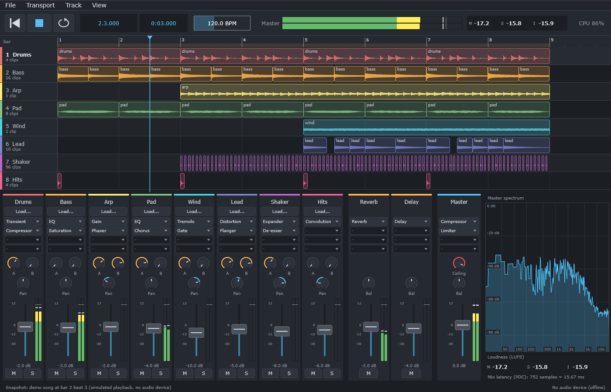

# DawLab: learn audio DSP from scratch in C++ and finish by building an 8-track DAW
**English** | [繁體中文](README.zh-TW.md)

[](https://github.com/TomHsieh300/DAW-for-fun/actions/workflows/ci.yml)

This course is for learners who "know basic C++ but have never studied DSP". It starts from "what does sound look like inside a computer?" and in each chapter builds a real, usable DSP component (or a family of them): gain, filter, EQ, compressor, limiter, saturation, distortion, gate, delay, modulation, meters, reverb... Then it uses JUCE to wrap them into VST3 plugins, writes a host that can load VST3 plugins, and finally puts everything together into an **8-track DAW, "DawLab 8"**, that can arrange clips, mix, host plugins and export WAV files.

The course is **bilingual (English / Traditional Chinese)**. English is the primary version (original file names such as `README.md`); the Traditional Chinese version sits next to it in a `.zh-TW.md` file (such as `README.zh-TW.md`). Every document has a language switcher at the top, and all code comments and program output are in English.



*The image above is not a screenshot. It was drawn by the app itself with `"DawLab 8.exe" --snapshot <file.png>` (chapter 14, Step 12), and ctest runs it on every build. The same command also saves a parameter panel (below, the compressor on the drum track): the knobs on the panel are generated automatically from each effect's parameter description.*


## What makes this course different

- **Every number is verified**: the examples and solutions of every chapter check themselves numerically with `DAWLAB_CHECK` (for example "-3.01 dB at the cutoff", "the limiter output peak is always ≤ the ceiling") and return non-zero on failure. The numbers quoted in the READMEs are what the programs actually print.
- **You can hear it**: the examples write the audio before and after processing as WAV files, so you can confirm with your ears what a formula means.
- **One DSP code base from start to finish**: the components in `dsp/` are header-only, JUCE-free C++17, shared by the offline examples, the VST3 plugins and the DAW engine.
- **Real-time thinking throughout**: no allocation on the audio thread, no locks, smoothed parameters, denormals, thread-safe meters... every chapter has a "Real-time considerations" section.

## Prerequisites

- **C++**: classes, templates, `std::vector`, lambdas, references and pointers. No JUCE knowledge is needed; chapter 13 introduces it from scratch.
- **Math**: high-school trigonometry, exponentials and logarithms. The other tools you need (complex numbers, transfer functions, the FFT, ...) are derived in the chapter that uses them.
- **No DSP or audio background is required.** A pair of headphones and software that can show waveforms and spectra (the free [Audacity](https://www.audacityteam.org/) is recommended) will help a lot.

## Setting up your environment

### Windows (primary platform)

1. Install [Visual Studio 2022](https://visualstudio.microsoft.com/): either **Build Tools** (command line only, small) or **Community** (includes the IDE, free) will do.
2. During installation, select the workload **"Desktop development with C++"**. It installs MSVC, the Windows SDK and CMake together; the scripts in this project automatically find the CMake bundled with Visual Studio, so `cmake` does not need to be on your system PATH.
3. Chapters 13 and 14 need JUCE:
   - The complete project folder already contains JUCE **9.0.4** in `third_party/JUCE`. **If you obtained the project through git, `third_party/` is not under version control** (it is listed in `.gitignore`), so you need to clone JUCE 9.0.4 into `third_party/JUCE` yourself, or skip to the next point and let CMake download it with FetchContent:
     ```powershell
     git clone --depth 1 --branch 9.0.4 https://github.com/juce-framework/JUCE.git third_party/JUCE
     ```
   - Cloning is optional: when `third_party/JUCE` does not exist, CMake automatically downloads the version given by `DAWLAB_JUCE_TAG` (default 9.0.4) from GitHub with FetchContent (this needs network access and git). You can also point to your own JUCE with `-DDAWLAB_JUCE_DIR=<path>`.
   - The VST3 SDK is included in JUCE, so no separate download is needed.

### Linux (verified on Ubuntu 24.04)

Every chapter, including the JUCE chapters 13 and 14, builds and passes all its tests on **Ubuntu 24.04 LTS with GCC 13.3 and CMake 3.28** (149 tests for chapters 00–12 plus the pure C++ part of chapter 14, and 44 for the JUCE build of chapters 13–14, including the `DawLab 8` smoke test and snapshot).

1. Install the compiler and CMake:
   ```bash
   sudo apt install build-essential cmake git
   ```
2. Chapters 13 and 14 need JUCE's system dependencies (ALSA / JACK, X11, freetype, fontconfig, OpenGL, webkit2gtk, curl; see `third_party/JUCE/docs/Linux Dependencies.md`):
   ```bash
   sudo apt install libasound2-dev libjack-jackd2-dev ladspa-sdk libfreetype-dev libfontconfig1-dev libx11-dev libxcomposite-dev libxcursor-dev libxext-dev libxinerama-dev libxrandr-dev libxrender-dev libglu1-mesa-dev mesa-common-dev libcurl4-openssl-dev libwebkit2gtk-4.1-dev
   ```
3. JUCE itself is obtained the same way as on Windows: clone it into `third_party/JUCE` (command above), or let CMake download it with FetchContent.

`scripts/build.sh` is the Linux / macOS counterpart of `build.ps1` (same options, written in lower-case `--long-option` style); see the next section.

### macOS (unverified)

Chapters 00–12 are plain C++17 + CMake and should build the same way on macOS (`xcode-select --install`, `brew install cmake`) with `./scripts/build.sh`. macOS has not been tested; the commands may need adjusting.

## Building, running and testing

Run all commands in PowerShell from the project root (`scripts/build.ps1` runs configure → build → ctest in order):

```powershell
.\scripts\build.ps1                                   # all pure C++ chapters (00–12), Debug, and run all tests
.\scripts\build.ps1 -Only 02-filter                   # build only chapter 02
.\scripts\build.ps1 -Only 02-filter,03-eq             # several chapters, comma-separated
.\scripts\build.ps1 -Juce                             # also build chapters 13 and 14 (JUCE)
.\scripts\build.ps1 -Only 14-daw-8track -Juce         # build only chapter 14
.\scripts\build.ps1 -Config Release                   # Release configuration (RelWithDebInfo is also available)
.\scripts\build.ps1 -Only 05-limiter -NoTest          # build only, do not run tests
.\scripts\build.ps1 -Only 05-limiter -TestLabel example   # run only the examples (or solution, test)
.\scripts\build.ps1 -BuildDir build-release -Config Release   # choose the build folder (default: build)
```

If PowerShell says scripts cannot be loaded, use `powershell -ExecutionPolicy Bypass -File .\scripts\build.ps1 ...` instead. The first time you add `-Juce`, JUCE's `juceaide` tool is built first, and a full build takes anywhere from a few minutes to over ten minutes.

On **Linux / macOS**, run `scripts/build.sh` from the project root in a terminal; it takes the same options:

```bash
./scripts/build.sh                                    # all pure C++ chapters (00–12), Debug, and run all tests
./scripts/build.sh --only 02-filter,03-eq             # several chapters, comma-separated
./scripts/build.sh --only 14-daw-8track --juce        # build only chapter 14, with the JUCE app
./scripts/build.sh --config Release --no-test         # Release, build only
./scripts/build.sh --only 05-limiter --test-label example   # run only the examples (or solution, test)
./scripts/build.sh --build-dir build-juce --juce      # choose the build folder (default: build)
```

It uses a single-config generator (Ninja if installed, otherwise Makefiles), so the configuration is fixed per build folder: use a different `--build-dir` for Debug and Release.

**Reading the chapter READMEs on Linux / macOS**: the chapters show Windows commands. Translate them like this: `.\scripts\build.ps1 -Only 02-filter` → `./scripts/build.sh --only 02-filter`, `-Juce` → `--juce`, and `.\bin\Debug\l02_filter_response.exe` → `./bin/l02_filter_response` (no `Debug/` subfolder and no `.exe`).

**Where the output goes** (using the default `build` folder as the example):

| What | Location |
|---|---|
| Executables for examples, solutions and starters | `build\bin\Debug\lNN_*.exe` (for Release: `build\bin\Release\`) |
| WAV / PNG files written by the programs | `dawlab_output\` under the current working directory (ctest's working directory is the build folder, so this is `build\dawlab_output\`) |
| Chapter 13 VST3 plugin | `build\lessons\13-vst-hosting\plugin\DawLabCompressor_artefacts\Debug\VST3\DawLabCompressor.vst3` (`DawLabLimiter` likewise) |
| Chapter 14 DAW | `build\bin\Debug\DawLab 8.exe` |
| On Linux / macOS | `build/bin/lNN_*` and `build/bin/DawLab 8` (no `Debug/` subfolder, no `.exe`); the VST3 bundles are at `build/lessons/13-vst-hosting/plugin/DawLabCompressor_artefacts/VST3/DawLabCompressor.vst3` |

When you run an example by hand, **`cd` into the build folder first** so the WAV files end up in `build\dawlab_output\`:

```powershell
cd build
.\bin\Debug\l02_filter_response.exe
& ".\bin\Debug\DawLab 8.exe"                          # open the DAW (needs an audio device)
& ".\bin\Debug\DawLab 8.exe" --snapshot dawlab_output\dawlab8.png   # no window; save the UI as a PNG
```

**ctest labels**: `example` (examples, which run to completion with no arguments), `solution` (exercise solutions, which check themselves numerically) and `test` (regression tests for components and the engine). The starter code in `exercises/starter/` is only built, not registered as tests: it contains `// TODO`s, and printing FAIL when you run it is expected.

## Directory layout

| Path | Contents |
|---|---|
| `README.md` | this page (English; the Chinese version is README.zh-TW.md) |
| `CMakeLists.txt` | root build file (options DAWLAB_ONLY, DAWLAB_WITH_JUCE, DAWLAB_JUCE_DIR, ...) |
| `cmake/DawLab.cmake` | dawlab_add_example / _solution / _starter / _test |
| `scripts/build.ps1` | Windows build + test script |
| `scripts/build.sh` | Linux / macOS build + test script (same options) |
| `docs/authoring-guide.md` | authoring rules and the DSP API contract (also available as .zh-TW.md) |
| `docs/images/` | screenshots for this page |
| `common/include/dawlab/` | shared utilities: AudioBuffer / AudioBlock, WAV I/O, test signals, analysis, self-check |
| `dsp/include/dawlab/dsp/` | the DSP components built in the chapters (header-only; list in dsp/include/dawlab/dsp/README.md) |
| `lessons/NN-name/README.md` | lecture notes (the main text; also available as README.zh-TW.md) |
| `lessons/NN-name/examples/` | example programs |
| `lessons/NN-name/exercises/` | exercises (README.md) and starter code (starter/) |
| `lessons/NN-name/solutions/` | answers and explanations for all exercises, plus complete programs for the programming ones |
| `lessons/NN-name/tests/` | (some chapters) component regression tests |
| `third_party/JUCE/` | JUCE 9.0.4 (chapters 13 and 14) |

An overview of all DSP components and what they are for is in [dsp/include/dawlab/dsp/README.md](dsp/include/dawlab/dsp/README.md); the common interface and the API contract are in [docs/authoring-guide.md](docs/authoring-guide.md).

## Chapter roadmap

The chapters go in numeric order, and every chapter uses components from the earlier ones.

| Chapter | Topic | What you will learn | Components built |
|---|---|---|---|
| [00](lessons/00-basics/README.md) | Digital audio basics and the development environment | samples, sample rate and Nyquist, aliasing, bit depth, dB, peak / RMS, clipping, block processing and the audio callback | (uses the shared utilities in `common/`) |
| [01](lessons/01-gain/README.md) | Gain, parameter smoothing and pan | why changing gain instantly clicks, linear ramps, pan laws, mono pan vs stereo balance, headroom when mixing | `SmoothedValue`, `Gain`, `Panner` |
| [02](lessons/02-filter/README.md) | Filters: from one-pole to biquad | difference equations, frequency response, poles / zeros, the RBJ cookbook, direct forms and numerical precision, cutoff modulation | `OnePole`, `Biquad`, `StateVariableFilter` |
| [03](lessons/03-eq/README.md) | Parametric EQ | shelf / peak / cut, Q and bandwidth, cascading, phase, parameter smoothing and clicks, cramping near Nyquist | `ParametricEq` |
| [04](lessons/04-compressor/README.md) | Compressor | envelope detector, gain computer, knee, attack / release, log-domain smoothing, stereo link | `EnvelopeFollower`, `Compressor` |
| [05](lessons/05-limiter/README.md) | Limiter | lookahead, the brickwall guarantee, sliding-window minimum, latency reporting | `DelayLine`, `Limiter` |
| [06](lessons/06-saturation/README.md) | Saturation and aliasing | waveshapers and harmonics, aliasing caused by nonlinearities, halfband FIR oversampling | `Oversampler`, `Saturation` |
| [07](lessons/07-distortion/README.md) | Distortion | hard clip, foldback, fuzz, rectify, bitcrush, an amp simulation chain | `Distortion`, `AmpChain` |
| [08](lessons/08-gate-expander/README.md) | Gate, Expander, De-esser, Transient Shaper | hysteresis and hold, downward expansion, sidechain, split-band, transient detection | `Gate`, `Expander`, `DeEsser`, `TransientShaper` |
| [09](lessons/09-delay/README.md) | Delay and echo | circular buffers, fractional delay and interpolation, feedback stability, ping-pong, tempo sync, Doppler | `FractionalDelayLine`, `Delay` |
| [10](lessons/10-modulation/README.md) | Modulation | LFO, chorus, flanger, phaser, tremolo / autopan | `Lfo`, `Chorus`, `Flanger`, `Phaser`, `Tremolo` |
| [11](lessons/11-metering-fft/README.md) | Metering and FFT | peak / RMS meters, LUFS (BS.1770 / R128), the FFT, windows and leakage, lock-free spectrum analysis | `Fft`, `LevelMeter`, `LoudnessMeter`, `SpectrumAnalyzer` |
| [12](lessons/12-reverb/README.md) | Reverb | RT60, comb / allpass, FDN, partitioned FFT convolution | `ReverbBuildingBlocks`, `Reverb`, `ConvolutionReverb` |
| [13](lessons/13-vst-hosting/README.md) | VST3 plugins and hosting (JUCE) | plugin architecture and lifecycle, parameters and state, latency and PDC, scanning and loading third-party VST3 plugins | `DawLabCompressor` / `DawLabLimiter` (VST3), the `dawlab_plugin_host` library |
| [14](lessons/14-daw-8track/README.md) | **Capstone: the 8-track DAW** | transport and the two kinds of clock, clips, mixer and FX buses, a lock-free command queue, PDC, offline bounce, real-time safety tests, the JUCE GUI, VST3 inserts | the pure C++ `dawlab::engine` and the JUCE app "DawLab 8" |
| [15](lessons/15-daw-growing/README.md) | Growing the DAW (in progress) | stable track ids; planned: a track pool with add / delete, a CPU budget, saving projects, undo / redo | the build-along snapshots of chapter 15 |

> English is the primary language: the English version of every document uses the original file name, and the Traditional Chinese version is the `.zh-TW.md` file of the same name. The two are kept in sync, and technical terms stay in English in the Chinese version.

## How to study

Go through every chapter in this order:

1. **Read `README.md`**: start with "Chapter goals", then read the theory. Follow the derivations with pen and paper once.
2. **Run the examples and listen**: build with `build.ps1 -Only NN-name`, `cd build`, then run `bin\Debug\lNN_*.exe`. Compare the numbers in the README with the output, listen to the before / after WAV files in `dawlab_output\` with headphones, and inspect the waveforms and spectra in Audacity.
3. **Do the exercises**: `exercises/README.md` has conceptual questions, calculation questions and programming exercises (difficulty marked ★☆☆ to ★★★). Write down your own answers to the conceptual and calculation questions first.
4. **Run your own starter**: the starter code for the programming exercises is in `exercises/starter/`. Fill in the `// TODO`s, rebuild and run the matching `lNN_exN_starter.exe`; you are done when the self-check goes from FAIL to all PASS.
5. **Compare with the solutions**: `solutions/README.md` has the answer and explanation for every exercise, and `solutions/*.cpp` are complete reference implementations. Even if your version already passes, it is worth comparing the two versions and their comments.

When you run into strange sounds, NaNs or clicks, first look at the chapter's "Common mistakes and debugging" section.

## License

The repository uses two licenses, chosen by file type; the details are in [LICENSING.md](LICENSING.md):

- **Source code** (`*.cpp`, `*.h`, `CMakeLists.txt`, `*.cmake`, scripts): [MIT License](LICENSE).
- **Course text and images** (`*.md` in all languages, `docs/images/`, `lessons/*/docs/images/`): [CC BY 4.0](LICENSE-docs); attribution is required when you reuse the course text.
- **JUCE** (needed only by chapters 13 and 14, and not part of this repository) is dual-licensed under the [AGPLv3](https://www.gnu.org/licenses/agpl-3.0.en.html) or the commercial JUCE EULA. If you use JUCE under the AGPLv3 and distribute a plugin or app you built, its complete source code must also be published under the AGPLv3; if you do not want to publish it, you need a license under the JUCE EULA. The VST3 SDK (bundled in JUCE) is MIT-licensed, and using the "VST" trademark or logo is subject to Steinberg's usage guidelines.
- If you only use chapters 00–12 (`common/`, `dsp/` and the programs of those chapters), JUCE is not linked and the JUCE licenses do not apply.

These summaries are for information only and are not legal advice; section 3.7 of chapter 13 gives a fuller explanation. Before distributing a plugin or app built from this course's code, read the license terms yourself and consult a lawyer if necessary.
