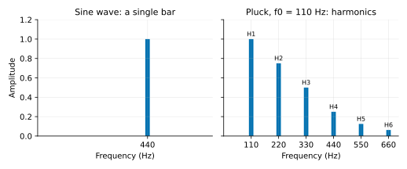
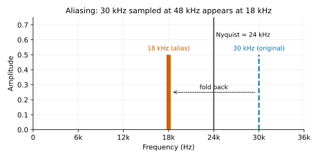
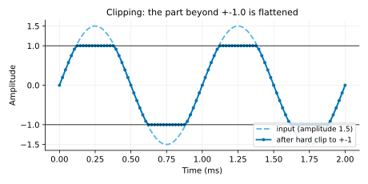
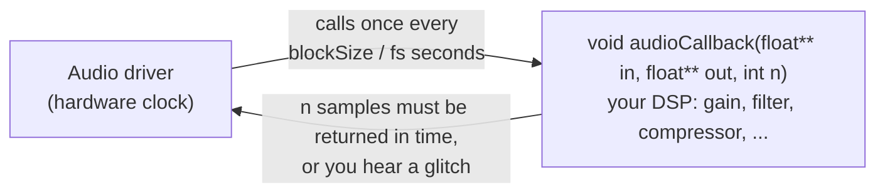
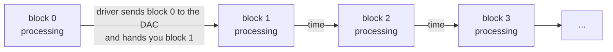

# Chapter 00: Digital Audio Fundamentals and the Development Environment

**English** | [繁體中文](README.zh-TW.md)

> [Course home](../../README.md) | Next chapter: [01 Gain and Pan](../01-gain/README.md)

This is the starting point of the whole course. By the end of this chapter you will know what sound looks like inside a computer, be able to do dB arithmetic, know what an audio callback is, and be able to compile, run and listen to every program in this course. Every DSP component in the next 14 chapters builds on the ideas introduced here.

## Roadmap of the whole course

The chapters go in numeric order, in a single straight line:


| Chapter | Topic | What you will build |
|---|---|---|
| 00 | Digital audio fundamentals, development environment | Understand sample, dB, block and latency; build and listen to the examples |
| 01 | Gain, pan, parameter smoothing | `Gain`, `Panner`, `SmoothedValue` |
| 02 | Filters (one-pole, biquad) | `OnePole`, `Biquad` (RBJ cookbook) |
| 03 | Parametric EQ | A 6-band `ParametricEq` |
| 04 | Compressor | `EnvelopeFollower`, `Compressor` |
| 05 | Limiter and lookahead | `DelayLine`, `Limiter` |
| 06 | Saturation and oversampling | `Oversampler`, `Saturation` |
| 07 | Distortion | `Distortion` (hard clip, foldback, bitcrush, ...) |
| 08 | Gate / expander / de-esser / transient shaper | Four kinds of dynamics processors |
| 09 | Delay | `FractionalDelayLine`, `Delay` (ping-pong, tempo sync) |
| 10 | Modulation | `Lfo`, `Chorus`, `Flanger`, `Phaser`, `Tremolo` |
| 11 | Metering and FFT | `Fft`, `LevelMeter`, `LoudnessMeter` (LUFS), `SpectrumAnalyzer` |
| 12 | Reverb | An algorithmic `Reverb` and a `ConvolutionReverb` |
| 13 | VST3 plugins and hosting (JUCE) | Wrap the compressor as a VST3, and write a host that can load VST3 plugins |
| 14 | Build your own 8-track DAW | Put everything together into a DAW that arranges clips, mixes, hosts VST3 plugins and exports WAV (recording is an extension exercise) |

---

## 0. Development environment

### 0.1 Windows: Visual Studio 2022

1. Download [Visual Studio 2022](https://visualstudio.microsoft.com/): either **Build Tools** (command line only, small) or **Community** (includes the IDE, free) will do.
2. During installation, select the workload **"Desktop development with C++"**. It installs the MSVC compiler, the Windows SDK and **CMake** together (this course's scripts automatically find the CMake bundled with VS, so you do not need to install it separately).
3. Open PowerShell, change to the project root, and run:

```powershell
.\scripts\build.ps1 -Only 00-basics        # configure + build + test chapter 00
.\scripts\build.ps1                        # all pure C++ chapters
.\scripts\build.ps1 -Only 00-basics -NoTest             # build only
.\scripts\build.ps1 -Only 00-basics -TestLabel example  # run only the examples (or "solution")
.\scripts\build.ps1 -Only 00-basics -Config Release     # Release build
.\scripts\build.ps1 -Only 14-daw-8track -Juce          # JUCE chapters (13, 14) need -Juce
```

`-Only` takes the name of a folder under `lessons/` (for example `00-basics` or `14-daw-8track`). If you mistype it (there is no such folder under `lessons/`), that name is silently skipped and only the shared utilities' `common_selftest` gets built; if you finish a build and find no executable for the chapter, check the spelling first. To build several chapters at once, separate them with commas: `-Only 13-vst-hosting,14-daw-8track`.

If PowerShell complains that scripts cannot be loaded, use `powershell -ExecutionPolicy Bypass -File .\scripts\build.ps1 -Only 00-basics`.

The script does the equivalent of the following three lines (the cmake bundled with VS lives in `C:\Program Files (x86)\Microsoft Visual Studio\2022\<edition>\Common7\IDE\CommonExtensions\Microsoft\CMake\CMake\bin\`):

```powershell
cmake -S . -B build -G "Visual Studio 17 2022" -A x64 -DDAWLAB_ONLY=00-basics
cmake --build build --config Debug --parallel
ctest --test-dir build -C Debug --output-on-failure
```

The built executables are in `build\bin\Debug\` (Release builds go to `build\bin\Release\`). **When you run an example by hand, `cd build` first**, because the programs write WAV files under `dawlab_output\` in the *current working directory*:

```powershell
cd build
.\bin\Debug\l00_test_signals.exe
.\bin\Debug\l00_wav_info.exe dawlab_output\l00_drum_loop.wav
```

### 0.2 Alternatives: VS Code and the Visual Studio IDE

- **VS Code + the CMake Tools extension**: open the project folder, pick the kit "Visual Studio Build Tools 2022 Release - amd64" (or Community) in the status bar at the bottom, and click "Build". To build just one chapter, add `"cmake.configureSettings": { "DAWLAB_ONLY": "00-basics" }` to `.vscode/settings.json`. "Run CTest" in the status bar runs the tests; to run a program by hand, make sure the terminal's working directory is the build folder.
- **Visual Studio 2022 IDE**: choose "Open a local folder" and select the project root; VS detects `CMakeLists.txt` automatically. Under "Project → CMake Settings", add the CMake variable `DAWLAB_ONLY=00-basics` to build just one chapter. Pick the target executable from the toolbar's "Select Startup Item" dropdown, for example `l00_db_math.exe`.

### 0.3 Linux / macOS

The course is verified on **Ubuntu 24.04** (GCC 13.3, CMake 3.28); macOS has not been tested. Install CMake ≥ 3.22 and a C++17 compiler (Ubuntu: `sudo apt install build-essential cmake git`; macOS: `xcode-select --install` plus `brew install cmake`), then use `scripts/build.sh`, the counterpart of `build.ps1`:

```bash
./scripts/build.sh --only 00-basics                         # configure + build + test chapter 00
./scripts/build.sh --only 00-basics --test-label example    # run only the examples (or "solution")
./scripts/build.sh --only 14-daw-8track --juce              # JUCE chapters (13, 14) need --juce
```

It does the equivalent of:

```bash
cmake -S . -B build -DCMAKE_BUILD_TYPE=Debug -DDAWLAB_ONLY=00-basics
cmake --build build --parallel
ctest --test-dir build --output-on-failure
```

The executables are in `build/bin/` (single-configuration generators have no `Debug/` subfolder, and there is no `.exe`). As on Windows, `cd build` before running an example by hand:

```bash
cd build
./bin/l00_test_signals
./bin/l00_wav_info dawlab_output/l00_drum_loop.wav
```

In the rest of the course, read `.\scripts\build.ps1 -Only X` as `./scripts/build.sh --only X`, `-Juce` as `--juce`, and `.\bin\Debug\name.exe` as `./bin/name`.

Only the JUCE chapters (13, 14) need extra packages on Linux (ALSA, X11, freetype, ...; the full `apt install` line is in "Setting up your environment" in the top-level README); this chapter does not.

### 0.4 Where the output WAVs go and how to listen to them

Every program writes through `dawlab::outputPath("filename")` to `<build directory>/dawlab_output/`. When ctest runs a program, the working directory is the build directory, so the files end up in the same place.

We strongly recommend installing the free [Audacity](https://www.audacityteam.org/):

- **Waveform**: just drag the WAV in. Zoom in with Ctrl + mouse wheel until you can see individual samples; those are $`x[n]`$.
- **Spectrogram**: the drop-down menu next to the track name → "Spectrogram". A sine wave is a horizontal line, a sweep is an upward-curving line, white noise is a uniform wash of noise, and an impulse is a vertical line.
- **Spectrum at a single moment**: select a region → "Analyze → Plot Spectrum". Look at `l00_clipped_sine.wav` and you can clearly see the odd harmonics at 1, 3 and 5 kHz.
- **Checking for clipping**: "View → Show Clipping" (the menu name varies by version and language) marks clipped samples in red.
- Turn the volume down when you listen to `l00_aliasing_sweep.wav`: the high frequencies near Nyquist are harsh.

---

## 1. Chapter goals

After this chapter you should be able to:

- Explain how sound becomes a stream of numbers: sampling, sample rate and bit depth, and why DSP code always uses `float` with the range $`[-1, 1]`$.
- Use the Nyquist theorem to work out which frequency a given tone will alias to at a given sample rate, and explain what aliasing sounds like.
- Be fluent in dB arithmetic: $`20\log_{10}`$, +6 dB ≈ twice the amplitude, summing identical signals (+6 dB) vs summing uncorrelated signals (+3 dB), and the quantization SNR ≈ 6.02N + 1.76 dB.
- Tell peak, RMS and crest factor apart, and know what clipping looks like in numbers.
- Explain channel, interleaved / non-interleaved, buffer, block processing, audio callback, and latency = blockSize / sampleRate.
- Name the four cardinal sins of the real-time audio thread (allocation, locks, I/O, unbounded loops / GC) and **why** each is forbidden.
- Build the whole course on Windows (or macOS / Linux), run the tests, find the output WAVs and inspect their waveforms and spectra in Audacity.
- Read the shared utilities in `common/include/dawlab/`: `AudioBuffer` / `AudioBlock`, `WavFile`, `Signals`, `Analysis` and `Check`.

---

## 2. Theory

### 2.1 Sound waves and sampling

Sound is a tiny variation of air pressure over time. A microphone turns the pressure into a voltage, and that voltage is a **continuous** curve $`x(t)`$: it has a value at every instant, and the value can be any real number. A computer cannot store anything continuous, so an ADC (analog-to-digital converter) does two things:

1. **Sampling**: measure the voltage once every fixed interval $`T`$. $`T`$ is called the sampling period, and its reciprocal $`f_s = 1/T`$ is the **sample rate**, in Hz. 48000 Hz means 48000 measurements per second, with consecutive samples $`1/48000 \approx 20.8\ \mu s`$ apart.
2. **Quantization**: round each measured voltage to one of a finite set of levels (see 2.3).

The result is a stream of numbers $`x[n] = x(nT)`$, $`n = 0, 1, 2, \ldots`$. That stream of numbers is "what sound looks like inside a computer"; there is nothing else. One second of 48 kHz stereo audio is 2 × 48000 = 96000 numbers.

![Left: a continuous sound wave x(t). Right: the same wave sampled as dots x[n], one every T = 1/fs.](images/sampling-continuous-vs-sampled.svg)

A very common misconception: "the sound between the samples is lost, so digital audio is stair-stepped and lossy". As long as the signal contains no component above $`f_s/2`$, these points determine the original smooth curve **uniquely** (this is the Nyquist theorem of the next section); on output the DAC uses a reconstruction filter to recover the smooth curve, not a staircase.

What does "a component above $`f_s/2`$" mean? To answer that, we first have to be clear about frequency, sine waves and spectra.

#### Frequency, sine waves and the spectrum

**Frequency** is "how many vibrations per second", in Hz. It corresponds to the **pitch** we hear: the A above middle C on a piano (A4) is 440 Hz, and the A an octave higher (A5) is 880 Hz (doubling the frequency = going up an octave). Human ears can hear roughly 20 Hz to 20 kHz, and the upper limit drops with age.

A **sine wave** is the "purest" sound, with a single frequency; it sounds like a tuning fork or the "beeeep" of a test tone:

$$
x(t) = A \sin(2\pi f t)
$$

$`A`$ is the amplitude (how loud) and $`f`$ is the frequency (what pitch). After sampling it becomes $`x[n] = A\sin(2\pi f n / f_s)`$, which is exactly what `makeSine()` in `Signals.h` computes.

**Any sound can be decomposed into a sum of many sine waves.** This is the core idea of Fourier analysis: a guitar, a human voice or a drum hit is equivalent to "many sine waves of different frequencies and amplitudes added together". Plotting "how large the sine wave at each frequency is" gives the **spectrum**: frequency on the horizontal axis, amplitude on the vertical axis.



The spectrum of a real instrument usually looks like the right-hand plot: the lowest bar is the **fundamental**, which determines the pitch we hear; the row of components above it whose frequencies are exactly **integer multiples** (2×, 3×, 4×, ...) of the fundamental are the **harmonics**, and the $`k`$-th harmonic has frequency $`k \cdot f_0`$. The fundamental itself counts as the first harmonic (H1), the 2× component is H2, and so on; components at odd multiples of the fundamental are **odd harmonics** (H3, H5, ...), and those at even multiples are **even harmonics** (H2, H4, ...).

**The make-up of the harmonics determines the timbre**: a piano, a guitar and a violin playing the same 110 Hz A sound different because the harmonics have different sizes. When we later talk about clipping, saturation and distortion and keep saying "new harmonics are generated", it means that the processed spectrum has bars that were not there before, so the timbre has changed.

To hear the difference: `l00_sine_440.wav`, written by `l00_test_signals`, is a single sine wave: clean but monotonous, like a test tone. `l00_pluck_110.wav` is a 110 Hz pluck; its pitch is lower, but because it has a whole row of harmonics it sounds "like an instrument", bright and rich, and since the higher harmonics decay faster over time, the sound gets duller and duller. Look at these two files with Audacity's "Analyze → Plot Spectrum" (see 0.4) and you get the two plots above.

### 2.2 Sample rate, the Nyquist theorem and aliasing

**The Nyquist–Shannon sampling theorem**: if the highest frequency in a signal is $`f_{max}`$, then as long as $`f_s > 2 f_{max}`$, the original signal can be reconstructed perfectly from the samples. Put the other way round, at sample rate $`f_s`$ the highest frequency that can be represented correctly is

$$
f_{Nyquist} = \frac{f_s}{2}
$$

The upper limit of human hearing is about 20 kHz, so CDs use 44.1 kHz (Nyquist 22.05 kHz), and professional audio commonly uses 48 kHz (Nyquist 24 kHz), 96 kHz and 192 kHz.

**So what happens to frequencies above Nyquist?** They do not disappear; they "masquerade" as a lower frequency. This is called **aliasing**. Intuition: imagine photographing a fan that spins 30 times per second at 48 pictures per second. Between pictures the fan turns 30/48 = 0.625 revolutions, but "turned 0.625 revolutions forward" and "turned 0.375 revolutions backward" produce identical pictures. So you see the fan spinning backward at 18 revolutions per second.

As a formula: a sine wave of frequency $`f_{in}`$, once sampled, produces **exactly the same** samples as all of the following frequencies:

$$
f_{alias} = \left| f_{in} - k \cdot f_s \right|,\quad k = 0, \pm 1, \pm 2, \ldots
$$

The one that falls within $`[0, f_s/2]`$ is the frequency you will "hear".

**Calculation: what does 30 kHz become when sampled at 48 kHz?**

$$
f_{alias} = |30000 - 1 \times 48000| = 18000\ \text{Hz}
$$

30 kHz is 6 kHz above Nyquist (24 kHz), so it "folds back" to 6 kHz below Nyquist, which is 18 kHz. You can verify this with trigonometry ($`n`$ is an integer):

$$
\sin\!\left(2\pi \tfrac{30000}{48000} n\right)
= \sin\!\left(2\pi n - 2\pi \tfrac{18000}{48000} n\right)
= -\sin\!\left(2\pi \tfrac{18000}{48000} n\right)
$$

The two sets of samples are identical except for the sign; the computer has no way to tell them apart. The example `l00_db_math` uses Goertzel (an algorithm that measures only the amplitude of a *single frequency*; see 3.4) on a 30 kHz sine wave, and the amplitude measured at 18 kHz is the full 0.5:

```
== Aliasing: f_in = 30 kHz, fs = 48 kHz ==
    at 18 kHz (|30000 - 48000|) the amplitude is 0.5000  <- all the energy has folded here
```



**Why should you care?** There are two places where components above Nyquist can be created:

1. **Before the ADC**: real-world sound contains ultrasonic components, so there is always an anti-aliasing lowpass filter in front of an ADC to remove them. That is the hardware's business; we do not need to worry about it.
2. **In our own DSP**: any **nonlinear** processing (saturation, distortion, clipping, even the fast gain changes of a compressor) creates new harmonics. A 1.1 kHz signal through a hard clip produces odd harmonics at 3.3, 5.5, 7.7, ... kHz, all the way up to infinity; everything above 24 kHz aliases back. For example the 23rd harmonic at 25.3 kHz folds to $`|25300 - 48000| = 22.7`$ kHz, and the 25th harmonic at 27.5 kHz folds to 20.5 kHz. These positions are **not** integer multiples of 1.1 kHz, so they turn into harsh noise unrelated to the original pitch. (The exception: if $`f_s`$ happens to be an integer multiple of the fundamental, e.g. 1 kHz @ 48 kHz, the aliases land back exactly on harmonic grid positions, e.g. 25 kHz folds to 23 kHz = H23. That is a coincidence; ordinary pitches do not do this.) This is why chapter 06 uses oversampling: first raise the sample rate to 4× (192 kHz, Nyquist 96 kHz), do the nonlinear processing, filter out everything above 24 kHz, and then come back down.

Perceptually, aliasing is "metallic", "digital", "the pitch running in the opposite direction". `l00_aliasing_sweep.wav`, written by `l00_db_math`, is a sweep from 20 Hz to 40 kHz (deliberately exceeding Nyquist): the pitch climbs all the way up, then after 24 kHz it falls instead. That is this phenomenon.

### 2.3 Bit depth and quantization

The number of bits used to store each sample is the **bit depth**. N-bit integer PCM has $`2^N`$ levels: 16 bit has 65536 ($`-32768 \ldots 32767`$), and 24 bit has 16777216. Note the asymmetry between positive and negative: the negative end reaches $`-2^{N-1}`$, but the positive end only reaches $`2^{N-1}-1`$. When converting to float in $`[-1, 1]`$ we divide by $`2^{N-1}`$, so the largest positive value 16 bit can store is $`32767/32768 \approx 0.99997`$, slightly below 1.0; the `quantize()` in `l00_db_math` clamps to this valid range after rounding.

Quantization means rounding the true value to the nearest level; the error $`e[n]`$ lies within $`\pm \Delta/2`$, where $`\Delta`$ is the level spacing. For most signals this error behaves like uniformly distributed random noise (quantization noise), with power

$$
P_{noise} = \frac{\Delta^2}{12}
$$

(the variance of a uniform distribution on $`[-\Delta/2, \Delta/2]`$). Dividing the power of a full-scale sine wave, $`P_{signal} = A^2/2`$, by it gives the best-case **SNR (signal-to-noise ratio)**. If the range of levels is $`[-1, 1]`$, then $`\Delta = 2 / 2^N = 2^{1-N}`$ and $`A = 1`$:

$$
\text{SNR} = 10\log_{10}\frac{1/2}{2^{2-2N}/12}
= 10\log_{10}\left(1.5 \cdot 2^{2N}\right)
= 20N\log_{10}2 + 10\log_{10}1.5
\approx 6.02N + 1.76\ \text{dB}
$$

**Intuition: every extra bit lowers the noise by 6 dB.** 16 bit gives about 98 dB and 24 bit about 146 dB. `l00_db_math` actually quantizes a sine wave and measures the SNR, and it matches the formula closely:

```
  bits     measured      formula
     8     49.12 dB     49.92 dB
    12     73.80 dB     74.00 dB
    16     98.06 dB     98.08 dB
    20    122.16 dB    122.16 dB
    24    146.24 dB    146.24 dB
```

The 8-bit measurement is about 0.8 dB below the formula: the tops of the positive half-cycles of a 0 dBFS sine wave exceed the largest valid code $`127/128`$ and get clamped, adding a little extra error; the more bits there are, the smaller the share of that one step, and the difference vanishes.

Note that the SNR is computed for a **full-scale signal**. If the signal is 20 dB lower, the SNR is 20 dB lower as well (same example: 8 bit at -20 dBFS has only 29.78 dB left). This is why you need enough level when recording. Listen to `l00_quantized_8bit.wav`: there is obvious hiss and distortion under the sine wave; `l00_quantized_16bit.wav` is almost indistinguishable from a clean one. The noise floor of 16 bit (smallest step about -90 dBFS) can only be noticed in extremely quiet passages with the monitoring level turned very high; this is also why recording and mixing internally commonly use 24 bit / float. (When converting high-resolution audio to 16 bit, in practice a tiny amount of random noise is added before quantizing. This is called **dither**; it turns the quantization error into an even hiss instead of distortion correlated with the signal. The bitcrusher in chapter 07 returns to this.)

### 2.4 Why DSP uses float, and 0 dBFS

Although files and hardware use integers, DSP internally always uses **32-bit float**, with the range by convention $`[-1.0, 1.0]`$:

- **No worrying about overflow**: adding two 16-bit integers can already overflow (wrap around to negative, causing a loud pop). A float can safely exceed 1.0, and you deal with it at the end.
- **Huge dynamic range**: a float has a 24-bit mantissa, and the relative precision does not change with level. A small -60 dB signal still has 24 bits of precision; an integer at -60 dB is left with only 6 bits (in the 16-bit case).
- **Natural multiplication**: gain is just multiplying by a number, with no fixed-point shifts.

The range $`[-1, 1]`$ corresponds to the "full scale" of integer PCM. A signal with amplitude exactly 1.0 is at **0 dBFS** (dB relative to Full Scale); every level quoted in dBFS is negative (or 0), for example a -6 dBFS sine wave has amplitude 0.5. This is the scale you see on a DAW meter.

A float can exceed 1.0 without breaking, but when it is written to an integer WAV or sent to a DAC, the excess is **cut off** (clipping, see 2.7). `WavFile.h` clamps to ±1 when writing 16/24-bit and keeps values as they are when writing 32-bit float.

### 2.5 dB arithmetic

Human perception of loudness is logarithmic: going from 0.1 to 0.2 sounds like "about the same size step" as going from 0.5 to 1.0. So audio almost always uses **dB (decibel)**:

$$
L_{dB} = 20\log_{10}\frac{A}{A_{ref}} \qquad\Longleftrightarrow\qquad \frac{A}{A_{ref}} = 10^{L_{dB}/20}
$$

This is the formula for **amplitude**. If you are comparing **power** (proportional to amplitude squared), the factor is 10 instead of 20: $`10\log_{10}(P/P_{ref}) = 10\log_{10}(A^2/A_{ref}^2) = 20\log_{10}(A/A_{ref})`$. The two formulas give the same answer; which one you use only depends on whether you are holding an amplitude or a power.

A few numbers you must memorize (from the output of `l00_db_math`):

| dB | Ratio | How to remember it |
|---:|---:|---|
| +20 | ×10 | every +20 dB adds a zero |
| +12 | ×3.98 ≈ ×4 | |
| +6 | ×1.995 ≈ ×2 | **+6 dB ≈ double the amplitude** |
| +3 | ×1.41 ≈ √2 | **+3 dB ≈ double the power** |
| 0 | ×1 | |
| -3 | ×0.708 ≈ 1/√2 | |
| -6 | ×0.501 ≈ ×0.5 | |
| -12 | ×0.251 ≈ ×0.25 | |
| -20 | ×0.1 | |
| -40 | ×0.01 | |
| -60 | ×0.001 | |

Exact values: ×2 = +6.0206 dB and √2 = +3.0103 dB. The course text writes 6.02 / 3.01.

**Summing: +6 dB or +3 dB?** This is where beginners mix things up most often, and the key is whether the two signals are correlated:

- **Perfectly identical signals** (for example the same track duplicated): every sample is $`x + x = 2x`$, so the amplitude is ×2 → **+6.02 dB**.
- **Uncorrelated signals** (for example two different noise signals, or two different guitars): the samples sometimes have the same sign and sometimes opposite signs, so the amplitudes do not add directly; it is the **power** that adds: $`P = P_1 + P_2 = 2P_1`$, so the amplitude is ×√2 → **+3.01 dB**.

```
== Summing two -12 dBFS signals ==
  Identical sines: RMS rises by +6.02 dB (amplitude ×2)
  Uncorrelated white noise: RMS rises by +3.04 dB (power ×2, amplitude ×√2)
```

Generalizing: mixing $`N`$ identical tracks gives +20log₁₀N dB, and $`N`$ uncorrelated tracks gives +10log₁₀N dB. Mixing 8 uncorrelated -18 dBFS signals gives about -9 dBFS; but if they are identical it is +18 dB → exactly 0 dBFS, and any more would clip. This directly affects how much headroom the mix bus of your chapter 14 DAW needs.

`DspMath.h` provides `dbToGain()` and `gainToDb()`. Anything below `kMinusInfinityDb` (-100 dB) is treated as silence, to avoid $`\log_{10}(0) = -\infty`$.

### 2.6 Peak, RMS and crest factor

There are two ways to measure "how loud" a signal is:

- **Peak**: the largest $`|x[n]|`$. It decides whether the signal clips.
- **RMS (root mean square)**: $`\sqrt{\frac{1}{N}\sum x[n]^2}`$, which is the square root of the power. It is closer to the "average loudness" that the ear perceives.

The ratio of the two is the **crest factor**, usually expressed in dB: $`\text{crest} = 20\log_{10}(\text{peak}/\text{RMS})`$. It tells you how "spiky" the signal is:

| Waveform | peak / RMS | crest factor |
|---|---|---|
| Square wave | 1 | 0 dB |
| Sine wave | √2 | 3.01 dB |
| Uniformly distributed white noise | √3 | 4.77 dB |
| Single impulse (1 sample in 0.5 s) | √24000 | 43.8 dB |
| Drum loop (this course's synthesized drums) | ≈ 5.3 | 14.5 dB |

Derivation for the sine wave: $`x = A\sin\theta`$, $`\overline{x^2} = A^2 \cdot \overline{\sin^2\theta} = A^2/2`$, so RMS = $`A/\sqrt 2`$. For noise uniformly distributed on $`[-A, A]`$: $`\overline{x^2} = \int_{-A}^{A} \frac{x^2}{2A}dx = A^2/3`$, so RMS = $`A/\sqrt 3`$.

The peak / RMS / crest printed by `l00_test_signals` are exactly these numbers:

```
sine 440 Hz      ...  peak  -6.02 dBFS  RMS  -9.03 dBFS  crest  3.01 dB
white noise      ...  peak -12.04 dBFS  RMS -16.81 dBFS  crest  4.77 dB
drum loop        ...  peak  -2.92 dBFS  RMS -17.43 dBFS  crest 14.51 dB
```

The drum loop's peak is only -2.9 dBFS, yet its RMS is just -17.4 dBFS: the energy of a drum hit is concentrated in very short instants (transients), and the rest of the time it is quiet. This is what the numbers mean by "highly dynamic", and it is what the compressor / limiter of chapters 04 and 05 deal with: squeeze the crest factor, and only then can you push the RMS up.

### 2.7 Clipping

When a signal with $`|x[n]| > 1.0`$ is converted to integers (written to a WAV, sent to a DAC), the excess is **hard-cut** at ±1.0:

$$
y[n] = \begin{cases} 1 & x[n] > 1 \\ x[n] & -1 \le x[n] \le 1 \\ -1 & x[n] < -1 \end{cases}
$$



A flattened waveform amounts to adding high-order harmonics that were not there before; it sounds harsh and "broken". `l00_db_math` hard-clips a 1 kHz sine wave of amplitude 1.5 and measures:

```
  clipped samples = 26000 / 48000 (54.2%; theory: the fraction with |sin| >= 2/3 ≈ 54%)
  THD = 15.22%; harmonics relative to the fundamental: H1 +0.0 dB  H2 -100.0 dB  H3 -16.5 dB  H4 -100.0 dB  H5 -35.7 dB
```

**THD (Total Harmonic Distortion)** is a single number that measures "how much harmonic content has been added in total":

$$
\text{THD} = \frac{\sqrt{H_2^2 + H_3^2 + H_4^2 + \cdots}}{H_1} \times 100\%
$$

$`H_k`$ is the amplitude of the $`k`$-th harmonic. In other words, it is "the total of the added harmonics as a fraction of the fundamental": 0% means perfectly clean (only the original sine wave), and the larger the number, the heavier the distortion. `thdPercent()` in `Analysis.h` uses Goertzel to measure H2 to H10 (the ones below Nyquist) and then applies this formula. The 15.22% above comes mainly from H3 (-16.5 dB ≈ 0.15×).

Symmetric clipping produces only **odd** harmonics (3, 5, 7, ...) and the even harmonics are 0; chapter 06 returns to this pattern. (We use 1 kHz @ 48 kHz here so that the number of clipped samples is a tidy 26000; as noted in 2.2, this frequency happens to make the high harmonics that alias back land on odd-harmonic positions as well, which is why H2 and H4 measure a clean -100 dB. With 1.1 kHz, the aliased components scatter to all sorts of non-integer-multiple positions, and measuring H2 and H4 might pick up some alias energy, but symmetric clipping itself still produces no even harmonics.) Counting the clipped samples is one of the problems in Exercise 4.

### 2.8 Channels, and interleaved / non-interleaved

Stereo has two channels, left and right, and each channel is an independent stream of samples. The samples of all channels at the same instant together are called a **frame**. There are two ways to lay out two channels in memory:

```
non-interleaved (planar): each channel is one contiguous block of memory
   L: [L0 L1 L2 L3 L4 L5 ...]
   R: [R0 R1 R2 R3 R4 R5 ...]

interleaved: all channels alternate within one block of memory
   [L0 R0 L1 R1 L2 R2 L3 R3 ...]
```

- **WAV files and most audio driver APIs (WASAPI, some modes of CoreAudio)** use interleaved.
- **DSP code, JUCE and VST3** use non-interleaved: processing "a stretch of one channel" takes just one pointer and one loop, and it is easier to SIMD.

This course's `AudioBuffer` is non-interleaved. `WavFile.h` does the conversion when reading and writing; Exercise 7 asks you to implement interleave / deinterleave yourself.

### 2.9 Buffers, block processing and the audio callback

A real audio program does **not** "read the whole song in and process it all at once". Every so often the audio driver hands you one **block** (also called a buffer) of samples, and you must process it and hand it back **before the next one arrives**. The function the driver calls is the **audio callback**:





Because once you receive a block of samples, the earliest it can be played is after the whole block has been processed, the **latency** is at least

$$
\text{latency} = \frac{\text{blockSize}}{f_s}
$$

The table printed by `l00_block_processing`:

```
     block      44100 Hz      48000 Hz      96000 Hz
        32       0.73 ms       0.67 ms       0.33 ms
        64       1.45 ms       1.33 ms       0.67 ms
       128       2.90 ms       2.67 ms       1.33 ms
       256       5.80 ms       5.33 ms       2.67 ms
       512      11.61 ms      10.67 ms       5.33 ms
      1024      23.22 ms      21.33 ms      10.67 ms
      2048      46.44 ms      42.67 ms      21.33 ms
```

This is the one-way minimum. In practice there is one block on input and one on output, and the driver may add another layer of buffering, so the **round-trip latency** when you hear yourself while recording is usually 2 to 3 times that: 512 @ 48 kHz is about 21 to 32 ms, which clearly feels "half a beat late" when playing an instrument; only 128 and below feels "instant".

**A small block size → low latency, but the callback is invoked more often**, so the fixed overhead of each call (function calls, parameter updates) takes a larger share, CPU load goes up, and you are more likely to miss the deadline. This is a trade-off, which is why DAWs let the user choose.

**Why does every example process in blocks of 512?** Because every DSP component must work correctly while "seeing only a small block": the memory of a filter (the value of the previous sample), the state of an envelope and the contents of a delay line must all be carried across blocks. If you process the whole signal at once, you will never discover the bug of "forgot to save the state". `l00_block_processing` demonstrates block-wise processing of a "stateless" operation like gain, and the result is identical to whole-signal processing (maximum difference = 0); later chapters show how stateful components handle this.

### 2.10 The four cardinal sins of real-time audio

The audio callback runs on a high-priority **audio thread** with a hard deadline: 512 samples @ 48 kHz is 10.67 ms, and a single miss is an audible click / dropout. So the callback must never do anything whose duration is **unknown**. The four cardinal sins:

| Sin | Why |
|---|---|
| **Allocation** (`new`, `malloc`, `std::vector::push_back`, `std::string`, ...) | The memory allocator has locks inside, and may have to ask the OS for new pages (a system call). Just once in a while it takes several milliseconds, and the deadline is blown. Fix: allocate all memory in `prepare()`. |
| **Locks** (`std::mutex`, any blocking synchronization) | If the lock is held by a low-priority UI thread and the OS happens to swap that thread out, the audio thread has to wait for it: this is called **priority inversion**. Fix: `std::atomic`, lock-free queues (the `SpectrumAnalyzer` in chapter 11 uses one). |
| **I/O** (files, console `printf`, network, logging) | System calls with completely unpredictable timing (the disk may be asleep). Fix: the audio thread drops the data into a lock-free FIFO and another thread writes the file. |
| **Unbounded loops / GC** | If the iteration count is not fixed (for example "keep computing until it converges") there is no guarantee that it finishes before the deadline. Languages with a garbage collector (Java, C#, Python) may pause all threads for tens of milliseconds at any time; this is why audio engines are almost always C / C++. |

Also avoid: throwing exceptions, calling third-party functions whose internals you do not know, and denormal floats (extremely small numbers can slow the CPU by 10 to 100 times; chapter 02 deals with this when we cover filters).

Every DSP component in this course follows the same interface: `prepare()` is the **only** place that may allocate, and `process()` contains nothing but arithmetic. The `audioCallback()` in `l00_block_processing` demonstrates this discipline; even the `std::vector` that holds the statistics is sized before entering the loop.

---

## 3. From formulas to code

This chapter has no new DSP algorithms to implement, so "from formulas to code" is split into two parts: 3.1 to 3.6 tour the shared `common/` utilities, and 3.7 to 3.11 walk through the example programs one by one.

This chapter has no new `dsp/` header; all the examples use only the utilities in `common/include/dawlab/`. They are the foundation of every program in the next 14 chapters, and it is worth spending 20 minutes reading the headers through. A single `#include <dawlab/Common.h>` pulls in all of them.

### 3.1 `AudioBuffer.h`: `AudioBuffer` and `AudioBlock`

```cpp
dawlab::AudioBuffer buffer(2, 48000);      // 2 ch × 48000 samples, allocated and zeroed (allocates)
float* left = buffer.getWritePointer(0);   // non-interleaved: one contiguous block of memory per channel
buffer.setSample(1, 100, 0.5f);
buffer.applyGain(0.5f);

dawlab::AudioBlock block(buffer);          // a view that does not own memory (does not allocate)
dawlab::AudioBlock part = block.getSubBlock(512, 512);      // samples 512..1023
dawlab::AudioBlock right = block.getChannelSubset(1, 1);    // the right channel only
part.multiplyBy(0.5f);                     // modifies the buffer directly
```

- **`AudioBuffer` owns its memory** (owning). `setSize()` allocates, so it may only be called in `prepare()` or in offline programs, and must never be called inside the audio callback.
- **`AudioBlock` is a non-owning view**: it stores only `float* const*` (a pointer per channel), the channel count, the sample count and a start offset. Copying it just copies a few integers and pointers and never touches the audio data.

**Why have a view?** Two reasons:

1. **Cutting out sub-blocks needs no copying**: `getSubBlock()` just moves the start offset forward. This is how `l00_block_processing` cuts 192000 samples into 375 blocks of 512 with zero copies.
2. **It meets JUCE / VST3 halfway**: they also pass channel pointers as `float**`. In chapters 13 and 14, `AudioBlock(juceBuffer.getArrayOfWritePointers(), numCh, numSamples)` is all it takes to use the same DSP code in a plugin and in a DAW, without changing a line.

So the `process()` of every DSP component in this course takes an `AudioBlock`, and an `AudioBuffer` converts implicitly to an `AudioBlock`, so you can simply write `processor.process(buffer)`.

### 3.2 `WavFile.h`: `readWav`, `writeWav`, `outputPath`

```cpp
dawlab::WavData wav;
std::string error;
if (!dawlab::readWav("in.wav", wav, &error)) { /* error holds a description of what went wrong */ }
// wav.buffer (an AudioBuffer, already converted to float [-1,1]), wav.sampleRate, wav.bitDepth

dawlab::writeWav(dawlab::outputPath("out.wav"), wav.buffer, wav.sampleRate);      // 24-bit PCM by default
dawlab::writeWav(dawlab::outputPath("out32.wav"), wav.buffer, wav.sampleRate, 32); // 32-bit float, keeps values beyond ±1
```

Reading supports 8/16/24/32-bit PCM, 32/64-bit float and WAVE_FORMAT_EXTENSIBLE; writing supports 16/24-bit PCM and 32-bit float. Integer formats clamp values beyond ±1.0 when written (this is the clipping of 2.7). `outputPath()` returns `dawlab_output/<filename>` and makes sure the folder exists.

### 3.3 `Signals.h`: test signals

Every chapter uses these deterministic signals (same parameters → same result) as input, so you do not need to prepare any audio files:

| Function | Purpose |
|---|---|
| `makeSine(freq, sr, seconds, amp, nch)` | The simplest signal, with a single frequency. The reference for measuring gain and THD. |
| `makeLogSweep(f0, f1, sr, seconds, amp, nch)` | The frequency rises logarithmically. Use it to "hear" the frequency response of a filter / EQ. |
| `makeWhiteNoise(sr, seconds, amp, nch, seed)` | Equal energy at all frequencies; the left and right channels use different seeds so they are **uncorrelated**. |
| `makeImpulse(numSamples, nch, position, amp)` | One sample = 1, the rest 0. Fed into a linear system, the output is its impulse response (chapter 12's convolution uses it). |
| `makeToneBursts(freq, sr, {levelsDb...}, segSeconds, nch)` | Level steps, e.g. -30 → -10 → -30 dBFS. For watching a compressor's attack / release. |
| `makeDrumLoop(sr, bars, bpm, amp, nch)` | Synthesized kick / snare / hi-hat with a high crest factor. The main material of the dynamics chapters. |
| `makePluck(freq, sr, seconds, ...)` | Karplus-Strong pluck, rich in harmonics with the highs decaying over time. Used for EQ and saturation. |
| `makePluckSequence(sr, seconds, amp, nch)` | An A-minor arpeggio, "musical" material. |
| `NoiseGenerator` | xorshift32, outputs $`[-1, 1)`$, for synthesizing your own signals. |
| `secondsToSamples(sec, sr)` | Seconds → number of samples (`DspMath.h` also has `msToSamples` and `samplesToMs`). |

### 3.4 `Analysis.h`: verifying with numbers

| Function | Purpose |
|---|---|
| `peakAbs(buffer)` / `peakAbs(ptr, n)` | The largest $`\|x\|`$ |
| `rms(buffer, ch)` / `rms(ptr, n)` | RMS |
| `hasNanOrInf(buffer)` | Catches NaN / Inf caused by DSP bugs |
| `goertzelAmplitude(ptr, n, freq, sr)` | The sine amplitude of a **single frequency** in the signal |
| `measureGainDb(processFn, freq, sr)` | The gain (dB) at a given frequency of any "one sample at a time" system |
| `harmonicLevelsDb(...)`, `thdPercent(...)` | Harmonic analysis, THD |

**Intuition for Goertzel**: an FFT computes all frequencies at once, but if you only want to know "how large is 1 kHz in this signal", Goertzel is cheaper: it is a second-order IIR filter whose resonance is deliberately tuned to the target frequency; you feed the whole signal through it and finally compute the amplitude at that frequency from the filter's two state variables. Feed in a sine wave of amplitude $`A`$ and the return value ≈ $`A`$. A Hann window is applied first, to reduce the leakage caused by discontinuities at the start and end of the signal. Terms such as IIR filter, window, leakage and FFT are covered in detail in chapter 02 (IIR filters) and chapter 11 (FFT, window, leakage); for now all you need to know is: **give it a signal and a frequency, and it returns the sine amplitude at that frequency**.

`measureGainDb()` is the workhorse for verifying filters in chapters 02 and 03: pass in a lambda, and it automatically feeds a sine wave, skips the transient, and measures the ratio of output to input.

### 3.5 `Check.h`: writing self-checks

```cpp
DAWLAB_CHECK(peak <= 1.0f);
DAWLAB_CHECK_NEAR(gainDb, -3.01, 0.05);         // |a - b| <= tol
return dawlab::test::summary("l00_ex4");          // returns 0 if everything passed (ctest PASS), otherwise 1
```

On failure it prints the expression, the actual value, the expected value and the file and line number. The solution of every exercise is verified this way, instead of "it sounds right to my ears". This chapter's `l00_db_math` also uses it to verify every numerical claim in the README.

### 3.6 `DspMath.h`, `Console.h`

`kPi`, `kTwoPi` (MSVC has no `M_PI`), `dbToGain`, `gainToDb`, `lerp`, `msToSamples`, `samplesToMs`. `Console.h` makes the Windows console display UTF-8 text (such as the ×, → and √ symbols in the examples' output); any program that includes a `dawlab/` header sets it up automatically.

### 3.7 Overview of the example programs

| target | Source | Demonstrates | Output WAVs |
|---|---|---|---|
| `l00_test_signals` | `examples/test_signals.cpp` | Generates all the test signals, prints peak / RMS / crest | `l00_sine_440.wav`, `l00_log_sweep.wav`, `l00_white_noise.wav`, `l00_impulse.wav`, `l00_tone_bursts.wav`, `l00_drum_loop.wav`, `l00_pluck_110.wav`, `l00_pluck_sequence.wav` |
| `l00_block_processing` | `examples/block_processing.cpp` | Simulates an audio callback, the latency table, per-block peak / RMS | `l00_block_input.wav`, `l00_block_processed.wav` |
| `l00_wav_info` | `examples/wav_info.cpp` | Reads a WAV (`argv[1]` or a generated one), prints its info, normalizes to -1 dBFS | `l00_wav_info_input.wav`, `l00_wav_info_normalized.wav` |
| `l00_db_math` | `examples/db_math.cpp` | Verifies every claim in 2.2 to 2.7 with numbers (self-check) | `l00_sum_identical.wav`, `l00_sum_uncorrelated.wav`, `l00_aliasing_30k.wav`, `l00_aliasing_sweep.wav`, `l00_quantized_8bit.wav`, `l00_quantized_16bit.wav`, `l00_clipped_sine.wav` |

### 3.8 `l00_test_signals`

It makes a segment of every kind of signal in `Signals.h`, writes each to a WAV, and prints the length, peak, RMS and crest factor. The point of this program is to **build your intuition for the numbers**:

```
sine 440 Hz      2 ch    96000 samples (2.00 s)  peak  -6.02 dBFS  RMS  -9.03 dBFS  crest  3.01 dB
log sweep        2 ch   192000 samples (4.00 s)  peak  -6.02 dBFS  RMS  -9.03 dBFS  crest  3.01 dB
white noise      2 ch    96000 samples (2.00 s)  peak -12.04 dBFS  RMS -16.81 dBFS  crest  4.77 dB
impulse          1 ch    24000 samples (0.50 s)  peak   0.00 dBFS  RMS -43.80 dBFS  crest 43.80 dB
tone bursts      2 ch    72000 samples (1.50 s)  peak -10.00 dBFS  RMS -17.70 dBFS  crest  7.70 dB
drum loop        2 ch   192000 samples (4.00 s)  peak  -2.92 dBFS  RMS -17.43 dBFS  crest 14.51 dB
pluck 110 Hz     2 ch    96000 samples (2.00 s)  peak  -6.03 dBFS  RMS -25.19 dBFS  crest 19.16 dB
pluck sequence   2 ch   192000 samples (4.00 s)  peak  -5.18 dBFS  RMS -19.71 dBFS  crest 14.53 dB
```

Compare with 2.5 and 2.6: amplitude 0.5 = -6.02 dBFS; the RMS of a sine wave is 3.01 dB below its peak; white noise of amplitude 0.25 = -12.04 dBFS with a crest of 4.77 dB; and for the impulse $`\text{crest} = 10\log_{10}(24000) = 43.8`$ dB.

**What you should see and hear**: open the spectrogram in Audacity. The sine is a horizontal line; the sweep is an upward-curving line (a logarithmic sweep is a straight line on a logarithmic frequency axis); the white noise is uniform throughout; the impulse is a vertical line (all frequencies appear at once); in the drum loop you can see the kick in the low frequencies and the hi-hat in the highs.

### 3.9 `l00_block_processing`

It first prints the latency table of 2.9, then cuts the 4-second drum loop into 375 blocks of 512 samples and calls a simulated `audioCallback()` on each block: apply a -6 dB gain and measure that block's peak and RMS (this is the seed of a DAW meter), and finally verify that "block-wise processing" and "whole-signal processing" are identical sample for sample:

```
== Simulated audio callback: 192000 samples, block size 512 -> 375 blocks (last block 512 samples) ==
   block   time(ms)  peak dBFS   RMS dBFS
       0        0.0      -9.31     -14.01
      23      245.3     -19.13     -28.83
     ...
     138     1472.0    -100.00    -100.00     <- this stretch is silent (-100 dB = kMinusInfinityDb)
     ...
Input peak -2.92 dBFS -> output peak -8.92 dBFS (largest block peak -8.92 dBFS)
Max difference between block-wise and whole-signal processing = 0 (gain has no state, so it should be 0)
```

Notice the structure of the program: the `std::vector` called `stats` is sized before entering the loop, and `audioCallback()` itself is `noexcept` and contains only multiplications and comparisons; this is the discipline described in 2.10.

**What you should hear**: `l00_block_processed.wav` is half as loud as `l00_block_input.wav` (-6.02 dB), and you cannot hear any seams between the 375 "blocks", because gain has no state across blocks.

### 3.10 `l00_wav_info`

Without arguments it generates a plucked arpeggio, writes it as a 24-bit WAV and reads it back (demonstrating the complete `readWav` flow); with an argument it analyzes the file you give it. It prints the channel count, sample rate, bit depth, length, memory usage, the number of clipped samples, and each channel's peak / RMS / crest / DC offset, then normalizes to -1 dBFS and writes the result as 32-bit float:

```
File: dawlab_output\l00_wav_info_input.wav
  channels    = 2
  sample rate = 48000 Hz
  bit depth   = 24 bit
  frames      = 192000 (4.000 s)
  memory      = 1500.0 KB (float, 2 ch × 192000 samples × 4 bytes)
  clipped     = 0 samples (|x| >= 1.0)
Before processing:
  channel   peak dBFS   RMS dBFS   crest dB    DC offset
  0             -7.68     -22.21      14.53    -0.013856
Normalize to -1.0 dBFS: applied +6.68 dB (× 2.1571)
After processing:
  0             -1.00     -15.53      14.53    -0.029889
```

Normalizing means "find the peak, work out the gain that makes the peak exactly equal to the target, and multiply the whole signal by it":

$$
g = \frac{10^{-1/20}}{\text{peak}} \quad\Rightarrow\quad \text{new peak} = g \cdot \text{peak} = 10^{-1/20} = 0.891 = -1\ \text{dBFS}
$$

Note that the crest factor is unchanged (peak and RMS both gain 6.68 dB), and the DC offset is also multiplied by 2.157. DC offset is the mean of the signal and ideally 0; this pluck has a tiny negative DC because the mean of the Karplus-Strong initial random numbers is not zero, and in practice you would filter it out with the highpass of chapter 02.

Try it: `.\bin\Debug\l00_wav_info.exe dawlab_output\l00_drum_loop.wav`, or use your own WAV (16/24/32-bit all work).

### 3.11 `l00_db_math`

This example does not demonstrate any new API. Its job is to **verify every numerical claim in this chapter with `DAWLAB_CHECK`**: the dB table, identical vs uncorrelated summing (+6.02 / +3.04 dB), the crest factor of four waveforms, 30 kHz → 18 kHz aliasing, the quantization SNR of 8 to 24 bit against 6.02N + 1.76, and the clipped-sample count and harmonics of clipping. The output ends with `[PASS] l00_db_math (17 checks passed)`. Readers can change the numbers (for example change 30 kHz to 50 kHz) and see what happens.

**What you should hear**: the pitch of `l00_aliasing_sweep.wav` falls after passing 24 kHz; `l00_quantized_8bit.wav` has hiss; `l00_clipped_sine.wav` sounds "brighter" and harsher than a clean sine wave.

---

## 4. Real-time notes

This chapter has no DSP components, but here we lay down the rules that every later chapter obeys:

- **`prepare(sampleRate, maxBlockSize, numChannels)` is the only place that may allocate.** All `std::vector`s, delay lines and scratch buffers are sized here to the maximum they will need. The block `process()` receives is always ≤ `maxBlockSize`.
- **`process(AudioBlock)` contains only arithmetic**: no `new`, no `std::vector::push_back`, no mutex, no `printf`, no exceptions. The `printf`s in the example programs are all **outside** the simulated callback.
- **Parameters come from the UI thread**: values written by a setter are read by the audio thread, so use `std::atomic<float>` or at least guarantee a single-word write; and parameter changes must be smoothed (chapter 01's `SmoothedValue`), otherwise you get zipper noise.
- **Measurements for the UI to read** (meters, gain reduction): store them in a `std::atomic<float>` with relaxed ordering, and let the UI thread read periodically.
- **Never read or write files on the audio thread.** The examples in this course are offline programs, so `writeWav` is fine; once chapters 13 and 14 have a real audio device, recording must hand its data over a lock-free FIFO to another thread that writes the file.

---

## 5. Common mistakes and debugging

| Symptom | Likely cause | How to check |
|---|---|---|
| The output WAV sounds broken and Audacity shows all red | Values beyond ±1.0 written as 16/24-bit → clipping | Is `peakAbs()` > 1? Use `l00_wav_info` to see the clipped count; write 32-bit float to see the raw values |
| The volume is 6 dB lower/higher than expected | Treating +6 dB as double the power, or treating the sum of two identical signals as +3 dB | Go back to 2.5; `gainToDb(2.0f)` is 6.02 |
| A click at regular intervals | State not saved at block boundaries (filter memory, envelope, ...) | Compare "block-wise" and "whole-signal" results the way `l00_block_processing` does |
| Highs sound "metallic" and the pitch runs the wrong way | Aliasing: nonlinear processing without oversampling, or a signal beyond Nyquist was produced | Listen to `l00_aliasing_sweep.wav` to get to know the sound; chapter 06 |
| Very quiet but hissy | Bit depth too low or signal level too low | 2.3: SNR falls with level |
| Some sounds vanish when left and right are merged | Left and right out of phase (L = -R) → cancellation in the downmix | Exercise 5 |
| The output is all 0 or NaN | Division by 0 (for example normalizing a silent buffer), log(0) | `hasNanOrInf()`; check peak > 0 before normalizing |
| The program cannot find the output file | The working directory is not the build folder | `outputPath()` writes to `<working directory>/dawlab_output/`; `cd build` first |
| Non-ASCII symbols (×, →, √) in printf output show up garbled | `dawlab/Console.h` is not included (`Common.h` already includes it) or the terminal is not UTF-8 | In PowerShell, `chcp 65001` works |
| MSVC reports `M_PI` undefined | MSVC does not define it by default | Use `dawlab::kPi` |
| `/W4` warnings: double → float, signed/unsigned | Mixed types | Use an explicit `static_cast<float>()`, and use `size_t` for indices |

---

## 6. Exercises

See [`exercises/README.md`](exercises/README.md). There are 7 problems: 3 calculation / concept problems (dB conversion, latency, aliasing) and 4 implementation problems (normalize and clipping count, stereo↔mono, linear vs equal-power fade, interleave/deinterleave). Every implementation problem comes with starter code in `exercises/starter/` and a complete solution in `solutions/`. The solutions and their explanations are in [`solutions/README.md`](solutions/README.md).

---

## 7. Further reading

- Julius O. Smith III, *Mathematics of the Discrete Fourier Transform (DFT) with Audio Applications* (free online, CCRMA): a rigorous derivation of sampling, aliasing and dB.
- Udo Zölzer (ed.), *DAFX: Digital Audio Effects*, 2nd ed., Wiley, 2011: the bible of effects, cited repeatedly throughout this course.
- Will Pirkle, *Designing Audio Effect Plugins in C++*, 2nd ed., Routledge, 2019: a hands-on book that goes from DSP to plugins.
- Ross Bencina, "Real-time audio programming 101: time waits for nothing" (blog post, 2011): the most frequently cited source for the four sins of 2.10.
- Timur Doumler, "C++ in the Audio Industry" (CppCon 2015 talk): real-time C++ in practice.
- Bob Katz, *Mastering Audio: The Art and the Science*, 3rd ed., Focal Press, 2014: the perceptual side of peak, RMS, crest factor and headroom.
- ITU-R BS.1770 (the loudness and true-peak measurement algorithms: K-weighting, gating), EBU R 128 (the recommendation for loudness normalization) and EBU Tech 3341 (the loudness meter specification: momentary / short-term / integrated), used by chapter 11's `LoudnessMeter`. EBU Tech 3343 is a practical guide to producing programs according to R 128 and makes good supplementary reading.

---

## 8. Next chapter

[Chapter 01: Gain](../01-gain/README.md): start from "multiply by a number" to build the first real DSP component, `Gain`, and learn to use `SmoothedValue` to avoid zipper noise when parameters change, plus the three pan laws of `Panner`.
