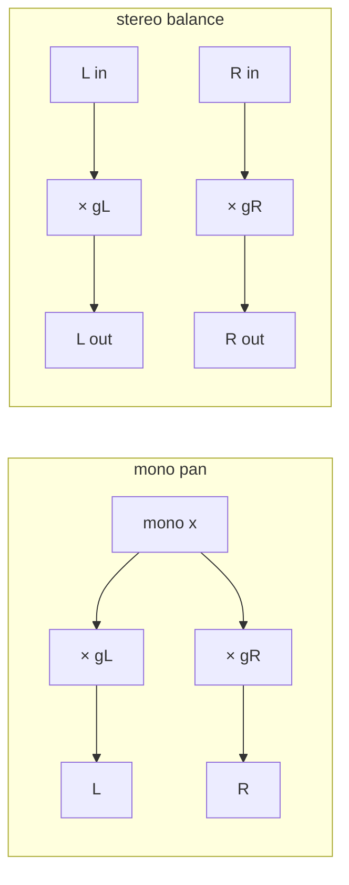

# 第 01 章：Gain、參數平滑與 Pan

> [教材首頁](../../README.md)　｜　上一章：[00 數位音訊基礎](../00-basics/README.md)　｜　下一章：[02 Filter](../02-filter/README.md)

「把訊號乘上一個數字」是整套 DSP 裡最簡單的運算，也是 DAW 裡最常用的運算：每一軌的推桿（fader）、pan 旋鈕、mute 鍵、master 推桿、plugin 的 input / output gain……全部都是乘法。
但是要把這個乘法做「對」，有一整章的事情要學：為什麼單位是 dB 而不是倍率？為什麼推桿不是線性的？為什麼改 gain 的瞬間會「喀」一聲？8 軌加起來為什麼會爆？pan 到中央為什麼會變小聲？本章一次講清楚。

## 1. 本章目標

讀完本章並做完練習，你應該能夠：

- 在 dB 與線性倍率之間自由換算（心算 ±6 dB、±20 dB、−3 dB），並說出 `20·log10` 與 `10·log10` 的差別。
- 解釋 fader taper 為什麼是對數 / 分段的，並自己寫出「推桿位置 ↔ dB」的映射與反函式。
- 從頻譜的角度說明「瞬間改 gain 會 click、連續改 gain 會 zipper noise」，並用一階差分與 sideband 把它量化。
- 實作並比較兩種參數平滑：linear ramp（`SmoothedValue`）與 one-pole exponential smoothing（時間常數 τ）。
- 使用本章的 `dawlab::dsp::Gain` / `Panner`，知道它們在 audio thread 上怎麼用才安全。
- 推導三種 pan law（linear / constant power / −4.5 dB）在中央的增益與左右功率和，並分清楚 **mono pan** 與 **stereo balance**。
- 解釋 N 軌相加時 peak 與 RMS 各自怎麼成長、什麼是 headroom 與 gain staging，以及 mute / solo / solo-safe 的解析規則（第 14 章的 mixer 用同一套規則；那裡只有 FX bus 與 master 是隱含的 solo-safe）。

## 2. 原理

### 2.1 線性倍率 vs dB

一個 gain 元件做的事只有一行：

$$
y[n] = g \cdot x[n]
$$

$g$ 是線性倍率（linear gain）：$g = 1$ 不變、$g = 0.5$ 振幅減半、$g = 0$ 靜音、$g = 2$ 振幅加倍、$g < 0$ 反相。
但你在 DAW 上看到的推桿刻度從來不是 0.5、2，而是 −6 dB、+6 dB。原因有兩個：**人耳是對數感知**（2.2 節），以及**乘法變加法**——串接兩個 gain 時倍率要相乘，dB 只要相加。

dB（decibel）定義在「功率比」上：$10 \log_{10}(P / P_0)$。音訊處理的是振幅（sample 值），而功率正比於振幅平方 $P \propto A^2$，所以

$$
L_\text{dB} = 10 \log_{10}\frac{A^2}{A_0^2} = 20 \log_{10}\frac{A}{A_0}
\qquad\Longleftrightarrow\qquad
g = 10^{L_\text{dB}/20}
$$

這就是 `dawlab::gainToDb()` / `dawlab::dbToGain()`（`common/include/dawlab/DspMath.h`）做的事。**振幅用 20·log10，功率（或 RMS 的平方、能量）用 10·log10**，記住這一點，後面 pan law 與 mixing 的推導都靠它。

幾個一定要背起來的對應：

| dB | 振幅倍率 $g$ | 功率倍率 $g^2$ | 直覺 |
|---:|---:|---:|---|
| +20 | 10 | 100 | |
| +12 | 3.981 ≈ 4 | 15.85 | |
| +6.02 | 2 | 4 | 「+6 dB = 振幅加倍」 |
| +3.01 | 1.414 = √2 | 2 | 「+3 dB = 功率加倍」 |
| 0 | 1 | 1 | unity gain |
| −3.01 | 0.7071 = 1/√2 | 0.5 | 功率減半 |
| −6.02 | 0.5 | 0.25 | 振幅減半 |
| −12.04 | 0.25 | 0.0625 | |
| −20 | 0.1 | 0.01 | |
| −40 | 0.01 | 10⁻⁴ | |
| −60 | 0.001 | 10⁻⁶ | 推桿「幾乎到底」 |
| −∞ | 0 | 0 | 真正的靜音 |

**dBFS**（decibels relative to full scale）以數位系統能表示的最大值 1.0 為 0 dB。一個振幅 0.5 的正弦波 peak 是 −6.02 dBFS；它的 RMS 是 $0.5/\sqrt{2} = 0.354$，也就是 −9.03 dBFS。正弦波的 peak 永遠比 RMS 高 3.01 dB，這個 3 dB 差距之後講 metering（第 11 章）時會一直出現。

`DspMath.h` 把低於 `kMinusInfinityDb = -100 dB` 的值一律視為 −∞（倍率 0）。這是個實用的妥協：−100 dB 已經遠低於任何系統的 noise floor，而真正的 0 可以讓 mute 完全靜音、讓 CPU 不必處理極小的數字（denormal：比 float 最小的正規數 ≈ 1.2e-38 還小的數，很多 CPU 處理它會慢 10–100 倍；本章哪裡會遇到見第 4 節）。

### 2.2 人耳對音量的對數感知

為什麼不直接讓推桿顯示倍率？因為人耳對響度的感覺大致是**對數**的（Weber–Fechner 定律的一個例子）：

- 從 0.1 到 0.2 與從 0.5 到 1.0，聽起來都是「大聲了差不多一樣多」——它們都是 +6 dB。
- 大約 **+10 dB 聽起來「響度加倍」**（心理聲學的粗略經驗值，Stevens 的響度定律）。注意這不是振幅加倍（+6 dB）也不是功率加倍（+3 dB）。
- 在中等音量下人耳能分辨的最小差異（JND）約 **1 dB**，所以 DAW 的推桿刻度以 0.1 dB 為單位就綽綽有餘。
- 從耳語（約 30 dB SPL）到痛閾（約 120 dB SPL）跨了 90 dB，也就是振幅 30000 倍——用線性刻度根本沒辦法畫在同一支推桿上。

換句話說，**dB 是為了讓「推桿移動一格」對應「聽起來差不多一樣多」而存在的**。這直接決定了推桿要怎麼設計。

### 2.3 Fader taper：把 0..1 的推桿位置映射到 dB

UI 上的推桿永遠是一個 0..1 的位置 $p$（滑鼠拖到哪就是哪）。如果直接拿 $p$ 當倍率（linear taper）會發生什麼事？

```
位置 p    倍率   dB
1.00      1.00    0.0
0.75      0.75   -2.5
0.50      0.50   -6.0
0.25      0.25  -12.0
0.10      0.10  -20.0
0.01      0.01  -40.0
```

整支推桿的上半截只涵蓋 6 dB，而最下面 1% 的行程卻要塞進 −40 dB 到 −∞——你幾乎不可能把一軌精準地調到 −30 dB。反過來，如果整支推桿「dB 對位置線性」（例如 0 → −90 dB、1 → +6 dB），每格 1 dB 很均勻，但推桿永遠到不了 −∞（真正的靜音），而且最底下將近三分之一的行程（−60 dB 以下，30/96 ≈ 31%）根本聽不到差別。

實務上 DAW 的推桿都是**分段（piecewise）曲線**：上半段 dB 對位置線性而且很「密」（0 dB 附近一格只有零點幾 dB，方便微調），下半段越往下每格的 dB 越大，最底端再接一小段「倍率線性」讓它真的能到 0。本章練習 4 用的是這一組分段點：

```
dB
 +6 ┤                                              ● 1.00
  0 ┤                                   ●  0.75  ⟋
    │                                 ⟋
-12 ┤                       ● 0.50  ⟋
    │                     ⟋
-30 ┤           ● 0.25  ⟋            每一段「dB 對位置線性」
    │         ⟋
-60 ┤ ● 0.05⟋
    │ │                                最底段 [0, 0.05]：
 -∞ ┤ ● 0.00                           「倍率對位置線性」→ p = 0 時倍率剛好是 0
    └─┴───────┴─────────┴────────────┴─────────── 位置 p
     0  0.05   0.25      0.50         0.75     1.00
```

| 位置 $p$ | dB | 這一段的「密度」 |
|---:|---:|---|
| 1.00 | +6 | 0.75..1.00：6 dB / 0.25 = 24 dB 每單位行程 |
| 0.75 | 0 | 0.50..0.75：12 dB / 0.25 = 48 dB 每單位行程 |
| 0.50 | −12 | 0.25..0.50：18 dB / 0.25 = 72 dB 每單位行程 |
| 0.25 | −30 | 0.05..0.25：30 dB / 0.20 = 150 dB 每單位行程 |
| 0.05 | −60 | 0..0.05：倍率從 0.001 線性到 0 |
| 0.00 | −∞ | |

段內用線性插值：$p$ 落在 $[p_i, p_{i+1}]$ 時 $t = (p - p_i)/(p_{i+1} - p_i)$，$L_\text{dB} = \mathrm{lerp}(L_i, L_{i+1}, t)$，再 `dbToGain`。反函式（gain → 位置，UI 要畫推桿時用）就是同一件事反過來做。這組數字沒有標準答案，各家 DAW 都不同，但「上密下疏、最底端接線性到 0」的結構是一樣的。

### 2.4 為什麼瞬間改 gain 會 click：乘上階梯函數

假設 gain 在第 $n_0$ 個 sample 從 $g_1$ 瞬間變成 $g_2$。這等於把訊號乘上一個**階梯函數**（step function）：

$$
y[n] = x[n] \cdot g[n],\qquad g[n] = g_1 + (g_2 - g_1)\,u[n - n_0]
$$

```
 g[n]
 g1 ─────────────┐
                 │   ← 這個垂直的「牆」就是問題所在
 g2              └──────────────
 ────────────────┴────────────── n
                 n0
```

**先建立直覺：振幅調變（amplitude modulation）與 sideband。** 把一個正弦波乘上一個「會變的 gain」，就是在調變它的振幅。最簡單的例子是讓 gain 以頻率 $f_m$ 緩慢起伏：

$$
\sin(2\pi f t)\cdot\bigl(1 + m\cos(2\pi f_m t)\bigr)
= \sin(2\pi f t) + \frac{m}{2}\sin\bigl(2\pi (f + f_m) t\bigr) + \frac{m}{2}\sin\bigl(2\pi (f - f_m) t\bigr)
$$

（用積化和差 $\sin A\cos B = \tfrac{1}{2}[\sin(A+B) + \sin(A-B)]$ 展開即可。）原本頻譜上只有 $f$ 一根柱子，乘上一個會變的 gain 之後，在 $f \pm f_m$ 長出兩根新的柱子。原本那根 $f$ 叫 **carrier**（載波），旁邊長出來的柱子叫 **sideband**（旁波帶）。gain 變化得越快（$f_m$ 越大），sideband 離載波越遠；gain 的變化越「劇烈」（含有越多高頻成分），sideband 就越多、越寬。

把這個觀念推廣：任何 gain 曲線 $g[n]$ 都可以拆成很多個不同頻率的正弦成分（第 00 章的頻譜），每一個成分都會在載波兩側各生出一對 sideband。這個「把 $G$ 的整個頻譜形狀複製一份、平移到載波位置」的運算，數學上叫**摺積**（convolution）：時域相乘等於頻域摺積，$Y(f) = X(f) * G(f)$。這裡只需要記住白話版本——「乘上 gain 曲線 = 把 gain 曲線的頻譜貼到訊號每一根頻率線的兩側」；完整推導見延伸閱讀的 Julius O. Smith《Mathematics of the DFT》。

回到階梯：純音 $x$ 的頻譜是一根線，摺積之後 $Y$ 就變成 $G(f)$ 的形狀平移到那根線的位置。而階梯函數的頻譜 $|G(f)|$ 以 $1/f$ 衰減（每倍頻程只掉 6 dB），是**寬頻**的——所以原本只有 1 kHz 的訊號，在改 gain 的那一瞬間突然多了從 20 Hz 到 20 kHz 的能量，耳朵聽到的就是一聲「喀」（click）。

時域的看法更直接：訊號在相鄰兩個 sample 之間出現一個不該有的「陡坡」。對一個振幅 $A$、頻率 $f$ 的正弦波，相鄰 sample 的差最多是

$$
\max |x[n] - x[n-1]| \approx A \cdot \frac{2\pi f}{f_s}
$$

（$A = 0.5$、$f = 1$ kHz、$f_s = 48$ kHz 時 = 0.0654）。一個跳變產生的差分是 $|x[n_0]|\cdot|g_2 - g_1|$，可以比這個值大很多倍。範例 1 就是用「一階差分最大值」來量化 click：它超過正弦波自然值多少倍，click 就有多明顯。

**Zipper noise** 是同一件事的連續版本。使用者拖推桿時，UI 大約每個 audio block（本教材 512 sample ≈ 10.7 ms，更新率 $f_b = 93.75$ Hz）送一次新的 gain 值，於是 gain 變成一條**樓梯**（staircase）。樓梯 = 一條平滑的斜坡 + 一個週期為 $1/f_b$ 的鋸齒狀誤差；這個鋸齒是週期訊號，可以拆成頻率 $f_b, 2f_b, 3f_b, \dots$ 的正弦波之和（就是第 00 章的「諧波」，數學上叫 Fourier 級數），而鋸齒波第 $k$ 個諧波的振幅正比於 $1/k$。套用上面「振幅調變」的直覺，每一個諧波 $k f_b$ 都在載波兩側生出一對 sideband，所以輸出會在載波兩側出現間隔 $f_b$ 的 **sideband**，每倍頻程掉 6 dB。這些 sideband 落在 1 kHz 旁邊 94 Hz、188 Hz、375 Hz……的地方，聽起來就是拉拉鍊的「茲茲茲」。

```
 階梯式（每 block 跳一階）              平滑（每個 sample 走一小步）
 g                                      g
 ┐                                      ╲
 └─┐                                      ╲
   └─┐                                      ╲
     └─┐                                      ╲
       └─┐                                      ╲
 ─────────── n                           ─────────── n
 頻譜：sideband 以 1/k 衰減（6 dB/oct）  頻譜：sideband 以 1/k² 衰減（12 dB/oct），而且小約 40 dB
```

為什麼平滑之後是 $1/k^2$？因為線性 ramp 之後 gain 是**連續**的（只有斜率不連續），連續的分段線性函數頻譜以 $1/f^2$ 衰減。範例 1 的 sideband 表格會讓你親眼看到這兩個斜率（階梯式每倍頻程 −6 dB、平滑每倍頻程 −12 dB）。

> 一個有趣的例外：如果跳變剛好發生在訊號的零交越（zero crossing，$x[n_0] = 0$），那 $x \cdot g_1 = x \cdot g_2 = 0$，根本不會有 click。如果範例 1 把跳變放在 block 邊界 sample 47616（≈ 0.992 s），因為 47616 / 48 = 992 剛好是整數個 1 kHz 週期，該處 $x = 0$——什麼也聽不到。所以範例刻意把跳變移到 sample 48128（訊號值 −0.433）。DAW 的「在零交越點剪接」就是利用這個性質；但即時調整推桿時你不能靠運氣，所以要平滑。

### 2.5 參數平滑：linear ramp vs one-pole exponential smoothing

解法是不要讓 $g[n]$ 跳，而是讓它在一段時間內「走」到目標。兩種最常見的走法：

**(a) Linear ramp**——固定在 $N$ 個 sample 內走完，每個 sample 前進固定的一步：

$$
g[n] = g[n-1] + \frac{g_\text{target} - g_\text{start}}{N},\qquad N = \mathrm{round}(T_\text{ramp} \cdot f_s)
$$

- 優點：可預測（50 ms 就是 50 ms）、一定會到達目標、實作只有一個加法。
- 缺點：斜率在起點與終點不連續（頻譜 $1/f^2$，實務上已經足夠乾淨）。
- 這就是本章 `SmoothedValue` 的做法，也是 JUCE `SmoothedValue<float, ValueSmoothingTypes::Linear>` 的做法。

**(b) One-pole exponential smoothing**——每個 sample 走「剩餘距離」的固定比例 $a$：

$$
g[n] = g[n-1] + a\,(g_\text{target} - g[n-1]) = (1-a)\,g[n-1] + a\,g_\text{target}
$$

這其實是一個一階 IIR 低通濾波器（第 02 章會正式介紹）。對階梯輸入（從 0 走到 1），解析解是

$$
g[n] = 1 - (1-a)^n = 1 - e^{-n/(\tau f_s)},\qquad a = 1 - e^{-1/(\tau f_s)} \approx \frac{1}{\tau f_s}
$$

$\tau$ 是**時間常數**（time constant）：走到 63.2%（$1 - e^{-1}$）所需的時間。常用的里程碑：

| 時間 | 到達比例 | 剩餘誤差 |
|---|---|---|
| $1\tau$ | 63.2% | −8.7 dB |
| $2.3\tau$（$\ln 10$） | 90% | −20 dB |
| $4.6\tau$（$\ln 100$） | 99% | −40 dB |
| $6.9\tau$（$\ln 1000$） | 99.9% | −60 dB |

- 優點：一開始走得快、接近目標時變慢，像電容充電 / 類比推桿，聽起來「更自然」；而且只在起點有一個斜率轉折（目標一改變，斜率就從 0 跳到 $a\cdot(g_\text{target} - g)$），終點是漸近、沒有轉折（linear ramp 起點和終點各有一個）。
- 缺點：理論上永遠到不了目標，實作時要在誤差夠小時「snap」到目標，否則 `isSmoothing()` 永遠是 true，而且殘餘的極小值會變成 denormal。還有一個精度陷阱：狀態用 float 存時，接近目標的增量 $a\cdot d$ 會小於 float 的半個 ulp（unit in the last place：float 在該數值附近相鄰兩個可表示數的間距；1.0 附近 $\varepsilon = 2^{-23} \approx 1.19 \times 10^{-7}$，略小於 1 的地方是它的一半），狀態會「卡」在離目標約 $\varepsilon/(4a)$ 的地方（$\tau$ = 10 ms 時約 $1.4 \times 10^{-5}$）——練習 3 會讓你親手踩到並修好它。

```
 g
 1.0 ┤            ╭────────────────── linear ramp：N 個 sample 後剛好到達
     │          ╱ ╭───────────────── exponential：τ 時 63.2%，4.6τ 時 99%
     │        ╱ ╱
 0.63┤      ╱╱ ·
     │    ╱╱
     │  ╱╱
   0 ┼╱╱─────┴────────┴──────────── n
     0       τ        N
```

**該用多長的 ramp？** 太短（< 1 ms）仍然會 click；太長（> 100 ms）推桿會有「慢半拍」的感覺，mute 鍵按下去聲音還拖一下。經驗值：gain / pan 用 **10–50 ms**；本章 `Gain` 與 `Panner` 預設 50 ms（API 合約規定）。像 filter cutoff 這種參數改變會重算係數，通常用更短的 ramp 加上每個 sample（或每幾個 sample）更新一次係數，第 02、03 章再談。

**`SmoothedValue` 的設計重點**（對應 `dsp/include/dawlab/dsp/SmoothedValue.h`）：

1. `reset(sampleRate, rampSeconds)` 在 prepare 階段決定 $N$；之後 audio thread 上完全不 allocate。
2. `setTargetValue()` 永遠**從目前值重新出發**（不是從上一個目標值），所以推桿連續移動時不會跳回去。
3. 目標值與目前值相同時不啟動 ramp，`isSmoothing()` 回傳 false，`process()` 可以走「整個 block 乘同一個數」的快速路徑。
4. 不用累加（`current += step`）：每一步由 `current = target − step·countdown` 直接算出。累加的寫法在長 ramp、大數值時（例如第 09 章以 sample 為單位、上萬的 delay time）每一步的 float 捨入誤差會累積，ramp 會衝過目標、最後一個 sample 再跳回來；直接算則每一步的誤差都不超過一個 ulp，`countdown` 到 0 時剛好等於 `target`。（標頭檔裡的乘法用 double 算。）
5. `setCurrentAndTargetValue()` 用在初始化：不要讓 plugin 一開機從 0 ramp 上來（會有 fade-in）。
6. `skip(n)`：這一段 buffer 不需要逐 sample 乘（例如確定是靜音）時，把 ramp 的進度往前推 n 個 sample，保持時間一致。

> **小心：不要用 `isSmoothing()` 判斷「參數有沒有變」。** ramp 長度是 0（`reset(sr, 0)`，或 `lround(seconds·sr) = 0`）時，`setTargetValue()` 會讓值瞬間跳到目標，`isSmoothing()` 從頭到尾都是 false。如果元件寫成「`isSmoothing()` 為 true 才重算 filter 係數」，smoothing 設成 0 時就會漏掉更新。要判斷參數是否改變，請比較「目前值」與「上次套用的值」（第 03 章 `ParametricEq` 就是這樣做的）。

### 2.6 Polarity invert（Ø）

「反相」就是 $g = -1$：$y[n] = -x[n]$。注意它和「相位移 180°」只有對純正弦波才一樣；對一般訊號，反相是**把波形上下翻**，不是時間延遲。用途：

- 多支麥克風收同一個音源（例如小鼓上下、吉他箱體兩支麥）時，若某支麥的極性相反，相加會互相抵消而變薄；按下 Ø 鍵修正。
- **Null test**：把處理前與處理後（或兩個 plugin 的輸出）一個反相相加，如果結果是 0（−∞ dB），代表兩者完全相同。這是驗證 DSP 實作最有力的工具，範例 3 (D) 示範。

在本章 `Gain` 裡，反相不是另外乘 −1，而是把 SmoothedValue 的目標設成 $-g$：切換時 gain 會從 $+g$ 平滑經過 0 走到 $-g$，所以**按下 Ø 鍵也不會 click**。

### 2.7 Mixing 與 headroom：N 軌相加之後 peak 會變多大？

Mixer 的核心就是加法：$y = \sum_i g_i x_i$。問題是加完會不會超過 1.0（0 dBFS）？答案取決於各軌之間**相關**（coherent）的程度：

**完全相關**（N 軌一模一樣，例如同一段訊號複製 N 份）：振幅直接相加

$$
A_\text{sum} = N \cdot A \quad\Rightarrow\quad +20\log_{10} N\ \text{dB}\qquad(N = 2: +6.02,\ N = 8: +18.06)
$$

**完全不相關**（N 軌獨立的雜訊、或不同樂器）：功率相加、振幅以 $\sqrt{N}$ 成長

$$
P_\text{sum} = N \cdot P \quad\Rightarrow\quad A_\text{rms,sum} = \sqrt{N}\,A_\text{rms} \quad\Rightarrow\quad +10\log_{10} N\ \text{dB}\qquad(N = 8: +9.03)
$$

這是 RMS 的成長；**peak 介於兩者之間**——運氣不好時各軌的峰值仍然可能同時出現，最壞情況就是各軌 peak 的線性總和。範例 3 用數字驗證這三條線。

```
 dB
 +18 ┤                                 ● coherent：20·log10(N)
     │                             ●
 +12 ┤                         ●                 ○ 實際 peak 落在這兩條線之間
     │                     ●         ○
  +6 ┤                 ●         ○ ─ ─ ─ ─ ● incoherent RMS：10·log10(N)
     │             ●   ○     ●
   0 ┼─────────●───●─────────────────────── N
     1         2         4         8
```

**Headroom** 是「目前的 peak 距離 0 dBFS 還有多少 dB」。**Gain staging** 是在訊號鏈的每一級都保留足夠 headroom 的習慣：各軌先拉低（例如 −12 到 −18 dB），讓 mix bus 的 peak 落在 −6 dBFS 左右，最後再由 master / limiter（第 05 章）決定成品音量。

那為什麼在 32-bit float 的 DAW 裡，mix bus 超過 0 dBFS 聲音卻不一定會破？因為 float 的 exponent 讓它的範圍超過 ±700 dB，內部超過 1.0 完全沒問題——破音發生在**離開 float 世界的地方**：寫成 16 / 24-bit 整數 WAV、送到 DAC、或經過某些假設輸入 ≤ 1.0 的 plugin（例如 bit-crusher、某些模擬類比的 saturation）。範例 3 把同一個「爆掉」的混音分別寫成 24-bit 與 32-bit float，讀回來比較 peak，你會看到 24-bit 版本被削到 0 dBFS，32-bit float 版本完好。

### 2.8 Mute / solo 的邏輯

每一軌有三個開關：**mute**、**solo**、**solo-safe**（有些 DAW 叫 solo isolate，用於 FX return、節拍器這種「別人 solo 時我也要出聲」的軌）。本教材採用與 Pro Tools / Logic 預設相同的規則：

1. 只要有任何一軌 solo，進入「solo 模式」：只有 solo 的軌出聲。
2. mute 永遠有效：solo + mute → 不出聲（mute 優先）。
3. solo-safe 的軌在 solo 模式下仍出聲，但自己 mute 時一樣不出聲。

整理成一條式子（$S$ = 是否有任何軌 solo）：

$$
\text{audible}_i = \neg\text{mute}_i \land (\neg S \lor \text{solo}_i \lor \text{soloSafe}_i)
$$

| mute | solo | soloSafe | 有人 solo？ | 出聲 |
|---|---|---|---|---|
| 0 | 0 | 0 | 否 | ✔ |
| 0 | 0 | 0 | 是 | ✘ |
| 0 | 1 | – | – | ✔ |
| 0 | 0 | 1 | 是 | ✔ |
| 1 | – | – | – | ✘ |

重點是：**解析完「該不該出聲」之後，不要直接把 sample 設成 0**，而是把那一軌 `Gain` 的目標設成 0 dB 或 −∞ dB，讓 ramp 走過去——mute 鍵才不會「喀」。第 14 章的 mixer 也是這個思路：`Mixer` 用 `!mute && (!anySolo || solo)`（`Mixer::isTrackAudible()` 的式子，沒有 soloSafe 項）決定每一軌該不該出聲，`ChannelStrip` 再用自己的 10 ms `SmoothedValue` 把 mute gain ramp 到 0 或 1（練習 6 用 `dsp::Gain` 的 50 ms ramp 示範同一件事）。

### 2.9 Pan law

Pan 的任務：把一個 mono 訊號分到左右兩個喇叭，用兩個 gain $g_L, g_R$ 表示聲像位置。令 pan 位置 $p \in [-1, 1]$（−1 全左、0 中央、+1 全右），並定義 $\theta = (p + 1)/2 \in [0, 1]$。三種常見的 law：

**Linear（線性）**

$$
g_L = 1 - \theta,\qquad g_R = \theta
$$

- 中央：$g_L = g_R = 0.5$ → **−6.02 dB**。
- 振幅和 $g_L + g_R = 1$ 永遠成立 → 把左右加成 mono 時音量不變（**mono 相容**）。
- 功率和 $g_L^2 + g_R^2 = 1 - 2\theta + 2\theta^2$，中央 = 0.5 → **−3.01 dB**：在房間裡用兩顆喇叭聽（左右不相關地疊加，功率相加），掃到中央會覺得音量「凹」下去。

**Constant power（等功率）**

$$
g_L = \cos\!\left(\theta\frac{\pi}{2}\right),\qquad g_R = \sin\!\left(\theta\frac{\pi}{2}\right)
$$

- 功率和 $g_L^2 + g_R^2 = \cos^2 + \sin^2 = 1$ **永遠成立**（這就是它叫等功率的原因）→ 用喇叭聽掃動時音量平穩。
- 中央：$g_L = g_R = \cos(\pi/4) = 1/\sqrt{2} = 0.7071$ → **−3.01 dB**。
- 振幅和在中央 = $\sqrt{2}$ → 加成 mono 時中央的訊號比兩端大 **+3.01 dB**（mono 不相容）。

**−4.5 dB（折衷）**

$$
g_L = \sqrt{(1-\theta)\cos\!\left(\theta\tfrac{\pi}{2}\right)},\qquad g_R = \sqrt{\theta\,\sin\!\left(\theta\tfrac{\pi}{2}\right)}
$$

取兩種 law 的**幾何平均**，dB 剛好是兩者的算術平均：中央 $\sqrt{0.5 \times 0.7071} = 0.5946$ → **−4.52 dB**（= (−6.02 − 3.01)/2）。功率和在中央 = $2 \times 0.5 \times 0.7071 = 0.7071$ → −1.51 dB；振幅和在中央 = 1.189 → +1.51 dB。喇叭聽凹 1.5 dB、mono 凸 1.5 dB，兩邊各讓一步。Cubase、Pro Tools、Reaper 等 DAW 都提供 −4.5 dB 作為 pan law 選項之一（各家的預設值不同，而且會隨版本改變，請以你使用的版本為準），SSL 等大型類比 console 也採用類似的數值。

把三種 law 在中央的數字放在一起：

| Pan law | 中央 $g_L = g_R$ | 中央 dB | $g_L^2 + g_R^2$（喇叭） | $g_L + g_R$（mono 相加） |
|---|---:|---:|---|---|
| Linear | 0.5 | −6.02 | 0.5（−3.01 dB，凹） | 1（0 dB，平） |
| Constant power | 0.7071 | −3.01 | 1（0 dB，平） | 1.414（+3.01 dB，凸） |
| −4.5 dB | 0.5946 | −4.52 | 0.7071（−1.51 dB） | 1.189（+1.51 dB） |

```
 gain
 1.0 ┤●─╮                                        ╭─●   ── linear
     │   ╲ ╲                                  ╱ ╱       ·· constant power
     │    ╲  ·╲                             ╱·  ╱
 0.71┤     ╲   ·╲·· ·· ·· ·· ·· ·· ·· ·· ··╱·   ╱  ← constant power 在中央 0.707（−3 dB）
     │      ╲     ╲                      ╱     ╱
 0.5 ┤       ╲      ╲──────────╳──────╱      ╱    ← linear 在中央 0.5（−6 dB）
     │        ╲    ╱                    ╲    ╱
     │         ╲ ╱   gL                 gR ╲ ╱
   0 ┼──────────●─────────────────────────────●──── pan
    -1                      0                      +1
```

**Mono pan vs stereo balance**——這是初學者最常混淆的地方：

- **Pan**（mono 輸入 → 立體聲輸出）：一個訊號被「分配」到左右，$L = g_L x$、$R = g_R x$。全右時左喇叭完全沒聲音，但所有內容都在右邊。
- **Balance**（立體聲輸入 → 立體聲輸出）：左右聲道各自乘一個 gain，$L' = g_L L$、$R' = g_R R$。轉到全右時左聲道被關掉，**左聲道原本的內容消失了**，並沒有搬到右邊。

本章 `Panner::process(block)` 對一個立體聲 block 做的就是第二種（channel 0 乘 $g_L$、channel 1 乘 $g_R$）；當 block 的兩個 channel 內容相同（mono 複製成兩聲道）時它等價於第一種。真正的「mono → stereo」用 `processMonoToStereo()`。範例 2 (C) 用左右不相關的雜訊證明 `process()` 只是 balance。注意 pan law 在中央仍然會套用：constant power 時 pan = 0 的立體聲 block 兩邊都是 −3 dB。已經是立體聲的 bus 或 master 通常要的是「中央 0 dB、往一邊轉時只衰減另一邊」的 **balance law**（第 14 章的 mixer 就是用 `Panner::computeGains()` 自己做 balance 模式）。想要「真的把立體聲訊號往右移」需要 M/S 或更複雜的處理（練習 7 的 stereo width 是其中一種工具）。



## 3. 從公式到程式碼

本章在 `dsp/include/dawlab/dsp/` 新增三個 header，全部 header-only、只依賴 `common/`，之後第 13 章的 plugin 會直接使用 `Gain` 與 `SmoothedValue`，第 14 章的 DAW 三個都會用到。

### 3.1 `SmoothedValue.h`

```cpp
class SmoothedValue {
public:
    void reset(double sampleRate, double rampSeconds) noexcept;  // prepare 階段：決定 ramp 長度 N
    void setRampLength(int numSamples) noexcept;                 // 只改長度、不打斷目前的值
    void setCurrentAndTargetValue(float value) noexcept;         // 初始化：不要從 0 ramp 上來
    void setTargetValue(float value) noexcept;                   // 從「目前值」出發走向新目標
    float getNextValue() noexcept;                               // 每個 sample 呼叫一次
    float getCurrentValue() const noexcept;
    float getTargetValue() const noexcept;
    bool  isSmoothing() const noexcept;
    void  skip(int numSamples) noexcept;
    void  applyGain(float* data, int n) noexcept;                // 便利函式：單一 channel
    void  applyGain(AudioBlock block) noexcept;                  // 便利函式：所有 channel 共用同一條 ramp
};
```

核心只有這幾行，對應 2.5 節的 linear ramp 公式：

```cpp
void startRamp() noexcept {                    // setTargetValue() 呼叫
    countdown_ = rampSamples_;                 // N
    step_ = (target_ - current_) / static_cast<float>(rampSamples_);   // (g_target − g_start) / N
}

float getNextValue() noexcept {
    if (countdown_ <= 0) return target_;       // 不在 ramp 中：快速路徑
    --countdown_;
    current_ = target_ - step_ * countdown_;   // = start + n·step，但不累加；countdown 到 0 時剛好是 target
    return current_;
}
```

`applyGain(AudioBlock)` 是給 `Gain` 用的：同一個 frame 的所有 channel 乘**同一個**值（左右聲道的音量要一起變，不能各走各的 ramp）。

### 3.2 `Gain.h`

```cpp
class Gain {
public:
    void prepare(double sampleRate, int maxBlockSize, int numChannels);
    void reset() noexcept;                       // ramp 直接對齊目標值
    static constexpr float kMaxGainDb = 40.0f;   // setGainDb 的上限
    void setGainDb(float db) noexcept;           // 參數用 dB（NaN 忽略、> +40 dB 夾住）
    void setGainLinear(float linear) noexcept;
    float getGainDb() const noexcept;
    float getGainLinear() const noexcept;
    void setPolarityInverted(bool) noexcept;     // Ø：目標變成 −g，走同一條 ramp
    bool isPolarityInverted() const noexcept;
    void setRampSeconds(double seconds) noexcept;   // 預設 0.05 s
    double getRampSeconds() const noexcept;
    float getCurrentGainLinear() const noexcept; // 目前實際乘進訊號的值（給 UI / 測試）
    bool isSmoothing() const noexcept;
    float processSample(int channel, float x) noexcept;  // 以 frame 為單位：channel 0 推進 ramp
    void process(AudioBlock block) noexcept;             // in-place
};
```

`setGainDb()` 做的事是「dB → 線性 → 設成 SmoothedValue 的目標」；`process()` 只是 `smoother_.applyGain(block)`。看起來很薄，但這層薄薄的包裝就是「參數用 dB 表達、內部用線性倍率、改變時平滑」這三件事的落實。`kMinusInfinityDb`（−100 dB）會被 `dbToGain` 轉成剛好 0，所以 `setGainDb(kMinusInfinityDb)` 就是 mute。`setGainDb()` 也替你擋掉非法值：NaN 會被忽略（保持原本的設定）、超過 `Gain::kMaxGainDb`（+40 dB）會被夾住——+inf 或「把倍率誤當 dB 傳進來」都不會讓輸出變成 inf。

`processSample(channel, x)` 的慣例：每個 frame 先呼叫 channel 0（推進 ramp 一步），其他 channel 沿用同一個值。這和 `process()` 的行為一致。

### 3.3 `Panner.h`

```cpp
enum class PanLaw { Linear, ConstantPower, Minus4_5dB };
const char* panLawName(PanLaw law) noexcept;

class Panner {
public:
    void prepare(double sampleRate, int maxBlockSize, int numChannels);
    void reset() noexcept;
    void setPan(float pan) noexcept;             // -1 左、0 中、+1 右
    float getPan() const noexcept;
    void setPanLaw(PanLaw law) noexcept;         // 預設 ConstantPower
    PanLaw getPanLaw() const noexcept;
    void setRampSeconds(double seconds) noexcept;   // 預設 0.05 s
    float getCurrentLeftGain() const noexcept;
    float getCurrentRightGain() const noexcept;
    bool isSmoothing() const noexcept;
    static void computeGains(float pan, PanLaw law, float& left, float& right) noexcept;  // 純函式
    void process(AudioBlock block) noexcept;                         // 立體聲 block：ch0 × gL、ch1 × gR（= balance）
    void processMonoToStereo(const float* mono, AudioBlock stereoOut) noexcept;  // 真正的 mono pan
};
```

`computeGains()` 是 2.9 節三條公式的直譯：

```cpp
const float theta = 0.5f * (p + 1.0f);                 // 0 = 全左, 0.5 = 中央, 1 = 全右
const float linL = 1.0f - theta,  linR = theta;        // Linear
const float halfPi = float(kPi) * 0.5f;
const float cpL = std::sin((1.0f - theta) * halfPi);  // = cos(θ·π/2)，但全右時精確為 0
const float cpR = std::sin(theta * halfPi);           // ConstantPower
// Minus4_5dB：幾何平均
left = std::sqrt(linL * cpL);  right = std::sqrt(linR * cpR);
```

為什麼 `cpL` 不直接寫 `std::cos(theta * halfPi)`？因為 `float(kPi)` 比真正的 π 大一點點，全右（θ = 1）時 `cos(float(π)/2)` 得到的是 −4.37e-8：不是 0，而且是**負值**，左聲道會殘留一個極小的反相訊號，和「全右時左喇叭完全沒聲音」不符。改寫成 $\sin((1-\theta)\pi/2)$ 在數學上完全相同，但兩端都是 $\sin(0) = 0$（精確），而且左右對稱、永遠不為負。範例 2 (D) 用 self-check 驗證三種 law 在 pan = ±1 時另一側的 gain 都 `== 0.0f`。另外，`setPan()` 遇到 NaN / inf 會忽略（保持原值），`computeGains()` 把它們視為中央——NaN 一旦流進音訊，後面所有處理都會變成 NaN。

左右 gain 各用一個 `SmoothedValue`，所以 pan 掃動不會 zipper。`process()` 遇到單聲道 block（沒有第二個 channel 可以 pan）什麼都不做；mono 輸入請用 `processMonoToStereo()`。

### 3.4 範例 1：`l01_zipper_noise`（`examples/zipper_noise.cpp`）

在專案根目錄建置（和練習題用同一個 build 目錄），再進到 build 目錄執行：

```powershell
.\scripts\build.ps1 -Only 01-gain
cd build
.\bin\Debug\l01_zipper_noise.exe
```

輸出 WAV 會寫到「目前工作目錄」下的 `dawlab_output/`（`outputPath()` 是相對於目前工作目錄的路徑），所以先 `cd build` 再執行，檔案就在 `build\dawlab_output\`。本章其他範例也照這個方式執行。

| 檔案 | 內容 | 該聽到什麼 |
|---|---|---|
| `l01_step_instant.wav` | 1 kHz 正弦波，約 1.0 s 時 gain 瞬間 0 → −20 dB | 清楚的一聲「喀」 |
| `l01_step_smoothed.wav` | 同上，50 ms linear ramp | 只有音量變小 |
| `l01_zipper_stepped.wav` | 0.5 s 起每個 block 降 1 dB、共 40 步（模擬拖推桿，沒平滑） | 像拉拉鍊的「茲茲茲」 |
| `l01_zipper_smoothed.wav` | 同上，經過 `SmoothedValue` | 乾淨的 fade out |

實際印出的數字（節錄）：

```
純正弦波的一階差分最大值：實測 0.0653，理論 A·2πf/fs = 0.0654

(A) 單次跳變 0 dB → -20 dB（在 sample 48128 = 1.0027 s，該處原始訊號值 -0.433）
    瞬間跳：跳變前一個 sample -0.3967 → 跳變後 -0.0433，一階差分 0.3534
    一階差分最大值：瞬間跳 0.3534（是正弦波自然值的 5.4 倍）
    一階差分最大值：50 ms ramp 0.0653（1.00 倍，幾乎等於自然值）

(B) 推桿移動：每個 block（10.67 ms，更新率 93.75 Hz）降 1 dB，共 40 步
    1 kHz 旁邊的 sideband（相對於 1 kHz 載波）：
    頻率                 階梯式 (dB)  平滑 (dB)
    1093.75 Hz (1k+ 1·fb)        -34.7        -74.4
    1187.50 Hz (1k+ 2·fb)        -40.8        -86.4
    1375.00 Hz (1k+ 4·fb)        -46.8        -98.5
    1750.00 Hz (1k+ 8·fb)        -52.8       -100.0
    2500.00 Hz (1k+16·fb)        -58.8       -100.0

SmoothedValue：50 ms ramp 在 48000 Hz 下走了 2400 個 sample（期望 2400）
```

怎麼讀這些數字：

- (A) 瞬間跳變的一階差分是正弦波自然值的 **5.4 倍**（0.3534 vs 0.0654）——這就是 click。平滑之後回到 1.00 倍。
- (B) 階梯式的 sideband 每倍頻程掉 **6 dB**（−34.7 → −40.8 → −46.8 → −52.8 → −58.8），正是 2.4 節說的 $1/k$；平滑版每倍頻程掉 **12 dB**（−74.4 → −86.4 → −98.5），是 $1/k^2$，而且整體低了約 40 dB（第一個 sideband 差 39.7 dB，更高階的差距更大；−100 dB 是量測下限）。
- 2400 = 0.05 × 48000：ramp 長度精確。

### 3.5 範例 2：`l01_pan_law`（`examples/pan_law.cpp`）

```powershell
bin\Debug\l01_pan_law.exe
```

輸出 `l01_pan_sweep_linear.wav`、`l01_pan_sweep_constpower.wav`、`l01_pan_sweep_minus4_5.wav`：mono 撥弦琶音 4 秒內從全左掃到全右。用耳機聽 linear 版本，經過中央時會覺得音量「掉下去」；constant power 版本（用喇叭聽）音量比較穩定；−4.5 dB 介於兩者之間。

印出的 pan law 表格（節錄中央與 ±0.5）：

```
--- Linear ---            gL (dB)   gR (dB) gL²+gR² dB     gL+gR dB
   -0.50                    -2.50    -12.04        -2.04         0.00
   +0.00                    -6.02     -6.02        -3.01         0.00
--- ConstantPower ---
   -0.50                    -0.69     -8.34         0.00         2.32
   +0.00                    -3.01     -3.01        -0.00         3.01
--- Minus4_5dB ---
   -0.50                    -1.59    -10.19        -1.03         1.15
   +0.00                    -4.52     -4.52        -1.51         1.51

(B) 掃到中央時左右聲道的 RMS（相對於 mono 原始訊號）：
  Linear         中央：L -6.15 dB, R -5.89 dB
  ConstantPower  中央：L -3.11 dB, R -2.91 dB
  Minus4_5dB     中央：L -4.63 dB, R -4.40 dB

(C) 立體聲（左右不相關的白雜訊）經過 Panner（ConstantPower, pan = +0.5）：
  L：-16.84 dB → -25.19 dB（變化 -8.34 dB，= gL -8.34 dB）
  R：-16.78 dB → -17.47 dB（變化 -0.69 dB，= gR -0.69 dB）

(D) 端點檢查：pan = ±1 時另一側的 gain
  Linear         全右 gL = 0、全左 gR = 0
  ConstantPower  全右 gL = 0、全左 gR = 0
  Minus4_5dB     全右 gL = 0、全左 gR = 0
  setPan(NaN) 之後 pan = 0.25；computeGains(NaN) = 0.7071 / 0.7071（視為中央）
[PASS] l01_pan_law (3 checks passed)
```

- 表格的每一欄都對得上 2.9 節的推導：Linear 的 `gL+gR` 永遠 0 dB、ConstantPower 的 `gL²+gR²` 永遠 0 dB、−4.5 dB 在中央各凹 / 凸 1.51 dB。
- (B) 是在掃動中取 0.1 s 量的，這段時間 pan 從 −0.025 走到 +0.025，所以左右差 0.2 dB 左右；兩者的平均（−6.02、−3.01、−4.52）正是理論值。
- (C) 左聲道掉了剛好 $g_L$ 的 8.34 dB，右聲道掉了 $g_R$ 的 0.69 dB——左邊的內容沒有「搬」到右邊，這是 balance。
- (D) 三種 law 在兩端的另一側都是精確的 0（見 3.3 節為什麼 `cpL` 要寫成 sin）；非法的 pan 值不會讓 NaN 流進音訊。

### 3.6 範例 3：`l01_mixing_headroom`（`examples/mixing_headroom.cpp`）

```powershell
bin\Debug\l01_mixing_headroom.exe
```

| 檔案 | 內容 | 該聽到什麼 |
|---|---|---|
| `l01_mix_hot_clipped.wav` | 8 軌每軌 0 dB 直接相加，寫成 24-bit | 鼓點處刺耳的破音 |
| `l01_mix_hot_float.wav` | 同一個混音寫成 32-bit float | 沒有破音（播放器會自動縮小或由你拉低音量） |
| `l01_mix_staged.wav` | 每軌 −18 dB、master 0 dB | 乾淨，但整體小聲——這是 headroom 的代價 |
| `l01_mix_mute.wav` | 一軌撥弦在約 1.0 s（0.992 s，block 邊界）被 mute（50 ms ramp） | 沒有 click 的靜音 |

```
(A) 8 軌一模一樣的正弦波，每軌 peak -12.00 dBFS：
    總和 peak = 6.06 dBFS（公式 20·log10(N) = +18.06 dB → 6.06 dBFS）← 超過 0 dBFS！
(B) 8 軌彼此不相關的白雜訊，每軌 RMS -16.84 dBFS、peak -12.04 dBFS：
    總和 RMS = -7.75 dBFS，成長 9.10 dB（公式 10·log10(N) = +9.03 dB）
    總和 peak = 5.46 dBFS，成長 17.50 dB（介於 +9.03 與 +18.06 之間）

(C) 8 軌音樂素材（1 軌鼓 + 7 軌撥弦），每軌 peak： -2.9 -6.9 -6.9 -6.9 -6.9 -7.0 -7.0 -7.0 dBFS
    各軌 peak 的線性總和 = 3.86（11.72 dBFS）：這是最壞情況（全部同時到達峰值）
    每軌 0 dB 直接相加：peak = 9.25 dBFS，286 個 sample 超過 0 dBFS → 寫成 24-bit 會 clip
    要保證最壞情況也有 6 dB headroom：每軌 + master 合計至少 -17.7 dB → 每軌 -18 dB、master +0 dB
    最壞情況 peak = 11.72 -18 = -6.28 dBFS（headroom 6.28 dB）
    每軌 -18 dB、master +0 dB：peak = -8.75 dBFS，headroom 8.75 dB
    （等於整體 -18 dB，所以 peak 剛好 = 9.25 -18 = -8.75 dBFS）
    讀回 l01_mix_hot_clipped.wav（24-bit 整數）：peak = -0.00 dBFS（已被削到 0 dBFS）
    讀回 l01_mix_hot_float.wav（32-bit float）：peak = 9.25 dBFS（超過 0 dBFS 的部分完好保留）

(D) polarity invert null test：原始 peak -6.94 dBFS，反相後 peak -6.94 dBFS，
    兩者相加 peak = -100.0 dBFS（完全抵消 = -inf dB）

(E) mute（第 47616 個 sample = 0.992 s，該處訊號值 +0.035），mute 附近 150 ms 的一階差分最大值：
    原始訊號 0.0103｜瞬間設成 0：0.0354（click）｜Gain 50 ms ramp：0.0103（不超過原始 = 沒有 click）
    1.2 s 之後的 peak = -100.0 dBFS（完全靜音）
```

- (A) 相關訊號：+18.06 dB，與 $20\log_{10} 8$ 完全一致。
- (B) 不相關訊號：RMS +9.10 dB（理論 +9.03），peak +17.5 dB——白雜訊的峰值確實有機會「湊在一起」，所以 **不能只看 RMS 來判斷會不會爆**。
- (C) 從各軌 peak 的線性總和 11.72 dBFS 反推：要保證最壞情況也留 6 dB，「每軌 + master」合計要降 17.7 dB → 每軌 −18 dB、master 0 dB，最壞情況 peak = 11.72 − 18 = −6.28 dBFS；實際混音的 peak 是 −8.75 dBFS（各軌峰值沒有同時出現，所以比最壞情況再低 2.5 dB）。訊號鏈上**每一級**的 gain 都要算進去：如果 master 再補 +3 dB，整體只降 15 dB，最壞情況就只剩 3.3 dB headroom。這就是 gain staging 的計算方式，不是「−12 dB」這種口訣。
- (C) 最後兩行：同一個混音，24-bit 版本的 peak 被削成 0 dBFS（破音已經「燒」進檔案裡），32-bit float 版本讀回來仍是 +9.25 dBFS——資料完好，只要之後拉低音量就能救回來。
- (D) null test 得到 −100 dBFS（本教材的 −∞）：`Gain` 的反相是精確的 −1。
- (E) 在 mute 附近 150 ms 的視窗裡比較：直接把 sample 設成 0 會讓一階差分變成原始訊號的 3.4 倍（0.0354 vs 0.0103，就是那一聲「喀」）；經過 `Gain` 的 50 ms ramp 則和原始訊號一樣（0.0103），沒有新增任何陡坡。1.2 s 之後是真正的 0（`kMinusInfinityDb` → 倍率 0）。注意 mute 剛好發生在 block 邊界（第 93 個 block 開頭 = 0.992 s），因為 UI 的參數只能在 block 之間生效。

## 4. Real-time 注意事項

- **只有 `prepare()` 可以 allocate。** 本章三個 class 其實都不需要 heap（狀態只有幾個 float），但介面統一；`process()` 內沒有任何 new / vector::resize / mutex / I/O。
- **本章元件不是 thread-safe：setter 只在 block 之間、由呼叫 `process()` 的同一個 thread 呼叫。** `setGainDb()` 寫的是一個 float（`gainDb_`）加上 SmoothedValue 的 target / step / countdown，全部是普通的 float / int。如果 UI thread 直接呼叫 setter、audio thread 同時在 `process()` 裡讀，在 C++ 記憶體模型下這就是 **data race，屬於 undefined behavior**——就算 x86 / ARM64 硬體上對齊的 float 寫入剛好不會被「撕裂」，編譯器也可以假設沒有其他 thread 在改這些變數而做出意想不到的最佳化，所以「硬體寫入是 atomic」不能當作 thread safety 的依據。正確做法是：UI thread 只寫一個 `std::atomic<float>`，audio thread 在每個 block 開頭讀出來、再交給平滑器（第 14 章的 `ChannelStrip` 就是這個模式）；第 13 章會用 JUCE 的 `AudioProcessorValueTreeState` 正式處理 parameter 的 thread safety。教材刻意不在本章元件內部加 atomic / lock，讓元件保持簡單、可以離線測試。
- **初始化要 `setCurrentAndTargetValue` / `reset()`。** 否則 plugin 一載入會從 0 ramp 到目標值，前 50 ms 有 fade-in；對 `Gain` 而言 `prepare()` 已經幫你做了。
- **Sample rate 改變要重新 `prepare()`。** ramp 長度以 sample 計，從 48 kHz 換到 96 kHz 不重算就會變成 25 ms。
- **Denormal。** 本章的 linear ramp 走完會精確對齊目標，不會留下極小值；但練習 3 的 exponential smoother 會，所以要 snap。第 02 章的 IIR filter 更需要注意。
- **ramp 不是 latency。** 平滑只影響「參數」到達目標的時間，訊號本身沒有被延遲，所以 `Gain` / `Panner` 不需要回報 latency。
- **多聲道共用一條 ramp。** `Gain::process()` 讓同一個 frame 的每個 channel 乘同一個值；如果你自己寫 loop 用 `processSample()`，請遵守「每個 frame 先 channel 0」的慣例，否則左右聲道的 ramp 會走成兩倍快。

## 5. 常見錯誤與除錯

| 症狀 | 可能原因 | 怎麼查 |
|---|---|---|
| 改參數時「喀」一聲 | 直接把新值乘進去，沒有 ramp；或 ramp 長度是 0（忘了 `prepare()` / `reset(sr, ramp)`） | 印出 `isSmoothing()`、`getRampSamples()`；算一階差分最大值（範例 1 的 `maxFirstDifference`）是否遠大於 $A\cdot 2\pi f/f_s$ |
| 拖推桿有「茲茲」聲 | 每個 block 跳一階、沒平滑 | 用 Goertzel 量載波旁 $k \cdot f_b$ 的 sideband（範例 1 (B)） |
| 音量改變「慢半拍」、mute 拖尾 | ramp 太長（> 100 ms）；或 exponential smoother 的 τ 設太大（記得 99% 要 4.6τ） | 把 ramp 調到 10–50 ms |
| plugin 一載入先淡入 | 沒有 `setCurrentAndTargetValue()`，從 0 ramp 上來 | 在 `prepare()` 裡把 current 對齊 target |
| 左右聲道音量變化不同步 / ramp 走太快 | 每個 channel 各呼叫一次 `getNextValue()` | 用 `applyGain(AudioBlock)`，或遵守「channel 0 推進 ramp」的慣例 |
| `isSmoothing()` 永遠是 true、CPU 偶爾飆高 | exponential smoother 沒有 snap；float 狀態卡在離目標約 $\varepsilon/(4a)$ 處；denormal | 狀態用 double、設 snap 門檻（練習 3） |
| 混音破音但 DAW 表頭沒紅 | 內部 float 沒事，輸出成整數 WAV / 送 DAC 才 clip | 看 mix bus 的 peak（`peakAbs`）；gain staging |
| pan 到中央變小聲 | 這是 linear pan law 的正常行為（−6 dB） | 換 constant power 或 −4.5 dB；確認你要的是喇叭聽還是 mono 相容 |
| 立體聲 track pan 全右後左邊的東西「不見了」 | `Panner::process()` 對立體聲是 balance，不是 pan | 想要搬移要先 sum 成 mono 再 `processMonoToStereo()`，或用 M/S（練習 7） |
| `dbToGain(-6)` 編譯出現 ambiguous | int 同時能轉 float / double | `DspMath.h` 已提供 `dbToGain(int)` overload；傳 `-6.0f` 最保險 |
| 用 `==` 比較 ramp 終點失敗 | 浮點累加誤差 | `SmoothedValue` 最後一步直接設成 target，自己實作時也要這麼做 |

## 6. 練習題

見 [`exercises/README.md`](exercises/README.md)。7 題：2 題觀念 / 計算（dB 心算、平滑與 pan law 的觀念）、5 題實作（exponential smoother 與時間常數量測、fader taper、multiplicative（dB 直線）ramp、mute / solo 解析、M/S stereo width 與 balance）。解答在 [`solutions/README.md`](solutions/README.md)。

## 7. 延伸閱讀

- Udo Zölzer (ed.), *DAFX: Digital Audio Effects*, 2nd ed., Wiley, 2011 —— 第 1 章 Introduction 的基礎概念；第 5 章 Spatial Effects 有 panning 與 pan law 的討論。
- Will Pirkle, *Designing Audio Effect Plugins in C++*, 2nd ed., Routledge, 2019 —— 參數平滑（parameter smoothing）與 plugin 架構。
- Joshua D. Reiss & Andrew P. McPherson, *Audio Effects: Theory, Implementation and Application*, CRC Press, 2014/2015（上市與版權頁年份不同）—— 有專章講 amplitude 相關效果與 panning。
- Bob Katz, *Mastering Audio: The Art and the Science*, 3rd ed., Focal Press, 2014/2015（上市與版權頁年份不同）—— headroom、gain staging、dBFS 與響度的實務觀點。
- JUCE 文件：`juce::SmoothedValue`（Linear / Multiplicative 兩種平滑）與 `juce::dsp::Panner`（提供 linear / balanced / sin3dB / sin4p5dB / sin6dB / squareRoot3dB / squareRoot4p5dB 等 pan rule），和本章的 API 對照著看。
- Julius O. Smith III, *Mathematics of the DFT* 與 *Introduction to Digital Filters*（CCRMA, Stanford，線上免費）—— 2.4 節「乘法 ↔ 摺積」與 2.5 節 one-pole 的數學背景。

## 8. 下一章

有了「乘上一個數」之後，下一步是「乘上一個會隨頻率變的數」——第 02 章 [02-filter](../02-filter/README.md) 從 one-pole 低通（就是練習 3 那條式子）出發，一路到 biquad 與 RBJ cookbook。
