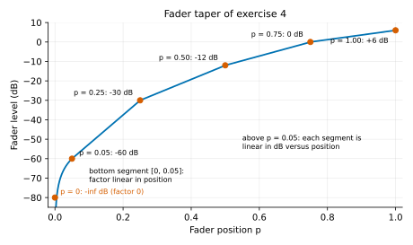
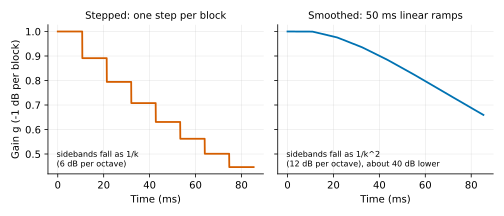
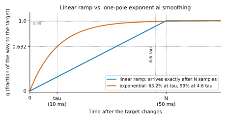
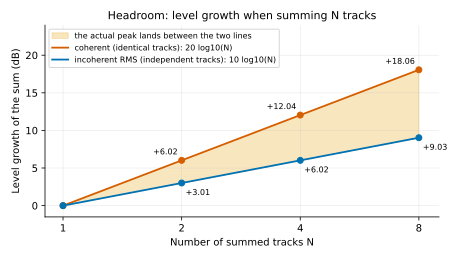
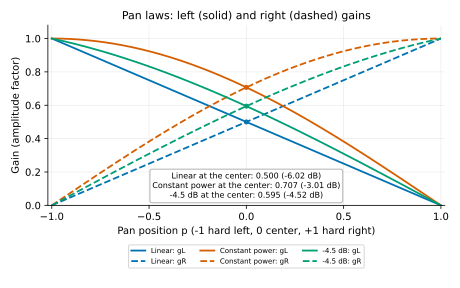
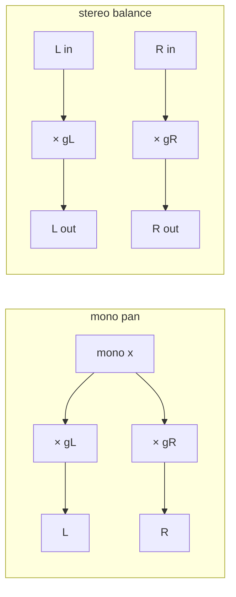
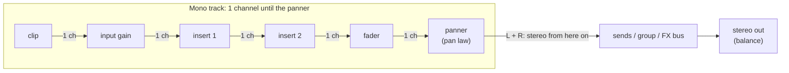
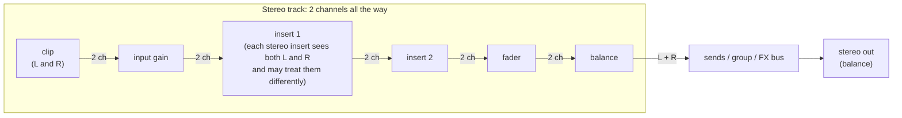

# Chapter 01: Gain, Parameter Smoothing and Pan

**English** | [繁體中文](README.zh-TW.md)

> [Course home](../../README.md) | Previous: [00 Digital Audio Basics](../00-basics/README.md) | Next: [02 Filter](../02-filter/README.md)

"Multiply the signal by a number" is the simplest operation in all of DSP, and also the most common operation in a DAW: every track's fader, the pan knob, the mute button, the master fader, a plugin's input / output gain... all of them are multiplications.
But doing this multiplication *right* takes a whole chapter: why is the unit dB rather than a plain factor? Why is a fader not linear? Why does changing a gain instantly make a "click"? Why does a sum of 8 tracks blow up? Why does a pan to the center get quieter? This chapter answers all of these in one go.

## 1. Chapter goals

After reading this chapter and doing the exercises, you should be able to:

- Convert freely between dB and linear factors (doing ±6 dB, ±20 dB and −3 dB in your head), and state the difference between `20·log10` and `10·log10`.
- Explain why a fader taper is logarithmic / piecewise, and write the "fader position ↔ dB" mapping and its inverse yourself.
- Explain, from the spectrum's point of view, why "changing the gain instantly clicks and changing it continuously produces zipper noise", and quantify both with the first difference and with sidebands.
- Implement and compare two kinds of parameter smoothing: the linear ramp (`SmoothedValue`) and one-pole exponential smoothing (time constant τ).
- Use this chapter's `dawlab::dsp::Gain` / `Panner`, and know how to use them safely on the audio thread.
- Derive the gain and the left/right power sum at the center for the three pan laws (linear / constant power / −4.5 dB), and tell **mono pan** from **stereo balance**.
- Explain how a DAW separates mono and stereo tracks (pan law vs. balance, where the signal becomes stereo), and predict the level difference of the same file on each.
- Explain how peak and RMS each grow when N tracks are summed, what headroom and gain staging are, and the resolution rules for mute / solo / solo-safe (the chapter 14 mixer uses the same rules; there only the FX bus and the master are implicitly solo-safe).

## 2. Theory

### 2.1 Linear factor vs. dB

A gain element does just one thing:

$$
y[n] = g \cdot x[n]
$$

$`g`$ is the linear gain: $`g = 1`$ leaves the signal unchanged, $`g = 0.5`$ halves the amplitude, $`g = 0`$ silences it, $`g = 2`$ doubles the amplitude, and $`g < 0`$ inverts the polarity.
Yet the fader scales you see in a DAW are never 0.5 and 2; they are −6 dB and +6 dB. There are two reasons: **the ear perceives loudness logarithmically** (section 2.2), and **multiplication becomes addition** -- when two gains are cascaded the factors multiply, while in dB you simply add.

The dB (decibel) is defined on a *power ratio*: $`10 \log_{10}(P / P_0)`$. Audio processing deals with amplitudes (sample values), and power is proportional to the square of the amplitude, $`P \propto A^2`$, so

$$
L_\text{dB} = 10 \log_{10}\frac{A^2}{A_0^2} = 20 \log_{10}\frac{A}{A_0}
\qquad\Longleftrightarrow\qquad
g = 10^{L_\text{dB}/20}
$$

This is exactly what `dawlab::gainToDb()` / `dawlab::dbToGain()` (`common/include/dawlab/DspMath.h`) do. **Use 20·log10 for amplitude, and 10·log10 for power (or the square of an RMS, or energy).** Remember this; the pan law and mixing derivations below all rely on it.

A few correspondences you must memorize:

| dB | Amplitude factor $`g`$ | Power factor $`g^2`$ | Intuition |
|---:|---:|---:|---|
| +20 | 10 | 100 | |
| +12 | 3.981 ≈ 4 | 15.85 | |
| +6.02 | 2 | 4 | "+6 dB = double the amplitude" |
| +3.01 | 1.414 = √2 | 2 | "+3 dB = double the power" |
| 0 | 1 | 1 | unity gain |
| −3.01 | 0.7071 = 1/√2 | 0.5 | half the power |
| −6.02 | 0.5 | 0.25 | half the amplitude |
| −12.04 | 0.25 | 0.0625 | |
| −20 | 0.1 | 0.01 | |
| −40 | 0.01 | 10⁻⁴ | |
| −60 | 0.001 | 10⁻⁶ | fader "almost at the bottom" |
| −∞ | 0 | 0 | true silence |

**dBFS** (decibels relative to full scale) takes the largest value a digital system can represent, 1.0, as 0 dB. A sine wave of amplitude 0.5 has a peak of −6.02 dBFS; its RMS is $`0.5/\sqrt{2} = 0.354`$, which is −9.03 dBFS. The peak of a sine wave is always 3.01 dB above its RMS, and this 3 dB gap will keep showing up when we get to metering (chapter 11).

`DspMath.h` treats any value below `kMinusInfinityDb = -100 dB` as −∞ (factor 0). This is a practical compromise: −100 dB is far below the noise floor of any system, and a true 0 lets a mute be completely silent and spares the CPU from processing tiny numbers (denormals: numbers smaller than the smallest normal float, ≈ 1.2e-38, which many CPUs process 10–100 times slower; section 4 says where this chapter can run into them).

### 2.2 The ear's logarithmic perception of loudness

Why not simply show the factor on the fader? Because the ear's sense of loudness is roughly **logarithmic** (an instance of the Weber–Fechner law):

- Going from 0.1 to 0.2 and going from 0.5 to 1.0 both sound "about equally louder" -- both are +6 dB.
- About **+10 dB sounds like "twice as loud"** (a rough rule of thumb from psychoacoustics, Stevens' power law of loudness). Note that this is neither a doubling of the amplitude (+6 dB) nor a doubling of the power (+3 dB).
- At moderate levels the smallest difference the ear can tell apart (the JND) is about **1 dB**, so a DAW fader scale in steps of 0.1 dB is more than enough.
- From a whisper (about 30 dB SPL) to the threshold of pain (about 120 dB SPL) spans 90 dB, i.e. an amplitude ratio of about 30000 -- there is no way to draw that on one fader with a linear scale.

In other words, **dB exists so that "one notch of the fader" corresponds to "about the same audible change"**. This directly determines how a fader has to be designed.

### 2.3 Fader taper: mapping a 0..1 fader position to dB

The fader in a UI is always a position $`p`$ between 0 and 1 (wherever the mouse drags it). What happens if we use $`p`$ directly as the factor (a linear taper)?

| Position $`p`$ | Factor | dB |
|---:|---:|---:|
| 1.00 | 1.00 | 0.0 |
| 0.75 | 0.75 | −2.5 |
| 0.50 | 0.50 | −6.0 |
| 0.25 | 0.25 | −12.0 |
| 0.10 | 0.10 | −20.0 |
| 0.01 | 0.01 | −40.0 |

The entire upper half of the fader covers only 6 dB, while the bottom 1% of travel has to squeeze in everything from −40 dB to −∞ -- you can hardly ever set a track precisely to −30 dB. Conversely, if the whole fader were "linear in dB versus position" (say 0 → −90 dB, 1 → +6 dB), each notch would be a uniform 1 dB, but the fader could never reach −∞ (true silence), and nearly a third of the travel at the very bottom (below −60 dB, 30/96 ≈ 31%) would make no audible difference at all.

In practice DAW faders are all **piecewise** curves: the upper part is linear in dB and very "dense" (near 0 dB one notch is only a fraction of a dB, convenient for fine adjustment), the lower part has more dB per notch the further down you go, and the very bottom attaches a short stretch that is "linear in factor" so that it really can reach 0. Exercise 4 of this chapter uses this set of breakpoints:



| Position $`p`$ | dB | "Density" of this segment |
|---:|---:|---|
| 1.00 | +6 | 0.75..1.00: 6 dB / 0.25 = 24 dB per unit of travel |
| 0.75 | 0 | 0.50..0.75: 12 dB / 0.25 = 48 dB per unit of travel |
| 0.50 | −12 | 0.25..0.50: 18 dB / 0.25 = 72 dB per unit of travel |
| 0.25 | −30 | 0.05..0.25: 30 dB / 0.20 = 150 dB per unit of travel |
| 0.05 | −60 | 0..0.05: the factor goes linearly from 0.001 to 0 |
| 0.00 | −∞ | |

Within a segment we interpolate linearly: when $`p`$ falls in $`[p_i, p_{i+1}]`$, $`t = (p - p_i)/(p_{i+1} - p_i)`$, $`L_\text{dB} = \mathrm{lerp}(L_i, L_{i+1}, t)`$, and then `dbToGain`. The inverse function (gain → position, used when the UI has to draw the fader) is the same thing done backwards. There is no standard answer for these numbers and every DAW differs, but the structure -- "dense at the top, sparse at the bottom, and a linear stretch down to 0 at the very bottom" -- is the same.

### 2.4 Why an instant gain change clicks: multiplying by a step function

Suppose the gain changes instantly from $`g_1`$ to $`g_2`$ at sample $`n_0`$. This is equivalent to multiplying the signal by a **step function**:

$$
y[n] = x[n] \cdot g[n],\qquad g[n] = g_1 + (g_2 - g_1)\,u[n - n_0]
$$

![Gain g[n] as a step function: it drops instantly from g1 to g2 at sample n0, a vertical wall](images/gain-step.svg)

**First, some intuition: amplitude modulation and sidebands.** Multiplying a sine wave by a "changing gain" modulates its amplitude. The simplest example lets the gain wobble slowly at frequency $`f_m`$:

$$
\sin(2\pi f t)\cdot\bigl(1 + m\cos(2\pi f_m t)\bigr)
= \sin(2\pi f t) + \frac{m}{2}\sin\bigl(2\pi (f + f_m) t\bigr) + \frac{m}{2}\sin\bigl(2\pi (f - f_m) t\bigr)
$$

(Expand it with the product-to-sum identity $`\sin A\cos B = \tfrac{1}{2}[\sin(A+B) + \sin(A-B)]`$.) The spectrum originally had a single bar at $`f`$; after multiplying by a changing gain, two new bars grow at $`f \pm f_m`$. The original bar at $`f`$ is called the **carrier**, and the bars that grow beside it are called **sidebands**. The faster the gain changes (the larger $`f_m`$), the farther the sidebands lie from the carrier; the more "violent" the change in gain (the more high-frequency content it has), the more and the wider the sidebands.

Generalizing: any gain curve $`g[n]`$ can be decomposed into many sine components of different frequencies (the spectrum of chapter 00), and each component grows a pair of sidebands on either side of the carrier. This operation -- "copy the whole spectral shape of $`G`$ and shift it to the carrier's position" -- is mathematically called **convolution**: multiplication in the time domain is convolution in the frequency domain, $`Y(f) = X(f) * G(f)`$. All you need to remember here is the plain-language version: "multiplying by a gain curve = pasting the spectrum of the gain curve onto both sides of every frequency line of the signal". For the full derivation see Julius O. Smith, *Mathematics of the DFT*, in the further reading.

Back to the step: the spectrum of a pure tone $`x`$ is a single line, and after convolution $`Y`$ becomes the shape of $`G(f)`$ shifted to that line. The spectrum $`|G(f)|`$ of a step falls off as $`1/f`$ (only 6 dB per octave) and is **broadband** -- so a signal that originally contained only 1 kHz suddenly has energy from 20 Hz to 20 kHz at the instant of the gain change, and what the ear hears is a "click".

The time-domain view is more direct: between two adjacent samples the signal shows an unwanted "steep slope". For a sine of amplitude $`A`$ and frequency $`f`$, the largest difference between adjacent samples is

$$
\max |x[n] - x[n-1]| \approx A \cdot \frac{2\pi f}{f_s}
$$

(for $`A = 0.5`$, $`f = 1`$ kHz, $`f_s = 48`$ kHz it equals 0.0654). A jump produces a difference of $`|x[n_0]|\cdot|g_2 - g_1|`$, which can be many times larger than this value. Example 1 uses the "maximum first difference" to quantify a click: the more times it exceeds the sine's natural value, the more obvious the click.

**Zipper noise** is the continuous version of the same thing. When the user drags a fader, the UI sends a new gain value about once per audio block (in this course 512 samples ≈ 10.7 ms, an update rate of $`f_b = 93.75`$ Hz), so the gain becomes a **staircase**. A staircase = a smooth ramp + a sawtooth error of period $`1/f_b`$; this sawtooth is a periodic signal that can be decomposed into a sum of sine waves at frequencies $`f_b, 2f_b, 3f_b, \dots`$ (these are the "harmonics" of chapter 00; mathematically this is a Fourier series), and the amplitude of the $`k`$-th harmonic of a sawtooth is proportional to $`1/k`$. Applying the "amplitude modulation" intuition above, every harmonic $`k f_b`$ grows a pair of sidebands on either side of the carrier, so the output shows **sidebands** spaced $`f_b`$ apart on both sides of the carrier, dropping 6 dB per octave. These sidebands land 94 Hz, 188 Hz, 375 Hz... away from 1 kHz, and what you hear is the "zzzzz" of a zipper being pulled.



Why is it $`1/k^2`$ after smoothing? Because after a linear ramp the gain is **continuous** (only the slope is discontinuous), and the spectrum of a continuous piecewise-linear function falls off as $`1/f^2`$. The sideband table in example 1 lets you see these two slopes for yourself (−6 dB per octave for the stepped version, −12 dB per octave for the smoothed one).

> An interesting exception: if the jump happens exactly at a zero crossing of the signal ($`x[n_0] = 0`$), then $`x \cdot g_1 = x \cdot g_2 = 0`$ and there is no click at all. If example 1 placed the jump on the block boundary at sample 47616 (≈ 0.992 s), then since 47616 / 48 = 992 is a whole number of 1 kHz periods, $`x = 0`$ there -- and you would hear nothing. So the example deliberately moves the jump to sample 48128 (signal value −0.433). A DAW's "edit at zero crossings" exploits this property; but when adjusting a fader in real time you cannot count on luck, so you smooth.

### 2.5 Parameter smoothing: linear ramp vs. one-pole exponential smoothing

The fix is not to let $`g[n]`$ jump, but to let it "walk" to the target over a period of time. The two most common ways of walking:

**(a) Linear ramp** -- finishes in a fixed $`N`$ samples, advancing by a fixed step per sample:

$$
g[n] = g[n-1] + \frac{g_\text{target} - g_\text{start}}{N},\qquad N = \mathrm{round}(T_\text{ramp} \cdot f_s)
$$

- Advantages: predictable (50 ms is 50 ms), it always reaches the target, and the implementation is a single addition.
- Disadvantage: the slope is discontinuous at the start and end (spectrum $`1/f^2`$, which in practice is already clean enough).
- This is what this chapter's `SmoothedValue` does, and also what JUCE's `SmoothedValue<float, ValueSmoothingTypes::Linear>` does.

**(b) One-pole exponential smoothing** -- each sample covers a fixed fraction $`a`$ of the "remaining distance":

$$
g[n] = g[n-1] + a\,(g_\text{target} - g[n-1]) = (1-a)\,g[n-1] + a\,g_\text{target}
$$

This is actually a first-order IIR low-pass filter (chapter 02 introduces it formally). For a step input (going from 0 to 1) the closed-form solution is

$$
g[n] = 1 - (1-a)^n = 1 - e^{-n/(\tau f_s)},\qquad a = 1 - e^{-1/(\tau f_s)} \approx \frac{1}{\tau f_s}
$$

$`\tau`$ is the **time constant**: the time needed to cover 63.2% ($`1 - e^{-1}`$) of the distance. Handy milestones:

| Time | Fraction reached | Remaining error |
|---|---|---|
| $`1\tau`$ | 63.2% | −8.7 dB |
| $`2.3\tau`$ ($`\ln 10`$) | 90% | −20 dB |
| $`4.6\tau`$ ($`\ln 100`$) | 99% | −40 dB |
| $`6.9\tau`$ ($`\ln 1000`$) | 99.9% | −60 dB |

- Advantages: it moves fast at first and slows down near the target, like a capacitor charging or an analog fader, which sounds "more natural"; and it has a slope corner only at the start (the moment the target changes, the slope jumps from 0 to $`a\cdot(g_\text{target} - g)`$), while the end is asymptotic with no corner (a linear ramp has one at each end).
- Disadvantages: in theory it never reaches the target, so an implementation must "snap" to the target once the error is small enough; otherwise `isSmoothing()` is true forever and the tiny residual values become denormals. There is also a precision trap: when the state is stored as a float, the increment $`a\cdot d`$ near the target becomes smaller than half an ulp (unit in the last place: the spacing between two adjacent representable floats near that value; near 1.0 it is $`\varepsilon = 2^{-23} \approx 1.19 \times 10^{-7}`$, and just below 1 it is half of that), and the state gets "stuck" about $`\varepsilon/(4a)`$ short of the target (about $`1.4 \times 10^{-5}`$ for $`\tau`$ = 10 ms) -- exercise 3 makes you step on this yourself and fix it.



**How long should the ramp be?** Too short (< 1 ms) still clicks; too long (> 100 ms) and the fader feels "half a beat behind", and a pressed mute button lets the sound trail on. Rule of thumb: **10–50 ms** for gain / pan; this chapter's `Gain` and `Panner` default to 50 ms (stipulated by the API contract). A parameter like a filter cutoff recomputes coefficients whenever it changes, and usually uses a shorter ramp together with updating the coefficients every sample (or every few samples); we come back to that in chapters 02 and 03.

**Key points in the design of `SmoothedValue`** (corresponding to `dsp/include/dawlab/dsp/SmoothedValue.h`):

1. `reset(sampleRate, rampSeconds)` decides $`N`$ during the prepare stage; after that nothing allocates on the audio thread.
2. `setTargetValue()` always **restarts from the current value** (not from the previous target), so there is no jump back while a fader is moving continuously.
3. When the target equals the current value no ramp is started and `isSmoothing()` returns false, so `process()` can take the "multiply the whole block by one number" fast path.
4. No accumulation (`current += step`): every step is computed directly as `current = target − step·countdown`. With the accumulating form, in long ramps and with large values (for example the delay times in samples, in the tens of thousands, of chapter 09) the float rounding error of every step accumulates, the ramp overshoots the target, and the last sample jumps back; computing directly keeps the error of every step within one ulp, and when `countdown` reaches 0 the value is exactly `target`. (The multiplication in the header is done in double.)
5. `setCurrentAndTargetValue()` is for initialization: you do not want a plugin to ramp up from 0 when it first starts (that would be a fade-in).
6. `skip(n)`: when this stretch of the buffer does not need a per-sample multiplication (for example you know it is silent), advance the ramp's progress by n samples to keep the timing consistent.

> **Careful: do not use `isSmoothing()` to decide "has the parameter changed".** When the ramp length is 0 (`reset(sr, 0)`, or `lround(seconds·sr) = 0`), `setTargetValue()` makes the value jump to the target instantly and `isSmoothing()` is false throughout. If a component is written as "recompute the filter coefficients only when `isSmoothing()` is true", the update gets missed when smoothing is set to 0. To decide whether a parameter changed, compare the "current value" with the "last applied value" (the chapter 03 `ParametricEq` does exactly that).

### 2.6 Polarity invert (Ø)

"Inverting" is $`g = -1`$: $`y[n] = -x[n]`$. Note that it equals a "180° phase shift" only for a pure sine; for a general signal, inverting **flips the waveform upside down**, it is not a time delay. Uses:

- When several microphones capture the same source (for example top and bottom of a snare, or two mics on a guitar cabinet), if one mic has the opposite polarity, summing them cancels and thins the sound; pressing the Ø button fixes it.
- **Null test**: sum the signal before and after processing (or the outputs of two plugins) with one of them inverted; if the result is 0 (−∞ dB), the two are identical. This is the most powerful tool for verifying a DSP implementation, demonstrated in example 3 (D).

In this chapter's `Gain`, inverting is not a separate multiplication by −1; instead the SmoothedValue's target is set to $`-g`$. When you toggle, the gain walks smoothly from $`+g`$ through 0 to $`-g`$, so **pressing the Ø button does not click either**.

### 2.7 Mixing and headroom: how big does the peak get after summing N tracks?

The core of a mixer is addition: $`y = \sum_i g_i x_i`$. The question is whether the sum exceeds 1.0 (0 dBFS). The answer depends on how **correlated** (coherent) the tracks are:

**Fully correlated** (N identical tracks, for example the same signal copied N times): the amplitudes add directly

$$
A_\text{sum} = N \cdot A \quad\Rightarrow\quad +20\log_{10} N\ \text{dB}\qquad(N = 2: +6.02,\ N = 8: +18.06)
$$

**Fully uncorrelated** (N independent noises, or different instruments): the powers add and the amplitude grows as $`\sqrt{N}`$

$$
P_\text{sum} = N \cdot P \quad\Rightarrow\quad A_\text{rms,sum} = \sqrt{N}\,A_\text{rms} \quad\Rightarrow\quad +10\log_{10} N\ \text{dB}\qquad(N = 8: +9.03)
$$

This is the growth of the RMS; **the peak lies between the two** -- with bad luck the peaks of the tracks can still occur at the same moment, and the worst case is the linear sum of the per-track peaks. Example 3 verifies these three lines with numbers.



**Headroom** is "how many dB the current peak is below 0 dBFS". **Gain staging** is the habit of keeping enough headroom at every stage of the signal chain: first pull the tracks down (for example −12 to −18 dB) so that the mix bus peaks around −6 dBFS, and finally let the master / limiter (chapter 05) decide the loudness of the finished product.

So why, in a 32-bit float DAW, does a mix bus that goes above 0 dBFS not necessarily sound distorted? Because the exponent gives float a range of more than ±700 dB, so exceeding 1.0 internally is perfectly fine -- the distortion happens **where the signal leaves the float world**: written to a 16- / 24-bit integer WAV, sent to a DAC, or passed through some plugin that assumes its input is ≤ 1.0 (for example a bit-crusher or some analog-modeling saturation). Example 3 writes the same "blown-up" mix as 24-bit and as 32-bit float, reads them back and compares the peaks: you will see that the 24-bit version is clipped to 0 dBFS while the 32-bit float version is intact.

### 2.8 The logic of mute / solo

Every track has three switches: **mute**, **solo**, and **solo-safe** (some DAWs call it solo isolate, used for tracks such as an FX return or a metronome that "should still sound when others are soloed"). This course adopts the same rules as the Pro Tools / Logic defaults:

1. As soon as any track is soloed, we enter "solo mode": only the soloed tracks sound.
2. Mute always takes effect: solo + mute → silent (mute wins).
3. A solo-safe track still sounds in solo mode, but is silent when muted itself.

Condensed into one expression ($`S`$ = whether any track is soloed):

$$
\text{audible}_i = \neg\text{mute}_i \land (\neg S \lor \text{solo}_i \lor \text{soloSafe}_i)
$$

| mute | solo | soloSafe | Anyone soloed? | Audible |
|---|---|---|---|---|
| 0 | 0 | 0 | no | ✔ |
| 0 | 0 | 0 | yes | ✘ |
| 0 | 1 | – | – | ✔ |
| 0 | 0 | 1 | yes | ✔ |
| 1 | – | – | – | ✘ |

The key point: **after resolving "should it sound", do not set the samples directly to 0**; instead set that track's `Gain` target to 0 dB or −∞ dB and let the ramp walk there -- only then does the mute button not "click". The chapter 14 mixer follows the same idea: `Mixer` decides whether each track should sound with `!mute && (!anySolo || solo)` (the expression of `Mixer::isTrackAudible()`, which has no soloSafe term), and `ChannelStrip` then uses its own 10 ms `SmoothedValue` to ramp the mute gain to 0 or 1 (exercise 6 demonstrates the same thing with the 50 ms ramp of `dsp::Gain`).

### 2.9 Pan law

The job of a pan: distribute a mono signal between the left and right speakers, with two gains $`g_L, g_R`$ expressing the image position. Let the pan position be $`p \in [-1, 1]`$ (−1 hard left, 0 center, +1 hard right) and define $`\theta = (p + 1)/2 \in [0, 1]`$. Three common laws:

**Linear**

$$
g_L = 1 - \theta,\qquad g_R = \theta
$$

- Center: $`g_L = g_R = 0.5`$ → **−6.02 dB**.
- The amplitude sum $`g_L + g_R = 1`$ always holds → when left and right are summed to mono the level does not change (**mono compatible**).
- The power sum $`g_L^2 + g_R^2 = 1 - 2\theta + 2\theta^2`$, equal to 0.5 at the center → **−3.01 dB**: listening with two speakers in a room (left and right add uncorrelated, i.e. their powers add), sweeping through the center sounds like the level "dips".

**Constant power**

$$
g_L = \cos\!\left(\theta\frac{\pi}{2}\right),\qquad g_R = \sin\!\left(\theta\frac{\pi}{2}\right)
$$

- The power sum $`g_L^2 + g_R^2 = \cos^2 + \sin^2 = 1`$ **always holds** (which is why it is called constant power) → when listening on speakers the level stays steady during a sweep.
- Center: $`g_L = g_R = \cos(\pi/4) = 1/\sqrt{2} = 0.7071`$ → **−3.01 dB**.
- The amplitude sum at the center is $`\sqrt{2}`$ → when summed to mono, a signal at the center is **+3.01 dB** louder than at the edges (not mono compatible).

**−4.5 dB (the compromise)**

$$
g_L = \sqrt{(1-\theta)\cos\!\left(\theta\tfrac{\pi}{2}\right)},\qquad g_R = \sqrt{\theta\,\sin\!\left(\theta\tfrac{\pi}{2}\right)}
$$

This takes the **geometric mean** of the two laws, so its dB value is exactly the arithmetic mean of the two: at the center $`\sqrt{0.5 \times 0.7071} = 0.5946`$ → **−4.52 dB** (= (−6.02 − 3.01)/2). The power sum at the center is $`2 \times 0.5 \times 0.7071 = 0.7071`$ → −1.51 dB; the amplitude sum at the center is 1.189 → +1.51 dB. On speakers it dips 1.5 dB and in mono it bulges 1.5 dB, each side giving up one step. DAWs such as Cubase, Pro Tools and Reaper all offer −4.5 dB as one of their pan law options (the default differs from DAW to DAW and changes with versions, so go by the version you use), and large analog consoles such as the SSL use similar values.

Putting the numbers of the three laws at the center side by side:

| Pan law | Center $`g_L = g_R`$ | Center dB | $`g_L^2 + g_R^2`$ (speakers) | $`g_L + g_R`$ (mono sum) |
|---|---:|---:|---|---|
| Linear | 0.5 | −6.02 | 0.5 (−3.01 dB, dips) | 1 (0 dB, flat) |
| Constant power | 0.7071 | −3.01 | 1 (0 dB, flat) | 1.414 (+3.01 dB, bulges) |
| −4.5 dB | 0.5946 | −4.52 | 0.7071 (−1.51 dB) | 1.189 (+1.51 dB) |



**Mono pan vs. stereo balance** -- this is where beginners confuse things most often:

- **Pan** (mono input → stereo output): one signal is "distributed" between left and right, $`L = g_L x`$, $`R = g_R x`$. At hard right the left speaker is completely silent, but all the content is on the right.
- **Balance** (stereo input → stereo output): the left and right channels are each multiplied by a gain, $`L' = g_L L`$, $`R' = g_R R`$. Turning to hard right switches off the left channel, and **the original content of the left channel disappears**; it is not moved to the right.

What this chapter's `Panner::process(block)` does to a stereo block is the second kind (channel 0 times $`g_L`$, channel 1 times $`g_R`$); when the two channels of the block hold the same content (mono copied to two channels) it is equivalent to the first kind. For a true "mono → stereo" use `processMonoToStereo()`. Example 2 (C) uses uncorrelated left and right noise to show that `process()` is only a balance. Note that the pan law is still applied at the center: with constant power, a stereo block at pan = 0 is −3 dB on both sides. A bus or master that is already stereo usually wants a **balance law** with "0 dB at the center, and only the other side attenuated when turned to one side" (the chapter 14 mixer does its own balance mode with `Panner::computeGains()`). To "really shift a stereo signal to the right" you need M/S or more elaborate processing (the stereo width of exercise 7 is one such tool).



### 2.10 Mono and stereo tracks in a DAW (Cubase as the example)

Section 2.9 separated pan from balance mathematically. A DAW turns that distinction into a property of the track itself: when you create an audio track you choose its **channel configuration**, mono or stereo, and that choice decides how many channels flow through the track's inserts and whether its pan control is a pan or a balance. We use Cubase as the example because it makes the choice explicit, but most DAWs work in a very similar way. Details such as menu names and defaults change between versions, so check the manual of the version you use.

**Mono track.** A mono audio track carries **one** channel from the clip, through its input gain and **inserts** (EQ, compressor, ...), up to the **panner**. Every insert on it processes that one channel. The panner is the point where the signal becomes stereo: it places the mono source in the stereo field with a **pan law** (section 2.9). In Cubase the pan law is a per-project setting (in the project setup dialog), with choices such as 0 dB, −3 dB, −4.5 dB and −6 dB; the default is −3 dB equal power, i.e. the constant power law of section 2.9. Everything after the panner is stereo: the sends, the group / FX channels (buses) and the stereo out (the master).

**Stereo track.** A stereo audio track carries **two** channels through its inserts; each insert sees a stereo signal and may treat the two sides differently. Its pan control is not a pan law: in Cubase's default mode, the **Stereo Balance Panner**, it is a **balance**. At the center both sides pass at unity (0 dB), and turning it to the right only attenuates the left side (the right side stays at unity), exactly the balance of section 2.9. Cubase also offers other stereo panner modes, for example the **Stereo Combined Panner**, which positions the left and right channels as a linked pair so you can narrow the stereo image and move it as a whole, instead of only attenuating one side.

**The master / stereo out** is always stereo and its pan is a balance, for the same reason: a finished stereo mix left at "center" must come out unchanged, not 3 dB quieter. A pan law there would turn every mix down by 3 dB just because the knob sits in the middle.





**The numbers.** With the constant power law and the linear balance law used in this course (the chapter 14 mixer uses the same one):

$$
\text{pan law: } g_L = \cos\!\left(\theta\tfrac{\pi}{2}\right),\ g_R = \sin\!\left(\theta\tfrac{\pi}{2}\right);\qquad
\text{balance: } g_L = \min(1,\ 1 - p),\ g_R = \min(1,\ 1 + p)
$$

| Position $`p`$ | Mono track, constant power ($`g_L`$ / $`g_R`$) | Stereo track, balance ($`g_L`$ / $`g_R`$) |
|---|---|---|
| −1 (hard left) | 1 / 0 | 1 / 0 |
| 0 (center) | 0.7071 / 0.7071 (−3.01 dB per side) | 1 / 1 (0 dB per side) |
| +0.5 | 0.3827 / 0.9239 | 0.5 / 1 (L −6.02 dB, R 0 dB) |
| +1 (hard right) | 0 / 1 | 0 / 1 |

So **the same mono file at the center is 3.01 dB louder per side on a stereo track (as $`L = R`$) than on a mono track**: $`20\log_{10}(1/0.7071) = 3.01`$ dB. Note also that balance at +0.5 does not "move the source halfway to the right"; it simply turns the left side down by 6 dB.

**Is duplicating a mono file into an $`L = R`$ stereo file the same as using a mono track?** Partly.

- The same:
  - The fader behaves identically, and if the stereo track used a pan law instead of balance, the levels at every pan position would be identical as well.
  - **Channel-independent inserts** -- EQ, filters, gain, saturation / distortion, and dynamics with the two sides linked (one detector driving the same gain on both sides) -- receive the same input on L and R and therefore produce identical L and R outputs. The result is the mono-track result, just stored twice.
- Different:
  - **Stereo-generating inserts** turn $`L = R`$ into a genuinely wide signal: a chorus with stereo spread, a ping-pong delay, the width of a reverb, the LFO phase offset between the two sides of a phaser or tremolo. On a mono track the same effect runs on one channel, so there is no second side to make different; the panner then sends scaled copies of that single signal to L and R, and the result stays a point source.
  - The stereo track **balances** instead of panning with a pan law: at the center it is 3.01 dB louder than the mono track (see the table), and turning it attenuates one side rather than moving the image.
  - It costs **twice the CPU and memory** (every insert processes two channels, the file takes twice the space) for no audible benefit when the inserts are channel-independent.
  - The meters show two identical channels.

**The other direction: folding a stereo file onto a mono track.** The stereo file has to be downmixed, usually as

$$
x_{\mathrm{mono}} = \frac{L + R}{2}
$$

This is exact for $`L = R`$ (you get the original signal back). **Correlated** material (the same content, with the same polarity, on both sides) keeps its level; **uncorrelated** material of equal level (for example the two sides of a wide reverb, or two different microphones) drops by about **3 dB**, because the powers add while the amplitude is halved ($`\sqrt{2}/2 = 0.7071`$); and material with **opposite polarity** on the two sides ($`R = -L`$, a pure side signal) **cancels** completely. This is the same mono-compatibility question as in exercise 7: $`(L + R)/2`$ is exactly the mid signal $`M`$.

**Looking ahead.** The DAW of chapter 14 implements exactly this model: `Track::setFormat(TrackFormat::Mono)` or `Track::setFormat(TrackFormat::Stereo)` chooses the format, a mono track runs its inserts on a one-channel block before the panner, and the format selects the strip's pan mode, `PanMode::PanLaw` for a mono track and `PanMode::Balance` for a stereo track (buses and the master always use balance). See [Step 4 - The 8-track mixer](../14-daw-8track/docs/step-04-mixer.md).

## 3. From formulas to code

This chapter adds three headers to `dsp/include/dawlab/dsp/`, all header-only and depending only on `common/`. Later, the chapter 13 plugin uses `Gain` and `SmoothedValue` directly, and the chapter 14 DAW uses all three.

### 3.1 `SmoothedValue.h`

```cpp
class SmoothedValue {
public:
    void reset(double sampleRate, double rampSeconds) noexcept;  // prepare stage: decides the ramp length N
    void setRampLength(int numSamples) noexcept;                 // changes only the length, does not interrupt the current value
    void setCurrentAndTargetValue(float value) noexcept;         // initialization: do not ramp up from 0
    void setTargetValue(float value) noexcept;                   // walks from the "current value" toward the new target
    float getNextValue() noexcept;                               // call once per sample
    float getCurrentValue() const noexcept;
    float getTargetValue() const noexcept;
    bool  isSmoothing() const noexcept;
    void  skip(int numSamples) noexcept;
    void  applyGain(float* data, int n) noexcept;                // convenience: a single channel
    void  applyGain(AudioBlock block) noexcept;                  // convenience: all channels share the same ramp
};
```

The core is only these few lines, corresponding to the linear ramp formula of section 2.5:

```cpp
void startRamp() noexcept {                    // called by setTargetValue()
    countdown_ = rampSamples_;                 // N
    step_ = (target_ - current_) / static_cast<float>(rampSamples_);   // (g_target − g_start) / N
}

float getNextValue() noexcept {
    if (countdown_ <= 0) return target_;       // not in a ramp: fast path
    --countdown_;
    current_ = target_ - step_ * countdown_;   // = start + n·step, but without accumulating; when countdown reaches 0 it is exactly target
    return current_;
}
```

`applyGain(AudioBlock)` is for `Gain`: all channels of the same frame are multiplied by the **same** value (the level of left and right must change together; they cannot each walk their own ramp).

### 3.2 `Gain.h`

```cpp
class Gain {
public:
    void prepare(double sampleRate, int maxBlockSize, int numChannels);
    void reset() noexcept;                       // snaps the ramp straight to the target value
    static constexpr float kMaxGainDb = 40.0f;   // upper limit of setGainDb
    void setGainDb(float db) noexcept;           // the parameter is in dB (NaN is ignored, > +40 dB is clamped)
    void setGainLinear(float linear) noexcept;
    float getGainDb() const noexcept;
    float getGainLinear() const noexcept;
    void setPolarityInverted(bool) noexcept;     // Ø: the target becomes −g, using the same ramp
    bool isPolarityInverted() const noexcept;
    void setRampSeconds(double seconds) noexcept;   // default 0.05 s
    double getRampSeconds() const noexcept;
    float getCurrentGainLinear() const noexcept; // the value actually being multiplied into the signal (for the UI / tests)
    bool isSmoothing() const noexcept;
    float processSample(int channel, float x) noexcept;  // per frame: channel 0 advances the ramp
    void process(AudioBlock block) noexcept;             // in place
};
```

What `setGainDb()` does is "dB → linear → set as the SmoothedValue target"; `process()` is just `smoother_.applyGain(block)`. It looks thin, but this thin wrapper is what puts three things into practice: "the parameter is expressed in dB, the internals use a linear factor, and changes are smoothed". `kMinusInfinityDb` (−100 dB) is converted by `dbToGain` to exactly 0, so `setGainDb(kMinusInfinityDb)` is a mute. `setGainDb()` also guards against invalid values for you: NaN is ignored (the existing setting is kept) and anything above `Gain::kMaxGainDb` (+40 dB) is clamped -- neither +inf nor "a linear factor passed in by mistake as dB" can make the output become inf.

The convention of `processSample(channel, x)`: for every frame, call channel 0 first (which advances the ramp by one step), and the other channels reuse the same value. This is consistent with the behavior of `process()`.

### 3.3 `Panner.h`

```cpp
enum class PanLaw { Linear, ConstantPower, Minus4_5dB };
const char* panLawName(PanLaw law) noexcept;

class Panner {
public:
    void prepare(double sampleRate, int maxBlockSize, int numChannels);
    void reset() noexcept;
    void setPan(float pan) noexcept;             // -1 left, 0 center, +1 right
    float getPan() const noexcept;
    void setPanLaw(PanLaw law) noexcept;         // default ConstantPower
    PanLaw getPanLaw() const noexcept;
    void setRampSeconds(double seconds) noexcept;   // default 0.05 s
    float getCurrentLeftGain() const noexcept;
    float getCurrentRightGain() const noexcept;
    bool isSmoothing() const noexcept;
    static void computeGains(float pan, PanLaw law, float& left, float& right) noexcept;  // pure function
    void process(AudioBlock block) noexcept;                         // stereo block: ch0 × gL, ch1 × gR (= balance)
    void processMonoToStereo(const float* mono, AudioBlock stereoOut) noexcept;  // a true mono pan
};
```

`computeGains()` is a direct transcription of the three formulas in section 2.9:

```cpp
const float theta = 0.5f * (p + 1.0f);                 // 0 = hard left, 0.5 = center, 1 = hard right
const float linL = 1.0f - theta,  linR = theta;        // Linear
const float halfPi = float(kPi) * 0.5f;
const float cpL = std::sin((1.0f - theta) * halfPi);  // = cos(θ·π/2), but exactly 0 at hard right
const float cpR = std::sin(theta * halfPi);           // ConstantPower
// Minus4_5dB: the geometric mean
left = std::sqrt(linL * cpL);  right = std::sqrt(linR * cpR);
```

Why isn't `cpL` simply written as `std::cos(theta * halfPi)`? Because `float(kPi)` is slightly larger than the true π, so at hard right (θ = 1) `cos(float(π)/2)` yields −4.37e-8: not 0, and moreover **negative**, so the left channel would keep a tiny inverted-polarity residue, which contradicts "at hard right the left speaker is completely silent". Rewriting it as $`\sin((1-\theta)\pi/2)`$ is mathematically identical, but both ends become $`\sin(0) = 0`$ (exact), and it is symmetric between left and right and never negative. Example 2 (D) uses a self-check to verify that for all three laws the opposite side's gain is `== 0.0f` at pan = ±1. In addition, `setPan()` ignores NaN / inf (keeping the previous value), and `computeGains()` treats them as the center -- once a NaN flows into the audio, everything after it turns into NaN.

The left and right gains each use a `SmoothedValue`, so a pan sweep does not zipper. `process()` does nothing for a mono block (there is no second channel to pan); for a mono input use `processMonoToStereo()`.

### 3.4 Example 1: `l01_zipper_noise` (`examples/zipper_noise.cpp`)

Build at the project root (the same build directory as the exercises), then change into the build directory and run it:

```powershell
.\scripts\build.ps1 -Only 01-gain
cd build
.\bin\Debug\l01_zipper_noise.exe
```

The output WAV files are written to `dawlab_output/` under the "current working directory" (`outputPath()` is a path relative to the current working directory), so `cd build` first and then run it, and the files end up in `build\dawlab_output\`. The other examples in this chapter are run the same way.

| File | Content | What you should hear |
|---|---|---|
| `l01_step_instant.wav` | 1 kHz sine, gain jumps instantly 0 → −20 dB at about 1.0 s | A clear "click" |
| `l01_step_smoothed.wav` | Same, with a 50 ms linear ramp | Only the level getting quieter |
| `l01_zipper_stepped.wav` | From 0.5 s on, −1 dB per block, 40 steps in total (simulating a fader drag, no smoothing) | A zipper-like "zzzzz" |
| `l01_zipper_smoothed.wav` | Same, through `SmoothedValue` | A clean fade out |

The numbers actually printed (excerpt):

```
Max first difference of the pure sine: measured 0.0653, theory A*2*pi*f/fs = 0.0654

(A) Single jump 0 dB -> -20 dB (at sample 48128 = 1.0027 s, original signal value there -0.433)
    Instant jump: sample before the jump -0.3967 -> after the jump -0.0433, first difference 0.3534
    Max first difference: instant jump 0.3534 (5.4x the natural value of the sine)
    Max first difference: 50 ms ramp 0.0653 (1.00x, almost equal to the natural value)

(B) Fader movement: -1 dB per block (10.67 ms, update rate 93.75 Hz), 40 steps in total
    Sidebands next to 1 kHz (relative to the 1 kHz carrier, measured over the 0.43 s of fader movement):
    Frequency              Stepped (dB) Smoothed (dB)
    1093.75 Hz (1k+ 1*fb)        -34.7        -74.4
    1187.50 Hz (1k+ 2*fb)        -40.8        -86.4
    1375.00 Hz (1k+ 4*fb)        -46.8        -98.5
    1750.00 Hz (1k+ 8*fb)        -52.8       -100.0
    2500.00 Hz (1k+16*fb)        -58.8       -100.0

SmoothedValue: the 50 ms ramp at 48000 Hz took 2400 samples (expected 2400), final value 0.000
```

How to read these numbers:

- (A) The first difference of the instant jump is **5.4 times** the natural value of the sine (0.3534 vs. 0.0654) -- that is the click. After smoothing it is back to 1.00 times.
- (B) The sidebands of the stepped version drop **6 dB** per octave (−34.7 → −40.8 → −46.8 → −52.8 → −58.8), exactly the $`1/k`$ of section 2.4; the smoothed version drops **12 dB** per octave (−74.4 → −86.4 → −98.5), which is $`1/k^2`$, and is about 40 dB lower overall (the first sideband differs by 39.7 dB, and the higher orders by even more; −100 dB is the measurement floor).
- 2400 = 0.05 × 48000: the ramp length is exact.

### 3.5 Example 2: `l01_pan_law` (`examples/pan_law.cpp`)

```powershell
bin\Debug\l01_pan_law.exe
```

It writes `l01_pan_sweep_linear.wav`, `l01_pan_sweep_constpower.wav` and `l01_pan_sweep_minus4_5.wav`: a mono plucked arpeggio swept from hard left to hard right over 4 seconds. On headphones, the linear version sounds as if the level "drops" while passing the center; the constant power version (heard on speakers) keeps a steadier level; −4.5 dB lies between the two.

The pan law tables printed (excerpt: the center and ±0.5):

```
--- Linear ---
     pan   gL (dB)   gR (dB) gL^2+gR^2 dB     gL+gR dB
   -0.50     -2.50    -12.04        -2.04         0.00
   +0.00     -6.02     -6.02        -3.01         0.00
--- ConstantPower ---
   -0.50     -0.69     -8.34         0.00         2.32
   +0.00     -3.01     -3.01        -0.00         3.01
--- Minus4_5dB ---
   -0.50     -1.59    -10.19        -1.03         1.15
   +0.00     -4.52     -4.52        -1.51         1.51

(B) Mono plucked arpeggio swept from left to right (4 s), RMS of the left and right channels measured at the center:
  Linear         center: L -6.15 dB, R -5.89 dB (relative to the original mono signal) -> l01_pan_sweep_linear.wav
  ConstantPower  center: L -3.11 dB, R -2.91 dB (relative to the original mono signal) -> l01_pan_sweep_constpower.wav
  Minus4_5dB     center: L -4.63 dB, R -4.40 dB (relative to the original mono signal) -> l01_pan_sweep_minus4_5.wav

(C) Stereo (uncorrelated white noise in left and right) through the Panner (ConstantPower, pan = +0.5):
  L: -16.84 dB -> -25.19 dB (change -8.34 dB, = gL -8.34 dB)
  R: -16.78 dB -> -17.47 dB (change -0.69 dB, = gR -0.69 dB)

(D) Endpoint check: gain on the opposite side at pan = +/-1
  Linear         hard right gL = 0, hard left gR = 0
  ConstantPower  hard right gL = 0, hard left gR = 0
  Minus4_5dB     hard right gL = 0, hard left gR = 0
  After setPan(NaN) pan = 0.25; computeGains(NaN) = 0.7071 / 0.7071 (treated as center)
[PASS] l01_pan_law (3 checks passed)
```

- Every column of the table matches the derivation in section 2.9: for Linear `gL+gR` is always 0 dB, for ConstantPower `gL²+gR²` is always 0 dB, and −4.5 dB dips / bulges by 1.51 dB at the center.
- (B) is measured over 0.1 s during the sweep, and in that time the pan moves from −0.025 to +0.025, which is why left and right differ by about 0.2 dB; the average of the two (−6.02, −3.01, −4.52) is exactly the theoretical value.
- (C) The left channel dropped by exactly $`g_L`$'s 8.34 dB and the right channel by $`g_R`$'s 0.69 dB -- the left content was not "moved" to the right; this is a balance.
- (D) For all three laws the opposite side is exactly 0 at both ends (see section 3.3 for why `cpL` has to be written with sin); an invalid pan value does not let NaN flow into the audio.

### 3.6 Example 3: `l01_mixing_headroom` (`examples/mixing_headroom.cpp`)

```powershell
bin\Debug\l01_mixing_headroom.exe
```

| File | Content | What you should hear |
|---|---|---|
| `l01_mix_hot_clipped.wav` | 8 tracks each at 0 dB summed directly, written as 24-bit | Harsh distortion on the drum hits |
| `l01_mix_hot_float.wav` | The same mix written as 32-bit float | No distortion (the player turns it down automatically, or you turn the volume down) |
| `l01_mix_staged.wav` | Each track at −18 dB, master 0 dB | Clean, but quiet overall -- this is the price of headroom |
| `l01_mix_mute.wav` | One plucked track is muted at about 1.0 s (0.992 s, a block boundary) with a 50 ms ramp | A mute without a click |

```
(A) 8 identical sine tracks, each with peak -12.00 dBFS:
    Sum peak = 6.06 dBFS (formula 20*log10(N) = +18.06 dB -> 6.06 dBFS) <- exceeds 0 dBFS!
(B) 8 mutually uncorrelated white-noise tracks, each with RMS -16.84 dBFS, peak -12.04 dBFS:
    Sum RMS = -7.75 dBFS, growth 9.10 dB (formula 10*log10(N) = +9.03 dB)
    Sum peak = 5.46 dBFS, growth 17.50 dB (between +9.03 and +18.06)

(C) 8 tracks of music material (1 drum track + 7 plucked-string tracks), peak of each track: -2.9 -6.9 -6.9 -6.9 -6.9 -7.0 -7.0 -7.0 dBFS
    Linear sum of the per-track peaks = 3.86 (11.72 dBFS): this is the worst case (all peaks arrive at the same time)
    Every track at 0 dB summed directly: peak = 9.25 dBFS, 286 samples exceed 0 dBFS -> clips when written as 24-bit
    To guarantee 6 dB of headroom even in the worst case: per-track + master must total at least -17.7 dB -> -18 dB per track, master +0 dB
    Worst-case peak = 11.72 -18 = -6.28 dBFS (headroom 6.28 dB)
    -18 dB per track, master +0 dB: peak = -8.75 dBFS, headroom 8.75 dB
    (Equivalent to -18 dB overall, so the peak is exactly 9.25 -18 = -8.75 dBFS)
    Read back l01_mix_hot_clipped.wav (24-bit integer): peak = -0.00 dBFS (clipped to 0 dBFS)
    Read back l01_mix_hot_float.wav (32-bit float): peak = 9.25 dBFS (the part above 0 dBFS is preserved intact)

(D) Polarity invert null test: original peak -6.94 dBFS, inverted peak -6.94 dBFS,
    peak of the sum of the two = -100.0 dBFS (complete cancellation = -inf dB)

(E) Mute (at sample 47616 = 0.992 s, signal value there +0.035), maximum first difference in the 150 ms around the mute:
    Original signal 0.0103 | instantly set to 0: 0.0354 (click) | Gain 50 ms ramp: 0.0103 (not above the original = no click)
    Peak after 1.2 s = -100.0 dBFS (completely silent)
```

- (A) Correlated signals: +18.06 dB, in exact agreement with $`20\log_{10} 8`$.
- (B) Uncorrelated signals: RMS +9.10 dB (theory +9.03), peak +17.5 dB -- the peaks of white noise really can "line up", so **you cannot judge whether it will clip from the RMS alone**.
- (C) Working backwards from the linear sum of the per-track peaks, 11.72 dBFS: to guarantee 6 dB of headroom even in the worst case, "per-track + master" together must come down by 17.7 dB → −18 dB per track and 0 dB on the master, giving a worst-case peak of 11.72 − 18 = −6.28 dBFS; the actual mix peaks at −8.75 dBFS (the track peaks do not occur at the same time, so it is another 2.5 dB lower than the worst case). The gain of **every stage** of the signal chain has to be counted: if the master then adds +3 dB, the overall reduction is only 15 dB and the worst case has just 3.3 dB of headroom left. That is how gain staging is computed -- it is not a rule of thumb like "−12 dB".
- (C) The last two lines: for the same mix, the peak of the 24-bit version was clipped to 0 dBFS (the distortion is already "burned" into the file), while the 32-bit float version reads back as +9.25 dBFS -- the data is intact and can be rescued simply by turning the level down afterwards.
- (D) The null test gives −100 dBFS (this course's −∞): `Gain`'s polarity inversion is an exact −1.
- (E) Compared over a 150 ms window around the mute: setting the samples directly to 0 makes the first difference 3.4 times that of the original signal (0.0354 vs. 0.0103, which is that "click"); going through `Gain`'s 50 ms ramp matches the original signal (0.0103) and adds no steep slope. After 1.2 s it is a true 0 (`kMinusInfinityDb` → factor 0). Note that the mute happens exactly on a block boundary (the start of block 93 = 0.992 s), because UI parameters can only take effect between blocks.

## 4. Real-time notes

- **Only `prepare()` may allocate.** None of the three classes in this chapter actually needs the heap (their state is just a few floats), but the interface is kept uniform; inside `process()` there is no new / vector::resize / mutex / I/O.
- **The components in this chapter are not thread-safe: setters are called only between blocks, from the same thread that calls `process()`.** `setGainDb()` writes one float (`gainDb_`) plus the SmoothedValue's target / step / countdown, all of which are plain floats / ints. If the UI thread calls a setter directly while the audio thread is reading inside `process()`, then under the C++ memory model this is a **data race, which is undefined behavior** -- even if on x86 / ARM64 hardware an aligned float write happens not to be "torn", the compiler may assume that no other thread is modifying these variables and perform surprising optimizations, so "hardware writes are atomic" cannot be used as a basis for thread safety. The correct approach: the UI thread writes only a `std::atomic<float>`, and the audio thread reads it at the start of every block and hands it to the smoother (the chapter 14 `ChannelStrip` follows this pattern); chapter 13 will deal with parameter thread safety formally using JUCE's `AudioProcessorValueTreeState`. The course deliberately does not add atomics / locks inside this chapter's components, to keep them simple and testable offline.
- **Initialize with `setCurrentAndTargetValue` / `reset()`.** Otherwise a plugin ramps from 0 to the target value as soon as it loads, producing a fade-in over the first 50 ms; for `Gain`, `prepare()` already does this for you.
- **Re-`prepare()` when the sample rate changes.** The ramp length is counted in samples; switching from 48 kHz to 96 kHz without recomputing would turn it into 25 ms.
- **Denormals.** This chapter's linear ramp lands exactly on the target when it finishes and leaves no tiny values behind; the exponential smoother of exercise 3 does, so it has to snap. The IIR filters of chapter 02 need even more care.
- **A ramp is not latency.** Smoothing only affects the time a "parameter" takes to reach its target; the signal itself is not delayed, so `Gain` / `Panner` do not need to report latency.
- **Multiple channels share one ramp.** `Gain::process()` multiplies every channel of the same frame by the same value; if you write your own loop with `processSample()`, follow the convention of "channel 0 first for every frame", otherwise the left and right ramps will each advance and run twice as fast.

## 5. Common mistakes and debugging

| Symptom | Likely cause | How to check |
|---|---|---|
| A "click" when a parameter changes | The new value is multiplied in directly with no ramp; or the ramp length is 0 (forgot `prepare()` / `reset(sr, ramp)`) | Print `isSmoothing()` and `getRampSamples()`; compute the maximum first difference (`maxFirstDifference` in example 1) and see whether it is much larger than $`A\cdot 2\pi f/f_s`$ |
| "Zzzz" while dragging a fader | One step per block with no smoothing | Measure the sidebands at $`k \cdot f_b`$ around the carrier with a Goertzel filter (example 1 (B)) |
| The level changes "half a beat late", mute trails on | The ramp is too long (> 100 ms); or the exponential smoother's τ is too large (remember 99% takes 4.6τ) | Set the ramp to 10–50 ms |
| A plugin fades in when loaded | No `setCurrentAndTargetValue()`, so it ramps up from 0 | Align current with target inside `prepare()` |
| Left and right levels change out of sync / the ramp runs too fast | `getNextValue()` is called once per channel | Use `applyGain(AudioBlock)`, or follow the convention that "channel 0 advances the ramp" |
| `isSmoothing()` is always true, the CPU occasionally spikes | The exponential smoother does not snap; the float state is stuck about $`\varepsilon/(4a)`$ from the target; denormals | Keep the state in a double and set a snap threshold (exercise 3) |
| The mix distorts but the DAW's meter is not red | Internal float is fine; it clips only when exported to an integer WAV / sent to a DAC | Look at the mix bus peak (`peakAbs`); gain staging |
| The level drops when panned to the center | This is normal behavior of the linear pan law (−6 dB) | Switch to constant power or −4.5 dB; decide whether you are listening on speakers or care about mono compatibility |
| After panning a stereo track hard right, the stuff on the left "vanishes" | `Panner::process()` is a balance for stereo, not a pan | To move content, first sum to mono and then use `processMonoToStereo()`, or use M/S (exercise 7) |
| `dbToGain(-6)` fails to compile as ambiguous | An int can convert to both float and double | `DspMath.h` already provides a `dbToGain(int)` overload; passing `-6.0f` is the safest |
| Comparing the ramp end point with `==` fails | Floating-point accumulation error | `SmoothedValue` sets the last step directly to the target; do the same in your own implementation |

## 6. Exercises

See [`exercises/README.md`](exercises/README.md). There are 8: 3 conceptual / calculation problems (dB mental math, concepts of smoothing and pan law, and exercise 8: the same vocal on a mono track and a stereo track) and 5 implementation problems (the exponential smoother and time-constant measurement, fader taper, the multiplicative (straight line in dB) ramp, mute / solo resolution, and M/S stereo width and balance). Solutions are in [`solutions/README.md`](solutions/README.md).

## 7. Further reading

- Udo Zölzer (ed.), *DAFX: Digital Audio Effects*, 2nd ed., Wiley, 2011 -- basic concepts in chapter 1, Introduction; chapter 5, Spatial Effects, discusses panning and pan laws.
- Will Pirkle, *Designing Audio Effect Plugins in C++*, 2nd ed., Routledge, 2019 -- parameter smoothing and plugin architecture.
- Joshua D. Reiss & Andrew P. McPherson, *Audio Effects: Theory, Implementation and Application*, CRC Press, 2014/2015 (the release year and the copyright-page year differ) -- has dedicated chapters on amplitude-related effects and panning.
- Bob Katz, *Mastering Audio: The Art and the Science*, 3rd ed., Focal Press, 2014/2015 (the release year and the copyright-page year differ) -- the practical view of headroom, gain staging, dBFS and loudness.
- JUCE documentation: `juce::SmoothedValue` (Linear / Multiplicative smoothing) and `juce::dsp::Panner` (which offers pan rules such as linear / balanced / sin3dB / sin4p5dB / sin6dB / squareRoot3dB / squareRoot4p5dB); read them side by side with this chapter's API.
- Julius O. Smith III, *Mathematics of the DFT* and *Introduction to Digital Filters* (CCRMA, Stanford, free online) -- the mathematical background for "multiplication ↔ convolution" in section 2.4 and the one-pole in section 2.5.

## 8. Next chapter

Having learned to "multiply by a number", the next step is to "multiply by a number that varies with frequency" -- chapter 02, [02-filter](../02-filter/README.md), starts from the one-pole low-pass (the very expression of exercise 3) and goes all the way to the biquad and the RBJ cookbook.
