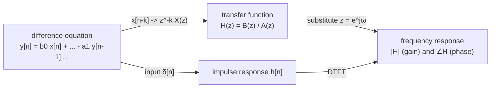
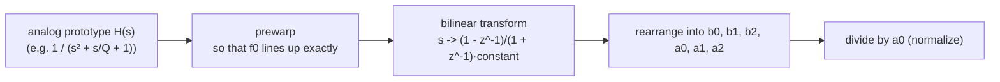
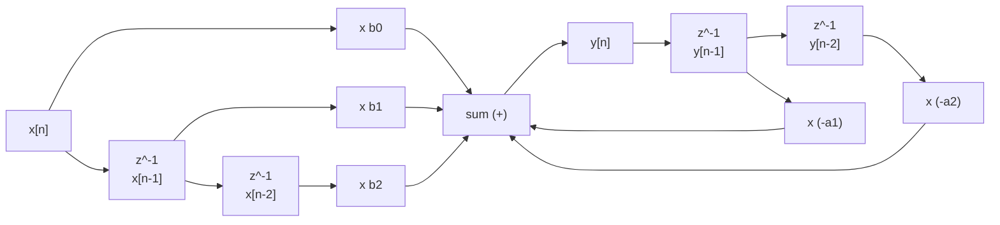
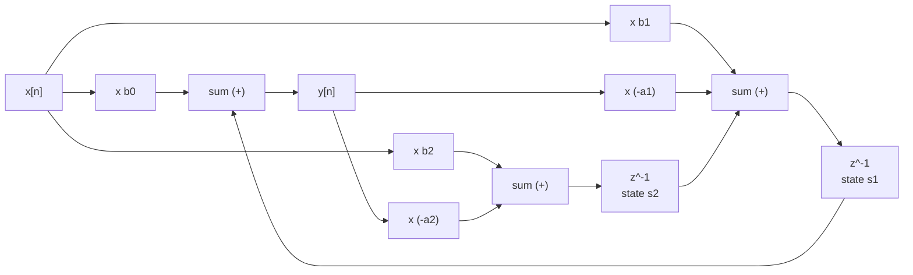

# Chapter 02: Filter — from one-pole to biquad
**English** | [繁體中文](README.zh-TW.md)

> [Course home](../../README.md)　|　Previous chapter: [01 Gain and Pan](../01-gain/README.md)　|　Next chapter: [03 Parametric EQ](../03-eq/README.md)

The gain in the previous chapter "multiplies every sample by the same number". This chapter is about "**multiplying by a number that changes with frequency**": letting low frequencies through and making high frequencies smaller (lowpass), or the reverse (highpass), or keeping only a band (bandpass), or cutting out a small piece (notch). That is a filter.

Almost every effect in a DAW hides a filter: an EQ is a row of biquads, a compressor's sidechain has a highpass, a delay's feedback loop has a lowpass (so the echoes get darker and darker), a reverb has damping, a de-esser detects sibilance with a bandpass, and the synthesizer "wah" is a resonant lowpass whose cutoff moves. This chapter starts from the simplest "average" and builds all the way up to the industry-standard RBJ biquad, measuring every mathematical claim with code.

## 1. Chapter goals

After reading this chapter and doing the exercises, you should be able to:

- Describe the same filter from the "time domain" (a weighted sum of past samples) and the "frequency domain" (each frequency multiplied by a complex number), and explain how the impulse response, the difference equation and the transfer function relate.
- Tell FIR from IIR, say why $`z^{-1}`$ means "a delay of one sample", and substitute $`z = e^{j\omega}`$ into $`H(z)`$ to compute the gain and phase at any frequency.
- "Read" the shape of the frequency response from the positions of the poles / zeros relative to the unit circle, and decide whether a filter is stable.
- Derive the exact coefficient $`a = e^{-2\pi f_c/f_s}`$ of the one-pole lowpass and compare it with the bilinear version; write a one-pole highpass and a DC blocker.
- State the origin of the RBJ Audio EQ Cookbook (analog prototype + bilinear transform + prewarping), use the 8 factories of `BiquadCoefficients`, and explain Q and resonance.
- Compare Direct Form I / II / Transposed Direct Form II, and explain why this course's `Biquad` chooses TDF-II with double coefficients and state.
- Build a 4th-order Butterworth (24 dB/oct) from two cascaded biquads, and state how the Q of each stage is computed (including odd orders).
- Explain cramping when the cutoff approaches Nyquist, and what to watch for when "modulating the cutoff quickly" (the TPT state-variable filter).

## 2. Principles

### 2.1 What a filter does: two views of the same thing

**The time-domain view:** a filter takes a weighted sum of "the current input" and "past inputs and past outputs". The simplest example is "average the most recent 4 samples":

```math
y[n] = \tfrac14\big(x[n] + x[n-1] + x[n-2] + x[n-3]\big)
```

Averaging smooths out fast up-and-down jitter (high frequencies get smaller) while slow changes are barely affected (low frequencies pass) -- this is already a lowpass filter.

**The frequency-domain view:** all the filters in this chapter are **LTI** (linear time-invariant) systems. An LTI system has a very important property:

> Feed in a sine wave of frequency $`f`$ and the output is **still** a sine wave of frequency $`f`$, with its amplitude multiplied by $`|H(f)|`$ and its phase shifted by $`\angle H(f)`$.

So a filter can be described completely by a single "frequency → complex number" curve $`H(f)`$: the magnitude $`|H|`$ is the gain at that frequency (usually drawn in dB), and the angle $`\angle H`$ is the phase delay. Think of a piece of music as a sum of many sine waves; a filter then "applies a separate gain to each frequency component" -- so it does not create new frequencies (which is completely different from the saturation / distortion of Chapters 06 and 07).

By ear:

| filter | what it does | how it sounds |
|---|---|---|
| lowpass (LPF) | reduces everything above the cutoff | muffled, dark, as if heard through a wall or a quilt |
| highpass (HPF) | reduces everything below the cutoff | thin, no low end, like a phone speaker |
| bandpass (BPF) | keeps only the region around the center | narrow-band, like an old telephone or a walkie-talkie |
| notch | cuts out a small piece around the center | almost the same as the original, only missing a certain "tone color" |
| allpass | leaves the magnitude alone, changes only the phase | no audible difference alone; it has an effect only when mixed with the original (phaser, Chapter 10) |
| peak / shelf | boosts or cuts a certain region | the basic building blocks of an EQ (Chapter 03) |

#### A quick review first: complex numbers and Euler's formula (the 30-second version)

The derivations that follow use the notation $`e^{j\theta}`$ constantly ($`j = \sqrt{-1}`$; engineers use $`j`$ rather than $`i`$ because $`i`$ is often used for current). You only need to remember four things:

1. **Euler's formula**: $`e^{j\theta} = \cos\theta + j\sin\theta`$. On the complex plane (real part on the horizontal axis, imaginary part on the vertical axis) it is **the point on the unit circle at angle $`\theta`$**: the magnitude is always 1 and the angle is $`\theta`$.
2. **Any complex number can be written as "magnitude × angle"**: $`H = |H|\,e^{j\angle H}`$. In the context of filters, the magnitude $`|H|`$ is the **amplitude factor (gain)** and the angle $`\angle H`$ is the **phase shift**.
3. **Multiplying complex numbers = multiplying magnitudes and adding angles**: $`|H|e^{j\angle H} \cdot e^{j\theta} = |H|\,e^{j(\theta + \angle H)}`$. So for a single frequency, "passing a signal through a filter" means "multiply the amplitude by $`|H|`$ and add $`\angle H`$ to the phase" -- exactly the statement in section 2.1.
4. **Why use $`e^{j\omega n}`$ instead of $`\cos(\omega n)`$?** Because $`e^{j\omega(n-1)} = e^{-j\omega} \cdot e^{j\omega n}`$: delaying by one sample is just "multiplying by a constant", which makes the derivations far simpler (after a delay, a cosine has to be split with the angle-sum formula into a cosine term and a sine term). A real sine wave is the sum of two conjugate complex sinusoids: $`\cos(\omega n) = \tfrac12\big(e^{j\omega n} + e^{-j\omega n}\big)`$; when the filter coefficients are real, the two halves are multiplied by mutually conjugate values of $`H`$, and added back they still form a real sine with amplitude × $`|H|`$ and phase + $`\angle H`$.


Later we substitute $`z = e^{j\omega}`$ into the transfer function: as $`\omega`$ goes from 0 to $`\pi`$, you walk counterclockwise along the upper half of the unit circle from $`z = 1`$ (DC) to $`z = -1`$ (Nyquist).

### 2.2 Impulse response and convolution

Feed an **impulse** (sample 0 is 1 and all the rest are 0, written $`\delta[n]`$) into a filter, and the output you get is called the **impulse response**, written $`h[n]`$.

Why is it so important? Because any input can be decomposed into "a series of scaled, shifted impulses": $`x[n] = \sum_k x[k]\,\delta[n-k]`$. An LTI system responds to each impulse with a shifted, scaled copy of $`h`$, and stacking them all up gives the output:

```math
y[n] = \sum_{k=0}^{\infty} h[k]\, x[n-k] \qquad\text{(convolution)}
```

The conclusion: **$`h[n]`$ completely describes an LTI filter**. The impulse response of the 4-point average above is $`\{0.25, 0.25, 0.25, 0.25, 0, 0, \dots\}`$.

And the frequency response is the DTFT (discrete-time Fourier transform) of the impulse response:

```math
H(e^{j\omega}) = \sum_{n} h[n]\, e^{-j\omega n},\qquad \omega = 2\pi \frac{f}{f_s}
```

$`\omega`$ is the digital angular frequency, "how many radians per sample": DC is $`\omega = 0`$ and Nyquist ($`f_s/2`$) is $`\omega = \pi`$. The example `l02_impulse_response` uses exactly this formula to compute the frequency response directly from the measured $`h[n]`$ and compare it with `magnitudeDb()`.

### 2.3 The first filter: the moving average (FIR)

The $`N`$-point moving average:

```math
y[n] = \frac1N \sum_{k=0}^{N-1} x[n-k]
```

The impulse response is $`N`$ values of $`1/N`$ followed by all zeros. Substituting into the DTFT (summing a geometric series):

```math
H(e^{j\omega}) = \frac1N\sum_{k=0}^{N-1} e^{-j\omega k}
= \frac{1}{N}\,\frac{\sin(N\omega/2)}{\sin(\omega/2)}\; e^{-j\omega (N-1)/2}
```

All the personality of the moving average can be read off this formula:

- DC ($`\omega \to 0`$): $`|H| = 1`$, 0 dB.
- At $`f = k\cdot f_s/N`$ ($`k = 1, 2, \dots`$) the numerator $`\sin(N\omega/2) = 0`$: **it vanishes completely (a null)**. With $`N = 4`$ and $`f_s = 48`$ kHz the first null is at 12 kHz.
- After a null the response "rises again" to form a sidelobe, and the first sidelobe is about −13 dB -- unlike a true lowpass that keeps falling.
- The phase is $`-\omega (N-1)/2`$: a fixed delay of $`(N-1)/2`$ samples at all frequencies, called **linear phase**.
- The −3 dB point is at about $`0.443\, f_s/N`$.


The figure (N = 8, $`f_s = 48`$ kHz) marks the −3 dB point at $`0.443\,f_s/N \approx 2.66`$ kHz (exact value for N = 8: 2.68 kHz), the nulls at $`k\cdot f_s/N`$ = 6, 12, 18 kHz, and the first sidelobe, whose peak is at about 8.6 kHz with −12.8 dB (−12.96 dB at $`1.5\,f_s/N`$ = 9 kHz).

A filter whose impulse response has finite length is called an **FIR** (finite impulse response) filter. Exercise 6 implements one (with a running sum: each sample needs just one addition and one subtraction, independent of $`N`$) and compares it with a one-pole.

### 2.4 The difference equation: FIR and IIR

Writing a filter as "output = a linear combination of the input and past values" is called a **difference equation**:

```math
y[n] = \sum_{k=0}^{M} b_k\, x[n-k] \;-\; \sum_{k=1}^{N} a_k\, y[n-k]
```

- Only $`b_k`$ (feed-forward): the output depends only on the input → the impulse response has finite length → **FIR**.
- With $`a_k`$ (feedback, using past **outputs**): after an impulse goes in it keeps circulating in the loop → the impulse response is in theory infinitely long → **IIR** (infinite impulse response).

The advantage of IIR is that it is **cheap**: a one-pole with only 2 multiplications (one multiply-add plus one multiply) achieves a smoothing that an FIR would need dozens of taps for. The price: the phase is not linear, it can be **unstable** (too much feedback blows it up), and it is more sensitive to the numerical precision of the coefficients. Audio EQs / filters use IIR almost exclusively; FIR is used mainly where linear phase is needed (linear-phase EQ, the anti-aliasing filter for oversampling in Chapter 06) and in convolution reverb (Chapter 12).

> Sign convention: this course (like the RBJ cookbook, JUCE and MATLAB) writes the denominator as $`1 + a_1 z^{-1} + a_2 z^{-2}`$, so the feedback terms in the difference equation have a **minus sign**. Some books flip the sign of $`a_k`$; always check the convention before copying a formula.

### 2.5 $`z^{-1}`$ = a one-sample delay; the transfer function

Consider a "complex sinusoid" input $`x[n] = e^{j\omega n}`$. Delaying by one sample gives

```math
x[n-1] = e^{j\omega(n-1)} = e^{-j\omega}\cdot x[n]
```

That is, **for a single frequency, "delaying by one sample" is the same as "multiplying by $`e^{-j\omega}`$"**. Generalizing $`e^{j\omega}`$ to a complex variable $`z`$, a delay of one sample is written as multiplication by $`z^{-1}`$. Both sides of the difference equation can then be written as "$`X`$ times a polynomial":

```math
Y(z)\,(1 + a_1 z^{-1} + a_2 z^{-2}) = X(z)\,(b_0 + b_1 z^{-1} + b_2 z^{-2})
```

```math
H(z) = \frac{Y(z)}{X(z)} = \frac{b_0 + b_1 z^{-1} + b_2 z^{-2}}{1 + a_1 z^{-1} + a_2 z^{-2}}
```

This is called the **transfer function**. To get the response at frequency $`f`$, substitute $`z = e^{j\omega}`$ ($`\omega = 2\pi f/f_s`$):

```math
H(e^{j\omega}) = \frac{b_0 + b_1 e^{-j\omega} + b_2 e^{-2j\omega}}{1 + a_1 e^{-j\omega} + a_2 e^{-2j\omega}},\qquad
\text{gain(dB)} = 20\log_{10}\lvert H(e^{j\omega})\rvert
```

This is exactly what `BiquadCoefficients::response()` / `magnitudeDb()` do (see section 3.2). The relationship among the three descriptions:



### 2.6 Poles, zeros and the unit circle: "seeing" the frequency response geometrically

Factor the numerator and denominator (second order as the example, $`b_0 \ne 0`$):

```math
H(z) = b_0\,\frac{(1 - q_1 z^{-1})(1 - q_2 z^{-1})}{(1 - p_1 z^{-1})(1 - p_2 z^{-1})}
= b_0\,\frac{(z - q_1)(z - q_2)}{(z - p_1)(z - p_2)}
```

The $`q_k`$ that make the numerator 0 are called **zeros**, and the $`p_k`$ that make the denominator 0 are called **poles**. Taking the magnitude at $`z = e^{j\omega}`$:

```math
\lvert H(e^{j\omega})\rvert = \lvert b_0\rvert\;\frac{\lvert e^{j\omega} - q_1\rvert\,\lvert e^{j\omega} - q_2\rvert}{\lvert e^{j\omega} - p_1\rvert\,\lvert e^{j\omega} - p_2\rvert}
```

$`e^{j\omega}`$ is a point on the **unit circle** of the complex plane: as $`\omega`$ goes from 0 (DC, at $`z = 1`$) counterclockwise to $`\pi`$ (Nyquist, at $`z = -1`$). The magnitude of the frequency response = "the product of the distances to the zeros" ÷ "the product of the distances to the poles". So:

- Near a **zero** the numerator is small → the response has a dip; a zero exactly on the unit circle → that frequency vanishes completely (a notch, the nulls of the moving average).
- Near a **pole** the denominator is small → the response has a peak; the closer a pole is to the unit circle, the higher and sharper the peak (resonance, high Q).


In the figure, × is a pole (they come in conjugate pairs, inside the circle) and ○ is a zero; the upper half of the unit circle is 0 .. Nyquist. Example: the RBJ lowpass has its two zeros stacked at $`z = -1`$ (completely gone at Nyquist) and its two poles near DC; the closer they are to the circle, the sharper the peak near the cutoff.

**The stability condition:** a pole $`p`$ contributes $`p^n`$ to the impulse response. With $`|p| < 1`$, $`p^n \to 0`$ (decays); with $`|p| = 1`$ it never decays (marginal); with $`|p| > 1`$ it grows exponentially (blows up, and the output soon becomes inf / NaN). Therefore:

> **An IIR filter is stable ⇔ all poles lie inside the unit circle ($`|p| < 1`$).** Where the zeros are does not affect stability.

For a second-order denominator $`1 + a_1 z^{-1} + a_2 z^{-2}`$, the poles are the roots of $`z^2 + a_1 z + a_2 = 0`$:

```math
p_{1,2} = \frac{-a_1 \pm \sqrt{a_1^2 - 4a_2}}{2}
```

When the discriminant is negative the poles are a complex-conjugate pair with radius $`r = \sqrt{a_2}`$ and angle $`\theta = \arccos\!\big(-a_1 / (2r)\big)`$. $`\theta`$ determines "at which frequency it resonates" ($`f \approx \theta f_s / 2\pi`$), and $`r`$ determines "how fast it decays": the envelope of the impulse response is $`r^n`$, with time constant $`\tau = -1/\ln r`$ samples. You can judge stability without solving for the roots -- the stability region of a second-order system on the $`(a_1, a_2)`$ plane is a triangle:

```math
|a_2| < 1 \quad\text{and}\quad |a_1| < 1 + a_2
```

Exercise 5 actually computes the poles of several coefficient sets and verifies them with an impulse: for example, for a 1 kHz, Q = 8 lowpass, the pole radius is $`r = 0.991875`$, the angle corresponds to 998.1 Hz, and $`\tau = 123`$ samples; after 1000 samples the impulse response has decayed by about 70 dB (theory $`20\log_{10} r^{1000} = -70.86`$ dB).

### 2.7 Cutoff and slope

- **Cutoff frequency** $`f_c`$: usually defined as the frequency where the gain is **3 dB** below the passband ($`|H| = 1/\sqrt2`$, half the power). Note that this is a "definition": a resonant filter (high Q) actually has a gain greater than 0 dB at $`f_c`$, in which case $`f_c`$ refers to the design parameter, not the −3 dB point.
- **Slope** (roll-off): how many dB of attenuation per octave (frequency ×2) far above the cutoff. Each "effective" pole contributes **6 dB/oct** (= 20 dB/decade), so:
  - first order (one-pole): 6 dB/oct
  - second order (biquad lowpass): 12 dB/oct
  - fourth order (two biquads): 24 dB/oct

Why 6 dB? For a first-order analog lowpass $`|H| = 1/\sqrt{1 + (f/f_c)^2}`$, when $`f \gg f_c`$, $`|H| \approx f_c / f`$: double the frequency, halve the amplitude, $`20\log_{10}(1/2) = -6.02`$ dB.

Section [3] of the example `l02_filter_response` actually measures it: the biquad LPF (1 kHz) drops 12.10 dB from 2 kHz to 4 kHz; the one-pole (100 Hz) drops 5.96 dB from 800 Hz to 1.6 kHz.

### 2.8 The one-pole lowpass: deriving the exact coefficient

The most commonly used IIR is a lowpass with a single pole:

```math
y[n] = (1-a)\,x[n] + a\,y[n-1]
\qquad\Longleftrightarrow\qquad
H(z) = \frac{1-a}{1 - a z^{-1}}
```

Intuition: on each sample the output moves toward the input by a fraction $`(1-a)`$ of the remaining distance. The closer $`a`$ is to 1, the slower it approaches and the smoother it is (the lower the cutoff). The exponential smoother of Chapter 01 is exactly this -- but note that **the sign convention is exactly the opposite**: the $`a`$ of Chapter 01 is "the fraction of the remaining distance covered each step" ($`g[n] = (1-a)\,g[n-1] + a\,g_\text{target}`$), which corresponds to the $`1-a`$ here; the $`a`$ here is "the fraction of the old value kept". The time constants of the two chapters are the same thing: Chapter 01's $`1 - a_{01} = e^{-1/(\tau f_s)}`$ ($`\tau`$ in seconds) is the $`a = e^{-T/\tau}`$ derived below ($`T = 1/f_s`$).

**How is $`a`$ determined by the cutoff?** Start from the analog RC lowpass: time constant $`\tau = RC`$, cutoff $`f_c = 1/(2\pi\tau)`$, and the impulse response is $`\frac{1}{\tau} e^{-t/\tau}`$ -- every time $`T`$ that passes, it decays by a factor of $`e^{-T/\tau}`$. The impulse response of the digital version is

```math
h[n] = (1-a)\,a^n
```

To make it **the same shape** as the analog one at the sampling instants (the same decay ratio per sample, $`T = 1/f_s`$), we require

```math
a = e^{-T/\tau} = e^{-2\pi f_c / f_s}
```

This design method, "making the digital impulse response equal to the sampled analog impulse response", is called **impulse invariance**. The factor $`(1-a)`$ in front makes the DC gain $`H(1) = (1-a)/(1-a) = 1`$.

A hand calculation ($`f_c = 1`$ kHz, $`f_s = 48`$ kHz):

```math
\frac{2\pi \cdot 1000}{48000} = 0.130900,\qquad a = e^{-0.130900} = 0.877306,\qquad 1 - a = 0.122694
```

The first value of the one-pole impulse response printed by the example `l02_impulse_response` is exactly 0.1227, and each sample after that is multiplied by 0.8773.

**Is its −3 dB point really at $`f_c`$?** Only approximately, and only when $`f_c \ll f_s`$. Setting $`|H|^2 = 1/2`$:

```math
\lvert H(e^{j\omega})\rvert^2 = \frac{(1-a)^2}{1 - 2a\cos\omega + a^2} = \frac12
\quad\Longrightarrow\quad
\cos\omega_{3\text{dB}} = 1 - \frac{(1-a)^2}{2a}
```

At $`f_c = 1`$ kHz this gives 1001.4 Hz (off by 0.14%), and at $`f_c = 10`$ kHz it is 11895 Hz (off by about 19%). The problem is at Nyquist: the exp version's gain at $`z = -1`$ is $`(1-a)/(1+a)`$, **not 0** (−23.69 dB at $`f_c = 1`$ kHz), and the higher the cutoff, the less cleanly it "shuts off"; at $`f_c = 15`$ kHz the entire curve is above −3 dB (even at Nyquist it is only −2.45 dB), and the −3 dB point does not exist at all.

**The bilinear version.** Another approach is to use the **bilinear transform** (detailed in section 2.11) to convert the analog $`H(s) = 1/(1 + s/\Omega_c)`$ directly to digital. The result is:

```math
g = \tan\!\left(\frac{\pi f_c}{f_s}\right),\qquad
H(z) = \frac{g\,(1 + z^{-1})}{(1+g) - (1-g)\,z^{-1}}
```

It has an extra zero at $`z = -1`$, so the Nyquist gain is 0 (−∞ dB) and the −3 dB point always lands exactly on $`f_c`$; the price is one extra multiply-add, and the shape at the high-frequency end is "squeezed" toward Nyquist (cramping, section 2.14). At $`f_c = 1`$ kHz, $`g = 0.065543`$ and the pole $`= (1-g)/(1+g) = 0.876976`$ -- almost the same as the exp version's 0.877306, so for a low cutoff there is no real difference between the two.

| $`f_c`$ | exp version $`a`$ | exp version actual −3 dB point | bilinear version −3 dB point |
|---:|---:|---:|---:|
| 100 Hz | 0.986995 | 100.0 Hz | 100.0 Hz |
| 1 kHz | 0.877306 | 1001.4 Hz | 1000.0 Hz |
| 5 kHz | 0.519703 | 5188.9 Hz | 5000.0 Hz |
| 10 kHz | 0.270091 | 11895.1 Hz | 10000.0 Hz |
| 15 kHz | 0.140367 | does not exist (−2.45 dB at Nyquist) | 15000.0 Hz |

(The numbers above are printed by section [1] of `l02_filter_response` and checked by self-checks.) This course's `OnePole` uses the exp version: it is mainly used for parameter smoothing, envelopes and damping in feedback loops, where the cutoff is far below Nyquist and the meaning of the "time constant" is most direct. When you need an accurate high-frequency cutoff, use a biquad.

### 2.9 The one-pole highpass and the DC blocker

**Highpass.** The intuitive approach is "the original signal minus the lowpass": $`x - \text{LP}(x)`$. Working it out:

```math
1 - \frac{1-a}{1-az^{-1}} = \frac{a\,(1 - z^{-1})}{1 - a z^{-1}}
```

It has a zero at DC ($`z = 1`$), so DC vanishes completely; but its gain at Nyquist ($`z = -1`$) is $`2a/(1+a)`$, so when the cutoff is high (small $`a`$) the passband falls below 0 dB. So `OnePole` replaces the leading constant with $`h = (1+a)/2`$, making Nyquist exactly 0 dB:

```math
y[n] = h\,\big(x[n] - x[n-1]\big) + a\,y[n-1],\qquad h = \frac{1+a}{2}
```

Check: at $`z = -1`$, $`H = h \cdot 2/(1+a) = 1`$. ✓ The example measures a 1 kHz highpass at −33.97 dB at 20 Hz (the 6 dB/oct extrapolation: $`20\log_{10}(20/1000) = -33.98`$ dB), −3.00 dB at 1 kHz and 0.00 dB at 20 kHz.

The **DC blocker** is a special case with the same structure but a pole very close to 1:

```math
y[n] = x[n] - x[n-1] + R\,y[n-1],\qquad H(z) = \frac{1 - z^{-1}}{1 - R z^{-1}},\quad R \approx 0.995
```

The zero at $`z = 1`$ kills DC; the pole at $`z = R`$ sits right next to it, leaving frequencies other than DC almost untouched (their distances to the two are almost equal for other points on the unit circle, so the ratio ≈ 1). The −3 dB point is about $`f_s(1-R)/2\pi`$: with $`R = 0.995`$ and $`f_s = 48`$ kHz → 38.2 Hz. Uses: removing the DC offset of a microphone / audio interface, or the DC produced by asymmetric distortion (Chapter 07). Exercise 2 implements and verifies it.

### 2.10 The biquad: a second-order IIR

The **biquad** (bi-quadratic: both numerator and denominator are quadratics) is the standard building block of audio filters:

```math
y[n] = b_0 x[n] + b_1 x[n-1] + b_2 x[n-2] - a_1 y[n-1] - a_2 y[n-2]
```

```math
H(z) = \frac{b_0 + b_1 z^{-1} + b_2 z^{-2}}{1 + a_1 z^{-1} + a_2 z^{-2}}
```

(If a formula gives $`a_0 \ne 1`$, divide all five coefficients by $`a_0`$ -- this is called normalizing.)

Why second order?

1. In a filter with real coefficients, complex poles always come in (conjugate) pairs. **A conjugate pair of poles needs exactly second order**, and only complex poles can create resonance (a peak) -- a first-order filter never has a peak.
2. Any higher-order filter can be factored into "a chain of biquads (plus at most one first-order section)" in cascade. Implementing a high order directly is extremely sensitive to coefficient error, while splitting it into a cascade of biquads is far more stable (section 2.13 explains why and demonstrates the cascade; section 2.15 measures the precision problem already visible at second order).
3. Second order is just enough to express the seven basic shapes: lowpass / highpass / bandpass / notch / allpass / peak / shelf.

### 2.11 The RBJ Audio EQ Cookbook: where the coefficients come from

The most widely used biquad formulas in the industry come from Robert Bristow-Johnson's *Cookbook formulae for audio EQ biquad filter coefficients* (the "RBJ cookbook" for short). Its design flow is:



**Analog prototypes** (normalized with $`\Omega_0 = 1`$, $`s = j\,\Omega/\Omega_0`$):

| type | $`H(s)`$ |
|---|---|
| LPF | $`\dfrac{1}{s^2 + s/Q + 1}`$ |
| HPF | $`\dfrac{s^2}{s^2 + s/Q + 1}`$ |
| BPF (0 dB peak) | $`\dfrac{s/Q}{s^2 + s/Q + 1}`$ |
| Notch | $`\dfrac{s^2 + 1}{s^2 + s/Q + 1}`$ |
| Allpass | $`\dfrac{s^2 - s/Q + 1}{s^2 + s/Q + 1}`$ |
| Peak | $`\dfrac{s^2 + s\,(A/Q) + 1}{s^2 + s/(AQ) + 1}`$ |
| Low shelf | $`A\,\dfrac{s^2 + (\sqrt A/Q)\,s + A}{A s^2 + (\sqrt A/Q)\,s + 1}`$ |
| High shelf | $`A\,\dfrac{A s^2 + (\sqrt A/Q)\,s + 1}{s^2 + (\sqrt A/Q)\,s + A}`$ |

where $`A = 10^{\text{gainDb}/40}`$ (note that it is **40**, not 20: the gain of a peak / shelf is split half-and-half between numerator and denominator, so $`A^2`$ is the total factor).

The **bilinear transform** maps the $`s`$-plane to the $`z`$-plane:

```math
s \;\leftarrow\; \frac{2}{T}\,\frac{1 - z^{-1}}{1 + z^{-1}}
```

It maps the entire analog imaginary axis ($`\Omega`$ from 0 to ∞) one-to-one onto the upper half of the unit circle ($`\omega`$ from 0 to π), so a stable analog filter always maps to a stable digital one and there is no aliasing. The price is that the frequency axis is compressed non-linearly. Substituting $`z = e^{j\omega}`$:

```math
\frac{1 - e^{-j\omega}}{1 + e^{-j\omega}} = j\tan\frac{\omega}{2}
\qquad\Longrightarrow\qquad
\Omega = \frac{2}{T}\tan\frac{\omega}{2}
```

At low frequencies $`\tan(\omega/2) \approx \omega/2`$, so $`\Omega \approx \omega/T`$ (they line up); the closer to Nyquist, the larger the deviation. **Prewarping** works like this: when designing the analog prototype, deliberately set $`\Omega_0`$ to $`\frac2T\tan(\omega_0/2)`$, so that after the transform $`f_0`$ lands **exactly** where you want it.

**Deriving the LPF once.** Let $`K = \tan(\omega_0/2)`$; after prewarping the substitution is $`s \leftarrow \frac{1}{K}\frac{1 - z^{-1}}{1 + z^{-1}}`$. Substitute into $`1/(s^2 + s/Q + 1)`$ and multiply numerator and denominator by $`K^2(1 + z^{-1})^2`$:

```math
H(z) = \frac{K^2(1 + 2z^{-1} + z^{-2})}{(1 + K/Q + K^2) + (2K^2 - 2)\,z^{-1} + (1 - K/Q + K^2)\,z^{-2}}
```

Then use the trigonometric identities $`K = \frac{\sin\omega_0}{1 + \cos\omega_0}`$ and $`1 + K^2 = \frac{2}{1 + \cos\omega_0}`$, multiply everything by $`\frac{1 + \cos\omega_0}{2}`$, and define $`\alpha = \frac{\sin\omega_0}{2Q}`$ to arrive at the cookbook form:

```math
b_0 = \frac{1 - \cos\omega_0}{2},\; b_1 = 1 - \cos\omega_0,\; b_2 = \frac{1 - \cos\omega_0}{2},\quad
a_0 = 1 + \alpha,\; a_1 = -2\cos\omega_0,\; a_2 = 1 - \alpha
```

**The coefficients of all 8 types** (sharing the intermediate quantities $`\omega_0 = 2\pi f_0/f_s`$, $`\alpha = \sin\omega_0/(2Q)`$, $`A = 10^{\text{gainDb}/40}`$; everything is divided by $`a_0`$ at the end):

| type | $`b_0`$ | $`b_1`$ | $`b_2`$ | $`a_0`$ | $`a_1`$ | $`a_2`$ |
|---|---|---|---|---|---|---|
| LPF | $`\frac{1-\cos\omega_0}{2}`$ | $`1-\cos\omega_0`$ | $`\frac{1-\cos\omega_0}{2}`$ | $`1+\alpha`$ | $`-2\cos\omega_0`$ | $`1-\alpha`$ |
| HPF | $`\frac{1+\cos\omega_0}{2}`$ | $`-(1+\cos\omega_0)`$ | $`\frac{1+\cos\omega_0}{2}`$ | $`1+\alpha`$ | $`-2\cos\omega_0`$ | $`1-\alpha`$ |
| BPF (0 dB peak) | $`\alpha`$ | $`0`$ | $`-\alpha`$ | $`1+\alpha`$ | $`-2\cos\omega_0`$ | $`1-\alpha`$ |
| Notch | $`1`$ | $`-2\cos\omega_0`$ | $`1`$ | $`1+\alpha`$ | $`-2\cos\omega_0`$ | $`1-\alpha`$ |
| Allpass | $`1-\alpha`$ | $`-2\cos\omega_0`$ | $`1+\alpha`$ | $`1+\alpha`$ | $`-2\cos\omega_0`$ | $`1-\alpha`$ |
| Peak | $`1+\alpha A`$ | $`-2\cos\omega_0`$ | $`1-\alpha A`$ | $`1+\alpha/A`$ | $`-2\cos\omega_0`$ | $`1-\alpha/A`$ |

The shelf coefficients are longer (let $`\beta = 2\sqrt A\,\alpha`$):

Low shelf:

```math
\begin{aligned}
b_0 &= A\big[(A+1) - (A-1)\cos\omega_0 + \beta\big] & a_0 &= (A+1) + (A-1)\cos\omega_0 + \beta\\
b_1 &= 2A\big[(A-1) - (A+1)\cos\omega_0\big] & a_1 &= -2\big[(A-1) + (A+1)\cos\omega_0\big]\\
b_2 &= A\big[(A+1) - (A-1)\cos\omega_0 - \beta\big] & a_2 &= (A+1) + (A-1)\cos\omega_0 - \beta
\end{aligned}
```

High shelf:

```math
\begin{aligned}
b_0 &= A\big[(A+1) + (A-1)\cos\omega_0 + \beta\big] & a_0 &= (A+1) - (A-1)\cos\omega_0 + \beta\\
b_1 &= -2A\big[(A-1) + (A+1)\cos\omega_0\big] & a_1 &= 2\big[(A-1) - (A+1)\cos\omega_0\big]\\
b_2 &= A\big[(A+1) + (A-1)\cos\omega_0 - \beta\big] & a_2 &= (A+1) - (A-1)\cos\omega_0 - \beta
\end{aligned}
```

The cookbook defines a separate "shelf slope" $`S`$ for shelves; $`S = 1`$ (the steepest slope without overshoot) is equivalent to $`Q = 1/\sqrt2`$ here.

A few patterns to observe: for all types the **denominator is the same** ($`1\pm\alpha`$, $`-2\cos\omega_0`$) -- the poles are determined only by $`f_0`$ and $`Q`$, and the differences among the shapes lie entirely in the positions of the zeros. The LPF's two zeros are at $`z = -1`$ (gone at Nyquist), the HPF's are at $`z = 1`$ (gone at DC), the notch's zeros lie exactly on the unit circle at $`e^{\pm j\omega_0}`$ ($`f_0`$ vanishes), and the allpass's zeros are "mirror images" of its poles ($`z \to 1/z^*`$), so the magnitude is 1 everywhere.

Section [2] of the example `l02_filter_response` prints the theoretical values (`magnitudeDb`) and the measured values (`measureGainDb`, which actually feeds sine waves in and measures) of these 8 types at 7 frequencies in one table, and they all agree to within 0.1 dB. For example, the 1 kHz, Q = 0.707 LPF: 500 Hz −0.26 dB, 1 kHz −3.01 dB, 2 kHz −12.37 dB, 16 kHz −56.88 dB.

### 2.12 Q and resonance

$`Q`$ (the quality factor) controls how close the poles are to the unit circle, i.e. "how sharp the peak is":

- **LPF / HPF**: the gain at $`f_0`$ is **exactly $`Q`$** (substituting $`s = j`$ into the analog prototype gives $`|H| = Q`$, and prewarping guarantees $`f_0`$ lines up). So the dB value at the cutoff = $`20\log_{10}Q`$:

| Q | 0.5 | 0.707 | 1 | 2 | 4 | 8 | 16 |
|---:|---:|---:|---:|---:|---:|---:|---:|
| gain at $`f_0`$ | −6.02 dB | −3.01 dB | 0 dB | +6.02 dB | +12.04 dB | +18.06 dB | +24.08 dB |
| peak frequency | no peak | no peak | 708 Hz | 936 Hz | 984 Hz | 996 Hz | 998 Hz |

  $`Q = 1/\sqrt2 \approx 0.707`$ is "the largest Q that shows no peak", i.e. the second-order **Butterworth** (maximally flat passband). When $`Q > 0.707`$ a resonance peak appears, with its peak frequency at $`f_0\sqrt{1 - 1/(2Q^2)}`$ (slightly below $`f_0`$). The table above is printed by `l02_resonance`.

- **BPF / notch / peak**: $`Q = f_0 / \text{BW}`$ (BW in Hz). For the BPF and notch, BW is the −3 dB bandwidth; **for the peak, BW is "between the two points at half the gain (gainDb/2)"** (the RBJ cookbook's definition) -- a +6 dB peak is above 0 dB at all frequencies, so it has no −3 dB points at all, and you look at the two +3 dB points instead (for a 1 kHz, Q = 2, +6 dB peak, the two +3 dB points are about 500 Hz apart). For a 1 kHz BPF, Q = 2 → a bandwidth of about 500 Hz (measured 781–1280 Hz, whose geometric mean is exactly 1 kHz). In music, bandwidth is often expressed as "so many octaves wide"; the conversion is $`Q = \frac{\sqrt{2^{N}}}{2^{N} - 1}`$ ($`N`$ = the bandwidth in octaves), and 1 octave ≈ Q 1.41.

**By ear**: a high-Q lowpass "sings out" the overtones around the cutoff; as the cutoff moves, the resonance peak slides over the overtones -- the most classic synthesizer sound. In the time domain, high Q = poles near the unit circle = an impulse response that decays slowly: `l02_impulse_response` measures a ringing length of about 1.2 ms for Q = 0.707 and about 11.8 ms for Q = 8, which sounds like going from a "click" to a "ping".

**Watch the level**: a Q = 16 LPF amplifies by 24 dB at the cutoff. In the resonant sweep of `l02_resonance`, an arpeggio with an original peak of −5.10 dBFS has a peak of +3.04 dBFS after the Q = 8 sweep -- already above 0 dBFS. In practice a resonant filter is often followed by gain compensation or saturation.

### 2.13 Cascading: the 4th-order Butterworth (24 dB/oct)

When two filters are cascaded, the total response = the product of the two, and the dB values simply add. So cascading two 12 dB/oct biquads gives 24 dB/oct -- **but the Q of both stages cannot be 0.707**.

The definition of an $`N`$-th order Butterworth is "maximally flat in the passband":

```math
\lvert H(j\Omega)\rvert^2 = \frac{1}{1 + (\Omega/\Omega_c)^{2N}}
```

It is always −3.01 dB at the cutoff, and far from the cutoff it attenuates at $`6N`$ dB/oct. Its $`N`$ poles are equally spaced (separated by $`\pi/N`$) on the left half-circle of the $`s`$-plane, symmetric about the real axis. Let a conjugate pole pair make an angle $`\varphi_k`$ with the negative real axis, i.e. $`-\cos\varphi_k \pm j\sin\varphi_k`$; multiplying out gives $`s^2 + 2\cos\varphi_k\,s + 1`$, and comparing with the biquad's $`s^2 + s/Q + 1`$:

```math
Q_k = \frac{1}{2\cos\varphi_k},\qquad
\varphi_k =
\begin{cases}
\dfrac{(2k+1)\pi}{2N}, & N \text{ even},\; k = 0, 1, \dots, \tfrac N2 - 1\\[2ex]
\dfrac{(k+1)\pi}{N}, & N \text{ odd},\; k = 0, 1, \dots, \tfrac{N-3}{2}
\end{cases}
```

Why do odd and even differ? The poles must be symmetric about the real axis and separated by $`\pi/N`$: for even $`N`$ no pole lies on the real axis, and the pair closest to it is at $`\pm\pi/(2N)`$; for odd $`N`$ there is a **real pole** right in the middle ($`\varphi = 0`$), and the others pair up at $`\pm\pi/N, \pm2\pi/N, \dots`$. That real pole is a first-order filter $`1/(s + 1)`$ -- so an odd order needs one more **one-pole** stage in the cascade, and it must be the bilinear version (section 2.8) with the same cutoff as the biquad stages, so that the −3 dB point lands exactly on $`f_c`$.

| order $`N`$ | Q of each stage |
|---:|---|
| 2 | 0.7071 |
| 3 | 1.0 (+ one one-pole stage) |
| 4 | 0.5412, 1.3066 |
| 5 | 0.6180, 1.6180 (+ one one-pole stage) |
| 6 | 0.5176, 0.7071, 1.9319 |
| 8 | 0.5098, 0.6013, 0.9000, 2.5629 |

`Biquad.h` provides `butterworthQ(order, stage)` to compute these values (handling both odd and even; it returns 0.7071 when `stage` is outside $`0..\lfloor N/2\rfloor - 1`$). Note: applying the even-order formula directly to an odd order is a common mistake -- for $`N = 3`$ it gives 0.5774 instead of 1.0, and the cascade is −7.78 dB at $`f_c`$ instead of −3.01 dB. The solution to Exercise 3 also verifies the 3rd-order case.

**Why split into a cascade of biquads instead of using a single $`N`$-th order difference equation?** Multiplying the 4th-order denominator out into $`1 + a_1z^{-1} + \dots + a_4z^{-4}`$ also works, but the roots (poles) of a high-order polynomial are extremely sensitive to tiny errors in the coefficients: with a low cutoff several poles crowd near $`z = 1`$, and if the coefficients are rounded in the last few bits of a float, the poles may move far away -- distorting the frequency response, or even pushing them outside the unit circle so that it blows up. After splitting into biquads, each stage handles only one pair of poles, the roots of a quadratic are far less sensitive to the coefficients, and each stage can individually be checked for stability with the triangle condition of section 2.6. (Even at second order, the precision problem is already visible when the poles hug $`z = 1`$; see the measurements in section 2.15.)

The 4th-order Butterworth is $`-10\log_{10}(1 + 2^8) = -24.10`$ dB at $`2f_c`$. Exercise 3 implements it with two biquad stages: the digital version is −24.25 dB at 2 kHz (the extra 0.15 dB is cramping, see the next section).

What if both stages use 0.707? The response at the cutoff becomes $`2 \times (-3.01) = -6.02`$ dB, and the passband sags earlier. This is actually another well-known filter: the **4th-order Linkwitz-Riley (LR4)**; its LPF + HPF add up to a perfectly flat magnitude, so it is used in crossovers (multiband compressors, speaker crossovers), but it is not a Butterworth.

### 2.14 Approaching Nyquist: cramping (bilinear warping)

The bilinear transform "squeezes" the entire analog $`\Omega \in [0, \infty)`$ into $`\omega \in [0, \pi)`$. The analog filter's response at infinitely high frequency is moved to Nyquist: a lowpass is forced to $`-\infty`$ dB at Nyquist. Prewarping can only guarantee that **one frequency** ($`f_0`$) lines up; the curve above $`f_0`$ gets squashed more and more, which is called **cramping**.

Section [4] of `l02_filter_response` compares the analog prototype with the digital version (LPF, Q = 0.707):

| $`f_c`$ | $`f`$ | analog | digital |
|---:|---:|---:|---:|
| 1 kHz | 1.2 kHz | −4.88 dB | −4.88 dB |
| 10 kHz | 12 kHz | −4.88 dB | −5.89 dB |
| 18 kHz | 21.6 kHz | −4.88 dB | −16.79 dB |

For a low $`f_c`$ they are almost identical; at $`f_c = 18`$ kHz, 20% above the cutoff the digital version attenuates almost 12 dB more. For a lowpass this is usually harmless (it is meant to attenuate anyway), but for **peak / shelf EQs** it makes high-frequency bells narrower and asymmetric, which sounds different from an analog EQ. There are two families of fixes:

1. **Oversampling** (Chapter 06): process at 2× or 4× the sample rate, so that $`f_0`$ is far from the new Nyquist.
2. **Matched / Nyquist-gain designs**: for example Orfanidis's parametric EQ design that specifies the Nyquist gain, or Vicanek's "matched" second-order filters, which make the digital curve follow the analog one more closely (further reading).

### 2.15 Direct Form I / II / Transposed Direct Form II

The same $`H(z)`$ has several implementation "structures". They are mathematically equivalent, but behave differently under finite precision and changing coefficients.

**Direct Form I (DF-I)** -- copies the difference equation literally, storing the past 2 inputs and 2 outputs (4 states):



**Direct Form II (DF-II)** -- does the feedback (poles) first and then the feed-forward (zeros), with the two sharing one delay line, so only 2 states are needed:

```math
w[n] = x[n] - a_1 w[n-1] - a_2 w[n-2],\qquad y[n] = b_0 w[n] + b_1 w[n-1] + b_2 w[n-2]
```

The problem is the intermediate variable $`w[n]`$: it is the signal that has passed through "only the pole part", and for a lowpass with a low cutoff it gets amplified by a very large factor.

**Transposed Direct Form II (TDF-II)** -- reverses the signal flow of DF-II (transposition), again with 2 states:

```math
\begin{aligned}
y[n] &= b_0\,x[n] + s_1[n-1]\\
s_1[n] &= b_1\,x[n] - a_1\,y[n] + s_2[n-1]\\
s_2[n] &= b_2\,x[n] - a_2\,y[n]
\end{aligned}
```



`l02_direct_forms` measures a "hard" filter (a 30 Hz, Q = 0.707 LPF, $`f_s = 48`$ kHz, with a pole radius of 0.997227, very close to $`z = 1`$; $`b_0 \approx 3.8\times10^{-6}`$):

| structure | states | round-off in float (relative to the output) | jump at the moment the coefficients change (30 → 60 Hz) |
|---|---:|---:|---:|
| DF-I | 4 | −73.91 dB | 1.6 times normal |
| DF-II | 2 | −73.39 dB | **983 times normal** (click) |
| TDF-II | 2 | −70.42 dB | 2.3 times normal |

The reference for the error is a TDF-II with "coefficients, state and output all in double". Now look at the precision of the **coefficients** and the **state** separately (all using DF-I):

| coefficients | state | error relative to the double reference |
|---|---|---:|
| float | float | −73.91 dB |
| float | double | −89.93 dB (changing only the state is not enough: when the coefficients are rounded to float the poles are already off the designed values, so what is computed is really another filter) |
| double | float | −83.77 dB (changing only the coefficients is not enough either: the state's round-off is still there) |
| double | double | −242.69 dB (the two double implementations agree almost perfectly) |
| `dawlab::dsp::Biquad` (double inside, **float output**) | | −151.20 dB |

The last row equals exactly the error from "just rounding the double reference output to float" (also −151.20 dB): the error inside `Biquad` is already too small to see, and what remains is only the quantization floor of `processSample()` returning a float.

The peak of DF-II's $`w[n]`$ reaches 18908, which is 65422 times the output (0.289); when the coefficients change, $`b`$ multiplies this huge $`w`$ and the output jumps a big step.

Conclusions and the choice made in this course:

- **DF-II is unsuitable for audio**: the internal nodes are amplified, changing the coefficients clicks, and in fixed-point it simply overflows.
- **DF-I** behaves very well (the state is the real input and output, and it is smooth on coefficient changes) and is the most commonly used on fixed-point DSP chips (a single accumulator, no internal overflow), but it needs 4 states.
- **TDF-II** needs only 2 states; the state is a "partial sum" of about the same magnitude as the output, and it is smooth on coefficient changes; in floating point there is no overflow problem, so it is the usual first choice for float / double implementations (JUCE's `IIRFilter` and many plugins use it).
- The measurements show the round-off of the three structures in float is of the same magnitude; what truly pushes the error below −130 dB is "**double for both coefficients and state**" (changing only one reaches just −84 ~ −90 dB). So `dawlab::dsp::Biquad` = **TDF-II + double coefficients and state**, with float input and output still (the error floor is the quantization of the float output, about −151 dB).

### 2.16 Parameter modulation: block updates, TPT and the State Variable Filter

In a plugin, when the user turns the cutoff knob, or an LFO or envelope modulates the cutoff, the coefficients keep changing. Things to watch:

1. **Computing coefficients is not cheap**: RBJ needs `sin` and `cos` (shelf / peak also need `pow`). The common practice is to compute once per block (or every 16 or 32 samples).
2. **Block updates are stepped**: the cutoff jumps once every 512 samples (10.7 ms). Section [B2] of `l02_cutoff_modulation` sweeps a 6 Hz LFO between 200 Hz and 8 kHz (Q = 6); the output with per-block updates differs from the ideal "update on every sample" version by −2.97 dB (almost as large as the signal: the resonance peak sits at the wrong frequency), and it sounds grainy. When the knob is turned slowly, per-block updates plus parameter smoothing (the `SmoothedValue` of Chapter 01, used for the EQ in Chapter 03) are enough.
3. **Stability of time-varying systems**: each set of coefficients being stable on its own does not guarantee that a system whose coefficients keep changing is stable; with high Q and fast, large modulation, a direct-form biquad can show a brief overshoot (analyzed by Laroche 2007).

The **TPT State Variable Filter (SVF)** is the common remedy for fast modulation. It discretizes the analog state-variable filter (two integrators + feedback) with trapezoidal integration (equivalent to bilinear), but **keeps the original circuit structure** (the topology-preserving transform, TPT):

```math
g = \tan\!\left(\frac{\pi f_c}{f_s}\right),\quad k = \frac1Q,\quad
a_1 = \frac{1}{1 + g(g + k)},\; a_2 = g\,a_1,\; a_3 = g\,a_2
```

For each sample:

```math
\begin{aligned}
v_3 &= x - ic_2, \quad v_1 = a_1\,ic_1 + a_2\,v_3, \quad v_2 = ic_2 + a_2\,ic_1 + a_3\,v_3\\
ic_1 &\leftarrow 2v_1 - ic_1, \quad ic_2 \leftarrow 2v_2 - ic_2\\
\text{low} &= v_2,\quad \text{band} = k\,v_1,\quad \text{high} = x - k\,v_1 - v_2,\quad \text{notch} = x - k\,v_1
\end{aligned}
```

Advantages: the states $`ic_1, ic_2`$ correspond to the integrators' "capacitor voltages", have physical meaning, and do not become "mismatched" with the coefficients when the cutoff changes; a per-sample update costs just one `tan`; and the same set of states gives LP / BP / HP / notch at the same time. When **static**, it is exactly the same as RBJ's filters of the same name (the same analog prototype + bilinear); section [C] of `l02_cutoff_modulation` verifies that the two agree at every frequency for 1 kHz, Q = 6 (for example both give +15.56 dB at 1 kHz).

To be honest, our measurements also show that in the [B3] test, "the cutoff jumps from 200 Hz to 8 kHz in an instant", neither the TDF-II biquad (peak ratio 1.17) nor the SVF (1.36) blows up -- the state of a TDF-II is already of the same magnitude as its output. The real advantages of the SVF are being "cheap enough to update on every sample" and having "multiple outputs", which is especially useful in synthesizer-style filters (the modulation effects of Chapter 10). This chapter places it in `StateVariableFilter.h` as a supplementary component.

## 3. From formulas to code

This chapter adds three headers (all in `dsp/include/dawlab/dsp/`, header-only, depending only on `common/`).

### 3.1 `OnePole.h`

```cpp
class OnePole {
public:
    enum class Type { Lowpass, Highpass };
    static double coefficientForCutoff(double cutoffHz, double sampleRate) noexcept; // a = exp(-2π fc/fs)
    void prepare(double sampleRate, int maxBlockSize, int numChannels);
    void reset() noexcept;
    void setType(Type) noexcept;      Type getType() const noexcept;
    void setCutoff(float hz) noexcept; float getCutoff() const noexcept;
    double getCoefficient() const noexcept;                  // the current a
    float processSample(int channel, float x) noexcept;
    void process(AudioBlock block) noexcept;
};
```

Mapping to the formulas:

- `updateCoefficients()`: `a_ = exp(-2π fc / fs)`, `b_ = 1 - a` (the input coefficient of the lowpass) and `h_ = (1 + a) / 2` (the normalization constant of the highpass). The cutoff is first clamped to $`(0.001, 0.49 f_s)`$ so that $`a`$ never reaches 0 or 1; `setCutoff(NaN)` is ignored (the last valid value is kept), because `std::clamp` cannot stop NaN.
- `processSample()`: the lowpass is `y = b_ * x + a_ * s.y1` ($`y[n] = (1-a)x[n] + a\,y[n-1]`$); the highpass is `y = h_ * (x - s.x1) + a_ * s.y1`.
- Each channel has its own `State { x1, y1 }` (double), kept in a `std::vector` allocated in `prepare()`; `processSample()` does no bounds checking, so the channel must be less than the `numChannels` given to `prepare()`.
- `flushDenormal()`: clears values to 0 when $`|y| < 10^{-30}`$ (see section 4).
- `setCutoff()` computes only one `exp`, so it can be called between blocks.

### 3.2 `Biquad.h`

```cpp
double butterworthQ(int order, int stage) noexcept;   // Q_k = 1 / (2 cos φ_k), with φ_k depending on whether N is odd or even (section 2.13)

struct BiquadCoefficients {
    double b0, b1, b2, a1, a2;                         // a0 is already normalized to 1
    static constexpr double kButterworthQ = 0.7071...;
    static BiquadCoefficients makeLowpass  (double sr, double f, double q) noexcept;
    static BiquadCoefficients makeHighpass (double sr, double f, double q) noexcept;
    static BiquadCoefficients makeBandpass (double sr, double f, double q) noexcept; // 0 dB peak
    static BiquadCoefficients makeNotch    (double sr, double f, double q) noexcept;
    static BiquadCoefficients makeAllpass  (double sr, double f, double q) noexcept;
    static BiquadCoefficients makePeak     (double sr, double f, double q, double gainDb) noexcept;
    static BiquadCoefficients makeLowShelf (double sr, double f, double q, double gainDb) noexcept;
    static BiquadCoefficients makeHighShelf(double sr, double f, double q, double gainDb) noexcept;
    std::complex<double> response(double f, double sr) const noexcept;
    double magnitudeDb(double f, double sr) const noexcept;
    double phase(double f, double sr) const noexcept;
    std::pair<std::complex<double>, std::complex<double>> poles() const noexcept;
    bool isStable() const noexcept;
};

class Biquad {
public:
    void prepare(double sampleRate, int maxBlockSize, int numChannels);
    void reset() noexcept;
    void setCoefficients(const BiquadCoefficients&) noexcept;
    const BiquadCoefficients& getCoefficients() const noexcept;
    float processSample(int channel, float x) noexcept;   // TDF-II
    void process(AudioBlock block) noexcept;
};
```

Mapping to the formulas:

- Each factory first calls `angles()` to compute $`\cos\omega_0`$ and $`\alpha = \sin\omega_0 / 2Q`$ (the frequency is clamped to $`(0.001, 0.499 f_s)`$ and Q to at least 0.001; a NaN frequency / Q / gainDb is treated as 1 kHz / $`1/\sqrt2`$ / 0 dB respectively, guaranteeing the coefficients are always finite), then hands the six values from the table in section 2.11 to `normalize()` to divide by $`a_0`$. The code and the table can be compared term by term.
- `response()`: `z1 = polar(1, -ω)` is $`e^{-j\omega}`$ ($`z^{-1}`$), and `num / den` is the $`H(e^{j\omega})`$ of section 2.5. `magnitudeDb()` takes `abs` and converts to dB (`gainToDb` has a floor of −100 dB, so the center of a notch prints −100). These two functions are for a UI to draw curves, and for the Chapter 03 EQ to compute the whole curve.
- `poles()` solves the quadratic with `std::complex`'s `sqrt` (a negative discriminant naturally yields conjugate poles); `isStable()` uses the triangle condition.
- `Biquad::processSample()` is the three-line TDF-II expression of section 2.15, with the states `s1` and `s2` in double.
- `setCoefficients()` does **not** clear the state: when the coefficients change between blocks the output is continuous (an advantage of TDF-II). Large jumps can still cause a brief transient; when smoothing is needed, the higher layer handles it (`ParametricEq` in Chapter 03).
- `butterworthQ()` is a free function (not a class member), used in Exercise 3.

### 3.3 `StateVariableFilter.h` (supplementary)

```cpp
class StateVariableFilter {
public:
    enum class Type { Lowpass, Highpass, Bandpass, Notch };
    struct Outputs { float low, band, high, notch; };
    void prepare(double sampleRate, int maxBlockSize, int numChannels);
    void reset() noexcept;
    void setType(Type) noexcept;        Type getType() const noexcept;
    void setCutoff(float hz) noexcept;  float getCutoff() const noexcept;  // can be called on every sample (one tan)
    void setQ(float q) noexcept;        float getQ() const noexcept;       // Q has a floor of 0.025
    Outputs processSampleAll(int channel, float x) noexcept;               // all four outputs at once
    float processSample(int channel, float x) noexcept;
    void process(AudioBlock block) noexcept;
};
```

`processSampleAll()` corresponds line by line to the expressions in section 2.16; `band` is multiplied by $`k`$ so that the bandpass peak is 0 dB (the same as the RBJ BPF).

### 3.4 Building and running

```powershell
.\scripts\build.ps1 -Only 02-filter          # build + run ctest (6 examples + 5 solutions)
cd build
.\bin\Debug\l02_filter_response.exe          # the examples' WAVs are written to build\dawlab_output\
```

### 3.5 Example 1: `l02_filter_response` (`examples/filter_response.cpp`)

**What it shows:** theoretical vs. measured frequency response. It writes no WAV, only prints tables, and ends with self-checks (118 checks).

- [1] one-pole: the actual −3 dB points of the exp version vs. the bilinear version (the table in section 2.8), the `OnePole` class measurements (a 1 kHz lowpass is −3.00 dB at 1 kHz and −22.45 dB at 16 kHz), the highpass, and the hand-calculation values for Exercise 1.
- [2] The 8 RBJ filter types × 7 frequencies, each cell "theory / measured":

```
    filter                        50            250            500           1000           2000           4000          16000
    Lowpass  Q=0.707    -0.00/ -0.00   -0.02/ -0.02   -0.26/ -0.26   -3.01/ -3.01  -12.37/-12.37  -24.48/-24.48  -56.88/-56.88
    Bandpass Q=2       -32.03/-32.03  -17.59/-17.59  -10.01/-10.01    0.00/ -0.00  -10.06/-10.06  -17.79/-17.79  -34.45/-34.45
    Peak +6dB Q=1        0.02/  0.02    0.42/  0.42    1.88/  1.88    6.00/  6.00    1.87/  1.87    0.41/  0.41    0.01/  0.01
    LowShelf +6dB        6.00/  6.00    5.97/  5.97    5.63/  5.63    3.00/  3.00    0.37/  0.37    0.02/  0.02    0.00/  0.00
```

  Note that a shelf is half its gain (+3 dB) at $`f_0`$, while a peak is exactly +6 dB at $`f_0`$.

- [3] Slope: the biquad is −12.10 dB from 2k→4k and −13.32 dB from 4k→8k (cramping has started); the one-pole (100 Hz) is −5.96 dB/oct; the one-pole (1 kHz) is only −5.24 dB from 2k→4k (the exp version is not −∞ at Nyquist).
- [4] The cramping table (section 2.14); the numbers in the table (−3.01 dB at the cutoff, −5.89 / −16.79 dB) all have self-checks.

### 3.6 Example 2: `l02_impulse_response` (`examples/impulse_response.cpp`)

**What it shows:** the impulse responses of FIR and IIR, and "computing the DTFT from $`h[n]`$".

```
    n =                              0       1       2       3       4       5  ...
    FIR moving avg N=4          0.2500  0.2500  0.2500  0.2500  0.0000  0.0000
    one-pole LP fc=1k           0.1227  0.1076  0.0944  0.0828  0.0727  0.0638
    biquad LP fc=1k Q=0.7071    0.0039  0.0149  0.0278  0.0380  0.0459  0.0518
```

- Moving average: four 0.25s and then all zeros (finite length); the DTFT has a null at 12 kHz ($`f_s/N`$).
- One-pole: $`h[n] = (1-a)a^n`$, with a maximum error of $`3.7\times10^{-9}`$ against theory term by term; $`h[100] = 2.5\times10^{-7}`$, never truly reaching 0 (IIR). $`\sum h[n] = 1`$ (the DC gain), and the DTFT is −3 dB at 1 kHz.
- Biquad LPF: the ringing lengths (time to fall below 1% of the peak) for Q = 0.707 / 2 / 8 are about 1.2 / 3.0 / 11.8 ms; the DTFT of Q = 8 at 1 kHz is +18.06 dB (= $`20\log_{10}8`$).

**Output WAVs:** `l02_ir_biquad_q0707.wav`, `l02_ir_biquad_q8.wav` (each repeated 4 times). **What you should hear:** Q = 0.707 is a short "tick"; Q = 8 is a pitched "ping" (a 1 kHz ping) -- this is what resonance looks like in the time domain.

### 3.7 Example 3: `l02_filter_sweep` (`examples/filter_sweep.cpp`)

**What it shows:** white noise and a 20 Hz→20 kHz log sweep through a 1 kHz LPF / HPF / BPF (Q = 2) / Notch (Q = 2), processed with a block size of 512 (simulating an audio callback). You can also bring your own file: `l02_filter_sweep.exe your_file.wav` (used as the input in place of the white noise).

The power of white noise is spread evenly over 0..Nyquist, so "output power / input power" should equal the mean of $`|H|^2`$ over the whole band. The program computes the theoretical value by numerical integration and compares it with the measurement:

```
               noise RMS   sweep RMS
    dry        -16.82 dB    -9.03 dB
    lpf        -30.13 dB   -11.50 dB   peak -6.02 dBFS
              Noise RMS change: measured -13.32 dB, theory ∫|H|² = -13.36 dB
    hpf        -17.02 dB   -12.66 dB   peak -6.02 dBFS
              Noise RMS change: measured -0.21 dB, theory ∫|H|² = -0.21 dB
    bpf        -31.76 dB   -19.12 dB   peak -6.02 dBFS
              Noise RMS change: measured -14.95 dB, theory ∫|H|² = -15.00 dB
    notch      -16.96 dB    -9.48 dB   peak -6.02 dBFS
              Noise RMS change: measured -0.14 dB, theory ∫|H|² = -0.14 dB
```

The 1 kHz LPF keeps only the energy in roughly the first 1 kHz of the 0..24 kHz, so the noise RMS drops by 13 dB; the HPF removes that same 1 kHz, so it drops only 0.2 dB -- yet they sound very different, because the human ear perceives frequency logarithmically.

**Output WAVs:** `l02_noise_dry.wav`, `l02_noise_lpf.wav`, `l02_noise_hpf.wav`, `l02_noise_bpf.wav`, `l02_noise_notch.wav`, and `l02_sweep_dry.wav`, `l02_sweep_lpf.wav`, `l02_sweep_hpf.wav`, `l02_sweep_bpf.wav`, `l02_sweep_notch.wav`.

**What you should hear:** noise_lpf is a "rumble" as if heard through a wall; noise_hpf is just a "hiss"; noise_bpf is the narrow-band noise of an old radio that is not tuned properly; noise_notch is almost indistinguishable from dry (only a small chunk around 1 kHz is cut out). The sweep versions are the most intuitive: the lpf gets quieter and quieter after sweeping past 1 kHz; the hpf is almost inaudible at the start; the bpf is loudest only when passing 1 kHz; the notch has a brief "dip" at the moment it passes 1 kHz.

### 3.8 Example 4: `l02_resonance` (`examples/resonance.cpp`)

**What it shows:** a Q sweep.

- [1] The LPF gain at the cutoff = $`20\log_{10}Q`$, and the peak frequency (the table in section 2.12).
- [2] The BPF −3 dB bandwidth vs. $`f_0/Q`$: for Q = 0.5 / 1 / 2 / 4 / 8 the measured values are 1983.7 / 996.5 / 498.9 / 249.6 / 125.1 Hz, against 2000 / 1000 / 500 / 250 / 125 Hz.
- [3] A synthesizer-style resonant sweep: a pluck arpeggio through an LPF whose cutoff moves from 200 Hz to 8 kHz every block (at constant speed on a log axis).

**Output WAVs:** `l02_resonance_dry.wav`, `l02_resonance_q0707.wav`, `l02_resonance_q8.wav` (the latter two are 32-bit float; the Q = 8 version peaks at +3.04 dBFS, so turn the volume down before playing it). **What you should hear:** Q = 0.707 is a smooth "timbre slowly opening up"; at Q = 8, as the cutoff passes each overtone it goes "wooow" and sings that overtone out, with the whole thing brighter and louder.

### 3.9 Example 5: `l02_direct_forms` (`examples/direct_forms.cpp`)

**What it shows:** the measurements of DF-I / DF-II / TDF-II from section 2.15 (round-off, the size of the internal nodes, and the jump when the coefficients change). In the program the three structures are written as small templates (`DirectForm1<T, C>`, `DirectForm2<T>`, `TransposedDirectForm2<T>`), where T can be float or double, to make comparison easy; the coefficient type `C` of `DirectForm1` can be chosen separately from the state type `T`, to isolate the individual effects of "coefficient precision" and "state precision". The reference is the double-output `TransposedDirectForm2<double>` (not the float-returning `Biquad`, which could not measure errors smaller than −151 dB). It writes no WAV.

### 3.10 Example 6: `l02_cutoff_modulation` (`examples/cutoff_modulation.cpp`)

**What it shows:** section 2.16: a 6 Hz LFO swings the cutoff of an LPF (Q = 6) between 200 Hz and 8 kHz.

- A: the biquad updates its coefficients every block; B: the SVF updates its cutoff on every sample.
- [B2] Using "a biquad that recomputes its RBJ coefficients on every sample" as the ideal baseline: the per-block biquad differs by −2.97 dB and the per-sample SVF by −25.69 dB.
- [B3] Overshoot on an instantaneous cutoff jump: biquad 1.170, SVF 1.357 (neither blows up).
- [C] Static response: the biquad and the SVF agree at every frequency (LP, plus self-checks for HP / BP / Notch).

**Output WAVs:** `l02_mod_dry.wav`, `l02_mod_biquad_block.wav`, `l02_mod_svf_sample.wav` (the latter two are 32-bit float). **What you should hear:** both are a rapid "wah-wah-wah" (auto-wah); in biquad_block the resonance peak jumps step by step, which sounds grainy; svf_sample slides continuously. Their peak and RMS are about the same; the difference is in the "smoothness".

## 4. Real-time considerations

- **Allocate memory only in `prepare()`.** All three classes allocate each channel's state in `prepare()` with `std::vector::assign`; `process()` / `processSample()` / the setters never allocate, lock or throw. When the channel count changes you must call `prepare()` again (off the audio thread).
- **The cost of computing coefficients.** `BiquadCoefficients::make*()` needs `sin` / `cos` (shelf and peak also need `pow`), `OnePole::setCutoff()` one `exp`, and the SVF one `tan`. Calling them between blocks is perfectly fine; recomputing on every sample for 8 tracks × 6 bands would be far too wasteful -- use block updates + smoothing, or compute only when a parameter actually changes.
- **Denormals.** The state of an IIR approaches 0 forever after the input goes silent, finally falling into the denormal (subnormal) range; an x86 CPU can be dozens of times slower on denormals, causing "CPU use spiking when it is silent". The components in this chapter clear $`|v| < 10^{-30}`$ to 0 on every state update (`flushDenormal()`); in addition, JUCE's `ScopedNoDenormals` (Chapters 13 and 14) turns on FTZ/DAZ for the whole callback.
- **NaN permanently poisons an IIR.** Once a NaN / inf appears in the input (or the coefficients are unstable), it enters the feedback state and the output is NaN forever after. When debugging, check with `hasNanOrInf()`; in practice a host `reset()`s that filter when this happens. Note that `reset()` **clears only the state and does not repair the coefficients**: if a **parameter** becomes NaN (for example a bad value from the UI), the computed coefficients are NaN and reset cannot save you. That is why this chapter's `OnePole::setCutoff()` ignores NaN and `BiquadCoefficients::make*()` replaces NaN parameters with safe values (`std::clamp` / `std::max` return NaN unchanged and cannot stop it); the components you write yourself must also block NaN as soon as parameters come in.
- **Thread safety.** `setCoefficients()` writes 5 doubles, which is not atomic. If the UI thread calls it directly while the audio thread is in `process()`, the audio thread may read coefficients that are "half old, half new" (even an unstable combination). The right approach is for the UI to write only atomic parameters (cutoff, Q, gain), and for the audio thread to read them at the start of a block and compute the coefficients itself -- the `ParametricEq` of Chapter 03 and the plugin of Chapter 13 both follow this pattern.
- **When to `reset()`.** Call `reset()` when the transport jumps, when playback starts, or when bypass is switched back, otherwise the tail of the previous passage (especially with high Q) will show up at the new position. But **do not reset when changing parameters during playback** (it clicks).
- **Stereo needs one state per channel.** Do not use the same `State` for the left and right channels (they would interfere and become a strange filter); the classes in this chapter keep them separate automatically according to `numChannels`.

## 5. Common mistakes and debugging

| Symptom | Likely cause | Fix |
|---|---|---|
| The output suddenly turns into huge noise, then all NaN | Unstable coefficients (a pole outside the unit circle): a sign copied wrongly from a formula, or forgetting to divide by $`a_0`$ | Check with `isStable()` / `poles()`; confirm the denominator convention is $`1 + a_1z^{-1} + a_2z^{-2}`$ and that the difference equation **subtracts** $`a_1 y[n-1]`$ |
| The overall level is wrong (for example several dB too loud across the whole band) | Forgot to normalize (divide by $`a_0`$) | Divide all the coefficients by $`a_0`$; check with `magnitudeDb()` that the passband is 0 dB |
| It blows up or does nothing with the cutoff at 30 kHz ($`f_s`$ = 48 kHz) | Above Nyquist, $`\omega_0 > \pi`$ | The factories already clamp to $`0.499 f_s`$; a filter you write yourself must clamp too |
| inf appears when Q is set to 0 | $`\alpha = \sin\omega_0 / (2Q)`$ divides by 0 | Put a floor on Q (0.001 in this chapter; 0.025 for the SVF) |
| Two Q = 0.707 stages cascaded give −6 dB at the cutoff | That is a Linkwitz-Riley, not a Butterworth | Use `butterworthQ(4, k)`: 0.5412, 1.3066 |
| A filter with a low cutoff (< 50 Hz) is noisy and the passband gain is inaccurate | float state / float coefficients lack precision (the poles are too close to $`z = 1`$) | Use double for state and coefficients (this chapter's `Biquad` already does); or use the SVF |
| Clicks / zipper noise when changing the cutoff | The parameter jumps too far at once, or DF-II is being used | TDF-II + parameter smoothing; use the SVF for fast modulation |
| CPU spikes after some silence | Denormals | Flush tiny values (handled in this chapter), `ScopedNoDenormals` |
| The left and right channels interfere with each other | The two channels share one state | One state per channel |
| Distortion after a high-Q filter | The resonance peak amplifies the gain by $`20\log_{10}Q`$ dB | Add gain compensation / a limiter afterwards; write the WAV as 32-bit float to see the overs |
| The frequency response plot "mirrors" back above $`f > f_s/2`$ | A digital frequency response is periodic in $`f_s`$ | Plot only up to Nyquist |
| The exp one-pole's −3 dB point is wrong at a high cutoff | Impulse invariance is inaccurate at high frequencies | Use the bilinear version or a biquad for a high cutoff |

## 6. Exercises

See [`exercises/README.md`](exercises/README.md). 7 problems: compute the one-pole coefficients by hand (calculation), DC blocker (implementation), 4th-order Butterworth (implementation), bandpass from an HPF + LPF (implementation), poles from coefficients and judging stability (calculation + implementation), FIR moving average vs. one-pole (implementation), and why TDF-II (concept). The solutions are in [`solutions/README.md`](solutions/README.md).

## 7. Further reading

- Robert Bristow-Johnson, *Cookbook formulae for audio EQ biquad filter coefficients* ("Audio EQ Cookbook"). The source of all the biquad formulas in this chapter; the W3C Web Audio API specification also includes a copy (`BiquadFilterNode`).
- Julius O. Smith III, *Introduction to Digital Filters with Audio Applications*, W3K Publishing, 2007 (a free online version is on the CCRMA website). The standard reference for transfer functions, poles/zeros, direct forms and the bilinear transform.
- Vadim Zavalishin, *The Art of VA Filter Design* (a free e-book published by Native Instruments). The complete derivation of TPT, zero-delay feedback and the SVF.
- Andrew Simper (Cytomic), *Solving the continuous SVF equations using trapezoidal integration and equivalent currents* (technical note). The implementation form used in `StateVariableFilter.h`.
- Udo Zölzer (ed.), *DAFX: Digital Audio Effects*, 2nd ed., Wiley, 2011. Chapter 2, "Filters and Delays".
- Will Pirkle, *Designing Audio Effect Plugins in C++*, 2nd ed., Routledge, 2019. Biquads, various filter designs, and their implementation in plugins.
- Sophocles J. Orfanidis, "Digital Parametric Equalizer Design With Prescribed Nyquist-Frequency Gain," *J. Audio Eng. Soc.*, vol. 45, no. 6, 1997. Addresses the cramping of a peak EQ near Nyquist.
- Martin Vicanek, *Matched Second Order Digital Filters* (2016, technical note). Another design that makes a digital biquad follow the analog response closely.
- Jean Laroche, "On the Stability of Time-Varying Recursive Filters," *J. Audio Eng. Soc.*, vol. 55, no. 6, 2007. A stability analysis for fast coefficient modulation.
- Alan V. Oppenheim & Ronald W. Schafer, *Discrete-Time Signal Processing*, 3rd ed., Pearson, 2010. The textbook for the z-transform, filter structures and quantization effects.

## 8. Next chapter

With a single biquad in hand, the next chapter, [03-eq](../03-eq/README.md), combines 6 biquads (low cut, shelf, peak, high cut, notch) into a parametric equalizer (`ParametricEq`), handling parameter smoothing, computing the whole EQ curve, and letting a UI draw the curve.
