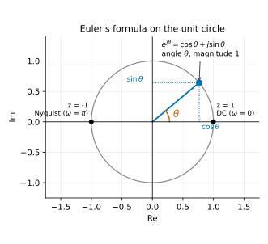
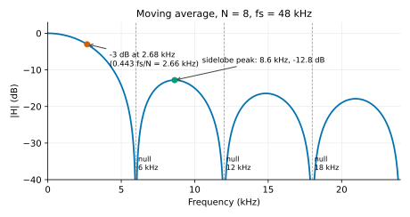
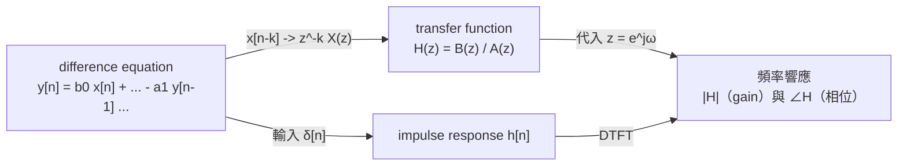
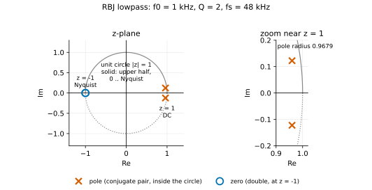
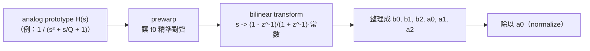
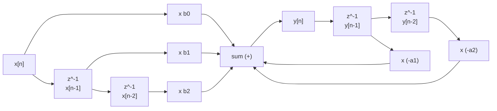
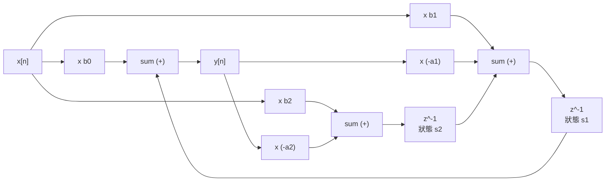

# 第 02 章：Filter —— 從 one-pole 到 biquad
[English](README.md) | **繁體中文**

> [教材首頁](../../README.zh-TW.md)　｜　上一章：[01 Gain 與 Pan](../01-gain/README.zh-TW.md)　｜　下一章：[03 Parametric EQ](../03-eq/README.zh-TW.md)

上一章的 gain 是「每個 sample 乘上同一個數」。這一章要做的是「**乘上一個會隨頻率改變的數**」：讓低頻通過、高頻變小（lowpass），或反過來（highpass），或只留下一段（bandpass），或挖掉一小塊（notch）。這就是 filter（濾波器）。

DAW 裡幾乎每一個效果都藏著 filter：EQ 是一排 biquad、compressor 的 sidechain 有 highpass、delay 的 feedback 迴路有 lowpass（讓回音越來越暗）、reverb 有 damping、de-esser 用 bandpass 偵測齒音、合成器的「wah」就是一個 cutoff 在動的 resonant lowpass。本章從最簡單的「平均」開始，一路推到業界標準的 RBJ biquad，並把每一個數學宣稱都用程式量出來。

## 1. 本章目標

讀完本章並做完練習，你應該能夠：

- 用「時域」（過去 sample 的加權和）與「頻域」（每個頻率被乘上一個複數）兩種角度描述同一個 filter，並說明 impulse response、difference equation、transfer function 三者的關係。
- 分辨 FIR 與 IIR，說出 $`z^{-1}`$ 為什麼代表「延遲一個 sample」，並把 $`z = e^{j\omega}`$ 代入 $`H(z)`$ 算出任意頻率的增益與相位。
- 用 pole / zero 在單位圓上的位置「看出」頻率響應的形狀，並判斷一個 filter 穩不穩定。
- 推導 one-pole lowpass 的精確係數 $`a = e^{-2\pi f_c/f_s}`$，並和 bilinear 版本比較；寫出 one-pole highpass 與 DC blocker。
- 說出 RBJ Audio EQ Cookbook 的來源（analog prototype + bilinear transform + prewarping），使用 `BiquadCoefficients` 的 8 種 factory，並解釋 Q 與 resonance。
- 比較 Direct Form I / II / Transposed Direct Form II，說明本教材的 `Biquad` 為什麼選 TDF-II + double 係數與狀態。
- 用兩級 biquad 串出 4 階 Butterworth（24 dB/oct），說出各級 Q 值的計算方式（含奇數階）。
- 解釋 cutoff 接近 Nyquist 時的 cramping，以及「快速調變 cutoff」時要注意什麼（TPT state-variable filter）。

## 2. 原理

### 2.1 Filter 在做什麼：兩個角度看同一件事

**時域的角度：** filter 把「現在的輸入」和「過去的輸入、過去的輸出」做加權相加。最簡單的例子是「取最近 4 個 sample 的平均」：

$$
y[n] = \tfrac14\big(x[n] + x[n-1] + x[n-2] + x[n-3]\big)
$$

平均會把快速的上下抖動抹平（高頻變小），緩慢的變化則幾乎不受影響（低頻通過）——這已經是一個 lowpass filter 了。

**頻域的角度：** 本章所有 filter 都是 **LTI**（linear time-invariant，線性非時變）系統。LTI 系統有一個非常重要的性質：

> 輸入一個頻率 $`f`$ 的正弦波，輸出**還是**頻率 $`f`$ 的正弦波，只是振幅被乘上 $`|H(f)|`$、相位被移動 $`\angle H(f)`$。

所以一個 filter 可以完全用一條「頻率 → 複數」的曲線 $`H(f)`$ 描述：大小 $`|H|`$ 就是該頻率的 gain（通常畫成 dB），角度 $`\angle H`$ 是相位延遲。把一段音樂想成很多正弦波的和，filter 就是「對每個頻率成分各自套一個 gain」——所以它不會產生新的頻率（這一點和第 06、07 章的 saturation / distortion 完全不同）。

聽感上：

| filter | 做什麼 | 聽起來 |
|---|---|---|
| lowpass（LPF） | cutoff 以上變小 | 悶、暗、像隔著牆或棉被 |
| highpass（HPF） | cutoff 以下變小 | 薄、沒有低頻、像手機喇叭 |
| bandpass（BPF） | 只留 center 附近 | 窄頻、像老電話或對講機 |
| notch | 挖掉 center 附近一小塊 | 和原音幾乎一樣，只少了某個「音色」 |
| allpass | 大小不變，只改相位 | 單獨聽不出差別；和原音混合才有效果（phaser，第 10 章） |
| peak / shelf | 某一段加大或減小 | EQ 的基本元件（第 03 章） |

#### 先複習：複數與 Euler 公式（30 秒版）

接下來的推導會一直用到 $`e^{j\theta}`$ 這種寫法（$`j = \sqrt{-1}`$，工程界用 $`j`$ 而不是 $`i`$，因為 $`i`$ 常拿來代表電流）。只需要記住四件事：

1. **Euler 公式**：$`e^{j\theta} = \cos\theta + j\sin\theta`$。在複數平面上（橫軸實部、縱軸虛部），它就是**單位圓上角度 $`\theta`$ 的那個點**：大小永遠是 1，角度是 $`\theta`$。
2. **任何複數都可以寫成「大小 × 角度」**：$`H = |H|\,e^{j\angle H}`$。在 filter 的語境裡，大小 $`|H|`$ 就是**振幅倍率（gain）**，角度 $`\angle H`$ 就是**相位移動**。
3. **複數相乘 = 大小相乘、角度相加**：$`|H|e^{j\angle H} \cdot e^{j\theta} = |H|\,e^{j(\theta + \angle H)}`$。所以「讓訊號通過 filter」對單一頻率而言，就是「振幅乘上 $`|H|`$、相位加上 $`\angle H`$」——正是 2.1 節那句話。
4. **為什麼用 $`e^{j\omega n}`$ 而不用 $`\cos(\omega n)`$？** 因為 $`e^{j\omega(n-1)} = e^{-j\omega} \cdot e^{j\omega n}`$：延遲一個 sample 只是「乘上一個常數」，推導會簡單非常多（cos 延遲後要用和角公式拆成 cos 與 sin 兩項）。真實的正弦波是兩個共軛複數正弦的和：$`\cos(\omega n) = \tfrac12\big(e^{j\omega n} + e^{-j\omega n}\big)`$；filter 係數是實數時，這兩半各自被乘上互為共軛的 $`H`$，加回來仍是實數的正弦，振幅 × $`|H|`$、相位 + $`\angle H`$。



之後會把 $`z = e^{j\omega}`$ 代入 transfer function：$`\omega`$ 從 0 走到 $`\pi`$，就是在單位圓的上半圈從 $`z = 1`$（DC）逆時針走到 $`z = -1`$（Nyquist）。

### 2.2 Impulse response 與 convolution

送一個 **impulse**（第 0 個 sample 是 1，其餘全是 0，記作 $`\delta[n]`$）進 filter，得到的輸出叫做 **impulse response**，記作 $`h[n]`$。

為什麼它這麼重要？因為任何輸入都可以拆成「一連串放大、平移過的 impulse」：$`x[n] = \sum_k x[k]\,\delta[n-k]`$。LTI 系統對每一個 impulse 的反應都是一份平移、放大過的 $`h`$，全部疊起來就是輸出：

$$
y[n] = \sum_{k=0}^{\infty} h[k]\, x[n-k] \qquad\text{（convolution，摺積）}
$$

結論：**$`h[n]`$ 完整描述了一個 LTI filter**。上面 4 點平均的 impulse response 就是 $`\{0.25, 0.25, 0.25, 0.25, 0, 0, \dots\}`$。

而頻率響應就是 impulse response 的 DTFT（discrete-time Fourier transform）：

$$
H(e^{j\omega}) = \sum_{n} h[n]\, e^{-j\omega n},\qquad \omega = 2\pi \frac{f}{f_s}
$$

$`\omega`$ 是「每個 sample 轉幾個弧度」的數位角頻率：DC 是 $`\omega = 0`$，Nyquist（$`f_s/2`$）是 $`\omega = \pi`$。範例 `l02_impulse_response` 就是用這條式子，從量到的 $`h[n]`$ 直接算出頻率響應，再和 `magnitudeDb()` 對照。

### 2.3 第一個 filter：moving average（FIR）

$`N`$ 點 moving average：

$$
y[n] = \frac1N \sum_{k=0}^{N-1} x[n-k]
$$

impulse response 是 $`N`$ 個 $`1/N`$，然後全是 0。把它代入 DTFT（等比級數求和）：

$$
H(e^{j\omega}) = \frac1N\sum_{k=0}^{N-1} e^{-j\omega k}
= \frac{1}{N}\,\frac{\sin(N\omega/2)}{\sin(\omega/2)}\; e^{-j\omega (N-1)/2}
$$

從這條式子可以讀出 moving average 的所有個性：

- DC（$`\omega \to 0`$）：$`|H| = 1`$，0 dB。
- 在 $`f = k\cdot f_s/N`$（$`k = 1, 2, \dots`$）分子 $`\sin(N\omega/2) = 0`$：**完全消失（null）**。$`N = 4`$、$`f_s = 48`$ kHz 時第一個 null 在 12 kHz。
- null 之後響應會「回升」形成旁瓣（sidelobe），第一個旁瓣約 −13 dB——不像真正的 lowpass 一路往下掉。
- 相位是 $`-\omega (N-1)/2`$：對所有頻率都是固定延遲 $`(N-1)/2`$ 個 sample，叫做 **linear phase**。
- −3 dB 點大約在 $`0.443\, f_s/N`$。



圖中（N = 8，$`f_s = 48`$ kHz）標出 −3 dB 點在 $`0.443\,f_s/N \approx 2.66`$ kHz（N = 8 的精確值是 2.68 kHz）、位於 $`k\cdot f_s/N`$ = 6、12、18 kHz 的 null，以及第一個 sidelobe：峰值在約 8.6 kHz、−12.8 dB（在 $`1.5\,f_s/N`$ = 9 kHz 是 −12.96 dB）。

這種「impulse response 有限長」的 filter 叫 **FIR**（finite impulse response）。練習 6 會實作它（用 running sum，每個 sample 只要一加一減，與 $`N`$ 無關），並和 one-pole 比較。

### 2.4 Difference equation：FIR 與 IIR

把 filter 寫成「輸出 = 輸入與過去值的線性組合」，叫做 **difference equation**（差分方程）：

$$
y[n] = \sum_{k=0}^{M} b_k\, x[n-k] \;-\; \sum_{k=1}^{N} a_k\, y[n-k]
$$

- 只有 $`b_k`$（feed-forward）：輸出只看輸入 → impulse response 有限長 → **FIR**。
- 有 $`a_k`$（feedback，用到過去的**輸出**）：impulse 進去之後會在迴路裡一直繞 → impulse response 理論上無限長 → **IIR**（infinite impulse response）。

IIR 的好處是**便宜**：一個只有 2 個乘法（一次乘加加一個乘法）的 one-pole，就能做出 FIR 要幾十個 tap 才做得到的平滑效果。代價是：相位不是線性的、有可能**不穩定**（feedback 太強會爆掉），而且對係數的數值精度比較敏感。音訊 EQ / filter 幾乎全部用 IIR；FIR 主要用在需要 linear phase 的場合（linear-phase EQ、oversampling 的 anti-aliasing filter，第 06 章）與 convolution reverb（第 12 章）。

> 符號慣例：本教材（和 RBJ cookbook、JUCE、MATLAB 一樣）把分母寫成 $`1 + a_1 z^{-1} + a_2 z^{-2}`$，所以 difference equation 裡的 feedback 項是**減號**。有些書把 $`a_k`$ 的正負號反過來寫，抄公式時一定要先確認慣例。

### 2.5 $`z^{-1}`$ = 延遲一個 sample；transfer function

考慮一個「複數正弦」輸入 $`x[n] = e^{j\omega n}`$。延遲一個 sample 會變成

$$
x[n-1] = e^{j\omega(n-1)} = e^{-j\omega}\cdot x[n]
$$

也就是說，**對單一頻率而言，「延遲一個 sample」等於「乘上 $`e^{-j\omega}`$」**。把 $`e^{j\omega}`$ 推廣成一個複數變數 $`z`$，延遲一個 sample 就記作乘上 $`z^{-1}`$。於是 difference equation 兩邊都可以寫成「$`X`$ 乘上一個多項式」：

$$
Y(z)\,(1 + a_1 z^{-1} + a_2 z^{-2}) = X(z)\,(b_0 + b_1 z^{-1} + b_2 z^{-2})
$$

$$
H(z) = \frac{Y(z)}{X(z)} = \frac{b_0 + b_1 z^{-1} + b_2 z^{-2}}{1 + a_1 z^{-1} + a_2 z^{-2}}
$$

這叫做 **transfer function**。要知道頻率 $`f`$ 的響應，就把 $`z = e^{j\omega}`$（$`\omega = 2\pi f/f_s`$）代進去：

$$
H(e^{j\omega}) = \frac{b_0 + b_1 e^{-j\omega} + b_2 e^{-2j\omega}}{1 + a_1 e^{-j\omega} + a_2 e^{-2j\omega}},\qquad
\text{gain(dB)} = 20\log_{10}\lvert H(e^{j\omega})\rvert
$$

這正是 `BiquadCoefficients::response()` / `magnitudeDb()` 做的事（見 3.2 節）。三種描述方式的關係：



### 2.6 Pole、zero 與單位圓：用幾何「看」頻率響應

把分子、分母因式分解（以二階為例，$`b_0 \ne 0`$）：

$$
H(z) = b_0\,\frac{(1 - q_1 z^{-1})(1 - q_2 z^{-1})}{(1 - p_1 z^{-1})(1 - p_2 z^{-1})}
= b_0\,\frac{(z - q_1)(z - q_2)}{(z - p_1)(z - p_2)}
$$

讓分子為 0 的 $`q_k`$ 叫 **zero**（零點），讓分母為 0 的 $`p_k`$ 叫 **pole**（極點）。在 $`z = e^{j\omega}`$ 上取大小：

$$
\lvert H(e^{j\omega})\rvert = \lvert b_0\rvert\;\frac{\lvert e^{j\omega} - q_1\rvert\,\lvert e^{j\omega} - q_2\rvert}{\lvert e^{j\omega} - p_1\rvert\,\lvert e^{j\omega} - p_2\rvert}
$$

$`e^{j\omega}`$ 是複數平面上**單位圓**的一個點：$`\omega`$ 從 0（DC，在 $`z = 1`$）逆時針走到 $`\pi`$（Nyquist，在 $`z = -1`$）。頻率響應的大小 = 「到各個 zero 的距離乘積」÷「到各個 pole 的距離乘積」。於是：

- 走到 **zero 附近**時分子很小 → 響應有凹陷；zero 正好在單位圓上 → 那個頻率完全消失（notch、moving average 的 null）。
- 走到 **pole 附近**時分母很小 → 響應有峰；pole 越靠近單位圓，峰越高越尖（resonance，高 Q）。



圖中 × 是 pole（共軛成對，在圓內），○ 是 zero；單位圓的上半圈 = 0 .. Nyquist。例：RBJ lowpass 的兩個 zero 疊在 $`z = -1`$（Nyquist 完全消失），兩個 pole 在 DC 附近；越靠近圓周，cutoff 附近的峰越尖。

**穩定條件：** 一個 pole $`p`$ 對 impulse response 的貢獻是 $`p^n`$。$`|p| < 1`$ 時 $`p^n \to 0`$（衰減）；$`|p| = 1`$ 時永遠不衰減（臨界）；$`|p| > 1`$ 時指數成長（爆掉，輸出很快變成 inf / NaN）。所以：

> **IIR filter 穩定 ⇔ 所有 pole 都在單位圓內（$`|p| < 1`$）。** zero 在哪裡都不影響穩定性。

對二階分母 $`1 + a_1 z^{-1} + a_2 z^{-2}`$，pole 是 $`z^2 + a_1 z + a_2 = 0`$ 的根：

$$
p_{1,2} = \frac{-a_1 \pm \sqrt{a_1^2 - 4a_2}}{2}
$$

判別式為負時是一對共軛複數 pole，半徑 $`r = \sqrt{a_2}`$，角度 $`\theta = \arccos\!\big(-a_1 / (2r)\big)`$。$`\theta`$ 決定「在哪個頻率共振」（$`f \approx \theta f_s / 2\pi`$），$`r`$ 決定「衰減多快」：impulse response 的包絡是 $`r^n`$，時間常數 $`\tau = -1/\ln r`$ 個 sample。不用解根也能判斷穩定性——二階系統的穩定區域在 $`(a_1, a_2)`$ 平面上是一個三角形：

$$
|a_2| < 1 \quad\text{且}\quad |a_1| < 1 + a_2
$$

練習 5 會實際算出幾組係數的 pole，並用 impulse 驗證：例如 1 kHz、Q = 8 的 lowpass，pole 半徑 $`r = 0.991875`$、角度對應 998.1 Hz、$`\tau = 123`$ samples；1000 個 sample 後 impulse response 衰減了約 70 dB（理論 $`20\log_{10} r^{1000} = -70.86`$ dB）。

### 2.7 Cutoff 與斜率

- **Cutoff frequency**（截止頻率）$`f_c`$：通常定義為增益比通帶低 **3 dB** 的頻率（$`|H| = 1/\sqrt2`$，功率剩一半）。注意這是「定義」：resonant filter（高 Q）在 $`f_c`$ 的增益反而會大於 0 dB，那時候 $`f_c`$ 指的是設計參數，不是 −3 dB 點。
- **斜率**（slope / roll-off）：遠離 cutoff 之後，每升高一個 octave（頻率 ×2）衰減多少 dB。每一個「有效作用」的 pole 貢獻 **6 dB/oct**（= 20 dB/decade），所以：
  - 一階（one-pole）：6 dB/oct
  - 二階（biquad lowpass）：12 dB/oct
  - 四階（兩級 biquad）：24 dB/oct

為什麼是 6 dB？一階 analog lowpass $`|H| = 1/\sqrt{1 + (f/f_c)^2}`$，當 $`f \gg f_c`$ 時 $`|H| \approx f_c / f`$：頻率加倍、振幅減半，$`20\log_{10}(1/2) = -6.02`$ dB。

範例 `l02_filter_response` 的 [3] 會實際量：biquad LPF（1 kHz）從 2 kHz 到 4 kHz 掉 12.10 dB；one-pole（100 Hz）從 800 Hz 到 1.6 kHz 掉 5.96 dB。

### 2.8 One-pole lowpass：精確係數的推導

最常用的 IIR 是只有一個 pole 的 lowpass：

$$
y[n] = (1-a)\,x[n] + a\,y[n-1]
\qquad\Longleftrightarrow\qquad
H(z) = \frac{1-a}{1 - a z^{-1}}
$$

直覺：輸出每個 sample 往輸入「靠近 $`(1-a)`$ 的比例」。$`a`$ 越接近 1，靠得越慢，越平滑（cutoff 越低）。第 01 章的 exponential smoother 就是它——但注意**符號剛好相反**：第 01 章的 $`a`$ 是「每步走剩餘距離的比例」（$`g[n] = (1-a)\,g[n-1] + a\,g_\text{target}`$），對應這裡的 $`1-a`$；這裡的 $`a`$ 是「留下舊值的比例」。兩章的時間常數是同一件事：第 01 章的 $`1 - a_{01} = e^{-1/(\tau f_s)}`$（$`\tau`$ 以秒計）就是下面推導的 $`a = e^{-T/\tau}`$（$`T = 1/f_s`$）。

**$`a`$ 怎麼由 cutoff 決定？** 從 analog 的 RC lowpass 出發：時間常數 $`\tau = RC`$，cutoff $`f_c = 1/(2\pi\tau)`$，impulse response 是 $`\frac{1}{\tau} e^{-t/\tau}`$——每經過時間 $`T`$，衰減 $`e^{-T/\tau}`$ 倍。數位版本的 impulse response 是

$$
h[n] = (1-a)\,a^n
$$

要讓它和 analog 版本在取樣點上**形狀一樣**（每個 sample 衰減的比例一樣，$`T = 1/f_s`$），就要求

$$
a = e^{-T/\tau} = e^{-2\pi f_c / f_s}
$$

這種「讓數位 impulse response 等於 analog impulse response 的取樣」的設計法叫 **impulse invariance**。前面的 $`(1-a)`$ 則讓 DC gain $`H(1) = (1-a)/(1-a) = 1`$。

手算一次（$`f_c = 1`$ kHz、$`f_s = 48`$ kHz）：

$$
\frac{2\pi \cdot 1000}{48000} = 0.130900,\qquad a = e^{-0.130900} = 0.877306,\qquad 1 - a = 0.122694
$$

範例 `l02_impulse_response` 印出的 one-pole impulse response 第一個值正是 0.1227，之後每個 sample 乘 0.8773。

**它的 −3 dB 點真的在 $`f_c`$ 嗎？** 只有在 $`f_c \ll f_s`$ 時才近似成立。設 $`|H|^2 = 1/2`$：

$$
\lvert H(e^{j\omega})\rvert^2 = \frac{(1-a)^2}{1 - 2a\cos\omega + a^2} = \frac12
\quad\Longrightarrow\quad
\cos\omega_{3\text{dB}} = 1 - \frac{(1-a)^2}{2a}
$$

$`f_c = 1`$ kHz 時算出 1001.4 Hz（偏 0.14%），$`f_c = 10`$ kHz 時是 11895 Hz（偏約 19%）。問題出在 Nyquist：exp 版在 $`z = -1`$ 的增益是 $`(1-a)/(1+a)`$，**不是 0**（$`f_c = 1`$ kHz 時是 −23.69 dB），cutoff 越高越「關不乾淨」；$`f_c = 15`$ kHz 時整條曲線都在 −3 dB 以上（Nyquist 處也只有 −2.45 dB），−3 dB 點根本不存在。

**Bilinear 版本。** 另一種做法是用 **bilinear transform**（2.11 節詳述）把 analog 的 $`H(s) = 1/(1 + s/\Omega_c)`$ 直接轉成數位。結果是：

$$
g = \tan\!\left(\frac{\pi f_c}{f_s}\right),\qquad
H(z) = \frac{g\,(1 + z^{-1})}{(1+g) - (1-g)\,z^{-1}}
$$

它多了一個在 $`z = -1`$ 的 zero，所以 Nyquist 增益是 0（−∞ dB），−3 dB 點永遠精準落在 $`f_c`$；代價是多一個乘加，而且高頻端的形狀被「擠」向 Nyquist（cramping，2.14 節）。$`f_c = 1`$ kHz 時 $`g = 0.065543`$，pole $`= (1-g)/(1+g) = 0.876976`$——和 exp 版的 0.877306 幾乎一樣，低 cutoff 時兩者沒有實質差別。

| $`f_c`$ | exp 版 $`a`$ | exp 版實際 −3 dB 點 | bilinear 版 −3 dB 點 |
|---:|---:|---:|---:|
| 100 Hz | 0.986995 | 100.0 Hz | 100.0 Hz |
| 1 kHz | 0.877306 | 1001.4 Hz | 1000.0 Hz |
| 5 kHz | 0.519703 | 5188.9 Hz | 5000.0 Hz |
| 10 kHz | 0.270091 | 11895.1 Hz | 10000.0 Hz |
| 15 kHz | 0.140367 | 不存在（Nyquist 處 −2.45 dB） | 15000.0 Hz |

（以上數字由 `l02_filter_response` 的 [1] 印出並 self-check。）本教材的 `OnePole` 用 exp 版：它主要用在參數平滑、envelope、feedback 迴路裡的 damping 這種 cutoff 遠低於 Nyquist 的場合，而且「時間常數」的語意最直接。需要精準高頻 cutoff 時請用 biquad。

### 2.9 One-pole highpass 與 DC blocker

**Highpass。** 直覺做法是「原訊號減掉 lowpass」：$`x - \text{LP}(x)`$。算一下：

$$
1 - \frac{1-a}{1-az^{-1}} = \frac{a\,(1 - z^{-1})}{1 - a z^{-1}}
$$

它在 DC（$`z = 1`$）有一個 zero，所以 DC 完全消失；但在 Nyquist（$`z = -1`$）的增益是 $`2a/(1+a)`$，cutoff 高時（$`a`$ 小）通帶會掉到 0 dB 以下。所以 `OnePole` 把前面的常數換成 $`h = (1+a)/2`$，讓 Nyquist 剛好 0 dB：

$$
y[n] = h\,\big(x[n] - x[n-1]\big) + a\,y[n-1],\qquad h = \frac{1+a}{2}
$$

檢查：$`z = -1`$ 時 $`H = h \cdot 2/(1+a) = 1`$。✓ 範例量到 1 kHz highpass 在 20 Hz 是 −33.97 dB（6 dB/oct 外插：$`20\log_{10}(20/1000) = -33.98`$ dB）、1 kHz 是 −3.00 dB、20 kHz 是 0.00 dB。

**DC blocker** 是同樣結構、但 pole 非常靠近 1 的特例：

$$
y[n] = x[n] - x[n-1] + R\,y[n-1],\qquad H(z) = \frac{1 - z^{-1}}{1 - R z^{-1}},\quad R \approx 0.995
$$

zero 在 $`z = 1`$ 殺掉 DC；pole 在 $`z = R`$ 緊貼著它，讓 DC 以外的頻率幾乎不受影響（兩者到單位圓上其他點的距離幾乎相等，相除 ≈ 1）。−3 dB 點約為 $`f_s(1-R)/2\pi`$：$`R = 0.995`$、$`f_s = 48`$ kHz → 38.2 Hz。用途：去掉麥克風 / 錄音介面的直流偏移、非對稱 distortion（第 07 章）產生的 DC。練習 2 會實作並驗證它。

### 2.10 Biquad：二階 IIR

**Biquad**（bi-quadratic，分子分母都是二次式）是音訊 filter 的標準積木：

$$
y[n] = b_0 x[n] + b_1 x[n-1] + b_2 x[n-2] - a_1 y[n-1] - a_2 y[n-2]
$$

$$
H(z) = \frac{b_0 + b_1 z^{-1} + b_2 z^{-2}}{1 + a_1 z^{-1} + a_2 z^{-2}}
$$

（若公式給出的 $`a_0 \ne 1`$，要把五個係數都除以 $`a_0`$——這叫 normalize。）

為什麼是二階？

1. 實係數的 filter，複數 pole 一定成對出現（共軛）。**一對共軛 pole 剛好需要二階**，而只有複數 pole 能做出 resonance（峰）——一階 filter 永遠沒有峰。
2. 任何高階 filter 都可以因式分解成「一串 biquad（加上最多一個一階）」串接。高階直接實作對係數誤差極度敏感，拆成 biquad 串接則穩定得多（2.13 節說明原因並示範串接；2.15 節實測二階就已經看得到的精度問題）。
3. 二階剛好夠表達 lowpass / highpass / bandpass / notch / allpass / peak / shelf 這七種基本形狀。

### 2.11 RBJ Audio EQ Cookbook：係數從哪裡來

業界最常用的 biquad 公式來自 Robert Bristow-Johnson 的 *Cookbook formulae for audio EQ biquad filter coefficients*（簡稱 RBJ cookbook）。它的設計流程是：



**Analog prototype**（以 $`\Omega_0 = 1`$ 正規化，$`s = j\,\Omega/\Omega_0`$）：

| 種類 | $`H(s)`$ |
|---|---|
| LPF | $`\dfrac{1}{s^2 + s/Q + 1}`$ |
| HPF | $`\dfrac{s^2}{s^2 + s/Q + 1}`$ |
| BPF（0 dB peak） | $`\dfrac{s/Q}{s^2 + s/Q + 1}`$ |
| Notch | $`\dfrac{s^2 + 1}{s^2 + s/Q + 1}`$ |
| Allpass | $`\dfrac{s^2 - s/Q + 1}{s^2 + s/Q + 1}`$ |
| Peak | $`\dfrac{s^2 + s\,(A/Q) + 1}{s^2 + s/(AQ) + 1}`$ |
| Low shelf | $`A\,\dfrac{s^2 + (\sqrt A/Q)\,s + A}{A s^2 + (\sqrt A/Q)\,s + 1}`$ |
| High shelf | $`A\,\dfrac{A s^2 + (\sqrt A/Q)\,s + 1}{s^2 + (\sqrt A/Q)\,s + A}`$ |

其中 $`A = 10^{\text{gainDb}/40}`$（注意是 **40** 不是 20：peak / shelf 的 gain 在分子分母各分一半，$`A^2`$ 才是總倍率）。

**Bilinear transform** 把 $`s`$ 平面映射到 $`z`$ 平面：

$$
s \;\leftarrow\; \frac{2}{T}\,\frac{1 - z^{-1}}{1 + z^{-1}}
$$

它把 analog 的整條虛軸（$`\Omega`$ 從 0 到 ∞）一對一地映射到單位圓的上半圈（$`\omega`$ 從 0 到 π），所以穩定的 analog filter 轉過來一定穩定，也不會有 aliasing。代價是頻率軸被非線性地壓縮了。把 $`z = e^{j\omega}`$ 代入：

$$
\frac{1 - e^{-j\omega}}{1 + e^{-j\omega}} = j\tan\frac{\omega}{2}
\qquad\Longrightarrow\qquad
\Omega = \frac{2}{T}\tan\frac{\omega}{2}
$$

低頻時 $`\tan(\omega/2) \approx \omega/2`$，所以 $`\Omega \approx \omega/T`$（對得上）；越接近 Nyquist，偏差越大。**Prewarping** 的作法是：在設計 analog prototype 時，故意把 $`\Omega_0`$ 設成 $`\frac2T\tan(\omega_0/2)`$，這樣轉換後 $`f_0`$ 會**精準**落在想要的位置。

**實際推導一次 LPF。** 令 $`K = \tan(\omega_0/2)`$，prewarp 後的代換是 $`s \leftarrow \frac{1}{K}\frac{1 - z^{-1}}{1 + z^{-1}}`$。代入 $`1/(s^2 + s/Q + 1)`$，上下同乘 $`K^2(1 + z^{-1})^2`$：

$$
H(z) = \frac{K^2(1 + 2z^{-1} + z^{-2})}{(1 + K/Q + K^2) + (2K^2 - 2)\,z^{-1} + (1 - K/Q + K^2)\,z^{-2}}
$$

再用三角恆等式 $`K = \frac{\sin\omega_0}{1 + \cos\omega_0}`$、$`1 + K^2 = \frac{2}{1 + \cos\omega_0}`$，全部乘上 $`\frac{1 + \cos\omega_0}{2}`$，並定義 $`\alpha = \frac{\sin\omega_0}{2Q}`$，就得到 cookbook 的形式：

$$
b_0 = \frac{1 - \cos\omega_0}{2},\; b_1 = 1 - \cos\omega_0,\; b_2 = \frac{1 - \cos\omega_0}{2},\quad
a_0 = 1 + \alpha,\; a_1 = -2\cos\omega_0,\; a_2 = 1 - \alpha
$$

**全部 8 種的係數**（共用中間量 $`\omega_0 = 2\pi f_0/f_s`$、$`\alpha = \sin\omega_0/(2Q)`$、$`A = 10^{\text{gainDb}/40}`$；最後都要除以 $`a_0`$）：

| 種類 | $`b_0`$ | $`b_1`$ | $`b_2`$ | $`a_0`$ | $`a_1`$ | $`a_2`$ |
|---|---|---|---|---|---|---|
| LPF | $`\frac{1-\cos\omega_0}{2}`$ | $`1-\cos\omega_0`$ | $`\frac{1-\cos\omega_0}{2}`$ | $`1+\alpha`$ | $`-2\cos\omega_0`$ | $`1-\alpha`$ |
| HPF | $`\frac{1+\cos\omega_0}{2}`$ | $`-(1+\cos\omega_0)`$ | $`\frac{1+\cos\omega_0}{2}`$ | $`1+\alpha`$ | $`-2\cos\omega_0`$ | $`1-\alpha`$ |
| BPF（0 dB peak） | $`\alpha`$ | $`0`$ | $`-\alpha`$ | $`1+\alpha`$ | $`-2\cos\omega_0`$ | $`1-\alpha`$ |
| Notch | $`1`$ | $`-2\cos\omega_0`$ | $`1`$ | $`1+\alpha`$ | $`-2\cos\omega_0`$ | $`1-\alpha`$ |
| Allpass | $`1-\alpha`$ | $`-2\cos\omega_0`$ | $`1+\alpha`$ | $`1+\alpha`$ | $`-2\cos\omega_0`$ | $`1-\alpha`$ |
| Peak | $`1+\alpha A`$ | $`-2\cos\omega_0`$ | $`1-\alpha A`$ | $`1+\alpha/A`$ | $`-2\cos\omega_0`$ | $`1-\alpha/A`$ |

Shelf 的係數比較長（令 $`\beta = 2\sqrt A\,\alpha`$）：

Low shelf：

$$
\begin{aligned}
b_0 &= A\big[(A+1) - (A-1)\cos\omega_0 + \beta\big] & a_0 &= (A+1) + (A-1)\cos\omega_0 + \beta\\
b_1 &= 2A\big[(A-1) - (A+1)\cos\omega_0\big] & a_1 &= -2\big[(A-1) + (A+1)\cos\omega_0\big]\\
b_2 &= A\big[(A+1) - (A-1)\cos\omega_0 - \beta\big] & a_2 &= (A+1) + (A-1)\cos\omega_0 - \beta
\end{aligned}
$$

High shelf：

$$
\begin{aligned}
b_0 &= A\big[(A+1) + (A-1)\cos\omega_0 + \beta\big] & a_0 &= (A+1) - (A-1)\cos\omega_0 + \beta\\
b_1 &= -2A\big[(A-1) + (A+1)\cos\omega_0\big] & a_1 &= 2\big[(A-1) - (A+1)\cos\omega_0\big]\\
b_2 &= A\big[(A+1) + (A-1)\cos\omega_0 - \beta\big] & a_2 &= (A+1) - (A-1)\cos\omega_0 - \beta
\end{aligned}
$$

Cookbook 對 shelf 另外定義了「shelf slope」$`S`$；$`S = 1`$（最陡但不過衝）等價於這裡的 $`Q = 1/\sqrt2`$。

觀察幾個規律：所有種類的**分母都一樣**（$`1\pm\alpha`$、$`-2\cos\omega_0`$）——pole 只由 $`f_0`$ 與 $`Q`$ 決定，各種形狀的差別全在 zero 的位置。LPF 的兩個 zero 在 $`z = -1`$（Nyquist 消失），HPF 的在 $`z = 1`$（DC 消失），notch 的 zero 正好在單位圓上的 $`e^{\pm j\omega_0}`$（$`f_0`$ 消失），allpass 的 zero 是 pole 的「鏡像」（$`z \to 1/z^*`$），所以大小處處為 1。

範例 `l02_filter_response` 的 [2] 把這 8 種在 7 個頻率的理論值（`magnitudeDb`）與實測值（`measureGainDb`，真的送正弦波進去量）印成同一張表，全部在 0.1 dB 內一致。例如 1 kHz、Q = 0.707 的 LPF：500 Hz −0.26 dB、1 kHz −3.01 dB、2 kHz −12.37 dB、16 kHz −56.88 dB。

### 2.12 Q 與 resonance

$`Q`$（quality factor）控制 pole 離單位圓多近，也就是「峰有多尖」：

- **LPF / HPF**：在 $`f_0`$ 的增益**剛好等於 $`Q`$**（analog prototype 代 $`s = j`$ 得 $`|H| = Q`$，而 prewarp 保證 $`f_0`$ 對齊）。所以 cutoff 處的 dB 值 = $`20\log_{10}Q`$：

| Q | 0.5 | 0.707 | 1 | 2 | 4 | 8 | 16 |
|---:|---:|---:|---:|---:|---:|---:|---:|
| $`f_0`$ 處增益 | −6.02 dB | −3.01 dB | 0 dB | +6.02 dB | +12.04 dB | +18.06 dB | +24.08 dB |
| 峰值頻率 | 無峰 | 無峰 | 708 Hz | 936 Hz | 984 Hz | 996 Hz | 998 Hz |

  $`Q = 1/\sqrt2 \approx 0.707`$ 是「不出現峰的最大 Q」，也就是二階 **Butterworth**（通帶最平坦）。$`Q > 0.707`$ 時出現 resonance 峰，峰值頻率在 $`f_0\sqrt{1 - 1/(2Q^2)}`$（略低於 $`f_0`$）。上表由 `l02_resonance` 印出。

- **BPF / notch / peak**：$`Q = f_0 / \text{BW}`$（BW 以 Hz 計）。BPF 與 notch 的 BW 是 −3 dB 頻寬；**peak 的 BW 則是「增益一半（gainDb/2）的兩點之間」**（RBJ cookbook 的定義）——+6 dB 的 peak 全頻段都在 0 dB 以上，根本沒有 −3 dB 點，要看 +3 dB 的兩點（1 kHz、Q = 2、+6 dB 的 peak，+3 dB 兩點相距約 500 Hz）。1 kHz 的 BPF，Q = 2 → 頻寬約 500 Hz（實測 781–1280 Hz，兩端點的幾何平均正好是 1 kHz）。音樂上常用「幾個 octave 寬」表示頻寬，換算是 $`Q = \frac{\sqrt{2^{N}}}{2^{N} - 1}`$（$`N`$ = 頻寬 octave 數），1 octave ≈ Q 1.41。

**聽感**：高 Q 的 lowpass 在 cutoff 附近會把那一帶的泛音「唱」出來；cutoff 一邊移動，resonance 峰就像在泛音上滑過去——這是合成器最經典的聲音。時域上，高 Q = pole 靠近單位圓 = impulse response 衰減很慢：`l02_impulse_response` 量到 Q = 0.707 的 ringing 長度約 1.2 ms，Q = 8 則約 11.8 ms，聽起來從「click」變成「ping」。

**注意音量**：Q = 16 的 LPF 在 cutoff 處放大 24 dB。`l02_resonance` 的 resonant sweep，原本 peak −5.10 dBFS 的琶音經過 Q = 8 的 sweep 後 peak 是 +3.04 dBFS——已經超過 0 dBFS。實務上 resonant filter 後面常接 gain 補償或 saturation。

### 2.13 串接：4 階 Butterworth（24 dB/oct）

兩個 filter 串接，總響應 = 兩者相乘，dB 直接相加。所以兩級 12 dB/oct 的 biquad 串起來就是 24 dB/oct——**但兩級的 Q 不能都用 0.707**。

$`N`$ 階 Butterworth 的定義是「通帶最平坦」：

$$
\lvert H(j\Omega)\rvert^2 = \frac{1}{1 + (\Omega/\Omega_c)^{2N}}
$$

它在 cutoff 永遠是 −3.01 dB，遠離 cutoff 後以 $`6N`$ dB/oct 衰減。它的 $`N`$ 個 pole 等距（相隔 $`\pi/N`$）分布在 $`s`$ 平面左半邊的半圓上，對實軸對稱。設一對共軛 pole 和負實軸的夾角是 $`\varphi_k`$，也就是 $`-\cos\varphi_k \pm j\sin\varphi_k`$，乘開得到 $`s^2 + 2\cos\varphi_k\,s + 1`$，和 biquad 的 $`s^2 + s/Q + 1`$ 比對：

$$
Q_k = \frac{1}{2\cos\varphi_k},\qquad
\varphi_k =
\begin{cases}
\dfrac{(2k+1)\pi}{2N}, & N \text{ 偶數},\; k = 0, 1, \dots, \tfrac N2 - 1\\[2ex]
\dfrac{(k+1)\pi}{N}, & N \text{ 奇數},\; k = 0, 1, \dots, \tfrac{N-3}{2}
\end{cases}
$$

為什麼奇偶不同？pole 要對實軸對稱、彼此相隔 $`\pi/N`$：$`N`$ 偶數時沒有 pole 落在實軸上，最靠近實軸的一對在 $`\pm\pi/(2N)`$；$`N`$ 奇數時正中間（$`\varphi = 0`$）有一個**實數 pole**，其餘成對的在 $`\pm\pi/N, \pm2\pi/N, \dots`$。那個實數 pole 就是一個一階 filter $`1/(s + 1)`$——所以奇數階要再串一級 **one-pole**，而且必須是 bilinear 版（2.8 節），cutoff 和各級 biquad 相同，−3 dB 點才會精準落在 $`f_c`$。

| 階數 $`N`$ | 各級 Q |
|---:|---|
| 2 | 0.7071 |
| 3 | 1.0（+ 一級 one-pole） |
| 4 | 0.5412、1.3066 |
| 5 | 0.6180、1.6180（+ 一級 one-pole） |
| 6 | 0.5176、0.7071、1.9319 |
| 8 | 0.5098、0.6013、0.9000、2.5629 |

`Biquad.h` 提供 `butterworthQ(order, stage)` 計算這些值（奇偶都處理；`stage` 超出 $`0..\lfloor N/2\rfloor - 1`$ 時回傳 0.7071）。注意：把偶數階的公式直接套到奇數階是常見錯誤——$`N = 3`$ 會算出 0.5774 而不是 1.0，串起來在 $`f_c`$ 是 −7.78 dB 而不是 −3.01 dB。練習 3 的解答也驗證了 3 階的情況。

**為什麼要拆成 biquad 串接，而不是直接用一個 $`N`$ 階的 difference equation？** 把 4 階的分母乘開成 $`1 + a_1z^{-1} + \dots + a_4z^{-4}`$ 也能算，但高階多項式的根（pole）對係數的微小誤差極度敏感：低 cutoff 時好幾個 pole 都擠在 $`z = 1`$ 附近，係數只要在 float 的最後幾個 bit 有捨入，pole 就可能移動到很遠的地方——頻率響應走樣，甚至被推到單位圓外而爆掉。拆成 biquad 後，每一級只負責一對 pole，二次式的根對係數的敏感度小得多，而且每一級各自都能用 2.6 節的三角形條件檢查穩定性。（即使只是二階，pole 很貼近 $`z = 1`$ 時精度問題也已經看得到，見 2.15 節的實測。）

4 階 Butterworth 在 $`2f_c`$ 處是 $`-10\log_{10}(1 + 2^8) = -24.10`$ dB。練習 3 用兩級 biquad 實作：數位版在 2 kHz 是 −24.25 dB（多出的 0.15 dB 是 cramping，見下節）。

如果兩級都用 0.707 會怎樣？cutoff 處變成 $`2 \times (-3.01) = -6.02`$ dB，通帶也提早下垂。這其實是另一種有名的 filter：**Linkwitz-Riley 4 階（LR4）**，它的 LPF + HPF 相加後大小剛好平坦，所以被用在 crossover（多頻段 compressor、喇叭分音），但它不是 Butterworth。

### 2.14 接近 Nyquist：cramping（bilinear warping）

Bilinear transform 把 analog 的 $`\Omega \in [0, \infty)`$ 整條「壓」進 $`\omega \in [0, \pi)`$。analog filter 在無限高頻的響應，被搬到了 Nyquist：lowpass 在 Nyquist 處被強制變成 $`-\infty`$ dB。prewarp 只能保證**一個頻率**（$`f_0`$）對齊，$`f_0`$ 以上的曲線會越來越被擠扁，這叫 **cramping**。

`l02_filter_response` 的 [4] 比較了 analog 原型與數位版本（LPF，Q = 0.707）：

| $`f_c`$ | $`f`$ | analog | digital |
|---:|---:|---:|---:|
| 1 kHz | 1.2 kHz | −4.88 dB | −4.88 dB |
| 10 kHz | 12 kHz | −4.88 dB | −5.89 dB |
| 18 kHz | 21.6 kHz | −4.88 dB | −16.79 dB |

$`f_c`$ 低時幾乎完全一致；$`f_c = 18`$ kHz 時，cutoff 上方 20% 的地方數位版多衰減了將近 12 dB。對 lowpass 而言這通常無傷大雅（反正要衰減），但對 **peak / shelf EQ** 會讓高頻的 bell 變窄、不對稱，和 analog EQ 的聽感不同。解法有兩類：

1. **Oversampling**（第 06 章）：在 2× 或 4× 取樣率下處理，讓 $`f_0`$ 遠離新的 Nyquist。
2. **Matched / Nyquist-gain 設計**：例如 Orfanidis 指定 Nyquist 增益的 parametric EQ 設計、Vicanek 的 "matched" 二階 filter，讓數位曲線更貼近 analog（延伸閱讀）。

### 2.15 Direct Form I / II / Transposed Direct Form II

同一個 $`H(z)`$ 有好幾種實作「結構」，數學上等價，但在有限精度與係數變動下的行為不同。

**Direct Form I（DF-I）**——照抄 difference equation，存過去 2 個輸入、2 個輸出（4 個狀態）：



**Direct Form II（DF-II）**——先做 feedback（pole）再做 feed-forward（zero），兩段共用同一條延遲線，只要 2 個狀態：

$$
w[n] = x[n] - a_1 w[n-1] - a_2 w[n-2],\qquad y[n] = b_0 w[n] + b_1 w[n-1] + b_2 w[n-2]
$$

問題在中間變數 $`w[n]`$：它是「只經過 pole 部分」的訊號，對低 cutoff 的 lowpass 會被放大非常多倍。

**Transposed Direct Form II（TDF-II）**——把 DF-II 的訊號流向反過來（transpose），一樣 2 個狀態：

$$
\begin{aligned}
y[n] &= b_0\,x[n] + s_1[n-1]\\
s_1[n] &= b_1\,x[n] - a_1\,y[n] + s_2[n-1]\\
s_2[n] &= b_2\,x[n] - a_2\,y[n]
\end{aligned}
$$



`l02_direct_forms` 用一個「很難算」的 filter 實測（30 Hz、Q = 0.707 的 LPF，$`f_s = 48`$ kHz，pole 半徑 0.997227，非常貼近 $`z = 1`$；$`b_0 \approx 3.8\times10^{-6}`$）：

| 結構 | 狀態數 | float 下的 round-off（相對輸出） | 換係數（30 → 60 Hz）瞬間的跳動 |
|---|---:|---:|---:|
| DF-I | 4 | −73.91 dB | 正常的 1.6 倍 |
| DF-II | 2 | −73.39 dB | **正常的 983 倍**（click） |
| TDF-II | 2 | −70.42 dB | 正常的 2.3 倍 |

誤差的參考值是「係數、狀態、輸出全部用 double」的 TDF-II。再把**係數**與**狀態**的精度分開來看（都用 DF-I）：

| 係數 | 狀態 | 相對 double 參考的誤差 |
|---|---|---:|
| float | float | −73.91 dB |
| float | double | −89.93 dB（只換狀態不夠：係數 round 成 float 時 pole 已經偏離設計值，算的根本是另一個 filter） |
| double | float | −83.77 dB（只換係數也不夠：狀態的 round-off 還在） |
| double | double | −242.69 dB（兩種 double 實作幾乎完全吻合） |
| `dawlab::dsp::Biquad`（double 內部、**float 輸出**） | | −151.20 dB |

最後一列剛好等於「只把 double 參考輸出 round 成 float」造成的誤差（也是 −151.20 dB）：`Biquad` 內部的誤差已經小到看不見，剩下的只是 `processSample()` 回傳 float 的量化底線。

DF-II 的 $`w[n]`$ 峰值達 18908，是輸出（0.289）的 65422 倍；換係數時 $`b`$ 乘上這個巨大的 $`w`$，輸出直接跳一大步。

結論與本教材的選擇：

- **DF-II 不適合音訊**：內部節點放大、換係數會 click；在 fixed-point 下會直接溢位。
- **DF-I** 行為很好（狀態就是真實的輸入輸出，換係數平順），fixed-point DSP 晶片上最常用（單一累加器、不會內部溢位），但要 4 個狀態。
- **TDF-II** 只要 2 個狀態，狀態是「部分和」，量級和輸出差不多，換係數平順；在 floating point 下沒有溢位問題，所以是 float / double 實作的常見首選（JUCE 的 `IIRFilter`、許多 plugin 都用它）。
- 實測顯示 float 下三種結構的 round-off 在同一個量級；真正把誤差壓到 −130 dB 以下的是「**係數與狀態都用 double**」（只換其中一個只到 −84 ~ −90 dB）。所以 `dawlab::dsp::Biquad` = **TDF-II + double 係數與狀態**，輸入輸出仍是 float（誤差底線就是 float 輸出的量化，約 −151 dB）。

### 2.16 參數調變：block 更新、TPT 與 State Variable Filter

在 plugin 裡，使用者轉 cutoff 旋鈕、LFO 或 envelope 調變 cutoff 時，係數會一直變。要注意：

1. **算係數不便宜**：RBJ 要 `sin`、`cos`（shelf / peak 還要 `pow`）。常見做法是每個 block（或每 16、32 個 sample）算一次。
2. **block 更新是階梯狀的**：cutoff 每 512 samples（10.7 ms）跳一次。`l02_cutoff_modulation` 的 [B2] 用 6 Hz LFO 在 200 Hz–8 kHz 間掃（Q = 6），每 block 更新的輸出與「每個 sample 都更新」的理想版本相差 −2.97 dB（幾乎和訊號一樣大：resonance 峰停在錯的頻率上），聽起來有顆粒感。慢慢轉旋鈕時，每 block 更新加上參數平滑（第 01 章的 `SmoothedValue`，第 03 章會用在 EQ）就夠了。
3. **時變系統的穩定性**：每一組係數各自穩定，不代表「一直在換係數」的系統一定穩定；高 Q、快速大幅調變時，直接形式的 biquad 可能出現短暫的過衝（Laroche 2007 有分析）。

**TPT State Variable Filter（SVF）** 是快速調變時的常見解法。它把 analog 的 state-variable filter（兩個積分器 + feedback）用 trapezoidal integration（等價於 bilinear）離散化，但**保留原本的電路結構**（topology-preserving transform，TPT）：

$$
g = \tan\!\left(\frac{\pi f_c}{f_s}\right),\quad k = \frac1Q,\quad
a_1 = \frac{1}{1 + g(g + k)},\; a_2 = g\,a_1,\; a_3 = g\,a_2
$$

每個 sample：

$$
\begin{aligned}
v_3 &= x - ic_2, \quad v_1 = a_1\,ic_1 + a_2\,v_3, \quad v_2 = ic_2 + a_2\,ic_1 + a_3\,v_3\\
ic_1 &\leftarrow 2v_1 - ic_1, \quad ic_2 \leftarrow 2v_2 - ic_2\\
\text{low} &= v_2,\quad \text{band} = k\,v_1,\quad \text{high} = x - k\,v_1 - v_2,\quad \text{notch} = x - k\,v_1
\end{aligned}
$$

優點：狀態 $`ic_1, ic_2`$ 對應積分器的「電容電壓」，有物理意義，換 cutoff 時不會和係數「不匹配」；每個 sample 更新只要一次 `tan`；同一組狀態同時給出 LP / BP / HP / notch。**靜態**時它和 RBJ 的同名 filter 完全一樣（同一個 analog prototype + bilinear），`l02_cutoff_modulation` 的 [C] 驗證了兩者在 1 kHz、Q = 6 時每個頻率都一致（例如 1 kHz 都是 +15.56 dB）。

誠實地說，我們的實測也顯示：在 [B3]「cutoff 一瞬間從 200 Hz 跳到 8 kHz」的測試裡，TDF-II biquad（峰值比 1.17）和 SVF（1.36）都沒有爆衝——TDF-II 的狀態本來就和輸出同量級。SVF 真正的優勢是「便宜到可以每個 sample 更新」與「多輸出」，這在合成器式的 filter（第 10 章的 modulation 效果）特別有用。本章把它放在 `StateVariableFilter.h` 當補充元件。

## 3. 從公式到程式碼

本章新增三個 header（都在 `dsp/include/dawlab/dsp/`，header-only，只依賴 `common/`）。

### 3.1 `OnePole.h`

```cpp
class OnePole {
public:
    enum class Type { Lowpass, Highpass };
    static double coefficientForCutoff(double cutoffHz, double sampleRate) noexcept; // a = exp(-2π fc/fs)
    void prepare(double sampleRate, int maxBlockSize, int numChannels);
    void reset() noexcept;
    void setType(Type) noexcept;      Type getType() const noexcept;
    void setCutoff(float hz) noexcept; float getCutoff() const noexcept;
    double getCoefficient() const noexcept;                  // 目前的 a
    float processSample(int channel, float x) noexcept;
    void process(AudioBlock block) noexcept;
};
```

對照公式：

- `updateCoefficients()`：`a_ = exp(-2π fc / fs)`、`b_ = 1 - a`（lowpass 的輸入係數）、`h_ = (1 + a) / 2`（highpass 的正規化常數）。cutoff 先 clamp 到 $`(0.001, 0.49 f_s)`$，避免 $`a`$ 落到 0 或 1；`setCutoff(NaN)` 會被忽略（保留上一個有效值），因為 `std::clamp` 擋不住 NaN。
- `processSample()`：lowpass 是 `y = b_ * x + a_ * s.y1`（$`y[n] = (1-a)x[n] + a\,y[n-1]`$）；highpass 是 `y = h_ * (x - s.x1) + a_ * s.y1`。
- 每個 channel 有自己的 `State { x1, y1 }`（double），放在 `prepare()` 時配置好的 `std::vector` 裡；`processSample()` 不做邊界檢查，channel 必須小於 `prepare()` 時給的 `numChannels`。
- `flushDenormal()`：$`|y| < 10^{-30}`$ 時清成 0（見第 4 節）。
- `setCutoff()` 只算一次 `exp`，可以在 block 之間呼叫。

### 3.2 `Biquad.h`

```cpp
double butterworthQ(int order, int stage) noexcept;   // Q_k = 1 / (2 cos φ_k)，φ_k 依 N 奇偶（2.13 節）

struct BiquadCoefficients {
    double b0, b1, b2, a1, a2;                         // a0 已正規化為 1
    static constexpr double kButterworthQ = 0.7071...;
    static BiquadCoefficients makeLowpass  (double sr, double f, double q) noexcept;
    static BiquadCoefficients makeHighpass (double sr, double f, double q) noexcept;
    static BiquadCoefficients makeBandpass (double sr, double f, double q) noexcept; // 0 dB peak
    static BiquadCoefficients makeNotch    (double sr, double f, double q) noexcept;
    static BiquadCoefficients makeAllpass  (double sr, double f, double q) noexcept;
    static BiquadCoefficients makePeak     (double sr, double f, double q, double gainDb) noexcept;
    static BiquadCoefficients makeLowShelf (double sr, double f, double q, double gainDb) noexcept;
    static BiquadCoefficients makeHighShelf(double sr, double f, double q, double gainDb) noexcept;
    std::complex<double> response(double f, double sr) const noexcept;
    double magnitudeDb(double f, double sr) const noexcept;
    double phase(double f, double sr) const noexcept;
    std::pair<std::complex<double>, std::complex<double>> poles() const noexcept;
    bool isStable() const noexcept;
};

class Biquad {
public:
    void prepare(double sampleRate, int maxBlockSize, int numChannels);
    void reset() noexcept;
    void setCoefficients(const BiquadCoefficients&) noexcept;
    const BiquadCoefficients& getCoefficients() const noexcept;
    float processSample(int channel, float x) noexcept;   // TDF-II
    void process(AudioBlock block) noexcept;
};
```

對照公式：

- 每個 factory 先呼叫 `angles()` 算出 $`\cos\omega_0`$ 與 $`\alpha = \sin\omega_0 / 2Q`$（頻率 clamp 到 $`(0.001, 0.499 f_s)`$，Q 至少 0.001；NaN 的 frequency / Q / gainDb 分別當成 1 kHz / $`1/\sqrt2`$ / 0 dB，保證係數永遠是有限值），再把 2.11 節表格的六個值交給 `normalize()` 除以 $`a_0`$。程式碼和表格可以逐項對照。
- `response()`：`z1 = polar(1, -ω)` 就是 $`e^{-j\omega}`$（$`z^{-1}`$），`num / den` 就是 2.5 節的 $`H(e^{j\omega})`$。`magnitudeDb()` 取 `abs` 再轉 dB（`gainToDb` 下限 −100 dB，所以 notch 中心會印 −100）。這兩個函式給 UI 畫曲線、給第 03 章的 EQ 算整條曲線用。
- `poles()` 用 `std::complex` 的 `sqrt` 解二次方程式（判別式為負時自然得到共軛 pole）；`isStable()` 用三角形條件。
- `Biquad::processSample()` 就是 2.15 節 TDF-II 的三行式子，狀態 `s1`、`s2` 是 double。
- `setCoefficients()` **不會**清掉狀態：block 之間換係數時輸出是連續的（TDF-II 的優點）。大幅跳動仍可能有短暫 transient，需要平滑時由上層處理（第 03 章 `ParametricEq`）。
- `butterworthQ()` 是自由函式（不是 class 成員），練習 3 會用到。

### 3.3 `StateVariableFilter.h`（補充）

```cpp
class StateVariableFilter {
public:
    enum class Type { Lowpass, Highpass, Bandpass, Notch };
    struct Outputs { float low, band, high, notch; };
    void prepare(double sampleRate, int maxBlockSize, int numChannels);
    void reset() noexcept;
    void setType(Type) noexcept;        Type getType() const noexcept;
    void setCutoff(float hz) noexcept;  float getCutoff() const noexcept;  // 可每個 sample 呼叫（一次 tan）
    void setQ(float q) noexcept;        float getQ() const noexcept;       // Q 下限 0.025
    Outputs processSampleAll(int channel, float x) noexcept;               // 一次拿到四種輸出
    float processSample(int channel, float x) noexcept;
    void process(AudioBlock block) noexcept;
};
```

`processSampleAll()` 逐行對應 2.16 節的式子；`band` 乘了 $`k`$，讓 bandpass 峰值是 0 dB（與 RBJ BPF 相同）。

### 3.4 建置與執行

```powershell
.\scripts\build.ps1 -Only 02-filter          # 建置 + 跑 ctest（6 支範例 + 5 個解答）
cd build
.\bin\Debug\l02_filter_response.exe          # 範例的 WAV 會寫到 build\dawlab_output\
```

### 3.5 範例 1：`l02_filter_response`（`examples/filter_response.cpp`）

**示範什麼：** 理論 vs 實測的頻率響應。不輸出 WAV，只印表格，最後 self-check（118 個檢查）。

- [1] one-pole：exp 版 vs bilinear 版的實際 −3 dB 點（2.8 節的表格），以及 `OnePole` class 實測（1 kHz lowpass 在 1 kHz 是 −3.00 dB、16 kHz 是 −22.45 dB）、highpass，以及練習 1 的手算對照值。
- [2] RBJ 8 種 filter × 7 個頻率，每格「理論 / 實測」：

```
    filter                        50            250            500           1000           2000           4000          16000
    Lowpass  Q=0.707    -0.00/ -0.00   -0.02/ -0.02   -0.26/ -0.26   -3.01/ -3.01  -12.37/-12.37  -24.48/-24.48  -56.88/-56.88
    Bandpass Q=2       -32.03/-32.03  -17.59/-17.59  -10.01/-10.01    0.00/ -0.00  -10.06/-10.06  -17.79/-17.79  -34.45/-34.45
    Peak +6dB Q=1        0.02/  0.02    0.42/  0.42    1.88/  1.88    6.00/  6.00    1.87/  1.87    0.41/  0.41    0.01/  0.01
    LowShelf +6dB        6.00/  6.00    5.97/  5.97    5.63/  5.63    3.00/  3.00    0.37/  0.37    0.02/  0.02    0.00/  0.00
```

  注意 shelf 在 $`f_0`$ 處是 gain 的一半（+3 dB），peak 在 $`f_0`$ 剛好 +6 dB。

- [3] 斜率：biquad 2k→4k −12.10 dB、4k→8k −13.32 dB（已開始 cramping）；one-pole（100 Hz）−5.96 dB/oct；one-pole（1 kHz）2k→4k 只有 −5.24 dB（exp 版 Nyquist 不是 −∞）。
- [4] cramping 表（2.14 節），表中數字（cutoff 處 −3.01 dB、−5.89 / −16.79 dB）都有 self-check。

### 3.6 範例 2：`l02_impulse_response`（`examples/impulse_response.cpp`）

**示範什麼：** FIR 與 IIR 的 impulse response，以及「從 $`h[n]`$ 算 DTFT」。

```
    n =                              0       1       2       3       4       5  ...
    FIR moving avg N=4          0.2500  0.2500  0.2500  0.2500  0.0000  0.0000
    one-pole LP fc=1k           0.1227  0.1076  0.0944  0.0828  0.0727  0.0638
    biquad LP fc=1k Q=0.7071    0.0039  0.0149  0.0278  0.0380  0.0459  0.0518
```

- moving average：4 個 0.25 之後全是 0（有限長）；DTFT 在 12 kHz（$`f_s/N`$）是 null。
- one-pole：$`h[n] = (1-a)a^n`$，與理論逐項比對最大誤差 $`3.7\times10^{-9}`$；$`h[100] = 2.5\times10^{-7}`$，永遠不會真的變 0（IIR）。$`\sum h[n] = 1`$（DC gain），DTFT 在 1 kHz 是 −3 dB。
- biquad LPF：Q = 0.707 / 2 / 8 的 ringing 長度（降到峰值 1% 以下）分別約 1.2 / 3.0 / 11.8 ms；Q = 8 的 DTFT 在 1 kHz 是 +18.06 dB（= $`20\log_{10}8`$）。

**輸出 WAV：** `l02_ir_biquad_q0707.wav`、`l02_ir_biquad_q8.wav`（各重複 4 次）。**該聽到：** Q = 0.707 是短促的「嗒」；Q = 8 是有音高的「叮」（1 kHz 的 ping）——這就是 resonance 在時域的樣子。

### 3.7 範例 3：`l02_filter_sweep`（`examples/filter_sweep.cpp`）

**示範什麼：** 白雜訊與 20 Hz→20 kHz log sweep 通過 1 kHz 的 LPF / HPF / BPF（Q = 2）/ Notch（Q = 2），以 block size 512 處理（模擬 audio callback）。也可以帶自己的檔案：`l02_filter_sweep.exe 你的檔案.wav`（取代白雜訊當輸入）。

白雜訊的功率均勻分布在 0..Nyquist，所以「輸出功率 / 輸入功率」應該等於 $`|H|^2`$ 在整個頻帶的平均。程式用數值積分算出理論值並和實測比較：

```
               noise RMS   sweep RMS
    dry        -16.82 dB    -9.03 dB
    lpf        -30.13 dB   -11.50 dB   peak -6.02 dBFS
              Noise RMS change: measured -13.32 dB, theory ∫|H|² = -13.36 dB
    hpf        -17.02 dB   -12.66 dB   peak -6.02 dBFS
              Noise RMS change: measured -0.21 dB, theory ∫|H|² = -0.21 dB
    bpf        -31.76 dB   -19.12 dB   peak -6.02 dBFS
              Noise RMS change: measured -14.95 dB, theory ∫|H|² = -15.00 dB
    notch      -16.96 dB    -9.48 dB   peak -6.02 dBFS
              Noise RMS change: measured -0.14 dB, theory ∫|H|² = -0.14 dB
```

（為了排版，上面把兩行合併成一行。）LPF 1 kHz 只留下 0..24 kHz 中大約前 1 kHz 的能量，所以雜訊 RMS 掉了 13 dB；HPF 去掉的是同樣那 1 kHz，所以只掉 0.2 dB——但聽起來差很多，因為人耳對頻率是對數感知的。

**輸出 WAV：** `l02_noise_dry.wav`、`l02_noise_lpf.wav`、`l02_noise_hpf.wav`、`l02_noise_bpf.wav`、`l02_noise_notch.wav`，以及 `l02_sweep_dry.wav`、`l02_sweep_lpf.wav`、`l02_sweep_hpf.wav`、`l02_sweep_bpf.wav`、`l02_sweep_notch.wav`。

**該聽到：** noise_lpf 像隔著牆的「轟——」；noise_hpf 只剩「嘶——」；noise_bpf 像老收音機沒調準的窄頻雜訊；noise_notch 和 dry 幾乎分不出來（只挖掉 1 kHz 附近一小塊）。sweep 版本最直觀：lpf 在掃過 1 kHz 之後越來越小聲；hpf 一開始幾乎聽不到；bpf 只有經過 1 kHz 時最大聲；notch 在經過 1 kHz 的瞬間有一個短暫的「凹陷」。

### 3.8 範例 4：`l02_resonance`（`examples/resonance.cpp`）

**示範什麼：** Q 掃描。

- [1] LPF 在 cutoff 的增益 = $`20\log_{10}Q`$，以及峰值頻率（2.12 節的表格）。
- [2] BPF 的 −3 dB 頻寬 vs $`f_0/Q`$：Q = 0.5 / 1 / 2 / 4 / 8 時量到 1983.7 / 996.5 / 498.9 / 249.6 / 125.1 Hz，對應 2000 / 1000 / 500 / 250 / 125 Hz。
- [3] 合成器式 resonant sweep：pluck 琶音過 LPF，cutoff 每個 block 從 200 Hz 往 8 kHz 移動（log 軸上等速）。

**輸出 WAV：** `l02_resonance_dry.wav`、`l02_resonance_q0707.wav`、`l02_resonance_q8.wav`（後兩者是 32-bit float，Q = 8 版本 peak +3.04 dBFS，播放前先把音量調低）。**該聽到：** Q = 0.707 是平順的「音色慢慢打開」；Q = 8 在 cutoff 經過每個泛音時會「嗚——」地把它唱出來，整體更亮、更大聲。

### 3.9 範例 5：`l02_direct_forms`（`examples/direct_forms.cpp`）

**示範什麼：** 2.15 節的 DF-I / DF-II / TDF-II 實測（round-off、內部節點大小、換係數時的跳動）。程式裡三種結構都寫成小 template（`DirectForm1<T, C>`、`DirectForm2<T>`、`TransposedDirectForm2<T>`），T 可以是 float 或 double，方便比較；`DirectForm1` 的係數型別 `C` 可以和狀態型別 `T` 分開選，用來隔離「係數精度」與「狀態精度」各自的影響。參考值是 double 輸出的 `TransposedDirectForm2<double>`（不用回傳 float 的 `Biquad`，否則量不到比 −151 dB 更小的誤差）。沒有 WAV 輸出。

### 3.10 範例 6：`l02_cutoff_modulation`（`examples/cutoff_modulation.cpp`）

**示範什麼：** 2.16 節：6 Hz LFO 讓 LPF（Q = 6）的 cutoff 在 200 Hz–8 kHz 間擺動。

- A：biquad 每個 block 更新係數；B：SVF 每個 sample 更新 cutoff。
- [B2] 以「每個 sample 都重算 RBJ 係數的 biquad」為理想基準：per-block biquad 差 −2.97 dB，per-sample SVF 差 −25.69 dB。
- [B3] cutoff 瞬間跳躍的過衝：biquad 1.170、SVF 1.357（都沒有爆衝）。
- [C] 靜態響應：biquad 與 SVF 在每個頻率一致（LP，以及 HP / BP / Notch 的 self-check）。

**輸出 WAV：** `l02_mod_dry.wav`、`l02_mod_biquad_block.wav`、`l02_mod_svf_sample.wav`（後兩者 32-bit float）。**該聽到：** 兩者都是快速的「哇哇哇」（auto-wah）；biquad_block 的 resonance 峰是一格一格跳的，有顆粒感；svf_sample 是連續滑動。兩者的 peak 與 RMS 差不多，差別在「滑順度」。

## 4. Real-time 注意事項

- **只在 `prepare()` 配置記憶體。** 三個 class 都在 `prepare()` 用 `std::vector::assign` 配置每個 channel 的狀態；`process()` / `processSample()` / setter 都不 allocate、不 lock、不 throw。channel 數改變時必須重新 `prepare()`（在 audio thread 之外）。
- **算係數的成本。** `BiquadCoefficients::make*()` 要 `sin` / `cos`（shelf、peak 還有 `pow`），`OnePole::setCutoff()` 一次 `exp`，SVF 一次 `tan`。在 block 之間呼叫完全沒問題；8 軌 × 6 band 每個 sample 都重算就太浪費——用 block 更新 + 平滑，或只在參數真的變動時才算。
- **Denormal。** IIR 的狀態在輸入變成靜音後會無限趨近 0，最後落入 denormal（次正規數）範圍，x86 CPU 處理 denormal 可能慢上數十倍，造成「靜音時 CPU 反而飆高」。本章元件在每次更新狀態時把 $`|v| < 10^{-30}`$ 清成 0（`flushDenormal()`）；另外 JUCE 的 `ScopedNoDenormals`（第 13、14 章）會在整個 callback 開啟 FTZ/DAZ。
- **NaN 會永久污染 IIR。** 一旦輸入出現 NaN / inf（或係數不穩定），它會進入 feedback 狀態，之後永遠輸出 NaN。除錯時用 `hasNanOrInf()` 檢查；實務上 host 遇到這種情況會 `reset()` 該 filter。注意 `reset()` **只清狀態、不修係數**：如果是**參數**變成 NaN（例如 UI 傳來壞值），算出來的係數就是 NaN，reset 也救不回來。所以本章的 `OnePole::setCutoff()` 會忽略 NaN、`BiquadCoefficients::make*()` 會把 NaN 參數換成安全值（`std::clamp` / `std::max` 遇到 NaN 會原樣回傳，擋不住）；你自己寫的元件也要在參數進來時就擋掉 NaN。
- **Thread safety。** `setCoefficients()` 寫入 5 個 double，不是 atomic。UI thread 直接呼叫而 audio thread 同時在 `process()`，可能讀到「一半舊、一半新」的係數（甚至不穩定的組合）。正確作法是 UI 只寫 atomic 的參數（cutoff、Q、gain），由 audio thread 在 block 開頭讀取並自己算係數——第 03 章的 `ParametricEq` 與第 13 章的 plugin 都照這個模式。
- **`reset()` 的時機。** transport 跳位、開始播放、bypass 切回來時呼叫 `reset()`，否則上一段的殘響（尤其高 Q）會出現在新位置。但**播放中改參數不要 reset**（會 click）。
- **立體聲要每個 channel 一份狀態。** 不要用同一個 `State` 處理左右聲道（會互相干擾、變成奇怪的 filter）；本章的 class 都依 `numChannels` 自動分開。

## 5. 常見錯誤與除錯

| 症狀 | 可能原因 | 解法 |
|---|---|---|
| 輸出瞬間變成巨大雜音、然後全部 NaN | 係數不穩定（pole 在單位圓外）：抄錯公式的正負號、忘了除以 $`a_0`$ | 用 `isStable()` / `poles()` 檢查；確認分母慣例是 $`1 + a_1z^{-1} + a_2z^{-2}`$ 且 difference equation 是**減** $`a_1 y[n-1]`$ |
| 整體音量不對（例如全頻段大了好幾 dB） | 忘了 normalize（除以 $`a_0`$） | 所有係數除以 $`a_0`$；用 `magnitudeDb()` 檢查通帶是否 0 dB |
| cutoff 設 30 kHz（$`f_s`$ = 48 kHz）時爆掉或沒反應 | 超過 Nyquist，$`\omega_0 > \pi`$ | factory 內已 clamp 到 $`0.499 f_s`$；自己寫的 filter 也要 clamp |
| Q 設 0 時出現 inf | $`\alpha = \sin\omega_0 / (2Q)`$ 除以 0 | Q 設下限（本章 0.001；SVF 0.025） |
| 兩級 Q = 0.707 串接，cutoff 處是 −6 dB | 那是 Linkwitz-Riley，不是 Butterworth | 用 `butterworthQ(4, k)`：0.5412、1.3066 |
| 低 cutoff（< 50 Hz）的 filter 有雜訊、通帶增益不準 | float 狀態 / float 係數精度不足（pole 太靠近 $`z = 1`$） | 狀態與係數用 double（本章 `Biquad` 已是）；或用 SVF |
| 改 cutoff 時有 click / zipper noise | 參數一次跳太大、或用了 DF-II | TDF-II + 參數平滑；快速調變用 SVF |
| 靜音一陣子後 CPU 飆高 | denormal | flush 小值（本章已處理）、`ScopedNoDenormals` |
| 左右聲道互相干擾 | 兩個 channel 共用一份狀態 | 每個 channel 一份狀態 |
| 高 Q filter 後面破音 | resonance 峰把增益放大到 $`20\log_{10}Q`$ dB | 後面加 gain 補償 / limiter；寫 WAV 用 32-bit float 才看得到 overs |
| 頻率響應圖在 $`f > f_s/2`$ 的地方「鏡像」回來 | 數位頻率響應以 $`f_s`$ 為週期 | 畫圖只畫到 Nyquist |
| exp 版 one-pole 在高 cutoff 時 −3 dB 點不對 | impulse invariance 在高頻不準 | 高 cutoff 用 bilinear 版或 biquad |

## 6. 練習題

見 [`exercises/README.md`](exercises/README.zh-TW.md)。7 題：手算 one-pole 係數（計算）、DC blocker（實作）、4 階 Butterworth（實作）、HPF + LPF 組 bandpass（實作）、由係數算 pole 判斷穩定性（計算 + 實作）、FIR moving average vs one-pole（實作）、為什麼用 TDF-II（觀念）。解答在 [`solutions/README.md`](solutions/README.zh-TW.md)。

## 7. 延伸閱讀

- Robert Bristow-Johnson, *Cookbook formulae for audio EQ biquad filter coefficients*（"Audio EQ Cookbook"）。本章所有 biquad 公式的出處；W3C 的 Web Audio API 規格也收錄了一份（`BiquadFilterNode`）。
- Julius O. Smith III, *Introduction to Digital Filters with Audio Applications*, W3K Publishing, 2007（CCRMA 網站有免費線上版）。transfer function、pole/zero、direct form、bilinear transform 的標準參考。
- Vadim Zavalishin, *The Art of VA Filter Design*（Native Instruments 公開的免費電子書）。TPT、zero-delay feedback、SVF 的完整推導。
- Andrew Simper（Cytomic），*Solving the continuous SVF equations using trapezoidal integration and equivalent currents*（技術筆記）。`StateVariableFilter.h` 的實作形式。
- Udo Zölzer (ed.), *DAFX: Digital Audio Effects*, 2nd ed., Wiley, 2011。第 2 章 "Filters and Delays"。
- Will Pirkle, *Designing Audio Effect Plugins in C++*, 2nd ed., Routledge, 2019。biquad、各種 filter 設計與 plugin 中的實作。
- Sophocles J. Orfanidis, "Digital Parametric Equalizer Design With Prescribed Nyquist-Frequency Gain," *J. Audio Eng. Soc.*, vol. 45, no. 6, 1997。解決 peak EQ 接近 Nyquist 時的 cramping。
- Martin Vicanek, *Matched Second Order Digital Filters*（2016，技術筆記）。另一種讓數位 biquad 貼近 analog 響應的設計。
- Jean Laroche, "On the Stability of Time-Varying Recursive Filters," *J. Audio Eng. Soc.*, vol. 55, no. 6, 2007。快速調變係數時的穩定性分析。
- Alan V. Oppenheim & Ronald W. Schafer, *Discrete-Time Signal Processing*, 3rd ed., Pearson, 2010。z-transform、filter 結構與量化效應的教科書。

## 8. 下一章

有了單一 biquad，下一章 [03-eq](../03-eq/README.zh-TW.md) 把 6 個 biquad（low cut、shelf、peak、high cut、notch）組成一台參數等化器（`ParametricEq`），處理參數平滑、整條 EQ 曲線的計算，以及讓 UI 可以畫出曲線。
