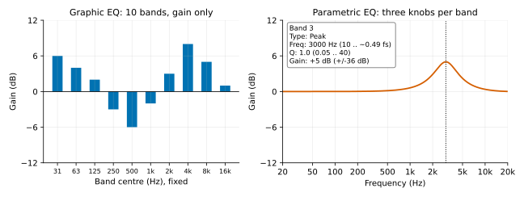
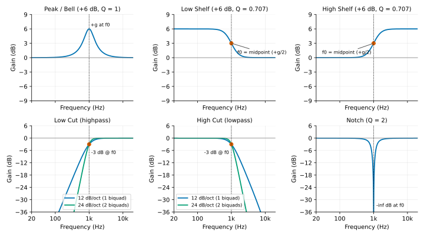
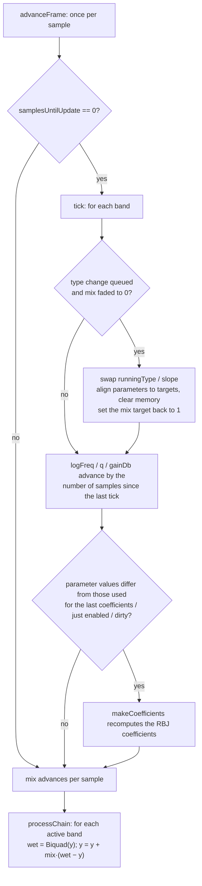

# Chapter 03: Parametric EQ
**English** | [繁體中文](README.zh-TW.md)

> [Course home](../../README.md)　｜　Previous: [02 Filter](../02-filter/README.md)　｜　Next: [04 Compressor](../04-compressor/README.md)

In Chapter 02 we got the biquad and the RBJ cookbook: give it a cutoff and a Q, and you get five coefficients that make some frequencies louder and others quieter.
An EQ (equalizer) is simply several of these biquads chained together, plus a convenient interface: each band has a frequency, a Q, and a gain. That sounds like mere packaging, but turning it into a component that can live inside a DAW raises a lot of questions that need clear answers. How do you convert Q to "how many octaves wide"? Why must the RBJ gain parameter be written as $`A = 10^{\text{dB}/40}`$ and not $`/20`$? How do you draw the curve of six stacked bands? Why does the sound go "tick-tick-tick" when the user turns the frequency knob during playback? Does an EQ only change the volume -- why does everyone keep talking about phase?

This chapter answers all of these in one go, and ends by building a 6-band `dawlab::dsp::ParametricEq`. The EQ insert of the Chapter 14 DAW uses it directly (the plugin in Chapter 13 only uses `Compressor`, `Limiter`, `Gain`, `SmoothedValue` and `DelayLine`, and contains no EQ).

## 1. Learning objectives

After reading this chapter and doing the exercises, you should be able to:

- Name the two uses of EQ in a mix (corrective vs creative), and the difference between a graphic EQ and a parametric EQ.
- Recognize the curve shapes of the six band types (peak / bell, low / high shelf, low / high cut, notch) and describe how each sounds.
- **Derive** the conversion formulas between Q and bandwidth (in octaves), and convert in your head between Q = 0.707, 1, 1.414 and 4.32 and the corresponding bandwidths.
- Starting from the analog prototype of the RBJ peak, explain why the gain parameter is $`A = 10^{\text{dB}/40}`$ (center gain $`A^2`$, gain $`A`$ at the bandwidth edges), and why a boost and a cut with the same parameters cancel exactly.
- Explain the relationship between a shelf's slope parameter S and Q, and the meaning of "transition frequency = midpoint gain".
- Prove that the dB responses add when several bands are cascaded, and write `getMagnitudeDb()` to draw the whole EQ curve.
- Explain the cause of clicks / zipper noise when parameters change live, compare "smooth the parameters and recompute the coefficients every N samples" with "interpolate the coefficients directly", and know the pitfalls of the latter.
- Explain why an IIR EQ must change the phase (minimum phase), and the costs of a linear-phase EQ (latency, pre-ringing).
- Explain cramping near Nyquist and several ways to deal with it, and the design idea behind proportional Q.
- Map common mixing EQ moves (a vocal low cut, the mud region, presence, air) onto concrete band settings.

## 2. Theory

### 2.1 What is an EQ? Corrective vs creative

An EQ can be described in one sentence: **it applies a different gain to different frequencies**. Mathematically it is an LTI (linear time-invariant) system, and the magnitude of its frequency response $`H(e^{j\omega})`$ is "how much to multiply each frequency by".

Mixing engineers use EQ for roughly two kinds of reasons:

| Purpose | Goal | Typical moves | Examples |
|---|---|---|---|
| **Corrective** | Remove what "should not be there" | Narrow cuts, low cuts, notches | Remove 60 Hz mains hum, low-frequency rumble picked up by a vocal microphone, or a frequency that is too loud because of a room resonance |
| **Creative / tonal** | Shape the tone and let each instrument occupy its own place in the mix | Wide boosts / cuts, shelves | Give the kick more weight, bring the vocal "forward", make the whole song "brighter" |

A frequently quoted rule of thumb is "**cuts narrow, boosts wide**": a narrow boost sounds like a resonance (like talking inside a pipe) and is very unnatural, whereas a narrow cut can remove a problem frequency precisely without affecting much else. Another is "**subtractive EQ first**": first carve out what you do not want, and you often no longer need to boost anything else -- boosting eats headroom (section 4).

### 2.2 Graphic EQ vs parametric EQ

**Graphic EQ**: the frequencies and Q are fixed, and the user can only push each band's gain. The common types are 10-band (one per octave, centered at 31.5, 63, 125, 250, 500, 1k, 2k, 4k, 8k, 16k Hz) and 31-band (one per 1/3 octave). The shape of the row of faders "looks like" the frequency response, hence the name graphic. In reality neighboring bands overlap, so the fader shape is not exactly the true curve -- Exercise 4 quantifies this.

**Parametric EQ**: all three parameters of each band (frequency, Q, gain) are adjustable, plus the band type. With just a few bands it can precisely treat any frequency. Almost every DAW's built-in EQ is parametric, and so is the one implemented in this chapter.



Left: the ten fader positions are only an example. Right: one parametric band (Type Peak, Freq 3000 Hz, Q 1.0, Gain +5 dB), with the range of each knob written in the box (frequency 10 Hz up to about 0.49·fs, Q 0.05..40, gain ±36 dB).

### 2.3 Band types and how they sound

This chapter's `EqBandType` has six values, all of them RBJ factories of the Chapter 02 `BiquadCoefficients` (a cut at 24 dB/oct uses two of them):



All six curves are drawn with f0 = 1 kHz at 48 kHz: Peak +6 dB with Q = 1; Low / High Shelf +6 dB with Q = 0.707 (at f0 the gain is the midpoint, +3 dB); Low Cut / High Cut at 12 dB/oct (one biquad, Q = 0.707) and at 24 dB/oct (two biquads), both −3 dB at f0; Notch with Q = 2 going to −∞ dB at f0.

| Type | RBJ formula used | Meaning of `frequency` | Meaning of `q` | `gainDb` | Sound / typical use |
|---|---|---|---|---|---|
| `Peak` (bell) | `makePeak` | Center frequency | Bandwidth (larger = narrower) | Gain at the center | The most versatile. +3 dB @ 3 kHz brings a vocal forward; −4 dB @ 300 Hz removes muddiness |
| `LowShelf` | `makeLowShelf` | The "midpoint" of the transition (where the gain = gainDb/2) | Steepness of the transition (0.707 = steepest without overshoot) | Gain at the low end | Adds "weight" or makes the whole thing "thinner", like the bass knob on a hi-fi |
| `HighShelf` | `makeHighShelf` | Same as above | Same as above | Gain at the high end | +2 dB @ 10 kHz for "air"; −3 dB to soften a harsh recording |
| `LowCut` | `makeHighpass` | The −3 dB point | At 12 dB/oct it is the resonance (0.707 = Butterworth) | None | Removes rumble, microphone-stand vibration, and the proximity effect of a vocal (a directional microphone boosts the low frequencies more the closer it is to the source) |
| `HighCut` | `makeLowpass` | The −3 dB point | Same as above | None | Removes hiss, pushes a synth pad further back |
| `Notch` | `makeNotch` | The frequency being carved out | The −3 dB bandwidth = f0/Q | None | Removes 50 / 60 Hz hum, a particular ring of a drum head |

**The slope of LowCut / HighCut.** Far from the cutoff, a 2nd-order highpass / lowpass behaves as $`|H| \propto (f/f_c)^{\pm 2}`$, i.e. it changes by $`20\log_{10} 2^2 \approx 12`$ dB per octave, hence "12 dB/oct". To get 24 dB/oct you need 4th order. The intuitive approach is "cascade two sections with Q = 0.707", but that gives −6 dB at $`f_c`$ and the corner becomes rounded. The correct approach is a **4th-order Butterworth**: its 4 poles are evenly distributed on the left half of a circle in the s-plane (one every 45°), and split into two conjugate pairs; the Q values of the two biquads are

```math
Q_k = \frac{1}{2\cos\left(\frac{(2k+1)\pi}{2N}\right)},\quad N = 4:\ Q_0 = 0.5412,\ Q_1 = 1.3066
```

(Chapter 02's `butterworthQ(order, stage)`). Neither section is −3 dB at $`f_c`$ -- the Q = 0.5412 section gives −5.33 dB and the Q = 1.3066 section gives +2.32 dB -- but together they come to exactly −3.01 dB (the output of Exercise 6). `ParametricEq` selects this mode with `EqSlope::Db24`, and the band's `q` is then ignored.

**Notch vs a deep peak cut.** The zeros of a notch lie exactly on the unit circle, so at $`f_0`$ it is a true $`-\infty`$ dB; a −30 dB peak is merely "very deep". A notch is suited to removing one exact frequency (hum), but it is easy to overdo on material whose pitch varies.

### 2.4 Q and bandwidth: the derivation

Mixing engineers say "1/3 octave wide", while the DSP formulas use Q. How do you convert between them?

**Definition of bandwidth.** For a bandpass / notch, the bandwidth is measured between the two −3 dB points; for a peak, RBJ defines it at the "**midpoint gain**" -- the two frequencies where the dB value is exactly half of the center value (for a +12 dB peak, look at the two points at +6 dB). The next section proves that the two definitions land on the same pair of frequencies.

**Analog prototype.** Write the normalized frequency as $`\Omega = f/f_0`$; the 2nd-order bandpass prototype is

```math
H_{BP}(s) = \frac{s/Q}{s^2 + s/Q + 1},\qquad s = j\Omega
```

```math
|H_{BP}(j\Omega)|^2 = \frac{(\Omega/Q)^2}{(1-\Omega^2)^2 + (\Omega/Q)^2}
```

The −3 dB condition ($`|H|^2 = 1/2`$) is $`(1-\Omega^2)^2 = (\Omega/Q)^2`$, i.e. $`|\Omega - 1/\Omega| = 1/Q`$. Solving this quadratic:

```math
\Omega^2 \mp \frac{\Omega}{Q} - 1 = 0 \quad\Rightarrow\quad \Omega_{1,2} = \sqrt{1 + \frac{1}{4Q^2}} \mp \frac{1}{2Q}
```

Two important properties can be read directly from the relations between roots and coefficients:

```math
\Omega_1 \Omega_2 = 1 \quad(\text{geometric symmetry: } f_1 f_2 = f_0^2),\qquad \Omega_2 - \Omega_1 = \frac{1}{Q} \quad(f_2 - f_1 = f_0/Q)
```

**Converting to octaves.** A bandwidth of $`N`$ octaves means $`f_2/f_1 = 2^N`$. By the geometric symmetry, $`\Omega_2 = 2^{N/2}`$ and $`\Omega_1 = 2^{-N/2}`$; substituting into $`\Omega_2 - \Omega_1 = 1/Q`$:

```math
\frac{1}{Q} = 2^{N/2} - 2^{-N/2} = 2\sinh\left(\frac{N\ln 2}{2}\right)
```

so

```math
\boxed{Q = \frac{1}{2\sinh(N\ln 2 / 2)} = \frac{2^{N/2}}{2^N - 1}}\qquad
\boxed{N = \frac{2}{\ln 2}\,\mathrm{asinh}\left(\frac{1}{2Q}\right)}
```

Common values (the output of Exercise 2):

| Q | 0.5 | 0.707 | 1.0 | 1.414 | 2.0 | 4.32 | 8.65 |
|---|---|---|---|---|---|---|---|
| bandwidth (octaves) | 2.54 | 1.90 | 1.39 | **1.00** | 0.71 | **1/3** | 1/6 |

Remembering two anchor points is enough: **Q = √2 ≈ 1.41 is 1 octave, and Q ≈ 4.32 is 1/3 octave**. Doubling Q roughly halves the bandwidth (for large Q, $`\mathrm{asinh}(x) \approx x`$ and $`N \approx 1.44/Q`$).

> Note: this is the relationship for the analog prototype. The bilinear transform "warps" the frequency axis, so at high frequencies the actual bandwidth is slightly narrower than the formula says (the digital RBJ cookbook formulas have an extra correction term $`\omega_0/\sin\omega_0`$). At 1 kHz and 48 kHz the difference is only about 0.02 dB (Exercise 2: a Q = √2, +12 dB peak measures +5.989 / +5.978 dB at 707.1 / 1414.2 Hz, against an ideal of +6). `ParametricEq::qToBandwidthOctaves()` / `bandwidthOctavesToQ()` / `bandEdges()` are exactly these three formulas.

### 2.5 The RBJ peak: why $`A = 10^{\text{dB}/40}`$?

The analog prototype of the RBJ cookbook's peaking EQ is

```math
H(s) = \frac{s^2 + s\,\dfrac{A}{Q} + 1}{s^2 + s\,\dfrac{1}{AQ} + 1}
```

Look at three places in turn:

1. **Far from the center** ($`s \to 0`$ or $`s \to \infty`$): the numerator and denominator both approach 1 or $`s^2`$, so $`|H| \to 1`$, i.e. 0 dB. ✔
2. **The center** $`s = j`$: $`s^2 + 1 = 0`$, which leaves $`\dfrac{jA/Q}{j/(AQ)} = A^2`$. So **the linear gain at the center is $`A^2`$**. For the center to be $`g`$ dB we need $`20\log_{10}A^2 = g`$, that is

```math
A = 10^{g/40}
```

   This is where the $`/40`$ comes from: $`A`$ is "the square root of the center gain".
3. **The bandwidth edges** (the previous section's $`|1-\Omega^2| = \Omega/Q`$):

```math
|H|^2 = \frac{(1-\Omega^2)^2 + (\Omega A/Q)^2}{(1-\Omega^2)^2 + (\Omega/(AQ))^2} = \frac{(\Omega/Q)^2(1 + A^2)}{(\Omega/Q)^2(1 + A^{-2})} = A^2
```

   So the gain at the edges is $`|H| = A`$, **exactly half the center in dB**. This is the "midpoint gain" bandwidth mentioned in section 2.4 -- it is the same pair of frequencies as the −3 dB points of a bandpass.

Why parameterize it this way? Look at the numerator and denominator: the damping terms are $`A/Q`$ and $`1/(AQ)`$ respectively. Replace $`g`$ with $`-g`$ ($`A \to 1/A`$) and the numerator and denominator **swap exactly**:

```math
H_{-g}(s) = \frac{1}{H_{+g}(s)}
```

That is, **+6 dB and −6 dB (same frequency, same Q) in cascade cancel perfectly** -- not just the magnitude, the phase is restored too. This is a symmetric, convenient property: the boost and cut curves are mirror images. Exercise 3 verifies it with numbers: +6 dB and −6 dB @ 1 kHz, Q = 1 in cascade have a maximum deviation of $`10^{-13}`$ dB over 20 Hz–20 kHz.

**Digitization.** Chapter 02 explained that RBJ uses the bilinear transform ($`s \leftarrow \frac{1}{\tan(\omega_0/2)}\cdot\frac{1-z^{-1}}{1+z^{-1}}`$, prewarped at $`\omega_0`$); after simplification this gives

```math
\begin{aligned}
\omega_0 &= 2\pi f_0/f_s,\quad \alpha = \frac{\sin\omega_0}{2Q},\quad A = 10^{g/40}\\
b_0 &= 1 + \alpha A,\quad b_1 = -2\cos\omega_0,\quad b_2 = 1 - \alpha A\\
a_0 &= 1 + \alpha / A,\quad a_1 = -2\cos\omega_0,\quad a_2 = 1 - \alpha / A
\end{aligned}
```

(all divided by $`a_0`$ to normalize; `BiquadCoefficients::makePeak` is exactly these lines). A worked example (Exercise 1): $`f_s = 48`$ kHz, $`f_0 = 12`$ kHz ($`\omega_0 = \pi/2`$, $`\cos = 0`$, $`\sin = 1`$), Q = 1, +6 dB: $`\alpha = 0.5`$, $`A = 1.4125`$, and after normalization $`b_0 = 1.26019`$, $`b_2 = 0.21694`$, $`a_2 = 0.47713`$, $`b_1 = a_1 = 0`$.

### 2.6 Shelves: the transition midpoint and the slope parameter S

The analog prototype of the RBJ low shelf is

```math
H_{LS}(s) = A\,\frac{s^2 + \dfrac{\sqrt{A}}{Q}s + A}{A s^2 + \dfrac{\sqrt{A}}{Q}s + 1}
```

- $`s \to 0`$ (DC): $`A \cdot A / 1 = A^2`$ → gain at the low end = $`g`$ dB.
- $`s \to \infty`$: $`A \cdot s^2 / (A s^2) = 1`$ → 0 dB at the high end.
- $`s = j`$ ($`f = f_0`$): the numerator is $`A(A - 1 + j\sqrt{A}/Q)`$ and the denominator is $`(1 - A) + j\sqrt{A}/Q`$; apart from the leading $`A`$ the two have the same magnitude, so $`|H(j)| = A`$ -- **at the transition frequency $`f_0`$ the gain is exactly $`g/2`$ dB**.

The high shelf replaces $`s`$ with $`1/s`$ (swapping high and low frequencies), with the same conclusion. This "midpoint" property matters: the tilt EQ of Exercise 5 relies on it, placing a low shelf of $`-t/2`$ and a high shelf of $`+t/2`$ at the same pivot, so that at the pivot $`-t/4 + t/4 = 0`$ dB.

**The slope parameter S.** The cookbook does not always use Q as the third parameter of a shelf; it can use the "shelf slope" S instead:

```math
\frac{1}{Q} = \sqrt{\left(A + \frac{1}{A}\right)\left(\frac{1}{S} - 1\right) + 2}
```

With S = 1 you get $`Q = 1/\sqrt{2}`$ regardless of the gain -- the cookbook describes this as "the steepest slope that still stays monotonic (no overshoot)". An S below 1 makes the transition more gradual; a Q above 0.707 (equivalent to S > 1) produces a small opposite dip and overshoot near the transition (some analog EQs deliberately keep this "bump" as part of their character). `ParametricEq::shelfSlopeToQ(S, gainDb)` is exactly this formula; the shelves in this chapter default to Q = 0.707 (S = 1).

The last table of Example 1 sweeps a +6 dB @ 1 kHz low shelf over 10 Hz–23 kHz with different Q values and measures the highest and lowest points of the curve:

```
      Q     S(equiv)  |H(f0)|(dB)   curve max(dB)   curve min(dB)
   0.500     0.51        +3.00         +6.00          +0.00
   0.707     1.00        +3.00         +6.00          +0.00     <- steepest but still monotonic
   1.000     1.89        +3.00         +6.44          -0.44
   1.500     3.75        +3.00         +7.64          -1.64
   2.000     5.72        +3.00         +8.86          -2.86     <- overshoot 2.86 dB, dip 2.86 dB
```

Three things to see at once: (1) whatever the Q, $`f_0`$ is at +3.00 dB (the midpoint property); (2) for Q ≤ 0.707 the curve stays within 0..+6 dB; (3) as Q grows, the overshoot and the dip are **equally large**. The reason: replace $`s`$ with $`1/s`$ in the $`H_{LS}(s)`$ above and simplify to get $`H_{LS}(1/s) = A^2 / H_{LS}(s)`$, so $`\text{dB}(f_0 \cdot 2^k) + \text{dB}(f_0 \cdot 2^{-k}) = g`$ -- on a log frequency axis the curve is symmetric about the point $`(f_0,\ g/2)`$, so however far it rises above $`g`$ on one side, it dips below 0 dB by the same amount on the other.

### 2.7 Cascade = dB addition; drawing the EQ curve

The six bands are in **cascade**: the signal passes through band 0, then band 1, and so on. When two LTI systems are cascaded, their transfer functions multiply:

```math
H(z) = H_0(z)\,H_1(z)\cdots H_5(z)
```

Taking the magnitude and then the dB turns multiplication into addition:

```math
20\log_{10}|H| = \sum_k 20\log_{10}|H_k| \qquad\text{(dB values add)}
```

```math
\angle H = \sum_k \angle H_k \qquad\text{(phases add too)}
```

Because multiplication is commutative, **the order of the cascade does not affect the frequency response** (and in float the numerical difference is also tiny; see section 4). Note that "dB values add" is not "linear amplitudes add": two +6 dB stages (2x each) stacked make +12 dB (4x), not 2 + 2.

So the implementation of `getMagnitudeDb(f)` simply adds up the `magnitudeDb(f, fs)` of every enabled band -- and each band's `magnitudeDb` substitutes $`z = e^{j\omega}`$ into $`H(z)`$:

```math
H(e^{j\omega}) = \frac{b_0 + b_1 e^{-j\omega} + b_2 e^{-2j\omega}}{1 + a_1 e^{-j\omega} + a_2 e^{-2j\omega}},\qquad \omega = 2\pi f/f_s
```

A UI only needs to call `getMagnitudeDb()` at a few hundred points on a log frequency axis to draw the curve (Example 1 draws an ASCII plot with 72 points). The table in Example 1 lists the contribution of each band; at 18 kHz, for example: band 3 +0.04, band 4 (high shelf +2 dB @ 10 kHz) +1.98, band 5 (high cut @ 18 kHz) −3.01, summing to −1.00 dB, which agrees exactly with `getMagnitudeDb(18000)` and with the measurement using a sine wave.

### 2.8 Phase: why an IIR EQ must change the phase

An IIR filter that changes the magnitude **always** changes the phase too. The poles and zeros of the RBJ EQ biquads lie inside (or on) the unit circle; such a system is called **minimum phase**, and the phase of a minimum-phase system is completely determined by its magnitude -- in other words, for a given magnitude curve, the minimum-phase version is the one with the least phase shift and the shortest delay, but it can never be zero.

> **Advanced (may be skipped)**: the mathematical statement of "the phase is completely determined by the magnitude" is that the log-magnitude and the phase of a minimum-phase system form a Hilbert transform pair (knowing one, you can compute the other). This needs a background in complex analysis and is not used anywhere in this course; remembering the intuitive conclusion above is enough.

Example 4 prints a peak of +6 dB @ 1 kHz, Q = 1:

```
 freq(Hz)   mag(dB)   phase(deg)   group delay(samples)
      500     +1.88      +18.00          -2.89
      707     +3.96      +18.39           3.21
     1000     +6.00       +0.00          10.80      <- 0.225 ms
     1414     +3.96      -18.40           1.61
     2000     +1.87      -17.97          -0.73
```

- At the center the phase = 0; below the center the phase leads (+), above it lags (−), by at most about ±18°, roughly at the bandwidth edges.
- The group delay ($`\tau = -d\phi/d\omega`$) is noticeable only near the boost, about 10.8 samples (0.225 ms) at the center; on the skirts it is even negative (where the phase rises with frequency). This does not violate causality; it only means the envelope of that part of the signal is moved slightly "earlier".
- The phase of a cut has exactly the opposite sign (−6 dB at 707 Hz gives −18.39°), consistent with section 2.5's "a cut is the reciprocal of a boost".

Audibly, the phase shift of a single band is almost inaudible; the problem arises in **parallel** use: when one copy of the signal goes through the EQ and another does not (for example several microphones capturing the same drum, or parallel processing) and the two are summed, the phase difference causes comb filtering (when two copies of a signal have a time or phase difference, some frequencies cancel when they are summed, and the frequency response shows a row of notches like the teeth of a comb).

**Linear-phase EQ.** If you want to change the magnitude while giving every frequency the same delay (the phase is a linear function of frequency), you must use a symmetric FIR filter (usually designed from the desired magnitude via an FFT). The costs:

1. **Latency**: the delay of a symmetric FIR is fixed at $`(N-1)/2`$ samples. Resolving low frequencies needs a very long FIR; for example 4097 taps → 2048 samples = 42.7 ms @ 48 kHz. A DAW has to do latency compensation (Chapter 14).
2. **Pre-ringing**: a symmetric impulse response oscillates *before* the main peak. A narrow boost / cut puts an "inhale-like" pre-echo before the transients of a kick or snare, whereas minimum phase has only post-ringing (which is closer to natural resonance).
3. **CPU**: a long FIR can only run with FFT convolution (Chapter 12).

So linear-phase EQs are mostly used in mastering, or wherever phase relationships must be preserved (for example multi-mic drums, multiband crossovers); for ordinary mixing minimum phase is enough. This chapter implements only minimum phase.

### 2.9 Changing parameters live: avoiding clicks and zipper noise

Turning an EQ knob during playback makes the filter time-varying. If every time the UI sends a new parameter you **swap the coefficients directly**, there are two problems:

1. **The parameter itself is a staircase**: a host / MIDI controller / automation may send parameters only once per block, or even once per 100 ms. The center frequency jumps one step at a time, and so does the output level → a regular "tick-tick-tick", which is zipper noise.
2. **There is a transient at the moment the coefficients change**: the filter's state variables ($`s_1, s_2`$ in TDF-II) were accumulated with the old coefficients, and combining them with the new coefficients produces a short discontinuity. The bigger the jump and the higher the Q, the more obvious it is.

Example 3 sweeps a +12 dB, Q = 6 peak logarithmically from 150 Hz to 6 kHz (4 seconds), with the host sending the frequency every 100 ms. The analysis signal is a 1 kHz sine wave, and we measure "the RMS jump per 1 ms":

```
  version      max jump(dB/ms)  jumps>1 dB     envelope peak
  reference        0.09            0           -3.11 @ 2063 ms   <- recompute at every sample along the ideal curve
  naive            3.35           12           -4.41 @ 2105 ms   <- swap the coefficients directly
  smooth/1         0.10            0           -3.11 @ 2156 ms   <- smooth the parameters + recompute at every sample
  smooth/32        0.10            0           -3.11 @ 2155 ms   <- smooth the parameters + recompute every 32 samples (default)
  smooth/512       0.26            0           -3.10 @ 2164 ms   <- smooth the parameters + recompute once per block
```

**Strategy: smooth the parameters, then recompute the coefficients.** What `ParametricEq` does:

1. The three parameters that affect the coefficients are each given a linear ramp (default 20 ms) with Chapter 01's `SmoothedValue`. **Frequency is smoothed in the $`\log_2`$ domain** -- going from 100 Hz to 200 Hz is the same "one octave" as going from 1 kHz to 2 kHz, so a sweep moves at the same speed in every octave; gain is smoothed in the dB domain.
2. The RBJ coefficients are recomputed only every `kDefaultUpdateInterval` = 32 samples (0.67 ms at 48 kHz), and only for bands whose parameter values have changed. Each recomputation needs `sin`, `cos` and `pow`, so computing six bands at every sample would be wasteful; the table shows that recomputing every 32 samples is almost indistinguishable from recomputing at every sample (0.10 vs 0.10 dB/ms), and the difference only starts to show when recomputing every 512 samples (0.26).
3. The ramp "chases" the target, so the smoothed version reaches the envelope peak about 90 ms later (the ramp length is set equal to the automation interval, 100 ms), which is inaudible.

**Why not interpolate the biquad coefficients directly?** Another common idea is to compute the old and new coefficients and then interpolate linearly between them sample by sample (so there is no need to compute sin/cos every time). The problems:

- **Frequency does not map linearly.** Section C of Example 4: for a +12 dB, Q = 2 peak, taking halfway between the coefficients at 100 Hz and at 10 kHz gives a filter whose maximum gain is at **6620 Hz** (+11.98 dB), not at the geometric midpoint of 1 kHz. The reason is that $`a_1 = -2\cos\omega_0/(1+\alpha/A)`$, so interpolating $`a_1`$ roughly interpolates $`\cos\omega_0`$, and $`\cos\omega_0`$ hardly moves at low frequencies (at 48 kHz, it is 0.99991 at 100 Hz and 0.9914 at 1 kHz) and only changes a lot at high frequencies (0.2588 at 10 kHz). So a "small step" in $`\cos\omega_0`$ covers several octaves of log frequency: when interpolating from 100 Hz toward 10 kHz, **the low-frequency octaves flash by and most of the time is spent at high frequencies** -- the sweep sounds like "it shoots up in an instant and then lingers at the high end".
- **Second order by itself: frozen coefficients are still stable.** The stability region of a 2nd-order denominator is the triangle $`|a_2| < 1,\ |a_1| < 1 + a_2`$ in the $`(a_1, a_2)`$ plane, which is a **convex set**: every point on the segment between any two points inside the triangle is still inside the triangle, so linearly interpolating between two stable sets of biquad coefficients gives intermediate coefficients that are stable for each "frozen" state (Example 4 section C prints "stable").
- **Higher-order polynomials: the poles can leave the unit circle midway.** For order 3 and above, the stable polynomials **do not form a convex set**. In section D1 of Example 4: take a 24 dB/oct high cut (a 4th-order Butterworth), and the midpoint between its 100 Hz and 10 kHz settings, taken on the "coefficients of the 4th-order polynomial obtained by multiplying the two biquads out", has a largest pole magnitude of **1.287** (0.995 and 0.678 at the two ends) -- the midpoint is already unstable, and its impulse response reaches $`1.8\times10^{10}`$ at n = 100. With the same two settings, **interpolating the two biquads separately** keeps both stable. This is another reason for "always split a high-order filter into a cascade of biquads" (Chapter 02 also gave a numerical-precision reason).
- **"Stable at every instant" does not mean "the time-varying system is stable".** The definition of stability is for LTI systems. Section D2 of Example 4 uses the real `Biquad` from Chapter 02: at every sample it alternates between a 50 Hz and a 16 kHz lowpass (Q = 0.707, **each set stable on its own**) and feeds in an impulse; the output is 348 at n = 40 and $`1.05\times10^{10}`$ at n = 80 -- it diverges. Intuitively: each set of coefficients is stable alone, but when switching back and forth quickly, what the previous coefficients left in the state variables is amplified by the next set, and back and forth it can snowball. The control: the same back-and-forth between 50 Hz and 16 kHz, but with each leg a smooth 20 ms walk in log frequency, gives a peak output of only 0.599 for 1 second of white noise. Conclusion: **if the parameters change slowly enough relative to the filter's time constant**, the time-varying effects are small; it is when the coefficients "jump" or "flip back and forth quickly" that it becomes dangerous. Filters that need large, fast modulation (for example a synth's filter envelope) switch to structures that are more robust to modulation, such as a TPT (topology-preserving transform) state variable filter (`StateVariableFilter.h` in section 2.16 of Chapter 02; see Further reading for more).

> **Advanced (may be skipped)**: the mathematical statement of D1 and D2. D1: the stability region of a 2nd-order denominator is a convex triangle, but the set of "stable polynomial coefficients" of order 4 and above is not convex, so the midpoint of two stable 4th-order polynomials can be unstable; Example 4 verifies this with a small Durand–Kerner iteration that finds the roots of the 4th-order polynomial. D2: in the language of state space, each sample step of TDF-II multiplies the state vector $`(s_1, s_2)`$ by the state-transition matrix $`\begin{pmatrix}-a_1 & 1\\ -a_2 & 0\end{pmatrix}`$. The eigenvalues of the matrices of the two coefficient sets are each inside the unit circle (= each is stable), but the eigenvalues of their **product** (the transition over two alternating steps) can be greater than 1, so the state is amplified once every two steps. This needs the concept of eigenvalues from linear algebra; not understanding it does not affect later chapters.

Therefore this chapter chooses: **smooth the parameters (in meaningful units: log frequency, dB) → recompute the coefficients from the formulas every N samples**. The coefficients are always the RBJ coefficients of some valid set of parameters (and therefore always stable), and the parameters walk slowly along a 20 ms ramp, so the rapid back-and-forth of case D2 never occurs.

**Changes that cannot be interpolated: enabling / disabling a band, changing the type, changing the slope.** There is no "halfway" between a Peak and a Notch. For these changes `ParametricEq` uses a dry/wet crossfade:

- Toggling `enabled`: each band has a `mix` (0 = bypass, 1 = fully on) that advances per sample along a 20 ms linear ramp: $`y = x + m\,(H(x) - x)`$.
- Changing the type / slope: first fade the mix to 0 (the old type keeps running) → at the moment of complete bypass, swap the type, clear the filter memory and align the parameters directly to the targets → then fade in. About 40 ms in total.
- Changing parameters while a band is fully bypassed: nobody can hear it, so the parameters jump straight to the target, and the fade-in is the final curve.

The third part of Example 3 quantifies this: on a 1 kHz sine wave, a LowCut is switched on, changed to a Peak, and then switched off. It uses the "sine prediction residual" $`r[n] = y[n] - 2\cos\omega\,y[n-1] + y[n-2]`$ (for a pure sine $`r = 0`$, and a sudden jump makes $`r`$ large): the naive direct switching gives max|r| = 0.0325 (−17.7 dB, relative to an amplitude of 0.25), while `ParametricEq` gives 0.0021 (−41.4 dB). Event by event:

```
      time       naive      ParametricEq   event
     0.256 s   0.009952   0.000121       LowCut@2k on
     0.768 s   0.017737   0.002130       changed to Peak +6 dB@1k
     1.280 s   0.032477   0.000068       off
```

For all three events the naive version has a sharp residual; `ParametricEq` is more than 80 times smaller at "on" and "off", and largest at "change type" (0.0021) because it has to fade out and then fade in, passing once through a dry ↔ wet change of amplitude and phase -- but it is still more than 8 times smaller than naive, and it is a smooth change spread over 40 ms rather than a sharp point.

### 2.10 Cramping near Nyquist

Section 2.14 of Chapter 02 looked at cramping (bilinear warping) of a lowpass near Nyquist; here we look at its effect on a peak. The bilinear transform squeezes the whole analog frequency axis $`[0, \infty)`$ into the digital $`[0, f_s/2]`$: the analog $`\Omega = \infty`$ maps to Nyquist. Prewarping guarantees that the **center frequency** lines up, but the right half of the bell is forced into the remaining space. For an RBJ peak we can verify directly at $`z = -1`$ (Nyquist):

```math
H(-1) = \frac{b_0 - b_1 + b_2}{a_0 - a_1 + a_2} = \frac{2 + 2\cos\omega_0}{2 + 2\cos\omega_0} = 1
```

**Any** RBJ peak is forced back to 0 dB at Nyquist. Section B of Example 4 (44.1 kHz, +6 dB @ 10 kHz, Q = 1):

```
 freq(Hz)   analog(dB)   digital(dB)   diff
    10000      +6.00        +6.00      +0.00   <- the center lines up
    14000      +4.05        +2.40      -1.65
    17000      +2.70        +0.74      -1.96
    22050      +1.52        +0.00      -1.52   <- Nyquist is forced to 0 dB
```

The digital bell becomes asymmetric and narrower on the right; this is **cramping**. The "air" high-shelf band at high frequencies is affected too. Solutions:

1. **Oversampling** (Chapter 06): run the EQ at 2x or 4x the sample rate, so that 10 kHz is far from Nyquist. The cost is CPU and the latency of the up/down-sampling filters.
2. **Designs with a prescribed Nyquist gain**: Orfanidis (1997) derived a peak design in which the gain at Nyquist can be specified (for example set to the value of the analog prototype at $`f_s/2`$).
3. **Matched designs that fit the analog response**: for example Vicanek's "Matched Second Order Digital Filters", which make the digital response follow the analog prototype closely over the whole band.

This chapter's `ParametricEq` stays with RBJ (simple, stable, consistent with Chapter 02); at 48 kHz the error for bands up to 10 kHz is not large, and you can switch designs when a more accurate high-frequency curve is needed.

### 2.11 Proportional Q

A fixed-Q peak has a perceptual problem: at small gains (±2 dB) you want it a little wider and gentler; at large gains (±12 dB) you want it narrower, otherwise it affects too many neighboring frequencies. **Proportional Q** designs make the "effective bandwidth" vary with |gain|: wide at small gains and narrow at large gains. Many analog console EQs and graphic EQs behave like this, so "a small turn is very musical, a big turn is very precise".

In implementation it is just a mapping $`Q_{\text{eff}} = f(Q, |g|)`$ placed before `setBand`. Each manufacturer's mapping curve is unpublished and different; an **illustrative** way to write it is $`Q_{\text{eff}} = Q\cdot(1 + k|g|)`$ ($`k`$ is a constant you choose, e.g. 0.1 means Q doubles at +10 dB). This is not the formula of any particular EQ, and this chapter does not implement it; it is only to show you the concept behind the knob. If you want to try it, adding one line before `ParametricEq::setBand()` is enough.

The opposite concept is the **constant-Q** of graphic EQs: however much you push, the bandwidth stays the same, so the interaction between neighboring bands is predictable. Exercise 4 shows this: a 10-band, Q = √2 graphic EQ with every band pushed +6 dB actually gives +8.80 dB at 1 kHz (the tails of the neighboring bands pile on top), and there is still about 1.9 dB of ripple between 125 Hz and 4 kHz -- the fader shape is not the curve.

### 2.12 Mixing practice: common frequency ranges and moves

The table below lists rules of thumb common in mixing practice (compiled from mixing books and engineers' habits, not derived from formulas or measured by the code). They are only starting points, not rules; every song and every microphone is different, so **always confirm with your ears**, and when A/B-comparing, match the levels (louder almost always sounds "better").

| Range | Name / character | Common moves |
|---|---|---|
| < 30 Hz | Very low frequencies (subsonic): barely audible but they eat headroom | LowCut at 30 Hz, 24 dB/oct on the drum bus and master |
| 60–100 Hz | Weight of the kick and bass | Kick +2~4 dB with a low shelf / peak; avoid boosting kick and bass at the same point |
| Below 80–150 Hz | Low frequencies that vocals, guitars and piano do not need | **Vocal low cut**: roughly 80–100 Hz (male voice), 100–150 Hz (female voice), to remove the proximity effect and vibration |
| 200–500 Hz | **Mud**, boxiness | The place where stacked multitrack material crowds up most easily; wide −2~−4 dB |
| 800 Hz–1.5 kHz | Nasal, "telephone" sound | A small cut; or a deliberate boost for a lo-fi effect |
| 2–5 kHz | **Presence**, diction, the sound of the pick on a guitar | Vocal +2~3 dB to bring it "forward"; too much is harsh (the ear is most sensitive here) |
| 5–9 kHz | Sibilance ("s" and "t" sounds) | A narrow cut, or the de-esser from Chapter 08 |
| > 10 kHz | **Air**, brightness | High shelf +1~3 dB; HighCut to remove hiss |

Example 2 turns these into two presets:

- **Guitar / pluck**: LowCut 70 Hz, −4 dB @ 300 Hz (Q 1.2), −2 dB @ 900 Hz (Q 2), +3 dB @ 3 kHz, HighShelf +2 dB @ 8 kHz.
- **Drum bus**: LowCut 30 Hz (24 dB/oct), LowShelf +3 dB @ 90 Hz, −3 dB @ 400 Hz (Q 1.5), +1.5 dB @ 2.5 kHz, HighShelf +3 dB @ 7 kHz.

## 3. From formulas to code

### 3.1 `dsp/include/dawlab/dsp/ParametricEq.h`

```cpp
enum class EqBandType { LowCut, LowShelf, Peak, HighShelf, HighCut, Notch };
enum class EqSlope { Db12, Db24 };          // only meaningful for LowCut / HighCut

struct EqBand {
    EqBandType type = EqBandType::Peak;
    float frequency = 1000.0f;   // Hz
    float q = 0.707f;
    float gainDb = 0.0f;         // only meaningful for Peak / LowShelf / HighShelf
    bool enabled = false;
};
```

**Data structures.** Inside, each band holds: the target `EqBand` set by the UI, the `slope`, the `runningType` / `runningSlope` that are actually running (still the old ones while a type change is fading out), four `SmoothedValue`s (`logFreq`, `q`, `gainDb`, `mix`), and two `Biquad`s (`stage1`, `stage2`; only a 24 dB/oct cut uses the second). The whole class has no pointers and no atomics, so it can be copied or placed in a `std::vector`.

**Standard interface.**

| Method | What it does |
|---|---|
| `prepare(sr, maxBlock, nch)` | The only place that allocates: allocates the channel state of each Biquad, sets the smoothers' ramp length, then calls `reset()` |
| `reset()` | Clears the filter memory; the smoothers jump straight to the targets (no ramp from the old values) |
| `setBand(i, band)` | Sets the target (with clamping: frequency 10 Hz..100 kHz, Q 0.05..40, gain ±36 dB; NaN / inf fields are ignored and the old value kept); the smoothers start ramping; queues a structural switch when needed. Does nothing if it is exactly the same as the current target (so it does not matter if the host resends the parameters every block). Must be called on the audio thread, between blocks |
| `getBand(i)` | Returns the **target** parameters (not the values being smoothed). The frequency is the value the user set: the frequency actually in effect is additionally capped below 0.49·fs (applied only when computing coefficients), so if you set 30 kHz before `prepare()` and then `prepare(96000)`, 30 kHz still takes effect |
| `getMagnitudeDb(f)` | The dB of the whole EQ: the `magnitudeDb` of the enabled bands added up (section 2.7) |
| `processSample(ch, x)` | Per sample. For every frame call channel 0, 1, … in order; smoothing and coefficient updates advance at channel 0 |
| `process(block)` | Processes a whole block in place |

**Extra methods** (for UI, teaching, and later chapters): `setBandEnabled/Type/Frequency/Q/GainDb`, `setSlope` / `getSlope`, `setSmoothingSeconds` (call before `prepare`), `setCoefficientUpdateInterval`, `getBandMagnitudeDb`, `getResponse` (complex), `getPhaseDegrees`, `getGroupDelaySamples`, and the static `qToBandwidthOctaves`, `bandwidthOctavesToQ`, `shelfSlopeToQ`, `bandEdges`, `makeCoefficients`, `makeSecondStageCoefficients`.

**The flow of each frame (`advanceFrame()`):**



Compare with section 2.9:

```cpp
void advanceFrame() noexcept {
    if (samplesUntilUpdate_ == 0) {            // every 32 samples: advance the parameters, recompute the coefficients
        tick(samplesSinceTick_);               // only advance by the number of samples that have actually elapsed since the last tick
        samplesSinceTick_ = 0;
        samplesUntilUpdate_ = updateInterval_;
    }
    --samplesUntilUpdate_;
    ++samplesSinceTick_;
    for (auto& b : bands_)                     // mix is only a multiplication; advancing it per sample keeps it from turning into small steps
        if (b.mix.isSmoothing())
            b.mixCurrent = b.mix.getNextValue();
}
```

When `setBand()` changes a parameter it sets `samplesUntilUpdate_` to 0, so the very next sample ticks and does not have to wait for the next 32-sample boundary.

**Why "the number of samples actually elapsed" instead of always advancing by 32?** If a tick always advanced by 32 samples "in advance", that would be fine in the usual case (a tick happens exactly every 32 samples); but when `setBand()` forces an early tick, the samples that the previous tick had already advanced in advance but that had not actually elapsed yet would be **advanced a second time**. When the host applies parameters at the start of every block (Chapters 13 and 14 do exactly this) and the block is smaller than 32, the ramp is sped up by a multiple -- with a 1-sample block, a 20 ms smoothing shrinks to 0.6 ms, i.e. no smoothing at all. The current approach lets the coefficients lag by at most 32 samples and never run ahead, and the total ramp length does not depend on the block size. Two further details:

- Before changing a parameter, `setBand()` calls `catchUpSmoothers()` to advance all ramps to "now", so the new ramp starts from the correct position.
- To decide whether to recompute the coefficients, the tick looks at "whether the current parameter values differ from those used for the last coefficient computation", not at "whether it is currently smoothing". With `setSmoothingSeconds(0)`, a `SmoothedValue` jumps to the target instantly and `isSmoothing()` is always false; if that were the criterion, the new parameters would never be applied to the filter.

These behaviors are all verified with numbers by the regression test `l03_test_parametric_eq` (`tests/parametric_eq_test.cpp`): block sizes 1 / 8 / 16 / 48 / 512, the ramp length when parameters are resent every block, the measured response equalling `getMagnitudeDb()` at smoothing 0, the steady-state response after switching types back and forth, a frequency set before `prepare()`, and the clicks of enabling / disabling and type changes. Run it first after changing `ParametricEq.h`.

**`makeCoefficients()`** is a `switch` that maps the band type to a Chapter 02 factory: `LowCut → makeHighpass`, `HighCut → makeLowpass`, `LowShelf → makeLowShelf`, …; at 24 dB/oct the first section uses Q = 0.5412 and `makeSecondStageCoefficients()` supplies the second with Q = 1.3066.

### 3.2 Example 1: `l03_eq_curve` (`examples/eq_curve.cpp`)

Sets up an EQ with all six bands on (LowCut 60 Hz 24 dB/oct, LowShelf +3 dB @ 120 Hz, −4 dB @ 300 Hz, +5 dB @ 3 kHz, HighShelf +2 dB @ 10 kHz, HighCut 18 kHz), draws an ASCII plot with `getMagnitudeDb()` (`#` = theory), then actually sends sine waves through the EQ, measures them with `measureGainDb()`, and overlays them on the same plot (`o` = measured):

```
    +4 dB |                                               ####o###                 |
    +2 dB |             #####o                        ####o       #o####o###o##    |
    +0 dB |-----------o#------#####---------o######o##-------------------------oo--|
    -2 dB |          #            o##    ###                                    #  |
    -4 dB |                          #o##                                          |
    ...
          +------------------------------------------------------------------------+
           20       50     100    200       500    1k     2k       5k     10k    20
```

In the table, "theory − measured" is 0.000 dB at all 15 frequencies -- what `getMagnitudeDb()` draws is the real sound. The second table lists each band's dB contribution and the sum, verifying section 2.7; the third table is the shelf Q and overshoot of section 2.6. It only outputs console text. At the end the program self-checks with `DAWLAB_CHECK` (maximum difference < 0.05 dB, cuts at −3.01 dB at fc) and prints `[PASS] l03_eq_curve` when all hold; otherwise it returns non-zero and ctest reports a failure.

```powershell
.\scripts\build.ps1 -Only 03-eq     # from the project root: build and run the tests
cd build                            # the default build directory (use your own if you passed -BuildDir)
.\bin\Debug\l03_eq_curve.exe
```

The other examples and solutions run the same way: `.\bin\Debug\<target>.exe`, and WAV files are written under `dawlab_output\` in the current directory.

### 3.3 Example 2: `l03_eq_presets` (`examples/eq_presets.cpp`)

Processes two pieces of material in blocks of 512 samples (simulating an audio callback), and uses Goertzel to measure the amplitude ratio "after / before" at each harmonic, to compare with the theoretical curve:

```
[pluck sequence] guitar-style EQ
     freq(Hz)   theory(dB)   measured(dB)
         110       -1.12        -1.13
         330       -3.85        -3.85
        1760       +1.01        +1.01
        3520       +2.70        +2.70
  dry  peak  -5.18 dBFS   RMS -19.71 dBFS
  eq   peak  -3.10 dBFS   RMS -19.32 dBFS
[drum loop] drum-bus EQ
  dry  peak  -2.92 dBFS   RMS -17.43 dBFS
  eq   peak  -1.58 dBFS   RMS -15.40 dBFS
```

Note that the RMS of the pluck hardly changed (−19.71 → −19.32) while the peak rose by 2 dB: the EQ changed the phases and proportions of the harmonics, and the peak of the waveform changed with them -- **recheck the headroom after an EQ**.

Output (`dawlab_output/` in the build directory): `l03_pluck_dry.wav`, `l03_pluck_eq.wav`, `l03_drums_dry.wav`, `l03_drums_eq.wav`. You can pass a WAV of your own as an argument (`l03_eq_presets.exe my.wav`), which applies the guitar-style EQ and writes `l03_custom_eq.wav`.

**What you should hear**: the pluck becomes cleaner, with less of a "muffled" feel and the attack of the plucked string further forward; in the drum loop the kick is fuller, the snare sounds less boxy, and the hi-hat is brighter.

### 3.4 Example 3: `l03_eq_automation` (`examples/eq_automation.cpp`)

The experiment of section 2.9. Three parts:

1. **Analysis**: sweep a peak's frequency over a 1 kHz sine wave (150 Hz → 6 kHz, +12 dB, Q = 6, 4 seconds; the host sends parameters every 100 ms), and compare the per-millisecond loudness jumps of reference / naive / smooth/1 / smooth/32 / smooth/512 (see section 2.9 for the table).
2. **Listening**: the same sweep on a 110 Hz band-limited sawtooth (30 harmonics) -- the classic wah.
3. **Switching on/off / changing type**: sine prediction residual, naive 0.0325 vs `ParametricEq` 0.0021, listed event by event (see section 2.9 for the table).

The final self-check: the maximum jump of smooth/1 and smooth/32 is < 0.5 dB/ms with no jump > 1 dB, naive really does have jumps, and the residual of `ParametricEq` on enable / disable / type change is more than 5 times smaller than naive's; when all hold it prints `[PASS] l03_eq_automation`.

Output: `l03_sweep_sine_naive.wav`, `l03_sweep_sine_smooth.wav`, `l03_sweep_saw_reference.wav`, `l03_sweep_saw_naive.wav`, `l03_sweep_saw_smooth.wav`, `l03_switch_naive.wav`, `l03_switch_smooth.wav`.

**What you should hear**: the naive version has a "tick-tick-tick" once every 100 ms while the peak sweeps past the signal (clearest in the sine version); smooth and reference are continuous, smooth wahs. `l03_switch_naive.wav` has a "click" at each of 0.256 s, 0.768 s and 1.28 s (the per-event residuals 0.0100 / 0.0177 / 0.0325 printed by the program correspond to these three clicks); `l03_switch_smooth.wav` has only smooth changes of level and timbre. The listening descriptions above are inferred from the numbers, so please confirm them yourself with headphones; the sine wave makes the difference easiest to hear.

### 3.5 Example 4: `l03_eq_phase_cramping` (`examples/eq_phase_cramping.cpp`)

Console text only, in four sections:

- **A**: magnitude / phase / group delay of +6 dB @ 1 kHz (the table in section 2.8).
- **B**: analog vs digital response of +6 dB @ 10 kHz at 44.1 kHz, and the verification of $`H(z=-1) = 1`$ (section 2.10).
- **C**: coefficient interpolation vs parameter interpolation (section 2.9: the interpolated peak lands at 6620 Hz).
- **D**: when coefficient interpolation becomes unstable (section 2.9). D1: interpolating the coefficients of a 4th-order polynomial, with max|pole| = 1.287 at the midpoint; D2: alternating every sample between two stable lowpass coefficient sets, with the output already at $`10^{10}`$ by n = 80. D1 needs to find the roots (poles) of a 4th-order polynomial, and the program uses a numerical iteration called Durand–Kerner; this is advanced material and may be skipped -- just look at whether the printed max|pole| is greater than 1, and read `maxPoleMagnitude()` if you are interested.

```
[D] When coefficient interpolation becomes unstable
   D1. 4th-order Butterworth lowpass, taking the midpoint of the "4th-order polynomial coefficients" at 100 Hz and 10 kHz:
       max|pole|: 100 Hz version 0.99500, 10 kHz version 0.67841, interpolated midpoint 1.28747 (> 1 = unstable)
       Impulse response of the midpoint: |h| = 1.77e+10 at n = 100, |h| = 1.17e+108 at n = 1000 (diverging)
       For comparison: interpolating the two biquads separately -> both are stable (each is still inside the convex stability triangle)
   D2. Alternating every sample between lowpass 50 Hz and 16 kHz (each stable on its own: stable / stable), feeding an impulse:
       n=20 |y|=0.0636   n=40 |y|=348   n=60 |y|=1.91e+06   n=80 |y|=1.05e+10
       For comparison: a smooth sweep between 50 Hz <-> 16 kHz every 20 ms (recomputed at every sample), 1 second of white noise (peak 0.5)
       output peak = 0.599 (bounded)
```

## 4. Real-time considerations

- **No allocation**: `process()` / `processSample()` only add, subtract, multiply and divide; all memory is allocated in `prepare()`. `setBand()` does not allocate either.
- **Cost of recomputing coefficients**: every `makeCoefficients` call needs `sin`, `cos` and `pow` (shelves also `sqrt`). `ParametricEq` recomputes only "while a band is smoothing", once every 32 samples. If the CPU is tight, you can raise the interval with `setCoefficientUpdateInterval()` (see smooth/512 in Example 3 for the price).
- **Denormals**: Chapter 02's `Biquad` flushes state variables smaller than $`10^{-30}`$ to 0, so after the EQ has processed silence it will not slow down the CPU.
- **Thread safety**: `setBand()` and `process()` **must not** be called simultaneously from two threads -- they read and write the same set of smoothers. The correct usage is to call `setBand()` on the audio thread between two blocks (Chapters 13 and 14 pass the UI's parameters into the audio thread via atomics and apply them at the start of `process`). Resending the same parameters at the start of every block is safe: when the values have not changed, `setBand()` returns immediately and does not disturb a ramp in progress (section 3.1). When the UI wants to draw the curve, keep your own array of `EqBand` on the UI side and compute `magnitudeDb` with the static `ParametricEq::makeCoefficients()` (or with another `ParametricEq` instance dedicated to the UI); do not read the one on the audio thread directly.
- **Headroom**: a boost makes the peak larger (Example 2: the drum bus goes from −2.92 to −1.58 dBFS). Internally float does not clip, but it matters when the final output goes to 16/24-bit or to the next effect with a threshold (a compressor, a limiter). Get into the habit of compensating with the output gain after the EQ when mixing.
- **Cascade order**: in theory it does not affect the frequency response (Exercise 3 measures both orders and finds them the same). In float, if there is a large boost, putting the cut first keeps the intermediate signal smaller; with TDF-II and double state variables, the difference is negligible in practice.
- **Call order of `processSample`**: smoothing advances at channel 0, so for every frame you must call channel 0, 1, … in order; processing only channel 1 and not channel 0 freezes the parameters. Using `process(block)` avoids this problem.

## 5. Common mistakes and debugging

| Symptom | Likely cause | Fix |
|---|---|---|
| "Tick-tick-tick" when turning the frequency knob | The coefficients are swapped as soon as a parameter arrives (zipper noise) | Smooth the parameters (log frequency, dB) and recompute the coefficients every N samples (section 2.9) |
| A "click" when enabling / disabling a band or switching type | The output jumps instantly from wet to dry | Dry/wet crossfade; on a type change fade out first and then fade in |
| When sweeping upward, "the low end flashes by and it lingers at the high end" | Smoothing in Hz instead of log frequency, or interpolating the coefficients directly (section 2.9) | Smooth the parameters in $`\log_2 f`$, then recompute the coefficients from the formulas |
| Occasionally a huge burst of sound, even NaN, when changing parameters | A high-order filter multiplied into one big polynomial and then interpolated, or the coefficients flipping back and forth rapidly (section 2.9, Example 4 section D) | Always split a high-order filter into biquads; smooth the parameters instead of interpolating the coefficients |
| The curve's gain is half or double the setting | `A` was computed with $`10^{\text{dB}/20}`$ | RBJ peak / shelf use $`A = 10^{\text{dB}/40}`$ (section 2.5) |
| A 24 dB/oct cut is −6 dB at the cutoff | Both sections use Q = 0.707 | 4th-order Butterworth: Q = 0.5412 and 1.3066 (section 2.3) |
| A shelf has a bump / dip near the transition | The shelf's Q > 0.707 (S > 1) | Use Q = 0.707 or `shelfSlopeToQ(S, gain)` |
| A boost above 10 kHz is weaker than expected | Nyquist cramping | Accept it, oversample, or switch to a Nyquist-matched design (section 2.10) |
| The drawn curve does not match the sound | The UI is reading parameters that are mid-smoothing / belong to another thread; or it forgot to treat a disabled band as 0 dB | Draw the curve from the "target" parameters; do not add disabled bands |
| NaN or a burst of noise at the output | frequency ≥ Nyquist, Q = 0, an extreme gain | Clamp (`ParametricEq` already does: 10 Hz..0.49·fs, Q 0.05..40, ±36 dB) |
| Measurements differ every time | Filter state from the previous measurement is still there | `reset()` before each measurement; `measureGainDb` skips the first 0.2 s of transient |

## 6. Exercises

See [`exercises/README.md`](exercises/README.md). There are 7 problems: 1 calculation (the A value, Q↔bandwidth, hand-computing RBJ coefficients), 5 implementation (Q↔bandwidth conversion and verification, verifying that the cascade adds dB, a 10-band graphic EQ, a tilt EQ, a high cut switchable between 12/24 dB/oct), and 1 conceptual (why an EQ changes the phase, and the cost of linear phase). The solutions are in [`solutions/README.md`](solutions/README.md).

## 7. Further reading

- Robert Bristow-Johnson, "Cookbook formulae for audio EQ biquad filter coefficients" (the RBJ Audio EQ Cookbook) -- the source of all the coefficients in this chapter and in Chapter 02; the W3C's Audio EQ Cookbook page also includes this document.
- Udo Zölzer (ed.), *DAFX: Digital Audio Effects*, 2nd ed., Wiley, 2011 -- Chapter 2, "Filters and Delays", covers the design and parameterization of shelving / peak filters.
- Sophocles J. Orfanidis, "Digital Parametric Equalizer Design With Prescribed Nyquist-Frequency Gain", *Journal of the Audio Engineering Society*, vol. 45, no. 6, pp. 444–455, 1997 -- the classic solution to the cramping of section 2.10.
- Martin Vicanek, "Matched Second Order Digital Filters" (2016, a technical note freely available online) -- makes a digital biquad follow the analog response right up to Nyquist.
- Vadim Zavalishin, *The Art of VA Filter Design* (Native Instruments, free PDF) -- TPT / zero-delay-feedback filters, suited to filters that need fast modulation.
- Andrew Simper (Cytomic), "Linear Trapezoidal Integrated State Variable Filter With Low Noise Optimisation" (a technical note, freely downloadable from cytomic.com) -- an SVF that is very robust to parameter modulation and can also do peak / shelf.
- Julius O. Smith III, *Introduction to Digital Filters with Audio Applications* (CCRMA, Stanford, free online) -- the mathematical background of minimum phase, group delay and the bilinear transform.
- Bobby Owsinski, *The Mixing Engineer's Handbook* -- a practical compilation of the kind of frequency ranges and mixing moves in section 2.12.

## 8. Next chapter

An EQ deals with "how loud which frequencies are"; Chapter 04, [04-compressor](../04-compressor/README.md), deals with "how loud something is at which moment" -- it detects the level with an envelope follower and controls the gain dynamically.
