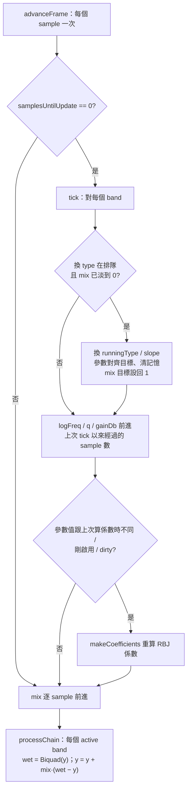

# 第 03 章：Parametric EQ
[English](README.md) | **繁體中文**

> [教材首頁](../../README.zh-TW.md)　｜　上一章：[02 Filter](../02-filter/README.zh-TW.md)　｜　下一章：[04 Compressor](../04-compressor/README.zh-TW.md)

第 02 章我們有了 biquad 與 RBJ cookbook：給一個 cutoff、一個 Q，就能算出五個係數，讓訊號「某些頻率大聲、某些頻率小聲」。
EQ（equalizer，等化器）就是把好幾顆這樣的 biquad 串起來，再加上一個好用的介面：每個 band 一個頻率、一個 Q、一個 gain。聽起來只是包裝，但要把它做成能放進 DAW 的元件，還有很多事情要想清楚：Q 跟「幾個 octave 寬」怎麼換算？為什麼 RBJ 的 gain 參數要寫成 $`A = 10^{\text{dB}/40}`$ 而不是 $`/20`$？六個 band 疊起來的曲線怎麼畫？使用者在播放中轉頻率旋鈕時為什麼會「噠噠噠」？EQ 只改音量嗎——為什麼大家都在說相位？

本章把這些一次講清楚，最後做出一個 6-band 的 `dawlab::dsp::ParametricEq`，第 14 章 DAW 的 EQ insert 會直接用它（第 13 章的 plugin 只用到 `Compressor`、`Limiter`、`Gain`、`SmoothedValue`、`DelayLine`，不含 EQ）。

## 1. 本章目標

讀完本章並做完練習，你應該能夠：

- 說出 EQ 在混音裡的兩種用途（修正 vs 創意），以及 graphic EQ 與 parametric EQ 的差別。
- 認得六種 band 類型（peak / bell、low / high shelf、low / high cut、notch）的曲線形狀，並描述它們的聽感。
- **推導** Q 與 bandwidth（octave）的互換公式，並在 Q = 0.707、1、1.414、4.32 之間心算對應的頻寬。
- 從 RBJ peak 的類比原型出發，解釋為什麼 gain 參數是 $`A = 10^{\text{dB}/40}`$（中心增益 $`A^2`$、頻寬邊緣增益 $`A`$），以及為什麼 boost 與同參數的 cut 剛好互相抵銷。
- 解釋 shelf 的 slope 參數 S 與 Q 的關係，以及「轉折頻率 = 中點增益」的意義。
- 證明多個 band 串接時 dB 響應相加，並寫出 `getMagnitudeDb()` 畫出整條 EQ 曲線。
- 說明參數即時改變時 click / zipper noise 的成因，比較「平滑參數後每 N 個 sample 重算係數」與「直接插值係數」，知道後者的陷阱。
- 解釋 IIR EQ 為什麼一定會改變相位（minimum phase），以及 linear-phase EQ 的代價（latency、pre-ringing）。
- 說明 Nyquist 附近的 cramping 與幾種解法，以及 proportional Q 的設計概念。
- 把常見的混音 EQ 手法（vocal 的 low cut、mud 區、presence、air）對應到具體的 band 設定。

## 2. 原理

### 2.1 EQ 是什麼？修正 vs 創意

EQ 做的事情一句話就講完：**對不同頻率給不同的 gain**。數學上，它是一個 LTI（linear time-invariant）系統，頻率響應 $`H(e^{j\omega})`$ 的大小（magnitude）就是「每個頻率要乘多少」。

混音工程師用 EQ 的理由大致分兩類：

<div align="center">

| 用途 | 目的 | 典型手法 | 例子 |
|---|---|---|---|
| **修正（corrective）** | 去掉「不該在那裡」的東西 | 窄的 cut、low cut、notch | 去掉 60 Hz 交流哼聲、vocal 麥克風收到的低頻震動、房間共振造成的某個頻率特別響 |
| **創意（creative / tonal）** | 塑造音色、讓樂器在混音裡各佔一塊位置 | 寬的 boost / cut、shelf | 讓 kick 更有重量、vocal 更「往前」、整首歌更「亮」 |

</div>

一個常被引用的經驗法則是「**cut 要窄、boost 要寬**」：窄的 boost 聽起來像共振（像在管子裡講話），很不自然；窄的 cut 則能精準拿掉問題頻率而不太影響其他東西。另一條是「**先減後加（subtractive EQ first）**」：先把不要的挖掉，往往就不需要再 boost 別的地方——boost 會吃掉 headroom（第 4 節）。

### 2.2 Graphic EQ vs Parametric EQ

**Graphic EQ**：頻率固定、Q 固定，使用者只能推每個 band 的 gain。常見的是 10-band（每 1 octave 一個，中心 31.5、63、125、250、500、1k、2k、4k、8k、16k Hz）或 31-band（每 1/3 octave 一個）。推桿排起來的形狀「看起來」就像頻率響應，所以叫 graphic。實際上相鄰 band 會互相重疊，推桿形狀跟真正的曲線不完全一樣——練習 4 會量化這件事。

**Parametric EQ**：每個 band 的三個參數（frequency、Q、gain）都可以調，再加上 band 類型。少少幾個 band 就能精準處理任何頻率。DAW 內建的 EQ 幾乎都是 parametric，本章實作的也是。

<p align="center"></p>

左：十支 fader 的位置只是示意。右：一個 parametric band（Type Peak、Freq 3000 Hz、Q 1.0、Gain +5 dB），方框內寫出每個旋鈕的範圍（frequency 10 Hz 到約 0.49·fs、Q 0.05..40、gain ±36 dB）。

### 2.3 Band 類型與聽感

本章的 `EqBandType` 有六種，全部是第 02 章 `BiquadCoefficients` 的 RBJ factory（cut 在 24 dB/oct 時用兩顆）：

<p align="center"></p>

六條曲線都取 f0 = 1 kHz、48 kHz 取樣：Peak +6 dB、Q = 1；Low / High Shelf +6 dB、Q = 0.707（在 f0 處的 gain 是中點，+3 dB）；Low Cut / High Cut 畫 12 dB/oct（一顆 biquad、Q = 0.707）與 24 dB/oct（兩顆 biquad），在 f0 處都是 −3 dB；Notch 取 Q = 2，在 f0 處下探到 −∞ dB。

<div align="center">

| 類型 | 用到的 RBJ 公式 | `frequency` 的意義 | `q` 的意義 | `gainDb` | 聽感 / 典型用途 |
|---|---|---|---|---|---|
| `Peak`（bell） | `makePeak` | 中心頻率 | 頻寬（越大越窄） | 中心的增益 | 最萬用。+3 dB @ 3 kHz 讓 vocal 往前；−4 dB @ 300 Hz 去掉混濁 |
| `LowShelf` | `makeLowShelf` | 轉折的「中點」（增益 = gainDb/2 的地方） | 轉折陡度（0.707 = 最陡但不過衝） | 低頻端的增益 | 整體「加重量」或「變薄」，像 Hi-Fi 的 bass 旋鈕 |
| `HighShelf` | `makeHighShelf` | 同上 | 同上 | 高頻端的增益 | +2 dB @ 10 kHz 的「air」；−3 dB 讓刺耳的錄音變柔 |
| `LowCut` | `makeHighpass` | −3 dB 點 | 12 dB/oct 時是共振（0.707 = Butterworth） | 無 | 去掉 rumble、麥克風架震動、vocal 的 proximity effect（近接效應：指向性麥克風離音源越近，低頻被放大得越多） |
| `HighCut` | `makeLowpass` | −3 dB 點 | 同上 | 無 | 去掉嘶聲、讓合成器 pad 退到後面 |
| `Notch` | `makeNotch` | 被挖掉的頻率 | −3 dB 頻寬 = f0/Q | 無 | 去掉 50 / 60 Hz 哼聲、鼓皮的某個 ring |

</div>

**LowCut / HighCut 的 slope。** 一顆 2 階 highpass / lowpass 在遠離 cutoff 的地方是 $`|H| \propto (f/f_c)^{\pm 2}`$，也就是每 octave 變化 $`20\log_{10} 2^2 \approx 12`$ dB，所以叫 12 dB/oct。要 24 dB/oct 就要 4 階。直覺做法是「兩顆 Q = 0.707 串接」，但那樣在 $`f_c`$ 是 −6 dB，而且轉角變圓。正確做法是 **4 階 Butterworth**：它的 4 個極點平均分佈在 s 平面左半圓上（每 45° 一個），拆成兩組共軛對，兩顆 biquad 的 Q 分別是

```math
Q_k = \frac{1}{2\cos\left(\frac{(2k+1)\pi}{2N}\right)},\quad N = 4:\ Q_0 = 0.5412,\ Q_1 = 1.3066
```

（第 02 章 `butterworthQ(order, stage)`）。每一顆在 $`f_c`$ 都不是 −3 dB——Q = 0.5412 那顆是 −5.33 dB、Q = 1.3066 那顆是 +2.32 dB——但兩者相加剛好 −3.01 dB（練習 6 的輸出）。`ParametricEq` 用 `EqSlope::Db24` 選這個模式，此時 band 的 `q` 被忽略。

**Notch vs 深的 peak cut。** Notch 的零點正好在單位圓上，所以 $`f_0`$ 處是真正的 $`-\infty`$ dB；peak −30 dB 則只是「很深」。Notch 適合拿掉一個精確的頻率（哼聲），但對有音高變化的素材很容易過頭。

### 2.4 Q 與 bandwidth：推導

混音工程師常說「1/3 octave 寬」，DSP 公式卻用 Q。兩者怎麼換？

**頻寬的定義。** 對 bandpass / notch，頻寬是兩個 −3 dB 點之間；對 peak，RBJ 定義在「**中點增益**」——dB 值剛好是中心一半的兩個頻率（+12 dB 的 peak 就看 +6 dB 的兩點）。下一節會證明這兩種定義落在同一組頻率上。

**類比原型。** 以 $`\Omega = f/f_0`$ 表示正規化頻率，二階 bandpass 原型是

```math
H_{BP}(s) = \frac{s/Q}{s^2 + s/Q + 1},\qquad s = j\Omega
```

```math
|H_{BP}(j\Omega)|^2 = \frac{(\Omega/Q)^2}{(1-\Omega^2)^2 + (\Omega/Q)^2}
```

−3 dB（$`|H|^2 = 1/2`$）的條件是 $`(1-\Omega^2)^2 = (\Omega/Q)^2`$，也就是 $`|\Omega - 1/\Omega| = 1/Q`$。解這個二次方程：

```math
\Omega^2 \mp \frac{\Omega}{Q} - 1 = 0 \quad\Rightarrow\quad \Omega_{1,2} = \sqrt{1 + \frac{1}{4Q^2}} \mp \frac{1}{2Q}
```

兩個重要的性質直接從根與係數的關係讀出來：

```math
\Omega_1 \Omega_2 = 1 \quad(\text{幾何對稱：} f_1 f_2 = f_0^2),\qquad \Omega_2 - \Omega_1 = \frac{1}{Q} \quad(f_2 - f_1 = f_0/Q)
```

**換成 octave。** 頻寬 $`N`$ octave 的意思是 $`f_2/f_1 = 2^N`$。由幾何對稱，$`\Omega_2 = 2^{N/2}`$、$`\Omega_1 = 2^{-N/2}`$，代入 $`\Omega_2 - \Omega_1 = 1/Q`$：

```math
\frac{1}{Q} = 2^{N/2} - 2^{-N/2} = 2\sinh\left(\frac{N\ln 2}{2}\right)
```

所以

```math
\boxed{Q = \frac{1}{2\sinh(N\ln 2 / 2)} = \frac{2^{N/2}}{2^N - 1}}\qquad
\boxed{N = \frac{2}{\ln 2}\,\mathrm{asinh}\left(\frac{1}{2Q}\right)}
```

常用值（練習 2 的輸出）：

<div align="center">

| Q | 0.5 | 0.707 | 1.0 | 1.414 | 2.0 | 4.32 | 8.65 |
|---|---|---|---|---|---|---|---|
| bandwidth（octave） | 2.54 | 1.90 | 1.39 | **1.00** | 0.71 | **1/3** | 1/6 |

</div>

記住兩個錨點就夠了：**Q = √2 ≈ 1.41 是 1 octave、Q ≈ 4.32 是 1/3 octave**。Q 加倍、頻寬大約減半（Q 大時 $`\mathrm{asinh}(x) \approx x`$，$`N \approx 1.44/Q`$）。

> 注意：這是類比原型的關係。bilinear transform 會把頻率軸「彎」（warp），高頻的實際頻寬會比公式略窄（RBJ cookbook 的數位版公式多了一個 $`\omega_0/\sin\omega_0`$ 的修正項）。在 1 kHz、48 kHz 下差異只有 0.02 dB 級（練習 2：Q = √2、+12 dB 的 peak 在 707.1 / 1414.2 Hz 實測 +5.989 / +5.978 dB，理想值 +6）。`ParametricEq::qToBandwidthOctaves()` / `bandwidthOctavesToQ()` / `bandEdges()` 就是這三條公式。

### 2.5 RBJ peak：為什麼 $`A = 10^{\text{dB}/40}`$？

RBJ cookbook 的 peaking EQ 類比原型是

```math
H(s) = \frac{s^2 + s\,\dfrac{A}{Q} + 1}{s^2 + s\,\dfrac{1}{AQ} + 1}
```

逐一看三個位置：

1. **遠離中心**（$`s \to 0`$ 或 $`s \to \infty`$）：分子分母都趨近 1 或 $`s^2`$，$`|H| \to 1`$，0 dB。✔
2. **中心** $`s = j`$：$`s^2 + 1 = 0`$，剩下 $`\dfrac{jA/Q}{j/(AQ)} = A^2`$。所以**中心的線性增益是 $`A^2`$**。要中心是 $`g`$ dB，就要 $`20\log_{10}A^2 = g`$，也就是

```math
A = 10^{g/40}
```

   這就是 $`/40`$ 的由來：$`A`$ 是「中心增益的平方根」。
3. **頻寬邊緣**（上一節的 $`|1-\Omega^2| = \Omega/Q`$）：

```math
|H|^2 = \frac{(1-\Omega^2)^2 + (\Omega A/Q)^2}{(1-\Omega^2)^2 + (\Omega/(AQ))^2} = \frac{(\Omega/Q)^2(1 + A^2)}{(\Omega/Q)^2(1 + A^{-2})} = A^2
```

   所以邊緣的增益是 $`|H| = A`$，**剛好是中心 dB 的一半**。這就是 2.4 節說的「中點增益」頻寬——它跟 bandpass 的 −3 dB 點是同一組頻率。

為什麼要這樣參數化？看分子和分母：阻尼項分別是 $`A/Q`$ 與 $`1/(AQ)`$。把 $`g`$ 換成 $`-g`$（$`A \to 1/A`$），分子和分母**剛好互換**：

```math
H_{-g}(s) = \frac{1}{H_{+g}(s)}
```

也就是 **+6 dB 和 −6 dB（同頻率、同 Q）串接會完全抵銷**——不只 magnitude，連相位都還原。這是對稱、好用的性質：boost 和 cut 的曲線形狀是鏡像。練習 3 用數字驗證：+6 dB 與 −6 dB @ 1 kHz、Q = 1 串接，20 Hz–20 kHz 最大偏差 $`10^{-13}`$ dB。

**數位化。** 第 02 章講過：RBJ 用 bilinear transform（$`s \leftarrow \frac{1}{\tan(\omega_0/2)}\cdot\frac{1-z^{-1}}{1+z^{-1}}`$，在 $`\omega_0`$ 處 prewarp），整理後得到

```math
\begin{aligned}
\omega_0 &= 2\pi f_0/f_s,\quad \alpha = \frac{\sin\omega_0}{2Q},\quad A = 10^{g/40}\\
b_0 &= 1 + \alpha A,\quad b_1 = -2\cos\omega_0,\quad b_2 = 1 - \alpha A\\
a_0 &= 1 + \alpha / A,\quad a_1 = -2\cos\omega_0,\quad a_2 = 1 - \alpha / A
\end{aligned}
```

（全部除以 $`a_0`$ 正規化，`BiquadCoefficients::makePeak` 就是這幾行。）手算一個例子（練習 1）：$`f_s = 48`$ kHz、$`f_0 = 12`$ kHz（$`\omega_0 = \pi/2`$，$`\cos = 0`$、$`\sin = 1`$）、Q = 1、+6 dB：$`\alpha = 0.5`$、$`A = 1.4125`$，正規化後 $`b_0 = 1.26019`$、$`b_2 = 0.21694`$、$`a_2 = 0.47713`$、$`b_1 = a_1 = 0`$。

### 2.6 Shelf：轉折中點與 slope 參數 S

RBJ low shelf 的類比原型是

```math
H_{LS}(s) = A\,\frac{s^2 + \dfrac{\sqrt{A}}{Q}s + A}{A s^2 + \dfrac{\sqrt{A}}{Q}s + 1}
```

- $`s \to 0`$（DC）：$`A \cdot A / 1 = A^2`$ → 低頻端增益 = $`g`$ dB。
- $`s \to \infty`$：$`A \cdot s^2 / (A s^2) = 1`$ → 高頻端 0 dB。
- $`s = j`$（$`f = f_0`$）：分子 $`A(A - 1 + j\sqrt{A}/Q)`$，分母 $`(1 - A) + j\sqrt{A}/Q`$，兩者除了前面的 $`A`$ 之外大小相同，所以 $`|H(j)| = A`$——**轉折頻率 $`f_0`$ 處剛好是 $`g/2`$ dB**。

High shelf 把 $`s`$ 換成 $`1/s`$（高低頻對調），同樣的結論。這個「中點」性質很重要：練習 5 的 tilt EQ 就是靠它，把 low shelf $`-t/2`$ 與 high shelf $`+t/2`$ 放在同一個 pivot，pivot 處 $`-t/4 + t/4 = 0`$ dB。

**Slope 參數 S。** RBJ cookbook 給 shelf 的第三個參數不一定用 Q，也可以用「shelf slope」S：

```math
\frac{1}{Q} = \sqrt{\left(A + \frac{1}{A}\right)\left(\frac{1}{S} - 1\right) + 2}
```

S = 1 時，不管 gain 多少都得到 $`Q = 1/\sqrt{2}`$——cookbook 的描述是：這是「仍保持單調（不過衝）的最陡 slope」。S 小於 1 轉折更緩；Q 大於 0.707（等效 S > 1）則會在轉折附近出現一個反向的小凹陷與過衝（有些類比 EQ 刻意保留這個「bump」當作音色）。`ParametricEq::shelfSlopeToQ(S, gainDb)` 就是這條公式；本章的 shelf 預設 Q = 0.707（S = 1）。

範例 1 最後一張表把 +6 dB @ 1 kHz 的 low shelf 用不同 Q 掃過 10 Hz–23 kHz，量曲線的最高與最低點：

```
      Q     S(equiv)  |H(f0)|(dB)   curve max(dB)   curve min(dB)
   0.500     0.51        +3.00         +6.00          +0.00
   0.707     1.00        +3.00         +6.00          +0.00     <- steepest but still monotonic
   1.000     1.89        +3.00         +6.44          -0.44
   1.500     3.75        +3.00         +7.64          -1.64
   2.000     5.72        +3.00         +8.86          -2.86     <- overshoot 2.86 dB, dip 2.86 dB
```

三件事一次看清楚：（1）不管 Q 多少，$`f_0`$ 處都是 +3.00 dB（中點性質）；（2）Q ≤ 0.707 時曲線不會超出 0..+6 dB；（3）Q 變大時過衝與凹陷**一樣大**。原因：把上面的 $`H_{LS}(s)`$ 裡的 $`s`$ 換成 $`1/s`$，整理後得到 $`H_{LS}(1/s) = A^2 / H_{LS}(s)`$，所以 $`\text{dB}(f_0 \cdot 2^k) + \text{dB}(f_0 \cdot 2^{-k}) = g`$——曲線在 log 頻率軸上以 $`(f_0,\ g/2)`$ 為中心點對稱，高過 $`g`$ 多少，另一側就低過 0 dB 多少。

### 2.7 串接 = dB 相加；畫 EQ 曲線

六個 band 是**串接**（cascade）：訊號先過 band 0、再過 band 1……。兩個 LTI 系統串接，轉移函數相乘：

```math
H(z) = H_0(z)\,H_1(z)\cdots H_5(z)
```

取大小再取 dB，乘法變加法：

```math
20\log_{10}|H| = \sum_k 20\log_{10}|H_k| \qquad\text{（dB 相加）}
```

```math
\angle H = \sum_k \angle H_k \qquad\text{（相位也相加）}
```

因為乘法可交換，**串接順序不影響頻率響應**（在 float 下數值上也幾乎沒差，見第 4 節）。注意「dB 相加」不是「線性振幅相加」：兩顆 +6 dB（2 倍）疊起來是 +12 dB（4 倍），不是 2 + 2。

所以 `getMagnitudeDb(f)` 的實作就是把每個 enabled band 的 `magnitudeDb(f, fs)` 加起來——每個 band 的 `magnitudeDb` 又是把 $`z = e^{j\omega}`$ 代入 $`H(z)`$：

```math
H(e^{j\omega}) = \frac{b_0 + b_1 e^{-j\omega} + b_2 e^{-2j\omega}}{1 + a_1 e^{-j\omega} + a_2 e^{-2j\omega}},\qquad \omega = 2\pi f/f_s
```

UI 只要在 log 頻率軸上取幾百個點呼叫 `getMagnitudeDb()` 就能畫出曲線（範例 1 用 72 個點畫 ASCII 圖）。範例 1 的表格逐 band 列出貢獻，例如 18 kHz 處：band 3 +0.04、band 4（high shelf +2 dB @ 10 kHz）+1.98、band 5（high cut @ 18 kHz）−3.01，總和 −1.00 dB，跟 `getMagnitudeDb(18000)` 以及正弦波實測完全一致。

### 2.8 相位：IIR EQ 為什麼一定會改變相位

改變 magnitude 的 IIR filter **一定**同時改變相位。RBJ 的 EQ biquad 極點和零點都在單位圓內（或上），這種系統叫 **minimum phase**；minimum-phase 系統的相位完全由 magnitude 決定——換句話說，給定一條 magnitude 曲線，minimum-phase 版本是「相位偏移最少、延遲最短」的那一個，但不可能是零。

> **進階（可跳過）**：「相位完全由 magnitude 決定」的數學說法是：minimum-phase 系統的 log-magnitude 與 phase 是一對 Hilbert transform（知道其中一個，就能算出另一個）。這需要複變函數的背景，本教材不會用到，記得上面的直覺結論就夠了。

範例 4 印出 +6 dB @ 1 kHz、Q = 1 的 peak：

```
 freq(Hz)   mag(dB)   phase(deg)   group delay(samples)
      500     +1.88      +18.00          -2.89
      707     +3.96      +18.39           3.21
     1000     +6.00       +0.00          10.80      <- 0.225 ms
     1414     +3.96      -18.40           1.61
     2000     +1.87      -17.97          -0.73
```

- 中心處相位 = 0；低於中心相位領先（+）、高於中心落後（−），最大約 ±18°，大約在頻寬邊緣。
- 群延遲（group delay，$`\tau = -d\phi/d\omega`$）只在 boost 附近明顯，中心約 10.8 samples（0.225 ms）；在 skirt 甚至是負的（相位隨頻率上升的地方），這不違反因果，只代表那一段的波包被「提前」了一點點。
- cut 的相位剛好反號（−6 dB 在 707 Hz 是 −18.39°），跟 2.5 節「cut 是 boost 的倒數」一致。

聽感上，單一 band 的相位偏移幾乎聽不出來；問題出在**並聯**的時候：同一個訊號一份 EQ 過、一份沒過（例如多支麥克風收同一顆鼓、或 parallel processing）再相加，相位差會造成 comb filtering（梳狀濾波：兩份訊號有時間或相位差，相加時某些頻率互相抵消，頻率響應像梳子一樣出現一排凹陷）。

**Linear-phase EQ。** 如果要 magnitude 改變但所有頻率延遲相同（相位是頻率的線性函數），就得用對稱的 FIR filter（通常用 FFT 從想要的 magnitude 設計）。代價：

1. **Latency**：對稱 FIR 的延遲固定是 $`(N-1)/2`$ 個 sample。要解析低頻需要很長的 FIR，例如 4097 taps → 2048 samples = 42.7 ms @ 48 kHz。DAW 要做 latency compensation（第 14 章）。
2. **Pre-ringing**：對稱 impulse response 在主峰「之前」就有振盪。窄的 boost / cut 會讓 kick、snare 的 transient 前面出現「吸氣聲」般的 pre-echo，minimum-phase 只有 post-ringing（比較像自然共鳴）。
3. **CPU**：長 FIR 要用 FFT convolution（第 12 章）才跑得動。

所以 linear-phase EQ 多用在 mastering 或需要保持相位關係的場合（例如多軌鼓、multiband 的 crossover），一般混音用 minimum-phase 就好。本章只實作 minimum-phase。

### 2.9 參數即時改變：避免 click 與 zipper noise

播放中轉 EQ 旋鈕，等於讓 filter 變成 time-varying。如果每次 UI 送來新參數就**直接換係數**，問題有兩個：

1. **參數本身是階梯**：host / MIDI controller / automation 送參數的頻率可能只有每 block 一次甚至每 100 ms 一次。中心頻率一階一階跳，輸出音量也一階一階跳 → 規律的「噠噠噠」，就是 zipper noise。
2. **換係數的瞬間有暫態**：filter 的狀態變數（TDF-II 的 $`s_1, s_2`$）是依照舊係數累積的，配上新係數會產生一小段不連續。跳得越大、Q 越高越明顯。

範例 3 把 +12 dB、Q = 6 的 peak 從 150 Hz 對數掃到 6 kHz（4 秒），host 每 100 ms 送一次頻率，分析訊號是 1 kHz 正弦波，量「每 1 ms 的 RMS 跳變」：

```
  version      max jump(dB/ms)  jumps>1 dB     envelope peak
  reference        0.09            0           -3.11 @ 2063 ms   <- recompute at every sample along the ideal curve
  naive            3.35           12           -4.41 @ 2105 ms   <- swap the coefficients directly
  smooth/1         0.10            0           -3.11 @ 2156 ms   <- smooth the parameters + recompute at every sample
  smooth/32        0.10            0           -3.11 @ 2155 ms   <- smooth the parameters + recompute every 32 samples (default)
  smooth/512       0.26            0           -3.10 @ 2164 ms   <- smooth the parameters + recompute once per block
```

**策略：平滑參數，再重算係數。** `ParametricEq` 的做法：

1. 三個會影響係數的參數各自用第 01 章的 `SmoothedValue` 做 linear ramp（預設 20 ms）。**frequency 在 $`\log_2`$ 域平滑**——從 100 Hz 到 200 Hz 跟從 1 kHz 到 2 kHz 一樣都是「一個 octave」，掃起來每個 octave 速度一致；gain 在 dB 域平滑。
2. 每 `kDefaultUpdateInterval` = 32 個 sample（48 kHz 下 0.67 ms）才重算一次 RBJ 係數，而且只有參數值有變的 band 才算。每次重算要 `sin`、`cos`、`pow`，逐 sample 算六個 band 很浪費；從表格看，每 32 個 sample 算一次跟每個 sample 算一次幾乎沒有差別（0.10 vs 0.10 dB/ms），每 512 個 sample 才算一次就開始看得出來（0.26）。
3. ramp 是「追著」目標走的，所以平滑版到達包絡最高點晚了約 90 ms（ramp 長度設成跟自動化間隔一樣 100 ms），聽不出來。

**為什麼不直接插值 biquad 係數？** 另一種常見想法是：算好舊係數和新係數，然後在兩者之間逐 sample 線性插值（不用每次都算 sin/cos）。問題：

- **頻率不是線性對應的。** 範例 4 的 C 段：+12 dB、Q = 2 的 peak，100 Hz 與 10 kHz 的係數各取一半，得到的 filter 最大增益在 **6620 Hz**（+11.98 dB），不是幾何中點 1 kHz。原因是 $`a_1 = -2\cos\omega_0/(1+\alpha/A)`$，插值 $`a_1`$ 約略等於插值 $`\cos\omega_0`$，而 $`\cos\omega_0`$ 在低頻幾乎不動（48 kHz 下，100 Hz 是 0.99991、1 kHz 是 0.9914），到高頻才大幅變化（10 kHz 是 0.2588）。所以在 $`\cos\omega_0`$ 上走「一小步」，在 log 頻率上就跨過好幾個 octave：從 100 Hz 往 10 kHz 插值時，**低頻的 octave 一閃而過，大部分時間停在高頻**——掃頻聽起來是「一下子衝上去、然後在高頻拖很久」。
- **二階本身：凍結的係數還是穩定的。** 二階分母的穩定區域是 $`(a_1, a_2)`$ 平面上的三角形 $`|a_2| < 1,\ |a_1| < 1 + a_2`$，是**凸集合**：三角形內任兩點連線上的每一點都還在三角形內，所以兩組穩定的 biquad 係數線性插值，每一組「凍結」的中間係數都穩定（範例 4 C 段印出「穩定」）。
- **高階多項式：插值中途可能跑出單位圓。** 3 階以上的穩定多項式**不構成凸集合**。範例 4 的 D1 段：24 dB/oct 的 high cut（4 階 Butterworth）若在 100 Hz 與 10 kHz 兩個設定之間，把「兩顆 biquad 乘開後的 4 階多項式係數」取中點，最大的 pole 絕對值是 **1.287**（兩端分別是 0.995 與 0.678）——中點已經不穩定，impulse response 在 n = 100 時就到 $`1.8\times10^{10}`$。同樣的兩個設定，**拆成兩顆 biquad 各自插值**就都穩定。這是「高階 filter 一律拆成 biquad 串接」的另一個理由（第 02 章也講過數值精度的理由）。
- **「每一瞬間都穩定」不等於「time-varying 系統穩定」。** 穩定性的定義是針對 LTI 系統。範例 4 的 D2 段用第 02 章真正的 `Biquad`：每個 sample 在 lowpass 50 Hz 與 16 kHz（Q = 0.707，**兩組各自都穩定**）之間交替，輸入一個 impulse，輸出在 n = 40 時是 348、n = 80 時是 $`1.05\times10^{10}`$——發散了。直覺上：每組係數單獨看都穩定，但快速來回切換時，前一組係數留在狀態變數裡的東西，會被下一組係數放大，一來一往就可能越滾越大。對照組：同樣在 50 Hz ↔ 16 kHz 之間來回，但每趟用 20 ms 在 log 頻率上平滑地走，1 秒白雜訊的輸出 peak 只有 0.599。結論：**參數相對於 filter 的時間常數變化得夠慢**，time-varying 的效應就很小；係數「跳」或「快速來回」才危險。需要大幅、快速調變的 filter（例如 synth 的 filter envelope）會改用對調變比較穩健的結構，例如 TPT（topology-preserving transform）state variable filter（第 02 章 2.16 節的 `StateVariableFilter.h`；更深入見延伸閱讀）。

> **進階（可跳過）**：D1、D2 的數學說法。D1：二階分母的穩定區域是凸的三角形，但 4 階以上的「穩定多項式係數」集合不是凸集合，所以兩個穩定的 4 階多項式取中點可能不穩定；範例 4 用一個小小的 Durand–Kerner 迭代求 4 階多項式的根來驗證。D2：用狀態空間（state space）的語言，TDF-II 每走一個 sample，狀態向量 $`(s_1, s_2)`$ 就乘上狀態轉移矩陣 $`\begin{pmatrix}-a_1 & 1\\ -a_2 & 0\end{pmatrix}`$。兩組係數的矩陣各自的特徵值（eigenvalue）都在單位圓內（= 各自穩定），但它們的**乘積**（交替走兩步的轉移）的特徵值可以大於 1，於是每走兩步狀態就被放大一次。這需要線性代數的特徵值概念，看不懂不影響後面的章節。

因此本章選擇：**平滑參數（在有意義的單位：log 頻率、dB）→ 每 N 個 sample 用公式重算係數**。係數永遠是某一組合法參數的 RBJ 係數（必定穩定），而參數以 20 ms 的 ramp 慢慢走，不會落入 D2 那種快速來回的情況。

**不能內插的改變：開關 band、換 type、換 slope。** Peak 和 Notch 之間沒有「一半」。`ParametricEq` 對這類改變用 dry/wet crossfade：

- `enabled` 切換：每個 band 有一個 `mix`（0 = bypass、1 = 全開），以 20 ms 線性 ramp 逐 sample 前進：$`y = x + m\,(H(x) - x)`$。
- 換 type / slope：先把 mix 淡到 0（舊的 type 繼續跑）→ 在完全 bypass 的那一刻換 type、清掉 filter 記憶、參數直接對齊目標 → 再淡入。總共約 40 ms。
- band 在完全 bypass 時改參數：沒人聽得到，參數直接跳到目標，淡入時就是最終曲線。

範例 3 的第 3 部分量化這件事：1 kHz 正弦波上開一顆 LowCut、換成 Peak、再關掉。用「正弦波預測殘差」$`r[n] = y[n] - 2\cos\omega\,y[n-1] + y[n-2]`$（純正弦波時 $`r = 0`$，突然的跳變會讓 $`r`$ 變大）：naive 直接切換 max|r| = 0.0325（−17.7 dB，相對振幅 0.25），`ParametricEq` 是 0.0021（−41.4 dB）。逐事件看：

```
      time       naive      ParametricEq   event
     0.256 s   0.009952   0.000121       LowCut@2k on
     0.768 s   0.017737   0.002130       changed to Peak +6 dB@1k
     1.280 s   0.032477   0.000068       off
```

三個事件 naive 都有尖銳的殘差；`ParametricEq` 在「開」與「關」時小了 80 倍以上，「換 type」最大（0.0021），因為它要先淡出、再淡入，中間經過一次 dry ↔ wet 的振幅與相位變化——但仍比 naive 小 8 倍以上，而且是攤在 40 ms 裡的平滑變化，不是一個尖點。

### 2.10 Nyquist 附近的 cramping

第 02 章 2.14 節看過 lowpass 接近 Nyquist 時的 cramping（bilinear warping），這裡看它對 peak 的影響。bilinear transform 把類比的整條頻率軸 $`[0, \infty)`$ 壓進數位的 $`[0, f_s/2]`$：類比的 $`\Omega = \infty`$ 對應到 Nyquist。prewarp 保證**中心頻率**對準，但鐘形的右半邊被硬擠進剩下的空間。對 RBJ peak，可以直接驗證 $`z = -1`$（Nyquist）處：

```math
H(-1) = \frac{b_0 - b_1 + b_2}{a_0 - a_1 + a_2} = \frac{2 + 2\cos\omega_0}{2 + 2\cos\omega_0} = 1
```

**任何** RBJ peak 在 Nyquist 都被強迫回到 0 dB。範例 4 的 B 段（44.1 kHz、+6 dB @ 10 kHz、Q = 1）：

```
 freq(Hz)   analog(dB)   digital(dB)   diff
    10000      +6.00        +6.00      +0.00   <- the center lines up
    14000      +4.05        +2.40      -1.65
    17000      +2.70        +0.74      -1.96
    22050      +1.52        +0.00      -1.52   <- Nyquist is forced to 0 dB
```

數位版的鐘形變得不對稱、右邊變窄，這就是 **cramping**。高頻的 high shelf「air」band 也會受影響。解法：

1. **Oversampling**（第 06 章）：在 2× 或 4× sample rate 下跑 EQ，10 kHz 就離 Nyquist 很遠了。代價是 CPU 與 up/down sampling filter 的 latency。
2. **指定 Nyquist 增益的設計**：Orfanidis（1997）推導出能指定 Nyquist 處增益（例如設成類比原型在 $`f_s/2`$ 的值）的 peak 設計。
3. **Matched / 擬合類比響應的設計**：例如 Vicanek 的 "Matched Second Order Digital Filters"，讓數位響應在整個頻帶都貼近類比原型。

本章的 `ParametricEq` 保持 RBJ（簡單、穩定、跟第 02 章一致），在 48 kHz 下 10 kHz 以內的 band 誤差都不大；需要更準的高頻曲線時再換設計。

### 2.11 Proportional Q

固定 Q 的 peak 有個聽感上的問題：小 gain（±2 dB）時希望寬一點、溫和一點；大 gain（±12 dB）時希望窄一點，不然會影響太多鄰近頻率。**Proportional Q** 的設計讓「有效頻寬」隨 |gain| 變：gain 小時寬、gain 大時窄。許多類比 console EQ 與 graphic EQ 有這種行為，所以「轉一點點就很音樂、轉很多就很精準」。

實作上就是在 `setBand` 之前加一個 $`Q_{\text{eff}} = f(Q, |g|)`$ 的映射。各家產品的映射曲線不公開、也各不相同；一個**示意用**的寫法是 $`Q_{\text{eff}} = Q\cdot(1 + k|g|)`$（$`k`$ 是自己挑的常數，例如 0.1 代表 +10 dB 時 Q 變成 2 倍）。這不是任何特定 EQ 的公式，本章也沒有實作它，只是讓你知道這個旋鈕背後的概念；想試的話，在 `ParametricEq::setBand()` 之前加一行就能做出來。

相對的概念是 graphic EQ 的 **constant-Q**：不管推多少，頻寬都一樣，相鄰 band 的互相影響才可預期。練習 4 會看到：10-band、Q = √2 的 graphic EQ 全部推 +6 dB，1 kHz 處實際是 +8.80 dB（相鄰 band 的尾巴疊上來），125 Hz–4 kHz 之間還有約 1.9 dB 的漣波——推桿形狀不等於曲線。

### 2.12 混音實務：常見頻段與手法

下表是混音實務中常見的經驗值（整理自混音書籍與工程師的習慣，不是由公式推導或程式量測出來的），只是起點，不是規則；每一首歌、每一支麥克風都不同，**一定要用耳朵確認**，而且 A/B 比較時要把音量對齊（大聲一點幾乎總是聽起來「比較好」）。

<div align="center">

| 頻段 | 名稱 / 聽感 | 常見手法 |
|---|---|---|
| < 30 Hz | 極低頻（subsonic），聽不太到但吃 headroom | 鼓 bus、master 用 LowCut 30 Hz、24 dB/oct |
| 60–100 Hz | kick、bass 的重量 | kick +2~4 dB low shelf / peak；避免 kick 和 bass 同時在同一點 boost |
| 80–150 Hz 以下 | vocal、吉他、鋼琴不需要的低頻 | **vocal low cut**：大約 80–100 Hz（男聲）、100–150 Hz（女聲），去掉 proximity effect 和震動 |
| 200–500 Hz | **mud（混濁）**、boxiness | 多軌疊起來最容易擠在這裡；寬的 −2~−4 dB |
| 800 Hz–1.5 kHz | 鼻音、「電話聲」 | 小的 cut；或刻意 boost 做 lo-fi 效果 |
| 2–5 kHz | **presence**、咬字、吉他 pick 的聲音 | vocal +2~3 dB 讓它「往前」；太多會刺耳（耳朵在這裡最敏感） |
| 5–9 kHz | 齒音（sibilance，「ㄙ」「ㄘ」） | 窄的 cut 或用第 08 章的 de-esser |
| > 10 kHz | **air**、亮度 | high shelf +1~3 dB；HighCut 去掉嘶聲 |

</div>

範例 2 把這些組成兩個 preset：

- **吉他 / pluck**：LowCut 70 Hz、−4 dB @ 300 Hz（Q 1.2）、−2 dB @ 900 Hz（Q 2）、+3 dB @ 3 kHz、HighShelf +2 dB @ 8 kHz。
- **鼓組 bus**：LowCut 30 Hz（24 dB/oct）、LowShelf +3 dB @ 90 Hz、−3 dB @ 400 Hz（Q 1.5）、+1.5 dB @ 2.5 kHz、HighShelf +3 dB @ 7 kHz。

## 3. 從公式到程式碼

### 3.1 `dsp/include/dawlab/dsp/ParametricEq.h`

```cpp
enum class EqBandType { LowCut, LowShelf, Peak, HighShelf, HighCut, Notch };
enum class EqSlope { Db12, Db24 };          // 只對 LowCut / HighCut 有意義

struct EqBand {
    EqBandType type = EqBandType::Peak;
    float frequency = 1000.0f;   // Hz
    float q = 0.707f;
    float gainDb = 0.0f;         // 只對 Peak / LowShelf / HighShelf 有意義
    bool enabled = false;
};
```

**資料結構。** 每個 band 內部有：UI 設定的目標 `EqBand`、`slope`、正在跑的 `runningType` / `runningSlope`（換 type 淡出期間仍是舊的）、四個 `SmoothedValue`（`logFreq`、`q`、`gainDb`、`mix`）、兩顆 `Biquad`（`stage1`、`stage2`；只有 24 dB/oct 的 cut 用到第二顆）。整個 class 沒有指標、沒有 atomic，可以複製或放進 `std::vector`。

**標準介面。**

<div align="center">

| 方法 | 做什麼 |
|---|---|
| `prepare(sr, maxBlock, nch)` | 唯一會 allocate 的地方：每顆 Biquad 配置 channel 狀態、平滑器設定 ramp 長度，然後 `reset()` |
| `reset()` | 清 filter 記憶，平滑器直接跳到目標（不從舊值 ramp） |
| `setBand(i, band)` | 設定目標（會 clamp：頻率 10 Hz..100 kHz、Q 0.05..40、gain ±36 dB；NaN / inf 的欄位忽略、保留舊值）；平滑器開始 ramp；必要時排隊做結構性切換。跟目前目標完全相同時什麼都不做（host 每個 block 重送參數也沒關係）。必須在 audio thread、block 之間呼叫 |
| `getBand(i)` | 回傳**目標**參數（不是平滑中的值）。頻率是使用者設定的值：實際生效的頻率另外夾在 0.49·fs 以下（只在算係數時套用），所以在 `prepare()` 之前設定 30 kHz、之後 `prepare(96000)`，30 kHz 仍然有效 |
| `getMagnitudeDb(f)` | 整條 EQ 的 dB：enabled band 的 `magnitudeDb` 相加（2.7 節） |
| `processSample(ch, x)` | 逐 sample。每個 frame 要依序呼叫 channel 0、1…；平滑與係數更新在 channel 0 時推進 |
| `process(block)` | in-place 處理整個 block |

</div>

**額外的方法**（給 UI、教學與後面章節用）：`setBandEnabled/Type/Frequency/Q/GainDb`、`setSlope` / `getSlope`、`setSmoothingSeconds`（在 `prepare` 前呼叫）、`setCoefficientUpdateInterval`、`getBandMagnitudeDb`、`getResponse`（複數）、`getPhaseDegrees`、`getGroupDelaySamples`，以及 static 的 `qToBandwidthOctaves`、`bandwidthOctavesToQ`、`shelfSlopeToQ`、`bandEdges`、`makeCoefficients`、`makeSecondStageCoefficients`。

**每個 frame 的流程（`advanceFrame()`）：**



對照 2.9 節：

```cpp
void advanceFrame() noexcept {
    if (samplesUntilUpdate_ == 0) {            // 每 32 個 sample：推進參數、重算係數
        tick(samplesSinceTick_);               // 只推進「上次 tick 以來實際經過」的 sample 數
        samplesSinceTick_ = 0;
        samplesUntilUpdate_ = updateInterval_;
    }
    --samplesUntilUpdate_;
    ++samplesSinceTick_;
    for (auto& b : bands_)                     // mix 只是乘法，逐 sample 前進才不會變成小階梯
        if (b.mix.isSmoothing())
            b.mixCurrent = b.mix.getNextValue();
}
```

`setBand()` 改了參數時會把 `samplesUntilUpdate_` 設成 0，讓下一個 sample 就 tick，不必等到下一個 32-sample 邊界。

**為什麼是「實際經過的 sample 數」，而不是每次都推進 32？** 如果 tick 一律「預先」推進 32 個 sample，平常沒問題（每 32 個 sample 剛好 tick 一次）；但 `setBand()` 強迫提早 tick 時，上一次 tick 已經預先推進、實際上還沒經過的那幾個 sample 會被**再推進一次**。host 在每個 block 開頭套用參數（第 13、14 章正是這樣做），block 又小於 32 時，ramp 就會被成倍加速——block 1 個 sample 時，20 ms 的平滑會縮成 0.6 ms，等於沒有平滑。現在的做法讓係數最多落後 32 個 sample、永遠不會超前，ramp 的總長度跟 block size 無關。另外兩個細節：

- `setBand()` 改參數前先呼叫 `catchUpSmoothers()`，把所有 ramp 推進到「現在」，新的 ramp 才從正確的位置出發。
- tick 判斷要不要重算係數，看的是「目前的參數值跟上次算係數時用的值是否不同」，而不是「是否正在平滑」。`setSmoothingSeconds(0)` 時 `SmoothedValue` 會讓值瞬間跳到目標、`isSmoothing()` 一直是 false，若用後者判斷，新參數就永遠不會套用到 filter。

這些行為都由回歸測試 `l03_test_parametric_eq`（`tests/parametric_eq_test.cpp`）以數字驗證：block size 1 / 8 / 16 / 48 / 512、每個 block 重送參數時的 ramp 長度，smoothing 0 時量到的響應等於 `getMagnitudeDb()`，來回換 type 後的穩態響應，`prepare()` 前設定的頻率，以及開關 / 換 type 的 click。改 `ParametricEq.h` 之後先跑它。

**`makeCoefficients()`** 是一個 `switch`，把 band type 對應到第 02 章的 factory：`LowCut → makeHighpass`、`HighCut → makeLowpass`、`LowShelf → makeLowShelf`……；24 dB/oct 時第一顆用 Q = 0.5412、`makeSecondStageCoefficients()` 給第二顆 Q = 1.3066。

### 3.2 範例 1：`l03_eq_curve`（`examples/eq_curve.cpp`）

設定一條六個 band 全開的 EQ（LowCut 60 Hz 24 dB/oct、LowShelf +3 dB @ 120 Hz、−4 dB @ 300 Hz、+5 dB @ 3 kHz、HighShelf +2 dB @ 10 kHz、HighCut 18 kHz），用 `getMagnitudeDb()` 畫 ASCII 圖（`#` = 理論），再把正弦波真的送進 EQ 用 `measureGainDb()` 量，疊在同一張圖上（`o` = 實測）：

```
    +4 dB |                                               ####o###                 |
    +2 dB |             #####o                        ####o       #o####o###o##    |
    +0 dB |-----------o#------#####---------o######o##-------------------------oo--|
    -2 dB |          #            o##    ###                                    #  |
    -4 dB |                          #o##                                          |
    ...
          +------------------------------------------------------------------------+
           20       50     100    200       500    1k     2k       5k     10k    20
```

表格中 15 個頻率的「理論 − 實測」全部是 0.000 dB——`getMagnitudeDb()` 畫的就是真的聲音。第二張表逐 band 列出 dB 貢獻與總和，驗證 2.7 節；第三張表是 2.6 節的 shelf Q 與過衝。只輸出 console 文字。程式最後用 `DAWLAB_CHECK` 自我檢查（最大差異 < 0.05 dB、cut 在 fc 是 −3.01 dB），全部成立時印 `[PASS] l03_eq_curve`，否則回傳非 0、ctest 判定失敗。

```powershell
.\scripts\build.ps1 -Only 03-eq     # 在專案根目錄：建置並跑測試
cd build                            # 預設的 build 目錄（用 -BuildDir 指定過就換成那個）
.\bin\Debug\l03_eq_curve.exe
```

其他範例與解答的執行方式相同：`.\bin\Debug\<target>.exe`，WAV 會寫到目前目錄底下的 `dawlab_output\`。

### 3.3 範例 2：`l03_eq_presets`（`examples/eq_presets.cpp`）

以 512 sample 為一個 block（模擬 audio callback）處理兩段素材，並用 Goertzel 量「處理後 / 處理前」在各諧波的振幅比，對照理論曲線：

```
[pluck sequence] guitar-style EQ
     freq(Hz)   theory(dB)   measured(dB)
         110       -1.12        -1.13
         330       -3.85        -3.85
        1760       +1.01        +1.01
        3520       +2.70        +2.70
  dry  peak  -5.18 dBFS   RMS -19.71 dBFS
  eq   peak  -3.10 dBFS   RMS -19.32 dBFS
[drum loop] drum-bus EQ
  dry  peak  -2.92 dBFS   RMS -17.43 dBFS
  eq   peak  -1.58 dBFS   RMS -15.40 dBFS
```

注意 pluck 的 RMS 幾乎沒變（−19.71 → −19.32），peak 卻高了 2 dB：EQ 改變了各諧波的相位與比例，波形的峰值跟著變——**EQ 之後要重新檢查 headroom**。

輸出（build 目錄的 `dawlab_output/`）：`l03_pluck_dry.wav`、`l03_pluck_eq.wav`、`l03_drums_dry.wav`、`l03_drums_eq.wav`。可以帶一個自己的 WAV 當參數（`l03_eq_presets.exe my.wav`），會套用吉他型 EQ 輸出 `l03_custom_eq.wav`。

**該聽到什麼**：pluck 變得較乾淨、少了「悶」的感覺、撥弦的起音更前面；鼓組的 kick 更厚、snare 的紙箱感變少、hi-hat 更亮。

### 3.4 範例 3：`l03_eq_automation`（`examples/eq_automation.cpp`）

2.9 節的實驗。三部分：

1. **分析**：1 kHz 正弦波上掃 peak frequency（150 Hz → 6 kHz、+12 dB、Q = 6、4 秒；host 每 100 ms 送一次參數），比較 reference / naive / smooth/1 / smooth/32 / smooth/512 每毫秒的音量跳變（表格見 2.9 節）。
2. **試聽**：110 Hz band-limited 鋸齒波（30 個諧波）做同樣的掃頻——經典的 wah。
3. **開關 / 換 type**：正弦波預測殘差，naive 0.0325 vs `ParametricEq` 0.0021，並逐事件列出（表格見 2.9 節）。

最後自我檢查：smooth/1 與 smooth/32 的最大跳變 < 0.5 dB/ms、沒有 > 1 dB 的跳變，naive 確實有跳變，`ParametricEq` 開關 / 換 type 的殘差比 naive 小 5 倍以上；全部成立時印 `[PASS] l03_eq_automation`。

輸出：`l03_sweep_sine_naive.wav`、`l03_sweep_sine_smooth.wav`、`l03_sweep_saw_reference.wav`、`l03_sweep_saw_naive.wav`、`l03_sweep_saw_smooth.wav`、`l03_switch_naive.wav`、`l03_switch_smooth.wav`。

**該聽到什麼**：naive 版在 peak 掃過訊號附近有每 100 ms 一次的「噠噠噠」（正弦波版最明顯）；smooth 與 reference 是連續滑順的 wah。`l03_switch_naive.wav` 在 0.256 s、0.768 s、1.28 s 各有一聲「喀」（程式逐事件印出的殘差 0.0100 / 0.0177 / 0.0325 就是這三聲）；`l03_switch_smooth.wav` 只有平順的音量與音色轉換。以上聽感是依數值推論的描述，請自己用耳機確認；用正弦波最容易聽出差別。

### 3.5 範例 4：`l03_eq_phase_cramping`（`examples/eq_phase_cramping.cpp`）

只輸出 console 文字，四段：

- **A**：+6 dB @ 1 kHz 的 magnitude / phase / group delay（2.8 節的表）。
- **B**：44.1 kHz 下 +6 dB @ 10 kHz 的類比 vs 數位響應，與 $`H(z=-1) = 1`$ 的驗證（2.10 節）。
- **C**：係數插值 vs 參數插值（2.9 節：插值後的 peak 跑到 6620 Hz）。
- **D**：係數插值什麼時候會不穩定（2.9 節）。D1：4 階多項式係數插值，中點 max|pole| = 1.287；D2：每個 sample 在兩組穩定的 lowpass 係數之間交替，n = 80 時輸出已到 $`10^{10}`$。D1 需要求 4 階多項式的根（pole），程式用一個叫 Durand–Kerner 的數值迭代法來求；這是進階內容，可以跳過，只要看印出的 max|pole| 是否大於 1 就好，有興趣再讀 `maxPoleMagnitude()`。

```
[D] When coefficient interpolation becomes unstable
   D1. 4th-order Butterworth lowpass, taking the midpoint of the "4th-order polynomial coefficients" at 100 Hz and 10 kHz:
       max|pole|: 100 Hz version 0.99500, 10 kHz version 0.67841, interpolated midpoint 1.28747 (> 1 = unstable)
       Impulse response of the midpoint: |h| = 1.77e+10 at n = 100, |h| = 1.17e+108 at n = 1000 (diverging)
       For comparison: interpolating the two biquads separately -> both are stable (each is still inside the convex stability triangle)
   D2. Alternating every sample between lowpass 50 Hz and 16 kHz (each stable on its own: stable / stable), feeding an impulse:
       n=20 |y|=0.0636   n=40 |y|=348   n=60 |y|=1.91e+06   n=80 |y|=1.05e+10
       For comparison: a smooth sweep between 50 Hz <-> 16 kHz every 20 ms (recomputed at every sample), 1 second of white noise (peak 0.5)
       output peak = 0.599 (bounded)
```

## 4. Real-time 注意事項

- **不 allocate**：`process()` / `processSample()` 只做加減乘除；所有記憶體在 `prepare()` 配好。`setBand()` 也不 allocate。
- **重算係數的成本**：每次 `makeCoefficients` 要 `sin`、`cos`、`pow`（shelf 還有 `sqrt`）。`ParametricEq` 只在「有 band 正在平滑」時、每 32 個 sample 算一次。若 CPU 很緊，可以用 `setCoefficientUpdateInterval()` 調大（代價見範例 3 的 smooth/512）。
- **Denormal**：第 02 章的 `Biquad` 在狀態變數小於 $`10^{-30}`$ 時 flush 成 0；EQ 處理完靜音後不會拖慢 CPU。
- **Thread safety**：`setBand()` 和 `process()` **不是**同時可以從兩個 thread 呼叫的——它們讀寫同一組平滑器。正確用法是在 audio thread 上、兩個 block 之間呼叫 `setBand()`（第 13、14 章會把 UI 的參數用 atomic 傳進 audio thread，在 `process` 開頭套用）。每個 block 開頭都重送同一組參數是安全的：值沒變時 `setBand()` 直接 return，不會打亂進行中的 ramp（3.1 節）。UI 要畫曲線時，請在 UI 端保留一份自己的 `EqBand` 陣列，用 static 的 `ParametricEq::makeCoefficients()`（或 UI 專用的另一個 `ParametricEq` instance）算 `magnitudeDb`，不要直接讀 audio thread 那一份。
- **Headroom**：boost 會讓 peak 變大（範例 2：鼓組 −2.92 → −1.58 dBFS）。float 內部不會 clip，但最後輸出到 16/24-bit 或下一個有 threshold 的效果器（compressor、limiter）時就有差。混音時養成「EQ 後 output gain 補償」的習慣。
- **串接順序**：理論上不影響頻率響應（練習 3 實測正反兩種順序一樣）。在 float 下，若有很大的 boost，把 cut 放在前面能讓中間訊號小一點；TDF-II 加上 double 狀態變數，實務上差別可以忽略。
- **`processSample` 的呼叫順序**：平滑在 channel 0 時推進，所以每個 frame 要依序呼叫 channel 0、1、…；只處理 channel 1 而不處理 channel 0 會讓參數停住。用 `process(block)` 就沒有這個問題。

## 5. 常見錯誤與除錯

<div align="center">

| 症狀 | 可能原因 | 解法 |
|---|---|---|
| 轉頻率旋鈕時「噠噠噠」 | 收到參數就直接換係數（zipper noise） | 平滑參數（log 頻率、dB），每 N 個 sample 重算係數（2.9 節） |
| 開關 band 或切換 type 時「喀」一聲 | 輸出瞬間從 wet 跳到 dry | dry/wet crossfade；換 type 先淡出再淡入 |
| 往上掃頻時「低頻一閃而過、在高頻拖很久」 | 在 Hz 而不是 log 頻率上平滑，或直接插值係數（2.9 節） | 在 $`\log_2 f`$ 上平滑參數，再用公式重算係數 |
| 改參數時偶爾爆出巨大的聲音、甚至 NaN | 把高階 filter 乘成一個大多項式再插值係數，或係數快速來回跳（2.9 節、範例 4 D 段） | 高階一律拆成 biquad；平滑參數而不是插值係數 |
| 曲線的 gain 是設定值的一半或兩倍 | `A` 用了 $`10^{\text{dB}/20}`$ | RBJ 的 peak / shelf 是 $`A = 10^{\text{dB}/40}`$（2.5 節） |
| 24 dB/oct 的 cut 在 cutoff 是 −6 dB | 兩顆都用 Q = 0.707 | 4 階 Butterworth：Q = 0.5412 與 1.3066（2.3 節） |
| shelf 在轉折附近有凸起 / 凹陷 | shelf 的 Q > 0.707（S > 1） | 用 Q = 0.707 或用 `shelfSlopeToQ(S, gain)` |
| 10 kHz 以上 boost 量不如預期 | Nyquist cramping | 接受、oversampling，或換 Nyquist-matched 設計（2.10 節） |
| 畫的曲線跟聲音對不起來 | UI 讀的是平滑中 / 別的 thread 的參數；或忘了把 disabled band 當 0 dB | 曲線用「目標」參數；disabled 的 band 不要加 |
| 輸出出現 NaN 或爆音 | frequency ≥ Nyquist、Q = 0、gain 極端 | clamp（`ParametricEq` 已做：10 Hz..0.49·fs、Q 0.05..40、±36 dB） |
| 測量結果每次不一樣 | 前一次量測的 filter 狀態還在 | 每次量測前 `reset()`；`measureGainDb` 會先跳過 0.2 s 的暫態 |

</div>

## 6. 練習題

見 [`exercises/README.zh-TW.md`](exercises/README.zh-TW.md)。7 題：1 題計算（A 值、Q↔bandwidth、手算 RBJ 係數）、5 題實作（Q↔bandwidth 換算與驗證、驗證串接 dB 相加、10-band graphic EQ、tilt EQ、可切換 12/24 dB/oct 的 high cut）、1 題觀念（EQ 為什麼改變相位、linear-phase 的代價）。解答在 [`solutions/README.zh-TW.md`](solutions/README.zh-TW.md)。

## 7. 延伸閱讀

- Robert Bristow-Johnson, "Cookbook formulae for audio EQ biquad filter coefficients"（RBJ Audio EQ Cookbook）—— 本章與第 02 章所有係數的來源；W3C 的 Audio EQ Cookbook 頁面也收錄了這份文件。
- Udo Zölzer (ed.), *DAFX: Digital Audio Effects*, 2nd ed., Wiley, 2011 —— 第 2 章 "Filters and Delays" 有 shelving / peak filter 的設計與參數化。
- Sophocles J. Orfanidis, "Digital Parametric Equalizer Design With Prescribed Nyquist-Frequency Gain", *Journal of the Audio Engineering Society*, vol. 45, no. 6, pp. 444–455, 1997 —— 2.10 節 cramping 的經典解法。
- Martin Vicanek, "Matched Second Order Digital Filters"（2016，網路上可免費取得的技術筆記）—— 讓數位 biquad 貼近類比響應到 Nyquist。
- Vadim Zavalishin, *The Art of VA Filter Design*（Native Instruments，免費 PDF）—— TPT / zero-delay-feedback filter，適合需要快速調變的 filter。
- Andrew Simper (Cytomic), "Linear Trapezoidal Integrated State Variable Filter With Low Noise Optimisation"（技術筆記，cytomic.com 可免費下載）—— 一種對參數調變很穩健、也能做 peak / shelf 的 SVF。
- Julius O. Smith III, *Introduction to Digital Filters with Audio Applications*（CCRMA, Stanford，線上免費）—— minimum phase、group delay、bilinear transform 的數學背景。
- Bobby Owsinski, *The Mixing Engineer's Handbook* —— 2.12 節那類頻段與混音手法的實務整理。

## 8. 下一章

EQ 處理的是「哪些頻率多大聲」；第 04 章 [04-compressor](../04-compressor/README.zh-TW.md) 處理的是「什麼時候多大聲」——用 envelope follower 偵測音量，動態地控制 gain。
