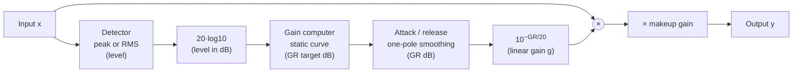
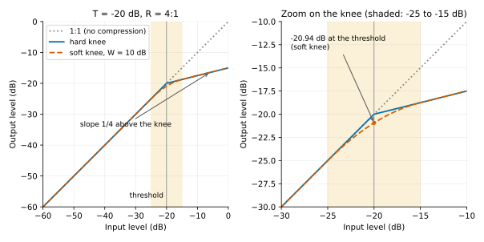
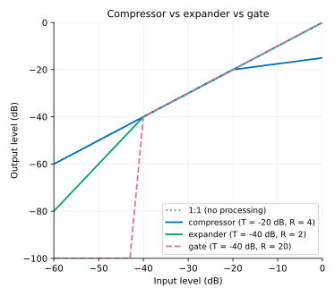
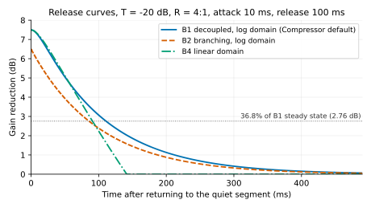

# Chapter 04: Compressor (Dynamics Compression)

**English** | [繁體中文](README.zh-TW.md)

> [Course home](../../README.md) | Previous: [03 Parametric EQ](../03-eq/README.md) | Next: [05 Limiter](../05-limiter/README.md)

The EQ in the previous chapter changed how energy is distributed along the "frequency axis"; this chapter starts dealing with how energy rises and falls along the "time axis", that is, **dynamics**. The compressor is the prototype of every dynamics processor (limiter, gate, expander, de-esser, transient shaper). This chapter takes it from theory to code, and lays the groundwork that the following chapters will reuse: `EnvelopeFollower` and `AttackReleaseFilter`.

## 1. Chapter goals

After this chapter you should be able to:

- Say what each of the compressor's four blocks (detector → gain computer → attack/release smoothing → makeup gain) does, and why they are arranged this way.
- Derive the static curve (transfer curve) formulas for the hard knee and the soft knee, and calculate by hand the output dB and gain reduction for any threshold / ratio / knee.
- Derive the one-pole smoother coefficient $`\alpha = e^{-1/(\tau f_s)}`$, and convert it into the times to "63.2%", "90%" and "99%".
- Explain the differences between peak and RMS detectors, linear and log (dB) domain smoothing, branching and decoupled smoothing, and feedforward and feedback topologies, and how each of them **sounds** different.
- Use `dawlab::dsp::Compressor` to compress a stereo signal in a block loop, read the gain reduction meter, connect an external sidechain, and do stereo link and parallel compression.
- Know what a compressor cannot do (it cannot catch peaks only a few samples wide), and why the next chapter needs a lookahead limiter.

## 2. Theory

### 2.1 Dynamic range and what a compressor is for

The difference between the loudest and the quietest parts of a signal is called its **dynamic range**. An unprocessed vocal may whisper at -40 dBFS and burst to -6 dBFS in an excited phrase, a 34 dB spread; put it in a mix with drums and bass, and the quiet words get buried while the loud words jump out. The compressor's job is to **adjust the volume automatically**: when the signal exceeds a certain threshold, it turns it down, shrinking the gap between loud and quiet.

Once the dynamic range has been reduced, the whole signal can be raised with makeup gain without clipping, so a side effect of the compressor (often the main purpose) is that it "sounds louder and more solid". In addition, the attack / release times determine how it reacts to the "head" and "tail" of each note, so the compressor is also a tool for sculpting **transients** (punch).

Another commonly used quantity is the **crest factor**:

```math
\text{crest factor (dB)} = 20\log_{10}\frac{\text{peak}}{\text{RMS}}
```

A drum kit has a very large crest factor (the synthetic drum loop in this chapter has 14.5 dB), while a sine wave has only 3.01 dB. A compressor generally lowers the crest factor, but in example 3 we will see that this holds only when the attack is fast enough.

### 2.2 Block diagram



Each of the four blocks answers one question:

<div align="center">

| Block | Question | Implementation in this chapter |
|---|---|---|
| Detector | "How loud is it right now?" | `DetectorMode::Peak` (instantaneous $`\lvert x \rvert`$) or `DetectorMode::Rms` ($`\sqrt{\overline{x^2}}`$) |
| Gain computer | "At this loudness, how many dB should be squashed?" | `Compressor::computeOutputDb()`, a pure function with no state |
| Attack / release | "How fast should it clamp down, and how fast should it let go?" | `AttackReleaseFilter`, smoothing the GR in the dB domain |
| Makeup gain | "It got quieter after compression, so make it up" | A fixed dB amount, smoothed internally with a 10 ms one-pole to avoid zipper noise |

</div>

The path that controls the gain is called the **sidechain**. Normally the sidechain is just a copy of the input; you can also feed it a different signal (for example, using the kick to compress the bass, which is called an **external sidechain**), or pass it through a filter before it reaches the detector (a **sidechain HPF**, exercise 4).

### 2.3 Gain computer: threshold, ratio, knee

Let the input level be $`x`$ (dB), the threshold $`T`$ (dB) and the ratio $`R`$. The static curve of a **hard knee** is a piecewise-linear line:

```math
y_{\text{hard}}(x) =
\begin{cases}
x, & x \le T \\
T + \dfrac{x - T}{R}, & x > T
\end{cases}
```

Above the threshold, every extra 1 dB of input yields only $`1/R`$ dB of extra output. $`R = 1`$ is a straight line (no compression), and with $`R = \infty`$ the output is pinned at $`T`$ (this is the static curve of a limiter). **Gain reduction** (GR; this course always uses a **positive value**) is the difference between input and output:

```math
\text{GR}(x) = x - y(x) = \left(1 - \frac{1}{R}\right)(x - T) \quad (x > T)
```

For example, with $`T = -20`$, $`R = 4`$, $`x = -10`$: $`y = -20 + (-10 + 20)/4 = -17.5`$ dB, so GR = 7.5 dB. Example 1 prints this line.

The polyline has a "corner" at $`T`$, so when the signal moves in and out of the threshold, the compression "starts abruptly". A **soft knee** rounds that corner with a quadratic section $`W`$ dB wide. The derivation requires that at both ends of the knee ($`x = T \pm W/2`$) the curve have the **same value and the same slope** as the two straight lines ($`C^1`$ continuity).

Let the curve inside the knee be $`y(x) = x + a\,(x - T + W/2)^2`$ (at the lower edge of the knee, $`x = T - W/2`$, the second term is 0, so both value and slope agree with $`y = x`$). At the upper edge $`x = T + W/2`$, the slope must equal $`1/R`$:

```math
y'(x) = 1 + 2a\,(x - T + W/2) \;\Rightarrow\; 1 + 2aW = \frac{1}{R} \;\Rightarrow\; a = \frac{1/R - 1}{2W}
```

Substitute $`a`$ back and check the value at the upper edge: $`y = T + W/2 + \frac{1/R - 1}{2W}W^2 = T + \frac{W}{2R}`$, and the straight line $`T + (x - T)/R`$ at $`x = T + W/2`$ also has the value $`T + \frac{W}{2R}`$, so they do join. Written as three pieces (in the form of Giannoulis, Massberg & Reiss 2012):

```math
y_{\text{soft}}(x) =
\begin{cases}
x, & 2(x - T) < -W \\[4pt]
x + \dfrac{(1/R - 1)\,(x - T + W/2)^2}{2W}, & 2\,\lvert x - T \rvert \le W \\[8pt]
T + \dfrac{x - T}{R}, & 2(x - T) > W
\end{cases}
```

$`W = 0`$ degenerates to the hard knee. A handy reference point: at the threshold itself, $`x = T`$, the soft knee is already compressing:

```math
y_{\text{soft}}(T) = T + \frac{(1/R - 1)\,W}{8}
```

With $`T = -20`$, $`R = 4`$, $`W = 10`$: $`y = -20 + (-0.75)(10/8) = -20.9375`$ dB, i.e. there is already 0.94 dB of GR at the threshold.

Plotted below (example 1 prints a text version of the same curves, one row per 2 dB). The left panel shows the full range, with the dotted 1:1 line for reference; the right panel zooms in on the knee region (-25 to -15 dB, shaded). Above the knee both curves run with slope 1/4; inside the knee the soft knee (dashed) leaves the 1:1 line gradually, while the hard knee (solid) bends abruptly at the threshold:

<p align="center"></p>

**What it sounds like**: a small ratio (2:1), a wide knee and a high threshold → "you can barely hear it working, the whole thing is just steadier"; a large ratio (8:1 or more), a hard knee and a low threshold → "clearly squashed, with a feeling of being grabbed". The soft knee is especially popular on vocals and buses, because when the signal hovers around the threshold there is no sudden "switching".

#### For comparison: expander and gate

A compressor squashes what is **above the threshold**; an **expander** does the opposite and pushes the signal **below the threshold** even lower (every 1 dB below becomes $`R`$ dB lower), and a **gate** is an expander with a very large ratio (below the threshold it simply shuts off). Their static curves bend downward below the threshold (the gate's output is clamped at -100 dB in the table and the figure):

<div align="center">

| In dB | compressor (T=-20, R=4) | expander (T=-40, R=2) | gate (T=-40, R=20) |
|---:|---:|---:|---:|
| -60.0 | -60.00 | -80.00 | -100.00 |
| -40.0 | -40.00 | -40.00 | -40.00 |
| -10.0 | -17.50 | -10.00 | -10.00 |
| 0.0 | -15.00 | 0.00 | 0.00 |

</div>

<p align="center"></p>

Chapter 08 implements them in full; for now just know that they use the same detector and attack/release machinery, and only the gain computer's curve differs.

### 2.4 Detector: peak vs RMS

A **peak detector** looks at the instantaneous $`\lvert x[n] \rvert`$. It reacts fastest and responds immediately to the spike of a drum hit, which suits catching transients and building a limiter.

An **RMS detector** looks at the average energy over a stretch of time, $`\sqrt{\overline{x^2}}`$, which is closer to the "loudness" the ear perceives. It is smoothed by nature, so its attack can never be faster than the window length, but it is less prone to pumping (the "breathing" feel of the whole volume sucking in and releasing with the drum hits; sections 2.9 and exercise 7 come back to this) and sounds more "musical". Two commonly used facts:

- The RMS of a sine wave is $`20\log_{10}\sqrt{2} = 3.01`$ dB below its peak. So with the same threshold, RMS mode compresses $`0.75 \times 3.01 \approx 2.26`$ dB less (for $`R = 4`$). B3 in example 2 prints 5.29 dB versus 7.49 dB.
- The RMS in this chapter uses a one-pole to take a moving average of $`x^2`$ (rather than a real window of length N); `setRmsWindowMs()` sets the time constant of that one-pole. Note that attack / release act on $`x^2`$: when $`x^2`$ reaches 63.2%, the amplitude is only at $`\sqrt{0.632} = 79.5\%`$.

### 2.5 Attack / release: one-pole smoothing and time constants

The core of the smoother is a first-order recursion (a one-pole lowpass):

```math
y[n] = \alpha\, y[n-1] + (1 - \alpha)\, x[n]
```

For a step input ($`x`$ jumps from 0 to 1), the analytic solution is $`y[n] = 1 - \alpha^n`$. We want "$`\tau`$ seconds elapsed" = "$`\tau f_s`$ samples elapsed" to be the point where $`y`$ reaches $`1 - e^{-1} = 63.2\%`$, so we require $`\alpha^{\tau f_s} = e^{-1}`$:

```math
\alpha = \exp\!\left(-\frac{1}{\tau f_s}\right)
```

This is `attackReleaseCoefficient()`. With $`\tau = 10`$ ms and $`f_s = 48`$ kHz: $`\alpha = e^{-1/480} = 0.997919`$.

**Converting time constants**: the time needed to reach a fraction $`p`$ is $`t_p = -\tau \ln(1 - p)`$:

<div align="center">

| Reaches | Time |
|---|---|
| 63.2% | $`1.00\,\tau`$ (by definition) |
| 90% | $`\ln 10 \cdot \tau = 2.303\,\tau`$ |
| 95% | $`3.00\,\tau`$ |
| 99% | $`4.605\,\tau`$ |

</div>

**Notation**: this chapter uses $`t_{63}`$ / $`t_{90}`$ (written t63 / t90 in the program output) for the time it takes the GR to complete 63.2% / 90% of its travel during attack; for release it uses $`t_{37}`$ / $`t_{10}`$ for the time it takes the GR to fall to just 36.8% / 10% of its starting value. For a plain one-pole, $`t_{63} = t_{37} = 1\,\tau`$ and $`t_{90} = t_{10} = 2.303\,\tau`$.

So "attack 10 ms" under this course's definition means 10 ms to 63.2% and 23 ms to 90%. **Different manufacturers define it differently** (some use time to 90%, some 10%→90%, and analog units can even be program-dependent), so two compressors that both say 10 ms can sound very different; this is why this chapter measures with numbers instead of trusting the text on the panel. (A) in example 2 measures t63 = 9.98 ms and t90 = 23.02 ms.

Attack and release use different $`\alpha`$: when the target is **higher** than the current state (more compression is needed) $`\alpha_A`$ is used, and when it is lower (letting go) $`\alpha_R`$ is used.

#### Branching vs decoupled

The formulation above, "switch the coefficient by direction", is called **branching**. It has a problem: for a periodic signal (a sine wave), the instantaneous level the detector delivers drops to 0 every half cycle, and branching pulls the state down with the release during that time, so the steady-state GR always ends up lower than the static curve. B2 in example 2 measures 6.47 dB (it should be 7.5).

**Decoupled** smoothing first applies a peak-hold that "rises instantly and decays with the release", then smooths that with the attack coefficient:

```math
\begin{aligned}
y_1[n] &= \max\!\big(x[n],\; \alpha_R\, y_1[n-1] + (1 - \alpha_R)\, x[n]\big) \\
y[n] &= \alpha_A\, y[n-1] + (1 - \alpha_A)\, y_1[n]
\end{aligned}
```

The peak-hold fills in the ripple of the periodic signal, so the steady-state GR equals the static curve exactly (B1 measures 7.49 dB), and the attack curve is exactly $`1 - e^{-t/\tau_A}`$. The price is that release becomes two stages in cascade (first the peak-hold decay, then the attack filter), and the measured release time is about $`\tau_R + \tau_A`$ (B1: 110.8 ms against the nominal 100 ms). `Compressor` uses decoupled by default; `EnvelopeFollower` defaults to branching (for the chapter 08 gate, which does not care about ripple and actually wants the level to "really fall").

#### Linear domain vs log (dB) domain

Smoothing can be placed in two different places:

- **Linear domain**: first smooth $`\lvert x \rvert`$ to get an envelope, then feed it into the static curve. This is the `EnvelopeFollower` → `computeOutputDb()` path (B4 in example 2).
- **Log domain**: first feed the instantaneous level into the static curve to get the GR target (dB), then smooth the GR. This is what `Compressor` does, and it is also the structure recommended by Giannoulis et al.

The difference is in the shape of the release. In the linear domain the envelope decays exponentially, which in dB is a **constant-rate fall**: $`20\log_{10} e = 8.686`$ dB per $`\tau`$ ($`\tau_R = 100`$ ms → 86.9 dB/s), and the GR falls in a straight line until it hits 0 and stops. In the log domain the GR itself decays exponentially, with a long tail that slowly settles to 0, which sounds more natural and more like analog gear; moreover the attack / release times are independent of the threshold and ratio (in the linear domain the shape of the GR curve changes with how far the signal exceeds the threshold). B4 in example 2 prints the two release curves side by side.

#### Illustration: the release curves of three kinds of smoothing

The figure below redraws the chart printed at the end of example 2 ($`T = -20`$, $`R = 4`$, attack 10 ms, release 100 ms; $`t = 0`$ is the moment a 1 kHz sine drops from -10 dBFS back to -30 dBFS). The solid line is B1 decoupled (log domain, the `Compressor` default), the dashed line is B2 branching, and the dash-dot line is B4 linear domain; the dotted horizontal line is 36.8% (2.76 dB) of B1's steady-state GR of 7.49 dB, i.e. where the curve should be "after one time constant":

<p align="center"></p>

Three things can be seen at a glance:

- **B2 (branching) starts from a lower place**: its steady state is only 6.47 dB (the ripple is pulled down by the release), whereas B1 is 7.49 dB.
- **B1 crosses the 36.8% line at about 110 ms**: decoupled's release is about $`\tau_R + \tau_A`$ (the price mentioned in "Branching vs decoupled" above). B1 and B2 both decay exponentially, falling more slowly the closer they get to 0, with a tail that drags on past 400 ms.
- **B4 (linear domain) is a straight line** that hits 0 and stops at about 150 ms: a constant-rate fall in dB, with no "slow finish". This is why the log domain sounds more natural.

### 2.6 Feedforward vs feedback

The block diagram above is **feedforward**: the detector looks at the input. A **feedback** topology lets the detector look at the **output** (the already-compressed signal), which was the natural approach in the analog era (the detection circuit is connected to the output).

Take a steady-state analysis of the hard knee: let the slope of the gain computer be $`s`$ (GR increases by $`s`$ dB for every 1 dB above the threshold; for feedforward $`s = 1 - 1/R`$). With feedback, $`Y = X - \text{GR}`$ and $`\text{GR} = s\,(Y - T)`$:

```math
\text{GR} = s\,(X - \text{GR} - T) \;\Rightarrow\; \text{GR} = \frac{s}{1 + s}(X - T) \;\Rightarrow\; Y - T = \frac{X - T}{1 + s}
```

So the **effective ratio of feedback is $`1 + s`$**. Moving a feedforward 4:1 setting ($`s = 0.75`$) straight to feedback gives only 1.75:1; to really get 4:1 you must set the slope to 3 (greater than 1, meaning that for every 1 dB over, the detector wants to squash 3 dB, converging to 0.75 through the loop). Behaviorally, the feedback detector at first sees a large output that has "not yet been squashed", so the GR target is initially far larger than at steady state → the early part of the attack is especially fast and then slowly converges (**program-dependent attack**); exercise 6 measures t63 shrinking from 10.8 ms to 2.8 ms. This is one reason feedback machines "sound smoother"; the price is that lookahead is impossible (the output has not been computed yet) and the ratio cannot be infinite.

### 2.7 Stereo link

If the left and right channels of a stereo signal are compressed separately, the louder side is squashed more, the level difference between left and right shrinks → the image "drifts" toward the quieter side. **Stereo link** makes both sides share one gain (determined by the larger of the two levels), so the left-right difference never changes. Example 4: L -6 dBFS, R -30 dBFS; unlinked, the left-right difference shrinks from 24 dB to 13.5 dB; linked, it stays at 24 dB. The `Compressor` in this chapter links by default; turn it off only when you need "separate compression" (for example dual-mono instruments).

### 2.8 Makeup and auto makeup

After compression the whole signal gets quieter, and **makeup gain** brings it back. The most common auto makeup formula is "make a 0 dBFS input return to 0 dBFS":

```math
\text{makeup} = -\,y(0) = -\,\text{computeOutputDb}(0, T, R, W)
```

With $`T = -20`$, $`R = 4`$, hard knee: $`y(0) = -20 + 20/4 = -15`$ → makeup = 15 dB. Many plugins make up only half, because real music rarely sits at 0 dBFS all the time and full makeup would be too loud. Exercise 5 verifies this formula, and runs a 0 dBFS sine through a real `Compressor` to confirm that the output returns to 0.01 dBFS.

### 2.9 Sidechain HPF

Low frequencies (kick, bass) carry a lot of energy and easily push the compressor down, squashing the mids and highs along with them, so the whole mix "breathes" (pumping) with the kick. The fix is to let the detector look at a "copy that has gone through a high-pass filter" while the gain is still applied to the original signal. Exercise 4 demonstrates it with a signal of 50 Hz @ -6 dBFS + 3 kHz @ -24 dBFS: without an HPF the GR is 11.2 dB and the 3 kHz is dragged down by 11.1 dB; with a 400 Hz one-pole HPF in the sidechain the GR is only 1.2 dB.

### 2.10 Gain reduction meter

The GR meter shows "how many dB are being squashed right now", and is the most important visual feedback when using a compressor. `Compressor::getGainReductionDb()` returns the largest GR (positive) in each block, stored in a `std::atomic<float>` that the audio thread writes and the UI thread reads, with no lock needed. Example 3 reads it once per block and draws it as a text meter.

### 2.11 Parallel (New York) compression

Mix the dry signal with a **heavily compressed** wet signal:

```math
y = (1 - \text{mix})\, x_{\text{dry}} + \text{mix}\, x_{\text{wet}}
```

The wet signal supplies thickness and "body", while the dry signal preserves transients and dynamics; it is one of the most commonly used techniques on drum buses and vocals. Exercise 3 implements it and verifies that the crest factor at mix = 0.5 lies between dry and wet.

## 3. From formulas to code

### 3.1 `dsp/include/dawlab/dsp/EnvelopeFollower.h`

This header holds three things and depends only on `dawlab/DspMath.h` and the standard library:

```cpp
enum class DetectorMode { Peak, Rms };
enum class SmoothingMode { Branching, Decoupled };

inline float  attackReleaseCoefficient(double timeMs, double sampleRate) noexcept; // α = exp(-1/(τ·fs))
inline double coefficientToTimeMs(double alpha, double sampleRate) noexcept;       // inverts it to get τ
```

**`AttackReleaseFilter`** is a one-pole smoother that "uses the attack coefficient when rising and the release coefficient when falling". It does not care whether the input is linear amplitude, $`x^2`$ or dB, so `Compressor` uses it to smooth the GR in the dB domain, and `EnvelopeFollower` uses it to smooth $`\lvert x \rvert`$ in the linear domain:

```cpp
float process(float target) noexcept {
    if (!std::isfinite(target)) target = 0.0f;    // block Inf / NaN: once the recursive state becomes NaN it never recovers
    if (mode_ == SmoothingMode::Branching) {
        const float a = target > y_ ? attackCoeff_ : releaseCoeff_;
        y_ = target + a * (y_ - target);          // another way of writing y = α·y + (1-α)·x, with one fewer multiplication
    } else {
        peakHold_ = std::max(target, target + releaseCoeff_ * (peakHold_ - target));
        y_ = peakHold_ + attackCoeff_ * (y_ - peakHold_);
    }
    if (std::abs(y_) < kDenormalFlush || !std::isfinite(y_)) y_ = 0.0f;  // flush denormals to 0; overflow is also reset to 0
    ...
}
```

**`EnvelopeFollower`** takes raw samples and returns a linear-amplitude envelope (always ≥ 0): Peak mode smooths $`\lvert x \rvert`$, RMS mode smooths $`x^2`$ and then takes the square root. The input first passes through a guard: Inf / NaN are treated as 0, and everything else is clamped to within ±$`10^6`$ (+120 dBFS) so that $`x^2`$ cannot overflow to Inf ($`x^2`$ exceeds the float range once $`\lvert x \rvert`$ is above about $`1.8 \times 10^{19}`$). The `Gate`, `Expander`, `DeEsser` and `TransientShaper` of chapter 08 reuse it directly.

### 3.2 `dsp/include/dawlab/dsp/Compressor.h`

`Compressor` is a feedforward, log-domain smoothing, decoupled-by-default stereo compressor. The per-sample flow corresponds to the block diagram in 2.2:

```cpp
// level (linear) → dB → static GR target (dB, positive, not yet smoothed)
float computeGainReductionTarget(float level) const noexcept {
    if (!std::isfinite(level)) level = 0.0f;   // Inf would make the static curve compute Inf - Inf = NaN
    const float levelDb = gainToDb(level);     // 0 → -100 dB, so the GR is naturally 0
    return computeGainReductionDb(levelDb, thresholdDb_, ratio_, kneeDb_);
}
// then smoothed by attack/release: gr = state.gainSmoother.process(grTarget)
```

In `process()`, when stereo link is on, all channels take the **largest level** to compute the same GR target, and each channel's smoother takes this shared target (at steady state everyone's GR is identical); when it is off, each channel has its own detector and target. Finally `block[ch][i] *= dbToGain(-gr) * makeupGainSmoothed_`.

Why not simply run a single smoother when linked? Because then the other channels' smoothers would freeze at the old value from the moment of switching, and when switching back to unlinked the gain would instantly jump back to that old value (a click); conversely, when going from unlinked to linked, the gain on the quiet side would instantly jump to the GR of the loud side. By having every channel run its own smoother, at the switch each side starts from its own current GR and moves smoothly to the new target at the attack / release speed (example 5 verifies this sample by sample).

The static gain computer is a `static` pure function, so a UI can use it directly to draw the transfer curve, and the exercises can use it as the "reference answer":

```cpp
static float computeOutputDb(float inputDb, float thresholdDb, float ratio, float kneeDb) noexcept;
static float computeGainReductionDb(float inputDb, float thresholdDb, float ratio, float kneeDb) noexcept;
```

Additional APIs beyond the contract: `setDetectorMode(DetectorMode)`, `setRmsWindowMs(float)`, `setSmoothingMode(SmoothingMode)`, `process(AudioBlock block, const AudioBlock& sidechain)` (external sidechain; the sidechain may have fewer channels than the main signal), `getLatencySamples()` (always 0), and getters for every parameter. A `std::atomic` member makes the class non-copyable by default, so a copy constructor is written by hand so that chapter 14 can put it in a `std::vector`.

### 3.3 Examples

All examples default to 48 kHz and a block size of 512, and run without arguments; WAV output goes to `<build directory>/dawlab_output/`.

```powershell
.\scripts\build.ps1 -Only 04-compressor          # build and run all the tests
cd build; .\bin\Debug\l04_transfer_curve.exe     # run a single example by hand
```

#### Example 1: `l04_transfer_curve` (`examples/transfer_curve.cpp`)

Prints the static curves of the hard knee and the soft knee (10 dB) at $`T = -20`$, $`R = 4`$, the hand-calculated check points (-22 → -22.3375, -20 → -20.9375, -18 → -19.8375), a ratio comparison from 1:1 to 1000:1, an ASCII plot, and a comparison of the expander / gate curves. There is no WAV output.

What to look for: the soft knee's GR starts "early and gradually" from -25 dB (0.04 dB at -24 dB), and above -15 dB the two curves coincide; at a ratio of 1000:1 a 0 dBFS input is pinned at -19.98 dB.

#### Example 2: `l04_step_response` (`examples/step_response.cpp`)

(A) Test `AttackReleaseFilter` alone with a 0 → 10 → 0 step:

```
αA = exp(-1/(0.010·48000)) = 0.997919, αR = exp(-1/(0.100·48000)) = 0.999792
Branching attack: t63 =   9.98 ms (theory τ = 10), t90 =  23.02 ms (theory ln10·τ = 23.03) | release: t37 =  99.96 ms (theory 100), t10 = 230.23 ms (theory 230.26)
Decoupled attack: t63 =   9.98 ms (theory τ = 10), t90 =  23.02 ms (theory ln10·τ = 23.03) | release: t37 = 110.48 ms (theory 100), t10 = 240.77 ms (theory 230.26)
```

(B) Feed 1 kHz tone bursts (-30 → -10 → -30 dBFS, 0.5 seconds each) into the `Compressor` ($`T = -20`$, $`R = 4`$, attack 10 ms, release 100 ms), recover the GR timeline from the peak ratio of the input / output over 1 ms windows, and print four comparison groups:

<div align="center">

| Group | Setting | Steady-state GR | attack t63 | release t37 |
|---|---|---|---|---|
| B1 | Decoupled + Peak (default) | 7.49 dB (static 7.50) | 10.8 ms | 110.8 ms |
| B2 | Branching + Peak | 6.47 dB (underestimated) | 17.8 ms | 100.2 ms |
| B3 | Decoupled + RMS 5 ms | 5.29 dB (static, computed at -13 dB = 5.24) | 15.8 ms | 114.8 ms |
| B4 | linear domain (EnvelopeFollower → static curve) | 7.49 dB | 9.7 ms | 90.8 ms, straight to 0 after 150 ms |

</div>

Finally the release curves of B1, B2 and B4 are overlaid in one ASCII chart (redrawn as the figure in section 2.5). It writes `l04_step_in.wav` and `l04_step_out.wav`. What you should hear: the loud second segment "jumps out" during the first 10 ms (overshoot peak -10.11 dBFS, then squashed to -17.49 dBFS), and on returning to the quiet segment the volume slowly "floats" back up over the first 100 ms.

#### Example 3: `l04_drum_loop` (`examples/drum_loop.cpp`)

Uses the 2-bar drum loop from `makeDrumLoop()` (peak -2.92 dBFS, RMS -17.43 dBFS, crest 14.51 dB), with three settings plus an attack-time sweep. Makeup is always set to "bring the output peak back to the dry peak", so the RMS difference tells "who is louder at the same peak level":

<div align="center">

| Setting | Max GR | crest | RMS vs dry after makeup |
|---|---|---|---|
| attack 0.02 ms (very fast, like an FET hardware compressor) | 12.81 dB | 10.44 dB | **+4.07 dB** |
| attack 30 ms (lets the transients through) | 9.67 dB | 19.52 dB | -5.01 dB |
| heavy compression T -26 / 10:1 / attack 0.02 ms | 20.77 dB | 9.95 dB | +4.56 dB |

</div>

The attack sweep ($`T = -20`$, $`R = 4`$, knee 6, release 80 ms):

```
attack(ms) | max GR | peak (down) | RMS (down) | crest(dB) | RMS vs dry after makeup
      0.02 |  12.81 |  12.64 |  8.57 |     10.44 |  +4.07 dB
      0.10 |  12.80 |   9.37 |  8.56 |     13.71 |  +0.81 dB
      1.00 |  12.53 |   5.48 |  8.39 |     17.42 |  -2.91 dB
     30.00 |   9.67 |   0.76 |  5.76 |     19.52 |  -5.01 dB
```

This table is the most important "counter-intuitive" conclusion of the chapter: **a compressor lowers the crest factor and makes things louder only when its attack is fast enough to catch the peaks**. The peaks of a drum kit are the snare noise and hi-hat spikes only a few samples wide; with a 1 ms one-pole attack the first sample rises to only 2% of the target, so the spike slips through untouched, and what gets squashed is the "body" behind it, so the crest actually rises from 14.5 to 17.4 dB. This is exactly the "punch" drummers want, and also the reason why "guaranteeing the peak never exceeds a value" has to rely on the lookahead limiter of chapter 05.

It writes `l04_drums_dry.wav`, `l04_drums_compressed.wav` (0.02 ms) and `l04_drums_compressed_slow_attack.wav` (30 ms). What you should hear: in the compressed version the kick / snare impact is reduced and the whole is tighter and louder; the slow-attack version keeps the drum heads and tightens the tails, and ends up slightly quieter than dry overall. You can also run it on your own material with `l04_drum_loop your.wav`.

#### Example 4: `l04_stereo_link` (`examples/stereo_link.cpp`)

A 1 kHz sine with L at -6 dBFS and R at -30 dBFS, $`T = -20`$, $`R = 4`$, hard knee:

```
stereo link = OFF: L -16.48, R -30.00, L-R difference 13.52 dB (the input is 24.00 dB)   GR 10.48 dB
stereo link = ON : L -16.48, R -40.48, L-R difference 24.00 dB                           GR 10.48 dB
External sidechain (mono -10 dBFS): GR = 7.48 dB, output L -13.48 / R -37.48 dBFS
```

The theoretical GR is $`(-6 + 20)(1 - 1/4) = 10.5`$ dB; the measured 10.48 is because decoupled's peak-hold decays with the release by 0.5 ms between two crests. It writes `l04_stereo_unlinked.wav` and `l04_stereo_linked.wav`; the unlinked version's image shifts to the right and narrows.

#### Example 5: `l04_robustness` (`examples/robustness.cpp`)

Demonstrates two traps on the audio thread that "do not crash, but silently break things", and verifies itself with `DAWLAB_CHECK` (it returns 0 only if everything passes).

(A) **Bad input**: insert `+Inf`, `NaN` or `2e19` (which overflows when squared) at sample 100 of a 1 kHz, -6 dBFS sine, and compare the output 1 second later with the clean input:

```
  Mode | Bad    | Tail peak (dBFS) | Clean input's tail | GR (dB) | Clean input's GR
  Peak | +Inf   |           -16.50 |             -16.50 |   10.48 |            10.48
  Peak | NaN    |           -16.50 |             -16.50 |   10.48 |            10.48
  Peak | 2e19   |           -16.50 |             -16.50 |   10.48 |            10.48
  RMS  | +Inf   |           -14.27 |             -14.27 |    8.25 |             8.25
  RMS  | NaN    |           -14.27 |             -14.27 |    8.25 |             8.25
  RMS  | 2e19   |           -14.27 |             -14.27 |    8.25 |             8.25
```

Without the non-finite guard (section 3.1), a recursive smoother that swallows a single NaN is stuck for good: in Peak mode `+Inf` makes the GR target Inf − Inf = NaN, and `dbToGain(NaN)` returns 0, so **the output is silent forever after**; in RMS mode the detector is stuck at NaN, `sqrt(max(0, NaN))` returns 0, and **it never compresses again**. In both cases the GR meter shows only 0, with nothing visibly wrong.

(B) **Stereo link toggling**: measure the gain sample by sample using a direct-current (DC) test signal. Start unlinked with R = 0 dBFS (GR 15 dB) and L = -40 dBFS (GR 0); switch to linked at 1.0 s, back to unlinked at 1.1 s (L and R both become -40 dBFS at the same time), and to linked again at 2.1 s:

```
  Switch to linked   @ 1.00 s: R gain  -15.00 dB ->  -15.00 dB; L gain    0.00 dB ->   -0.03 dB
  Switch to unlinked @ 1.10 s: R gain  -15.00 dB ->  -15.00 dB; L gain  -15.00 dB ->  -15.00 dB
  Switch to linked   @ 2.10 s: R gain   -0.00 dB ->   -0.00 dB; L gain   -0.00 dB ->   -0.00 dB
  Largest gain change between adjacent samples over the whole run: L 0.031 dB, R 0.031 dB (at most about 0.03 dB per sample during attack)
  End of the linked segment: L gain -15.00 dB, R gain -15.00 dB (should be almost identical)
```

On switching to linked, L catches up with R's 15 dB at the attack speed (about 0.03 dB per sample) instead of being pulled down 15 dB instantly. It writes `l04_link_toggle.wav` (a DC signal, so there is nothing to hear; open it in a waveform editor and check that the waveform is smooth around the switch points).

## 4. Real-time considerations

- **`process()` does not allocate**: `prepare()` is the only place that allocates memory (`channels_.resize`). The sidechain buffers in the examples and exercises are also allocated once, outside the loop.
- **Denormals**: during release, the state of `AttackReleaseFilter` decays exponentially to a tiny value, and `process()` flushes $`\lvert y \rvert < 10^{-15}`$ to 0; `reset()` zeroes all the state. Without this, CPU usage suddenly spikes after a stretch of quiet.
- **Zipper noise**: changing threshold / ratio / knee directly is safe, because they affect only the **target** of the GR, and the GR itself is always smoothed by attack / release, so turning a knob produces no clicks. Makeup gain is multiplied onto the output, so it is smoothed internally with a 10 ms one-pole. Changing attack / release just swaps $`\alpha`$ and leaves the state unchanged, which is also safe. Toggling stereo link is safe too: when linked every channel still runs its own smoother (just on the same target), and at the instant of switching each side moves smoothly from its current GR (example 5 (B)).
- **Bad input (Inf / NaN)**: as soon as the state of a recursive filter becomes NaN it never comes back (any operation involving NaN yields NaN), and only `reset()` helps. If a bug upstream (for example a division by 0) sends in one Inf, the compressor may go silent or stop compressing from then on. So `AttackReleaseFilter` treats non-finite input as 0 and zeroes its state if it overflows; `EnvelopeFollower` clamps the input to ±$`10^6`$ before squaring; `Compressor` treats a non-finite level as 0. These checks add only a few comparisons per sample and have almost no effect on CPU (example 5 (A)).
- **Thread safety**: `getGainReductionDb()` uses `std::atomic<float>` with relaxed ordering, so the UI thread can read it at any time; the setters are single float writes, which are practically safe on x86/ARM, but if the UI changes several parameters at once and needs them to be consistent, take a parameter snapshot at the host level (chapter 13).
- **Zero latency**: feedforward has no lookahead, and `getLatencySamples()` returns 0, so the host needs no compensation.
- **Independent of block size**: all state is updated sample by sample, so however the blocks are cut, the output samples are identical (the examples use 512). The only thing that depends on block size is `getGainReductionDb()`: it stores the "largest GR within this block", so the larger the block, the more the meter reading resembles a peak-hold.

## 5. Common mistakes and debugging

<div align="center">

| Symptom | Likely cause |
|---|---|
| GR is always 0 | The threshold is too high (remember dBFS is negative, so -20 not 20); or the detector is getting silence (the sidechain is wired wrongly). |
| GR blows up to 100 dB and the output becomes 0 | `gainToDb(0)` returns -100; if your static curve does not correctly "return 0 below the threshold", -100 dB is treated as "over". |
| Steady-state GR is 1 dB less than the hand calculation | Branching smoothing was used: the ripple of a periodic signal is pulled down by the release (section 2.5). Switch to decoupled, or accept it as a "sounds looser" trait. |
| Attack set to 1 ms but the peaks still jump out | This is normal (example 3). The first sample of a one-pole rises only by $`1 - \alpha`$; to catch a single-sample peak you need lookahead (chapter 05). |
| The output has "clicks" | Makeup changes the linear value directly without smoothing; or attack is 0 with a large ratio, so the GR jumps with the waveform every sample (this is really waveshaping and produces harmonic distortion). |
| The stereo image wanders left and right | Stereo link is off. |
| A "click" at the instant stereo link is toggled | In linked mode only one channel's smoother is updated, the other channels' state is frozen at the old value, and the gain jumps instantly when switching back. Every channel must keep updating its smoother (example 5 (B)). |
| From some moment on the output is silent forever, or never compresses again, while the GR meter keeps showing 0 | An Inf / NaN (or a huge value that overflows when squared) entered the detector or smoother, and the recursive state is stuck at NaN for good: `dbToGain(NaN)` returns 0 → silence; `sqrt(max(0, NaN))` returns 0 → the level is always -100 dB → no compression. One occurrence jams it permanently, and only `reset()` recovers it. The fix is to block non-finite values at the entry of the recursive filter (section 3.1, example 5 (A)) and to check upstream with `hasNanOrInf()`. |
| In RMS mode the attack is slow however you adjust it | The RMS window is itself a layer of lowpass, so the attack cannot be faster than the window length; to be faster, shorten `setRmsWindowMs()` or switch to Peak. |
| CPU spikes when it is quiet | Denormals. Make sure flush-to-zero is in place; in a plugin you can also turn on the CPU's FTZ/DAZ flags (chapter 13). |
| Output locks up or oscillates when running a feedback topology | A loop with slope $`s > 1`$ is stable only thanks to attack smoothing; attack = 0 makes it jump back and forth every sample. Exercise 6 fixes the attack at 10 ms. |

</div>

## 6. Exercises

See [`exercises/README.md`](exercises/README.md): 1 conceptual question, 1 calculation question (`l04_ex2_solution` checks the answers), and 5 implementation questions (parallel compression, sidechain HPF, auto makeup, feedback topology, RMS window length). Solutions and explanations are in [`solutions/README.md`](solutions/README.md).

## 7. Further reading

- D. Giannoulis, M. Massberg, J. D. Reiss, "Digital Dynamic Range Compressor Design—A Tutorial and Analysis", *Journal of the Audio Engineering Society*, vol. 60, no. 6, pp. 399–408, 2012. The soft-knee formula, the branching / decoupled smoothing and the log-domain structure in this chapter all come from this paper.
- U. Zölzer (ed.), *DAFX: Digital Audio Effects*, 2nd ed., Wiley, 2011. Chapter 4, "Nonlinear Processing", gives an overall introduction to dynamics processing.
- Will Pirkle, *Designing Audio Effect Plugins in C++*, 2nd ed., Routledge, 2019. The book has a dedicated chapter on implementing dynamics processors as plugins (detector, gain computer, sidechain).
- Bob Katz, *Mastering Audio: The Art and the Science*, 3rd ed., Focal Press, 2014. Discusses the use and sound of compressors from the mixing / mastering point of view.

## 8. Next chapter

Chapter 05, [05-limiter](../05-limiter/README.md), pushes the ratio to infinity and adds lookahead and a delay line to build a **limiter** that "guarantees the peak never exceeds the ceiling", which is exactly the fix for the peaks that slipped through in example 3.
