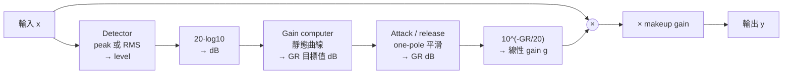

# 第 04 章：Compressor（動態壓縮器）

[English](README.md) | **繁體中文**

> [教材首頁](../../README.zh-TW.md)　｜　上一章：[03 Parametric EQ](../03-eq/README.zh-TW.md)　｜　下一章：[05 Limiter](../05-limiter/README.zh-TW.md)

上一章的 EQ 改變的是「頻率軸」上的能量分布；這一章開始處理「時間軸」上的能量起伏——也就是 **dynamics**。Compressor 是所有 dynamics 處理器（limiter、gate、expander、de-esser、transient shaper）的原型，這一章把它從原理推到程式，並且建立之後幾章都會重用的地基：`EnvelopeFollower` 與 `AttackReleaseFilter`。

## 1. 本章目標

讀完這一章，你應該能：

- 說出 compressor 的四個方塊（detector → gain computer → attack/release 平滑 → makeup gain）各自在做什麼，以及為什麼要這樣排。
- 推導 hard knee 與 soft knee 的靜態曲線（transfer curve）公式，手算任意 threshold / ratio / knee 下的輸出 dB 與 gain reduction。
- 推導 one-pole 平滑器的係數 $`\alpha = e^{-1/(\tau f_s)}`$，並換算「到 63.2%」、「到 90%」、「到 99%」的時間。
- 解釋 peak 與 RMS detector、linear 與 log（dB）domain 平滑、branching 與 decoupled 平滑、feedforward 與 feedback 拓樸的差別，以及它們分別**聽起來**有什麼不同。
- 用 `dawlab::dsp::Compressor` 在 block 迴圈裡壓縮立體聲訊號、讀取 gain reduction meter、接外部 sidechain、做 stereo link 與 parallel compression。
- 知道 compressor 做不到什麼（抓不到幾個 sample 寬的尖峰），為什麼下一章需要 lookahead limiter。

## 2. 原理

### 2.1 Dynamic range 與 compressor 的用途

一段訊號最大聲與最小聲的差距叫 **dynamic range**（動態範圍）。一段沒處理過的人聲，輕聲細語可能在 -40 dBFS、激動的句子衝到 -6 dBFS，差了 34 dB；放進有鼓、貝斯的混音裡，小聲的字會被蓋掉，大聲的字又跳出來。Compressor 的工作就是**自動調音量**：訊號超過某個門檻（threshold）時把它壓小聲，讓大聲與小聲的差距縮小。

縮小動態範圍之後，整段訊號可以用 makeup gain 整體拉大而不爆掉，所以 compressor 的副作用（也常常是主要目的）是「聽起來比較大聲、比較紮實」。此外，attack / release 時間決定它對每一個音「頭」與「尾」的反應，所以 compressor 也是雕塑 **transient**（打擊感）的工具。

另一個常用的量是 **crest factor**（峰值因數）：

$$
\text{crest factor (dB)} = 20\log_{10}\frac{\text{peak}}{\text{RMS}}
$$

鼓組的 crest factor 很大（本章合成鼓組是 14.5 dB），正弦波只有 3.01 dB。Compressor 一般會降低 crest factor——但我們在範例 3 會看到，這只有在 attack 夠快時才成立。

### 2.2 方塊圖



四個方塊各自回答一個問題：

| 方塊 | 問題 | 本章的實作 |
|---|---|---|
| Detector | 「現在多大聲？」 | `DetectorMode::Peak`（瞬間 $`\lvert x \rvert`$）或 `DetectorMode::Rms`（$`\sqrt{\overline{x^2}}`$） |
| Gain computer | 「這麼大聲的話，該壓幾 dB？」 | `Compressor::computeOutputDb()`，純函式，沒有狀態 |
| Attack / release | 「要多快壓下去、多快放開？」 | `AttackReleaseFilter`，在 dB domain 平滑 GR |
| Makeup gain | 「壓完變小聲了，補回來」 | 固定 dB，內部用 10 ms one-pole 平滑避免 zipper noise |

控制 gain 的那條路徑叫 **sidechain**（側鏈）。一般情況下 sidechain 就是輸入本身的複本；也可以餵別的訊號進去（例如用 kick 去壓 bass，這叫 **external sidechain**），或先過一個 filter 再給 detector（**sidechain HPF**，練習 4）。

### 2.3 Gain computer：threshold、ratio、knee

令輸入 level 為 $`x`$（dB）、threshold 為 $`T`$（dB）、ratio 為 $`R`$。**Hard knee** 的靜態曲線是一條折線：

$$
y_{\text{hard}}(x) =
\begin{cases}
x, & x \le T \\
T + \dfrac{x - T}{R}, & x > T
\end{cases}
$$

threshold 以上，輸入每多 1 dB，輸出只多 $`1/R`$ dB。$`R = 1`$ 是直線（不壓縮），$`R = \infty`$ 時輸出被釘在 $`T`$（這就是 limiter 的靜態曲線）。**Gain reduction**（GR，本教材一律用**正值**）是輸入與輸出的差：

$$
\text{GR}(x) = x - y(x) = \left(1 - \frac{1}{R}\right)(x - T) \quad (x > T)
$$

例如 $`T = -20`$、$`R = 4`$、$`x = -10`$：$`y = -20 + (-10 + 20)/4 = -17.5`$ dB，GR = 7.5 dB。範例 1 會印出這一行。

折線在 $`T`$ 處有一個「轉角」，訊號在 threshold 附近進進出出時，壓縮會「突然開始」。**Soft knee** 用一段寬 $`W`$ dB 的二次曲線把轉角磨圓。推導的要求是：曲線在 knee 兩端（$`x = T \pm W/2`$）要跟兩條直線**值相等、斜率也相等**（$`C^1`$ 連續）。

設 knee 內的曲線為 $`y(x) = x + a\,(x - T + W/2)^2`$（knee 下緣 $`x = T - W/2`$ 時，第二項為 0，值與斜率都跟 $`y = x`$ 一致）。在上緣 $`x = T + W/2`$，斜率要等於 $`1/R`$：

$$
y'(x) = 1 + 2a\,(x - T + W/2) \;\Rightarrow\; 1 + 2aW = \frac{1}{R} \;\Rightarrow\; a = \frac{1/R - 1}{2W}
$$

把 $`a`$ 代回去檢查上緣的值：$`y = T + W/2 + \frac{1/R - 1}{2W}W^2 = T + \frac{W}{2R}`$，而直線 $`T + (x - T)/R`$ 在 $`x = T + W/2`$ 的值也是 $`T + \frac{W}{2R}`$，確實接上。整理成三段（Giannoulis, Massberg & Reiss 2012 的寫法）：

$$
y_{\text{soft}}(x) =
\begin{cases}
x, & 2(x - T) < -W \\[4pt]
x + \dfrac{(1/R - 1)\,(x - T + W/2)^2}{2W}, & 2\,\lvert x - T \rvert \le W \\[8pt]
T + \dfrac{x - T}{R}, & 2(x - T) > W
\end{cases}
$$

$`W = 0`$ 就退化成 hard knee。一個好記的對照點：在 threshold 本身 $`x = T`$，soft knee 已經在壓了：

$$
y_{\text{soft}}(T) = T + \frac{(1/R - 1)\,W}{8}
$$

$`T = -20`$、$`R = 4`$、$`W = 10`$：$`y = -20 + (-0.75)(10/8) = -20.9375`$ dB，也就是 threshold 處已經有 0.94 dB 的 GR。

把它畫出來（節錄自範例 1 的輸出；完整版每 2 dB 一列。`#` = hard knee、`o` = soft knee、`.` = 1:1 參考線、`*` = 兩者重疊）：

```
     0 |                              .|
    -4 |                            .  |
    -8 |                          .    |
   -12 |                        .      |
   -14 |                       .       |
   -16 |                      .   *****|   ← threshold 以上：斜率 1/4
   -18 |                     .*****    |   ← knee 彎曲處：已經離開 1:1 線
   -20 |                    ***        |   ← knee：-25..-15 dB 之間慢慢彎
   -22 |                   **          |
   -24 |                  **           |
   -28 |                **             |
       ...
   -60 |**                             |
       +-------------------------------+
       -60           -30            0  (輸入 dB)
```

**聽感**：ratio 小（2:1）、knee 寬、threshold 高 → 「幾乎聽不出來在壓，只是整體比較穩」；ratio 大（8:1 以上）、hard knee、threshold 低 → 「明顯被壓扁、有被抓住的感覺」。Soft knee 在人聲、bus 上特別受歡迎，因為訊號在 threshold 附近時不會突然「切換」。

#### 對照：expander 與 gate

Compressor 壓的是 **threshold 以上**；**expander** 反過來，把 threshold **以下**的訊號推得更小（每低 1 dB 變成低 $`R`$ dB），**gate** 是 ratio 極大的 expander（低於門檻直接關掉）。它們的靜態曲線在 threshold 以下彎向下方：

```
 輸入 dB | compressor(T=-20,R=4) | expander(T=-40,R=2) | gate(T=-40,R=20)
   -60.0 |                -60.00 |              -80.00 |          -100.00
   -40.0 |                -40.00 |              -40.00 |           -40.00
   -10.0 |                -17.50 |              -10.00 |           -10.00
     0.0 |                -15.00 |                0.00 |             0.00
```

第 08 章會完整實作它們；這裡先知道它們用的是同一套 detector 與 attack/release 機制，只是 gain computer 的曲線不同。

### 2.4 Detector：peak vs RMS

**Peak detector** 看瞬間的 $`\lvert x[n] \rvert`$。反應最快，對一聲鼓的尖峰立刻有感，適合抓 transient、做 limiter。

**RMS detector** 看一段時間內的平均能量 $`\sqrt{\overline{x^2}}`$，比較接近人耳感受到的「響度」。它天生就是平滑過的，所以 attack 不可能比視窗長度快，但比較不容易產生 pumping（整體音量跟著鼓點一吸一放的「呼吸」感，2.9 節與練習 7 會再談）、聽起來比較「音樂」。兩個常用的事實：

- 正弦波的 RMS 比 peak 低 $`20\log_{10}\sqrt{2} = 3.01`$ dB。所以同樣的 threshold，RMS 模式會少壓 $`0.75 \times 3.01 \approx 2.26`$ dB（$`R = 4`$ 時）。範例 2 的 B3 會印出 5.29 dB 對 7.49 dB。
- 本章的 RMS 用 one-pole 對 $`x^2`$ 做移動平均（而不是真的開一個長度 N 的視窗），`setRmsWindowMs()` 設定的就是這個 one-pole 的時間常數。注意 attack / release 作用在 $`x^2`$ 上：$`x^2`$ 到 63.2% 時，振幅只到 $`\sqrt{0.632} = 79.5\%`$。

### 2.5 Attack / release：one-pole 平滑與時間常數

平滑器的核心是一階遞迴（one-pole lowpass）：

$$
y[n] = \alpha\, y[n-1] + (1 - \alpha)\, x[n]
$$

對一個 step 輸入（$`x`$ 從 0 跳到 1），解析解是 $`y[n] = 1 - \alpha^n`$。我們希望「經過 $`\tau`$ 秒」等於「經過 $`\tau f_s`$ 個 sample」時，$`y`$ 到達 $`1 - e^{-1} = 63.2\%`$，所以要求 $`\alpha^{\tau f_s} = e^{-1}`$：

$$
\alpha = \exp\!\left(-\frac{1}{\tau f_s}\right)
$$

這就是 `attackReleaseCoefficient()`。$`\tau = 10`$ ms、$`f_s = 48`$ kHz：$`\alpha = e^{-1/480} = 0.997919`$。

**時間常數的換算**：到達比例 $`p`$ 所需的時間是 $`t_p = -\tau \ln(1 - p)`$：

| 到達 | 時間 |
|---|---|
| 63.2% | $`1.00\,\tau`$（定義） |
| 90% | $`\ln 10 \cdot \tau = 2.303\,\tau`$ |
| 95% | $`3.00\,\tau`$ |
| 99% | $`4.605\,\tau`$ |

**記號**：本章用 $`t_{63}`$ / $`t_{90}`$（程式輸出同樣寫成 t63 / t90）表示 attack 時 GR 走完 63.2% / 90% 所需的時間；release 用 $`t_{37}`$ / $`t_{10}`$ 表示 GR 降到只剩 36.8% / 10% 所需的時間。對單純的 one-pole 來說，$`t_{63} = t_{37} = 1\,\tau`$、$`t_{90} = t_{10} = 2.303\,\tau`$。

所以「attack 10 ms」在本教材的定義下，是 10 ms 到 63.2%、23 ms 到 90%。**不同廠商定義不同**（有的用到 90%、有的用 10%→90%、類比機器還有 program-dependent 的），同樣寫 10 ms 的兩台 compressor 聽起來可以差很多——這是為什麼本章要用數字量測，而不是相信面板上的字。範例 2 的 (A) 會量出 t63 = 9.98 ms、t90 = 23.02 ms。

Attack 與 release 用不同的 $`\alpha`$：目標值比目前狀態**高**（要壓更多）時用 $`\alpha_A`$，比較低（放開）時用 $`\alpha_R`$。

#### Branching vs decoupled

上面「依方向切換係數」的寫法叫 **branching**。它有一個問題：detector 送進來的瞬間 level 對週期訊號（正弦波）每半個週期就掉到 0 一次，branching 會在那段用 release 往下拉，穩態時 GR 永遠比靜態曲線低。範例 2 的 B2 量到 6.47 dB（應該是 7.5）。

**Decoupled** 平滑先做一個「瞬間上升、以 release 衰減」的 peak-hold，再用 attack 係數平滑它：

$$
\begin{aligned}
y_1[n] &= \max\!\big(x[n],\; \alpha_R\, y_1[n-1] + (1 - \alpha_R)\, x[n]\big) \\
y[n] &= \alpha_A\, y[n-1] + (1 - \alpha_A)\, y_1[n]
\end{aligned}
$$

peak-hold 把週期訊號的 ripple 填平，所以穩態 GR 精確等於靜態曲線（B1 量到 7.49 dB），attack 曲線也精確是 $`1 - e^{-t/\tau_A}`$。代價是 release 變成兩級串聯（先 peak-hold 衰減、再過 attack 濾波器），量到的 release 時間約是 $`\tau_R + \tau_A`$（B1：110.8 ms 對標稱 100 ms）。`Compressor` 預設用 decoupled；`EnvelopeFollower` 預設 branching（給第 08 章 gate 用，gate 不在乎 ripple，反而要「真的掉下去」）。

#### Linear domain vs log（dB）domain

平滑可以放在兩個地方：

- **Linear domain**：先平滑 $`\lvert x \rvert`$ 得到 envelope，再丟進靜態曲線。這是 `EnvelopeFollower` → `computeOutputDb()` 的路徑（範例 2 的 B4）。
- **Log domain**：先把瞬間 level 丟進靜態曲線得到 GR 目標值（dB），再平滑 GR。這是 `Compressor` 的做法，也是 Giannoulis 等人建議的結構。

差別在 release 的形狀。Linear domain 的 envelope 指數衰減，換成 dB 是**等速下降**：每 $`\tau`$ 掉 $`20\log_{10} e = 8.686`$ dB（$`\tau_R = 100`$ ms → 86.9 dB/s），GR 直線掉到 0 就停住。Log domain 的 GR 本身指數衰減，尾巴拖得長、慢慢收到 0，聽起來比較自然、比較像類比機器；而且 attack / release 時間與 threshold、ratio 無關（linear domain 的 GR 曲線形狀會隨訊號超過 threshold 多少而變）。範例 2 的 B4 會把兩條 release 曲線並排印出來。

#### 圖解：三種平滑的 release 曲線

下圖是範例 2 最後印出的 ASCII 圖（$`T = -20`$、$`R = 4`$、attack 10 ms、release 100 ms，1 kHz 正弦波從 -10 dBFS 掉回 -30 dBFS 的那一刻是 $`t = 0`$）。橫軸每格 10 ms，縱軸每列 0.5 dB；`1` = B1 decoupled（log domain，`Compressor` 預設）、`2` = B2 branching、`4` = B4 linear domain、`*` = 兩條以上重疊；`-` 那一列是 B1 穩態 GR 7.49 dB 的 36.8%（2.76 dB），也就是「經過一個時間常數」該到的位置：

```
   8.0 |
       |*4
   7.0 | 14
       |2 14
   6.0 | 2 1
       |  2 *
   5.0 |   2 *
       |    2 *
   4.0 |     2 *
       |      2 *1
   3.0 |-------22411--------------------------------------
       |         22 11
   2.0 |          422211
       |           4  22*11
   1.0 |            4    22***111
       |             4        222********111
   0.0 |______________4444444444444444444*****************
       0         100       200       300       400      (ms)
```

三件事一眼可以看出來：

- **B2（branching）從比較低的地方出發**：穩態只有 6.47 dB（ripple 被 release 拉低），B1 是 7.49 dB。
- **B1 大約在 110 ms 穿過 36.8% 線**：decoupled 的 release 是 $`\tau_R + \tau_A`$ 左右（前面「Branching vs decoupled」講的代價）。B1、B2 都是指數衰減，越接近 0 掉得越慢，尾巴一直拖到 400 ms 以後。
- **B4（linear domain）是一條直線**，約 150 ms 就直接撞到 0 停住——在 dB 上等速下降，沒有「慢慢收尾」。這就是 log domain 聽起來比較自然的原因。

### 2.6 Feedforward vs feedback

上面的方塊圖是 **feedforward**：detector 看輸入。**Feedback** 拓樸讓 detector 看**輸出**（壓完的訊號），這是類比時代的自然做法（偵測電路接在輸出端）。

用 hard knee 的穩態分析：令 gain computer 的斜率為 $`s`$（GR 每超過 threshold 1 dB 增加 $`s`$ dB；feedforward 時 $`s = 1 - 1/R`$）。Feedback 時 $`Y = X - \text{GR}`$ 且 $`\text{GR} = s\,(Y - T)`$：

$$
\text{GR} = s\,(X - \text{GR} - T) \;\Rightarrow\; \text{GR} = \frac{s}{1 + s}(X - T) \;\Rightarrow\; Y - T = \frac{X - T}{1 + s}
$$

所以 feedback 的**有效 ratio 是 $`1 + s`$**。把 feedforward 的 4:1 設定（$`s = 0.75`$）直接搬到 feedback 只有 1.75:1；要真的 4:1 得把斜率設成 3（比 1 還大，意思是 detector 看到超過 1 dB 就想壓 3 dB，靠迴路收斂到 0.75）。行為上，feedback 的 detector 一開始看到「還沒被壓」的大輸出，GR 目標值一開始遠大於穩態 → attack 前段特別快、之後慢慢收斂（**program-dependent attack**）；練習 6 會量到 t63 從 10.8 ms 縮到 2.8 ms。這是 feedback 機器「聽起來比較順」的原因之一；代價是無法做 lookahead（輸出還沒算出來）、ratio 無法無限大。

### 2.7 Stereo link

立體聲訊號左右各自壓的話，哪邊大聲哪邊被壓得多，左右音量差縮小 → 聲像往小聲那邊「漂」。**Stereo link** 讓兩邊共用同一個 gain（由兩邊中較大的 level 決定），左右差永遠不變。範例 4：L -6 dBFS、R -30 dBFS，unlinked 時左右差從 24 dB 縮成 13.5 dB；linked 時維持 24 dB。本章的 `Compressor` 預設 link；需要「各自壓」（例如 dual-mono 的樂器）才關掉。

### 2.8 Makeup 與 auto makeup

壓完之後整體變小聲，**makeup gain** 把它補回來。最常見的 auto makeup 公式是「讓 0 dBFS 的輸入回到 0 dBFS」：

$$
\text{makeup} = -\,y(0) = -\,\text{computeOutputDb}(0, T, R, W)
$$

$`T = -20`$、$`R = 4`$、hard knee：$`y(0) = -20 + 20/4 = -15`$ → makeup = 15 dB。很多 plugin 只補一半，因為真實音樂很少一直頂在 0 dBFS，補滿會太大聲。練習 5 會驗證這個公式，並用真的 `Compressor` 跑 0 dBFS 正弦波確認輸出回到 0.01 dBFS。

### 2.9 Sidechain HPF

低頻（kick、bass）能量大，很容易把 compressor 踩下去，連帶把中高頻一起壓小聲，整個 mix 跟著 kick「呼吸」（pumping）。解法是 detector 看「經過 high-pass filter 的複本」，gain 仍套在原始訊號上。練習 4 用 50 Hz @ -6 dBFS + 3 kHz @ -24 dBFS 的訊號示範：沒有 HPF 時 GR 11.2 dB、3 kHz 被拖下去 11.1 dB；sidechain 加 400 Hz 的 one-pole HPF 之後 GR 只剩 1.2 dB。

### 2.10 Gain reduction meter

GR meter 顯示「現在壓了幾 dB」，是使用 compressor 時最重要的視覺回饋。`Compressor::getGainReductionDb()` 回傳每個 block 的最大 GR（正值），用 `std::atomic<float>` 存，audio thread 寫、UI thread 讀，不需要 lock。範例 3 每個 block 讀一次，畫成文字版 meter。

### 2.11 Parallel（New York）compression

把 dry 訊號和**重壓**過的 wet 訊號混在一起：

$$
y = (1 - \text{mix})\, x_{\text{dry}} + \text{mix}\, x_{\text{wet}}
$$

Wet 提供厚度與「身體」，dry 保留 transient 與動態，是鼓組 bus 與人聲最常用的技巧之一。練習 3 實作它，並驗證 mix = 0.5 的 crest factor 介於 dry 與 wet 之間。

## 3. 從公式到程式碼

### 3.1 `dsp/include/dawlab/dsp/EnvelopeFollower.h`

這個 header 放了三樣東西，只依賴 `dawlab/DspMath.h` 與標準函式庫：

```cpp
enum class DetectorMode { Peak, Rms };
enum class SmoothingMode { Branching, Decoupled };

inline float  attackReleaseCoefficient(double timeMs, double sampleRate) noexcept; // α = exp(-1/(τ·fs))
inline double coefficientToTimeMs(double alpha, double sampleRate) noexcept;       // 反推 τ
```

**`AttackReleaseFilter`** 是「上升用 attack 係數、下降用 release 係數」的 one-pole 平滑器。它不在乎輸入是線性振幅、$`x^2`$ 還是 dB，所以 `Compressor` 拿它在 dB domain 平滑 GR，`EnvelopeFollower` 拿它在 linear domain 平滑 $`\lvert x \rvert`$：

```cpp
float process(float target) noexcept {
    if (!std::isfinite(target)) target = 0.0f;    // 擋掉 Inf / NaN：遞迴狀態一旦變 NaN 就永遠回不來
    if (mode_ == SmoothingMode::Branching) {
        const float a = target > y_ ? attackCoeff_ : releaseCoeff_;
        y_ = target + a * (y_ - target);          // y = α·y + (1-α)·x 的另一種寫法，少一次乘法
    } else {
        peakHold_ = std::max(target, target + releaseCoeff_ * (peakHold_ - target));
        y_ = peakHold_ + attackCoeff_ * (y_ - peakHold_);
    }
    if (std::abs(y_) < kDenormalFlush || !std::isfinite(y_)) y_ = 0.0f;  // denormal flush 成 0；溢位也歸零
    ...
}
```

**`EnvelopeFollower`** 吃原始 sample、回傳線性振幅 envelope（永遠 ≥ 0）：Peak 模式平滑 $`\lvert x \rvert`$，RMS 模式平滑 $`x^2`$ 再開根號。輸入先經過防護：Inf / NaN 當成 0，其餘夾在 ±$`10^6`$（+120 dBFS）以內，避免 $`x^2`$ 溢位成 Inf（$`\lvert x \rvert`$ 超過約 $`1.8 \times 10^{19}`$ 時 $`x^2`$ 就超出 float 範圍）。第 08 章的 `Gate`、`Expander`、`DeEsser`、`TransientShaper` 直接重用它。

### 3.2 `dsp/include/dawlab/dsp/Compressor.h`

`Compressor` 是 feedforward、log-domain 平滑、預設 decoupled 的 stereo compressor。每個 sample 的流程對應 2.2 的方塊圖：

```cpp
// level（線性）→ dB → 靜態 GR 目標值（dB，正值，尚未平滑）
float computeGainReductionTarget(float level) const noexcept {
    if (!std::isfinite(level)) level = 0.0f;   // Inf 會讓靜態曲線算出 Inf - Inf = NaN
    const float levelDb = gainToDb(level);     // 0 → -100 dB，GR 自然為 0
    return computeGainReductionDb(levelDb, thresholdDb_, ratio_, kneeDb_);
}
// 再經過 attack/release 平滑：gr = state.gainSmoother.process(grTarget)
```

`process()` 裡，stereo link 開著時所有 channel 取**最大的 level** 算出同一個 GR 目標值，每個 channel 的 smoother 都吃這個共同目標（穩態時大家的 GR 完全相同）；關掉時每個 channel 各有自己的 detector 與目標值。最後 `block[ch][i] *= dbToGain(-gr) * makeupGainSmoothed_`。

為什麼 linked 時不乾脆只跑一個 smoother？因為那樣其他 channel 的 smoother 會凍結在切換當下的舊值，之後切回 unlinked，gain 會瞬間跳回那個舊值（click）；反過來 unlinked → linked 時，安靜那一邊的 gain 也會瞬間跳到大聲那一邊的 GR。讓每個 channel 都跑自己的 smoother，切換時每一邊都從自己目前的 GR 出發，以 attack / release 的速度平滑地走向新目標（範例 5 會逐 sample 驗證）。

靜態 gain computer 是 `static` 純函式，所以 UI 可以直接拿它畫 transfer curve，練習也可以拿它當「標準答案」：

```cpp
static float computeOutputDb(float inputDb, float thresholdDb, float ratio, float kneeDb) noexcept;
static float computeGainReductionDb(float inputDb, float thresholdDb, float ratio, float kneeDb) noexcept;
```

合約以外的額外 API：`setDetectorMode(DetectorMode)`、`setRmsWindowMs(float)`、`setSmoothingMode(SmoothingMode)`、`process(AudioBlock block, const AudioBlock& sidechain)`（外部 sidechain；sidechain 的 channel 數可以比主訊號少）、`getLatencySamples()`（永遠 0），以及各參數的 getter。`std::atomic` 成員會讓 class 預設不能複製，所以手寫了 copy constructor，第 14 章才能把它放進 `std::vector`。

### 3.3 範例

所有範例預設 48 kHz、block size 512、不帶參數即可執行；WAV 輸出在 `<build 目錄>/dawlab_output/`。

```powershell
.\scripts\build.ps1 -Only 04-compressor          # 建置並跑全部測試
cd build; .\bin\Debug\l04_transfer_curve.exe     # 手動執行單一範例
```

#### 範例 1：`l04_transfer_curve`（`examples/transfer_curve.cpp`）

印出 $`T = -20`$、$`R = 4`$ 下 hard knee 與 soft knee（10 dB）的靜態曲線表、手算對照點（-22 → -22.3375、-20 → -20.9375、-18 → -19.8375）、ratio 從 1:1 到 1000:1 的比較、ASCII 圖，以及 expander / gate 的曲線對照。沒有 WAV 輸出。

該看到：soft knee 的 GR 從 -25 dB 就「提早、慢慢」開始（-24 dB 時 0.04 dB），-15 dB 之後兩條曲線重合；ratio 1000:1 時 0 dBFS 的輸入被釘在 -19.98 dB。

#### 範例 2：`l04_step_response`（`examples/step_response.cpp`）

(A) 單獨測 `AttackReleaseFilter` 對 0 → 10 → 0 的 step：

```
αA = exp(-1/(0.010·48000)) = 0.997919, αR = exp(-1/(0.100·48000)) = 0.999792
Branching attack: t63 =   9.98 ms (theory τ = 10), t90 =  23.02 ms (theory ln10·τ = 23.03) | release: t37 =  99.96 ms (theory 100), t10 = 230.23 ms (theory 230.26)
Decoupled attack: t63 =   9.98 ms (theory τ = 10), t90 =  23.02 ms (theory ln10·τ = 23.03) | release: t37 = 110.48 ms (theory 100), t10 = 240.77 ms (theory 230.26)
```

(B) 把 1 kHz tone bursts（-30 → -10 → -30 dBFS，各 0.5 秒）餵進 `Compressor`（$`T = -20`$、$`R = 4`$、attack 10 ms、release 100 ms），由輸入 / 輸出每 1 ms 視窗的 peak 比反推 GR 時間軸，印四組比較：

| 組 | 設定 | 穩態 GR | attack t63 | release t37 |
|---|---|---|---|---|
| B1 | Decoupled + Peak（預設） | 7.49 dB（靜態 7.50） | 10.8 ms | 110.8 ms |
| B2 | Branching + Peak | 6.47 dB（低估） | 17.8 ms | 100.2 ms |
| B3 | Decoupled + RMS 5 ms | 5.29 dB（靜態以 -13 dB 算 = 5.24） | 15.8 ms | 114.8 ms |
| B4 | linear domain（EnvelopeFollower → 靜態曲線） | 7.49 dB | 9.7 ms | 90.8 ms，150 ms 後直接 0 |

最後把 B1、B2、B4 的 release 曲線疊成一張 ASCII 圖（就是 2.5 節「圖解」那張）。輸出 `l04_step_in.wav`、`l04_step_out.wav`。該聽到：第二段大聲的音在前 10 ms 會「衝」出來（overshoot 峰值 -10.11 dBFS，之後被壓到 -17.49 dBFS），回到小聲段時前 100 ms 音量慢慢「浮」回來。

#### 範例 3：`l04_drum_loop`（`examples/drum_loop.cpp`）

用 `makeDrumLoop()` 的 2 小節鼓組（peak -2.92 dBFS、RMS -17.43 dBFS、crest 14.51 dB），三組設定 + attack 時間掃描。makeup 一律設成「讓輸出 peak 回到 dry 的 peak」，這樣 RMS 的差就是「一樣大的 peak 之下誰比較大聲」：

| 設定 | 最大 GR | crest | makeup 後 RMS 相對 dry |
|---|---|---|---|
| attack 0.02 ms（極快，類似 FET 硬體 compressor） | 12.81 dB | 10.44 dB | **+4.07 dB** |
| attack 30 ms（放過 transient） | 9.67 dB | 19.52 dB | -5.01 dB |
| 重壓 T -26 / 10:1 / attack 0.02 ms | 20.77 dB | 9.95 dB | +4.56 dB |

attack 掃描（$`T = -20`$、$`R = 4`$、knee 6、release 80 ms）：

```
attack(ms) | max GR | peak ↓ | RMS ↓ | crest(dB) | RMS vs dry after makeup
      0.02 |  12.81 |  12.64 |  8.57 |     10.44 |  +4.07 dB
      0.10 |  12.80 |   9.37 |  8.56 |     13.71 |  +0.81 dB
      1.00 |  12.53 |   5.48 |  8.39 |     17.42 |  -2.91 dB
     30.00 |   9.67 |   0.76 |  5.76 |     19.52 |  -5.01 dB
```

這張表是本章最重要的「反直覺」結論：**compressor 只有在 attack 快到能抓住尖峰時才會降低 crest factor、讓東西變大聲**。鼓組的 peak 是 snare 雜訊與 hi-hat 幾個 sample 寬的尖峰，attack 1 ms 的 one-pole 第一個 sample 只升到目標的 2%，尖峰原封不動溜過去，被壓到的是後面的「身體」，crest 反而從 14.5 升到 17.4 dB。這正是鼓手要的「punch」——也是為什麼「保證 peak 不超過」得靠第 05 章的 lookahead limiter。

輸出 `l04_drums_dry.wav`、`l04_drums_compressed.wav`（0.02 ms）、`l04_drums_compressed_slow_attack.wav`（30 ms）。該聽到：compressed 版 kick / snare 衝擊感變小、整體更紮實也更大聲；slow attack 版鼓頭保留、尾巴壓緊、整體反而比 dry 小聲一點。也可以 `l04_drum_loop 你的.wav` 用自己的素材跑。

#### 範例 4：`l04_stereo_link`（`examples/stereo_link.cpp`）

L -6 dBFS、R -30 dBFS 的 1 kHz 正弦波，$`T = -20`$、$`R = 4`$、hard knee：

```
stereo link = OFF: L -16.48, R -30.00, L-R difference 13.52 dB (the input is 24.00 dB)   GR 10.48 dB
stereo link = ON : L -16.48, R -40.48, L-R difference 24.00 dB                           GR 10.48 dB
External sidechain (mono -10 dBFS): GR = 7.48 dB, output L -13.48 / R -37.48 dBFS
```

GR 理論值 $`(-6 + 20)(1 - 1/4) = 10.5`$ dB；量到 10.48 是因為 decoupled 的 peak-hold 在兩個波峰之間以 release 衰減了 0.5 ms。輸出 `l04_stereo_unlinked.wav`、`l04_stereo_linked.wav`，unlinked 版聲像往右偏、變窄。

#### 範例 5：`l04_robustness`（`examples/robustness.cpp`）

示範兩個在 audio thread 上「不會當掉、但會靜靜壞掉」的陷阱，並用 `DAWLAB_CHECK` 自我驗證（全部通過才回傳 0）。

(A) **壞輸入**：在 1 kHz、-6 dBFS 的正弦波第 100 個 sample 塞入 `+Inf`、`NaN` 或 `2e19`（平方後會溢位），比較 1 秒後的輸出與乾淨輸入：

```
  Mode | Bad    | Tail peak (dBFS) | Clean input's tail | GR (dB) | Clean input's GR
  Peak | +Inf   |           -16.50 |             -16.50 |   10.48 |            10.48
  Peak | NaN    |           -16.50 |             -16.50 |   10.48 |            10.48
  Peak | 2e19   |           -16.50 |             -16.50 |   10.48 |            10.48
  RMS  | +Inf   |           -14.27 |             -14.27 |    8.25 |             8.25
  RMS  | NaN    |           -14.27 |             -14.27 |    8.25 |             8.25
  RMS  | 2e19   |           -14.27 |             -14.27 |    8.25 |             8.25
```

如果沒有 non-finite 防護（3.1 節），遞迴的 smoother 只要吃進一個 NaN 就永久卡死：Peak 模式下 `+Inf` 會讓 GR 目標值變成 Inf − Inf = NaN，`dbToGain(NaN)` 回傳 0，**之後的輸出永遠是靜音**；RMS 模式下 detector 卡在 NaN，`sqrt(max(0, NaN))` 回傳 0，**之後永遠不壓縮**。兩種情況 GR meter 都只顯示 0，看不出任何異常。

(B) **stereo link 切換**：用直流（DC）測試訊號逐 sample 量 gain。先 unlinked、R = 0 dBFS（GR 15 dB）、L = -40 dBFS（GR 0）；1.0 s 切成 linked、1.1 s 切回 unlinked（同時 L、R 都變成 -40 dBFS）、2.1 s 再切成 linked：

```
  Switch to linked   @ 1.00 s: R gain  -15.00 dB →  -15.00 dB; L gain    0.00 dB →   -0.03 dB
  Switch to unlinked @ 1.10 s: R gain  -15.00 dB →  -15.00 dB; L gain  -15.00 dB →  -15.00 dB
  Switch to linked   @ 2.10 s: R gain   -0.00 dB →   -0.00 dB; L gain   -0.00 dB →   -0.00 dB
  Largest gain change between adjacent samples over the whole run: L 0.031 dB, R 0.031 dB (at most about 0.03 dB per sample during attack)
  End of the linked segment: L gain -15.00 dB, R gain -15.00 dB (should be almost identical)
```

切成 linked 時 L 以 attack 的速度（每 sample 約 0.03 dB）跟上 R 的 15 dB，而不是瞬間被拉下 15 dB。輸出 `l04_link_toggle.wav`（DC 訊號，聽不到內容，用波形編輯器看切換點附近是否平滑）。

## 4. Real-time 注意事項

- **`process()` 不 allocate**：`prepare()` 是唯一配置記憶體的地方（`channels_.resize`）。範例與練習裡的 sidechain buffer 也都在迴圈外配置一次。
- **Denormal**：`AttackReleaseFilter` 的狀態在 release 時會指數衰減到極小，`process()` 把 $`\lvert y \rvert < 10^{-15}`$ flush 成 0；`reset()` 把所有狀態歸零。沒做這件事，安靜一段時間後 CPU 使用率會突然飆高。
- **Zipper noise**：threshold / ratio / knee 直接改值是安全的——它們只影響 GR 的**目標值**，而 GR 本身永遠經過 attack / release 平滑，所以轉旋鈕不會有 click。Makeup gain 是乘在輸出上的，所以內部用 10 ms one-pole 平滑。Attack / release 改變只是換 $`\alpha`$，狀態不變，也安全。Stereo link 切換也安全：linked 時每個 channel 仍跑自己的 smoother（只是吃同一個目標值），切換瞬間每一邊都從目前的 GR 平滑過渡（範例 5 (B)）。
- **壞輸入（Inf / NaN）**：遞迴濾波器的狀態只要變成 NaN 就永遠回不來（NaN 參與的運算結果都是 NaN），只能 `reset()`。上游一個 bug（例如除以 0）送進一個 Inf，compressor 就可能從此靜音或從此不壓縮。所以 `AttackReleaseFilter` 把 non-finite 的輸入當成 0、狀態若溢位也歸零；`EnvelopeFollower` 先把輸入夾在 ±$`10^6`$ 再平方；`Compressor` 把 non-finite 的 level 當成 0。這些檢查每個 sample 只多幾次比較，對 CPU 幾乎沒有影響（範例 5 (A)）。
- **Thread safety**：`getGainReductionDb()` 用 `std::atomic<float>` + relaxed ordering，UI thread 隨時可以讀；setter 是單一 float 寫入，在 x86/ARM 上實務安全，但如果 UI 會一次改多個參數並要求一致性，要在 host 層做參數快照（第 13 章）。
- **零延遲**：feedforward 無 lookahead，`getLatencySamples()` 回傳 0，host 不需要補償。
- **Block 大小無關**：所有狀態都是逐 sample 更新，block 怎麼切，輸出的 sample 都一樣（範例用 512）。唯一和 block 大小有關的是 `getGainReductionDb()`：它存的是「這個 block 內的最大 GR」，block 越大，meter 讀數越像 peak-hold。

## 5. 常見錯誤與除錯

| 症狀 | 可能原因 |
|---|---|
| GR 永遠是 0 | threshold 太高（記得 dBFS 是負的，-20 不是 20）；或 detector 吃到的是 silence（sidechain 接錯）。 |
| GR 爆到 100 dB、輸出變 0 | `gainToDb(0)` 回傳 -100，如果你的靜態曲線沒有正確處理「低於 threshold 回傳 0」，-100 dB 會被當成「超過」。 |
| 穩態 GR 比手算少 1 dB | 用了 branching 平滑：週期訊號的 ripple 被 release 拉下來（2.5 節）。換 decoupled，或接受這是「聽起來比較鬆」的特色。 |
| attack 設 1 ms 但尖峰還是衝出來 | 這是正常的（範例 3）。One-pole 第一個 sample 只升 $`1 - \alpha`$；要抓單 sample 尖峰得用 lookahead（第 05 章）。 |
| 輸出有「喀」聲 | makeup 直接改線性值沒有平滑；或 attack 設 0 且 ratio 很大，GR 每個 sample 跟著波形跳（這其實是 waveshaping，會產生諧波失真）。 |
| 左右聲像亂飄 | stereo link 關了。 |
| 切換 stereo link 的瞬間有「喀」聲 | linked 模式只更新其中一個 channel 的 smoother，其他 channel 的狀態凍結在舊值，切回來時 gain 瞬間跳變。每個 channel 都要持續更新 smoother（範例 5 (B)）。 |
| 某一刻之後輸出永遠靜音，或永遠不再壓縮，GR meter 卻一直顯示 0 | 有一個 Inf / NaN（或平方後溢位的超大值）進了 detector 或 smoother，遞迴狀態永久卡在 NaN：`dbToGain(NaN)` 回傳 0 → 靜音；`sqrt(max(0, NaN))` 回傳 0 → level 永遠是 -100 dB → 不壓縮。一次就永久卡死，只有 `reset()` 救得回來。解法是在遞迴濾波器入口擋掉 non-finite（3.1 節、範例 5 (A)），並用 `hasNanOrInf()` 檢查上游。 |
| RMS 模式 attack 怎麼調都慢 | RMS 視窗本身就是一層 lowpass，attack 不可能快過視窗長度；要快就縮短 `setRmsWindowMs()` 或改 Peak。 |
| 安靜時 CPU 飆高 | denormal。確認 flush-to-zero 有做；在 plugin 裡也可以開 CPU 的 FTZ/DAZ flag（第 13 章）。 |
| 跑 feedback 拓樸時輸出鎖死或震盪 | 斜率 $`s > 1`$ 的迴路靠 attack 平滑才穩定，attack = 0 會每個 sample 來回跳。練習 6 固定 attack 10 ms。 |

## 6. 練習題

見 [`exercises/README.md`](exercises/README.zh-TW.md)：1 題觀念、1 題計算（`l04_ex2_solution` 會驗算答案）、5 題實作（parallel compression、sidechain HPF、auto makeup、feedback 拓樸、RMS 視窗長度）。解答與解說在 [`solutions/README.md`](solutions/README.zh-TW.md)。

## 7. 延伸閱讀

- D. Giannoulis, M. Massberg, J. D. Reiss, "Digital Dynamic Range Compressor Design—A Tutorial and Analysis", *Journal of the Audio Engineering Society*, vol. 60, no. 6, pp. 399–408, 2012. 本章的 soft knee 公式、branching / decoupled 平滑、log-domain 結構都來自這篇。
- U. Zölzer (ed.), *DAFX: Digital Audio Effects*, 2nd ed., Wiley, 2011. 第 4 章 "Nonlinear Processing" 有 dynamics 處理的整體介紹。
- Will Pirkle, *Designing Audio Effect Plugins in C++*, 2nd ed., Routledge, 2019. 書中有專章講 dynamics processor 的 plugin 實作（detector、gain computer、sidechain）。
- Bob Katz, *Mastering Audio: The Art and the Science*, 3rd ed., Focal Press, 2014. 從混音 / 母帶的角度談 compressor 的使用與聽感。

## 8. 下一章

第 05 章 [05-limiter](../05-limiter/README.zh-TW.md) 把 ratio 推到無限大、加上 lookahead 與 delay line，做出「保證 peak 不超過 ceiling」的 **limiter**——正是範例 3 那些溜過去的尖峰的解法。
