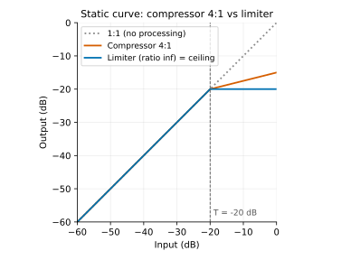
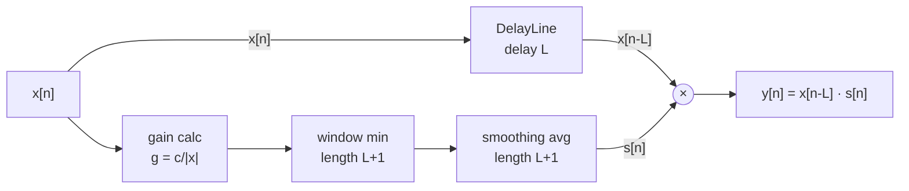
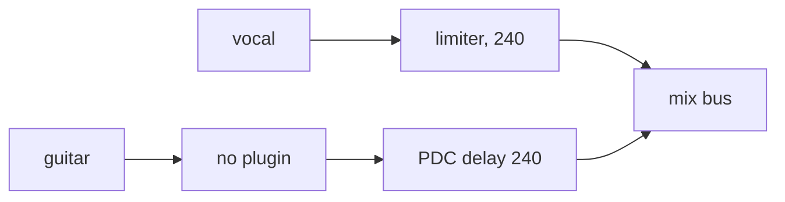
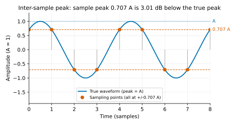
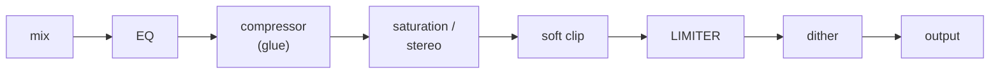

# Chapter 05: Limiter — the lookahead brickwall limiter

**English** | [繁體中文](README.zh-TW.md)

> [Course Home](../../README.md) | Previous: [04 Compressor](../04-compressor/README.md) | Next: [06 Saturation](../06-saturation/README.md)

The compressor in Chapter 04 *reduces* dynamics, but it is always half a beat late: it starts clamping down only after the signal has gotten louder, so the first peak always slips through. This chapter builds a component that gives a **hard guarantee**: whatever you feed it, the output sample peak never exceeds the ceiling you set. The price of that guarantee is latency (lookahead), and latency in turn drags in the DAW's plugin delay compensation, true peak and inter-sample peak — problems mastering engineers face every day.

## 1. Chapter goals

After reading this chapter and doing the exercises, you will be able to:

- Explain the relationship between a limiter and a compressor as "ratio → ∞, attack → 0", and show with numbers why even a fast-attack compressor still overshoots.
- Derive the lookahead limiter algorithm (required gain → sliding window minimum → moving average → release) and **prove** that it guarantees output ≤ ceiling.
- Implement `DelayLine` (a circular buffer) and `Limiter`, using a monotonic deque to get an O(1) amortized window minimum.
- Report latency correctly, and explain how a DAW compensates for it with plugin delay compensation (PDC).
- Explain inter-sample peak and dBTP, and why the ceiling is usually set to -1 dBTP; measure true peak with 4x oversampling.
- Tell the trade-offs between a clipper and a limiter, know what LUFS is (Chapter 11 implements it), and know where a limiter sits in a mastering chain.

## 2. Theory

### 2.1 A limiter = a compressor with ratio → ∞ and attack → 0

Recall the static curve (hard knee) from Chapter 04:

```math
y_{\text{dB}} = \begin{cases} x_{\text{dB}} & x_{\text{dB}} \le T \\ T + \dfrac{x_{\text{dB}} - T}{R} & x_{\text{dB}} > T \end{cases}
```

As $`R \to \infty`$ the second branch becomes $`y_{\text{dB}} = T`$: no matter how large the input above the threshold, the output stays at $`T`$. This horizontal line is the "ceiling". Written in linear terms, when the input $`|x|`$ exceeds the ceiling $`c`$, the gain required is

```math
g = \min\!\Bigl(1,\ \frac{c}{|x|}\Bigr)
```

<p align="center"></p>

But the static curve is only half the story. The attack / release smoother from Chapter 04 decides *how fast* the gain gets into place, whereas a limiter requires the gain to be in place *before the peak reaches the output* — so attack must not only be fast, it must be **negative**.

### 2.2 Why a fast-attack compressor still overshoots (with numbers)

Take the Chapter 04 `Compressor` and set it up to imitate a limiter as closely as possible: threshold -20 dB, ratio 100:1, hard knee, attack 1 ms. The input is a 1 kHz tone burst that sits at -30 dBFS for 0.4 s and then suddenly jumps to -6 dBFS.

Target gain reduction: with an input of -6 dB the output is $`-20 + 14/100 = -19.86`$ dB, so $`GR_\infty = 13.86`$ dB. The compressor's attack is a one-pole smoother (it smooths the gain reduction in dB), so the gain reduction rises as $`GR(t) = GR_\infty\,(1 - e^{-t/\tau})`$ with $`\tau = 1`$ ms. A 1 kHz sine that gets louder starting at phase 0 has its first peak at $`t = 0.25`$ ms, and one every 0.5 ms after that; the largest output in each 1 ms window is "the first peak of that window" ($`t = k + 0.25`$ ms, where the gain has been reduced the least):

<div align="center">

| Window | Peak time $`t`$ | $`1 - e^{-t/\tau}`$ | Theoretical GR | Theoretical output peak |
|---|---|---|---|---|
| 0–1 ms | 0.25 ms | 0.221 | 3.07 dB | **-9.07 dBFS** |
| 1–2 ms | 1.25 ms | 0.713 | 9.89 dB | -15.89 dBFS |
| 2–3 ms | 2.25 ms | 0.895 | 12.40 dB | -18.40 dBFS |
| 3–4 ms | 3.25 ms | 0.961 | 13.32 dB | -19.32 dBFS |
| 5–6 ms | 5.25 ms | 0.995 | 13.79 dB | -19.79 dBFS |

</div>

Measured by the example `l05_compressor_vs_limiter` (output peak within each 1 ms window):

```
Time after jump    Input (dBFS)     Compressor        Limiter
   0 ms ~ 1              -6.00          -7.99         -20.00
   1 ms ~ 2              -6.00         -15.54         -20.00
   2 ms ~ 3              -6.00         -18.27         -20.00
   3 ms ~ 4              -6.00         -19.27         -20.00
   5 ms ~ 6              -6.00         -19.77         -20.00
   8 ms ~ 9              -6.00         -19.84         -20.00
  50 ms ~ 51             -6.00         -19.85         -20.00

Overshoot relative to threshold/ceiling within 20 ms after the jump: Compressor +12.01 dB, Limiter +0.00 dB
```

(An excerpt; the program also prints the 12 ms and 20 ms rows, plus the peak of the whole output and the safety clamp trigger count.)

In the very first millisecond the compressor lets **12 dB of overshoot** through (-7.99 dBFS is 12.01 dB above the threshold), and only over the next few milliseconds does it slowly settle to the steady state of -19.85 dB. The measurement shows "less reduction" than the theoretical table (for example -7.99 versus -9.07) because Chapter 04 uses a peak detector: $`|x|`$ reaches -6 dB only near the crest of each wave, and the rest of the time the target gain reduction is smaller than $`GR_\infty`$, so the attack is only "pushing down" for part of the time. What if we set attack to 0? The Chapter 04 compressor is feedforward, with the detector and the gain acting on the same sample, so with attack = 0 there is no overshoot any more and the output is only $`(x-T)/R`$ above the threshold (here $`14/100 = 0.14`$ dB; it equals the threshold exactly only as ratio → ∞) — but the gain jumps from 0 dB to -13.86 dB **within a single sample**, which is like cutting the waveform with a knife: a discontinuous gain jump is a click. If the release is also short, the gain follows every waveform cycle up and down, and the behavior degenerates into a clipper (section 2.9) and produces harmonic distortion. What we want is for the gain to come down smoothly **and** to be fully down by the time the peak arrives, which means the gain must start moving **before** the peak arrives. This is not a flaw in the Chapter 04 implementation; it is **causality**: a system with no delay sees only $`x[0..n]`$ at time $`n`$ and cannot prepare ahead of time for a peak it has not yet seen.

### 2.3 What brickwall demands, and lookahead

"Brickwall" means: for **any** input, every output sample satisfies $`|y[n]| \le c`$. To have both a "smooth gain curve" (otherwise there is distortion) and "never exceeds", the gain must already be down to $`\le c/|x|`$ before the peak reaches the output. Since we cannot see the future at time $`n`$, we **delay the audio**:



The audio path is $`L`$ samples late and the gain path has no delay — relative to the audio, the gain is $`L`$ samples "early", which gives it $`L`$ samples of time to come down gradually. That is lookahead. $`L`$ is set by `setLookaheadMs()`: $`L = \mathrm{round}(\text{ms}\cdot f_s / 1000)`$, so 5 ms @ 48 kHz is 240 samples.

### 2.4 The algorithm: six steps per sample

Let $`x_s[n] = x[n]\cdot g_{\text{in}}`$ (the signal after the input gain), $`c`$ the linear value of the ceiling, and $`L`$ the lookahead in samples. For stereo, all channels share a single gain (stereo link), and $`|x_s[n]|`$ is the maximum over channels.

1. **Required gain**: $`g[n] = \min\!\bigl(1,\ c / |x_s[n]|\bigr)`$. Looking at this one sample alone, how small a gain does it need so as not to exceed the ceiling.
2. **Release**: $`gr[n] = \min\!\bigl(g[n],\ gr[n-1] + (1 - gr[n-1])\,c_{\text{rel}}\bigr)`$, with $`c_{\text{rel}} = 1 - e^{-1/(\tau f_s)}`$. The gain can follow downward instantly (the min), but can return toward 1 only at one-pole speed.
3. **Window minimum**: $`m[n] = \min\bigl(gr[n-L],\ \dots,\ gr[n]\bigr)`$ — a sliding window minimum of length $`L+1`$.
4. **Moving average**: $`s[n] = \dfrac{1}{L+1}\sum_{k=0}^{L} m[n-k]`$ — a box filter of length $`L+1`$.
5. **Output**: $`y[n] = x_s[n-L]\cdot s[n]`$.
6. **Safety clamp**: $`y[n] \leftarrow \mathrm{clamp}(y[n], -c, c)`$. In theory it never acts (the next section proves this); it exists only for floating-point rounding and exceptions such as "parameters changed during playback", and it counts its activations so you can debug.

Why "min, then average" rather than averaging directly? Look at the time axis. Suppose $`gr`$ suddenly drops from 1 to $`g`$ at $`n_0`$:

![Gain over time: gr[n] drops from 1 to g at n0; the window minimum m[n] drops with it, and the moving average s[n] ramps down linearly, reaching g exactly at n0+L.](images/limiter-gain-smoothing.svg)

- The moving average turns the "instantaneous drop" into a "linear ramp of length $`L+1`$": that is the attack, and the ramp length equals the lookahead exactly — when the peak $`x[n_0]`$ reaches the output at $`n_0 + L`$, $`s`$ has just come down to $`g`$, neither early nor late.
- Without the min, if we averaged $`gr`$ directly, then when $`gr`$ is low for only a single sample (a spike), the average would "dilute" it: $`s[n_0+L] = (L\cdot 1 + g)/(L+1) \gg g`$, and the peak would exceed the ceiling. The min makes that low value "hold" for the full $`L+1`$ samples of the window, so the average truly reaches $`g`$.
- Why is the window $`L+1`$ rather than $`L`$? Because all $`L+1`$ terms of the average must be $`\le g[n_0]`$, and these terms correspond to $`m[n_0], \dots, m[n_0+L]`$; the window of $`m[n_0+L]`$ is $`[n_0, n_0+L]`$, which just barely still contains $`n_0`$. One fewer and you are off by a sample (a classic off-by-one that the fuzz test will catch).

### 2.5 Proof: the output never exceeds the ceiling

Fix an arbitrary time $`n`$.

1. By step 2, for all $`k`$: $`gr[k] \le g[k]`$ (the result of a min is never larger than any of its arguments).
2. By step 3, $`m[n-k]`$ is the minimum of $`\{gr[n-k-L], \dots, gr[n-k]\}`$. For $`k = 0, 1, \dots, L`$ this range always contains index $`n-L`$ (since $`n-k-L \le n-L \le n-k`$). Therefore
   $`\displaystyle m[n-k] \le gr[n-L] \le g[n-L],\qquad k = 0,\dots,L.`$
3. By step 4, $`s[n]`$ is the average of these $`L+1`$ values of $`m`$, each $`\le g[n-L]`$, so $`s[n] \le g[n-L]`$. Also each term lies in $`[0, 1]`$, so $`0 \le s[n] \le 1`$.
4. By step 5, $`|y[n]| = |x_s[n-L]|\cdot s[n] \le |x_s[n-L]|\cdot g[n-L]`$.
   - If $`|x_s[n-L]| > c`$: $`g[n-L] = c/|x_s[n-L]|`$, and the product is $`c`$.
   - If $`|x_s[n-L]| \le c`$: $`g[n-L] = 1`$, and the product is $`|x_s[n-L]| \le c`$.

In both cases $`|y[n]| \le c`$. ∎

Note that the proof **does not use** the release time constant, nor how the input gain varies — so these two parameters can be changed freely during playback (the fuzz test in Exercise 6, part (2), verifies this). What the proof does use is: $`gr \le g`$, window length $`= L+1`$, average length $`= L+1`$, audio delay $`= L`$. If any one of these four numbers is wrong, the guarantee is broken.

As for floating point: $`c/|x| \cdot |x|`$ can be 1 ulp (unit in the last place: the spacing between two adjacent representable floats near that value) larger than $`c`$ in float, and a moving average implemented with a running sum accumulates rounding error. So the code clamps the average to $`[0, 1]`$ and adds a final safety clamp; only a "clear" excess (relative error $`> 10^{-6}`$) is counted as an anomaly. The running sum accumulates in `double`, so its error is far below this tolerance, and under normal use the safety clamp count is always 0.

Note that the lower bound of the clamp is 0, not $`m[n]`$. Intuitively "the average cannot be smaller than the window minimum", but what is averaged here are the $`L+1`$ window minima $`m[n-L..n]`$ taken at *different times*, not values within one window. During release $`gr`$ keeps rising, so $`m[n] = gr[n-L]`$ while the older $`m[n-L..n-1]`$ are all smaller, which makes the average $`< m[n]`$. If the lower bound were set to $`m[n]`$, the computed value would become $`\max(\text{average}, m[n])`$: the guarantee would still hold (since $`m[n] \le gr[n-L] \le g[n-L]`$), but the box smoothing on the release side would effectively be removed, and with a very short release the gain would jump back in a single sample (a click).

### 2.6 Release: how the gain comes back

After the peak has passed, $`g[n]`$ returns to 1, but $`gr[n]`$ can only go back at one-pole speed:

```math
gr[n] = gr[n-1] + (1 - gr[n-1])\,c_{\text{rel}},\qquad c_{\text{rel}} = 1 - e^{-1/(\tau f_s)}
```

$`\tau`$ is `setReleaseMs()`: after $`\tau`$ the gain has recovered 63.2 % of the "remaining distance", and after $`2.3\tau`$, 90 %. This chapter applies the one-pole on the **linear gain** (the Chapter 04 compressor does it in dB); the benefit is simplicity, and the inequality $`gr \le g`$ is visible at a glance.

The rising $`gr`$ also passes through the min of step 3 and the length-$`(L+1)`$ moving average of step 4, so even if release is set to 0 ($`gr`$ jumps back to 1 in one sample), $`s`$ still returns to 1 along a linear ramp of $`L+1`$ samples rather than jumping back instantly.

How it sounds:
- Release too short (< 10 ms): the gain follows each cycle of the low-frequency waveform up and down — the gain is modulated at audio rate, which amounts to multiplying the signal by a periodic waveform → intermodulation distortion, and the bass turns "fuzzy".
- Release too long (> 500 ms): after a large peak everything stays quiet and slowly comes back — pumping.
- Common compromise: 50–200 ms; many commercial limiters use "auto release" (a short and a long stage) or adapt it to the program material.

### 2.7 Latency and plugin delay compensation

`getLatencySamples()` returns $`L`$. The example `l05_latency_impulse` verifies it with an impulse:

```
sampleRate    lookahead  getLatencySamples       impulse at     match?
     44100       5.0 ms                221              221        yes
     48000       5.0 ms                240              240        yes
     96000      10.0 ms                960              960        yes
```

(An excerpt; the program prints 9 rows in total: 1.5 / 5 / 10 ms × 3 sample rates. 44.1 kHz × 5 ms = 220.5, which `std::lround` rounds up to 221.)

The null test in the same example: feed a signal below the ceiling (so the limiter has nothing to do) into the limiter, shift the output earlier by 240 samples and subtract it from the input, and the residual = 0 — when the limiter is not acting it is **completely transparent**, just $`L`$ samples late.

How does a DAW deal with this delay? The plugin reports its latency through the host API (`AudioProcessor::setLatencySamples()` in JUCE, `IAudioProcessor::getLatencySamples()` in VST3), and the host performs **plugin delay compensation (PDC)**:



It finds the maximum latency over all paths and inserts compensating delay on the other paths so that every signal arrives at the mix bus aligned; the price is that the output of the whole mix is 240 samples late. The Chapter 14 engine implements this PDC ([Step 8](../14-daw-8track/docs/step-08-pdc.md)) and reports the latency of the whole mix through `Engine::getLatencySamples()`.

The playhead has to be corrected too. The engine's transport position is "the sample currently being *computed*"; the sound of that sample first has to wait the PDC latency (240 here) before it leaves the engine, and then the audio device's output latency (the driver and DA converter buffers) before it comes out of the speakers. So what the Chapter 14 app's TransportBar (bar/time counter) and ArrangementView (playhead) display is

```math
\text{displayed position} = \max\bigl(0,\ \text{transport position} - \text{engine PDC latency} - \text{device output latency}\bigr)
```

(subtracted only while playing; when stopped there is no sound, so the position where the next playback will start is shown directly), so that what is on screen lines up with what the ear hears. It is implemented in `AudioHost::getAudiblePosition()`, described in Chapter 14's [Step 13](../14-daw-8track/docs/step-13-transport-bar.md) and [Step 14](../14-daw-8track/docs/step-14-arrangement.md). This is also why it is **not recommended to change the lookahead during playback**: once the latency changes the host has to recompute the PDC of the whole session, which usually interrupts playback. This chapter's `setLookaheadMs()` resets the smoother state, so call it while playback is stopped.

### 2.8 True peak, inter-sample peak and dBTP

Sample peak ≤ ceiling guarantees only that "these sampling points" do not exceed it. The continuous waveform reconstructed by a DAC can be higher between two samples — the **inter-sample peak**. An extreme example: a sine of frequency $`f_s/4`$ has only 4 sampling points per cycle, and if its phase is offset by 45°, every sample lands at $`\pm 0.707A`$:

<p align="center"></p>

The **true peak** defined in ITU-R BS.1770-4 is the sample peak measured after upsampling the signal by 4 (48 kHz → 192 kHz, interpolating with a lowpass), in units of **dBTP**.

#### How do we upsample by 4? (the intuitive version)

This subsection gives only the intuition needed for Exercise 4; the full theory (halfband filters, Kaiser windows, latency, multi-stage upsampling) is in [Chapter 06 section 2.6](../06-saturation/README.md) and is derived again there. The whole thing takes four steps:

**(1) Zero insertion.** Insert 3 zeros between every two samples, so the sample rate becomes $`4f_s`$:

```text
 original (fs)         x[0]            x[1]            x[2]
 zero-inserted (4fs)   x[0]  0  0  0   x[1]  0  0  0   x[2]  0  0  0
 wanted (4fs)          x[0]  .  .  .   x[1]  .  .  .   x[2]  .  .  .
```

In the last row, `.` stands for the value of the continuous waveform at 1/4, 1/2 and 3/4 of the way to the next original sample.

What we want is the last row: the original samples stay put, and the three slots in between are filled with the values of "the continuous waveform the DAC reconstructs" at those instants. Zero insertion merely makes room for them first.

**(2) Images.** Call the "wanted" 4x signal $`v[m]`$. The zero-inserted result $`u[m]`$ is just $`v[m]`$ multiplied by the pulse train $`p[m]`$ = "1, 0, 0, 0, 1, 0, 0, 0, …" (at multiples of 4, $`v = x`$; everywhere else it is multiplied by 0). This pulse train can be written as a sum of a few cosines:

```math
p[m] = \tfrac14\bigl[\,1 + 2\cos(\tfrac{\pi}{2}m) + \cos(\pi m)\,\bigr]
```

(Check with $`m = 0, 1, 2, 3`$: 1, 0, 0, 0.) At a sample rate of $`4f_s`$, $`\cos(\tfrac{\pi}{2}m)`$ is a cosine at frequency $`f_s`$ and $`\cos(\pi m)`$ is at $`2f_s`$. Hence

```math
u = v\cdot p = \tfrac14 v + \tfrac12 v\cos(2\pi f_s t) + \tfrac14 v\cos(2\pi\cdot 2f_s t)
```

Multiplying by a cosine moves the spectrum to both sides of that frequency (the same trigonometric identity as in Chapter 06's "nonlinearity creates new frequencies"). The result: $`u`$ contains a copy of $`v`$ (the baseband) with only **1/4** of its amplitude, plus copies around $`f_s`$ and $`2f_s`$ — the **images**. For example, a 10 kHz sine at 48 kHz, after zero insertion, shows up at 192 kHz simultaneously as 10, 38, 58 and 86 kHz ($`48 \mp 10`$, $`96 - 10`$). That "spikes plus lots of zeros" look of the zero-inserted signal is exactly these high-frequency images stacked together.

**(3) Lowpass interpolation.** Since $`u = \tfrac14 v + \text{images}`$, a lowpass with its cutoff at the original $`f_s/2`$ (1/8 of the new sample rate) removes the images, and multiplying by 4 gives $`v`$. The impulse response of an ideal lowpass is a sinc; plugging in the cutoff and the gain of 4 gives exactly

```math
h[n] = \mathrm{sinc}\!\Bigl(\frac{n}{4}\Bigr) = \frac{\sin(\pi n/4)}{\pi n/4}
```

It is 0 at $`n = \pm 4, \pm 8, \dots`$: after filtering, every original sample contributes 0 at the **positions of the other original samples** and a little at the slots in between — that is, "the original samples stay put and only the zeros get filled in", which is exactly interpolation. An ideal sinc is infinitely long; in practice we keep only 64 taps and multiply by a Hann window to smooth the truncated edges (otherwise the frequency response has ripples; the window trade-offs are in Chapter 11 section 2.9).

**(4) Polyphase: compute only the non-zero terms.** Running a 64-tap FIR directly at $`4f_s`$ costs 64 multiplications per output and 4 outputs per original sample, 256 in total — but 3/4 of $`u`$ is zero, so the vast majority of multiplications are "× 0". Write the output as $`m = 4n + p`$ ($`p = 0..3`$); only terms where $`u[m-k]`$ falls on a multiple of 4 survive, i.e. $`k = 4j + p`$:

```math
y[4n+p] = \sum_j h[4j+p]\; x[n-j]
```

<div align="center">

| Output | Taps used | Inputs multiplied |
|---|---|---|
| $`y[4n+0]`$ | $`h[0], h[4], h[8], \dots, h[60]`$ | $`x[n], x[n-1], \dots, x[n-15]`$ |
| $`y[4n+1]`$ | $`h[1], h[5], h[9], \dots, h[61]`$ | same |
| $`y[4n+2]`$ | $`h[2], h[6], h[10], \dots, h[62]`$ | same |
| $`y[4n+3]`$ | $`h[3], h[7], h[11], \dots, h[63]`$ | same |

</div>

The 64-tap prototype is split into four 16-tap sub-filters (**phases**), and the four phases consume the same most recent 16 original inputs. Each original sample needs only $`4 \times 16 = 64`$ multiplications, and there is no need to actually build a 4x-long zero-inserted buffer. The coefficients of each phase sum to about 1 (when the input is constant, all 4 interpolated points must equal that constant), so the whole prototype sums to 4 — this is the "multiply by 4" in (2).

This is all that Exercise 4 asks you to implement. Chapter 06 builds the `Oversampler` with a different design (a halfband filter that upsamples by only 2x at a time, two stages in cascade for 4x); Chapter 11 Exercise 3 reuses it directly to build a true-peak meter and compares its reading error and CPU cost against the Exercise 4 version.

Measured results of Exercise 4:

<div align="center">

| Signal | sample peak | true peak |
|---|---|---|
| fs/4 sine, phase 45° (true peak -6.02) | -9.03 dBFS | -6.18 dBTP |
| drum loop +12 dB, hard clipped to 0 dBFS | 0.00 dBFS | +4.54 dBTP |
| drum loop +12 dB → this chapter's Limiter (ceiling -1 dBFS) | -1.00 dBFS | +1.02 dBTP |

</div>

The first row reads -6.18 rather than -6.02 because the 64-tap interpolation filter has even length: its 4 interpolated points fall at 1/8, 3/8, 5/8 and 7/8 between two original samples, while this signal's peak is exactly in the middle (1/2), so the nearest interpolated point is 1/8 of a sample away and the reading is at most 0.17 dB low. A 4x oversampling true-peak meter is by nature only "very close" to the real peak, not exact (the Exercise 4 solution explains this in full).

Why does it matter? Because after the signal leaves your DAW it is reconstructed again: the DAC's reconstruction filter (the lowpass a DAC uses to turn discrete samples back into a continuous waveform), sample rate conversion, and MP3 / AAC encoding all "restore" those inter-sample peaks, which then clip on an integer path with only 0 dBFS of headroom. That is why EBU R128 recommends a programme true peak of no more than **-1 dBTP**, and why streaming platforms mostly ask for -1 dBTP as well (some recommend -2 dBTP to leave room for lossy codecs). In practice:

- With a sample-peak limiter (this chapter), leave another 1–2 dB below the ceiling;
- Or build a **true-peak limiter**: upsample by 4 in the sidechain before computing $`g`$ (put the Exercise 4 filter into step 1 and you are done);
- Either way, confirm with a true-peak meter at the end.

### 2.9 Clipper vs limiter

A clipper is the simplest "guaranteed not to exceed": $`y = \mathrm{clamp}(x, -c, c)`$ (hard) or a smooth curve (soft). It has zero delay and no state, but what it changes is the **waveform**, not the gain — the tops of a sine get flattened → harmonics. Exercise 5 measured (1 kHz, +6 dBFS): the soft clipper has THD 20.9 % (H3 -13.8 dB, H5 -27.6 dB; an odd-symmetric curve produces only odd harmonics); the limiter has THD 0.0000 % — in steady state the entire waveform is multiplied by the same gain, so the waveform does not change.

<div align="center">

| | Clipper | Limiter |
|---|---|---|
| Delay | 0 | lookahead (1–10 ms) |
| What it changes | waveform | gain |
| Side effects | harmonic distortion (ugly on sustained sounds) | pumping, dulled transients |
| Good for | shaving very short peaks, sounds that are meant to be "broken up", hardware / live | mastering, broadcast, anywhere a clean result is needed |

</div>

Many mastering engineers use both: a soft clipper in front of the limiter shaves 1–2 dB off drum peaks (short enough that the distortion is inaudible), so the limiter does not need to do as much gain reduction.

### 2.10 A short introduction to loudness (LUFS)

Peak only tells you about "the single largest sample", which has little to do with how loud something feels to the ear. EBU R128 / ITU-R BS.1770 measure loudness in **LUFS** (Loudness Units relative to Full Scale): the signal first goes through K-weighting (a high-frequency shelf plus a highpass, imitating the human ear), then the mean square over 400 ms windows is taken, $`L_K = -0.691 + 10\log_{10}\sum_i G_i\,z_i`$, followed by gating (an absolute gate of -70 LUFS and a relative gate of -10 LU) to obtain the integrated loudness. The broadcast target is -23 LUFS, while streaming platforms mostly normalize programmes to around -14 LUFS — which means "pushing the limiter to the limit" just gets turned down on streaming and loses dynamics for nothing. Chapter 11 implements `LoudnessMeter`.

The example `l05_drum_limiting` in this chapter uses RMS as a rough proxy for loudness: with input gain +12 dB → ceiling -1 dBFS, the peak is pinned at the ceiling (up only from the dry -2.92 to -1.00 dBFS, 1.92 dB more), yet the RMS rises by 7.2 dB, and the crest factor shrinks from 14.51 dB to 9.25 dB (about 5.3 dB less). This is how a limiter "makes things louder": it **lowers the crest factor** (the distance between peak and RMS).

### 2.11 Position in a mastering chain



The limiter is almost always last (dither excepted; dither is a very small amount of noise added before reducing the bit depth, for example to 16-bit, so that quantization error becomes a smooth noise floor instead of distortion that follows the signal; its amplitude is only about 1 LSB, so it hardly affects the peak), because its job is to "guarantee the peak of the final output"; if anything that changes gain is placed after it, the guarantee is void. Its input gain (or threshold) determines the final loudness, the ceiling is set to -1 dBTP, and the gain reduction meter should ideally only jump 2–4 dB occasionally on the biggest transients — if it is pressing continuously by more than 6 dB, the punch of the drums is gone.

## 3. From formulas to code

This chapter adds two headers: `dsp/include/dawlab/dsp/DelayLine.h` and `dsp/include/dawlab/dsp/Limiter.h` (the latter also contains `SlidingWindowMin`).

### 3.1 `DelayLine.h`: the circular buffer

A delay of $`D`$ samples is $`y[n] = x[n-D]`$, which requires remembering the last $`D`$ inputs. A circular buffer makes both push and read O(1) with no data movement:

```cpp
void push(int channel, float x) noexcept {
    int& w = writeIndex_[channel];
    channelData(channel)[w] = x;
    if (++w >= size_) w = 0;            // wrap back to the start at the end
}

float read(int channel, int delaySamples) const noexcept {
    const int d = std::clamp(delaySamples, 0, maxDelay_);
    int idx = writeIndex_[channel] - 1 - d;
    if (idx < 0) idx += size_;          // same as mod size, without the negative-remainder trap
    return channelData(channel)[idx];
}
```

`prepare(maxDelaySamples, numChannels)` allocates `maxDelay + 1` slots (it must hold both "now" and "maxDelay ago"). `read(ch, 0)` is the sample just pushed, and `read(ch, L)` is the one from L pushes ago. Each channel has its own write index. Chapter 09's `FractionalDelayLine` keeps the same design and adds interpolation for fractional delays.

### 3.2 `SlidingWindowMin`: the monotonic deque

Step 3 needs "the minimum of the most recent $`L+1`$ values" at every sample. Brute force scans the window every sample and costs O(L) (10 ms @ 96 kHz = 961 comparisons per sample). The idea of the monotonic deque: keep in the deque only the (value, index) pairs that still have a chance to become the minimum, with strictly increasing value from oldest to newest.

```cpp
float push(float v) noexcept {
    const int64_t n = sampleIndex_++;
    // (a) Drop every element >= v at the back: they expire earlier than v and are no smaller, so they can never be the minimum again
    while (count_ > 0 && values_[back()] >= v) --count_;
    // (b) Drop the front if it has left the window [n - window + 1, n]
    while (count_ > 0 && indices_[head_] <= n - window_) { head_ = (head_ + 1) % capacity_; --count_; }
    // (c) Put v at the back (there are <= window - 1 elements now, so there is always room)
    const int slot = (head_ + count_) % capacity_;
    values_[slot] = v; indices_[slot] = n; ++count_;
    return values_[head_];              // the front is the minimum
}
```

Each element is pushed at most once and popped at most once → N samples cost O(N) in total, O(1) per sample on average. The deque is a pre-allocated circular array, so `push()` does not allocate. Exercise 3 has you write it yourself, compare it with brute force and time them: the deque version is dozens of times faster, and the longer the window the bigger the gap — the brute-force time grows with L, while the deque version barely changes; that is the difference between O(L) and O(1) (measured in a Debug build: about 20–30x for a window of 241 and about 70–100x for 961; the exact ratios depend on the machine and load, and the gap is larger in Release).

### 3.3 `Limiter.h`: the six steps

```cpp
void process(AudioBlock block) noexcept {
    for (int i = 0; i < numSamples; ++i) {
        // (1) input gain (linear ramp) → push into the delay line → take |peak| over all channels (stereo link)
        float peak = 0.0f;
        for (int ch = 0; ch < numChannels; ++ch) {
            const float xs = block.getSample(ch, i) * currentInputGain_;
            delay_.push(ch, xs);
            peak = std::max(peak, std::abs(xs));
        }
        // (2) required gain: g = min(1, ceiling / peak)
        const float g = (peak > ceiling) ? ceiling / peak : 1.0f;
        // (3) release: upward only at one-pole speed back to 1; downward follows instantly
        float released = releasedGain_ + (1.0f - releasedGain_) * cRel;
        releasedGain_ = std::min(g, released);
        // (4) minimum within the lookahead window (length L+1)
        const float m = windowMin_.push(releasedGain_);
        // (5) moving average of length L+1 (running sum) → linear attack ramp
        averageSum_ += m - oldest; oldest = m; ...
        const float s = std::clamp(float(averageSum_ * invLen), 0.0f, 1.0f);
        // (6) output = delayed audio × smoothed gain; the safety clamp is the last line of defense
        for (int ch = 0; ch < numChannels; ++ch) {
            float y = delay_.read(ch, L) * s;
            if (!(std::abs(y) <= ceiling)) { ++clips (if clearly exceeded); y = clamp(y, -ceiling, ceiling); }
            block.setSample(ch, i, y);
        }
    }
    gainReductionDb_.store(-gainToDb(minSmoothedGain));   // for the UI's GR meter
}
```

A few design details:

- **The moving average uses a running sum**: one add and one subtract per sample, O(1). The sum accumulates in `double` and is then clamped to $`[0, 1]`$ to stop rounding drift (the lower bound must not be $`m`$; see the last paragraph of section 2.5 for why).
- **Channel count**: the block passed to `process()` must not have more channels than the `numChannels` given to `prepare()`. Extra channels have no delay line and take no part in peak detection; Debug builds assert, and Release builds clear them to 0 (better silence than letting an unlimited signal through). The same goes for calling `process()` without `prepare()`: Debug asserts, and Release outputs all zeros.
- **The safety clamp uses `!(|y| <= ceiling)`** rather than `|y| > ceiling`: every comparison with NaN is false, so written this way NaN is also caught and replaced with 0.
- **The input gain uses a linear ramp of about 20 ms** (`setInputGainDb()`) to avoid zipper noise when you turn the knob; `reset()` puts it in place immediately.
- **The upper bound of lookahead is fixed at `prepare()`**: `setMaxLookaheadMs()` (default 20 ms) must be called before `prepare()`, and `prepare()` allocates the delay line, the deque and the averaging ring accordingly. `setLookaheadMs()` only remembers the value you asked for, and the effective value is $`\min(\text{requested}, \text{upper bound})`$, so the call order of the two setters does not affect the result; `getLookaheadMs()` returns the effective value, which after prepare always agrees with `getLatencySamples()`.
- **`getGainReductionDb()`** returns the largest gain reduction within the previous block (positive dB) as a relaxed `std::atomic<float>`, so the UI thread can read it directly.
- **`getSafetyClipCount()`** is a debugging counter: always 0 under normal use; it increases only if the ceiling is lowered during playback or the input contains NaN / Inf.

The API (per the course contract):

<div align="center">

| Method | Description |
|---|---|
| `setMaxLookaheadMs(float)` | Upper bound on lookahead, call before `prepare()` (takes effect at the next prepare), default 20 ms |
| `prepare(double sr, int maxBlock, int numCh)` | Allocates memory (the only place that allocates); must be called before `process()` |
| `reset()` | Clears the delay line, window, average and release state |
| `setCeilingDb(float)` | Default -1 dB |
| `setInputGainDb(float)` | Default 0 dB, 20 ms ramp; does nothing when the value is unchanged (safe to call every block) |
| `setReleaseMs(float)` | Default 100 ms |
| `setLookaheadMs(float)` | Default 5 ms; the effective value is clamped to [0, max] (independent of call order); resets the smoothing state |
| `float getLookaheadMs() const` | The effective lookahead (ms) |
| `int getLatencySamples() const` | = the lookahead in samples |
| `float getGainReductionDb() const` | Positive, thread-safe |
| `uint64_t getSafetyClipCount() const` | For debugging |
| `process(AudioBlock)` | In place, stereo-linked; the block must not have more channels than the `numCh` given to `prepare()` |

</div>

### 3.4 Examples

Build and run (from the project root; ctest runs all examples and solutions automatically):

```powershell
.\scripts\build.ps1 -Only 05-limiter
cd build
.\bin\Debug\l05_compressor_vs_limiter.exe
```

All WAV files are written to `build\dawlab_output\`.

<div align="center">

| Target | What it shows | Output WAV |
|---|---|---|
| `l05_compressor_vs_limiter` | The overshoot comparison of section 2.2: the same tone burst through a Compressor (100:1, attack 1 ms) and a Limiter (lookahead 2 ms), printing the peak for every 1 ms after the jump | `l05_cmp_vs_lim_input.wav`, `l05_cmp_vs_lim_compressor.wav`, `l05_cmp_vs_lim_limiter.wav` |
| `l05_drum_limiting` | A drum loop pushed +6 / +12 dB and then limited (ceiling -1 dBFS), printing peak, RMS, crest factor and max GR; compared against hard clipping. Optional `argv[1]` for your own WAV | `l05_drums_dry.wav`, `l05_drums_limited_6dB.wav`, `l05_drums_limited_12dB.wav`, `l05_drums_clipped_12dB.wav` |
| `l05_latency_impulse` | The impulse delay at 44.1 / 48 / 96 kHz = `getLatencySamples()`; the null test; a table of the gain coming down ahead of time | `l05_latency_impulse.wav`, `l05_latency_burst.wav` (left = input, right = output; drag it into a DAW to see the ramp) |
| `l05_ceiling_stress` | A stress test of the guarantee in section 2.5: +40 dB noise, a 50 Hz square wave of ±10 (+20 dBFS), DC, ±1000 impulses, alternating ±10⁴ … with random block lengths and random parameters, checking the output peak and the safety clamp count (the `clamp#` column must be 0); finally it verifies that the output is sample-for-sample identical for block 512 / 1 / random blocks | none (pure numbers) |

</div>

Measured output of `l05_drum_limiting`:

```
input gain      in peak     out peak      out RMS     RMS gain       max GR
     +0 dB      -2.92 dB      -2.92 dB     -17.43 dB      +0.00 dB       0.00 dB
     +6 dB       3.08 dB      -1.00 dB     -13.38 dB      +4.05 dB       4.08 dB
    +12 dB       9.08 dB      -1.00 dB     -10.25 dB      +7.18 dB      10.08 dB
+12 dB clip       9.08 dB       0.00 dB      -7.55 dB      +9.88 dB          -
```

What to listen for: `limited_6dB` is clearly louder than `dry` with hardly any audible compression; `limited_12dB` is louder still, but the kick's "impact" is dulled and the hi-hat is pushed down together with the kick (pumping); `clipped_12dB` has the highest RMS, but the kick / snare have an obvious gritty distortion. The max GR of 10.08 dB = 9.08 − (−1), no more and no less — lookahead brings the gain down exactly far enough (the program checks that max GR = max(0, input peak − ceiling) and fails if the error exceeds 0.05 dB).

Part (3) of `l05_latency_impulse` (tone burst -30 → 0 dBFS, ceiling -6 dB, L = 240):

<div align="center">

| Output position relative to step + L | Gain (dB) | Output (dBFS) | Note |
|---|---|---|---|
| -240 samples | -0.12 | -30.12 | the gain starts coming down here (L samples earlier than the peak) |
| -120 samples | -2.63 | -32.63 | the linear ramp is halfway (linear gain 0.75) |
| +0 samples | -6.00 | -6.00 | the peak reaches the output; the gain is exactly ceiling / peak |
| +240 samples | -6.00 | -6.00 | |

</div>

(An excerpt; the program also prints positions such as -480, -180 and -60.) The linear gain falls linearly from 1 to 0.5 over 241 samples: in theory at -240 it is $`(240 + 0.5)/241 = 0.998`$ (-0.02 dB) and at -120 it is 0.75 (-2.50 dB). The numbers in the table are slightly lower (-0.12, -2.63 dB) because the example measures gain as "the output peak within a 0.5 ms (24-sample) window ÷ the input peak", and within those 24 samples the gain is still falling.

## 4. Real-time notes

- **Only `prepare()` allocates**: the sizes of the delay line, the deque and the averaging ring are determined by `setMaxLookaheadMs()` and the sample rate. There is no allocation, no lock and no I/O inside `process()`.
- **`setLookaheadMs()` is not a real-time-safe "smooth" operation**: it resets the window and the average (a mismatch in lengths would break the guarantee), and changing latency requires notifying the host to recompute PDC. Change it while playback is stopped.
- **Lowering `setCeilingDb()` during playback** makes the L samples in the pipeline whose gain has already been computed exceed the new ceiling, and the safety clamp catches them (with clipping). To build a "ceiling knob that can be turned during playback", smooth the ceiling with a `SmoothedValue`, or lower the input gain at the same time during the ramp.
- **Parameter smoothing**: the input gain has a built-in 20 ms linear ramp; a change in the release coefficient needs no smoothing (it only affects the recovery speed).
- **Setters must tolerate being called repeatedly every block**: a plugin wrapper (Chapter 13) typically re-sets every parameter at the start of each `processBlock()`. If `setInputGainDb()` recomputed the ramp step from the "remaining distance" every time, the ramp would get slower and slower and never reach the target; so this chapter's `setInputGainDb()` / `setReleaseMs()` return immediately when the value has not changed (Exercise 6 solution part (5) verifies it: setting +6 dB every block yields exactly the target value after 25 ms).
- **Denormals**: the release one-pole converges toward 1, not toward 0, so no denormals arise; the code still sets the value directly to 1 once `released > 1 - 10^{-6}`, so it never stays a hair short.
- **Thread safety**: `getGainReductionDb()` / `getSafetyClipCount()` are relaxed atomics that the UI thread can read at any time. The setters and `process()` must be on the same thread, or the host must guarantee they are called between blocks (as in Chapter 04).
- **Block-size independence**: all state is maintained per sample, so block lengths of 1 or 1024, different every time, give exactly the same result (the last part of `l05_ceiling_stress` runs the same drum loop with block 512, block 1 and random blocks, and the maximum output difference = 0; the fuzz test also uses random block lengths throughout).
- **Stereo link**: all channels share one gain. If left and right were limited independently, then whenever only one side triggers, the stereo image would suddenly shift toward the other side.

## 5. Common mistakes and debugging

<div align="center">

| Symptom | Likely cause |
|---|---|
| The output peak still exceeds the ceiling (`getSafetyClipCount()` > 0) | The audio is not delayed, or the delay ≠ L; the window / average length uses L instead of L + 1; the average is not preceded by a min; the lookahead or ceiling was changed during playback |
| A "click" | The average is too short (the gain jumps instantly); `setLookaheadMs()` was called during playback; the input gain has no ramp |
| Fuzzy bass, intermodulation | Release is too short and the gain jitters with the waveform cycle. Lengthen the release, or add a "hold" (after the gain drops, keep it there for a while — for example more than one low-frequency cycle — before releasing) |
| The punch of the drums is gone and the whole song breathes with the kick | Too much gain reduction (input gain pushed too hard) or too long a release. In mastering the GR usually jumps only 2–4 dB on transients |
| Two tracks mixed together show comb filtering / phasiness | Latency was not reported or was reported wrongly (the host does no PDC). Measure it the way `l05_latency_impulse` does: the position where the impulse comes out is the latency |
| A true-peak meter shows more than -1 dBTP | This is normal for a sample-peak limiter (section 2.8). Leave another 1–2 dB below the ceiling, or do true-peak detection |
| The stereo image shifts to one side when loud | No stereo link |
| The output is all 0 | `prepare()` was not called, or the block has more channels than at `prepare()` (a Debug build stops at an assert; a Release build clears the channels that have no delay line to 0, or the whole block if there was no prepare) |
| Some samples become 0 | The input contains NaN / Inf: this chapter's safety clamp replaces the resulting NaN with 0 (`getSafetyClipCount()` increases), but the upstream should be fixed |
| The GR meter shows -0.00 | `-gainToDb(1)` is -0.0; this chapter handles it with `std::max(0.0f, …)` |

</div>

Debugging tips: drag `l05_latency_burst.wav` into a DAW — the left channel is the input and the right channel is the output — and zoom in on the gain ramp over the L samples before the peak; use `l05_ceiling_stress` (watch the `clamp#` column) and the Exercise 6 fuzz test as regression tests, running them after every change. Note that checking only "output peak ≤ ceiling" is not enough: the final safety clamp pulls the output back to the ceiling whether or not the algorithm is right, so all the examples in this chapter and Exercise 6 also require `getSafetyClipCount() == 0`; only that catches bugs where the window length, the average length or the delay is off by one sample.

## 6. Exercises

See [`exercises/README.md`](exercises/README.md) (7 problems: 2 conceptual, 1 calculation, 4 implementation); the solutions are in [`solutions/README.md`](solutions/README.md).

## 7. Further reading

- D. Giannoulis, M. Massberg, J. D. Reiss, "Digital Dynamic Range Compressor Design—A Tutorial and Analysis", *Journal of the Audio Engineering Society*, 60(6), 2012. The attack / release structure in Chapters 04 and 05 comes from this paper; it also discusses lookahead.
- ITU-R BS.1770-4, "Algorithms to measure audio programme loudness and true-peak audio level" (Annex 2 is the specification of the 4x oversampling true-peak meter).
- EBU R 128, "Loudness normalisation and permitted maximum level of audio signals"; EBU Tech 3341 (the EBU mode of loudness metering).
- U. Zölzer (ed.), *DAFX: Digital Audio Effects*, 2nd ed., Wiley, 2011 — Chapter 4, dynamics processing (including limiters).
- J. D. Reiss, A. McPherson, *Audio Effects: Theory, Implementation and Application*, CRC Press, 2014 — Chapter 6, dynamics processing.
- W. Pirkle, *Designing Audio Effect Plugins in C++*, 2nd ed., Routledge, 2019 — dynamics processors and plugin latency reporting.
- JUCE documentation: `AudioProcessor::setLatencySamples()` / `getLatencySamples()` (how a plugin reports latency to the host).

## 8. Next chapter

[06 Saturation](../06-saturation/README.md): in this chapter we deliberately did not change the waveform; the next chapter does the opposite, using a waveshaper to generate harmonics on purpose — and using oversampling to deal with the aliasing that follows.
