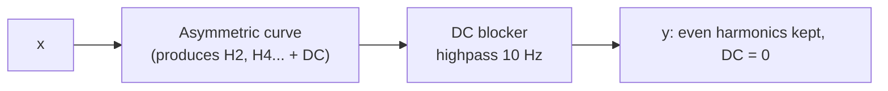
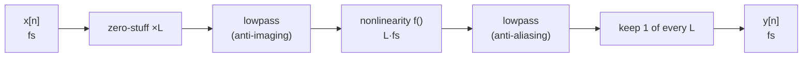

# Chapter 06: Saturation and Aliasing

**English** | [繁體中文](README.zh-TW.md)

> [Course home](../../README.md)　|　Previous: [05 Limiter](../05-limiter/README.md)　|　Next: [07 Distortion](../07-distortion/README.md)

Every component we have written so far (gain, filter, EQ, compressor, limiter) can be treated as **linear** over short time spans: feed in a 1 kHz sine and you get a 1 kHz sine back, only with a different size and phase. This chapter deliberately breaks that. Saturation "bends" the waveform so that the signal grows frequencies that were not there before, which is exactly where the "warm", "thick" and "sticky" character of analog gear comes from. In the digital world, however, any newly grown frequency that lies above Nyquist **folds back (aliases)** into the audible band as harsh noise that has nothing to do with the pitch. The whole chapter deals with these two things: how to generate harmonics in a pleasant way, and how to keep them from aliasing.

---

## 1. Goals

After reading this chapter and doing the exercises, you will be able to:

- **Derive by hand**, with trigonometric identities, which harmonics $`x^2`$, $`x^3`$ and $`x - x^3/3`$ produce from a sine and with what amplitude, and verify it with a program measurement.
- Explain waveshaping and the transfer curve, state the differences between the four curves (tanh, cubic soft clip, arctan, asymmetric), and explain what drive and output compensation mean.
- Explain why a **symmetric** curve produces only odd harmonics while an **asymmetric** curve produces even harmonics and a **DC offset**, and why a DC blocker should follow (the DC blocker implementation is [Chapter 02, exercise 2](../02-filter/exercises/README.md)).
- Compute with a formula where any harmonic will alias to at a given sample rate.
- Understand the complete oversampling flow (zero-stuff -> lowpass -> nonlinearity -> lowpass -> decimate), and why a halfband / polyphase filter saves more than half of the multiplications and what it costs in latency.
- Use the `dawlab::dsp::Oversampler` (2x / 4x / 8x) and `dawlab::dsp::Saturation` introduced in this chapter.
- Explain the principles of ADAA (antiderivative anti-aliasing) and Chebyshev polynomials, and implement each of them.
- Know the main characteristics of tape and tube saturation, and why dry/wet mixing must be latency-aligned.

---

## 2. Theory

### 2.1 Intuition: nonlinearity = generating new frequencies

A linear system can do only two things: change the **magnitude** of each frequency and change the **phase** of each frequency. It cannot create something out of nothing. You can see this directly from the definition: a linear system satisfies $`T\{a x_1 + b x_2\} = a T\{x_1\} + b T\{x_2\}`$, so a sine going in must come out as a sine of the same frequency (the frequency response of Chapter 02 is meaningful only because of this property).

Saturation is different. It is a **memoryless nonlinear function**:

$$
y[n] = f\big(x[n]\big)
$$

Each sample looks only at itself and is fed through a curve $`f`$. As long as $`f`$ is not a straight line, a sine is "bent", and a bent periodic signal expanded in a Fourier series contains integer multiples of the fundamental: **harmonics**.

```
 Input: sine wave             transfer curve f(x)            Output: tops flattened
                                    y
   ╭─╮       ╭─╮                    │      ___________               ╭──╮      ╭──╮
  ╱   ╲     ╱   ╲                   │    ╱                          ╱    ╲    ╱    ╲
 ╱     ╲   ╱     ╲      ──>   ──────┼──╱──────── x     ──>        │      │  │      │
        ╲ ╱       ╲ ╱               │╱                                    ╲╱        ╲╱
         ╰         ╰          _____╱│
                                    │
        Small signal: on the straight part, almost no distortion; large signal: enters the curved region and produces harmonics
```

Two key observations here are used throughout the chapter:

1. **The amount of distortion depends on the signal level.** For small signals the curve is almost a straight line and there are few harmonics; only when you push harder does the signal enter the curved region. That is why saturation always has a "drive" parameter: how much the signal is amplified before it enters the curve.
2. **The harmonic frequencies are integer multiples of the fundamental, no matter how high the fundamental is.** For a 7 kHz sine, the 3rd harmonic is 21 kHz, the 5th is 35 kHz, ... This is the source of the aliasing problem (section 2.5).

### 2.2 Derivation with trigonometric identities: $`x^2`$ and $`x^3`$

The simplest nonlinearity is a polynomial. Let the input be $`x = A \sin\theta`$, $`\theta = 2\pi f_0 t`$.

**The square term $`x^2`$.** Using the double-angle formula $`\sin^2\theta = \dfrac{1 - \cos 2\theta}{2}`$:

$$
x^2 = A^2 \sin^2\theta = \frac{A^2}{2} - \frac{A^2}{2}\cos 2\theta
$$

Result: **a DC component ($`A^2/2`$) plus a 2nd harmonic (amplitude $`A^2/2`$)**, and the fundamental itself disappears. Two things are worth remembering: squaring produces **even harmonics**, and it **always comes with DC** (because $`x^2 \ge 0`$, the mean cannot be 0).

**The cubic term $`x^3`$.** Using the triple-angle formula $`\sin 3\theta = 3\sin\theta - 4\sin^3\theta`$, rearranged to $`\sin^3\theta = \dfrac{3\sin\theta - \sin 3\theta}{4}`$:

$$
x^3 = A^3 \sin^3\theta = \frac{3A^3}{4}\sin\theta - \frac{A^3}{4}\sin 3\theta
$$

Result: **the fundamental (amplitude $`3A^3/4`$) plus the 3rd harmonic (amplitude $`A^3/4`$)**, with no DC and no even harmonics. Note that the 3rd harmonic relative to the fundamental is $`\frac{1}{3}`$, i.e. $`20\log_{10}(1/3) = -9.54`$ dB, independent of $`A`$.

Generalization: $`\sin^n\theta`$ produces only harmonics that "have the same parity as $`n`$ and are $`\le n`$". So **a polynomial of degree $`N`$ produces at most up to the $`N`$-th harmonic**. This statement matters in section 2.8 (Chebyshev) and in section 2.6 (how much oversampling is needed).

**The practical soft clip: $`y = x - x^3/3`$.** Substituting the result above:

$$
y = A\sin\theta - \frac{1}{3}\left(\frac{3A^3}{4}\sin\theta - \frac{A^3}{4}\sin 3\theta\right)
  = \left(A - \frac{A^3}{4}\right)\sin\theta + \frac{A^3}{12}\sin 3\theta
$$

so

$$
\frac{H_3}{H_1} = \frac{A^3/12}{A - A^3/4} = \frac{A^2}{12 - 3A^2}
$$

| $`A`$ | $`H_1 = A - A^3/4`$ | $`H_3 = A^3/12`$ | $`H_3/H_1`$ | THD |
|---|---|---|---|---|
| 0.25 | 0.24609 | 0.0013021 | −45.53 dB | 0.53 % |
| 0.5 | 0.46875 | 0.0104167 | −33.06 dB | 2.22 % |
| 1.0 | 0.75 | 0.0833 | −19.08 dB | 11.11 % |

The last table of the example `l06_harmonic_analysis` prints "theory vs measurement" for these three rows side by side, with an error of 0.000 dB; the solution to exercise 2 also verifies every number with Goertzel.

> THD (Total Harmonic Distortion) $`= \dfrac{\sqrt{H_2^2 + H_3^2 + \cdots}}{H_1} \times 100\%`$. For $`|x| \le 1`$ this curve has only a 3rd harmonic, so THD is just $`H_3/H_1`$.

### 2.3 Waveshaping and the transfer curve

Plotting $`y = f(x)`$ gives the **transfer curve**. The horizontal axis is the input and the vertical axis is the output; the straight line $`y = x`$ means no distortion at all. A good saturation curve usually has these properties:

- **Passes through the origin with slope 1 there**: it is "transparent" for small signals and does not change the volume.
- **Monotonically increasing**: a larger input never gives a smaller output (otherwise you get a strange folding distortion, which is the business of foldback in Chapter 07).
- **Bounded**: the output has an upper limit, which is what "saturation" means.
- **Smooth**: the smoother the curve (the more continuous its higher derivatives), the faster the high harmonics decay, so it sounds "softer" and aliases less easily.

`Saturation::shape()` in this chapter provides four curves:

| Curve | Formula | Small-signal expansion | Character |
|---|---|---|---|
| `Tanh` | $`\tanh x`$ | $`x - \frac{x^3}{3} + \frac{2x^5}{15} - \cdots`$ | Classic soft clip, infinitely smooth, asymptotic to ±1, produces only odd harmonics |
| `Cubic` | $`x - \frac{x^3}{3}`$ ($`\lvert x\rvert \le 1`$), otherwise $`\pm\frac{2}{3}`$ | exactly $`x - \frac{x^3}{3}`$ | Cheap; for $`\lvert x\rvert \le 1`$ only a 3rd harmonic; beyond that it becomes a hard clip |
| `Arctan` | $`\frac{2}{\pi}\arctan\left(\frac{\pi x}{2}\right)`$ | $`x - \frac{\pi^2}{12}x^3 + \cdots`$ | Larger cubic term (0.82 vs tanh's 0.33) -> the knee starts bending earlier; approaches ±1 very slowly |
| `Asymmetric` | $`\tanh x`$ ($`x \ge 0`$), $`\frac{1}{2}\tanh 2x`$ ($`x < 0`$) | slope 1 at the origin on both sides | The negative half saturates early at −0.5 -> even harmonics + DC (tube-like) |

**Continuity of Cubic.** At $`x = 1`$, $`x - x^3/3`$ has value $`2/3`$ and derivative $`1 - x^2 = 0`$. So joining the constant $`\pm 2/3`$ at $`|x| = 1`$ makes both the **value and the first derivative continuous**, and the transfer curve has no corner. If you forget the clamp, the curve starts to fall after $`x > 1`$ (the derivative $`1 - x^2 < 0`$, no longer monotonic) and goes negative after $`x > \sqrt{3}`$ ($`\sqrt{3} - (\sqrt{3})^3/3 = 0`$); when you push the drive you hear extremely ugly aliasing and even phase-inverted distortion (section 5). Its **second derivative**, however, is discontinuous at $`|x| = 1`$ (−2 on the left, 0 on the right), so once the signal is pushed into the clamped region the high harmonics decay more slowly than tanh's: in the example, at $`A = 4`$ the THD of Cubic is 38.3% against 30.1% for tanh.

**Normalization of Arctan.** The raw $`\arctan x`$ has asymptote $`\pm\pi/2`$ and slope 1 at the origin. We multiply by $`2/\pi`$ so the asymptote becomes ±1, and then multiply the input by $`\pi/2`$ to restore slope 1 at the origin, so the four curves can be compared fairly.

The transfer-curve table printed by the example `l06_harmonic_analysis` (excerpt):

```
       x       Tanh      Cubic     Arctan   Asymmetric
   -2.00    -0.9640    -0.6667    -0.8038    -0.4997
   -1.00    -0.7616    -0.6667    -0.6391    -0.4820
   -0.50    -0.4621    -0.4583    -0.4238    -0.3808
    0.50     0.4621     0.4583     0.4238     0.4621
    1.00     0.7616     0.6667     0.6391     0.7616
    2.00     0.9640     0.6667     0.8038     0.9640
```

and the harmonics (relative to the fundamental) for a 100 Hz sine of amplitude $`A = 1`$:

| Curve | H2 | H3 | H4 | H5 | THD | DC |
|---|---|---|---|---|---|---|
| Tanh | — | −23.5 dB | — | −45.1 dB | 6.71 % | 0 |
| Cubic | — | −19.1 dB | — | — | 11.11 % | 0 |
| Arctan | — | −20.0 dB | — | −34.8 dB | 10.21 % | 0 |
| Asymmetric | −19.6 dB | −19.3 dB | −40.4 dB | −34.4 dB | 15.26 % | +0.0748 |

("—" means below −99 dB, i.e. not present.)

**Drive and output compensation.** Drive is the gain (in dB) applied before the curve. Because the curve has slope 1 at the origin, at 0 dB drive small signals pass through almost unchanged; +12 dB drive means the signal is amplified 4 times before entering the curve. But the curve has an upper limit, so pushing the drive harder does **not** make the output louder proportionally: instead the peak is held down while the RMS rises (the crest factor falls, and it sounds "denser and louder"). This is why saturation must have an **output gain** (output compensation):

- Without compensation, pushing the drive also makes it louder; human hearing is biased toward "louder sounds better", so you would wrongly conclude that "adding saturation is better".
- The right way to tune parameters is a **loudness-matched A/B**: adjust the output gain so that wet and dry have the same loudness, then compare the tone.
- A common automatic compensation is output ≈ −drive × k (k about 0.5 to 1, depending on the curve and material); `Saturation` in this chapter lets the user set `setOutputGainDb()` manually, which keeps the behavior transparent.

### 2.4 Odd vs even harmonics, symmetry and DC

**Why does a symmetric curve produce only odd harmonics?** The precise meaning of "symmetric" is an **odd function**: $`f(-x) = -f(x)`$. A sine has **half-wave symmetry**: $`x(t + T/2) = -x(t)`$. Substituting:

$$
y(t + T/2) = f\big(x(t + T/2)\big) = f\big(-x(t)\big) = -f\big(x(t)\big) = -y(t)
$$

The output also has half-wave symmetry. The $`k`$-th harmonic of a periodic signal is multiplied by $`e^{j\pi k} = (-1)^k`$ when shifted by half a period; to satisfy $`y(t+T/2) = -y(t)`$, only components with $`(-1)^k = -1`$ can exist, that is, $`k`$ odd. DC ($`k = 0`$) is excluded as well.

An **asymmetric curve** (for example `Asymmetric`, where the positive half saturates at +1 and the negative half already saturates at −0.5) breaks the half-wave symmetry, so even harmonics and DC both appear. Any curve can be split into an odd part and an even part:

$$
f(x) = \underbrace{\frac{f(x) - f(-x)}{2}}_{\text{odd part → odd harmonics}} + \underbrace{\frac{f(x) + f(-x)}{2}}_{\text{even part → even harmonics + DC}}
$$

The odd part is an odd function, so by the argument above it produces only odd harmonics; therefore **all even harmonics and DC come from the even part**. The even part is an even function ($`g(-x) = g(x)`$), and $`|\sin\theta|`$ has period $`T/2`$, so $`g(A\sin\theta)`$ also has period $`T/2`$: its frequency components can only be integer multiples of $`2f_0`$: DC, 2nd, 4th, ...

Take `Asymmetric` as an example. Let $`t = \tanh|x|`$ and use $`\tanh 2u = \dfrac{2\tanh u}{1 + \tanh^2 u}`$:

$$
g(x) = \frac{f(x) + f(-x)}{2} = \frac{1}{2}\left(t - \frac{t}{1 + t^2}\right) = \frac{t^3}{2(1 + t^2)} \;\ge\; 0
$$

The even part is $`\ge 0`$ everywhere, so the mean (DC) is necessarily positive. For small signals $`t \approx |x|`$ and $`g(x) \approx |x|^3/2`$; the mean of $`|\sin\theta|^3`$ is $`\frac{4}{3\pi}`$, so

$$
\text{DC} \approx \frac{A^3}{2}\cdot\frac{4}{3\pi} = \frac{2A^3}{3\pi}
$$

The example `l06_harmonic_analysis` prints this approximation next to the measurement: 0.00021 vs 0.00021 at $`A = 0.1`$, 0.00332 vs 0.00301 at $`A = 0.25`$; at $`A = 0.5`$ the approximation 0.0265 is already clearly too high (measured 0.0188), because $`t^3/(1+t^2)`$ grows more slowly than $`|x|^3`$ as $`|x|`$ gets larger. Note that the even part of `Asymmetric` starts at $`|x|^3`$ rather than $`x^2`$ (both sides have the same slope and curvature at the origin), which is also why its H2 is much weaker for small signals than that of a curve containing an $`x^2`$ term: for example, for the $`x + kx^2`$ of exercise 2, $`H_2/H_1 = kA/2`$, proportional to $`A`$, whereas the even content of `Asymmetric` only begins at $`A^3`$.

**What it sounds like:**

| | Odd harmonics (3, 5, 7, ...) | Even harmonics (2, 4, 6, ...) |
|---|---|---|
| Musical intervals | 3rd = octave plus a fifth, 5th = two octaves plus a major third, the 7th is already off equal temperament | 2nd = an octave up, 4th = two octaves up; both are "the same note" |
| Sound | Hollow, square-wave-like, with bite (clarinet, square wave); sounds harsh when overdone | Thick, warm, "sweet", blends very well with the original note |
| Typical source | Symmetric circuits: push-pull power stages, tape, diode pairs | Asymmetric circuits: single-ended tube preamps, transistors with a bias offset |

**The harm of a DC offset.** An asymmetric curve makes the mean of the signal no longer 0 (in the example DC = +0.0748 at $`A = 1`$ and +0.207 at $`A = 4`$). DC itself cannot be heard, but it:

- **Eats headroom**: the whole waveform shifts upward and the positive half reaches 0 dBFS early.
- **Fools downstream dynamics processors**: the detector of a compressor / limiter treats DC as signal.
- **Causes clicks**: at the start or end of a track, or on mute, DC going from present to absent is a step.
- **Makes the next nonlinearity even more asymmetric**: when several saturation stages are cascaded the bias accumulates.

The solution is a **DC blocker**: a highpass with a very low cutoff (5 to 20 Hz). The classic form:

$$
y[n] = x[n] - x[n-1] + R\, y[n-1], \qquad H(z) = \frac{1 - z^{-1}}{1 - R z^{-1}}, \qquad R \approx 1 - \frac{2\pi f_c}{f_s}
$$

The zero is at $`z = 1`$ (the DC gain is exactly 0) and the pole is at $`z = R`$, very close to the zero, so apart from the very lowest frequencies the signal is almost unaffected. Under the small-angle approximation $`|H(e^{j\omega_c})| \approx \omega_c / \sqrt{(1-R)^2 + \omega_c^2} = 1/\sqrt{2}`$, i.e. −3 dB at $`f_c`$. With $`f_c = 10`$ Hz and $`f_s = 48`$ kHz, $`R = 0.998691`$; a DC step decays to 1% in $`\ln 0.01 / \ln R \approx 3516`$ samples ≈ 73 ms (the DC blocker implementation and the step-response measurement are in [Chapter 02, exercise 2](../02-filter/exercises/README.md), which uses $`R = 0.995`$). `Saturation` internally uses Chapter 02's `OnePole` highpass (10 Hz), which differs in two places: the pole is $`a = e^{-2\pi f_c/f_s}`$ instead of the first-order approximation $`1 - 2\pi f_c/f_s`$ (at 10 Hz the two differ only on the order of $`10^{-6}`$), and there is an extra constant $`h = (1+a)/2`$ that makes the gain exactly 0 dB at Nyquist.



### 2.5 Aliasing: harmonics above Nyquist fold back

Chapter 00 covered the sampling theorem: a sample rate $`f_s`$ can represent only frequencies within $`0 \sim f_s/2`$ (Nyquist). The key point is that **a digital nonlinearity is applied at the sample points**. The harmonics produced by the curve do not "automatically disappear"; those above Nyquist are folded back into $`0 \sim f_s/2`$ by the sampling process. A frequency $`f`$ is recorded as:

$$
f_{\text{alias}} = \left|\, \Big( (f + f_s/2) \bmod f_s \Big) - f_s/2 \,\right|
$$

Intuitively, you fold the frequency axis back and forth like paper, using $`f_s/2`$ as the mirror:

```
 0          fs/2          fs          3fs/2         2fs
 |------------|------------|------------|------------|
 |  originally |  mirrored   |  mirrored   |  ...
 |  here       |  f → fs - f |  f → f - fs |
 |<====== the audible range is only this segment ======>|  (folded back into 0..fs/2)
```

**Example: a 7 kHz sine + tanh, $`f_s`$ = 48 kHz.** tanh is an odd function and has only odd harmonics:

| Harmonic | Frequency | Folds to | Integer multiple of 7 kHz? |
|---|---|---|---|
| 3 | 21 kHz | 21 kHz (already below Nyquist) | Yes (a real harmonic) |
| 5 | 35 kHz | 48 − 35 = **13 kHz** | No |
| 7 | 49 kHz | 49 − 48 = **1 kHz** | No |
| 9 | 63 kHz | 63 − 48 = **15 kHz** | No |
| 11 | 77 kHz | 96 − 77 = **19 kHz** | No |
| 13 | 91 kHz | 96 − 91 = **5 kHz** | No |

Frequencies such as 1 kHz, 5 kHz and 13 kHz have no harmonic relationship to 7 kHz, so they sound like another, out-of-tune note, or like a "metallic, hissy" contamination. And when the input pitch slides (vibrato, bends), the aliases move **out of proportion** to the pitch: those folded as $`f_s - kf_0`$ (13 kHz from the 5th, 19 kHz from the 11th, 5 kHz from the 13th) slide in the **opposite** direction, while those folded as $`kf_0 - f_s`$ (1 kHz from the 7th, 15 kHz from the 9th) slide in the **same** direction at $`k`$ times the speed. The whole thing sounds like a mass of darting noise and is very noticeable.

Incidentally, because $`\gcd(7000, 48000) = 1000`$ and only odd harmonics exist, every alias lands on an "odd kHz" ($`7k \bmod 48`$ is always odd). The example `l06_aliasing_demo` and exercises 6 and 7 all exploit this: measuring the energy at 1, 3, 5, ..., 23 kHz is enough to compute the total alias energy.

Measured by the example `l06_aliasing_demo` (drive +18 dB, so the peak entering tanh is ≈ 4; excerpt, the example actually measures the 11 alias positions 1, 3, 5, ..., 23 kHz):

```
Frequency            1x         2x         4x         8x
7 kHz (H1)          0.0        0.0        0.0        0.0
21 kHz (H3)       -11.3      -11.4      -11.4      -11.4
 1 kHz alias      -25.8      -99.9      -99.9      -99.9
 3 kHz alias      -73.7      -92.9      -92.9      -99.9
 5 kHz alias      -46.0      -46.0      -99.9      -99.9
13 kHz alias      -18.9      -99.9      -99.9      -99.9
17 kHz alias      -84.9      -86.2      -86.2      -99.9
19 kHz alias      -39.3      -39.3      -99.9      -99.9
alias total       -17.9      -38.3      -85.2      -99.9
```

At 1x, the 13 kHz alias is only 18.9 dB below the fundamental, louder than many of the "real" harmonics. (−99.9 is the floor of the example's table printing, meaning "below −99.9 dB"; exercise 7 uses the same setup without clamping and measures −111.5 dB at 8x.)

Now compare with the prediction table: at 2x the 11th (77 kHz → 19 kHz) and 13th (91 kHz → 5 kHz) harmonics still fold back into the audible range, so the 19 kHz and 5 kHz aliases are almost unchanged in the 2x column (−39.3, −46.0 dB); at 4x it takes the 25th (175 kHz → 17 kHz) and 27th (189 kHz → 3 kHz) to fold back, and their amplitudes are already tiny (−86.2, −92.9 dB), which is the origin of the −85.2 dB at 4x.

**How to reduce aliasing?** There are three routes, and this chapter touches all of them:

1. **Oversampling** (section 2.6): apply the nonlinearity at a higher sample rate so the harmonics are lowpassed away before they can fold back.
2. **Use a smoother curve / a smaller drive**: the faster the harmonics decay, the less energy lies above Nyquist. Hard clipping is the worst (its harmonics decay only as $`1/k^2`$ to $`1/k`$).
3. **ADAA** (section 2.7): work on the nonlinearity itself, approximating "a continuous-time nonlinearity + anti-aliasing".

### 2.6 Oversampling, halfband and polyphase

**The complete flow:**



1. **Upsample (zero-stuffing + lowpass)**: insert a 0 between every two samples, so the sample rate becomes $`2f_s`$. Zero-stuffing creates a mirror image of the original spectrum: a 1 kHz sine, zero-stuffed, shows up at both 1 kHz and 47 kHz at $`2f_s = 96`$ kHz. So a lowpass with its cutoff at $`f_s/2`$ removes the image, and the gain is multiplied by 2. Why 2? After zero-stuffing, the original spectrum is split equally between the baseband and the image: $`\cos(\omega_0 n)`$ zero-stuffed equals $`\tfrac12\cos(\omega_0 m/2) + \tfrac12\cos(\omega_0 m/2)(-1)^m`$, where the first half is the baseband and the second half is the image (multiplying by $`(-1)^m`$ shifts the frequency to $`f_s - f`$). After the lowpass removes the image, the **amplitude** of the baseband is only half, so multiply by 2 to restore it. (If you think in terms of "average energy is halved", you would wrongly conclude that you should multiply by $`\sqrt{2}`$.)
2. **Nonlinearity**: applied at $`L f_s`$. Nyquist is now $`L f_s/2`$, so harmonics above $`f_s/2`$ have an extra $`(L-1)f_s/2`$ of room to "stay" without folding back.
3. **Downsample (lowpass + decimation)**: first use a lowpass to remove everything above $`f_s/2`$ (including the newly generated harmonics), then keep 1 of every $`L`$ samples. If you decimate without filtering first, those harmonics alias anyway.

**How big a factor?** A harmonic at frequency $`f`$ first folds once at $`L f_s`$; as long as the folded frequency is still above the original $`f_s/2`$, it is filtered out during downsampling. So it is safe as long as $`f < L f_s - f_s/2`$. In the 7 kHz example: at 2x the safe limit is $`96 - 24 = 72`$ kHz (rescuing only the 5th, 7th and 9th); at 4x it is $`192 - 24 = 168`$ kHz (rescuing up to the 23rd); at 8x it is 360 kHz. The high harmonics of tanh decay quickly, so 4x already brings the total alias from −17.9 dB down to −85.2 dB. **The advantage of polynomial curves** is that the required factor can be computed exactly: a polynomial of degree $`N`$ produces at most $`N`$-th harmonics, with a maximum frequency of $`N \cdot f_s/2`$; to keep it from folding back into $`0 \sim f_s/2`$ you need $`L \ge (N+1)/2`$.

**Halfband filter.** The lowpass used for 2x upsampling / downsampling has its cutoff at exactly 1/4 of the new sample rate ($`f_s/2`$ is 1/4 at $`2f_s`$). A filter with "its cutoff at 1/4 of the sample rate and symmetric passband and stopband" is called a **halfband**, and its ideal impulse response is

$$
h[n] = \frac{\sin(\pi n / 2)}{\pi n}, \qquad h[0] = \frac{1}{2}
$$

For non-zero even $`n`$, $`\sin(\pi n/2) = 0`$, so **all non-zero even taps are 0**!

**Why multiply by a window?** The ideal $`h[n]`$ extends infinitely to both sides, but in practice we can only take a finite length (63 taps for stage 1 of this chapter). Truncating directly is equivalent to multiplying by a rectangular window; the frequency response then shows ripple near the cutoff and the stopband is only about −21 dB. Multiplying by a window that is "1 in the middle and gradually shrinks to nearly 0 at both ends" smooths the truncated edges and greatly reduces the ripple. We use a **Kaiser window**, which has one parameter $`\beta`$: the larger $`\beta`$ is, the deeper the stopband but the wider the transition band (for the same number of taps); $`\beta = 8`$ gives a stopband of about −80 dB. Windows are discussed in detail in Chapter 11 (FFT); here you only need to know that "it makes the truncation gentle". The window is left-right symmetric, so the even taps are still 0 after multiplying. The centre coefficients printed by the example `l06_oversampler_response`:

```
h[0..7] = 0.50000, 0.31707, 0.00000, -0.10244, 0.00000, 0.05772, 0.00000, -0.03749
```

**Polyphase: compute only what is needed.** Split the FIR into the even taps and the odd taps (two phases):

- **Upsampling**: half of the zero-stuffed signal is 0. The "even samples" of the output only multiply the odd taps, and the "odd samples" only multiply the even taps, and the even taps of a halfband are reduced to the centre $`1/2`$. So:
  - one output = an FIR over the odd taps ($`2K`$ multiplications),
  - the other output = the original sample delayed by $`K-1`$ (**0 multiplications**).
- **Downsampling**: compute only the half of the outputs that are kept, again split into "an odd-tap FIR" + "a pure delay of the centre tap × 1/2".

Taking stage 1 of this chapter (63 taps, $`2K = 32`$ odd taps) as an example, the multiplications needed per "original-rate sample":

| Method | Upsampling | Downsampling |
|---|---|---|
| Zero-stuff, then run the 63-tap FIR directly (twice at 2fs) | 126 | 126 (compute, then discard half) |
| Polyphase (not exploiting the zero coefficients) | 63 | 63 |
| **Polyphase + halfband zero coefficients** | **32** | **33** |

**FIR halfband vs IIR allpass polyphase.** Another common approach is an IIR polyphase halfband built from two allpass filters (Valenzuela & Constantinides 1983; many commercial plugins use it). The trade-offs:

| | FIR halfband (used in this chapter) | IIR allpass polyphase |
|---|---|---|
| Phase | **Linear phase**: all frequencies are delayed equally | Nonlinear phase (little delay at low frequencies, more near the cutoff) |
| Latency | Larger (4x in this chapter: 36 samples = 0.75 ms) | Very small (a few samples) |
| Multiplications | About 32 per sample (stage 1) | Usually far fewer for the same stopband attenuation (each allpass has only a few coefficients) |
| Numerics | Cannot become unstable, no denormal problems | Recursive structure: must handle denormals and coefficient quantization |
| dry/wet mix | Delaying dry by an integer number of samples aligns it perfectly | The phase is not a pure delay -> the mix gets comb filtering or phase shifts |

We chose the FIR because it makes the latency a clean integer, lets dry/wet align perfectly, and has the easiest principle to check. The price is latency and CPU. If you are building a plugin for live monitoring where latency matters a lot, the IIR version is the better choice.

**Design numbers of this chapter's Oversampler** (measured by the example `l06_oversampler_response`):

| Stage | Factor | Odd taps | FIR length | Group delay | Working sample rate |
|---|---|---|---|---|---|
| 1 | ×2 | 32 | 63 | 31 samples | 96 kHz |
| 2 | ×4 | 12 | 23 | 11 samples | 192 kHz |
| 3 | ×8 | 8 | 15 | 7 samples | 384 kHz |

Frequency response of stage 1 (at 96 kHz): passband error < 0.01 dB up to 20.3 kHz; the stopband is ≤ −80 dB from 28.0 kHz; at 24 kHz (the old Nyquist) it is exactly −6.02 dB (a halfband signature: $`H(f_s/4) = 1/2`$). Why can stages 2 and 3 be so much shorter? Stage 2 goes from 96 to 192 kHz; its input already contains only about 0 to 24 kHz (stage 1 has blocked everything higher), and the images after zero-stuffing lie above 96 − 24 = 72 kHz; so the transition band of stage 2 can be as wide as 24 kHz to 72 kHz, and the wider the transition, the fewer taps are needed. Stage 3 (192 → 384 kHz) is the same: its images lie above 192 − 24 = 168 kHz, with an even wider transition band.

**Latency.** A linear-phase FIR of length $`2M+1`$ has a delay of $`M`$ samples ($`M = 2K - 1`$ is the half-length of the FIR; note that it is a different thing from the factor $`L`$ above). Upsampling once and downsampling once, stage 1 costs a round trip of $`2 \times 31 = 62`$ samples at 96 kHz = **31 samples at 48 kHz**. With several stages, the delay of each stage must be converted back to the original sample rate and summed:

$$
\text{latency} = \sum_{i=1}^{S} \frac{2M_i - \varphi_i}{2^i}
$$

At 4x this is $`\frac{62}{2} + \frac{22}{4} = 36.5`$; to make the latency an **integer** (the host's latency compensation accepts only whole samples), downsampling may keep either the even or the odd samples of the filter output (the decimation phase $`\varphi_i \in \{0, 1\}`$; choosing 1 removes one sample of that stage's delay). `Oversampler::prepare()` computes each $`\varphi_i`$ automatically, giving 2x = 31, 4x = 36, 8x = 38 samples, all confirmed by the example with impulse measurements.

**Passband edge.** Because the transition band is at 20.3 to 28 kHz, signals near Nyquist are attenuated: a round trip at 22 kHz gives −1.25 dB and at 23 kHz −3.92 dB (the passthrough table of the example `l06_oversampler_response`). An attentive reader will notice that this is not twice the single-pass response (22 kHz single pass −0.649 dB × 2 = −1.30 dB; 23 kHz −2.366 dB × 2 = −4.73 dB). The difference comes from the image: when upsampling, the image of 23 kHz is at $`48 - 23 = 25`$ kHz and is suppressed by only 12.45 dB; when downsampling it is suppressed by another 12.45 dB, and then decimation folds it exactly back to 23 kHz, where it adds in phase with the main signal: $`0.580 + 0.057 = 0.637 \Rightarrow -3.92`$ dB. The halfband symmetry $`|H(f)| + |H(f_s - f)| = 1`$ (in terms of the original $`f_s`$, e.g. 0.928 at 22 kHz plus 0.072 at 26 kHz) appears here as well. This is irrelevant for 48 kHz audio (the upper limit of human hearing is about 20 kHz), but at a sample rate of 44.1 kHz the transition band falls proportionally at 18.7 to 25.7 kHz.

### 2.7 ADAA: anti-aliasing in the nonlinearity itself

Oversampling is effective but expensive. The idea of ADAA (antiderivative anti-aliasing, Parker et al. 2016, Bilbao et al. 2017) is this: the naive $`y[n] = f(x[n])`$ looks only at the sample points and has no idea what happens between two samples (for example, the signal hitting the corner of the clip between the two points). If we assume the input is a **straight line** between $`x[n-1]`$ and $`x[n]`$, and take the **average value** of $`f`$ over that segment:

$$
y[n] = \frac{1}{x[n] - x[n-1]} \int_{x[n-1]}^{x[n]} f(u)\, du = \frac{F(x[n]) - F(x[n-1])}{x[n] - x[n-1]}
$$

where $`F`$ is the antiderivative of $`f`$ ($`F' = f`$). This is equivalent to "applying the nonlinearity in continuous time, then averaging with a rectangular filter one sample wide and sampling"; the rectangular filter is a lowpass and reduces the high harmonics before they fold back.

**The antiderivative of the hard clip**: $`f(x) = \text{clamp}(x, -1, 1)`$,

$$
F(x) = \begin{cases} x^2/2 & |x| \le 1 \\ |x| - 1/2 & |x| > 1 \end{cases}
$$

Both the value (1/2) and the slope (±1) are continuous at $`|x| = 1`$. The antiderivative of tanh is $`\ln\cosh x`$ (for large $`|x|`$ use $`|x| - \ln 2`$ to avoid overflow).

**Numerical issue**: when $`x[n] \approx x[n-1]`$ this is $`0/0`$. In that case use the limiting value $`f\big((x[n] + x[n-1])/2\big)`$. The numerator must be computed in `double`, otherwise subtracting two nearly equal $`F`$ values gives severe rounding error.

**The price**: in the linear region $`y[n] = (x[n] + x[n-1])/2`$, i.e. a 2-tap average: half a sample of delay and a high-frequency attenuation of $`|H| = \cos(\omega/2)`$ (about −0.94 dB at 7 kHz and about −11.7 dB at 20 kHz).

Measured in exercise 6 (7 kHz, hard clip with peak 2):

| Method | Total alias |
|---|---|
| naive 1x | −24.6 dB |
| ADAA 1x | −42.1 dB (17.5 dB better) |
| naive 2x | −36.8 dB |
| ADAA + 2x | −56.0 dB |
| naive 4x | −49.2 dB |
| naive 8x | −61.7 dB |

ADAA 1x is already cleaner than naive 2x, and the CPU cost is only one extra subtraction and one division. Compare the last two rows: the harmonics of a hard clip decay only as $`1/k`$, so oversampling alone improves things by only 12 to 13 dB per doubling, and 8x still has −61.7 dB of alias; "ADAA + 2x" reaches the same order of magnitude with far less computation. In practice the common combination is exactly "ADAA + 2x oversampling".

### 2.8 Chebyshev polynomials: producing specified harmonics exactly

If you want to "add only a 2nd harmonic at −20 dB and nothing else", there is a beautiful tool: the Chebyshev polynomials of the first kind $`T_n`$, defined by

$$
T_n(\cos\theta) = \cos(n\theta)
$$

In other words, **a sine of amplitude 1 fed into $`T_n`$ comes out as a pure $`n`$-th harmonic**. The recurrence:

$$
T_0 = 1,\quad T_1 = x,\quad T_{n+1}(x) = 2x\,T_n(x) - T_{n-1}(x)
$$

$$
T_2 = 2x^2 - 1,\quad T_3 = 4x^3 - 3x,\quad T_4 = 8x^4 - 8x^2 + 1,\quad T_5 = 16x^5 - 20x^3 + 5x
$$

A harmonic exciter is then $`y = x + \sum_n g_n T_n(x)`$. At amplitude 1, $`H_n/H_1 = g_n`$ exactly (exercise 4: setting $`g_2 = 0.1`$ measures −20.00 dB). But note:

- **Exact only at amplitude 1.** At amplitude $`A`$, $`T_2(A\cos\theta) = A^2\cos 2\theta + (A^2 - 1)`$: the 2nd harmonic becomes $`g_2 A^2`$, and there is also a DC of $`g_2(A^2 - 1)`$ (exercise 4: DC = −0.075 at $`A = 0.5`$). In general the $`n`$-th harmonic of $`T_n`$ varies as $`A^n`$ and leaks into orders $`n-2, n-4, \ldots`$. So real products first normalize by an envelope, or simply accept the analog-like behavior of "the louder, the more harmonics".
- **It explodes for $`|x| > 1`$**: $`T_5(2) = 362`$. Always clamp before the curve.
- **The benefit**: a polynomial of degree $`N`$ produces at most $`N`$-th harmonics, so you know **exactly** how much oversampling is needed (section 2.6).

### 2.9 Tape and tube: characteristics of analog saturation

The curves in this chapter are "memoryless": the output depends only on the current input. Real analog saturation is much more complicated; here we only give an overview, so that you know what else the "good analog flavor" includes:

**Tape**
- The magnetization curve is S-shaped and roughly symmetric -> mainly **odd harmonics**, with gentle compression at high levels.
- **Hysteresis**: the magnetization depends not only on the current input but also on the past -> a nonlinearity with memory, with an amount of distortion that depends on frequency.
- **High-frequency loss and self-erasure**: the louder the recording, the earlier the highs saturate; so pushing tape sounds "darker and rounder" rather than harsher.
- **Head bump**: the playback head has a few dB of frequency-response undulation at low frequencies (tens of Hz).
- **Wow / flutter**: tiny speed instabilities cause slow / fast modulation of pitch (the modulation techniques of Chapter 10).

**Tube**
- **Single-ended triode preamp**: the transfer curve is inherently asymmetric -> rich **even harmonics** (the inspiration for the `Asymmetric` curve in this chapter).
- **Push-pull power stage**: the two sides cancel the even harmonics -> mainly odd.
- **The bias moves with the signal**: with large signals the grid conducts and the coupling capacitor charges, causing the operating point to drift and "blocking distortion", so the amount of distortion follows the note's envelope.
- **Power-supply sag**: when loud, the supply voltage droops, producing a compressor-like effect.

A practical approximation is "**pre-emphasis EQ -> nonlinearity -> de-emphasis EQ**", plus a bias that moves with the envelope. Some of these models come back in Chapter 07 (distortion / amp chain).

### 2.10 Dry/wet mix and latency alignment

**Parallel saturation**: mix a heavily saturated signal back into the original at 20 to 40%. The benefit is that the dry transients and dynamics are preserved, and only harmonics and density are "added"; it is the familiar "New York" technique in mixing.

$$
y = (1 - \text{mix}) \cdot \text{dry} + \text{mix} \cdot \text{wet}
$$

The pitfall: the wet signal passes through the oversampler and is **delayed by latency samples**; if the dry is not delayed too, adding the two is a comb filter, with notches at $`f = \frac{2k+1}{2\tau}`$ for a delay $`\tau`$. For 4x, $`\tau = 36/48000 = 0.75`$ ms -> the first notch is at 667 Hz, then 2 kHz, 3.33 kHz, ... and the tone becomes hollow (this is the principle of the flanger, Chapter 10). So `Saturation` internally delays the dry by `getLatencySamples()` samples as well, and the whole plugin reports the same latency to the host so that the host can align the other tracks.

---

## 3. From Formulas to Code

This chapter adds two headers:

- `dsp/include/dawlab/dsp/Oversampler.h`: `HalfbandStage` (one ×2 / ÷2 stage) and `Oversampler` (1x / 2x / 4x / 8x). Depends only on `common/`.
- `dsp/include/dawlab/dsp/Saturation.h`: `SaturationCurve`, `saturationCurveName()`, `Saturation`. Depends on `Oversampler.h` and Chapter 02's `OnePole.h` (the DC blocker).

### 3.1 `Oversampler.h`

**API:**

```cpp
namespace dawlab::dsp {

class HalfbandStage {
public:
    static std::vector<double> designHalfband(int numOddTaps, double beta); // full FIR coefficients (for analysis)
    void prepare(int numOddTaps, double beta, int numChannels, int decimationPhase = 0);
    void reset() noexcept;
    void upsample(int channel, const float* in, float* out, int n) noexcept;   // n → 2n
    void downsample(int channel, const float* in, float* out, int n) noexcept; // 2n → n
    int getNumOddTaps() const noexcept; int getFilterLength() const noexcept;
    int getFilterDelay() const noexcept; int getDecimationPhase() const noexcept;
    int getRoundTripDelay() const noexcept;
    const std::vector<float>& getPolyphaseCoefficients() const noexcept;
};

class Oversampler {
public:
    static constexpr int kMaxFactorLog2 = 3;
    explicit Oversampler(int factorLog2 = 1) noexcept;              // factor = 2^factorLog2 (0..3)
    void prepare(double sampleRate, int maxBlockSize, int numChannels);
    void reset() noexcept;
    int getFactor() const noexcept;  int getFactorLog2() const noexcept;
    double getOversampledRate() const noexcept;
    int getLatencySamples() const noexcept;                          // in original-rate samples, an integer
    AudioBlock upsample(const AudioBlock& input) noexcept;           // returns a view of the internal high-rate buffer
    void downsample(AudioBlock output) noexcept;                     // length must equal that of the upsample input
};

}
```

**Usage (a typical process loop):**

```cpp
dawlab::AudioBlock up = oversampler.upsample(block);   // up.getNumSamples() == block.getNumSamples() * factor
for (int ch = 0; ch < up.getNumChannels(); ++ch) {
    float* u = up.getChannelPointer(ch);
    for (int i = 0; i < up.getNumSamples(); ++i)
        u[i] = std::tanh(u[i]);                          // apply the nonlinearity at the high sample rate
}
oversampler.downsample(block);                          // writes back into the original block
```

**Coefficient design (`designHalfband`)** maps directly onto the formulas of section 2.6:

```cpp
if (n == 0)            ideal = 0.5;
else if (n % 2 == 0)   ideal = 0.0;                                   // halfband: even taps are 0
else                   ideal = std::sin(0.5 * kPi * n) / (kPi * n);   // h[n] = sin(πn/2)/(πn)
h[n + M] = ideal * kaiser(n);                                          // multiply by the Kaiser window (M = half-length)
```

`prepare()` then extracts the odd taps and multiplies them by 2, storing them as the polyphase coefficients `g_` (the factor 2 compensates for zero-stuffing; downsampling multiplies by 1/2 again).

**The inner loop of upsampling** is exactly the "32 multiplications + one pure delay" of the table in section 2.6:

```cpp
pushMirror(s.upHist, s.upPos, N, in[i]);          // write into the ring buffer
const float* hist = s.upHist.data() + s.upPos;    // hist[j] = x[i - j], contiguous memory
float acc = 0.0f;
for (int j = 0; j < N; ++j) acc += g[j] * hist[j]; // FIR over the odd taps
out[2 * i]     = acc;                              // the interpolated point
out[2 * i + 1] = hist[K_ - 1];                     // the original sample (centre tap 1/2 × 2 = 1), a pure delay
```

**The "mirrored ring buffer"**: every sample is written at both `pos` and `pos + N`, so `buf[pos .. pos + N - 1]` is always the latest $`N`$ samples in contiguous memory; the FIR inner loop needs no modulo, and the compiler can vectorize it more easily.

**Cascading stages**: 4x = stage 1 (48→96 kHz) + stage 2 (96→192 kHz); downsampling goes the other way. The output of each stage is stored in `buffers_[i]` (sample rate $`= f_s \cdot 2^i`$), all allocated in `prepare()` according to `maxBlockSize`, so neither `upsample()` nor `downsample()` allocates.

**Latency computation** (inside `prepare()`): first assume all $`\varphi_i = 0`$ and sum $`\sum (2M_i) \cdot 2^{S-i}`$ in units of "$`1/2^S`$ original samples"; every binary bit of the remainder $`r = \text{sum} \bmod 2^S`$ corresponds exactly to the $`\varphi_i`$ of one stage, and after subtracting it the result is an integer.

### 3.2 `Saturation.h`

**API:**

```cpp
namespace dawlab::dsp {

enum class SaturationCurve { Tanh, Cubic, Arctan, Asymmetric };
const char* saturationCurveName(SaturationCurve) noexcept;

class Saturation {
public:
    static float shape(SaturationCurve curve, float x) noexcept;  // pure-function transfer curve
    void setOversamplingFactorLog2(int factorLog2) noexcept;      // 0..3; call before prepare() (default 1 = 2x)
    void prepare(double sampleRate, int maxBlockSize, int numChannels);
    void reset() noexcept;
    void setCurve(SaturationCurve) noexcept;      SaturationCurve getCurve() const noexcept;
    void setDriveDb(float db) noexcept;           float getDriveDb() const noexcept;
    void setMix(float mix01) noexcept;            float getMix() const noexcept;
    void setOutputGainDb(float db) noexcept;      float getOutputGainDb() const noexcept;
    void setDcBlockerEnabled(bool) noexcept;      void setDcBlockerHz(float hz) noexcept; // default on, 10 Hz
    int getOversamplingFactor() const noexcept;   // the factor actually in effect (consistent with getLatencySamples())
    int getPendingOversamplingFactorLog2() const noexcept; // the value stored by setOversamplingFactorLog2(), effective at the next prepare
    int getLatencySamples() const noexcept;       // = the Oversampler's latency (0 at 1x)
    void process(AudioBlock block) noexcept;      // automatically chunks blocks larger than maxBlockSize
};

}
```

**Signal flow:**

```
 x ──> drive(dB) ──> [Oversampler ×L] ──> shape(curve) ──> [÷L] ──> DC blocker ──> output gain ──┐
 │                                                                                                 mix ──> y
 └──> delay by latency samples (aligned with wet) ─────────────────────────────────────────────────┘
```

`process()` first cuts the block into chunks of at most `maxBlockSize` (normally just one chunk) and hands each to `processChunk()`, which has three parts:

1. **Copy dry, apply drive.** The dry is first copied to `dryScratch_` (allocated at prepare time), and the wet path is multiplied by the drive sample by sample. Drive, output gain and mix all go through a 20 ms linear ramp (`LinearRamp`, the same idea as Chapter 01's `SmoothedValue`), so turning the drive knob causes no zipper noise.
2. **Upsample → curve → downsample.** The `switch (curve_)` sits **outside** the sample loop to avoid a branch per sample; `Tanh` calls `std::tanh` directly and the other curves call `shape()`.
3. **DC blocker → output gain → mix.** Before entering the DC blocker, non-finite values (NaN, inf) are replaced with 0 (the reason is in section 5). The dry is delayed through a ring buffer of length `latency + 1` (`pushAndReadDry()`), then mixed as `dry + (wet - dry) * mix` (equal to $`(1-\text{mix})\,\text{dry} + \text{mix}\cdot\text{wet}`$ with one fewer multiplication).

**`shape()` against section 2.3:**

```cpp
case SaturationCurve::Cubic:
    if (x >= 1.0f)  return 2.0f / 3.0f;     // |x| ≥ 1: join the hard clip, value and first derivative both continuous
    if (x <= -1.0f) return -2.0f / 3.0f;
    return x - x * x * x * (1.0f / 3.0f);   // y = x - x³/3
case SaturationCurve::Arctan:
    return (2/π) * atan(π/2 * x);           // slope 1 at the origin, asymptote ±1
case SaturationCurve::Asymmetric:
    return x >= 0 ? tanh(x) : 0.5f * tanh(2x); // the negative half saturates early at -0.5
```

### 3.3 Examples

None of the examples needs arguments; the WAV output goes to `dawlab_output/` under the build directory. Build and run:

```powershell
.\scripts\build.ps1 -Only 06-saturation
cd build
.\bin\Debug\l06_harmonic_analysis.exe
```

To measure CPU time (example 3, exercise 7) use Release instead: `.\scripts\build.ps1 -Only 06-saturation -Config Release`; the executables are in `.\bin\Release\`.

#### Example 1: `l06_harmonic_analysis` (`examples/harmonic_analysis.cpp`)

- **Shows**: the numeric transfer-curve table of the four curves; H1 to H8, THD and DC of a 100 Hz sine at amplitudes 0.25 to 4 (the tables in section 2.3 come from here); the DC of Asymmetric against the small-signal approximation $`2A^3/(3\pi)`$ (section 2.4); Cubic theory vs measurement (section 2.2).
- **Output**: `l06_drive_sweep_tanh.wav`, `l06_drive_sweep_cubic.wav`, `l06_drive_sweep_arctan.wav`, `l06_drive_sweep_asymmetric.wav`: a 220 Hz sine whose drive sweeps from 0 dB to +24 dB over 4 seconds (4x oversampling, output −3 dB).
- **What to hear**: it starts as a clean sine and gets brighter and more "squashed". Tanh / Cubic sound hollow and square-wave-like (odd harmonics); Asymmetric is thicker and carries an octave-up component (even harmonics); Cubic has the roughness of a hard clip at large drive.
- **Why analyze at 100 Hz**: the 240th harmonic is the first to reach Nyquist, and the high harmonics of these smooth curves have decayed to unmeasurable levels long before, so there is no aliasing contamination even without oversampling.

#### Example 2: `l06_aliasing_demo` (`examples/aliasing_demo.cpp`)

- **Shows**: a 7 kHz sine → tanh (drive +18 dB). It first prints a **prediction table** of where each odd harmonic lands at 1x / 2x / 4x / 8x and whether it is filtered out; then it measures the energy at the fundamental, at 21 kHz and at the 10 alias positions (the table of section 2.5).
- **Output**: `l06_alias_7k_1x.wav`, `l06_alias_7k_2x.wav`, `l06_alias_7k_4x.wav`, `l06_alias_7k_8x.wav`.
- **What to hear**: at 1x, besides the 7 kHz there are clearly inharmonic tones at 1 kHz, 5 kHz, 13 kHz and so on; 2x removes most of them; 4x / 8x leave almost only a clean 7 kHz (21 kHz is inaudible to most people). Note: a 7 kHz sine is itself very piercing, so **turn the volume down**.
- Returns 1 if the total alias does not fall as the factor increases.

#### Example 3: `l06_oversampler_response` (`examples/oversampler_response.cpp`)

- **Shows**: the design parameters and coefficients of each halfband stage; the frequency response of stage 1 (passband / stopband edges, −6.02 dB at 24 kHz); the round-trip delay of 1x/2x/4x/8x measured with an impulse and compared with `getLatencySamples()`; the passthrough gain error; the suppression of the 47 kHz image after upsampling (−100 dB, the measurement floor); the upsample/downsample time for 10 seconds of stereo noise.
- **Output**: prints numbers only, no WAV.
- Returns 1 if the latencies disagree, if the passthrough error is ≥ 0.02 dB (below 18 kHz), or if the image is > −75 dB.

#### Example 4: `l06_saturate_music` (`examples/saturate_music.cpp`)

- **Shows**: `Saturation` (4x) applied to a drum loop and a pluck sequence with four presets:

| preset | curve | drive | mix | output |
|---|---|---|---|---|
| glue | Tanh | +6 dB | 100% | −3 dB |
| tube | Asymmetric | +12 dB | 100% | −6 dB |
| parallel | Tanh | +18 dB | 30% | −6 dB |
| cubic | Cubic | +12 dB | 100% | −3 dB |

  It prints peak, RMS, crest factor and the RMS change (the `dRMS` column); for Asymmetric it compares the DC with the DC blocker off / on (drums: +0.01623 → −0.00000; pluck: −0.01671 → −0.00012); for Cubic it compares the curve ceiling with the actual peak and splits the excess into two sources, the "DC blocker" and the "downsampling lowpass" (see section 5). Finally it feeds a block of 2000 samples to a `Saturation` prepared with `prepare(…, 512, …)` and confirms that the automatic chunking gives exactly the same result as normal processing (largest difference 0).

  (The pluck's dry signal already has a DC of −0.023: the Karplus-Strong of `makePluckSequence` uses a burst of random noise as the excitation, whose mean is not 0. With the DC blocker on, this part is removed as well.)
- **Output**: `l06_drums_dry.wav`, `l06_drums_glue.wav`, `l06_drums_tube.wav`, `l06_drums_parallel.wav`, `l06_drums_cubic.wav`, and the same five files starting with `l06_pluck_`.
- **Optional argument**: `l06_saturate_music.exe my_drums.wav` uses your WAV in place of the drum loop.
- **What to hear**: glue makes the kit tighter and louder (the crest factor of the drums drops from 14.5 dB to 12.1 dB); the snare / hi-hat of tube get a grittier texture and thicker lows; parallel resembles the dry but is fuller; the crest factor of cubic falls to about 9 dB, with rough distortion at the attacks.

---

## 4. Real-Time Considerations

- **No allocation**: all intermediate buffers and FIR histories of `Oversampler`, and the dry delay line and `dryScratch_` of `Saturation`, are allocated in `prepare()` according to `maxBlockSize`. `process()` only reads and writes. A host block larger than `maxBlockSize` is non-compliant usage, but it does occur: `Saturation::process()` automatically cuts it into chunks of `maxBlockSize` (example 4 verifies the result is identical to normal processing); when using `Oversampler` directly you must guarantee it yourself, otherwise it asserts in Debug and writes out of bounds in Release.
- **The oversampling factor cannot be changed on the audio thread**: `setOversamplingFactorLog2()` changes buffer sizes and latency, so it must be called before `prepare()`. If it is called after prepare, the new value is only stored (`getPendingOversamplingFactorLog2()`), and `getOversamplingFactor()` and `getLatencySamples()` keep reporting the factor actually running until the next `prepare()`. When a plugin lets the user switch the factor, re-prepare on the message thread and tell the host the latency has changed (Chapter 13).
- **Report the latency**: `getLatencySamples()` must be given to the host (VST3 `getLatencySamples`), otherwise this track will be 0.75 ms (4x) later than the others, which causes phase problems when stacked with, say, a drum bus recorded with other microphones.
- **Parameter smoothing**: drive / output / mix all go through a 20 ms linear ramp. Switching the curve is instantaneous (with a small discontinuity); if you need a seamless switch, run the two curves simultaneously and crossfade.
- **Denormals**: the curves themselves are memoryless and produce no denormals; the only recursive part is the DC blocker (`OnePole` flushes states smaller than $`10^{-30}`$ to 0). The FIR halfband is not recursive, so there is no denormal accumulation.
- **CPU**: the cost grows roughly linearly with the factor. Exercise 7 measured on the author's machine (10 seconds of stereo, tanh): in a Release build 1x / 2x / 4x / 8x take 11.9 / 37.3 / 70.3 / 124.3 ms, i.e. 3.1 / 5.9 / 10.5 times the 1x cost, and 4x uses only 0.7% of one core; the ratios of the Debug build fluctuate noticeably between runs (2x about 3.8 to 4.7, 4x about 6.6 to 8.4, 8x about 12 to 15 times). Absolute numbers vary by machine, so run it once on your own computer. `std::tanh` itself is not cheap; commercial plugins often use rational approximations (e.g. a Padé approximation) or lookup tables. These costs are multiplied by $`L`$ at the high sample rate, so measure before optimizing.
- **Thread safety**: the setters only write a float and set up a ramp, and are expected to be called by the audio thread between blocks. If the UI thread will call them directly, store the parameters in `std::atomic<float>` at the plugin layer and read them at the start of `process()` before calling the setters. `shape()` is a static pure function and can be called from any thread.

---

## 5. Common Mistakes and Debugging

| Symptom | Cause | Fix |
|---|---|---|
| After adding saturation, high notes (hi-hats, high-position guitar) get a "metallic" noise unrelated to the pitch, and the noise does not follow the pitch during a pitch bend (some slide in reverse, some dart in the same direction at several times the speed) | aliasing | Turn on 2x/4x oversampling; lower the drive; use ADAA; lowpass before saturating |
| When pushing the drive, the sound suddenly becomes harsh or even phase-inverted distortion | The polynomial is not clamped ($`x - x^3/3`$ falls after $`x > 1`$ and changes sign after $`x > \sqrt{3}`$; Chebyshev explodes for $`\lvert x\rvert > 1`$) | Join a constant outside the curve, or clamp the input first |
| After adding parallel saturation the tone becomes hollow, like a flanger | The dry was not delayed by latency samples → comb filter (the first notch is at 667 Hz for 4x) | Delay the dry by `getLatencySamples()`; report the latency from the whole plugin |
| The waveform is shifted upward, the following compressor keeps clamping down, and there are clicks at the start and end of a track | DC offset from an asymmetric curve | Add a DC blocker after the curve (5 to 20 Hz highpass) |
| "Adding saturation seems to sound better", but with it off the original doesn't seem bad either | An illusion caused by higher loudness | Use the output gain for a loudness-matched A/B |
| The output peak is higher than the curve's ceiling (cubic in example 4: curve ceiling −6.52 dBFS, the pluck actually reaches −2.51 dBFS) | **Saturation is not a limiter**: the downsampling lowpass makes the clipped waveform overshoot (the Gibbs phenomenon: when a waveform with sharp corners loses its high harmonics to a lowpass, overshoot and ripple appear at the edges), and the DC blocker pushes the waveform up when it removes a local offset. The breakdown of example 4 (pluck): 1x with the DC blocker off is exactly −6.52, DC blocker only −4.39, 4x only −3.27, both on −2.51 dBFS | When a guaranteed peak is required, put the Chapter 05 Limiter (or a true-peak limiter) at the end |
| THD measured at high frequency looks strange (too low or jumping) | Harmonics beyond Nyquist cannot be measured, or an alias happens to land on a harmonic | Measure THD at low frequencies (100 Hz to 1 kHz); `harmonicLevelsDb` automatically skips harmonics beyond Nyquist |
| After a NaN arrives from upstream, the output stays NaN forever (only `reset()` recovers it) | The DC blocker is recursive: once a NaN enters its state, NaN times anything is still NaN and never leaves (an FIR does not have this problem: the NaN leaves the window after a few dozen samples) | Replace non-finite values with 0 before a recursive structure (`Saturation` already does this: only a short stretch of silence results, then it recovers automatically); for recursive effects you write yourself, sanitize at the entry or `reset()` when a NaN is detected |
| `downsample()` asserts | The block passed to `downsample()` has a different length from the one given to `upsample()` | Call upsample once and downsample once for the same block |
| With oversampling on, the highs near 22 kHz get quieter | The halfband transition band (22 kHz round trip −1.25 dB) | Normal; for a wider passband increase the number of taps of stage 1 (at the cost of latency) |

**Debugging tip**: don't use your ears first. Use `goertzelAmplitude` to measure the frequencies that "should be there" and those that "should not": the H2 of a symmetric curve should be −∞ dB; a 7 kHz input should have nothing at 1 kHz. The prediction table plus measurement table of example 2 is a template for this method.

---

## 6. Exercises

See [`exercises/README.md`](exercises/README.md). There are 7 problems:

1. ★☆☆ Concept: symmetry, even harmonics, DC and latency alignment
2. ★☆☆ Calculation: harmonics of $`x^2`$, $`x^3`$ and $`x - x^3/3`$ by hand
3. ★★☆ Calculation: alias frequencies
4. ★★☆ Implementation: Chebyshev harmonic exciter
5. ★★☆ Implementation: latency-aligned dry/wet mix, measuring the comb notches when misaligned
6. ★★★ Implementation: first-order ADAA hard clip
7. ★★☆ Implementation: alias energy and CPU cost of 1x / 2x / 4x / 8x

Solutions are in [`solutions/README.md`](solutions/README.md).

---

## 7. Further Reading

- Udo Zölzer (ed.), *DAFX: Digital Audio Effects*, 2nd ed., Wiley, 2011 — the chapter on nonlinear processing covers waveshaping, tube / tape modeling and oversampling.
- Will Pirkle, *Designing Audio Effect Plugins in C++*, 2nd ed., Routledge, 2019 — plugin implementations of waveshapers and oversampling.
- Julian D. Parker, Vadim Zavalishin, Efflam Le Bivic, "Reducing the Aliasing of Nonlinear Waveshaping Using Continuous-Time Convolution", *Proc. DAFx-16*, 2016 — one of the original ADAA papers.
- Stefan Bilbao, Fabián Esqueda, Julian D. Parker, Vesa Välimäki, "Antiderivative Antialiasing for Memoryless Nonlinearities", *IEEE Signal Processing Letters*, 24(7), 2017.
- R. A. Valenzuela, A. G. Constantinides, "Digital signal processing schemes for efficient interpolation and decimation", *IEE Proceedings G*, 1983 — the IIR allpass polyphase halfband.
- fred harris, *Multirate Signal Processing for Communication Systems*, Prentice Hall, 2004 — complete derivations of polyphase and halfband filters.
- Jyri Pakarinen, David T. Yeh, "A Review of Digital Techniques for Modeling Vacuum-Tube Guitar Amplifiers", *Computer Music Journal*, 33(2), 2009.
- Julius O. Smith III, *Spectral Audio Signal Processing* (the CCRMA online book) — windows (including Kaiser) and FIR design.

---

## 8. Next Chapter

Chapter 07 [Distortion](../07-distortion/README.md) pushes this chapter's waveshaper to the extreme (hard clip, foldback, fuzz, rectify, bitcrush) and reuses this chapter's `Oversampler` to deal with more severe aliasing.
