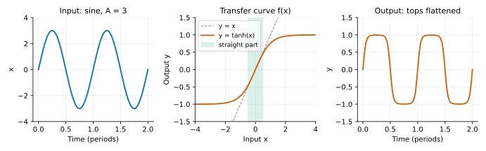
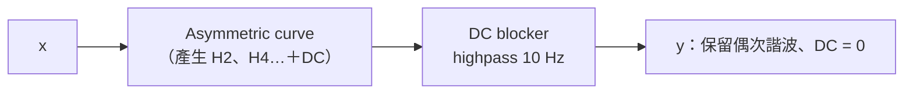
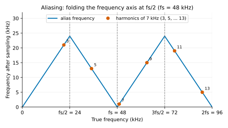
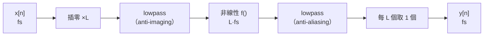
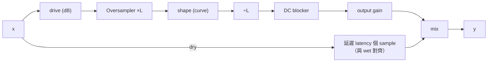

# 第 06 章：Saturation 與 aliasing

[English](README.md) | **繁體中文**

> [教材首頁](../../README.zh-TW.md)　｜　上一章：[05 Limiter](../05-limiter/README.zh-TW.md)　｜　下一章：[07 Distortion](../07-distortion/README.zh-TW.md)

到目前為止，我們寫過的每一個元件——gain、filter、EQ、compressor、limiter——在「短時間內」都可以看成**線性**的：輸入一個 1 kHz 的正弦波，輸出還是 1 kHz，只是大小和相位變了。這一章要刻意打破這件事。Saturation（飽和）把波形「壓彎」，讓訊號長出原本不存在的頻率，這正是類比器材「溫暖」「厚」「黏」的來源；但在數位世界裡，新長出來的頻率如果超過 Nyquist，會**折返（alias）**回可聽頻帶，變成刺耳、跟音高無關的雜音。整章就是在處理這兩件事：怎麼「好聽地」產生諧波，以及怎麼不讓它們 alias。

---

## 1. 本章目標

讀完本章、做完練習後，你可以：

- 用三角恆等式**手算** $`x^2`$、$`x^3`$、$`x - x^3/3`$ 對正弦波產生哪些諧波、振幅多少，並用程式量測驗證。
- 解釋 waveshaping 與 transfer curve，說出 tanh、cubic soft clip、arctan、asymmetric 四條曲線的差別，以及 drive、輸出補償的意義。
- 說明為什麼**對稱**曲線只產生奇次諧波、**不對稱**曲線會產生偶次諧波與 **DC offset**，以及為什麼後面要接 DC blocker（DC blocker 的實作是[第 02 章練習 2](../02-filter/exercises/README.zh-TW.md)）。
- 用公式算出任何諧波在某個 sample rate 下會 alias 到哪個頻率。
- 理解 oversampling 的完整流程（插零 → lowpass → 非線性 → lowpass → 抽取），以及 halfband / polyphase filter 為什麼能省一半以上的乘法、代價是多少 latency。
- 使用本章新增的 `dawlab::dsp::Oversampler`（2x / 4x / 8x）與 `dawlab::dsp::Saturation`。
- 說明 ADAA（antiderivative anti-aliasing）與 Chebyshev polynomial 的原理，並各自實作一個。
- 知道 tape 與 tube 飽和的主要特徵，以及 dry/wet mix 為什麼必須做 latency 對齊。

---

## 2. 原理

### 2.1 直覺：非線性 = 產生新的頻率

線性系統只能做兩件事：改變每個頻率的**大小**、改變每個頻率的**相位**。它不可能「無中生有」。這可以直接從定義看出來：線性系統滿足 $`T\{a x_1 + b x_2\} = a T\{x_1\} + b T\{x_2\}`$，所以一個正弦波進去，出來一定是同頻率的正弦波（第 02 章的頻率響應就是靠這個性質才有意義）。

Saturation 不一樣。它是一個**無記憶（memoryless）的非線性函式**：

```math
y[n] = f\big(x[n]\big)
```

每個 sample 只看自己，丟進一條曲線 $`f`$。只要 $`f`$ 不是直線，正弦波就會被「壓彎」，而被壓彎的週期訊號，用 Fourier series 展開就會出現基頻的整數倍——**諧波（harmonics）**。



小訊號：在直線段，幾乎不失真；大訊號：進入彎曲區，產生諧波。

這裡有兩個關鍵觀察，整章都會用到：

1. **失真量取決於訊號大小。** 小訊號時曲線幾乎是直線，諧波很少；推大之後才進入彎曲區。所以 saturation 一定會有一個「drive」參數：在進入曲線之前把訊號放大多少。
2. **諧波的頻率是基頻的整數倍，不管基頻多高。** 7 kHz 的正弦波，三次諧波是 21 kHz、五次是 35 kHz……這就是 aliasing 問題的來源（2.5 節）。

### 2.2 用三角恆等式推導：$`x^2`$ 與 $`x^3`$

最簡單的非線性是多項式。設輸入 $`x = A \sin\theta`$，$`\theta = 2\pi f_0 t`$。

**平方項 $`x^2`$。** 用倍角公式 $`\sin^2\theta = \dfrac{1 - \cos 2\theta}{2}`$：

```math
x^2 = A^2 \sin^2\theta = \frac{A^2}{2} - \frac{A^2}{2}\cos 2\theta
```

結果：**一個 DC（$`A^2/2`$）加上一個二次諧波（振幅 $`A^2/2`$）**，基頻本身消失了。兩件事值得記住：平方會產生**偶次諧波**，而且**一定伴隨 DC**（因為 $`x^2 \ge 0`$，平均值不可能是 0）。

**立方項 $`x^3`$。** 用三倍角公式 $`\sin 3\theta = 3\sin\theta - 4\sin^3\theta`$，移項得 $`\sin^3\theta = \dfrac{3\sin\theta - \sin 3\theta}{4}`$：

```math
x^3 = A^3 \sin^3\theta = \frac{3A^3}{4}\sin\theta - \frac{A^3}{4}\sin 3\theta
```

結果：**基頻（振幅 $`3A^3/4`$）加上三次諧波（振幅 $`A^3/4`$）**，沒有 DC、沒有偶次。注意三次諧波相對於基頻是 $`\frac{1}{3}`$，也就是 $`20\log_{10}(1/3) = -9.54`$ dB，跟 $`A`$ 無關。

推廣：$`\sin^n\theta`$ 只會產生「與 $`n`$ 同奇偶、且 $`\le n`$」的諧波。所以 **$`N`$ 次多項式最多只會產生到第 $`N`$ 次諧波**——這句話在 2.8 節（Chebyshev）和 2.6 節（需要多少 oversampling）都很重要。

**實際的 soft clip：$`y = x - x^3/3`$。** 代入上面的結果：

```math
y = A\sin\theta - \frac{1}{3}\left(\frac{3A^3}{4}\sin\theta - \frac{A^3}{4}\sin 3\theta\right)
  = \left(A - \frac{A^3}{4}\right)\sin\theta + \frac{A^3}{12}\sin 3\theta
```

所以

```math
\frac{H_3}{H_1} = \frac{A^3/12}{A - A^3/4} = \frac{A^2}{12 - 3A^2}
```

| $`A`$ | $`H_1 = A - A^3/4`$ | $`H_3 = A^3/12`$ | $`H_3/H_1`$ | THD |
|---|---|---|---|---|
| 0.25 | 0.24609 | 0.0013021 | −45.53 dB | 0.53 % |
| 0.5 | 0.46875 | 0.0104167 | −33.06 dB | 2.22 % |
| 1.0 | 0.75 | 0.0833 | −19.08 dB | 11.11 % |

範例 `l06_harmonic_analysis` 的最後一張表把這三列的「理論 vs 量測」並排印出，誤差 0.000 dB；練習 2 的解答也用 Goertzel 驗證了每一個數字。

> THD（Total Harmonic Distortion）$`= \dfrac{\sqrt{H_2^2 + H_3^2 + \cdots}}{H_1} \times 100\%`$。在 $`|x| \le 1`$ 時這條曲線只有三次諧波，所以 THD 就是 $`H_3/H_1`$。

### 2.3 Waveshaping 與 transfer curve

把 $`y = f(x)`$ 畫成圖就是 **transfer curve**（轉移曲線）。橫軸是輸入、縱軸是輸出；直線 $`y = x`$ 代表完全不失真。好的 saturation 曲線通常有這些性質：

- **過原點、原點斜率 = 1**：小訊號時「透明」，不會改變音量。
- **單調遞增**：輸入變大，輸出不會變小（否則會產生奇怪的折疊失真，那是第 07 章 foldback 的事）。
- **有界（bounded）**：輸出有上限，這就是「飽和」。
- **平滑**：越平滑（高階導數越連續），高次諧波衰減得越快 → 聽起來越「柔」、也越不容易 alias。

本章的 `Saturation::shape()` 提供四條曲線：

| 曲線 | 公式 | 小訊號展開 | 特性 |
|---|---|---|---|
| `Tanh` | $`\tanh x`$ | $`x - \frac{x^3}{3} + \frac{2x^5}{15} - \cdots`$ | 經典 soft clip，無限平滑、漸近到 ±1，只產生奇次諧波 |
| `Cubic` | $`x - \frac{x^3}{3}`$（$`\lvert x\rvert \le 1`$），否則 $`\pm\frac{2}{3}`$ | 精確就是 $`x - \frac{x^3}{3}`$ | 便宜；$`\lvert x\rvert \le 1`$ 時只有三次諧波；超過後變 hard clip |
| `Arctan` | $`\frac{2}{\pi}\arctan\left(\frac{\pi x}{2}\right)`$ | $`x - \frac{\pi^2}{12}x^3 + \cdots`$ | 三次項較大（0.82 vs tanh 的 0.33）→ knee 更早開始彎；趨近 ±1 很慢 |
| `Asymmetric` | $`\tanh x`$（$`x \ge 0`$）、$`\frac{1}{2}\tanh 2x`$（$`x < 0`$） | 兩側原點斜率都是 1 | 負半波提早在 −0.5 飽和 → 偶次諧波 + DC（類 tube） |

**Cubic 的連續性。** $`x - x^3/3`$ 在 $`x = 1`$ 時值為 $`2/3`$，導數 $`1 - x^2 = 0`$。所以在 $`|x| = 1`$ 處接上常數 $`\pm 2/3`$，**值與一階導數都連續**，transfer curve 沒有折角。如果忘了截斷，$`x > 1`$ 之後曲線就開始往下掉（導數 $`1 - x^2 < 0`$，不再單調），$`x > \sqrt{3}`$ 之後更變成負的（$`\sqrt{3} - (\sqrt{3})^3/3 = 0`$）——推大 drive 時會聽到極其難聽的折返、甚至反相失真（第 5 節）。不過它的**二階導數**在 $`|x| = 1`$ 不連續（左邊 $`-2`$、右邊 0），所以推進截斷區後高次諧波衰減得比 tanh 慢：範例裡 $`A = 4`$ 時 Cubic 的 THD 是 38.3%，tanh 是 30.1%。

**Arctan 的正規化。** 原始的 $`\arctan x`$ 漸近值是 $`\pm\pi/2`$、原點斜率 1。我們乘上 $`2/\pi`$ 讓漸近值變 ±1，再把輸入乘 $`\pi/2`$ 讓原點斜率回到 1，這樣四條曲線可以公平比較。

範例 `l06_harmonic_analysis` 印出的 transfer curve 表（節錄）：

```
       x       Tanh      Cubic     Arctan   Asymmetric
   -2.00    -0.9640    -0.6667    -0.8038    -0.4997
   -1.00    -0.7616    -0.6667    -0.6391    -0.4820
   -0.50    -0.4621    -0.4583    -0.4238    -0.3808
    0.50     0.4621     0.4583     0.4238     0.4621
    1.00     0.7616     0.6667     0.6391     0.7616
    2.00     0.9640     0.6667     0.8038     0.9640
```

以及 100 Hz 正弦波、振幅 $`A = 1`$ 時的諧波（相對於基頻）：

| 曲線 | H2 | H3 | H4 | H5 | THD | DC |
|---|---|---|---|---|---|---|
| Tanh | — | −23.5 dB | — | −45.1 dB | 6.71 % | 0 |
| Cubic | — | −19.1 dB | — | — | 11.11 % | 0 |
| Arctan | — | −20.0 dB | — | −34.8 dB | 10.21 % | 0 |
| Asymmetric | −19.6 dB | −19.3 dB | −40.4 dB | −34.4 dB | 15.26 % | +0.0748 |

（「—」代表低於 −99 dB，也就是不存在。）

**Drive 與輸出補償。** Drive 是進入曲線前的增益（dB）。因為曲線原點斜率是 1，drive 0 dB 時小訊號幾乎原樣通過；drive +12 dB 代表訊號放大 4 倍再進曲線。但曲線有上限，所以 drive 推得越大，輸出音量**不會**等比例變大，反而 peak 被壓住、RMS 上升（crest factor 下降，聽起來「更密、更大聲」）。這就是為什麼 saturation 一定要有 **output gain**（輸出補償）：

- 不補償時，drive 一推，音量也變大；人耳有「越大聲越好聽」的偏誤，你會誤以為「加飽和比較好」。
- 調參數時的正確做法是 **loudness-matched A/B**：調 output gain 讓 wet 與 dry 的響度相同，再比較音色。
- 一個常見的自動補償是 output ≈ −drive × k（k 約 0.5～1，視曲線與素材而定）；本章的 `Saturation` 讓使用者手動設 `setOutputGainDb()`，保持行為透明。

### 2.4 奇次 vs 偶次諧波、對稱性與 DC

**為什麼對稱曲線只產生奇次諧波？** 「對稱」的精確說法是**奇函式**：$`f(-x) = -f(x)`$。正弦波有**半波對稱**：$`x(t + T/2) = -x(t)`$。代進去：

```math
y(t + T/2) = f\big(x(t + T/2)\big) = f\big(-x(t)\big) = -f\big(x(t)\big) = -y(t)
```

輸出也半波對稱。而一個週期訊號的第 $`k`$ 次諧波在平移半個週期後會乘上 $`e^{j\pi k} = (-1)^k`$；要滿足 $`y(t+T/2) = -y(t)`$，只有 $`(-1)^k = -1`$ 的成分可以存在——也就是 $`k`$ 為奇數。DC（$`k = 0`$）同樣被排除。

**不對稱曲線**（例如 `Asymmetric`，正半波在 +1 飽和、負半波在 −0.5 就飽和）打破了半波對稱，所以偶次諧波與 DC 都會出現。可以把任何曲線拆成奇部與偶部：

```math
f(x) = \underbrace{\frac{f(x) - f(-x)}{2}}_{\text{奇部 → 奇次諧波}} + \underbrace{\frac{f(x) + f(-x)}{2}}_{\text{偶部 → 偶次諧波 + DC}}
```

奇部是奇函式，依上面的論證只產生奇次諧波；所以**偶次諧波與 DC 全部來自偶部**。偶部是偶函式（$`g(-x) = g(x)`$），而 $`|\sin\theta|`$ 的週期是 $`T/2`$，所以 $`g(A\sin\theta)`$ 的週期也是 $`T/2`$——它的頻率成分只能是 $`2f_0`$ 的整數倍：DC、2 次、4 次……

以 `Asymmetric` 為例，令 $`t = \tanh|x|`$，利用 $`\tanh 2u = \dfrac{2\tanh u}{1 + \tanh^2 u}`$：

```math
g(x) = \frac{f(x) + f(-x)}{2} = \frac{1}{2}\left(t - \frac{t}{1 + t^2}\right) = \frac{t^3}{2(1 + t^2)} \;\ge\; 0
```

偶部處處 $`\ge 0`$，所以平均值（DC）一定是正的。小訊號時 $`t \approx |x|`$，$`g(x) \approx |x|^3/2`$；而 $`|\sin\theta|^3`$ 的平均值是 $`\frac{4}{3\pi}`$，所以

```math
\text{DC} \approx \frac{A^3}{2}\cdot\frac{4}{3\pi} = \frac{2A^3}{3\pi}
```

範例 `l06_harmonic_analysis` 有把這個近似跟量測並排：$`A = 0.1`$ 時 0.00021 vs 0.00021、$`A = 0.25`$ 時 0.00332 vs 0.00301；$`A = 0.5`$ 時近似值 0.0265 已經明顯高估（實測 0.0188），因為 $`t^3/(1+t^2)`$ 在 $`|x|`$ 變大後長得比 $`|x|^3`$ 慢。注意 `Asymmetric` 的偶部從 $`|x|^3`$ 開始而不是 $`x^2`$（兩邊在原點的斜率與曲率都相同），這也是小訊號時它的 H2 比含 $`x^2`$ 項的曲線弱得多的原因：例如練習 2 的 $`x + kx^2`$，$`H_2/H_1 = kA/2`$，跟 $`A`$ 成正比；而 `Asymmetric` 的偶次成分要從 $`A^3`$ 才開始。

**聽感：**

| | 奇次諧波（3、5、7…） | 偶次諧波（2、4、6…） |
|---|---|---|
| 音程關係 | 3 次 = 高八度＋五度，5 次 = 兩個八度＋大三度，7 次已經偏離平均律 | 2 次 = 高八度，4 次 = 兩個八度，都是「同一個音」 |
| 聽感 | 空心、方波感、有咬勁（clarinet、方波）；推多了顯得刺 | 厚、溫暖、「甜」，和原音融合得很好 |
| 典型來源 | 對稱的電路：push-pull 功率級、tape、二極體對 | 不對稱的電路：single-ended 真空管前級、偏壓偏移的電晶體 |

**DC offset 的壞處。** 不對稱曲線讓訊號的平均值不再是 0（範例中 $`A = 1`$ 時 DC = +0.0748，$`A = 4`$ 時 +0.207）。DC 本身聽不到，但它：

- **吃掉 headroom**：波形整個往上偏，正半波提早撞到 0 dBFS。
- **騙過後級的動態處理器**：compressor / limiter 的 detector 會把 DC 當成訊號。
- **產生 click**：track 開頭、結尾或 mute 時，DC 從有變無是一個 step。
- **讓下一級非線性變得更不對稱**：串接多級飽和時偏壓會越積越多。

解法是 **DC blocker**：一個 cutoff 很低（5～20 Hz）的 highpass。經典形式：

```math
y[n] = x[n] - x[n-1] + R\, y[n-1], \qquad H(z) = \frac{1 - z^{-1}}{1 - R z^{-1}}, \qquad R \approx 1 - \frac{2\pi f_c}{f_s}
```

零點在 $`z = 1`$（DC 增益正好 0），極點在 $`z = R`$，非常貼近零點，所以除了極低頻以外幾乎不影響訊號。小角度近似下 $`|H(e^{j\omega_c})| \approx \omega_c / \sqrt{(1-R)^2 + \omega_c^2} = 1/\sqrt{2}`$，也就是 $`f_c`$ 處 −3 dB。$`f_c = 10`$ Hz、$`f_s = 48`$ kHz 時 $`R = 0.998691`$；一個 DC step 衰減到 1% 需要 $`\ln 0.01 / \ln R \approx 3516`$ 個 sample ≈ 73 ms（DC blocker 本身的實作與 step response 量測見[第 02 章練習 2](../02-filter/exercises/README.zh-TW.md)，那裡用的是 $`R = 0.995`$）。`Saturation` 內部用的是第 02 章的 `OnePole` highpass（10 Hz），差別在兩處：極點用 $`a = e^{-2\pi f_c/f_s}`$ 而不是一階近似 $`1 - 2\pi f_c/f_s`$（10 Hz 時兩者只差 $`10^{-6}`$ 量級），以及多了一個讓 Nyquist 處剛好 0 dB 的常數 $`h = (1+a)/2`$。



### 2.5 Aliasing：超過 Nyquist 的諧波會折返

第 00 章講過取樣定理：sample rate $`f_s`$ 只能表示 $`0 \sim f_s/2`$（Nyquist）以內的頻率。關鍵是：**數位的非線性是在取樣點上做的**。曲線產生的諧波不會「自動消失」，超過 Nyquist 的那些會被取樣過程摺回 $`0 \sim f_s/2`$。頻率 $`f`$ 被記錄成：

```math
f_{\text{alias}} = \left|\, \Big( (f + f_s/2) \bmod f_s \Big) - f_s/2 \,\right|
```

直覺上就是把頻率軸以 $`f_s/2`$ 為鏡子來回摺紙：



橫軸是真實頻率，縱軸是取樣之後實際落在哪裡。0 到 $`f_s/2`$ 原封不動；$`f_s/2`$ 到 $`f_s`$ 鏡射回來（$`f \to f_s - f`$）；$`f_s`$ 到 $`3f_s/2`$ 再鏡射一次（$`f \to f - f_s`$），依此類推。可聽範圍只有 $`0 \sim f_s/2`$ 這一段，超過 Nyquist 的部分都被摺回這裡。圖上的圓點是下面 7 kHz 例子的各次諧波。

**例子：7 kHz 正弦波 + tanh、$`f_s`$ = 48 kHz。** tanh 是奇函式，只有奇次諧波：

| 諧波 | 頻率 | 折返到 | 是不是 7 kHz 的整數倍？ |
|---|---|---|---|
| 3 | 21 kHz | 21 kHz（本來就在 Nyquist 以下） | 是（真正的諧波） |
| 5 | 35 kHz | 48 − 35 = **13 kHz** | 否 |
| 7 | 49 kHz | 49 − 48 = **1 kHz** | 否 |
| 9 | 63 kHz | 63 − 48 = **15 kHz** | 否 |
| 11 | 77 kHz | 96 − 77 = **19 kHz** | 否 |
| 13 | 91 kHz | 96 − 91 = **5 kHz** | 否 |

1 kHz、5 kHz、13 kHz……這些頻率跟 7 kHz 沒有和聲關係，聽起來就像另一個不協調的音，或是一種「金屬、沙沙的」雜質。而且輸入音高在滑動（vibrato、bend）時，alias 的移動跟音高**不成比例**：用 $`f_s - kf_0`$ 折回來的（5 次的 13 kHz、11 次的 19 kHz、13 次的 5 kHz）會**反向**滑；用 $`kf_0 - f_s`$ 折回來的（7 次的 1 kHz、9 次的 15 kHz）會以 $`k`$ 倍的速度**同向**滑。整體聽起來像一團亂竄的雜音，非常明顯。

順帶一提：因為 $`\gcd(7000, 48000) = 1000`$，而且只有奇次諧波，所有 alias 都會落在「奇數 kHz」上（$`7k \bmod 48`$ 一定是奇數）。範例 `l06_aliasing_demo` 與練習 6、7 都利用這一點，只要在 1、3、5、…、23 kHz 這些位置量能量，就能算出 alias 總能量。

範例 `l06_aliasing_demo` 的實測（drive +18 dB，進入 tanh 的 peak ≈ 4；節錄，範例實際量了 1、3、5、…、23 kHz 共 11 個 alias 位置）：

```
Frequency            1x         2x         4x         8x
7 kHz (H1)          0.0        0.0        0.0        0.0
21 kHz (H3)       -11.3      -11.4      -11.4      -11.4
 1 kHz alias      -25.8      -99.9      -99.9      -99.9
 3 kHz alias      -73.7      -92.9      -92.9      -99.9
 5 kHz alias      -46.0      -46.0      -99.9      -99.9
13 kHz alias      -18.9      -99.9      -99.9      -99.9
17 kHz alias      -84.9      -86.2      -86.2      -99.9
19 kHz alias      -39.3      -39.3      -99.9      -99.9
alias total       -17.9      -38.3      -85.2      -99.9
```

在 1x 下，13 kHz 的 alias 只比基頻低 18.9 dB——比很多「真的」諧波還大聲。（−99.9 是範例印表時的下限，代表「比 −99.9 dB 還低」；練習 7 用同樣的設定但不截斷，8x 量到 −111.5 dB。）

再對照一下預測表：2x 時 11 次（77 kHz → 19 kHz）與 13 次（91 kHz → 5 kHz）仍然折回可聽範圍，所以 19 kHz 與 5 kHz 的 alias 在 2x 欄位幾乎沒變（−39.3、−46.0 dB）；4x 時要到 25 次（175 kHz → 17 kHz）、27 次（189 kHz → 3 kHz）才會折回來，它們的振幅已經很小（−86.2、−92.9 dB），這就是 4x 的 −85.2 dB 的來源。

**怎麼減少 aliasing？** 有三條路，本章都會碰到：

1. **Oversampling**（2.6 節）：在更高的 sample rate 下做非線性，讓諧波在折返之前就被 lowpass 擋掉。
2. **用更平滑的曲線 / 較小的 drive**：諧波衰減得越快，超過 Nyquist 的能量越少。Hard clip 最糟（諧波只以 $`1/k^2`$～$`1/k`$ 衰減）。
3. **ADAA**（2.7 節）：在非線性本身動手腳，近似「連續時間的非線性 + 抗混疊」。

### 2.6 Oversampling、halfband 與 polyphase

**完整流程：**



1. **Upsample（插零 + lowpass）**：在每兩個 sample 之間插入 0，sample rate 變成 $`2f_s`$。插零在頻譜上會產生原訊號的鏡像（image）：1 kHz 的正弦波插零後，在 $`2f_s = 96`$ kHz 下會同時出現 1 kHz 與 47 kHz。所以要用一個 cutoff 在 $`f_s/2`$ 的 lowpass 把 image 濾掉，並把增益乘 2。為什麼是 2？插零後，原本的頻譜被平分成 baseband 與 image 兩份：$`\cos(\omega_0 n)`$ 插零後等於 $`\tfrac12\cos(\omega_0 m/2) + \tfrac12\cos(\omega_0 m/2)(-1)^m`$，前一半是 baseband、後一半是 image（乘上 $`(-1)^m`$ 等於把頻率搬到 $`f_s - f`$）。lowpass 濾掉 image 之後，baseband 的**振幅**只剩一半，所以要乘 2 把振幅補回來。（如果用「平均能量減半」來想，會誤以為該乘 $`\sqrt{2}`$。）
2. **非線性**：在 $`L f_s`$ 下做。現在 Nyquist 是 $`L f_s/2`$，比 $`f_s/2`$ 高的諧波多了 $`(L-1)f_s/2`$ 的空間可以「待著」而不折返。
3. **Downsample（lowpass + 抽取）**：先用 lowpass 把 $`f_s/2`$ 以上的東西（包含新產生的諧波）全部濾掉，再每 $`L`$ 個 sample 取 1 個。如果沒有先濾波就抽取，那些諧波一樣會 alias。

**倍率要多大？** 一個諧波頻率 $`f`$ 在 $`L f_s`$ 下先摺一次，摺完的頻率只要仍高於原本的 $`f_s/2`$，就會在降頻時被濾掉。所以只要 $`f < L f_s - f_s/2`$ 就安全。7 kHz 的例子：2x 時安全上限是 $`96 - 24 = 72`$ kHz（只救得了 5、7、9 次）；4x 時是 $`192 - 24 = 168`$ kHz（救到 23 次）；8x 時是 360 kHz。tanh 的高次諧波衰減很快，所以 4x 就讓 alias 總和從 −17.9 dB 降到 −85.2 dB。**多項式曲線的好處**是可以精確算出需要的倍率：$`N`$ 次多項式最多產生 $`N`$ 次諧波，最高頻率 $`N \cdot f_s/2`$，要它不折回 $`0 \sim f_s/2`$，需要 $`L \ge (N+1)/2`$。

**Halfband filter。** 2x 升 / 降頻用的 lowpass 截止頻率剛好是新 sample rate 的 1/4（$`f_s/2`$ 在 $`2f_s`$ 下就是 1/4）。這種「cutoff 在 1/4 sample rate、通帶與阻帶對稱」的 filter 叫 **halfband**，它的理想 impulse response 是

```math
h[n] = \frac{\sin(\pi n / 2)}{\pi n}, \qquad h[0] = \frac{1}{2}
```

$`n`$ 為非零偶數時 $`\sin(\pi n/2) = 0`$，所以**所有非零偶數 tap 都是 0**！

**為什麼要乘 window？** 理想的 $`h[n]`$ 往兩邊無限延伸，實際上只能取有限長（本章第 1 級取 63 個 tap）。直接截斷等於乘上一個方形窗，頻率響應會在 cutoff 附近出現漣波、阻帶也只有大約 −21 dB。改乘一個「中間是 1、往兩端漸漸變小到接近 0」的 window，截斷的邊緣變平滑，漣波就大幅降低。我們用 **Kaiser window**，它有一個參數 $`\beta`$：$`\beta`$ 越大，阻帶越深、但 transition band 越寬（同樣的 tap 數下）；$`\beta = 8`$ 大約可得 −80 dB 的阻帶。window 會在第 11 章（FFT）詳談，這裡只要知道「它讓截斷變溫和」。window 是左右對稱的，乘上去之後偶數 tap 依然是 0。範例 `l06_oversampler_response` 印出的中心係數：

```
h[0..7] = 0.50000, 0.31707, 0.00000, -0.10244, 0.00000, 0.05772, 0.00000, -0.03749
```

**Polyphase：只算需要的東西。** 把 FIR 拆成偶數 tap 與奇數 tap 兩組（兩個 phase）：

- **升頻**：插零後的訊號一半是 0。輸出的「偶數 sample」只會乘到奇數 tap，「奇數 sample」只會乘到偶數 tap——而 halfband 的偶數 tap 只剩中心的 $`1/2`$。所以：
  - 一個輸出 = 奇數 tap 的 FIR（$`2K`$ 次乘法），
  - 另一個輸出 = 原始 sample 延遲 $`K-1`$ 個（**0 次乘法**）。
- **降頻**：只計算會被留下的那一半輸出，同樣分成「奇數 tap FIR」＋「中心 tap × 1/2 的純延遲」。

以本章的第 1 級（63 taps，奇數 tap $`2K = 32`$）為例，每個「原始取樣率的 sample」需要的乘法：

| 做法 | 升頻 | 降頻 |
|---|---|---|
| 插零後直接跑 63-tap FIR（在 2fs 下算 2 次） | 126 | 126（算完丟一半） |
| polyphase（不利用零係數） | 63 | 63 |
| **polyphase + halfband 零係數** | **32** | **33** |

**FIR halfband vs IIR allpass polyphase。** 另一種常見做法是用兩條 allpass filter 組成的 IIR polyphase halfband（Valenzuela & Constantinides 1983；很多商用 plugin 用它）。取捨如下：

| | FIR halfband（本章採用） | IIR allpass polyphase |
|---|---|---|
| 相位 | **線性相位**：所有頻率延遲相同 | 非線性相位（低頻延遲少、靠近 cutoff 延遲多） |
| latency | 較大（本章 4x 為 36 samples = 0.75 ms） | 很小（幾個 sample） |
| 乘法數 | 每 sample 約 32 次（第 1 級） | 同等阻帶衰減下通常少很多（每條 allpass 只有少數幾個係數） |
| 數值 | 不會不穩定、沒有 denormal 問題 | 遞迴結構：要處理 denormal、係數量化 |
| dry/wet mix | dry 延遲整數個 sample 就能完美對齊 | 相位不是單純延遲 → mix 會有 comb filtering 或相位偏移 |

我們選 FIR，因為它讓 latency 是乾淨的整數、dry/wet 可以完美對齊，而且原理最容易檢查。代價是 latency 與 CPU。如果你在做 live monitoring、對 latency 很敏感的 plugin，IIR 版是更好的選擇。

**本章 Oversampler 的設計數字**（範例 `l06_oversampler_response` 實測）：

| 級 | 倍率 | 奇數 tap | FIR 長度 | group delay | 工作 sample rate |
|---|---|---|---|---|---|
| 1 | ×2 | 32 | 63 | 31 samples | 96 kHz |
| 2 | ×4 | 12 | 23 | 11 samples | 192 kHz |
| 3 | ×8 | 8 | 15 | 7 samples | 384 kHz |

第 1 級的頻率響應（在 96 kHz 下）：passband 誤差 < 0.01 dB 到 20.3 kHz；阻帶從 28.0 kHz 起 ≤ −80 dB；24 kHz（舊 Nyquist）處正好 −6.02 dB（halfband 的特徵：$`H(f_s/4) = 1/2`$）。第 2、3 級為什麼可以短這麼多？第 2 級是 96 → 192 kHz，它的輸入已經只剩 0～24 kHz 左右（更高的部分第 1 級已經擋掉了），插零後的 image 落在 96 − 24 = 72 kHz 以上；所以第 2 級的 transition band 可以從 24 kHz 一路寬到 72 kHz——transition 越寬，需要的 tap 越少。第 3 級（192 → 384 kHz）同理，image 落在 192 − 24 = 168 kHz 以上，transition band 更寬。

**Latency。** 線性相位 FIR 長度 $`2M+1`$ 的延遲是 $`M`$ 個 sample（$`M = 2K - 1`$ 是 FIR 的半長度；注意它和前面的倍率 $`L`$ 是不同的東西）。升頻一次、降頻一次，第 1 級來回 $`2 \times 31 = 62`$ 個 96 kHz 的 sample = **31 個 48 kHz 的 sample**。多級時要把每一級的延遲換算回原始 sample rate 加總：

```math
\text{latency} = \sum_{i=1}^{S} \frac{2M_i - \varphi_i}{2^i}
```

4x 時 $`= \frac{62}{2} + \frac{22}{4} = 36.5`$；為了讓 latency 是**整數**（host 的 latency compensation 只接受整數 sample），降頻時可以選擇取 filter 輸出的偶數或奇數 sample（decimation phase $`\varphi_i \in \{0, 1\}`$，選 1 會少延遲 1 個該級的 sample）。`Oversampler::prepare()` 自動算出每一級的 $`\varphi_i`$，結果是 2x = 31、4x = 36、8x = 38 samples，範例用 impulse 實測全部一致。

**Passband 邊緣。** 因為 transition band 在 20.3～28 kHz，接近 Nyquist 的訊號會被衰減：22 kHz 來回一趟 −1.25 dB、23 kHz −3.92 dB（範例 `l06_oversampler_response` 的 passthrough 表）。細心的讀者會發現這不是單趟響應的兩倍（22 kHz 單趟 −0.649 dB × 2 = −1.30 dB；23 kHz −2.366 dB × 2 = −4.73 dB）。差額來自 image：升頻時 23 kHz 的 image 在 $`48 - 23 = 25`$ kHz，只被壓了 12.45 dB；降頻時它又被壓 12.45 dB，然後抽取時正好折回 23 kHz，和主訊號同相相加：$`0.580 + 0.057 = 0.637 \Rightarrow -3.92`$ dB。halfband 的對稱性 $`|H(f)| + |H(f_s - f)| = 1`$（以原始 $`f_s`$ 計，例如 22 kHz 的 0.928 加 26 kHz 的 0.072）也在這裡出現。這對 48 kHz 的音訊來說無關緊要（人耳上限約 20 kHz），但如果 sample rate 是 44.1 kHz，transition band 會等比例落在 18.7～25.7 kHz。

### 2.7 ADAA：在非線性本身做抗混疊

Oversampling 很有效但很貴。ADAA（antiderivative anti-aliasing，Parker et al. 2016、Bilbao et al. 2017）的想法是：naive 的 $`y[n] = f(x[n])`$ 只看取樣點，完全不知道兩個取樣點之間發生了什麼（例如訊號在兩點之間撞到 clip 的尖角）。如果我們假設輸入在 $`x[n-1]`$ 與 $`x[n]`$ 之間是**直線**，然後取 $`f`$ 在這段上的**平均值**：

```math
y[n] = \frac{1}{x[n] - x[n-1]} \int_{x[n-1]}^{x[n]} f(u)\, du = \frac{F(x[n]) - F(x[n-1])}{x[n] - x[n-1]}
```

其中 $`F`$ 是 $`f`$ 的反導函式（$`F' = f`$）。這等價於「在連續時間做非線性，再用一個寬度 1 sample 的矩形 filter 平均後取樣」——矩形 filter 是一個 lowpass，會在折返之前壓低高頻諧波。

**Hard clip 的反導函式**：$`f(x) = \text{clamp}(x, -1, 1)`$，

```math
F(x) = \begin{cases} x^2/2 & |x| \le 1 \\ |x| - 1/2 & |x| > 1 \end{cases}
```

在 $`|x| = 1`$ 處值（1/2）與斜率（±1）都連續。tanh 的反導函式是 $`\ln\cosh x`$（大 $`|x|`$ 時用 $`|x| - \ln 2`$ 避免 overflow）。

**數值問題**：$`x[n] \approx x[n-1]`$ 時是 $`0/0`$。這時改用極限值 $`f\big((x[n] + x[n-1])/2\big)`$。分子要用 `double`，否則兩個接近的 $`F`$ 相減會有嚴重的捨入誤差。

**代價**：在線性區 $`y[n] = (x[n] + x[n-1])/2`$，也就是一個 2-tap 平均——半個 sample 的延遲，以及 $`|H| = \cos(\omega/2)`$ 的高頻衰減（7 kHz 約 −0.94 dB、20 kHz 約 −11.7 dB）。

練習 6 的實測（7 kHz、peak 2 的 hard clip）：

| 方法 | alias 總和 |
|---|---|
| naive 1x | −24.6 dB |
| ADAA 1x | −42.1 dB（改善 17.5 dB） |
| naive 2x | −36.8 dB |
| ADAA + 2x | −56.0 dB |
| naive 4x | −49.2 dB |
| naive 8x | −61.7 dB |

ADAA 1x 已經比 naive 2x 更乾淨，而 CPU 只多了一次減法與除法。對照最後兩列：hard clip 的諧波只以 $`1/k`$ 衰減，單靠 oversampling 每翻一倍只改善 12～13 dB，8x 還有 −61.7 dB 的 alias；「ADAA + 2x」用少得多的運算就到了同一個量級。實務上常見的組合正是「ADAA + 2x oversampling」。

### 2.8 Chebyshev polynomial：精確地產生指定的諧波

如果你想要「只加 −20 dB 的二次諧波，其他都不要」，有一個漂亮的工具：第一類 Chebyshev polynomial $`T_n`$，定義是

```math
T_n(\cos\theta) = \cos(n\theta)
```

也就是說，**振幅 1 的正弦波丟進 $`T_n`$，出來就是純粹的第 $`n`$ 次諧波**。遞迴式：

```math
T_0 = 1,\quad T_1 = x,\quad T_{n+1}(x) = 2x\,T_n(x) - T_{n-1}(x)
```

```math
T_2 = 2x^2 - 1,\quad T_3 = 4x^3 - 3x,\quad T_4 = 8x^4 - 8x^2 + 1,\quad T_5 = 16x^5 - 20x^3 + 5x
```

一個 harmonic exciter 就是 $`y = x + \sum_n g_n T_n(x)`$。振幅 1 時 $`H_n/H_1 = g_n`$，完全精確（練習 4：設 $`g_2 = 0.1`$ 量到 −20.00 dB）。但要注意：

- **只在振幅 1 時精確。** 振幅 $`A`$ 時 $`T_2(A\cos\theta) = A^2\cos 2\theta + (A^2 - 1)`$：二次諧波變成 $`g_2 A^2`$，而且多了 DC $`g_2(A^2 - 1)`$（練習 4：$`A = 0.5`$ 時 DC = −0.075）。一般來說 $`T_n`$ 的第 $`n`$ 次諧波隨 $`A^n`$ 變化，並漏出 $`n-2, n-4, \ldots`$ 次。所以真正的產品會先做 envelope 正規化，或乾脆接受「越大聲越多諧波」這個類比般的行為。
- **$`|x| > 1`$ 會爆炸**：$`T_5(2) = 362`$。進曲線前一定要 clamp。
- **好處**：$`N`$ 次多項式最多產生 $`N`$ 次諧波，所以你**確切知道**需要多少 oversampling（2.6 節）。

### 2.9 Tape 與 tube：類比飽和的特徵

本章的曲線是「無記憶」的：輸出只取決於當下的輸入。真實的類比飽和複雜得多，這裡只做概述，讓你知道「好聽的類比味」還包含哪些東西：

**Tape（磁帶）**
- 磁化曲線是 S 形、大致對稱 → 以**奇次諧波**為主，在高位準時柔和地壓縮。
- **磁滯（hysteresis）**：磁化不只取決於現在的輸入，還取決於過去 → 有記憶的非線性，失真量與頻率有關。
- **高頻損失與自消磁**：錄得越大聲，高頻越早飽和；所以 tape 推大時聽起來是「變暗、變圓」而不是變刺。
- **Head bump**：放音磁頭在低頻（數十 Hz）有幾 dB 的頻率響應起伏。
- **Wow / flutter**：轉速的微小不穩定造成音高的緩慢 / 快速調變（第 10 章 modulation 的技巧）。

**Tube（真空管）**
- **Single-ended 三極管前級**：transfer curve 本質上不對稱 → 豐富的**偶次諧波**（本章 `Asymmetric` 曲線的靈感）。
- **Push-pull 功率級**：兩邊對稱抵消偶次 → 以奇次為主。
- **偏壓（bias）會隨訊號移動**：大訊號時 grid 導通、耦合電容充電，造成工作點漂移與 "blocking distortion"——失真量跟著音符的 envelope 變化。
- **電源 sag**：大聲時電源電壓下垂，產生類似 compressor 的效果。

一個實用的近似是：「**pre-emphasis EQ → 非線性 → de-emphasis EQ**」，再加上依 envelope 移動的偏壓。這些模型在第 07 章（distortion / amp chain）會再碰到一部分。

### 2.10 Dry/wet mix 與 latency 對齊

**Parallel saturation（平行飽和）**：把重度飽和的訊號以 20～40% 混回原訊號。好處是保留 dry 的 transient 與動態，只「加」上諧波與密度——混音上常見的「New York」式手法。

```math
y = (1 - \text{mix}) \cdot \text{dry} + \text{mix} \cdot \text{wet}
```

陷阱：wet 經過 oversampler，**延遲了 latency 個 sample**；如果 dry 沒有跟著延遲，兩者相加就是一個 comb filter：延遲 $`\tau`$ 時在 $`f = \frac{2k+1}{2\tau}`$ 處出現 notch。4x 的 $`\tau = 36/48000 = 0.75`$ ms → 第一個 notch 在 667 Hz、接著 2 kHz、3.33 kHz……音色會變得空洞（這就是 flanger 的原理，第 10 章）。所以 `Saturation` 內部把 dry 也延遲 `getLatencySamples()` 個 sample，並且整個 plugin 對 host 回報同樣的 latency，讓 host 對齊其他 track。

---

## 3. 從公式到程式碼

本章新增兩個 header：

- `dsp/include/dawlab/dsp/Oversampler.h`：`HalfbandStage`（一級 ×2 / ÷2）與 `Oversampler`（1x / 2x / 4x / 8x）。只依賴 `common/`。
- `dsp/include/dawlab/dsp/Saturation.h`：`SaturationCurve`、`saturationCurveName()`、`Saturation`。依賴 `Oversampler.h` 與第 02 章的 `OnePole.h`（DC blocker）。

### 3.1 `Oversampler.h`

**API：**

```cpp
namespace dawlab::dsp {

class HalfbandStage {
public:
    static std::vector<double> designHalfband(int numOddTaps, double beta); // 完整 FIR 係數（給分析用）
    void prepare(int numOddTaps, double beta, int numChannels, int decimationPhase = 0);
    void reset() noexcept;
    void upsample(int channel, const float* in, float* out, int n) noexcept;   // n → 2n
    void downsample(int channel, const float* in, float* out, int n) noexcept; // 2n → n
    int getNumOddTaps() const noexcept; int getFilterLength() const noexcept;
    int getFilterDelay() const noexcept; int getDecimationPhase() const noexcept;
    int getRoundTripDelay() const noexcept;
    const std::vector<float>& getPolyphaseCoefficients() const noexcept;
};

class Oversampler {
public:
    static constexpr int kMaxFactorLog2 = 3;
    explicit Oversampler(int factorLog2 = 1) noexcept;              // 倍率 = 2^factorLog2（0..3）
    void prepare(double sampleRate, int maxBlockSize, int numChannels);
    void reset() noexcept;
    int getFactor() const noexcept;  int getFactorLog2() const noexcept;
    double getOversampledRate() const noexcept;
    int getLatencySamples() const noexcept;                          // 以原始 sample rate 計，整數
    AudioBlock upsample(const AudioBlock& input) noexcept;           // 回傳內部高取樣率 buffer 的 view
    void downsample(AudioBlock output) noexcept;                     // 長度必須與 upsample 的 input 相同
};

}
```

**用法（典型的 process 迴圈）：**

```cpp
dawlab::AudioBlock up = oversampler.upsample(block);   // up.getNumSamples() == block.getNumSamples() * factor
for (int ch = 0; ch < up.getNumChannels(); ++ch) {
    float* u = up.getChannelPointer(ch);
    for (int i = 0; i < up.getNumSamples(); ++i)
        u[i] = std::tanh(u[i]);                          // 在高 sample rate 下做非線性
}
oversampler.downsample(block);                          // 寫回原本的 block
```

**係數設計（`designHalfband`）** 直接對應 2.6 節的公式：

```cpp
if (n == 0)            ideal = 0.5;
else if (n % 2 == 0)   ideal = 0.0;                                   // halfband：偶數 tap 為 0
else                   ideal = std::sin(0.5 * kPi * n) / (kPi * n);   // h[n] = sin(πn/2)/(πn)
h[n + M] = ideal * kaiser(n);                                          // 乘上 Kaiser window（M = 半長度）
```

`prepare()` 再把奇數 tap 取出來乘 2，存成 polyphase 係數 `g_`（乘 2 是插零的增益補償；降頻時再乘 1/2 回來）。

**升頻的內迴圈**就是 2.6 節表格的「32 次乘法 + 一個純延遲」：

```cpp
pushMirror(s.upHist, s.upPos, N, in[i]);          // 寫進 ring buffer
const float* hist = s.upHist.data() + s.upPos;    // hist[j] = x[i - j]，連續記憶體
float acc = 0.0f;
for (int j = 0; j < N; ++j) acc += g[j] * hist[j]; // 奇數 tap 的 FIR
out[2 * i]     = acc;                              // 內插出來的點
out[2 * i + 1] = hist[K_ - 1];                     // 原始 sample（中心 tap 1/2 × 2 = 1），純延遲
```

**「鏡像 ring buffer」**：每個 sample 同時寫在 `pos` 與 `pos + N`，於是 `buf[pos .. pos + N - 1]` 永遠是連續的最近 $`N`$ 個 sample，FIR 內迴圈不需要取餘數（modulo），編譯器也比較容易向量化。

**多級串接**：4x = 第 1 級（48→96 kHz）＋第 2 級（96→192 kHz）；降頻時反過來。每一級的輸出存在 `buffers_[i]`（sample rate $`= f_s \cdot 2^i`$），全部在 `prepare()` 依 `maxBlockSize` 配置好，所以 `upsample()` / `downsample()` 都不 allocate。

**Latency 計算**（`prepare()` 裡）：先假設所有 $`\varphi_i = 0`$，以「$`1/2^S`$ 個原始 sample」為單位加總 $`\sum (2M_i) \cdot 2^{S-i}`$，零頭 $`r = \text{總和} \bmod 2^S`$ 的每一個二進位位元剛好對應一級的 $`\varphi_i`$，扣掉之後就是整數。

### 3.2 `Saturation.h`

**API：**

```cpp
namespace dawlab::dsp {

enum class SaturationCurve { Tanh, Cubic, Arctan, Asymmetric };
const char* saturationCurveName(SaturationCurve) noexcept;

class Saturation {
public:
    static float shape(SaturationCurve curve, float x) noexcept;  // 純函式 transfer curve
    void setOversamplingFactorLog2(int factorLog2) noexcept;      // 0..3；在 prepare() 之前呼叫（預設 1 = 2x）
    void prepare(double sampleRate, int maxBlockSize, int numChannels);
    void reset() noexcept;
    void setCurve(SaturationCurve) noexcept;      SaturationCurve getCurve() const noexcept;
    void setDriveDb(float db) noexcept;           float getDriveDb() const noexcept;
    void setMix(float mix01) noexcept;            float getMix() const noexcept;
    void setOutputGainDb(float db) noexcept;      float getOutputGainDb() const noexcept;
    void setDcBlockerEnabled(bool) noexcept;      void setDcBlockerHz(float hz) noexcept; // 預設開、10 Hz
    int getOversamplingFactor() const noexcept;   // 目前實際生效的倍率（與 getLatencySamples() 一致）
    int getPendingOversamplingFactorLog2() const noexcept; // setOversamplingFactorLog2() 存下、下次 prepare 才生效的值
    int getLatencySamples() const noexcept;       // = Oversampler 的 latency（1x 時 0）
    void process(AudioBlock block) noexcept;      // block 比 maxBlockSize 大時自動切塊
};

}
```

**訊號流程：**



`process()` 先把 block 切成不超過 `maxBlockSize` 的小塊（正常情況下只有一塊），每塊交給 `processChunk()`，分成三段：

1. **複製 dry、套 drive。** dry 先複製到 `dryScratch_`（prepare 時已配置好），wet 路徑逐 sample 乘上 drive。drive、output gain、mix 都經過 20 ms 的線性 ramp（`LinearRamp`，跟第 01 章 `SmoothedValue` 同概念），推 drive 旋鈕時不會有 zipper noise。
2. **升頻 → 曲線 → 降頻。** `switch (curve_)` 放在 sample 迴圈**外面**，避免每個 sample 都做一次分支；`Tanh` 直接呼叫 `std::tanh`，其他曲線呼叫 `shape()`。
3. **DC blocker → output gain → 混合。** 進入 DC blocker 之前先把非有限值（NaN、inf）換成 0（理由見第 5 節）。dry 經過一個長度 `latency + 1` 的 ring buffer 延遲（`pushAndReadDry()`），再以 `dry + (wet - dry) * mix` 混合（等於 $`(1-\text{mix})\,\text{dry} + \text{mix}\cdot\text{wet}`$，少一次乘法）。

**`shape()` 與 2.3 節的對照：**

```cpp
case SaturationCurve::Cubic:
    if (x >= 1.0f)  return 2.0f / 3.0f;     // |x| ≥ 1：接 hard clip，值與一階導數都連續
    if (x <= -1.0f) return -2.0f / 3.0f;
    return x - x * x * x * (1.0f / 3.0f);   // y = x - x³/3
case SaturationCurve::Arctan:
    return (2/π) * atan(π/2 * x);           // 原點斜率 1、漸近 ±1
case SaturationCurve::Asymmetric:
    return x >= 0 ? tanh(x) : 0.5f * tanh(2x); // 負半波提早在 -0.5 飽和
```

### 3.3 範例

所有範例都不需要參數，WAV 輸出在 build 目錄下的 `dawlab_output/`。建置與執行：

```powershell
.\scripts\build.ps1 -Only 06-saturation
cd build
.\bin\Debug\l06_harmonic_analysis.exe
```

要量 CPU 時間（範例 3、練習 7）請改用 Release：`.\scripts\build.ps1 -Only 06-saturation -Config Release`，執行檔在 `.\bin\Release\`。

#### 範例 1：`l06_harmonic_analysis`（`examples/harmonic_analysis.cpp`）

- **示範**：四條曲線的 transfer curve 數值表；100 Hz 正弦波在振幅 0.25～4 時的 H1～H8、THD 與 DC（2.3 節的表格就是從這裡來的）；Asymmetric 的 DC vs 小訊號近似 $`2A^3/(3\pi)`$（2.4 節）；Cubic 的理論值 vs 量測（2.2 節）。
- **輸出**：`l06_drive_sweep_tanh.wav`、`l06_drive_sweep_cubic.wav`、`l06_drive_sweep_arctan.wav`、`l06_drive_sweep_asymmetric.wav`：220 Hz 正弦波，4 秒內 drive 從 0 dB 掃到 +24 dB（4x oversampling、output −3 dB）。
- **該聽到**：開頭是乾淨的正弦波，越來越亮、越來越「扁」。Tanh / Cubic 偏空心、方波感（奇次）；Asymmetric 比較厚、帶著高八度（偶次）；Cubic 在大 drive 時有 hard clip 的粗糙。
- **為什麼用 100 Hz 分析**：第 240 次諧波才到 Nyquist，這些平滑曲線的高次諧波早就衰減到量不到，所以不用 oversampling 也不會被 aliasing 汙染。

#### 範例 2：`l06_aliasing_demo`（`examples/aliasing_demo.cpp`）

- **示範**：7 kHz 正弦波 → tanh（drive +18 dB）。先印出每個奇次諧波在 1x / 2x / 4x / 8x 下會落在哪裡、是否被濾掉的**預測表**；再實際量測基頻、21 kHz 與 10 個 alias 位置的能量（2.5 節的表）。
- **輸出**：`l06_alias_7k_1x.wav`、`l06_alias_7k_2x.wav`、`l06_alias_7k_4x.wav`、`l06_alias_7k_8x.wav`。
- **該聽到**：1x 除了 7 kHz 之外，明顯有 1 kHz、5 kHz、13 kHz 等不協調的音；2x 少了大部分；4x / 8x 幾乎只剩乾淨的 7 kHz（21 kHz 多數人聽不到）。注意：7 kHz 正弦波本身很刺耳，**請把音量調小**。
- alias 總和沒有隨倍率下降時回傳 1。

#### 範例 3：`l06_oversampler_response`（`examples/oversampler_response.cpp`）

- **示範**：各級 halfband 的設計參數與係數；第 1 級的頻率響應（passband / stopband 邊緣、24 kHz 處 −6.02 dB）；用 impulse 量測 1x/2x/4x/8x 的來回延遲並與 `getLatencySamples()` 比對；passthrough 增益誤差；升頻後 47 kHz image 的抑制量（−100 dB，量測地板）；10 秒 stereo noise 的升降頻耗時。
- **輸出**：只印數字，不輸出 WAV。
- latency 不一致、passthrough 誤差 ≥ 0.02 dB（18 kHz 以下）或 image > −75 dB 時回傳 1。

#### 範例 4：`l06_saturate_music`（`examples/saturate_music.cpp`）

- **示範**：用 `Saturation`（4x）處理 drum loop 與 pluck sequence，四組 preset：

| preset | 曲線 | drive | mix | output |
|---|---|---|---|---|
| glue | Tanh | +6 dB | 100% | −3 dB |
| tube | Asymmetric | +12 dB | 100% | −6 dB |
| parallel | Tanh | +18 dB | 30% | −6 dB |
| cubic | Cubic | +12 dB | 100% | −3 dB |

  印出 peak、RMS、crest factor 與 ΔRMS；Asymmetric 時比較「關 / 開 DC blocker」的 DC（drums：+0.01623 → −0.00000；pluck：−0.01671 → −0.00012）；Cubic 時比較曲線上限與實際 peak，並把超出的部分拆成「DC blocker」與「降頻 lowpass」兩個來源（見第 5 節）。最後用 2000 samples 的 block 餵給 `prepare(…, 512, …)` 的 `Saturation`，確認自動切塊的結果與正常處理完全相同（最大差異 0）。

  （pluck 的 dry 本身就有 −0.023 的 DC：`makePluckSequence` 的 Karplus-Strong 是用一段隨機 noise 當激發，平均值不為 0。DC blocker 開著時這部分也一起被移除了。）
- **輸出**：`l06_drums_dry.wav`、`l06_drums_glue.wav`、`l06_drums_tube.wav`、`l06_drums_parallel.wav`、`l06_drums_cubic.wav`，以及 `l06_pluck_` 開頭的同樣五個檔案。
- **可選參數**：`l06_saturate_music.exe my_drums.wav` 會用你的 WAV 取代 drum loop。
- **該聽到**：glue 讓鼓組更緊、更大聲（drums 的 crest factor 從 14.5 dB 降到 12.1 dB）；tube 的 snare / hi-hat 更有砂質感、低頻更厚；parallel 跟 dry 很像但更飽滿；cubic 的 crest factor 降到約 9 dB，音頭有粗糙的破音。

---

## 4. Real-time 注意事項

- **不 allocate**：`Oversampler` 的所有中間 buffer、FIR 歷史，以及 `Saturation` 的 dry 延遲線、`dryScratch_` 都在 `prepare()` 依 `maxBlockSize` 配置。`process()` 只做讀寫。host 給的 block 大於 `maxBlockSize` 是不合規的用法，但真的會遇到：`Saturation::process()` 會自動切成 `maxBlockSize` 的小塊（範例 4 驗證結果與正常處理完全相同）；直接使用 `Oversampler` 時則必須自己保證，否則 Debug 下會 assert、Release 下會越界寫入。
- **Oversampling 倍率不能在 audio thread 改**：`setOversamplingFactorLog2()` 改變的是 buffer 大小與 latency，必須在 `prepare()` 之前呼叫。prepare 之後才呼叫的話，新值只會被存起來（`getPendingOversamplingFactorLog2()`），`getOversamplingFactor()` 與 `getLatencySamples()` 仍然回報目前實際在跑的倍率，直到下一次 `prepare()`。plugin 裡讓使用者切換倍率時，要在 message thread 重新 prepare，並通知 host latency 改變了（第 13 章）。
- **回報 latency**：`getLatencySamples()` 要交給 host（VST3 的 `getLatencySamples`），否則這條 track 會比其他 track 晚 0.75 ms（4x）——跟其他麥克風的鼓組 bus 疊在一起時會有相位問題。
- **參數平滑**：drive / output / mix 都經過 20 ms 線性 ramp。curve 切換是瞬間的（會有一個小的不連續），需要無縫切換時可以同時跑兩條曲線做 crossfade。
- **Denormal**：曲線本身是無記憶的，不會產生 denormal；遞迴的部分只有 DC blocker（`OnePole` 會把小於 $`10^{-30}`$ 的狀態清為 0）。FIR halfband 不是遞迴結構，沒有 denormal 累積的問題。
- **CPU**：成本大致隨倍率線性成長。練習 7 在作者機器上的量測（10 秒 stereo、tanh）：Release 建置 1x / 2x / 4x / 8x 為 11.9 / 37.3 / 70.3 / 124.3 ms，也就是 1x 的 3.1 / 5.9 / 10.5 倍，4x 只吃掉一顆核心的 0.7%；Debug 建置的倍率則在幾次執行之間明顯跳動（2x 約 3.8～4.7、4x 約 6.6～8.4、8x 約 12～15 倍）。絕對數字會隨機器變動，請在自己的電腦上跑一次。`std::tanh` 本身不便宜；商用 plugin 常用有理式近似（例如 Padé 近似）或查表。這些都是在高 sample rate 下乘以 $`L`$ 倍的成本，所以要先量再最佳化。
- **Thread safety**：setter 只是寫 float 與設定 ramp，預期由 audio thread 在 block 之間呼叫。如果 UI thread 會直接呼叫，請在 plugin 層用 `std::atomic<float>` 存參數、在 `process()` 開頭讀取後再呼叫 setter。`shape()` 是 static 純函式，任何 thread 都能呼叫。

---

## 5. 常見錯誤與除錯

| 症狀 | 原因 | 解法 |
|---|---|---|
| 高音（hi-hat、高把位吉他）加飽和後出現「金屬味」、和音高無關的雜音，pitch bend 時雜音不跟著音高走（有的反向滑、有的以數倍速度同向亂竄） | aliasing | 開 2x/4x oversampling；降低 drive；用 ADAA；先 lowpass 再飽和 |
| drive 推大後，聲音突然變成刺耳、甚至反相的破音 | 多項式沒有截斷（$`x - x^3/3`$ 在 $`x > 1`$ 後往下掉、$`x > \sqrt{3}`$ 後變號；Chebyshev 在 $`\lvert x\rvert > 1`$ 爆炸） | 在曲線外側接上常數，或先 clamp 輸入 |
| 加了 parallel saturation，音色變空洞、像 flanger | dry 沒有延遲 latency 個 sample → comb filter（4x 時第一個 notch 在 667 Hz） | dry 延遲 `getLatencySamples()`；整個 plugin 回報 latency |
| 波形整個往上偏、後面的 compressor 一直在壓、track 開頭結尾有 click | 不對稱曲線產生的 DC offset | 曲線後加 DC blocker（5～20 Hz highpass） |
| 「加了飽和好像比較好聽」，關掉後又覺得原本也不差 | 音量變大造成的錯覺 | 用 output gain 做 loudness-matched A/B |
| 輸出 peak 比曲線的上限還高（範例 4 的 cubic：曲線上限 −6.52 dBFS，pluck 實際 −2.51 dBFS） | **saturation 不是 limiter**：降頻的 lowpass 會讓被削平的波形產生 overshoot（Gibbs 現象：有尖角的波形被 lowpass 去掉高次諧波後，邊緣會出現過衝與漣波），DC blocker 移除局部偏移時也會把波形推高。範例 4 的拆解（pluck）：1x 關 DC blocker 正好 −6.52、只開 DC blocker −4.39、只開 4x −3.27、兩者都開 −2.51 dBFS | 需要保證 peak 時，在最後接第 05 章的 Limiter（或 true-peak limiter） |
| THD 在高頻量起來很奇怪（偏低或跳動） | 諧波超過 Nyquist 量不到，或 alias 剛好落在某個諧波上 | 用低頻（100 Hz～1 kHz）量 THD；`harmonicLevelsDb` 會自動略過超過 Nyquist 的諧波 |
| 上游送進一個 NaN 之後，輸出永遠是 NaN（要 `reset()` 才恢復） | DC blocker 是遞迴的：NaN 一旦進入它的狀態，NaN 乘任何數都還是 NaN，永遠出不來（FIR 不會，NaN 幾十個 sample 後就離開視窗） | 在遞迴結構前把非有限值換成 0（`Saturation` 已經這樣做：只會有一小段靜音，之後自動恢復）；自己寫的遞迴效果也要在入口做 sanitize，或偵測到 NaN 時 `reset()` |
| `downsample()` assert 失敗 | 傳給 `downsample()` 的 block 長度與 `upsample()` 不同 | 同一個 block 呼叫一次 upsample、一次 downsample |
| 開了 oversampling，22 kHz 附近的高頻變小 | halfband 的 transition band（22 kHz 來回 −1.25 dB） | 正常現象；需要更寬的 passband 就增加第 1 級的 tap 數（代價是 latency） |

**除錯技巧**：先別用耳朵。用 `goertzelAmplitude` 量「應該有」與「不該有」的頻率：對稱曲線的 H2 應該是 −∞ dB；7 kHz 輸入在 1 kHz 應該沒有東西。範例 2 的預測表 + 量測表就是這個方法的樣板。

---

## 6. 練習題

見 [`exercises/README.zh-TW.md`](exercises/README.zh-TW.md)。共 7 題：

1. ★☆☆ 觀念：對稱、偶次諧波、DC 與 latency 對齊
2. ★☆☆ 計算：手算 $`x^2`$、$`x^3`$、$`x - x^3/3`$ 的諧波
3. ★★☆ 計算：alias 頻率
4. ★★☆ 實作：Chebyshev 諧波 exciter
5. ★★☆ 實作：latency 對齊的 dry/wet mix，量測沒對齊時的 comb notch
6. ★★★ 實作：一階 ADAA hard clip
7. ★★☆ 實作：1x / 2x / 4x / 8x 的 alias 能量與 CPU 成本

解答在 [`solutions/README.zh-TW.md`](solutions/README.zh-TW.md)。

---

## 7. 延伸閱讀

- Udo Zölzer (ed.), *DAFX: Digital Audio Effects*, 2nd ed., Wiley, 2011 —— nonlinear processing 一章涵蓋 waveshaping、tube / tape 模擬與 oversampling。
- Will Pirkle, *Designing Audio Effect Plugins in C++*, 2nd ed., Routledge, 2019 —— waveshaper 與 oversampling 的 plugin 實作。
- Julian D. Parker, Vadim Zavalishin, Efflam Le Bivic, "Reducing the Aliasing of Nonlinear Waveshaping Using Continuous-Time Convolution", *Proc. DAFx-16*, 2016 —— ADAA 的原始論文之一。
- Stefan Bilbao, Fabián Esqueda, Julian D. Parker, Vesa Välimäki, "Antiderivative Antialiasing for Memoryless Nonlinearities", *IEEE Signal Processing Letters*, 24(7), 2017。
- R. A. Valenzuela, A. G. Constantinides, "Digital signal processing schemes for efficient interpolation and decimation", *IEE Proceedings G*, 1983 —— IIR allpass polyphase halfband。
- fred harris, *Multirate Signal Processing for Communication Systems*, Prentice Hall, 2004 —— polyphase 與 halfband filter 的完整推導。
- Jyri Pakarinen, David T. Yeh, "A Review of Digital Techniques for Modeling Vacuum-Tube Guitar Amplifiers", *Computer Music Journal*, 33(2), 2009。
- Julius O. Smith III, *Spectral Audio Signal Processing*（CCRMA 線上書）—— window（含 Kaiser）與 FIR 設計。

---

## 8. 下一章

第 07 章 [Distortion](../07-distortion/README.zh-TW.md) 把本章的 waveshaper 推向極端——hard clip、foldback、fuzz、rectify、bitcrush——並沿用本章的 `Oversampler` 對付更嚴重的 aliasing。
