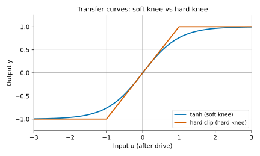
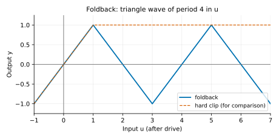
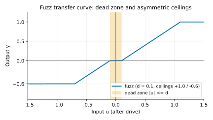
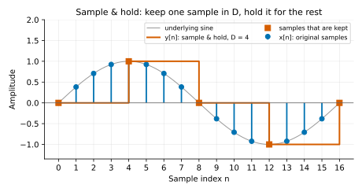
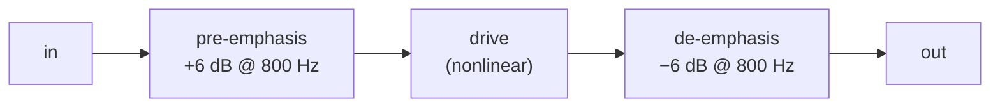
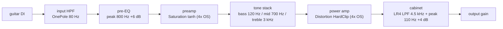
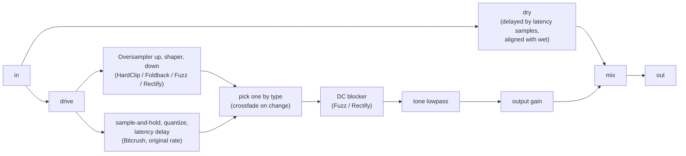

# Chapter 07: Distortion -- Hard Clip, Fuzz, Bitcrusher, and an Amp Chain

**English** | [繁體中文](README.zh-TW.md)

> [Course home](../../README.md) | Previous: [06 Saturation](../06-saturation/README.md) | Next: [08 Gate / Expander](../08-gate-expander/README.md)

The saturation of Chapter 06 "gently rounds off the top of the waveform": nearly transparent at low levels, adding a little even- and odd-order harmonic content only as the level rises, so it sounds "warm" and "thick".
This chapter is its ferocious sibling: it **cuts the waveform flat** (hard clip), **folds it back** (foldback), **cuts half of it away** (rectify), **breaks the bias** (fuzz), and even **throws away the resolution** (bitcrusher).
These effects are the signature sounds of electric guitar, industrial electronica, and lo-fi hip-hop, but they are also the effects in DSP that are easiest to make "dirty, but in the wrong way": aliasing, DC offset, a sudden jump in level, an amplified noise floor... This chapter takes them on one at a time with math and measurements, and finally chains them into a simple guitar amp simulation.

## 1. Chapter Goals

After reading this chapter and doing the exercises, you should be able to:

- State the difference between saturation and distortion: the **hardness of the knee** determines how fast the harmonics decay, and therefore whether it sounds "warm" or "harsh".
- Derive that hard clip approaches a square wave as drive → ∞ with THD → $`\sqrt{\pi^2/8 - 1} \approx 48.3\%`$, and explain why a symmetric curve produces only odd harmonics.
- Write the transfer curves of foldback (wavefolding), fuzz (asymmetric + dead zone), and full-wave / half-wave rectify, and predict their spectra (for example, why full-wave rectify goes **up an octave**).
- Derive the quantization step $`\Delta = 2/2^N`$ and the SNR formula $`6.02N + 1.76`$ dB, and understand where the aliasing of sample & hold lands and why its level is set by the sinc of the ZOH.
- Decide which effects need oversampling (hard clip does, bitcrush does not) and compute the frequency an alias folds to.
- Design tone shaping: pre-emphasis / de-emphasis and a post lowpass (the tone knob).
- Use this chapter's `dawlab::dsp::Distortion` and `dawlab::dsp::AmpChain`, and understand the role of each stage of the guitar amp chain "input HPF → pre-EQ → drive → tone stack → power amp → cabinet" and why the order matters.
- Do gain staging and output level compensation (RMS match), and know why the noise gate belongs **before** the distortion.

## 2. Theory

### 2.1 Saturation vs. distortion: how hard is the knee?

Mathematically, Chapter 06 and this chapter do exactly the same thing: every sample is fed through a **memoryless transfer curve** $`y = f(u)`$, where $`u = g \cdot x`$ is the input multiplied by the drive gain $`g`$. The difference is the **shape** of the curve:

<p align="center"></p>

Three aspects distinguish "saturation" from "distortion":

<div align="center">

| Aspect | saturation (Chapter 06) | distortion (this chapter) |
|---|---|---|
| Degree | THD usually < 10%, nearly transparent at low drive | THD easily 20-50% or more; the fundamental may not even be the largest component |
| Knee hardness | Smooth everywhere (tanh, arctan) | Has "corners" (hard clip, the fold points of foldback), even discontinuities (the steps of a quantizer) |
| Number of harmonics | Few, decaying quickly | Many, decaying slowly, extending beyond Nyquist |

</div>

**Why does the hardness of the knee determine how fast the harmonics decay?** This is a basic fact of Fourier analysis: if a periodic function and its first $`k-1`$ derivatives are continuous but its $`k`$-th derivative has a jump, its Fourier coefficients decay roughly as $`1/n^{k+1}`$.

- Square wave (the function itself has a jump, $`k = 0`$): harmonics ∝ $`1/n`$.
- A sine flattened by hard clip: the function is continuous, but at the clip point the slope suddenly goes from $`\cos`$ to 0 ($`k = 1`$): harmonics ∝ $`1/n^2`$ (the larger the drive, the steeper the clip point, and the closer to the square wave's $`1/n`$).
- A sine rounded by tanh: all derivatives are continuous: the harmonics decay **exponentially**, and the high harmonics quickly vanish into the noise.

That is why soft clip sounds "round" and hard clip sounds "harsh" -- the harshness comes from that long string of slowly decaying high harmonics. It also directly determines how severe the aliasing is (Section 2.8).

### 2.2 Hard clipping and its spectrum

```math
y = \mathrm{clip}(u) = \begin{cases} 1, & u > 1 \\ u, & |u| \le 1 \\ -1, & u < -1 \end{cases}
```

In code this is simply `std::clamp(u, -1.0f, 1.0f)`.

**Only odd harmonics.** Clip is an odd function: $`f(-u) = -f(u)`$. Feed it a sine $`x(t) = A\sin\omega t`$; since $`x(t + T/2) = -x(t)`$, the output also satisfies $`y(t + T/2) = -y(t)`$ (half-wave symmetry). For the $`n`$-th harmonic $`\sin(n\omega t)`$, shifting by half a period multiplies it by $`(-1)^n`$; the symmetry holds only when $`n`$ is odd, so the coefficients of the even harmonics must be 0.

**As drive → ∞ it approaches a square wave.** Multiply a sine by a very large $`g`$ and clip, and almost the whole period is stuck at ±1 -- a square wave:

```math
\text{square}(t) = \frac{4}{\pi}\sum_{n = 1, 3, 5, \dots} \frac{\sin(n\omega t)}{n}
```

The fundamental amplitude is $`4/\pi \approx 1.273`$ (+2.1 dBFS -- larger than the clip limit of 1!), and the $`n`$-th harmonic is $`1/n`$ of the fundamental: H3 = −9.5 dB, H5 = −14.0 dB, H7 = −16.9 dB (relative to the fundamental).

THD is fastest to compute with Parseval's theorem. Parseval's theorem says: **the total power of a signal (RMS²) equals the sum of the powers of its frequency components**, and a sine of amplitude $`a`$ has power $`a^2/2`$. So "the total power of all harmonics = total power − fundamental power", and there is no need to add infinitely many harmonics one by one. The square wave has RMS = 1 (power = 1) and the fundamental's power is $`(4/\pi)^2 / 2 = 8/\pi^2`$, so

```math
\text{THD} = \sqrt{\frac{P_\text{total} - P_1}{P_1}} = \sqrt{\frac{1 - 8/\pi^2}{8/\pi^2}} = \sqrt{\frac{\pi^2}{8} - 1} \approx 0.483 = 48.3\%
```

If we sum only up to the 50th harmonic (the example's `thdPercent(..., 50)`), we must subtract the tail $`\sum_{n \text{ odd} \ge 51} 1/n^2 \approx 0.01`$ for $`n \ge 51`$, giving $`\sqrt{(\pi^2/8 - 1 - 0.01)} \approx 47.3\%`$. What Example 1 measured (220 Hz, −6 dBFS sine):

<div align="center">

| drive | H1 (dBFS) | H3 | H5 | H7 | THD |
|---|---|---|---|---|---|
| 10 dB | 1.5 | −14.1 | −42.1 | −29.7 | 17.0% |
| 20 dB | 2.0 | −8.0 | −13.4 | −17.9 | 37.9% |
| 40 dB | 2.1 | −7.4 | −11.9 | −14.8 | 47.0% |

</div>

At drive 40 dB, H1 = 2.1 dBFS (= $`4/\pi`$), H3 − H1 = −9.5 dB, and THD is 47.0%, nearly the same as the square wave's theoretical values; the even harmonics are all unmeasurable (−100 dB = the floor of Analysis.h). The self-check in Example 1 verifies each item: H1 within 0.3 dB of $`20\log_{10}(4/\pi) = 2.10`$ dB, H3 − H1 within 0.5 dB of −9.54 dB, THD between 44% and 48.3%, and all even harmonics below −80 dB.

**What it sounds like**: at low drive only the note onsets are clipped, like a "preamp pushed too hard"; at high drive every note becomes a square wave with very long sustain (because the tail of the note is pushed into clipping too), and the tone is bright and harsh, like an 8-bit game console or an 80s distortion pedal.

### 2.3 Foldback / wavefolding: fold it back when it goes over

Where hard clip "cuts off" anything beyond ±1, foldback "folds it back", like light bouncing between two mirrors:

<p align="center"></p>

Mathematically, $`u`$ is mapped onto a triangle wave of period $`4`$:

```math
t = (u + 1) \bmod 4 \in [0, 4), \qquad
y = \begin{cases} t - 1, & t < 2 \\ 3 - t, & t \ge 2 \end{cases}
```

For $`|u| \le 1`$, $`y = u`$ (perfectly transparent); for $`u \in [1, 3]`$, $`y = 2 - u`$; for $`u \in [3, 5]`$, $`y = u - 4`$ ... no matter how large $`u`$ is it folds correctly many times, which is more robust than the one-fold `if (u > 1) u = 2 - u;` (Exercise 3 generalizes this to an arbitrary threshold).

**Spectral character**: every extra fold adds two more "corners" to the waveform, so as drive increases the harmonics do not simply get more numerous; instead **energy moves among the harmonics** -- at some drive H3 is even larger than H1 (Example 1: at Foldback 12 dB, H1 = −7.0 dBFS and H3 = −5.2 dBFS, THD 127%; the self-check confirms H3 > H1). This is the signature of West Coast synthesizers (Buchla, Serge): drive the fold amount with an LFO or envelope and the overtones "sweep", a bit like a filter sweep but more metallic.

Foldback is also an odd function, so it too has only odd harmonics.

### 2.4 Fuzz: high gain, asymmetry, gating

The fuzz pedals of the 1960s (Fuzz Face, Tone Bender) had only two or three transistors, enormous gain, and a transistor bias that was often not centered. This gives three characteristics, which this chapter's `Distortion::fuzz()` models with the simplest piecewise-linear function:

```math
y = \begin{cases}
0, & |u| \le d \quad \text{(dead zone, }d = 0.1\text{)}\\
\min(u - d,\; 1.0), & u > d \\
-\min(|u| - d,\; 0.6), & u < -d
\end{cases}
```

<p align="center"></p>

1. **High gain**: drive is usually 30 dB or more, so it is clipping almost all the time, close to a square wave.
2. **Asymmetric**: the positive half-cycle reaches at most +1.0 and the negative at least −0.6. $`f(-u) \ne -f(u)`$, half-wave symmetry is broken, and **even harmonics appear**; the average of the output is no longer 0 (**DC offset**). DC eats headroom and fools the next stage (a compressor, another distortion), so for Fuzz and Rectify `Distortion` adds a 10 Hz one-pole highpass after the shaper (a DC blocker, the `OnePole` from Chapter 02).
3. **Dead zone → gating**: the output is 0 while $`|u| \le d`$. When a note decays until its amplitude after the drive is below $`d`$, the sound suddenly "cuts off" instead of fading slowly -- the **gating / sputter** characteristic of fuzz (the "putt-putt" broken-up note tail). At drive $`G`$ dB, an input peak below $`20\log_{10} d - G = -20 - G`$ dBFS is shut off; at drive 30 dB the threshold is −50 dBFS. Some people love this effect (the "popcorn" sound of a Fuzz Face when you turn the guitar volume down), while others consider it a flaw. The dead zone also produces crossover distortion: a piece of the waveform around every zero crossing is eaten.

Section (2b) of Example 1 measures this threshold directly (Fuzz, drive 30 dB, 220 Hz sine, output peak):

<div align="center">

| Input peak | −60 dBFS | −53 dBFS | −47 dBFS | −40 dBFS |
|---|---|---|---|---|
| Output peak | 0 (completely silent) | 0 (completely silent) | 0.041 | 0.216 |

</div>

Below the threshold is a **digital zero**, not "very quiet" -- the self-check requires the peak below the threshold to be exactly 0 and above the threshold to be audible. At −47 dBFS the peak of $`u`$ is $`10^{-17/20} \approx 0.141`$; subtracting the dead zone 0.1 leaves 0.041, exactly the measured value (the oversampler's filter only makes it differ by a hair).

Example 1's measurements (220 Hz, −6 dBFS):

<div align="center">

| drive | H1 | H2 | H3 | H4 | THD |
|---|---|---|---|---|---|
| 12 dB | −0.3 | −19.8 | −13.4 | −24.6 | 26.1% |
| 30 dB | 0.1 | −36.8 | −9.4 | −36.9 | 45.2% |

</div>

(Self-check: the H2 of Fuzz at 12 dB must be above −30 dBFS and more than 10 dB larger than at 30 dB.) Interestingly, at very high drive the even harmonics actually **weaken**: once both sides are fully saturated the waveform becomes a square wave of "+1 on the positive half-cycle, −0.6 on the negative", which equals "a symmetric square wave (amplitude 0.8) + DC 0.2"; after the DC blocker removes the DC it is close to a symmetric square wave again. The asymmetric flavor is strongest at moderate drive.

### 2.5 Rectification: full-wave → an octave up, and half-wave

Rectification comes from power-supply circuits: turning AC into DC. In audio there are two kinds:

- **full-wave**: $`y = |u|`$
- **half-wave**: $`y = \max(u, 0)`$

**Why does full-wave rectify raise the pitch an octave?** Intuition: after the negative half-cycle of $`|\sin\omega t|`$ is flipped up, the waveform **repeats every half-cycle**; the period goes from $`T`$ to $`T/2`$ and the frequency doubles = an octave up. Written more precisely with a Fourier series:

```math
|\sin\omega t| = \frac{2}{\pi} - \frac{4}{\pi}\sum_{k=1}^{\infty} \frac{\cos(2k\omega t)}{4k^2 - 1}
= \frac{2}{\pi} - \frac{4}{3\pi}\cos 2\omega t - \frac{4}{15\pi}\cos 4\omega t - \cdots
```

Only DC and the **even** harmonics ($`2\omega, 4\omega, 6\omega, \dots`$) remain, and the fundamental $`\omega`$ disappears completely. The pitch the ear hears is determined by the "common divisor of the harmonics": the common divisor of $`2\omega, 4\omega, 6\omega`$ is $`2\omega`$, so it sounds an octave above the original.

Measurement (Example 1, drive 6.02 dB so that a −6 dBFS sine just reaches a peak of 1): H1 = −100 dB (unmeasurable), H2 = −7.4 dBFS, H4 = −21.4 dBFS. Theory: $`4/(3\pi) = 0.424 \to -7.44`$ dB, $`4/(15\pi) = 0.085 \to -21.42`$ dB, in perfect agreement (the self-check allows ±0.3 dB and requires H1 < −60 dB). There is also DC of $`2/\pi \approx 0.64`$, which the DC blocker removes.

**Half-wave** is

```math
\max(\sin\omega t, 0) = \frac{1}{\pi} + \frac{1}{2}\sin\omega t - \frac{2}{\pi}\sum_{k=1}^{\infty}\frac{\cos(2k\omega t)}{4k^2-1}
```

The fundamental is still there (amplitude 1/2), plus the even harmonics and DC: the pitch is unchanged, but the sound becomes "hollow, like a square wave with a nasal quality". `Distortion` switches with `setRectifyMode(RectifyMode::HalfWave)`.

When you full-wave rectify a **chord**, besides every note going up an octave, intermodulation components such as $`f_1 \pm f_2`$ appear between any two frequencies $`f_1, f_2`$ -- which is why octave fuzz (for example Octavia-type pedals) sounds ugly on chords but charming on single-note solos.

### 2.6 Bitcrusher: quantization and sample-rate reduction

A bitcrusher deliberately cuts down the two "resolutions" of digital audio: **amplitude resolution** (bit depth) and **time resolution** (sample rate).

#### 2.6.1 Quantization: step and SNR

A signed $`N`$-bit integer has $`2^N`$ codes, mapped onto the amplitude range $`[-1, 1)`$, so the size of each step is

```math
\Delta = \frac{2}{2^N} = 2^{1-N}
```

8 bit: $`\Delta = 2/256 = 0.0078`$; 16 bit: $`\Delta = 2/65536 \approx 3.05 \times 10^{-5}`$. Quantization is "rounding to the nearest step" (a mid-tread quantizer):

```math
Q(u) = \Delta \cdot \mathrm{clamp}\!\left(\left\lfloor \frac{u}{\Delta} + \frac{1}{2} \right\rfloor,\; -M,\; M - 1\right), \qquad M = \left\lfloor 2^{N-1} \right\rfloor
```

Note that the upper limit is $`M - 1`$: just like real 16-bit PCM (−32768 ... 32767), the largest positive value is $`1 - \Delta`$, not 1. When $`N`$ is an integer, $`M = 2^{N-1}`$; when $`N`$ is fractional (allowed by `setBitDepth()`, for example 5.5 bit), $`M`$ takes the integer part (5.5 bit: $`2^{4.5} = 22.6 \to M = 22`$, codes −22 ... 21), so the output always lands on integer multiples of $`\Delta`$, with a maximum positive value of $`21\Delta = 0.928`$ and a minimum of $`-22\Delta = -0.972`$.

**Very low bit counts ($`N < 2`$)**: $`M = 1`$ and the only codes left are −1 and 0 -- the whole positive half-cycle becomes 0, leaving only negative square pulses, and the output is asymmetric and carries a large DC (true 1-bit two's complement behaves the same way). The Bitcrush path has no DC blocker (the reason is in Section 3.1), so at such low bit counts it is best to follow it with a highpass, or simply set the lower limit of the bit-depth knob to 2.

**Deriving the SNR formula.** Treat the quantization error $`e = Q(u) - u`$ as noise uniformly distributed over $`[-\Delta/2, \Delta/2]`$ (valid when the signal is large and "busy" enough); its power (variance) is

```math
\sigma_e^2 = \frac{1}{\Delta}\int_{-\Delta/2}^{\Delta/2} e^2\, de = \frac{\Delta^2}{12}
```

A sine of amplitude $`A`$ has power $`A^2/2`$. So

```math
\text{SNR} = 10\log_{10}\frac{A^2/2}{\Delta^2/12} = 10\log_{10}\frac{6A^2}{\Delta^2}
= 10\log_{10}\left(6A^2 \cdot 2^{2N-2}\right) = 10\log_{10}1.5 + 20N\log_{10}2 + 20\log_{10}A
```

```math
\boxed{\text{SNR} \approx 6.02\,N + 1.76 + 20\log_{10}A \;\text{dB}}
```

Each extra bit adds 6.02 dB of SNR; every 20 dB the signal gets quieter, SNR also drops by 20 dB -- **the size of the quantization noise is fixed and does not change with the signal**. Example 3 measured (997 Hz sine):

<div align="center">

| bits | step | SNR measured (0 dBFS) | theory | SNR measured (−20 dBFS) | theory |
|---|---|---|---|---|---|
| 4 | 0.125 | 23.24 | 25.84 | 5.27 | 5.84 |
| 8 | 0.00781 | 49.12 | 49.93 | 29.78 | 29.93 |
| 12 | 0.000488 | 73.80 | 74.01 | 53.97 | 54.01 |
| 16 | 3.05e-5 | 98.06 | 98.09 | 78.07 | 78.09 |

</div>

From 8 → 16 bit the measurement gives 6.12 / 6.04 dB per bit. The deviation at low bit counts has two causes: (1) the positive peak at 0 dBFS exceeds the quantizer's upper limit $`1 - \Delta`$ and is cut off (at 4 bit, 0.125 is cut off!), adding clipping distortion; (2) with only a few levels the error is highly correlated with the signal and does not behave like uniform noise. And at −20 dBFS with 2 and 3 bit: the signal amplitude 0.1 is smaller than $`\Delta/2`$, the whole thing is quantized to 0, and SNR = 0 dB -- **the tail simply disappears**, which is why a bitcrusher makes a reverb tail "cut off".

> Why 997 Hz and not 1000 Hz? 48000 / 1000 = 48 is an integer, so every period samples exactly the same points and the quantization error repeats every period → it becomes **harmonics** instead of noise. 997 is prime, so the error looks "random", matching the assumption of the derivation. This also explains why bitcrush on a quiet pure tone sounds like "distortion" rather than "hiss".

**What it sounds like**: 12 bit is almost indistinguishable (a little hiss in the tails); at 8 bit the tails clearly break up and the noise "follows the notes" (it is not a steady hiss); 4 bit is as rough as a broken telephone.

#### 2.6.2 Sample-rate reduction: sample & hold and deliberate aliasing

The "correct" way to reduce the sample rate is to lowpass first and then drop samples (the Oversampler of Chapter 06 does the reverse). A bitcrusher deliberately does not: it "looks" at the input only once every $`D`$ samples and holds the previous value the rest of the time (**sample & hold**, S&H):

<p align="center"></p>

The effective sample rate is $`f_s' = f_s / D`$. In the world of $`f_s'`$, any frequency above $`f_s'/2`$ aliases:

```math
f_\text{alias} = |f - k f_s'|, \quad k = \mathrm{round}(f / f_s')
```

The hold action itself is a zero-order hold (ZOH), whose frequency response is a sinc:

```math
|H_\text{ZOH}(f)| = \left|\frac{\sin(\pi f / f_s')}{\pi f / f_s'}\right|
```

So the level of each component = its original level × the ZOH value at that frequency. (Strictly speaking, in discrete time the response of "holding for $`D`$ samples" is the Dirichlet kernel $`\left|\frac{\sin(\pi f D / f_s)}{D \sin(\pi f / f_s)}\right|`$; for large $`D`$ and $`f \ll f_s`$ it approaches the sinc above. The example uses the sinc as the theoretical value, with an error within 0.3 dB.) Example 3's measurement: a 5 kHz, −6 dBFS sine, $`D = 8`$ ($`f_s' = 6`$ kHz):

<div align="center">

| Frequency | Measured | Theory |
|---|---|---|
| 5000 Hz (original) | −20.2 dBFS | −6 + (−14.4) = −20.4 |
| **1000 Hz (alias, $`|5000 - 6000|`$)** | **−6.4 dBFS** | −6 + (−0.4) = −6.4 |
| 11000 Hz (image, $`f_s' + f`$) | −26.5 dBFS | — |

</div>

A 1 kHz that did not exist before, with no harmonic relationship to 5 kHz at all, appears -- and it is 14 dB louder than the original 5 kHz. These **frequencies unrelated to the pitch** are the bitcrusher's "metallic" and "robotic" character; when you play a melody, the aliases move in the opposite direction to the notes, which is very recognizable. This is **deliberate** aliasing -- it is the effect itself.

### 2.7 Tone shaping: pre-emphasis, de-emphasis, and the tone knob

A key property of nonlinearity: **it acts more on the louder parts**. If you first boost a band with an EQ before the distortion, that band is "distorted more"; if you then pull it back with the opposite EQ after the distortion, the overall frequency balance is unchanged but the **character of the distortion** changes. This is called **pre-emphasis / de-emphasis**:



The classic approach for guitar overdrive (for example the mid hump of many "green pedals"):

- **Cut the lows before the drive** (input HPF): low frequencies carry a lot of energy, and after entering the nonlinearity they produce **intermodulation** with the high notes -- two frequencies $`f_1, f_2`$ through a term like $`u^3`$ produce $`2f_1 - f_2`$, $`2f_2 - f_1`$, and other frequencies unrelated to the musical scale. The expansion of $`(\cos a + \cos b)^3`$ contains terms such as $`\tfrac{3}{4}\cos(2a - b)`$, so the lower and louder the two notes, the more "mud" is produced. Removing everything below 80 Hz first keeps a chord on the low strings from smearing into a blob.
- **Push the mids before the drive** (pre-EQ peak, around 800 Hz): let the band that gives the guitar the most "character" enter the distortion first.
- **A lowpass after the drive** (the tone knob): the high harmonics of hard clip decay slowly (Section 2.1), and keeping all of them sounds like "mosquitoes". `Distortion::setToneHz()` is a 2nd-order Butterworth lowpass with Q = 0.7071 (the `Biquad` from Chapter 02), completely bypassed at ≥ 20 kHz.

**Order matters**: "EQ → distortion" and "distortion → EQ" are not the same thing. Linear systems can be reordered ($`H_1 H_2 = H_2 H_1`$), but as soon as a nonlinearity $`f`$ is sandwiched in between, $`H_2 \cdot f(H_1 x) \ne H_1 \cdot f(H_2 x)`$. Exercise 7 has you design an amp chain from this angle.

### 2.8 When is oversampling needed?

Chapter 06 already explained that a nonlinearity generates new frequencies, and the part beyond Nyquist ($`f_s/2`$) aliases back into the audible band. The key question is: **how high do the newly generated frequencies reach?**

- Polynomial $`u^k`$: multiplies the frequency of a sine by at most $`k`$. As long as the oversampling factor is $`\ge k`$, in theory there is no aliasing (the case of the cubic curve in Chapter 06).
- hard clip, foldback, fuzz, rectify: the curve has "corners", which is equivalent to an **infinite-degree polynomial**; the harmonics extend without limit, decaying only about as $`1/n`$ (close to a square wave). Oversampling cannot eliminate the aliasing; it can only make the harmonics that "fold back" much smaller.

Take a 5 kHz sine through hard clip at 48 kHz: the odd harmonics 15k, 25k, 35k, 45k, 55k ... only 15k is within Nyquist, and the rest fold back according to $`|f - k f_s|`$:

<div align="center">

| harmonic | 5k | 15k | 25k | 35k | 45k | 55k | 65k ... |
|---|---|---|---|---|---|---|---|
| folds to | 5k | 15k | 23k | 13k | 3k | 7k | 17k ... |
| integer multiple of 5 kHz? | yes | yes | no | no | no | no | no |

</div>

The folded frequencies 23k, 13k, 3k, 7k, and 17k are not integer multiples of 5 kHz, so they are **inharmonic**.

Measurements from Example 4 (`l07_oversampling_aliasing`, drive 20 dB) in dBFS:

<div align="center">

| OS | latency | H @ 5k | H @ 15k | A @ 3k | A @ 7k | A @ 13k | A @ 23k |
|---|---|---|---|---|---|---|---|
| 1x | 0 | 2.0 | −8.0 | −22.9 | −28.5 | −18.2 | −13.5 |
| 2x | 31 | 2.0 | −8.0 | −44.1 | −44.9 | −44.6 | −26.4 |
| 4x | 36 | 2.0 | −8.0 | −47.4 | −47.4 | −48.8 | −26.2 |
| 8x | 38 | 2.0 | −8.0 | −74.6 | −78.2 | −72.9 | −25.9 |

</div>

The true harmonics (H columns) are completely unaffected; the aliases (A columns) drop by 19-31 dB at 4x and by another 24-31 dB at 8x. Three details:

1. **The 23 kHz column barely drops**: the 25 kHz harmonic lies in the **transition band** of the Chapter 06 halfband filter (centered on 24 kHz) and is attenuated only slightly. But 23 kHz is inaudible anyway, so it does not matter.
2. **2x and 4x are almost the same, and only 8x improves things substantially.** In the oversampled world (sample rate $`L f_s`$), the $`n`$-th harmonic folds to $`|n f_0 - k L f_s|`$; only the components that "have already folded back into 0-24 kHz at the high sample rate" cannot be blocked by the downsampling filter. Find the lowest harmonic number that folds back to 3 kHz / 7 kHz (Example 4 prints this table):

   | OS | High sample rate | Lowest harmonic folding to 3 kHz | Lowest harmonic folding to 7 kHz |
   |---|---|---|---|
   | 1x | 48 kHz | 9th (45 kHz) | 11th (55 kHz) |
   | 2x | 96 kHz | 39th (195 kHz = 2 × 96 + 3) | 37th (185 kHz = 2 × 96 − 7) |
   | 4x | 192 kHz | 39th (195 kHz = 192 + 3) | 37th (185 kHz = 192 − 7) |
   | 8x | 384 kHz | 153rd (765 kHz) | 155th (775 kHz) |

   Twice 96 kHz is exactly 192 kHz, so 2x and 4x are folded back by the **same set of harmonics**, and the aliases differ by only 2-4 dB; at 8x the folding starts only at the 150th harmonic or above, another 24-31 dB smaller. The 39th harmonic of an ideal square wave is $`1/39`$ of the fundamental (−31.8 dB); but the clipped waveform at drive 20 dB is really a "trapezoid" (the rising edge has a finite slope), so the high harmonics decay faster than $`1/n`$ (closer to $`1/n^2`$, see Section 2.1), and the aliases actually measured (about −46 to −49 dB relative to H1) are smaller still. This also shows that the size of the aliasing **depends on the input frequency**: with a different fundamental, the gap between 2x and 4x would be different.
3. **Where the latency comes from.** In the Chapter 06 Oversampler, each halfband stage has $`2K_i`$ odd-numbered taps (32, 12, and 8 for the three stages), and the group delay of upsampling + downsampling is $`2(2K_i - 1)`$ samples "at that stage's high sample rate". Converted back to the original sample rate and truncated to an integer:

   $`\displaystyle \text{latency} = \left\lfloor \frac{1}{2^S}\sum_{i=1}^{S} 2(2K_i - 1)\, 2^{S-i} \right\rfloor`$

   2x: $`62/2 = 31`$; 4x: $`(124 + 22)/4 = 36.5 \to 36`$; 8x: $`(248 + 44 + 14)/8 = 38.25 \to 38`$. Doubling the factor adds only a few samples of latency, because the later stages work at ever higher sample rates and their filters get ever shorter. The self-check of Example 4 recomputes this formula with `Oversampler::kOddTapsStage1..3` and compares it with `Distortion::getLatencySamples()`.

The other self-checks of Example 4: 4x is more than 20 dB below 1x at 3 kHz (more than 15 dB at 7 kHz), 8x is another 20 dB or more below 4x, 2x and 4x differ by less than 6 dB, and the true harmonics at 5 kHz and 15 kHz are unchanged at every factor.

**Bitcrush does not need oversampling**: quantization noise is not "harmonics beyond Nyquist" -- at the original sample rate it is already spread uniformly across the whole band, and the aliasing of sample & hold is the effect itself. Doing S&H at 4x would actually change the effect (the length of the hold and the position of the quantization would all differ). The control group in Example 4: Bitcrush 8 bit gives a 7 kHz noise level of −64.0 dBFS at both 1x and 4x, exactly the same (the bitcrush path of `Distortion` never goes through the oversampler anyway; the self-check requires the two to differ by < 0.01 dB). Incidentally, in this example 3 kHz is −100 dB (unmeasurable) while 7 kHz has −64 dB: at 48 kHz a 5 kHz tone repeats every 48 samples, so the quantization error repeats periodically too, and the noise concentrates on integer multiples of 1 kHz instead of spreading evenly across the band -- exactly the situation that "use 997 Hz rather than 1000 Hz" in Section 2.6.1 avoids.

<div align="center">

| Effect | Needs oversampling? | Reason |
|---|---|---|
| tanh / cubic saturation | Depends on drive, 2-4x | Harmonics decay quickly |
| hard clip, foldback, fuzz | **Yes**, 4x or more | The curve has corners; harmonics decay slowly |
| full-wave / half-wave rectify | **Yes** | Corners at the zero crossings |
| bitcrush (quantization + S&H) | **No** | Aliasing is the effect itself; quantization noise is in-band anyway |

</div>

### 2.9 Noise, gain staging, and output level compensation

**Distortion amplifies the noise floor.** Suppose the guitar signal peaks at −10 dBFS and the noise floor (hum and hiss from a single-coil pickup) is −60 dBFS, so SNR = 50 dB. After a hard clip with 30 dB of drive: the signal is clipped near 0 dBFS (it only "rises" by 10 dB), but the noise is fully amplified by 30 dB to −30 dBFS. SNR drops from 50 dB to about 30 dB. In other words: **the noise floor is amplified by the full drive in dB, while the signal is clipped and rises only by its original headroom to 0 dBFS**, so SNR loses about "drive − headroom" (here 30 − 10 = 20 dB). When drive is much larger than the headroom (for example 40-50 dB for a fuzz), the loss approaches the drive in dB itself.

So the noise gate belongs **before** the distortion: while the signal has not yet been squashed and the gap between signal and noise is still large, it can judge "are we playing right now", the threshold is easy to set, and it does not misjudge. Placed afterwards, the distortion has already pushed the note tails and the noise to about the same loudness and the gate can hardly tell them apart. (The gate itself is the subject of Chapter 08; the fuzz's dead zone can be seen as a very crude gate built into the curve.)

**Output level compensation.** Distortion almost always makes the sound **louder**: the pluck sequence in Example 1 (RMS −19.7 dBFS) has an RMS of −3.5 dBFS after HardClip at 20 dB -- 16 dB louder! The human ear has a louder-is-better bias, and if you compare timbres without compensation you will always feel more drive is better. The examples all use **RMS match** to pull the output back to the same RMS as the input before comparing:

```math
g_\text{comp} = \frac{\text{RMS}_\text{in}}{\text{RMS}_\text{out}}
```

<div align="center">

| type | RMS after processing | Compensation needed |
|---|---|---|
| HardClip 20 dB | −3.50 dBFS | −16.21 dB |
| Foldback 12 dB | −8.36 | −11.35 |
| Fuzz 30 dB | −4.21 | −15.50 |
| Rectify 6 dB | −18.22 | −1.49 |
| Bitcrush 6 bit ×4 | −19.68 | −0.03 |

</div>

Offline processing can compute the RMS of the whole clip; real-time processing must track the input and output with a **sliding RMS** (a first-order IIR mean-square detector) and compute the compensation factor on the fly -- this is the auto gain compensation of Exercise 5. The "auto gain" or "output automatically linked inversely to drive" commonly found in plugins is this very idea.

**Gain staging**: every stage of a distortion chain has a "level where it should sit". Too quiet before the preamp → not enough distortion; too loud before the power amp → only a square wave is left; too loud after the cabinet → the next plugin (compressor, reverb) is slammed. This chapter's `Distortion` has `setOutputGainDb()` after the shaper and `AmpChain` also has an output gain, so you can pull the level back into a reasonable range at each stage (for example around −18 dBFS RMS).

### 2.10 The guitar amp simulation chain

A real guitar amp (amp + speaker cabinet) can be split into several functional blocks. This chapter's `AmpChain` builds a minimal version of each with components from earlier chapters:



<div align="center">

| Stage | Real circuit | This chapter's model | Why it sits here |
|---|---|---|---|
| input HPF | Input coupling capacitor | `OnePole` highpass 80 Hz | Remove the lows before the distortion to avoid intermodulation and "mud" |
| pre-EQ | RC network between the tube stages | `Biquad` peak | Pre-emphasis: decides which band distorts first |
| preamp | Tubes such as the 12AX7 | Chapter 06 `Saturation` (tanh) | The main source of overdrive, with a soft knee |
| tone stack | bass / mid / treble knobs (passive RC network) | Three `Biquad`s (shelf, peak, shelf) | Sits **between** the two nonlinear stages, changing the spectrum fed to the power amp |
| power amp | Power tubes + output transformer | This chapter's `Distortion` (HardClip) | Hard clipping and a compressed feel when pushed hard |
| cabinet | 12-inch speaker + enclosure | Two Butterworth LPFs forming an LR4 + one peak | The speaker simply cannot reproduce anything above 5 kHz; this stage cuts the harsh high harmonics |

</div>

(LR4 = 4th-order **Linkwitz-Riley** lowpass: two 2nd-order Butterworth lowpass filters with Q = $`1/\sqrt{2}`$ in cascade, −6 dB at the cutoff and 24 dB/oct beyond it; details below. The name comes from Siegfried Linkwitz and Russ Riley, and it was originally a loudspeaker crossover design.)

**The cabinet is the most underrated stage.** Example 2 runs a 110 Hz sine through the Lead preset and measures the harmonic difference between cabinet on and off:

<div align="center">

| Harmonic | Frequency (Hz) | cab off (dBFS) | cab on (dBFS) | Difference | Cabinet response `getCabinetMagnitudeDb()` |
|---|---|---|---|---|---|
| 1 | 110 | 2.1 | 6.1 | +4.0 | +4.00 (resonance peak) |
| 3 | 330 | −7.5 | −7.2 | +0.2 | +0.24 |
| 9 | 990 | −17.2 | −17.2 | 0.0 | +0.00 |
| 21 | 2310 | −25.5 | −26.0 | −0.5 | −0.53 |
| 41 | 4510 | −35.0 | −41.0 | −6.1 | −6.06 (LR4 cutoff: −6 dB) |
| 61 | 6710 | −46.5 | −63.1 | −16.6 | −16.59 |
| 81 | 8910 | −55.4 | −82.8 | −27.4 | −27.37 |

</div>

The "Difference" column **equals the cabinet's frequency response item by item**: the cabinet is the last stage of the whole chain and is linear, so it only "multiplies each harmonic by its own gain at that frequency" and creates no new frequencies. The self-check of Example 2 checks exactly this (±0.5 dB for every measurable harmonic), and also requires the harmonics above 8 kHz to be cut by 15 dB or more. (The even harmonics sit at the −100 dB measurement floor: the hard clip of the power amp and the tanh of the preamp are both symmetric curves.)

The LR4 (two 2nd-order Butterworth lowpass filters with Q = $`1/\sqrt{2}`$ in cascade) is $`2 \times (-3.01) = -6.02`$ dB at the cutoff and has a slope of 24 dB/oct away from it. The Lead without a cabinet (`l07_amp_lead_nocab.wav`) sounds like "mosquitoes" precisely because of these high harmonics. In practice, a real cab sim uses convolution with an impulse response recorded through a microphone (Chapter 12); this chapter's biquad version is the cheapest approximation (Exercise 4).

**Order is tone.** With the same five components, if you move the tone stack in front of the preamp, the bass knob becomes "controls how much the low end distorts" instead of "controls the level of the low end"; if you move the cabinet in front of the power amp, nobody blocks the new high harmonics that the power amp generates. Exercise 7 asks you to analyze this carefully.

## 3. From Formulas to Code

### 3.1 `Distortion.h`

Location: `dsp/include/dawlab/dsp/Distortion.h`. Signal flow:



The public interface (following the contract in Section 5 of the authoring guide, plus a few extra methods that are convenient for teaching):

```cpp
enum class DistortionType { HardClip, Foldback, Fuzz, Rectify, Bitcrush };
enum class RectifyMode { FullWave, HalfWave };

class Distortion {
public:
    void setOversamplingFactorLog2(int);        // call before prepare, default 2 (4x), 0 = no oversampling
    void prepare(double sampleRate, int maxBlockSize, int numChannels);
    void reset() noexcept;
    void setType(DistortionType);  void setRectifyMode(RectifyMode);
    void setDriveDb(float);        // 0..60 dB
    void setToneHz(float);         // 200..20000 Hz, >= 20 kHz = bypass
    void setMix(float);            // 0..1
    void setOutputGainDb(float);   // -60..24 dB
    void setBitDepth(float);       // 1..24 (may be fractional)
    void setDownsampleFactor(int); // 1..64
    int getLatencySamples() const; // the same for every type (measured in Example 1, part (4))
    int getOversamplingFactor() const;              // 1 / 2 / 4 / 8
    // getType / getRectifyMode / getDriveDb / getToneHz / getMix / getOutputGainDb / getBitDepth / getDownsampleFactor
    void process(AudioBlock) noexcept;              // automatically slices blocks larger than maxBlockSize
    float processSample(int ch, float x) noexcept;   // no oversampling, latency = 0, no crossfade on type change

    static constexpr float kFuzzDeadZone = 0.1f, kFuzzPositiveCeiling = 1.0f, kFuzzNegativeCeiling = 0.6f;
    static constexpr float kToneBypassHz = 20000.0f, kDcBlockerHz = 10.0f;
    static constexpr int kMaxOversamplingLog2 = 3;
    static constexpr double kTypeFadeMs = 10.0;        // crossfade length when the type changes
    static float hardClip(float u), foldback(float u), fuzz(float u);
    static float rectify(float u, RectifyMode = RectifyMode::FullWave);
    static float quantize(float u, float bits);
    static float shape(DistortionType, float u);       // for plotting transfer curves
    static double theoreticalSnrDb(double bits, double amplitude = 1.0);
};
```

Going through it piece by piece:

- **Static curves**: `hardClip` = `std::clamp(u, -1, 1)` (Section 2.2); `foldback` implements $`t = (u+1) \bmod 4`$ of Section 2.3 with `std::fmod`, adding 4 for negative values; `fuzz` follows the piecewise function of Section 2.4, with the constants `kFuzzDeadZone = 0.1`, `kFuzzPositiveCeiling = 1.0`, `kFuzzNegativeCeiling = 0.6`; `rectify` follows Section 2.5 with the output limited to [0, 1]; `quantize` follows Section 2.6.1, rounding with `std::floor(u / step + 0.5)` and then clamping to $`[-M, M-1]`$, $`M = \lfloor 2^{N-1} \rfloor`$ (`std::floor(levels * 0.5f)`, so that the code is an integer for fractional bit depths). These are all `static` and memoryless, so exercises and tests can call them directly.
- **sample & hold** (`crush()`, private): one `holdCounter_` and `holdValue_` per channel. When the counter is 0 the hold value is updated, then the counter is incremented and wraps to 0 at `downsampleFactor_`. Hold first, then quantize.
- **Two paths, one latency**: HardClip / Foldback / Fuzz / Rectify go through `Oversampler::upsample()` → shaper → `downsample()`; Bitcrush is processed at the original sample rate and then passes through a `FixedDelay` that adds the same latency as the oversampler. The dry signal gets the same delay. So `getLatencySamples()` is the same value whatever the type (36 samples at 4x); the host needs only one fixed latency compensation, and **the latency does not change when the type is switched**.
- **Both paths run on every block**: this is the key to switching types without trouble. If each block ran only "the path of the current type", the state of the other path (the oversampler's FIR history, the bitcrush delay line) would freeze at the moment it was last used; switch back after 5 seconds and the first block would spit out **audio from 5 seconds ago** unchanged (about 36-72 samples at 4x). So `processChunk()` first runs the bitcrush path whatever the type (writing into `crushBuffer_`, which is cheap), then runs the oversampled shaper path (while Bitcrush is active it idles on "the last non-Bitcrush type"), and only at the end decides by type which one to use. The cost is that the oversampler also does wasted work when Bitcrush is selected.
- **Crossfade on type change**: fresh state alone is not enough -- changing HardClip to Fuzz makes the output waveform for the same input different, and switching directly would create a discontinuity (a click) at that instant. After `setType()`, the next block starts a linear crossfade of `kTypeFadeMs` = 10 ms: when switching between the two paths, it fades between the outputs of the two paths (their latencies are the same and they are time-aligned, so there is no comb filtering mid-fade); when switching within one path (for example HardClip → Foldback), it fades between the two curves at the oversampled shaper output. If the type is changed again while a fade is in progress, the next fade starts after this one finishes. A `setType()` called after `prepare()` / `reset()` and before the first block takes effect directly, with no fade. Note the fade only means "no click"; audibly the timbre still changes very quickly. `processSample()` does no fade at all.
- **DC blocker**: only Fuzz and Rectify use its output (only they are asymmetric); it is a 10 Hz `OnePole` highpass. But like the two paths it **runs on every block** so its state never freezes, and the other types are completely unaffected (the bitcrush SNR measurement needs wet and dry aligned sample by sample, and the phase shift of a 10 Hz highpass at 1 kHz is enough to cap the SNR at about 40 dB).
- **Rectify mode**: the oversampled path uses the private `shapeMemoryless()`, whose only difference from the static `shape()` is that Rectify follows `setRectifyMode()` (`shape()` always uses full-wave, just for plotting).
- **tone**: `updateToneCoefficients()` checks at the start of every block whether `toneHz_` changed, and recomputes `BiquadCoefficients::makeLowpass(fs, toneHz, 0.7071)` only if it did.
- **Parameter smoothing**: drive, output gain, and mix use `detail::BlockRamp` -- each block goes linearly from current to target (512 samples ≈ 10.7 ms), avoiding zipper noise.
- **Chunking**: `process()` itself is just a loop that slices the block into pieces of at most `maxBlockSize` and hands them to the private `processChunk()`. The internal buffers (the dry copy, the oversampler's high-rate buffer) are all sized by `maxBlockSize`, so when the host occasionally hands in a larger block, nothing is written out of bounds (the same strategy as `Saturation::process()` in Chapter 06). Channels beyond those given to `prepare()` are left untouched.
- **`processSample()`**: for offline analysis or situations that do not need oversampling. It bypasses the oversampler and does no dry delay, so HardClip and the like alias with this version; use `process()` for correct results. It also calls `updateToneCoefficients()` first, so `setToneHz()` still works when you use only `processSample()`; but drive / mix / output are not ramped and type changes do not crossfade.

### 3.2 `AmpChain.h`

Location: `dsp/include/dawlab/dsp/AmpChain.h`. It is exactly the block diagram of Section 2.10:

```cpp
class AmpChain {
public:
    void setOversamplingFactorLog2(int);   // before prepare; shared by preamp and power amp, 0..3, default 2 (4x)
    void prepare(double sampleRate, int maxBlockSize, int numChannels);
    void reset() noexcept;
    void setInputHighpassHz(float);        // 20..500, default 80
    void setPreEqHz(float);  void setPreEqGainDb(float);           // 200..3000 Hz; ±12 dB
    void setPreampDriveDb(float);          // → Saturation (tanh)
    void setPowerAmpDriveDb(float);  void setPowerAmpType(DistortionType);
    void setBassDb(float);  void setMidDb(float);  void setTrebleDb(float);   // ±12 dB
    void setCabinetEnabled(bool);  void setCabinetCutoffHz(float);
    void setCabinetResonanceHz(float);  void setCabinetResonanceDb(float);
    void setOutputGainDb(float);
    int getLatencySamples() const;          // preamp + power amp (36 + 36 = 72 at 4x)
    double getPreEqMagnitudeDb(double f) const;
    double getToneStackMagnitudeDb(double f) const;
    double getCabinetMagnitudeDb(double f) const;
    void process(AudioBlock) noexcept;
};
```

- The parameter setters only set the `dirty_` flag; at the start of the next `process()`, `applyParameters()` recomputes all the biquad coefficients at once -- no allocation, so they can be called freely between blocks.
- The frequencies of the tone stack are fixed (120 Hz low shelf, 700 Hz peak, 3 kHz high shelf) and only the gains are exposed. The tone stack of a real amp is the same: the corner frequencies are set by the circuit components, and the knobs change only the "amount".
- `getXxxMagnitudeDb()` adds up the `magnitudeDb()` of the biquads of each stage (cascaded linear systems: dB values add), and Example 2 uses them to print the frequency-response table. They compute the coefficients directly from the **current parameter values** (the private `preEqCoefficients()`, `cabLowpassCoefficients()`, ...; `applyParameters()` uses the same set of functions), so right after calling a setter you get the new curve without first running a `process()` -- important when a UI draws an EQ curve.

### 3.3 Example 1: `l07_distortion_types` (`examples/distortion_types.cpp`)

Demonstrates the 5 `DistortionType`s:

1. Prints the transfer curve table ($`u`$ from −3 to +3 in steps of 0.25). You can see Foldback fold back to 0 at $`u = 2`$, Fuzz output 0.15 at $`u = 0.25`$ (the dead zone eats 0.1), the negative half-cycle stop at −0.6, and the maximum of Bitcrush (8 bit) be 0.9922 = $`1 - \Delta`$.
2. A 220 Hz, −6 dBFS sine through each type, printing H1-H8 in dBFS and THD (the tables in Sections 2.2, 2.4, and 2.5 come from here). Self-check: the THD of HardClip 40 dB is between 44% and 48.3%, H1 = $`4/\pi`$, H3 − H1 = −9.54 dB; HardClip and Foldback have no even harmonics; the H3 of Foldback 12 dB is greater than H1; the H2 of Fuzz is larger at 12 dB than at 30 dB; the H1 of Rectify vanishes and H2 / H4 match $`4/(3\pi)`$, $`4/(15\pi)`$.
   (2b) The gating threshold of Fuzz at drive 30 dB (the table in Section 2.4). Self-check: the output is exactly 0 below −50 dBFS and audible above.
3. The pluck sequence through each type, written to WAV after RMS match, printing peak, RMS, compensation, and latency (the table in Section 2.9). Self-check: no NaN / Inf.
4. **Measuring the latency for real**: `getLatencySamples()` is only a claim; this part runs white noise (amplitude 0.3, drive 0 dB, Bitcrush at 24 bit, Rectify in half-wave) through each type and uses the cross-correlation $`r(\ell) = \sum_n y[n]\,x[n-\ell]`$ to find the true delay $`\ell`$ of the output relative to the input. The result is 36 samples for all five types, equal to `getLatencySamples()` -- that is, the oversampled path and the "bitcrush + `FixedDelay`" path really are aligned. It also compares the gain at 15 kHz for mix 50% vs. 100%: HardClip / Foldback −0.001 dB, Bitcrush 0.000 dB (if dry and wet were misaligned, a comb-filter notch would show up here). Self-check: measured delay = `getLatencySamples()` = 36, and the gain difference < 0.1 dB.

To run (build from the project root, then go into the build directory):

```powershell
.\scripts\build.ps1 -Only 07-distortion -NoTest
cd build
.\bin\Debug\l07_distortion_types.exe              # or give it your own WAV: l07_distortion_types.exe my_guitar.wav
```

Output in `dawlab_output/`: `l07_types_dry.wav`, `l07_types_hardclip.wav` (drive 20 dB, tone 6 kHz), `l07_types_foldback.wav` (12 dB), `l07_types_fuzz.wav` (30 dB, tone 4 kHz), `l07_types_rectify.wav` (6 dB), `l07_types_bitcrush.wav` (6 bit, ×4).

What to listen for: hard clip is hard and bright with very long sustain; foldback sounds like a synthesizer, with overtones "sweeping" as the level decays; fuzz is rough and the tails cut off abruptly (gating); rectify is an octave higher and has lost its "bottom"; bitcrush has hissy quantization noise and metallic aliasing.

### 3.4 Example 2: `l07_amp_chain` (`examples/amp_chain.cpp`)

1. Prints the pre-EQ, tone stack, and cabinet frequency-response tables for the Lead preset. Key points: the pre-EQ is +8.00 dB at 800 Hz; the cabinet is +4.00 dB at 110 Hz, **−6.02 dB** at 4500 Hz (LR4), and −27.80 dB at 9000 Hz (a bit more than the −24.6 dB of an analog LR4, because of the frequency warping of the bilinear transform, which Exercise 4 derives). Self-check: these three numbers, and latency = 2 × 36 = 72 samples.
2. The three presets (Clean / Crunch / Lead) process the pluck sequence and are written to WAV after RMS match.

   | preset | preamp | power amp | pre-EQ | bass / mid / treble | RMS after processing | Compensation |
   |---|---|---|---|---|---|---|
   | Clean | 6 dB | 0 dB | +3 dB | 0 / 0 / 0 | −14.40 dBFS | −5.31 dB |
   | Crunch | 18 dB | 6 dB | +6 dB | 0 / 0 / +2 | −2.10 | −17.61 |
   | Lead | 30 dB | 12 dB | +8 dB | −2 / +3 / 0 | −1.04 | −18.67 |

   This table has no item-by-item numeric self-check (it depends on many details such as the preamp's tanh, the ramp of the Chapter 06 Saturation, and the DC blocker); only the **trend** is checked: the more drive, the louder after processing (Clean < Crunch < Lead), and all are louder than the input. That is exactly the point of gain staging in Section 2.9: without compensation, Lead is almost 19 dB louder than the input.
3. A 110 Hz sine through Lead: the harmonic comparison with the cabinet on / off (the table in Section 2.10). Self-check: each harmonic's "on − off" equals `getCabinetMagnitudeDb()` (±0.5 dB), and everything above 8 kHz is cut by 15 dB or more.

The latency is printed as 72 samples (one 4x oversampler each in the preamp and the power amp). Output: `l07_amp_dry.wav`, `l07_amp_clean.wav`, `l07_amp_crunch.wav`, `l07_amp_lead.wav`, `l07_amp_lead_nocab.wav`. You can run `l07_amp_chain.exe my_di.wav` to process your own dry guitar recording (DI).

What to listen for: Clean is just a bit thicker; Crunch has grit and cleans up when you play softer (this is the dynamic response of a tanh preamp); Lead has very long sustain; the nocab version is harsh -- those are the high harmonics the cabinet filters out.

### 3.5 Example 3: `l07_bitcrusher_sweep` (`examples/bitcrusher_sweep.cpp`)

1. A 0 dBFS 997 Hz sine with bit depth 2 → 16, measuring SNR = $`20\log_{10}(\text{rms}(x) / \text{rms}(y - x))`$ and comparing with `Distortion::theoreticalSnrDb()` (the table in Section 2.6.1). Self-check: for ≥ 6 bit the measurement is within 2 dB of theory; from 8 → 16 bit each bit gives 6.02 ± 0.3 dB.
2. The same thing with a −20 dBFS signal.
3. The SNR for downsample factor 1 → 16 (16 bit): 1 → 98.06, 2 → 20.70, 4 → 12.29, 8 → 5.46, 16 → −0.32 dB (self-check: the larger the factor, the lower the SNR; factor 2 already drops below 30 dB). Also the alias measurement of a 5 kHz sine at factor 8 (the table in Section 2.6.2). Self-check: the levels of both the original frequency and the alias are within 1 dB of the ZOH sinc theory.
4. The pluck sequence at five settings: `l07_bitcrush_dry.wav`, `l07_bitcrush_12bit.wav`, `l07_bitcrush_8bit.wav`, `l07_bitcrush_4bit.wav`, `l07_bitcrush_ds8.wav` (16 bit, ×8), `l07_bitcrush_lofi.wav` (8 bit, ×4).

This example uses `setOversamplingFactorLog2(0)`, so latency = 0 and the error can be computed by subtracting sample by sample directly.

### 3.6 Example 4: `l07_oversampling_aliasing` (`examples/oversampling_aliasing.cpp`)

1. A 5 kHz, −6 dBFS sine through HardClip (drive 20 dB) at oversampling 1x / 2x / 4x / 8x, measuring the harmonics and aliases (the table in Section 2.8), then listing, for each factor, the lowest harmonic number that folds back to 3 kHz / 7 kHz. Self-check: latency = 0 / 31 / 36 / 38 (recomputed from the halfband lengths); 4x is more than 20 dB below 1x, 8x is another 20 dB or more below 4x, 2x and 4x differ by < 6 dB; the true harmonics are unchanged.
2. Control group: the noise of Bitcrush 8 bit is exactly the same at 1x and 4x (self-check: the difference < 0.01 dB).
3. A log sweep (100 Hz → 10 kHz) is hard-clipped and written as `l07_alias_sweep_1x.wav` and `l07_alias_sweep_4x.wav`.

What to listen for: in the 1x version, once the sweep passes 2-3 kHz, several **downward-sweeping** whistles appear in the background (the alias frequency $`|kf_s - nf|`$ falls as $`f`$ rises); the 4x version has almost none.

## 4. Real-Time Considerations

- **Allocation only in `prepare()`**: `Distortion` creates the `Oversampler` (a `std::unique_ptr`), the dry buffer, the delay lines, and the S&H state in `prepare()`. `setOversamplingFactorLog2()` must be called **before** `prepare()`; if you change the factor you must `prepare()` again (in a plugin, typically while the host has stopped playback).
- **Block size**: all buffers are sized by `maxBlockSize`; when `process()` receives a larger block it automatically slices it and does not write out of bounds. The only side effect is that the block ramps for drive / output / mix finish within the first chunk (the ramp gets shorter), which is almost inaudible.
- **Fixed latency**: different types take different paths, but the latency is padded to be the same, so `getLatencySamples()` depends only on the oversampling factor. If the latency changed with the type, the host would have to redo delay compensation on every switch, and playback would jump.
- **Parameter smoothing**: drive, output, and mix ramp linearly each block. Tone, bit depth, and downsample factor are **not smoothed**: the tone coefficients are swapped directly (a TDF-II biquad is fairly tolerant of coefficient jumps, but turning the tone knob sharply can still produce a slight click; for cleaner behavior, ramp the cutoff each block, or use the coefficient interpolation of Chapter 03); bit depth and downsample are "stepped" effects anyway, so jumps are not obvious.
- **Denormals**: `Biquad` and `OnePole` already flush tiny values to 0 internally; S&H and the quantizer have no recursive state and cannot produce denormals.
- **Run the unused path too**: once a "stateful but temporarily unused" component (the other path's oversampler, the delay line, the DC blocker, a bypassed tone filter) stops running, its state stays at a point long ago; the moment it is re-enabled it spits out old audio. `Distortion`'s approach is to let both paths and the DC blocker run on every block (at the cost of a bit of CPU), and to `reset()` the tone filter when it comes back from bypass. The alternative is to `reset()` a path when it is re-enabled, but that leaves a latency-length gap of silence and still needs a crossfade to avoid a click.
- **Thread safety**: the setters are plain member-variable writes, designed to be called from the audio thread "between blocks" (for example the host reading the UI parameters at the start of `processBlock`). If the UI thread will call the setters directly, use `std::atomic<float>` as the go-between, as the plugin in Chapter 13 does.
- **The output can exceed 0 dBFS**: the fundamental of HardClip can reach $`4/\pi`$ (+2.1 dBFS), and Foldback / Fuzz plus the overshoot of the tone filter can also exceed 1. Always follow with an output gain (or the limiter from Chapter 05); do not send it straight to a 16-bit output.

## 5. Common Mistakes and Debugging

<div align="center">

| Symptom | Cause | Fix |
|---|---|---|
| Inharmonic "metallic" sound and downward-sweeping whistles when playing high notes | Hard clip at the original sample rate aliases | Use `process()` (which oversamples) rather than `processSample()`; factor 4x or more |
| At mix 50% the sound gets thin, like a flanger | The dry signal is not delayed by latency samples and is misaligned with wet → comb filtering | The dry must go through the same delay (`Distortion` already does this; take care when writing your own parallel chain) |
| The compressor keeps squashing after fuzz / rectify, with a "thump" on fade-out | DC offset | Add a DC blocker (10-20 Hz highpass) |
| After quantization the whole signal is shifted down by half a step | Truncating with `floor(u / Δ)` instead of rounding; the error averages −Δ/2 | Use `floor(u / Δ + 0.5)` (mid-tread) |
| The positive peak of 8 bit is slightly smaller than the negative peak | Normal: the upper limit is $`1 - \Delta`$ (127/128) | This is the behavior of real integer PCM, not a bug |
| Foldback output blows up at very high drive | Folding only once with `if (u > 1) u = 2 - u` | Use the periodic `fmod` formulation (Section 2.3) |
| The fuzz tail suddenly vanishes and you think it is a bug | Gating caused by the dead zone | This is a hallmark of fuzz; if you don't want it, lower the drive or make the dead zone smaller |
| Every time you turn up the drive it seems "more is better" | The illusion of a louder level | Compare after RMS match / auto gain (Exercise 5) |
| The noise floor / hum is amplified unbearably | The drive amplifies the noise too | Put the gate before the distortion (Chapter 08) and cut the hum with the input HPF |
| The bitcrusher's "downsample" has no audible effect | Lowpass then downsample (a correct resampler was built) | A bitcrusher wants exactly sample & hold with no filter |
| `Distortion` has no effect at all, the output equals the input | `prepare()` was not called (`process()` returns immediately when it finds it has not been prepared, to avoid touching unallocated buffers) | Always `prepare()` first |
| After changing `setOversamplingFactorLog2()` nothing changes, not even the latency | The factor only takes effect at `prepare()` | Call `prepare()` again after changing the factor |

</div>

## 6. Exercises

See [`exercises/README.md`](exercises/README.md). 7 problems: calculation (the quantization step and SNR for N bits; the alias frequency of hard clip), conceptual (why full-wave rectify goes up an octave), implementation (a wavefolder, a cab sim built from biquads, auto gain compensation), and design (the order of the stages of the amp chain). Solutions are in [`solutions/README.md`](solutions/README.md).

## 7. Further Reading

- Udo Zölzer (ed.), *DAFX: Digital Audio Effects*, 2nd ed., Wiley, 2011 -- the "Nonlinear Processing" chapter covers overdrive, distortion, fuzz, valve modeling, rectifiers, and aliasing.
- Will Pirkle, *Designing Audio Effect Plugins in C++*, 2nd ed., Routledge, 2019 -- plugin implementations of waveshapers, bitcrushers, and oversampling.
- Joshua D. Reiss & Andrew P. McPherson, *Audio Effects: Theory, Implementation and Application*, CRC Press, 2015 -- the distortion chapter has guitar pedal circuits and spectral analysis.
- David T. Yeh, Jonathan S. Abel, Julius O. Smith III, "Simplified, physically-informed models of distortion and overdrive guitar effects pedals", *Proc. DAFx-07*, 2007 -- the classic paper that breaks circuits such as the Tube Screamer / Distortion+ down into "filter → nonlinearity → filter", which corresponds exactly to the pre / de-emphasis of Section 2.7.
- Fabián Esqueda, Stefan Bilbao, Vesa Välimäki, "Aliasing reduction in clipped signals", *IEEE Transactions on Signal Processing*, 2016 -- uses BLAMP to correct the aliasing at the corners of hard clip without relying on oversampling.
- Julian Parker, Vadim Zavalishin, Efflam Le Bivic, "Reducing the aliasing of nonlinear waveshaping using continuous-time convolution", *Proc. DAFx-16*, 2016 -- antiderivative anti-aliasing (ADAA), another route besides oversampling.
- Fabián Esqueda, Henri Pöntynen, Julian Parker, Stefan Bilbao, "Virtual analog models of the Lockhart and Serge wavefolders", *Applied Sciences*, 7(12), 1328, 2017 -- digital models of real wavefolder circuits.
- W. R. Bennett, "Spectra of quantized signals", *Bell System Technical Journal*, 1948 -- the original paper for the $`\Delta^2/12`$ quantization noise model.
- Stanley P. Lipshitz, Robert A. Wannamaker, John Vanderkooy, "Quantization and dither: a theoretical survey", *Journal of the Audio Engineering Society*, 1992 -- when quantization noise "behaves like noise" and when it becomes distortion, and the theory of dither.

## 8. Next Chapter

This chapter kept saying "put the gate before the distortion" -- Chapter 08, [08-gate-expander](../08-gate-expander/README.md), implements the noise gate, downward expander, de-esser, and transient shaper, completing the dynamics-processing toolbox.
