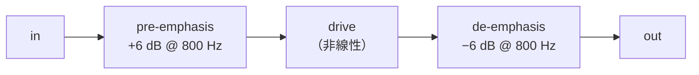
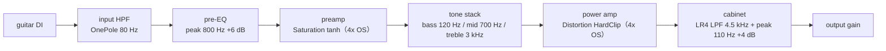
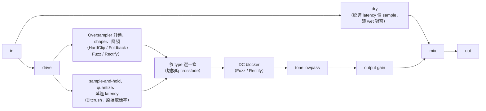

# 第 07 章：Distortion —— hard clip、fuzz、bitcrusher 與 amp chain

[English](README.md) | **繁體中文**

> [教材首頁](../../README.zh-TW.md)　｜　上一章：[06 Saturation](../06-saturation/README.zh-TW.md)　｜　下一章：[08 Gate / Expander](../08-gate-expander/README.zh-TW.md)

第 06 章的 saturation 是「溫柔地把波形頂端壓圓」：小聲時幾乎透明，大聲時才慢慢加上一點偶次、奇次諧波，聽起來「暖」、「厚」。
這一章要做的是它的兇狠版本：把波形**硬生生切平**（hard clip）、**折回來**（foldback）、**切掉一半**（rectify）、**偏壓壞掉**（fuzz），甚至**把解析度砍掉**（bitcrusher）。
這些效果是電吉他、工業電子、lo-fi hip-hop 的招牌聲音，但它們也是 DSP 裡最容易「做出來就很髒、但髒的方式不對」的效果：aliasing、DC offset、音量暴增、底噪被放大……本章會一個一個用數學和量測講清楚，最後把它們串成一條簡易的吉他 amp 模擬鏈。

## 1. 本章目標

讀完本章並做完練習，你應該能夠：

- 說出 saturation 與 distortion 的差別：**knee 的硬度**決定諧波衰減的速度，進而決定「暖」還是「刺」。
- 推導 hard clip 在 drive → ∞ 時趨近方波、THD → $`\sqrt{\pi^2/8 - 1} \approx 48.3\%`$，並解釋為什麼對稱的曲線只產生奇次諧波。
- 寫出 foldback（wavefolding）、fuzz（asymmetric + dead zone）、full-wave / half-wave rectify 的 transfer curve，並預測它們的頻譜（例如 full-wave rectify 為什麼會**高八度**）。
- 推導量化 step $`\Delta = 2/2^N`$ 與 SNR 公式 $`6.02N + 1.76`$ dB，並理解 sample & hold 的 aliasing 落在哪些頻率、大小由 ZOH 的 sinc 決定。
- 判斷什麼效果需要 oversampling（hard clip 要，bitcrush 不用），並計算 alias 會折到哪個頻率。
- 設計 tone shaping：pre-emphasis / de-emphasis、後級 lowpass（tone 旋鈕）。
- 使用本章的 `dawlab::dsp::Distortion` 與 `dawlab::dsp::AmpChain`，理解吉他 amp 鏈「input HPF → pre-EQ → drive → tone stack → power amp → cabinet」每一級的角色與順序的意義。
- 做 gain staging 與輸出音量補償（RMS match），知道 noise gate 為什麼要放在 distortion **前面**。

## 2. 原理

### 2.1 Saturation 與 distortion：差別在「knee 有多硬」

從數學上看，第 06 章與本章做的事情一模一樣：把每個 sample 丟進一條 **memoryless 的 transfer curve** $`y = f(u)`$，其中 $`u = g \cdot x`$ 是乘上 drive gain $`g`$ 之後的輸入。差別在曲線的**形狀**：


三個面向可以區分「saturation」與「distortion」：

| 面向 | saturation（第 06 章） | distortion（本章） |
|---|---|---|
| 程度 | THD 通常 < 10%，drive 小時幾乎透明 | THD 動輒 20–50% 以上，甚至基頻都不是最大的成分 |
| knee 的硬度 | 曲線處處平滑（tanh、arctan） | 有「角」（hard clip、foldback 的折點），甚至不連續（quantizer 的階梯） |
| 諧波數量 | 少、衰減快 | 多、衰減慢，延伸到 Nyquist 之外 |

**為什麼 knee 的硬度決定諧波衰減速度？** 這是 Fourier 分析的一個基本事實：一個週期函數如果它本身與前 $`k-1`$ 階導數都連續、但第 $`k`$ 階導數有跳躍，那它的 Fourier 係數大約以 $`1/n^{k+1}`$ 衰減。

- 方波（函數本身就有跳躍，$`k = 0`$）：諧波 ∝ $`1/n`$。
- 被 hard clip 切平的正弦：函數連續，但在切點斜率突然從 $`\cos`$ 變成 0（$`k = 1`$）：諧波 ∝ $`1/n^2`$（drive 越大切點越陡，越接近方波的 $`1/n`$）。
- tanh 把正弦壓圓：所有導數都連續：諧波**指數**衰減，高次諧波很快就消失在雜訊裡。

所以 soft clip 聽起來「圓」，hard clip 聽起來「刺」——刺的來源是那一大串衰減很慢的高次諧波。這也直接決定了 aliasing 的嚴重程度（2.8 節）。

### 2.2 Hard clipping 與它的頻譜

```math
y = \mathrm{clip}(u) = \begin{cases} 1, & u > 1 \\ u, & |u| \le 1 \\ -1, & u < -1 \end{cases}
```

程式裡就是 `std::clamp(u, -1.0f, 1.0f)`。

**只有奇次諧波。** clip 是奇函數：$`f(-u) = -f(u)`$。把正弦 $`x(t) = A\sin\omega t`$ 送進去，因為 $`x(t + T/2) = -x(t)`$，輸出也滿足 $`y(t + T/2) = -y(t)`$（half-wave symmetry）。對第 $`n`$ 次諧波 $`\sin(n\omega t)`$ 來說，平移半週期會乘上 $`(-1)^n`$；只有 $`n`$ 是奇數時才符合這個對稱，所以偶次諧波的係數必須為 0。

**drive → ∞ 時趨近方波。** 正弦乘上一個很大的 $`g`$ 再 clip，幾乎整個週期都卡在 ±1，就是方波：

```math
\text{square}(t) = \frac{4}{\pi}\sum_{n = 1, 3, 5, \dots} \frac{\sin(n\omega t)}{n}
```

基頻振幅是 $`4/\pi \approx 1.273`$（+2.1 dBFS——比 clip 的上限 1 還大！），第 $`n`$ 次諧波是基頻的 $`1/n`$：H3 = −9.5 dB、H5 = −14.0 dB、H7 = −16.9 dB（相對基頻）。

THD 用 Parseval 定理算最快。Parseval 定理說的是：**訊號的總功率（RMS²）等於各個頻率成分功率的總和**，而振幅 $`a`$ 的正弦功率是 $`a^2/2`$。所以「所有諧波的總功率 = 總功率 − 基頻功率」，不必把無窮多個諧波一個一個加起來。方波的 RMS = 1（功率 = 1），基頻的功率 = $`(4/\pi)^2 / 2 = 8/\pi^2`$，所以

```math
\text{THD} = \sqrt{\frac{P_\text{total} - P_1}{P_1}} = \sqrt{\frac{1 - 8/\pi^2}{8/\pi^2}} = \sqrt{\frac{\pi^2}{8} - 1} \approx 0.483 = 48.3\%
```

如果只加到第 50 次諧波（範例的 `thdPercent(..., 50)`），要扣掉 $`n \ge 51`$ 的尾巴 $`\sum_{n \text{ odd} \ge 51} 1/n^2 \approx 0.01`$，得到 $`\sqrt{(\pi^2/8 - 1 - 0.01)} \approx 47.3\%`$。範例 1 量到的（220 Hz、−6 dBFS 正弦）：

| drive | H1 (dBFS) | H3 | H5 | H7 | THD |
|---|---|---|---|---|---|
| 10 dB | 1.5 | −14.1 | −42.1 | −29.7 | 17.0% |
| 20 dB | 2.0 | −8.0 | −13.4 | −17.9 | 37.9% |
| 40 dB | 2.1 | −7.4 | −11.9 | −14.8 | 47.0% |

drive 40 dB 時 H1 = 2.1 dBFS（= $`4/\pi`$）、H3 − H1 = −9.5 dB、THD 47.0%，跟方波的理論值幾乎一樣；偶次諧波全部量不到（−100 dB = Analysis.h 的下限）。範例 1 的 self-check 會逐項驗證：H1 與 $`20\log_{10}(4/\pi) = 2.10`$ dB 差 < 0.3 dB、H3 − H1 與 −9.54 dB 差 < 0.5 dB、THD 介於 44% 與 48.3% 之間、偶次諧波全部低於 −80 dB。

**聽感**：drive 小時只有音頭被切到，像是「推過頭的 preamp」；drive 大時每個音都變成方波，sustain 很長（因為音尾也被推到 clip），音色亮、刺、像 8-bit 遊戲機或 80 年代的 distortion 踏板。

### 2.3 Foldback / wavefolding：超過就折回來

hard clip 在超過 ±1 時「切掉」，foldback 則是「折回來」，像光在兩面鏡子之間反射：


數學上就是把 $`u`$ 映射到一個週期 $`4`$ 的三角波上：

```math
t = (u + 1) \bmod 4 \in [0, 4), \qquad
y = \begin{cases} t - 1, & t < 2 \\ 3 - t, & t \ge 2 \end{cases}
```

$`|u| \le 1`$ 時 $`y = u`$（完全透明）；$`u \in [1, 3]`$ 時 $`y = 2 - u`$；$`u \in [3, 5]`$ 時 $`y = u - 4`$ ……不管 $`u`$ 多大都能正確折很多次，這是比「`if (u > 1) u = 2 - u;`」只折一次更穩健的寫法（練習 3 會推廣到任意 threshold）。

**頻譜特徵**：每多折一次，波形就多兩個「角」，於是 drive 增加時諧波不是單調變多，而是**能量在諧波之間移動**——某個 drive 下 H3 比 H1 還大（範例 1：Foldback 12 dB 時 H1 = −7.0 dBFS、H3 = −5.2 dBFS，THD 127%；self-check 會確認 H3 > H1）。這就是 West Coast 合成器（Buchla、Serge）的招牌：用 LFO 或 envelope 去推 drive，泛音會「掃」起來，有點像 filter sweep 但更金屬。

foldback 也是奇函數，所以同樣只有奇次諧波。

### 2.4 Fuzz：高增益、不對稱、gating

1960 年代的 fuzz 踏板（Fuzz Face、Tone Bender）只有兩三顆電晶體，增益非常大，而且電晶體的偏壓（bias）常常不在正中央。這帶來三個特徵，本章的 `Distortion::fuzz()` 用最簡單的分段線性函數模擬它們：

```math
y = \begin{cases}
0, & |u| \le d \quad \text{（dead zone，}d = 0.1\text{）}\\
\min(u - d,\; 1.0), & u > d \\
-\min(|u| - d,\; 0.6), & u < -d
\end{cases}
```


1. **高增益**：drive 通常 30 dB 以上，幾乎所有時間都在 clip，接近方波。
2. **不對稱**（asymmetric）：正半週最高 +1.0、負半週最低 −0.6。$`f(-u) \ne -f(u)`$，half-wave symmetry 被破壞，**偶次諧波出現**，而且輸出的平均值不再是 0（**DC offset**）。DC 會吃掉 headroom、讓下一級（compressor、另一個 distortion）誤判，所以 `Distortion` 對 Fuzz 與 Rectify 會在 shaper 後面加一個 10 Hz 的 one-pole highpass（DC blocker，第 02 章的 `OnePole`）。
3. **Dead zone → gating**：$`|u| \le d`$ 的時候輸出是 0。音符衰減到 drive 之後的振幅小於 $`d`$ 時，聲音會突然「斷掉」，而不是慢慢變小——這就是 fuzz 特有的 **gating / sputter**（「噗噗」的破音音尾）。在 drive $`G`$ dB 下，輸入峰值低於 $`20\log_{10} d - G = -20 - G`$ dBFS 就會被關掉；drive 30 dB 時門檻是 −50 dBFS。有些人很愛這個效果（Fuzz Face 把吉他音量轉小的「爆米花」聲），有些人覺得是缺點。dead zone 同時也產生 crossover distortion：每次過零附近波形都有一段被吃掉。

範例 1 第 (2b) 段直接量這個門檻（Fuzz、drive 30 dB、220 Hz 正弦，輸出 peak）：

| 輸入峰值 | −60 dBFS | −53 dBFS | −47 dBFS | −40 dBFS |
|---|---|---|---|---|
| 輸出 peak | 0（完全靜音） | 0（完全靜音） | 0.041 | 0.216 |

門檻以下是**數位的零**，不是「很小聲」——self-check 檢查門檻以下的 peak 必須剛好是 0、門檻以上必須有聲音。−47 dBFS 時 $`u`$ 的峰值是 $`10^{-17/20} \approx 0.141`$，扣掉 dead zone 0.1 只剩 0.041，正好是量到的值（oversampler 的 filter 只會讓它差一點點）。

範例 1 的量測（220 Hz、−6 dBFS）：

| drive | H1 | H2 | H3 | H4 | THD |
|---|---|---|---|---|---|
| 12 dB | −0.3 | −19.8 | −13.4 | −24.6 | 26.1% |
| 30 dB | 0.1 | −36.8 | −9.4 | −36.9 | 45.2% |

（self-check：Fuzz 12 dB 的 H2 必須高於 −30 dBFS，而且比 30 dB 時大 10 dB 以上。）有趣的是，drive 很大時偶次諧波反而**變弱**：兩邊都完全飽和後，波形變成「正半週 +1、負半週 −0.6」的方波，等於「對稱方波（幅度 0.8）+ DC 0.2」，DC 被 DC blocker 拿掉後就又接近對稱方波了。不對稱的味道最濃的是中等 drive。

### 2.5 Rectification：full-wave → 高八度，half-wave

整流（rectify）來自電源電路：把交流變成直流。音訊上有兩種：

- **full-wave**：$`y = |u|`$
- **half-wave**：$`y = \max(u, 0)`$

**為什麼 full-wave rectify 讓音高高八度？** 直覺：$`|\sin\omega t|`$ 的負半週被翻上來之後，**每半個週期就重複一次**，週期從 $`T`$ 變成 $`T/2`$，頻率加倍 = 高八度。用 Fourier 級數寫得更精確：

```math
|\sin\omega t| = \frac{2}{\pi} - \frac{4}{\pi}\sum_{k=1}^{\infty} \frac{\cos(2k\omega t)}{4k^2 - 1}
= \frac{2}{\pi} - \frac{4}{3\pi}\cos 2\omega t - \frac{4}{15\pi}\cos 4\omega t - \cdots
```

只剩 DC 和**偶次**諧波（$`2\omega, 4\omega, 6\omega, \dots`$），基頻 $`\omega`$ 完全消失。耳朵聽到的音高由「諧波的公因數」決定：$`2\omega, 4\omega, 6\omega`$ 的公因數是 $`2\omega`$，所以聽起來是原本的八度上方。

量測（範例 1，drive 6.02 dB 讓 −6 dBFS 的正弦剛好到峰值 1）：H1 = −100 dB（量不到）、H2 = −7.4 dBFS、H4 = −21.4 dBFS。理論：$`4/(3\pi) = 0.424 \to -7.44`$ dB、$`4/(15\pi) = 0.085 \to -21.42`$ dB，完全吻合（self-check 容許 ±0.3 dB，並要求 H1 < −60 dB）。還有 $`2/\pi \approx 0.64`$ 的 DC，由 DC blocker 移除。

**half-wave** 則是

```math
\max(\sin\omega t, 0) = \frac{1}{\pi} + \frac{1}{2}\sin\omega t - \frac{2}{\pi}\sum_{k=1}^{\infty}\frac{\cos(2k\omega t)}{4k^2-1}
```

基頻還在（振幅 1/2），再加上偶次諧波和 DC：音高不變，但聲音變得「空洞、像方波加了鼻音」。`Distortion` 用 `setRectifyMode(RectifyMode::HalfWave)` 切換。

對**和弦**做 full-wave rectify 時，除了每個音高八度，兩個頻率 $`f_1, f_2`$ 之間還會出現 $`f_1 \pm f_2`$ 等 intermodulation 成分——這就是 octave fuzz（例如 Octavia 類踏板）在和弦上很難聽、但在單音 solo 很迷人的原因。

### 2.6 Bitcrusher：quantization 與 sample-rate reduction

bitcrusher 把數位音訊的兩個「解析度」故意砍低：**振幅解析度**（bit depth）與**時間解析度**（sample rate）。

#### 2.6.1 Quantization：step 與 SNR

$`N`$ bit 的 signed 整數有 $`2^N`$ 個 code，對應到 $`[-1, 1)`$ 的振幅範圍，所以每一階的大小（step）是

```math
\Delta = \frac{2}{2^N} = 2^{1-N}
```

8 bit：$`\Delta = 2/256 = 0.0078`$；16 bit：$`\Delta = 2/65536 \approx 3.05 \times 10^{-5}`$。量化就是「四捨五入到最近的階」（mid-tread quantizer）：

```math
Q(u) = \Delta \cdot \mathrm{clamp}\!\left(\left\lfloor \frac{u}{\Delta} + \frac{1}{2} \right\rfloor,\; -M,\; M - 1\right), \qquad M = \left\lfloor 2^{N-1} \right\rfloor
```

注意上限是 $`M - 1`$：跟真正的 16 bit PCM 一樣（−32768 … 32767），最大正值是 $`1 - \Delta`$，不是 1。$`N`$ 是整數時 $`M = 2^{N-1}`$；$`N`$ 是小數時（`setBitDepth()` 允許，例如 5.5 bit）$`M`$ 取整數部分（5.5 bit：$`2^{4.5} = 22.6 \to M = 22`$，code 為 −22 … 21），這樣輸出永遠落在 $`\Delta`$ 的整數倍上，最大正值 $`21\Delta = 0.928`$、最小值 $`-22\Delta = -0.972`$。

**很低的 bit 數（$`N < 2`$）**：$`M = 1`$，code 只剩 −1 與 0——正半週全部變成 0，只剩負的方波脈衝，輸出不對稱、帶有很大的 DC（真正的 1 bit 二補數也是這樣）。Bitcrush 路徑沒有 DC blocker（理由見 3.1 節），所以這麼低的 bit 數後面最好接一個 highpass，或者乾脆把 bit depth 旋鈕的下限設在 2。

**SNR 公式推導。** 把量化誤差 $`e = Q(u) - u`$ 當作在 $`[-\Delta/2, \Delta/2]`$ 均勻分布的雜訊（訊號夠大、夠「亂」時成立），它的功率（變異數）是

```math
\sigma_e^2 = \frac{1}{\Delta}\int_{-\Delta/2}^{\Delta/2} e^2\, de = \frac{\Delta^2}{12}
```

振幅 $`A`$ 的正弦功率是 $`A^2/2`$。所以

```math
\text{SNR} = 10\log_{10}\frac{A^2/2}{\Delta^2/12} = 10\log_{10}\frac{6A^2}{\Delta^2}
= 10\log_{10}\left(6A^2 \cdot 2^{2N-2}\right) = 10\log_{10}1.5 + 20N\log_{10}2 + 20\log_{10}A
```

```math
\boxed{\text{SNR} \approx 6.02\,N + 1.76 + 20\log_{10}A \;\text{dB}}
```

每多 1 bit，SNR 多 6.02 dB；訊號每小 20 dB，SNR 也少 20 dB——**量化雜訊的大小是固定的，不隨訊號變**。範例 3 量到（997 Hz 正弦）：

| bits | step | SNR 量測（0 dBFS） | 理論 | SNR 量測（−20 dBFS） | 理論 |
|---|---|---|---|---|---|
| 4 | 0.125 | 23.24 | 25.84 | 5.27 | 5.84 |
| 8 | 0.00781 | 49.12 | 49.93 | 29.78 | 29.93 |
| 12 | 0.000488 | 73.80 | 74.01 | 53.97 | 54.01 |
| 16 | 3.05e-5 | 98.06 | 98.09 | 78.07 | 78.09 |

8 → 16 bit 量到每 bit 6.12 / 6.04 dB。低 bit 數的偏差有兩個原因：(1) 0 dBFS 的正峰超過量化器的上限 $`1 - \Delta`$ 被削掉（4 bit 時削掉 0.125！），多了 clip 失真；(2) 只有幾階時誤差跟訊號高度相關，不像均勻雜訊。而 −20 dBFS 的 2、3 bit：訊號振幅 0.1 小於 $`\Delta/2`$，整段被量化成 0，SNR = 0 dB——**音尾會直接消失**，這就是 bitcrusher 讓 reverb tail 「斷掉」的原因。

> 為什麼用 997 Hz 而不是 1000 Hz？48000 / 1000 = 48 是整數，每個週期取樣到的點完全一樣，量化誤差每週期重複 → 變成**諧波**而不是雜訊。997 是質數，誤差才會「亂」，符合推導的假設。這也說明了 bitcrush 對低音量的純音聽起來像「失真」而不是「hiss」。

**聽感**：12 bit 幾乎聽不出差別（音尾有一點沙沙聲）；8 bit 音尾明顯碎掉、雜訊「跟著音符」出現（不是穩定的 hiss）；4 bit 粗糙到像壞掉的電話。

#### 2.6.2 Sample-rate reduction：sample & hold 與刻意的 aliasing

降取樣率的「正確」做法是先 lowpass 再丟 sample（第 06 章的 Oversampler 反過來做）。bitcrusher 偏偏不這麼做：每 $`D`$ 個 sample 才「看」一次輸入，其餘時間維持上一個值（**sample & hold**, S&H）：


等效取樣率 $`f_s' = f_s / D`$。在 $`f_s'`$ 的世界裡，任何高於 $`f_s'/2`$ 的頻率都會 alias：

```math
f_\text{alias} = |f - k f_s'|, \quad k = \mathrm{round}(f / f_s')
```

hold 的動作本身是一個 zero-order hold（ZOH），頻率響應是 sinc：

```math
|H_\text{ZOH}(f)| = \left|\frac{\sin(\pi f / f_s')}{\pi f / f_s'}\right|
```

所以每個成分的大小 = 原本的大小 × ZOH 在那個頻率的值。（嚴格說，在離散時間裡「hold $`D`$ 個 sample」的響應是 Dirichlet kernel $`\left|\frac{\sin(\pi f D / f_s)}{D \sin(\pi f / f_s)}\right|`$；$`D`$ 大、$`f \ll f_s`$ 時它就趨近上面的 sinc。範例用 sinc 當理論值，誤差在 0.3 dB 以內。）範例 3 的量測：5 kHz、−6 dBFS 正弦、$`D = 8`$（$`f_s' = 6`$ kHz）：

| 頻率 | 量測 | 理論 |
|---|---|---|
| 5000 Hz（原頻率） | −20.2 dBFS | −6 + (−14.4) = −20.4 |
| **1000 Hz（alias，$`|5000 - 6000|`$）** | **−6.4 dBFS** | −6 + (−0.4) = −6.4 |
| 11000 Hz（image，$`f_s' + f`$） | −26.5 dBFS | — |

一個原本不存在、跟 5 kHz 毫無諧波關係的 1 kHz 出現了，而且比原本的 5 kHz 還大聲 14 dB。這種**跟音高無關的頻率**就是 bitcrusher 的「金屬味」、「機器人味」；彈一段旋律時，alias 會往跟音符相反的方向移動，非常有辨識度。這是**刻意的** aliasing，是效果本身。

### 2.7 Tone shaping：pre-emphasis、de-emphasis 與 tone 旋鈕

非線性的一個關鍵特性：**它對大聲的部分作用比較多**。如果在 distortion 前面先用 EQ 把某個頻段推大，那個頻段就會被「失真得比較多」；失真之後再用相反的 EQ 拉回來，整體頻率平衡不變，但**失真的質感**改變了。這叫 **pre-emphasis / de-emphasis**：



吉他 overdrive 的經典做法（例如很多「綠色踏板」的 mid hump）：

- **drive 前先切低頻**（input HPF）：低頻能量大，進到非線性之後會跟高音產生 **intermodulation**——兩個頻率 $`f_1, f_2`$ 經過 $`u^3`$ 這種項會產生 $`2f_1 - f_2`$、$`2f_2 - f_1`$ 等跟音階無關的頻率。$`(\cos a + \cos b)^3`$ 展開裡有 $`\tfrac{3}{4}\cos(2a - b)`$ 這種項，所以兩個音越低、越大聲，產生的「爛泥」越多。先把 80 Hz 以下拿掉，低音弦的和弦就不會糊成一團。
- **drive 前推中頻**（pre-EQ peak，800 Hz 左右）：讓吉他最有「個性」的頻段先進入失真。
- **drive 後用 lowpass**（tone 旋鈕）：hard clip 的高次諧波衰減慢（2.1 節），全部留著會像「蚊子叫」。`Distortion::setToneHz()` 就是一顆 Q = 0.7071 的 2 階 Butterworth lowpass（第 02 章 `Biquad`），≥ 20 kHz 時整個 bypass。

**順序很重要**：「EQ → 失真」與「失真 → EQ」不是同一件事。線性系統可以交換順序（$`H_1 H_2 = H_2 H_1`$），但只要中間夾了一個非線性 $`f`$，$`H_2 \cdot f(H_1 x) \ne H_1 \cdot f(H_2 x)`$。練習 7 會讓你從這個角度設計 amp chain。

### 2.8 什麼時候需要 oversampling？

第 06 章已經講過：非線性會產生新的頻率，超過 Nyquist（$`f_s/2`$）的部分會 alias 回聽得到的頻帶。關鍵問題是：**新產生的頻率最高到哪裡？**

- 多項式 $`u^k`$：把正弦的頻率最多乘上 $`k`$ 倍。只要 oversampling 倍率 $`\ge k`$，理論上就不會 alias（第 06 章 cubic 曲線的情況）。
- hard clip、foldback、fuzz、rectify：曲線有「角」，等於**無窮次多項式**，諧波無限延伸、只以約 $`1/n`$（接近方波時）衰減。oversampling 不能消滅 alias，只能讓「折回來的那些諧波」本身小很多。

以 48 kHz、5 kHz 正弦的 hard clip 為例，奇次諧波 15k、25k、35k、45k、55k ……只有 15k 在 Nyquist 以內，其餘按 $`|f - k f_s|`$ 折回來：

| 諧波 | 5k | 15k | 25k | 35k | 45k | 55k | 65k ... |
|---|---|---|---|---|---|---|---|
| 折到 | 5k | 15k | 23k | 13k | 3k | 7k | 17k ... |
| 是 5 kHz 的整數倍嗎？ | 是 | 是 | 否 | 否 | 否 | 否 | 否 |

折回來的 23k、13k、3k、7k、17k 都不是 5 kHz 的整數倍，所以是**不和諧（inharmonic）**的。

範例 4（`l07_oversampling_aliasing`，drive 20 dB）的量測（dBFS）：

| OS | latency | H @ 5k | H @ 15k | A @ 3k | A @ 7k | A @ 13k | A @ 23k |
|---|---|---|---|---|---|---|---|
| 1x | 0 | 2.0 | −8.0 | −22.9 | −28.5 | −18.2 | −13.5 |
| 2x | 31 | 2.0 | −8.0 | −44.1 | −44.9 | −44.6 | −26.4 |
| 4x | 36 | 2.0 | −8.0 | −47.4 | −47.4 | −48.8 | −26.2 |
| 8x | 38 | 2.0 | −8.0 | −74.6 | −78.2 | −72.9 | −25.9 |

真正的諧波（H 欄）完全不受影響；alias（A 欄）在 4x 時降了 19–31 dB、8x 時再降 24–31 dB。三個細節：

1. **23 kHz 那欄幾乎不降**：25 kHz 的諧波落在第 06 章 halfband filter 的**過渡帶**（以 24 kHz 為中心）裡，只被衰減一點點。但 23 kHz 本來就聽不到，無所謂。
2. **2x 跟 4x 幾乎一樣，8x 才大幅改善。** 在 oversampled 的世界（取樣率 $`L f_s`$）裡，第 $`n`$ 次諧波折到 $`|n f_0 - k L f_s|`$；只有「已經在高取樣率裡折回 0–24 kHz」的成分，downsample filter 才擋不掉。找出最低第幾次諧波會折回 3 kHz / 7 kHz（範例 4 會印這張表）：

   | OS | 高取樣率 | 折回 3 kHz 的最低次諧波 | 折回 7 kHz 的最低次諧波 |
   |---|---|---|---|
   | 1x | 48 kHz | 9 次（45 kHz） | 11 次（55 kHz） |
   | 2x | 96 kHz | 39 次（195 kHz = 2 × 96 + 3） | 37 次（185 kHz = 2 × 96 − 7） |
   | 4x | 192 kHz | 39 次（195 kHz = 192 + 3） | 37 次（185 kHz = 192 − 7） |
   | 8x | 384 kHz | 153 次（765 kHz） | 155 次（775 kHz） |

   96 kHz 的 2 倍剛好是 192 kHz，所以 2x 與 4x 被**同一批諧波**折回來，alias 只差 2–4 dB；8x 要到第 150 次以上才折回來，又小了 24–31 dB。理想方波的第 39 次諧波是基頻的 $`1/39`$（−31.8 dB）；而 drive 20 dB 的 clip 波形其實是「梯形」（上升段有有限的斜率），高次諧波衰減得比 $`1/n`$ 更快（接近 $`1/n^2`$，見 2.1 節），所以實際量到的 alias（相對 H1 約 −46 ~ −49 dB）又更小。這也說明 alias 的大小**跟輸入頻率有關**：換一個基頻，2x 與 4x 的差距就不一樣了。
3. **latency 怎麼來的。** 第 06 章的 Oversampler 每一級 halfband 有 $`2K_i`$ 個奇數 tap（三級分別是 32、12、8），升頻 + 降頻的 group delay 是 $`2(2K_i - 1)`$ 個「該級的高取樣率 sample」。換算回原始取樣率再取整數：

   $`\displaystyle \text{latency} = \left\lfloor \frac{1}{2^S}\sum_{i=1}^{S} 2(2K_i - 1)\, 2^{S-i} \right\rfloor`$

   2x：$`62/2 = 31`$；4x：$`(124 + 22)/4 = 36.5 \to 36`$；8x：$`(248 + 44 + 14)/8 = 38.25 \to 38`$。倍率加倍、latency 卻只多幾個 sample，因為後面幾級在越來越高的取樣率下運作、filter 也越來越短。範例 4 的 self-check 用 `Oversampler::kOddTapsStage1..3` 重算這個公式，與 `Distortion::getLatencySamples()` 比對。

範例 4 的其他 self-check：4x 在 3 kHz 比 1x 低 20 dB 以上（7 kHz 低 15 dB 以上）、8x 比 4x 再低 20 dB 以上、2x 與 4x 差不到 6 dB、5 kHz 與 15 kHz 的真諧波在各倍率下都不變。

**bitcrush 不需要 oversampling**：量化雜訊不是「超過 Nyquist 的諧波」，它在原始取樣率就已經均勻分布在整個頻帶；sample & hold 的 aliasing 更是效果本身。在 4x 下做 S&H 反而會改變效果（hold 的長度、量化的位置都不同）。範例 4 的對照組：Bitcrush 8 bit 在 1x 與 4x 時 7 kHz 的雜訊都是 −64.0 dBFS，一模一樣（`Distortion` 的 bitcrush 路徑本來就不經過 oversampler；self-check 要求兩者差 < 0.01 dB）。順帶一提，這個例子的 3 kHz 是 −100 dB（量不到）而 7 kHz 有 −64 dB：5 kHz 在 48 kHz 下每 48 個 sample 重複一次，量化誤差也跟著週期性重複，所以雜訊集中在 1 kHz 的整數倍上，而不是平均地鋪滿整個頻帶——這正是 2.6.1 節「用 997 Hz 而不是 1000 Hz」要避免的情況。

| 效果 | 需要 oversampling？ | 原因 |
|---|---|---|
| tanh / cubic saturation | 視 drive，2–4x | 諧波衰減快 |
| hard clip、foldback、fuzz | **要**，4x 以上 | 曲線有角，諧波衰減慢 |
| full-wave / half-wave rectify | **要** | 在過零點有角 |
| bitcrush（量化 + S&H） | **不要** | aliasing 是效果本身；量化雜訊本來就在頻帶內 |

### 2.9 Noise、gain staging 與輸出音量補償

**失真會把底噪放大。** 假設吉他訊號 peak −10 dBFS、底噪（單線圈拾音器的 hum、hiss）−60 dBFS，SNR = 50 dB。經過 30 dB drive 的 hard clip：訊號被 clip 在 0 dBFS 附近（只「上升」了 10 dB），底噪卻完整地被放大 30 dB 到 −30 dBFS。SNR 從 50 dB 掉到約 30 dB。也就是說：**底噪被完整放大了 drive 的 dB 數，訊號卻被 clip 住、只上升了它原本離 0 dBFS 的 headroom**，所以 SNR 大約損失「drive − headroom」（這裡是 30 − 10 = 20 dB）。drive 遠大於 headroom 時（例如 fuzz 的 40~50 dB），損失就接近 drive 本身的 dB 數。

所以 noise gate 要放在 distortion **前面**：在訊號還沒被壓扁、訊號與雜訊的差距還很大的時候判斷「現在有沒有在彈」，threshold 好設、不會誤判。放在後面的話，失真已經把音尾和雜訊都推到差不多大聲，gate 很難分辨。（gate 本身是第 08 章的主題；fuzz 的 dead zone 可以看成一個很粗糙、內建在曲線裡的 gate。）

**輸出音量補償。** 失真幾乎一定讓聲音**變大聲**：範例 1 的 pluck sequence（RMS −19.7 dBFS）經過 HardClip 20 dB 之後 RMS 變成 −3.5 dBFS，大了 16 dB！人耳有「越大聲越好聽」的偏見（louder-is-better bias），不補償就比較音色，你永遠會覺得 drive 越大越好。範例都用 **RMS match** 把輸出拉回跟輸入一樣的 RMS 再比較：

```math
g_\text{comp} = \frac{\text{RMS}_\text{in}}{\text{RMS}_\text{out}}
```

| type | 處理後 RMS | 需要補償 |
|---|---|---|
| HardClip 20 dB | −3.50 dBFS | −16.21 dB |
| Foldback 12 dB | −8.36 | −11.35 |
| Fuzz 30 dB | −4.21 | −15.50 |
| Rectify 6 dB | −18.22 | −1.49 |
| Bitcrush 6 bit ×4 | −19.68 | −0.03 |

離線處理可以算整段的 RMS；即時處理要用**滑動的 RMS**（一階 IIR 的 mean-square 偵測器）分別追蹤輸入和輸出，即時算出補償倍率——這就是練習 5 的 auto gain compensation。plugin 上常見的「auto gain」或「output 自動跟 drive 反向連動」就是這個概念。

**gain staging**：distortion 鏈的每一級都有「該在的音量」。preamp 前太小 → 失真不夠；power amp 前太大 → 只剩方波；cabinet 後太大 → 下一個 plugin（compressor、reverb）被打爆。本章的 `Distortion` 在 shaper 後面有 `setOutputGainDb()`，`AmpChain` 也有 output gain，讓你在每一級把音量拉回合理的範圍（例如 −18 dBFS RMS 附近）。

### 2.10 吉他 amp 模擬鏈

真實的吉他音箱（amp + 喇叭箱）可以拆成幾個功能區塊。本章的 `AmpChain` 用前幾章的元件把它們各做一個最簡化的版本：



| 級 | 真實電路 | 本章的模型 | 為什麼放在這裡 |
|---|---|---|---|
| input HPF | 輸入耦合電容 | `OnePole` highpass 80 Hz | 失真前先拿掉低頻，避免 intermodulation 與「糊」 |
| pre-EQ | 真空管級之間的 RC 網路 | `Biquad` peak | pre-emphasis：決定哪個頻段先失真 |
| preamp | 12AX7 等真空管 | 第 06 章 `Saturation`（tanh） | 主要的 overdrive 來源，軟 knee |
| tone stack | bass / mid / treble 旋鈕（被動 RC 網路） | 3 顆 `Biquad`（shelf、peak、shelf） | 在兩個非線性級**之間**，改變送進 power amp 的頻譜 |
| power amp | 功率管 + 輸出變壓器 | 本章 `Distortion`（HardClip） | 推太大時的硬 clip、壓縮感 |
| cabinet | 12 吋喇叭 + 箱體 | 2 顆 Butterworth LPF 串成 LR4 + 1 顆 peak | 喇叭根本發不出 5 kHz 以上，這一級把刺耳的高次諧波砍掉 |

（LR4 = 4 階 **Linkwitz-Riley** lowpass：兩顆 Q = $`1/\sqrt{2}`$ 的 2 階 Butterworth lowpass 串接，cutoff 處是 −6 dB、之後 24 dB/oct，細節見下文。名字來自 Siegfried Linkwitz 與 Russ Riley，原本是喇叭分音器的設計。）

**cabinet 是最被低估的一級。** 範例 2 用 110 Hz 正弦經過 Lead preset，量 cabinet 開 / 關的諧波差：

| 諧波 | 頻率 (Hz) | cab off (dBFS) | cab on (dBFS) | 差 | cabinet 響應 `getCabinetMagnitudeDb()` |
|---|---|---|---|---|---|
| 1 | 110 | 2.1 | 6.1 | +4.0 | +4.00（共振 peak） |
| 3 | 330 | −7.5 | −7.2 | +0.2 | +0.24 |
| 9 | 990 | −17.2 | −17.2 | 0.0 | +0.00 |
| 21 | 2310 | −25.5 | −26.0 | −0.5 | −0.53 |
| 41 | 4510 | −35.0 | −41.0 | −6.1 | −6.06（LR4 的 cutoff：−6 dB） |
| 61 | 6710 | −46.5 | −63.1 | −16.6 | −16.59 |
| 81 | 8910 | −55.4 | −82.8 | −27.4 | −27.37 |

「差」那一欄和 cabinet 的頻率響應**逐項相等**：cabinet 是整條鏈最後一級、而且是線性的，它對每個諧波只做「乘上自己在那個頻率的增益」，不會產生新的頻率。範例 2 的 self-check 就是檢查這件事（每個量得到的諧波 ±0.5 dB），同時要求 8 kHz 以上的諧波被砍 15 dB 以上。（偶次諧波是 −100 dB 的量測下限：power amp 的 hard clip 與 preamp 的 tanh 都是對稱曲線。）

LR4（兩顆 Q = $`1/\sqrt{2}`$ 的 2 階 Butterworth lowpass 串接）在 cutoff 處是 $`2 \times (-3.01) = -6.02`$ dB，遠離 cutoff 後斜率 24 dB/oct。沒有 cabinet 的 Lead（`l07_amp_lead_nocab.wav`）聽起來像「蚊子叫」，正是因為這些高次諧波。實務上，真正的 cab sim 會用麥克風錄下的 impulse response 做 convolution（第 12 章），本章的 biquad 版本是最便宜的近似（練習 4）。

**順序就是音色。** 同樣的五個元件，把 tone stack 搬到 preamp 前面，bass 旋鈕會變成「控制低頻失真多少」而不是「控制低頻音量多少」；把 cabinet 搬到 power amp 前面，power amp 新產生的高次諧波就沒人擋了。練習 7 會請你仔細分析。

## 3. 從公式到程式碼

### 3.1 `Distortion.h`

位置：`dsp/include/dawlab/dsp/Distortion.h`。訊號流程：



公開介面（照 authoring guide 第 5 節的合約，另外多了幾個方便教學的 method）：

```cpp
enum class DistortionType { HardClip, Foldback, Fuzz, Rectify, Bitcrush };
enum class RectifyMode { FullWave, HalfWave };

class Distortion {
public:
    void setOversamplingFactorLog2(int);        // prepare 前呼叫，預設 2（4x），0 = 不 oversampling
    void prepare(double sampleRate, int maxBlockSize, int numChannels);
    void reset() noexcept;
    void setType(DistortionType);  void setRectifyMode(RectifyMode);
    void setDriveDb(float);        // 0..60 dB
    void setToneHz(float);         // 200..20000 Hz，≥ 20 kHz = bypass
    void setMix(float);            // 0..1
    void setOutputGainDb(float);   // -60..24 dB
    void setBitDepth(float);       // 1..24（可以是小數）
    void setDownsampleFactor(int); // 1..64
    int getLatencySamples() const; // 不論 type 都一樣（實測見範例 1 第 (4) 段）
    int getOversamplingFactor() const;              // 1 / 2 / 4 / 8
    // getType / getRectifyMode / getDriveDb / getToneHz / getMix / getOutputGainDb / getBitDepth / getDownsampleFactor
    void process(AudioBlock) noexcept;              // block 比 maxBlockSize 大時自動切塊
    float processSample(int ch, float x) noexcept;   // 不做 oversampling、latency = 0、type 切換不 crossfade

    static constexpr float kFuzzDeadZone = 0.1f, kFuzzPositiveCeiling = 1.0f, kFuzzNegativeCeiling = 0.6f;
    static constexpr float kToneBypassHz = 20000.0f, kDcBlockerHz = 10.0f;
    static constexpr int kMaxOversamplingLog2 = 3;
    static constexpr double kTypeFadeMs = 10.0;        // 切換 type 時的 crossfade 長度
    static float hardClip(float u), foldback(float u), fuzz(float u);
    static float rectify(float u, RectifyMode = RectifyMode::FullWave);
    static float quantize(float u, float bits);
    static float shape(DistortionType, float u);       // 給畫 transfer curve 用
    static double theoreticalSnrDb(double bits, double amplitude = 1.0);
};
```

逐段對照：

- **靜態曲線**：`hardClip` = `std::clamp(u, -1, 1)`（2.2 節）；`foldback` 用 `std::fmod` 實作 2.3 節的 $`t = (u+1) \bmod 4`$，負數補 4；`fuzz` 照 2.4 節的分段函數，常數 `kFuzzDeadZone = 0.1`、`kFuzzPositiveCeiling = 1.0`、`kFuzzNegativeCeiling = 0.6`；`rectify` 照 2.5 節，輸出限制在 [0, 1]；`quantize` 照 2.6.1 節，`std::floor(u / step + 0.5)` 四捨五入、再 clamp 到 $`[-M, M-1]`$，$`M = \lfloor 2^{N-1} \rfloor`$（`std::floor(levels * 0.5f)`，小數 bit 時 code 才會是整數）。這些都是 `static`、memoryless，練習與測試可以直接呼叫。
- **sample & hold**（`crush()`，private）：每個 channel 一個 `holdCounter_` 和 `holdValue_`。counter 為 0 時更新 hold 值，然後 counter + 1、到 `downsampleFactor_` 歸零。先 hold 再量化。
- **兩條路徑、同一個 latency**：HardClip / Foldback / Fuzz / Rectify 走 `Oversampler::upsample()` → shaper → `downsample()`；Bitcrush 在原始取樣率處理，再經過一個 `FixedDelay` 補上跟 oversampler 一樣的 latency。dry 訊號也經過同樣的延遲。這樣 `getLatencySamples()` 不論 type 為何都是同一個值（4x 時 36 samples），host 只需要一個固定的 latency compensation，**切換 type 時 latency 不會變**。
- **兩條路徑每個 block 都跑**：這是切換 type 時不出錯的關鍵。如果每個 block 只跑「目前 type 的那條路徑」，另一條路徑的狀態（oversampler 的 FIR 歷史、bitcrush 的延遲線）就會凍結在最後一次使用的那一刻；隔了 5 秒切回來，第一個 block 會把 **5 秒前的音訊**原封不動吐出來（4x 時大約 36~72 個 sample）。所以 `processChunk()` 不論 type 為何都先跑 bitcrush 路徑（寫進 `crushBuffer_`，很便宜），再跑 oversampled shaper 路徑（Bitcrush 時它用「上一個非 Bitcrush 的 type」空轉），最後才依 type 決定用哪一個。代價是選 Bitcrush 時 oversampler 也在白做工。
- **切換 type 的 crossfade**：光是狀態新鮮還不夠——HardClip 換成 Fuzz，同一個輸入的輸出波形本來就不一樣，直接換會在換的那一刻產生不連續（click）。`setType()` 之後的下一個 block 會開始一段 `kTypeFadeMs` = 10 ms 的線性 crossfade：兩條路徑之間換的話，在兩條路徑的輸出之間 fade（兩者 latency 相同、時間對齊，所以 fade 中間不會有 comb filtering）；同一條路徑內換（例如 HardClip → Foldback）的話，在 oversampled 的 shaper 輸出端對兩條曲線做 fade。fade 進行中又改 type，會等這段 fade 走完再開始下一段。`prepare()` / `reset()` 後第一個 block 之前呼叫的 `setType()` 直接生效、不 fade。注意 fade 只是「不 click」，聽感上仍然是很快地換了音色；`processSample()` 則完全不做 fade。
- **DC blocker**：只有 Fuzz 與 Rectify 採用它的輸出（只有它們不對稱），10 Hz 的 `OnePole` highpass。但它和兩條路徑一樣**每個 block 都跑**，狀態才不會凍結；其他 type 完全不受影響（bitcrush 的 SNR 量測需要 wet 與 dry 逐 sample 對齊，10 Hz highpass 在 1 kHz 的相位差就足以讓 SNR 卡在 40 dB 左右）。
- **Rectify 的 mode**：oversampled 路徑用 private 的 `shapeMemoryless()`，它和 static 的 `shape()` 唯一的差別是 Rectify 依照 `setRectifyMode()`（`shape()` 固定用 full-wave，只是畫圖用）。
- **tone**：`updateToneCoefficients()` 在每個 block 開頭檢查 `toneHz_` 有沒有變，有變才重算 `BiquadCoefficients::makeLowpass(fs, toneHz, 0.7071)`。
- **參數平滑**：drive、output gain、mix 用 `detail::BlockRamp`——每個 block 從 current 線性走到 target（512 samples ≈ 10.7 ms），避免 zipper noise。
- **切塊**：`process()` 本身只是一個迴圈，把 block 切成不超過 `maxBlockSize` 的小塊交給 private 的 `processChunk()`。內部 buffer（dry 備份、oversampler 的高取樣率 buffer）都是依 `maxBlockSize` 配置的，host 偶爾給超過的 block 時，這樣才不會寫出界（跟第 06 章 `Saturation::process()` 同樣的策略）。比 `prepare()` 時多出來的 channel 原封不動。
- **`processSample()`**：給離線分析或不需要 oversampling 的情境。它不經過 oversampler、不做 dry 延遲，所以 HardClip 等用這個版本會 alias；要正確的結果請用 `process()`。它開頭也會呼叫 `updateToneCoefficients()`，所以只用 `processSample()` 時 `setToneHz()` 一樣有效；但 drive / mix / output 不做 ramp、type 切換不 crossfade。

### 3.2 `AmpChain.h`

位置：`dsp/include/dawlab/dsp/AmpChain.h`。就是 2.10 節的方塊圖：

```cpp
class AmpChain {
public:
    void setOversamplingFactorLog2(int);   // prepare 前；preamp 與 power amp 共用，0..3，預設 2（4x）
    void prepare(double sampleRate, int maxBlockSize, int numChannels);
    void reset() noexcept;
    void setInputHighpassHz(float);        // 20..500，預設 80
    void setPreEqHz(float);  void setPreEqGainDb(float);           // 200..3000 Hz；±12 dB
    void setPreampDriveDb(float);          // → Saturation（tanh）
    void setPowerAmpDriveDb(float);  void setPowerAmpType(DistortionType);
    void setBassDb(float);  void setMidDb(float);  void setTrebleDb(float);   // ±12 dB
    void setCabinetEnabled(bool);  void setCabinetCutoffHz(float);
    void setCabinetResonanceHz(float);  void setCabinetResonanceDb(float);
    void setOutputGainDb(float);
    int getLatencySamples() const;          // preamp + power amp（4x 時 36 + 36 = 72）
    double getPreEqMagnitudeDb(double f) const;
    double getToneStackMagnitudeDb(double f) const;
    double getCabinetMagnitudeDb(double f) const;
    void process(AudioBlock) noexcept;
};
```

- 參數 setter 只設 `dirty_` 旗標，下一個 `process()` 開頭才用 `applyParameters()` 一次重算全部 biquad 係數——不 allocate，可以在 block 之間任意呼叫。
- tone stack 的頻率是固定的（120 Hz low shelf、700 Hz peak、3 kHz high shelf），只開放 gain。真實 amp 的 tone stack 也是如此：轉折頻率由電路零件決定，旋鈕只改「量」。
- `getXxxMagnitudeDb()` 把各級 biquad 的 `magnitudeDb()` 相加（串接的線性系統：dB 相加），範例 2 用它印頻率響應表。它們直接用**目前的參數值**算係數（private 的 `preEqCoefficients()`、`cabLowpassCoefficients()`……，`applyParameters()` 也用同一組函式），所以呼叫 setter 之後馬上就能拿到新的曲線，不必先跑一個 `process()`——UI 畫 EQ 曲線時很重要。

### 3.3 範例 1：`l07_distortion_types`（`examples/distortion_types.cpp`）

示範 5 種 `DistortionType`：

1. 印出 transfer curve 表（$`u`$ 從 −3 到 +3，每 0.25 一格）。看得到 Foldback 在 $`u = 2`$ 折回 0、Fuzz 在 $`u = 0.25`$ 輸出 0.15（dead zone 吃掉 0.1）、負半週停在 −0.6、Bitcrush（8 bit）的最大值是 0.9922 = $`1 - \Delta`$。
2. 220 Hz、−6 dBFS 正弦經過各 type，印出 H1~H8 的 dBFS 與 THD（2.2、2.4、2.5 節的表格都來自這裡）。self-check：HardClip 40 dB 的 THD 介於 44% 與 48.3%、H1 = $`4/\pi`$、H3 − H1 = −9.54 dB；HardClip 與 Foldback 沒有偶次諧波；Foldback 12 dB 的 H3 > H1；Fuzz 的 H2 在 12 dB 時比 30 dB 時大；Rectify 的 H1 消失、H2 / H4 符合 $`4/(3\pi)`$、$`4/(15\pi)`$。
   (2b) Fuzz drive 30 dB 的 gating 門檻（2.4 節的表）。self-check：−50 dBFS 以下輸出完全是 0、以上有聲音。
3. pluck sequence 經過每種 type，RMS match 後輸出 WAV，印出 peak、RMS、補償量與 latency（2.9 節的表）。self-check：沒有 NaN / Inf。
4. **實際量 latency**：`getLatencySamples()` 只是宣稱，這段用 white noise（0.3 振幅、drive 0 dB、Bitcrush 24 bit、Rectify 用 half-wave）跑過每種 type，用 cross-correlation $`r(\ell) = \sum_n y[n]\,x[n-\ell]`$ 找出輸出相對輸入真正的延遲 $`\ell`$。結果五種 type 都是 36 samples，等於 `getLatencySamples()`——也就是 oversampled 路徑與「bitcrush + `FixedDelay`」路徑真的對齊。另外比較 mix 50% 與 100% 在 15 kHz 的增益：HardClip / Foldback −0.001 dB、Bitcrush 0.000 dB（dry 與 wet 錯位的話，這裡會出現 comb filtering 的凹陷）。self-check：實測延遲 = `getLatencySamples()` = 36、增益差 < 0.1 dB。

執行（在專案根目錄建置，再進到 build 目錄執行）：

```powershell
.\scripts\build.ps1 -Only 07-distortion -NoTest
cd build
.\bin\Debug\l07_distortion_types.exe              # 或給一個自己的 WAV：l07_distortion_types.exe my_guitar.wav
```

輸出 `dawlab_output/`：`l07_types_dry.wav`、`l07_types_hardclip.wav`（drive 20 dB、tone 6 kHz）、`l07_types_foldback.wav`（12 dB）、`l07_types_fuzz.wav`（30 dB、tone 4 kHz）、`l07_types_rectify.wav`（6 dB）、`l07_types_bitcrush.wav`（6 bit、×4）。

該聽到：hard clip 硬而亮、sustain 很長；foldback 像合成器，泛音隨音量衰減而「掃」動；fuzz 粗糙、音尾會突然斷掉（gating）；rectify 高了八度、少了「底」；bitcrush 有沙沙的量化雜訊與金屬味的 aliasing。

### 3.4 範例 2：`l07_amp_chain`（`examples/amp_chain.cpp`）

1. 印出 Lead preset 的 pre-EQ、tone stack、cabinet 頻率響應表。重點：pre-EQ 在 800 Hz 是 +8.00 dB；cabinet 在 110 Hz 是 +4.00 dB、4500 Hz 是 **−6.02 dB**（LR4）、9000 Hz 是 −27.80 dB（比類比 LR4 的 −24.6 dB 多掉一些，原因是 bilinear transform 的 frequency warping，練習 4 會推導）。self-check：這三個數字，以及 latency = 2 × 36 = 72 samples。
2. 三組 preset（Clean / Crunch / Lead）處理 pluck sequence，RMS match 後輸出 WAV。

   | preset | preamp | power amp | pre-EQ | bass / mid / treble | 處理後 RMS | 補償 |
   |---|---|---|---|---|---|---|
   | Clean | 6 dB | 0 dB | +3 dB | 0 / 0 / 0 | −14.40 dBFS | −5.31 dB |
   | Crunch | 18 dB | 6 dB | +6 dB | 0 / 0 / +2 | −2.10 | −17.61 |
   | Lead | 30 dB | 12 dB | +8 dB | −2 / +3 / 0 | −1.04 | −18.67 |

   這張表沒有逐項的數值 self-check（它取決於 preamp 的 tanh、第 06 章 Saturation 的 ramp 與 DC blocker 等很多細節），只檢查**趨勢**：drive 越大處理後越大聲（Clean < Crunch < Lead），而且都比輸入大聲。這正是 2.9 節 gain staging 的重點：Lead 不補償的話比輸入大了將近 19 dB。
3. 110 Hz 正弦經過 Lead：cabinet 開 / 關的諧波比較（2.10 節的表）。self-check：每個諧波的「開 − 關」等於 `getCabinetMagnitudeDb()`（±0.5 dB），8 kHz 以上被砍 15 dB 以上。

latency 印出 72 samples（preamp 與 power amp 各一個 4x oversampler）。輸出：`l07_amp_dry.wav`、`l07_amp_clean.wav`、`l07_amp_crunch.wav`、`l07_amp_lead.wav`、`l07_amp_lead_nocab.wav`。可以用 `l07_amp_chain.exe my_di.wav` 處理自己錄的乾吉他（DI）。

該聽到：Clean 只是比較厚；Crunch 有顆粒感，彈輕一點會變乾淨（這是 tanh preamp 的動態反應）；Lead sustain 很長；nocab 版本刺耳——那就是被 cabinet 擋掉的高次諧波。

### 3.5 範例 3：`l07_bitcrusher_sweep`（`examples/bitcrusher_sweep.cpp`）

1. 0 dBFS 的 997 Hz 正弦，bit depth 2 → 16，量 SNR = $`20\log_{10}(\text{rms}(x) / \text{rms}(y - x))`$，與 `Distortion::theoreticalSnrDb()` 比較（2.6.1 節的表）。self-check：≥ 6 bit 時量測與理論差 < 2 dB；8 → 16 bit 每 bit 6.02 ± 0.3 dB。
2. 同樣的事，訊號 −20 dBFS。
3. downsample factor 1 → 16（16 bit）的 SNR：1 → 98.06、2 → 20.70、4 → 12.29、8 → 5.46、16 → −0.32 dB（self-check：factor 越大 SNR 越低；factor 2 就掉到 30 dB 以下）。以及 5 kHz 正弦在 factor 8 的 alias 量測（2.6.2 節的表）。self-check：原頻率與 alias 的大小都和 ZOH sinc 理論差 < 1 dB。
4. 五種設定的 pluck sequence：`l07_bitcrush_dry.wav`、`l07_bitcrush_12bit.wav`、`l07_bitcrush_8bit.wav`、`l07_bitcrush_4bit.wav`、`l07_bitcrush_ds8.wav`（16 bit、×8）、`l07_bitcrush_lofi.wav`（8 bit、×4）。

這支範例用 `setOversamplingFactorLog2(0)`，latency = 0，才能直接逐 sample 相減算誤差。

### 3.6 範例 4：`l07_oversampling_aliasing`（`examples/oversampling_aliasing.cpp`）

1. 5 kHz、−6 dBFS 正弦經過 HardClip（drive 20 dB），oversampling 1x / 2x / 4x / 8x，量諧波與 alias（2.8 節的表），再列出每種倍率下最低第幾次諧波會折回 3 kHz / 7 kHz。self-check：latency = 0 / 31 / 36 / 38（由 halfband 長度重算）；4x 比 1x 低 20 dB 以上、8x 比 4x 再低 20 dB 以上、2x 與 4x 差 < 6 dB；真諧波不變。
2. 對照組：Bitcrush 8 bit 在 1x 與 4x 下的雜訊一模一樣（self-check：差 < 0.01 dB）。
3. log sweep（100 Hz → 10 kHz）hard clip 後輸出 `l07_alias_sweep_1x.wav` 與 `l07_alias_sweep_4x.wav`。

該聽到：1x 版本在 sweep 超過 2~3 kHz 之後，背景出現好幾條**往下掃**的哨音（alias 的頻率 $`|kf_s - nf|`$ 在 $`f`$ 上升時下降）；4x 版本幾乎沒有。

## 4. Real-time 注意事項

- **allocation 只在 `prepare()`**：`Distortion` 在 `prepare()` 建立 `Oversampler`（`std::unique_ptr`）、dry buffer、延遲線與 S&H 狀態。`setOversamplingFactorLog2()` 必須在 `prepare()` **之前**呼叫；改了倍率就要重新 `prepare()`（plugin 裡通常是 host 停止播放時）。
- **block 大小**：所有 buffer 依 `maxBlockSize` 配置；`process()` 收到更大的 block 會自動切塊，不會寫出界。唯一的副作用是 drive / output / mix 的 block ramp 會在第一個小塊就走完（ramp 長度變短），聽感上幾乎沒差。
- **固定的 latency**：不同 type 走不同路徑，但 latency 補到一樣，`getLatencySamples()` 只跟 oversampling 倍率有關。如果 latency 會隨 type 改變，host 每次切換都要重新做 delay compensation，播放中會跳一下。
- **參數平滑**：drive、output、mix 每個 block 線性 ramp。tone、bit depth、downsample factor **沒有平滑**：tone 的係數是直接換（TDF-II biquad 對係數跳變還算寬容，但大幅轉動 tone 旋鈕時仍可能有輕微的 click；要更乾淨可以改成每個 block 對 cutoff 做 ramp、或用第 03 章的係數插值）；bit depth 與 downsample 本來就是「階梯式」的效果，跳變不明顯。
- **denormal**：`Biquad` 與 `OnePole` 內部已經把極小值 flush 成 0；S&H 與 quantizer 沒有遞迴狀態，不會產生 denormal。
- **不用的路徑也要跑**：「有狀態、但暫時沒用到」的元件（另一條路徑的 oversampler、延遲線、DC blocker、bypass 中的 tone filter）一旦停下來，狀態就停在很久以前；重新啟用的那一刻會把舊音訊吐出來。`Distortion` 的做法是讓兩條路徑和 DC blocker 每個 block 都跑（多花一點 CPU），tone filter 從 bypass 恢復時則先 `reset()`。另一種做法是在路徑重新啟用時 `reset()` 它，但那樣會有 latency 長度的空白，仍然需要 crossfade 才不會 click。
- **thread safety**：setter 是一般的成員變數寫入，設計上在「block 之間」由 audio thread 呼叫（例如 host 在 `processBlock` 開頭把 UI 的參數讀進來）。如果 UI thread 會直接呼叫 setter，要像第 13 章的 plugin 那樣用 `std::atomic<float>` 當中介。
- **輸出會超過 0 dBFS**：HardClip 的基頻可以到 $`4/\pi`$（+2.1 dBFS），Foldback / Fuzz 加上 tone 的 overshoot 也可能超過 1。後面一定要接 output gain（或第 05 章的 limiter），不要直接送去 16 bit 輸出。

## 5. 常見錯誤與除錯

| 症狀 | 原因 | 解法 |
|---|---|---|
| 高音彈奏時有不和諧的「金屬味」、往下掃的哨音 | 在原始取樣率做 hard clip，alias | 用 `process()`（會 oversampling），而不是 `processSample()`；倍率 4x 以上 |
| 開 mix 50% 時聲音變薄、像 flanger | dry 沒有延遲 latency 個 sample，跟 wet 錯位 → comb filtering | dry 也要經過同樣的延遲（`Distortion` 已經做了；自己寫 parallel chain 時要注意） |
| fuzz / rectify 之後 compressor 一直在壓、fade out 時「噗」一聲 | DC offset | 加 DC blocker（10–20 Hz highpass） |
| 量化之後整體往下偏了半階 | 用 `floor(u / Δ)` 截斷而不是四捨五入，誤差平均 −Δ/2 | 用 `floor(u / Δ + 0.5)`（mid-tread） |
| 8 bit 的正峰比負峰小一點 | 正常：上限是 $`1 - \Delta`$（127/128） | 這是真實整數 PCM 的行為，不是 bug |
| foldback 在 drive 很大時輸出爆掉 | 只用 `if (u > 1) u = 2 - u` 折一次 | 用 `fmod` 的週期寫法（2.3 節） |
| fuzz 的音尾突然消失，以為是 bug | dead zone 造成的 gating | 這是 fuzz 的特色；不想要就降低 drive 或把 dead zone 改小 |
| 每次調 drive 都覺得「越大越好」 | 音量變大的錯覺 | 做 RMS match / auto gain 再比較（練習 5） |
| 底噪 / hum 被放大到受不了 | drive 也放大了雜訊 | gate 放在 distortion 前面（第 08 章），input HPF 切掉 hum |
| bitcrusher 的「downsample」聽不出效果 | 先 lowpass 再降取樣（做成了正確的 resampler） | bitcrusher 要的就是不加 filter 的 sample & hold |
| `Distortion` 完全沒有效果、輸出等於輸入 | 沒有呼叫 `prepare()`（`process()` 發現還沒 prepare 就直接 return，避免存取未配置的 buffer） | 一定先 `prepare()` |
| 改了 `setOversamplingFactorLog2()` 卻沒有變化，latency 也沒變 | 倍率只在 `prepare()` 時生效 | 改倍率後重新 `prepare()` |

## 6. 練習題

見 [`exercises/README.md`](exercises/README.zh-TW.md)。7 題：計算題（N bits 的 quantization step 與 SNR；hard clip 的 alias 頻率）、觀念題（full-wave rectify 為什麼高八度）、實作題（wavefolder、用 biquad 做 cab sim、auto gain compensation）、設計題（amp chain 各級的順序）。解答在 [`solutions/README.md`](solutions/README.zh-TW.md)。

## 7. 延伸閱讀

- Udo Zölzer (ed.), *DAFX: Digital Audio Effects*, 2nd ed., Wiley, 2011 —— "Nonlinear Processing" 一章涵蓋 overdrive、distortion、fuzz、valve 模擬、rectifier 與 aliasing。
- Will Pirkle, *Designing Audio Effect Plugins in C++*, 2nd ed., Routledge, 2019 —— waveshaper、bitcrusher 與 oversampling 的 plugin 實作。
- Joshua D. Reiss & Andrew P. McPherson, *Audio Effects: Theory, Implementation and Application*, CRC Press, 2015 —— distortion 一章有吉他踏板電路與頻譜分析。
- David T. Yeh, Jonathan S. Abel, Julius O. Smith III, "Simplified, physically-informed models of distortion and overdrive guitar effects pedals", *Proc. DAFx-07*, 2007 —— 把 Tube Screamer / Distortion+ 這類電路拆成「filter → 非線性 → filter」的經典論文，正好對應 2.7 節的 pre / de-emphasis。
- Fabián Esqueda, Stefan Bilbao, Vesa Välimäki, "Aliasing reduction in clipped signals", *IEEE Transactions on Signal Processing*, 2016 —— 不靠 oversampling、用 BLAMP 修正 hard clip 角落的 alias。
- Julian Parker, Vadim Zavalishin, Efflam Le Bivic, "Reducing the aliasing of nonlinear waveshaping using continuous-time convolution", *Proc. DAFx-16*, 2016 —— antiderivative anti-aliasing（ADAA），oversampling 之外的另一條路。
- Fabián Esqueda, Henri Pöntynen, Julian Parker, Stefan Bilbao, "Virtual analog models of the Lockhart and Serge wavefolders", *Applied Sciences*, 7(12), 1328, 2017 —— 真實 wavefolder 電路的數位模型。
- W. R. Bennett, "Spectra of quantized signals", *Bell System Technical Journal*, 1948 —— $`\Delta^2/12`$ 量化雜訊模型的原始論文。
- Stanley P. Lipshitz, Robert A. Wannamaker, John Vanderkooy, "Quantization and dither: a theoretical survey", *Journal of the Audio Engineering Society*, 1992 —— 量化雜訊何時「像雜訊」、何時變成失真，以及 dither 的理論。

## 8. 下一章

本章一再提到「gate 要放在 distortion 前面」——第 08 章 [08-gate-expander](../08-gate-expander/README.zh-TW.md) 就來實作 noise gate、downward expander、de-esser 與 transient shaper，把動態處理的工具箱補齊。
