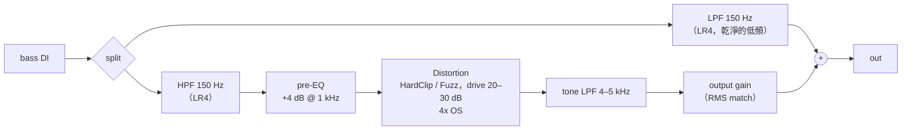

# 第 07 章 解答：Distortion

題目在 [`../exercises/README.md`](../exercises/README.md)。實作題的完整程式在本資料夾（`ex3_wavefolder.cpp`、`ex4_cab_sim.cpp`、`ex5_auto_gain.cpp`），每支都有 self-check，最後印出 `[PASS] l07_exN (...)`。

執行全部解答（Windows，在專案根目錄）：

```powershell
.\scripts\build.ps1 -Only 07-distortion -TestLabel solution
```

---

## 練習 1（計算）Quantization step 與 SNR

**1.** $\Delta = 2/2^N$，$\text{SNR} = 6.02N + 1.76$ dB（$A = 1$）：

| N | $\Delta$ | 理論 SNR |
|---|---|---|
| 4 | $2/16 = 0.125$ | $24.08 + 1.76 = 25.84$ dB |
| 8 | $2/256 = 0.0078125$ | $48.16 + 1.76 = 49.93$ dB |
| 12 | $2/4096 \approx 4.88 \times 10^{-4}$ | $72.25 + 1.76 = 74.01$ dB |
| 16 | $2/65536 \approx 3.05 \times 10^{-5}$ | $96.33 + 1.76 = 98.09$ dB |
| 24 | $2/2^{24} \approx 1.19 \times 10^{-7}$ | $144.49 + 1.76 = 146.26$ dB |

（24 bit 的 146 dB 只是理論值：實際的類比電路熱雜訊大約在 −120 dBFS 左右，所以 24 bit 的最後幾個 bit 其實都是雜訊。）

**2.** $49.93 + 20\log_{10}(0.1) = 49.93 - 20 = 29.93$ dB。範例 `l07_bitcrusher_sweep` 第 (2) 段印出 8 bit 量測 29.78 dB，差 0.14 dB。

**3.** $6.02N + 1.76 - 12 \ge 60 \Rightarrow N \ge 70.24 / 6.02 = 11.67$，所以至少 **12 bit**（12 bit 時 SNR = 74.01 − 12 = 62.0 dB）。

**4.** mid-tread 量化器的整數 code 範圍是 $[-2^{N-1}, 2^{N-1} - 1] = [-8, 7]$，最大正輸出是 $7 \times 0.125 = 0.875 = 1 - \Delta$。0 dBFS 正弦的正峰（$u > 0.9375$ 時四捨五入到 code 8，再被 clamp 回 7）會被**削平**到 0.875。這段 clip 失真不是均勻雜訊，會額外增加誤差功率，所以量測的 SNR（23.24 dB）比理論（25.84 dB）低。bit 數越多，$\Delta$ 越小、被削的部分越少，差距越小（8 bit −0.81 dB、16 bit −0.03 dB）。

**5.** $\Delta = 2 / 2^{5.5} = 2 / 45.25 \approx 0.0442$；SNR $= 6.02 \times 5.5 + 1.76 \approx 34.87$ dB。小數 bit 代表「階數不是 2 的整數次方」（$2^{5.5} \approx 45.25$ 階）。實作上 `quantize()` 把 code 限制在 $[-M, M-1]$、$M = \lfloor 2^{4.5} \rfloor = 22$，也就是 −22 … 21 共 44 個整數 code（README 2.6.1 節），輸出才會一直落在 $\Delta$ 的整數倍上。物理上不存在這種 ADC，但在效果器上很有用：bit depth 旋鈕可以**連續**地轉動、可以被 automation 平順地掃過，而不是每轉一格就跳 6 dB 的雜訊。

**6.** 量化誤差 $e$ 均勻分布在 $[-\Delta/2, \Delta/2]$：

$$
\sigma_e^2 = \frac{1}{\Delta}\int_{-\Delta/2}^{\Delta/2} e^2\,de = \frac{1}{\Delta}\cdot\frac{e^3}{3}\Big|_{-\Delta/2}^{\Delta/2} = \frac{1}{\Delta}\cdot\frac{2}{3}\cdot\frac{\Delta^3}{8} = \frac{\Delta^2}{12}
$$

訊號功率 $A^2/2$，$\Delta = 2^{1-N}$，所以 $\Delta^2 = 4 \cdot 2^{-2N}$：

$$
\text{SNR} = 10\log_{10}\frac{A^2/2}{4 \cdot 2^{-2N}/12} = 10\log_{10}\left(1.5 \cdot 2^{2N} \cdot A^2\right)
= \underbrace{10\log_{10}1.5}_{1.76} + N \cdot \underbrace{20\log_{10}2}_{6.02} + 20\log_{10}A
$$

---

## 練習 2（觀念）為什麼 full-wave rectify 會讓音高高八度？

**1. 週期。** $\sin\omega t$ 的週期是 $T = 2\pi/\omega$，負半週是正半週的「倒影」：$\sin(\omega t + \pi) = -\sin\omega t$。取絕對值之後負半週被翻成跟正半週一模一樣，所以 $|\sin\omega(t + T/2)| = |\sin\omega t|$：**週期變成 $T/2$，基頻變成 $2f$**，正好高一個八度。

**2. Fourier 級數。**

$$
|\sin\omega t| = \frac{2}{\pi} - \frac{4}{\pi}\sum_{k=1}^{\infty}\frac{\cos(2k\omega t)}{4k^2-1}
$$

只有 DC（$2/\pi \approx 0.637$）與 $2\omega, 4\omega, 6\omega, \dots$。**$\omega$ 的係數是 0**。$2\omega$ 的振幅 $4/(3\pi) = 0.424$（−7.4 dB）、$4\omega$ 的振幅 $4/(15\pi) = 0.085$（−21.4 dB），範例 `l07_distortion_types` 的 Rectify 列量到的正是 H2 = −7.4、H4 = −21.4 dBFS、H1 = −100（量不到）。

（推導：$|\sin\omega t|$ 是偶函數、週期 $\pi/\omega$，用 cosine 級數 $a_{2k} = \frac{2}{\pi}\int_0^{\pi}\sin\theta\cos 2k\theta\, d\theta = \frac{2}{\pi}\cdot\frac{-2}{4k^2-1}$。）

**3.** $\max(\sin\omega t, 0)$ 的週期仍然是 $T$——正半週保留、負半週變成 0，兩個半週不一樣，所以沒有 $T/2$ 的週期性：

$$
\max(\sin\omega t, 0) = \frac{1}{\pi} + \frac{1}{2}\sin\omega t - \frac{2}{\pi}\sum_{k=1}^{\infty}\frac{\cos(2k\omega t)}{4k^2-1}
$$

基頻還在（振幅 1/2），多了 DC（$1/\pi$）和偶次諧波。其實它就是 $\frac{1}{2}(\sin\omega t + |\sin\omega t|)$：一半原訊號 + 一半 full-wave，所以聽起來是「原音高 + 一點八度上方的鼻音」。

**4.** 不會。$|0.3 + \sin\omega t|$ 的正、負兩段不再對稱（正半週最高 1.3，負半週最低 −0.7 翻上來只有 0.7），週期又回到 $T$，**基頻重新出現**。這也是為什麼 octave fuzz 對輸入的 DC 或偏壓很敏感；`Distortion` 的 Rectify 前面的訊號應該是零均值的（吉他 DI 本來就是，但如果前面接了一個不對稱的 fuzz 就不是）。

**5.** 單音時 rectify 只產生 $2f$ 的整數倍，聽起來是乾淨的八度。和弦有 $f_1, f_2$ 兩個以上的頻率時，$|\cdot|$ 是非線性的，除了 $2f_1, 2f_2$ 之外還會產生 $f_1 + f_2$、$|f_1 - f_2|$ 等 intermodulation 成分，這些頻率通常不在和弦的音階上，聽起來就「髒、走音」。

---

## 練習 3（實作）Wavefolder —— `ex3_wavefolder.cpp`

**(a) 三角 folder**：把實數線「捲」到週期 $4T$ 的三角波上：

```cpp
float t = std::fmod(u + T, 4.0f * T);   // (-4T, 4T)
if (t < 0.0f) t += 4.0f * T;            // [0, 4T)
return t < 2.0f * T ? t - T : 3.0f * T - t;
```

驗證：$T = 1$、$u = 1.5$：$t = 2.5 \ge 2$，$y = 3 - 2.5 = 0.5$ ✓；$u = 3$：$t = 0$，$y = -1$ ✓；$u = -2.5$：$t = \text{fmod}(-1.5, 4) = -1.5 \to 2.5$，$y = 0.5$ ✓。self-check 確認 $u \in [-10, 10]$ 與 `Distortion::foldback()` 最大差異為 0。

**(b) sine folder**：$y = \sin(\pi u/2)$。$|u| \le 1$ 時單調遞增、像很軟的 soft clip；之後平滑地折返。它的**所有導數都連續**，而三角 folder 在折點的一階導數從 +1 跳到 −1。依照 README 2.1 節的規則，三角 folder 的諧波以 $1/n^2$ 衰減，sine folder 衰減得快得多。解答印出的表（220 Hz 正弦 × 2.0）：

| folder | H3 | H5 | H7 | H9 |
|---|---|---|---|---|
| triangle | +2.0 | −11.9 | −20.9 | −18.0 |
| sine | +1.4 | −14.7 | −38.4 | −67.1 |

（相對 H1 的 dB。）sine folder 到 H9 已經掉到 −67 dB，三角 folder 還有 −18 dB——sine 版本聲音比較圓，也比較不容易 alias。數學上，$\sin(\frac{\pi}{2}\cdot 2\sin\theta) = \sin(\pi\sin\theta) = 2\sum_{k\,\text{odd}} J_k(\pi)\sin k\theta$（Jacobi–Anger 展開），諧波大小由 Bessel 函數 $J_k(\pi)$ 決定，$k$ 超過 $\pi$ 之後急速衰減。

**(c) Wavefolder class**：`Oversampler oversampler_{2}`（4x）→ `upsample()` → 每個 sample `foldTriangle(x * drive, T)` → `downsample()`。結果：drive 0 dB、0.25 振幅時 THD = 0.0000%（完全在 $|u| < T$ 的透明區）；drive 18 dB 時 THD = 125.5%、peak 0.990；latency 36 samples（第 06 章 4x oversampler）。輸出 `l07_ex3_wavefolder.wav`（threshold 0.5、drive 14 dB 的 pluck sequence）。

---

## 練習 4（實作）Cabinet simulator —— `ex4_cab_sim.cpp`

四顆 biquad 串接，`processSample` 依序呼叫；`magnitudeDb` 把四個 `getCoefficients().magnitudeDb(f, fs)` 相加（串接的線性系統：響應相乘 = dB 相加）。

執行結果：

| 頻率 | 分析式 | 實測 |
|---|---|---|
| 30 Hz | −14.67 | −14.67 |
| 70 Hz | −1.18 | −1.18 |
| 100 Hz | +3.07 | +3.07 |
| 200 Hz | +0.61 | +0.61 |
| 1 kHz | −0.00 | −0.00 |
| 2.25 kHz | −0.48 | −0.48 |
| 4.5 kHz | −6.02 | −6.02 |
| 9 kHz | −27.80 | −27.80 |
| 15 kHz | −55.47 | −55.47 |

重點：

- **LR4 在 cutoff 處 −6.02 dB**：一顆 Q = $1/\sqrt2$ 的 2 階 Butterworth 在 cutoff 處 $|H|^2 = 1/2$（−3.01 dB），兩顆串接 −6.02 dB。
- **100 Hz 是 +3.07 而不是 +4**：peak filter 本身在 100 Hz 是 +4 dB，但 70 Hz 的 highpass 在 100 Hz 還有約 −0.9 dB 的損失。
- **9 kHz 的 frequency warping**：類比 2 階 Butterworth lowpass $|H(j\Omega)|^2 = 1/(1 + (\Omega/\Omega_c)^4)$；一個 octave 上方 $\Omega/\Omega_c = 2$，兩顆串接是 $-20\log_{10}(1 + 16) = -24.6$ dB。但 RBJ cookbook 用 bilinear transform，數位頻率 $f$ 對應到類比頻率 $\propto \tan(\pi f / f_s)$，所以等效比例是

  $$
  r = \frac{\tan(\pi \cdot 9000/48000)}{\tan(\pi \cdot 4500/48000)} = \frac{0.6682}{0.3033} = 2.203
  $$

  $-20\log_{10}(1 + r^4) = -20\log_{10}(1 + 23.56) = -27.80$ dB，和量測完全一致。越接近 Nyquist 掉得越快（在 $f_s/2$ 是 $-\infty$）。對 cab sim 來說這反而是好事。

輸出 `l07_ex4_cab_noise.wav`：白雜訊（white noise）經過 cab sim，聽起來像「對著音箱錄的雜訊」——悶、中頻集中、底部有一點共鳴。

---

## 練習 5（實作）Auto gain compensation —— `ex5_auto_gain.cpp`

核心迴圈：

```cpp
inMs  = a * inMs  + (1 - a) * x[i] * x[i];
outMs = a * outMs + (1 - a) * y[i] * y[i];
const float g = std::clamp(std::sqrt(inMs / std::max(outMs, 1e-12f)), 0.01f, 100.0f);
y[i] *= g;
```

設計細節：

- 兩個偵測器時間常數相同，穩態時 $g \to \text{RMS}_\text{in} / \text{RMS}_\text{out}$，所以輸出 RMS = 輸入 RMS。
- 分母下限 $10^{-12}$ 與 ±40 dB 的 clamp：靜音時 $0/0$ 不會變 NaN；從靜音到有聲的瞬間 gain 也不會暴衝（self-check (3)：全靜音輸入、輸出必須全 0）。
- 每個 sample 的 gain 都在連續變化，不需要另外 ramp；狀態在 block 結尾把 < $10^{-30}$ 的值清成 0，避免 denormal。

**估算 (1) 的增益**：輸入 $0.1\sin\theta$，RMS $= 0.0707$（−23.01 dBFS）。drive 30 dB 後 $u = 3.16\sin\theta$，$|u| < 1$ 只在 $\theta < \theta_0 = \arcsin(1/3.16) = 0.3217$ rad 時成立，其餘被 clip 在 ±1。在四分之一週期上平均：

$$
\overline{y^2} = \frac{2}{\pi}\left[\int_0^{\theta_0} 10\sin^2\theta\,d\theta + \left(\frac{\pi}{2} - \theta_0\right)\right]
= \frac{2}{\pi}\left[10\left(\frac{\theta_0}{2} - \frac{\sin 2\theta_0}{4}\right) + 1.249\right] \approx 0.864
$$

RMS $\approx 0.930$（−0.63 dBFS）。增益 $= -23.01 - (-0.63) = -22.38$ dB；解答量到 −22.38 dB。（如果把輸出當作純方波，RMS = 1，會估成 −23.0 dB——差 0.6 dB，因為 drive 30 dB 的 clip 還不是完美的方波。）

**(2)** pluck、Fuzz 30 dB：輸入 RMS −19.71、無補償 −3.10（大了 16.6 dB）、有補償 −19.55 dBFS（差 0.16 dB）。

**延伸思考**：$\tau$ 太短（1 ms，大約一個 220 Hz 週期的 1/4）時，mean square 會跟著波形本身起伏，$g$ 在一個週期內就忽大忽小，等於又做了一次 amplitude modulation——產生新的失真，而且把 pluck 的 attack 抹平（變成一台很快的 compressor）。$\tau$ 太長（2 s）時，音頭剛進來的那段 gain 還停留在「靜音時的值」（最高 +40 dB，或上一個音的值），會先爆出一段大音量，然後慢慢收斂；音符之間的音量變化也會被「延遲」反應。100 ms 左右是常見的折衷，跟 VU 表 / short-term loudness 的時間尺度差不多。

---

## 練習 6（計算）Alias 會落在哪裡？

**1.** 7 kHz、$f_s = 48$ kHz，奇次諧波：

| 諧波 | 頻率 | $k = \text{round}(f/f_s)$ | 實際出現在 | 判斷 |
|---|---|---|---|---|
| 3 | 21 kHz | 0 | 21 kHz | 真的諧波（< 24 kHz） |
| 5 | 35 kHz | 1 | 13 kHz | alias |
| 7 | 49 kHz | 1 | 1 kHz | alias（比基頻還低！） |
| 9 | 63 kHz | 1 | 15 kHz | alias |
| 11 | 77 kHz | 2 | 19 kHz | alias |
| 13 | 91 kHz | 2 | 5 kHz | alias |
| 15 | 105 kHz | 2 | 9 kHz | alias |

只有基頻與 H3 是真的；1、5、9、13、15、19 kHz 都不是 7 kHz 的整數倍，聽起來是不和諧的金屬聲。注意 1 kHz 的 alias 比基頻還低——高音的 hard clip 在 1x 下會「長出低音」。

**2.** $27 \times 7 = 189$ kHz，在 192 kHz 下 $k = 1$，折到 $|189 - 192| = 3$ kHz。之後 3 kHz 在 downsample 的 passband 裡，**會原封不動地留下來**——oversampler 的 filter 只能擋住「在高取樣率下還沒折回來」的成分，已經在高取樣率裡折回來的 alias 救不了。理想方波的第 27 次諧波是基頻的 $1/27$，即 $-20\log_{10}27 = -28.6$ dB；實際的 clip 波形是梯形，高次諧波衰減更快，所以真正的值會更小。這就是為什麼 hard clip 常用 8x 甚至 16x，或配合 ADAA（README 延伸閱讀）。

（對照 README 2.8 節：範例 `l07_oversampling_aliasing` 用 5 kHz 正弦時，2x 與 4x 都被第 39 次諧波（195 kHz）折回 3 kHz，所以兩者的 alias 只差 2–4 dB；8x 要到第 153 次諧波才折回 3 kHz，alias 再低 24–31 dB。同樣的方法套在本題的 7 kHz：4x 下第 27 次諧波 189 kHz → 3 kHz；2x（96 kHz）下第 27 次諧波是 $|189 - 2 \times 96| = 3$ kHz，也是同一個——又一次 2x 跟 4x 被同一個諧波打中。）

**3.** $f_s' = 48000 / 4 = 12$ kHz，Nyquist 6 kHz。3 kHz < 6 kHz，**本身不會 alias**。但 sample & hold 會在 $k f_s' \pm f$ 產生 image：9 kHz（$12 - 3$）、15 kHz、21 kHz ……大小由 ZOH 決定：

- 3 kHz：$\left|\frac{\sin(\pi/4)}{\pi/4}\right| = 0.900 \to -0.91$ dB
- 9 kHz：$\left|\frac{\sin(3\pi/4)}{3\pi/4}\right| = 0.300 \to -10.45$ dB

（離散時間的精確值用 Dirichlet kernel $\left|\frac{\sin(\pi f D/f_s)}{D\sin(\pi f/f_s)}\right|$：3 kHz 是 −0.86 dB、9 kHz 是 −9.95 dB，跟 sinc 近似差 0.5 dB 以內。）原本純淨的 3 kHz 正弦多了一個只小 10 dB 的 9 kHz——這就是 lo-fi 取樣機「金屬、有顆粒」的聲音來源。

**4.** 因為這個 image / alias 就是 bitcrusher **想要的效果**。sample & hold 的「階梯」是在原始取樣率上定義的（每 $D$ 個 sample hold 一次）；在 4x 下做，hold 的時間位置會變，而 downsample filter 會把高於 24 kHz 的部分濾掉、改變階梯的形狀，結果反而不是使用者預期的 lo-fi 聲音。量化雜訊同理：它本來就分布在 0~24 kHz，不是「超過 Nyquist 的諧波」，oversampling 沒有東西可以擋。範例 `l07_oversampling_aliasing` 第 (2) 段量到 1x 與 4x 完全一樣（7 kHz 都是 −64.0 dBFS）。

---

## 練習 7（設計）Amp chain 裡各級的順序為什麼重要？

**1.** 線性非時變系統滿足 $H_1(H_2 x) = H_2(H_1 x)$，因為頻域上就是 $H_1(f) H_2(f) X(f)$，乘法可交換。waveshaper $f(\cdot)$ 不是線性的：$f(a + b) \ne f(a) + f(b)$，所以 $H \cdot f(x) \ne f(H x)$。例如 $H$ = 低頻 −12 dB，$f$ = hard clip：先 $H$ 再 $f$，低頻因為變小而**不再被 clip**；先 $f$ 再 $H$，低頻**已經被 clip**（已經產生了諧波和 intermodulation），之後只是把被 clip 過的低頻調小聲而已。

**2.** 低音弦的和弦（例如 E 和 B，82 Hz 與 123 Hz）送進非線性之後，除了各自的諧波，還有 intermodulation 成分。這條 amp chain 的 preamp（tanh）與 power amp（hard clip）都是對稱曲線，只會產生**奇數階**的 IMD：$2f_1 - f_2 \approx 41$ Hz、$2f_2 - f_1 \approx 164$ Hz、$2f_1 + f_2 \approx 287$ Hz、$2f_2 + f_1 \approx 328$ Hz……（若前面有不對稱的級，例如 fuzz，還會多出 $f_2 - f_1 = 41$ Hz、$f_1 + f_2 = 205$ Hz 這類二階成分——理由和 README 2.2 節「對稱 → 只有奇次諧波」相同），而且低頻能量大、佔掉了 clip 的「預算」，讓高頻的失真也被調變。結果是糊、轟轟的、和弦聽不清楚。HPF 放在 preamp **前面**，低頻在進入非線性之前就變小，IMD 少很多；放在後面時 IMD 已經產生了，41 Hz 那種 HPF 擋得掉，但 164 Hz 這種落在中低頻的 IMD 擋不掉。

**3.** 放在兩個非線性級**之間**：bass 旋鈕改變的是「送進 power amp 的低頻有多少」，所以它同時改變**低頻的失真量**——bass 推大時 power amp 更容易被低頻推到 clip，整體聲音變得更壓縮、更「鬆」，甚至高音的失真也變多（因為低頻把波形頂到 clip 區）。這是真實 amp 的 tone stack 會「互相影響、而且跟 gain 有關」的原因。放在**最後面**：bass 旋鈕就只是一個單純的 EQ，只改低頻音量、不改失真的質感（跟在 DAW 的 mixer 上加 EQ 一樣）。兩種都有用，但聲音不同。

**4.** cabinet 是一個強力的 lowpass。放在 power amp **前面**時，它確實把 preamp 產生的高次諧波砍掉了，但 power amp 的 hard clip 會**重新產生**一整串高次諧波（而且沒有任何東西擋在後面），結果還是刺耳的「蚊子叫」——cabinet 的作用幾乎被抵銷。物理上喇叭本來就在最後：所有電路產生的聲音最後都要經過喇叭這個「機械 lowpass」才變成聲波。

**5.** 放在最前面（input HPF 附近、preamp 之前）。理由見 README 2.9 節：失真會把底噪完整放大 drive 的 dB 數，訊號卻被 clip 住只上升一點，SNR 大約損失「drive − 訊號原本的 headroom」；在 distortion 之前，訊號與雜訊的差距最大（例如 50 dB），threshold 很好設。放在 cabinet 後面時，彈奏中的音尾和停止時的雜訊可能只差 20–30 dB，gate 要不是切掉音尾、就是放過雜訊。另一個常見做法是「gate 的偵測訊號取自最前端（sidechain），但衰減作用在最後」，這樣也能擋住 distortion 本身產生的雜訊——第 08 章的 `Gate::process(main, sidechain)` 正好支援這種接法。

**6.** 一個合理的設計（parallel / multiband 的想法）：



- crossover 用 Linkwitz-Riley（LR4）：LPF 與 HPF 在 150 Hz 各 −6 dB、相位一致，在 distortion drive = 0 時兩路相加是平坦的 allpass。
- 低頻路徑完全不經過非線性 → 基音飽滿、和弦也不會產生 IMD 爛泥。
- 高頻路徑先 pre-EQ 推中頻，讓「咆哮」的部分先失真；distortion 後用 tone LPF 擋掉刺耳的高次諧波，再用 output gain 把高頻路徑的音量拉回跟低頻差不多（不然一推 drive 高頻路徑就蓋過低頻）。
- **latency 對齊**：distortion 有 oversampler latency（4x 時 36 samples），低頻路徑必須補上同樣的延遲，否則相加時在 crossover 附近會 comb filtering。這跟 `Distortion` 內部讓 dry 路徑延遲 latency 個 sample 是同一個道理。
- 如果需要 noise gate，放在 split 之前（或至少放在高頻路徑的 distortion 之前）。
