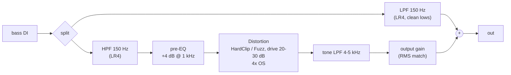

# Chapter 07 Solutions: Distortion

**English** | [繁體中文](README.zh-TW.md)

The problems are in [`../exercises/README.md`](../exercises/README.md). The complete programs for the implementation problems are in this folder (`ex3_wavefolder.cpp`, `ex4_cab_sim.cpp`, `ex5_auto_gain.cpp`); each has self-checks and finally prints `[PASS] l07_exN (...)`.

Run all the solutions (Windows, from the project root):

```powershell
.\scripts\build.ps1 -Only 07-distortion -TestLabel solution
```

---

## Exercise 1 (Calculation) Quantization step and SNR

**1.** $`\Delta = 2/2^N`$, $`\text{SNR} = 6.02N + 1.76`$ dB ($`A = 1`$):

| N | $`\Delta`$ | Theoretical SNR |
|---|---|---|
| 4 | $`2/16 = 0.125`$ | $`24.08 + 1.76 = 25.84`$ dB |
| 8 | $`2/256 = 0.0078125`$ | $`48.16 + 1.76 = 49.93`$ dB |
| 12 | $`2/4096 \approx 4.88 \times 10^{-4}`$ | $`72.25 + 1.76 = 74.01`$ dB |
| 16 | $`2/65536 \approx 3.05 \times 10^{-5}`$ | $`96.33 + 1.76 = 98.09`$ dB |
| 24 | $`2/2^{24} \approx 1.19 \times 10^{-7}`$ | $`144.49 + 1.76 = 146.26`$ dB |

(The 146 dB of 24 bit is only a theoretical value: the thermal noise of real analog circuits is around −120 dBFS, so the last few bits of a 24-bit converter are really just noise.)

**2.** $`49.93 + 20\log_{10}(0.1) = 49.93 - 20 = 29.93`$ dB. Part (2) of the example `l07_bitcrusher_sweep` prints 29.78 dB measured for 8 bit, a difference of 0.14 dB.

**3.** $`6.02N + 1.76 - 12 \ge 60 \Rightarrow N \ge 70.24 / 6.02 = 11.67`$, so at least **12 bit** (at 12 bit, SNR = 74.01 − 12 = 62.0 dB).

**4.** The integer code range of a mid-tread quantizer is $`[-2^{N-1}, 2^{N-1} - 1] = [-8, 7]`$, and the maximum positive output is $`7 \times 0.125 = 0.875 = 1 - \Delta`$. The positive peak of a 0 dBFS sine (for $`u > 0.9375`$ it rounds to code 8 and is then clamped back to 7) is **flattened** to 0.875. This clipping distortion is not uniform noise and adds extra error power, so the measured SNR (23.24 dB) is lower than theory (25.84 dB). The more bits, the smaller $`\Delta`$ and the less is cut off, so the gap shrinks (8 bit −0.81 dB, 16 bit −0.03 dB).

**5.** $`\Delta = 2 / 2^{5.5} = 2 / 45.25 \approx 0.0442`$; SNR $`= 6.02 \times 5.5 + 1.76 \approx 34.87`$ dB. A fractional bit count means "the number of levels is not an integer power of 2" ($`2^{5.5} \approx 45.25`$ levels). In the implementation, `quantize()` restricts the code to $`[-M, M-1]`$ with $`M = \lfloor 2^{4.5} \rfloor = 22`$, i.e. the 44 integer codes −22 ... 21 (README Section 2.6.1), so the output always lands on integer multiples of $`\Delta`$. No such ADC exists physically, but it is very useful in an effect: the bit-depth knob can be turned **continuously** and swept smoothly by automation, instead of jumping 6 dB of noise with every notch.

**6.** The quantization error $`e`$ is uniformly distributed over $`[-\Delta/2, \Delta/2]`$:

```math
\sigma_e^2 = \frac{1}{\Delta}\int_{-\Delta/2}^{\Delta/2} e^2\,de = \frac{1}{\Delta}\cdot\frac{e^3}{3}\Big|_{-\Delta/2}^{\Delta/2} = \frac{1}{\Delta}\cdot\frac{2}{3}\cdot\frac{\Delta^3}{8} = \frac{\Delta^2}{12}
```

The signal power is $`A^2/2`$ and $`\Delta = 2^{1-N}`$, so $`\Delta^2 = 4 \cdot 2^{-2N}`$:

```math
\text{SNR} = 10\log_{10}\frac{A^2/2}{4 \cdot 2^{-2N}/12} = 10\log_{10}\left(1.5 \cdot 2^{2N} \cdot A^2\right)
= \underbrace{10\log_{10}1.5}_{1.76} + N \cdot \underbrace{20\log_{10}2}_{6.02} + 20\log_{10}A
```

---

## Exercise 2 (Conceptual) Why does full-wave rectify raise the pitch an octave?

**1. The period.** The period of $`\sin\omega t`$ is $`T = 2\pi/\omega`$, and the negative half-cycle is the "mirror image" of the positive one: $`\sin(\omega t + \pi) = -\sin\omega t`$. After taking the absolute value, the negative half-cycle is flipped to be identical to the positive one, so $`|\sin\omega(t + T/2)| = |\sin\omega t|`$: **the period becomes $`T/2`$ and the fundamental becomes $`2f`$**, exactly one octave higher.

**2. The Fourier series.**

```math
|\sin\omega t| = \frac{2}{\pi} - \frac{4}{\pi}\sum_{k=1}^{\infty}\frac{\cos(2k\omega t)}{4k^2-1}
```

There is only DC ($`2/\pi \approx 0.637`$) and $`2\omega, 4\omega, 6\omega, \dots`$. **The coefficient of $`\omega`$ is 0**. The amplitude of $`2\omega`$ is $`4/(3\pi) = 0.424`$ (−7.4 dB) and that of $`4\omega`$ is $`4/(15\pi) = 0.085`$ (−21.4 dB); the Rectify row of the example `l07_distortion_types` measures exactly H2 = −7.4, H4 = −21.4 dBFS, and H1 = −100 (unmeasurable).

(Derivation: $`|\sin\omega t|`$ is an even function with period $`\pi/\omega`$; with the cosine series, $`a_{2k} = \frac{2}{\pi}\int_0^{\pi}\sin\theta\cos 2k\theta\, d\theta = \frac{2}{\pi}\cdot\frac{-2}{4k^2-1}`$.)

**3.** The period of $`\max(\sin\omega t, 0)`$ is still $`T`$ -- the positive half-cycle is kept and the negative becomes 0; the two half-cycles differ, so there is no $`T/2`$ periodicity:

```math
\max(\sin\omega t, 0) = \frac{1}{\pi} + \frac{1}{2}\sin\omega t - \frac{2}{\pi}\sum_{k=1}^{\infty}\frac{\cos(2k\omega t)}{4k^2-1}
```

The fundamental is still there (amplitude 1/2), plus DC ($`1/\pi`$) and the even harmonics. In fact it is just $`\frac{1}{2}(\sin\omega t + |\sin\omega t|)`$: half the original signal plus half full-wave, so it sounds like "the original pitch plus a bit of nasal tone an octave above".

**4.** No. The positive and negative parts of $`|0.3 + \sin\omega t|`$ are no longer symmetric (the positive half-cycle peaks at 1.3, while the negative half-cycle, at −0.7, flips up to only 0.7), the period returns to $`T`$, and **the fundamental reappears**. This is also why an octave fuzz is sensitive to DC or bias at its input; the signal in front of the `Distortion` Rectify should have zero mean (a guitar DI does, but not if an asymmetric fuzz comes before it).

**5.** With a single note, rectify produces only integer multiples of $`2f`$, which sound like a clean octave. When a chord has two or more frequencies $`f_1, f_2`$, the $`|\cdot|`$ is nonlinear, and besides $`2f_1, 2f_2`$ it also produces intermodulation components such as $`f_1 + f_2`$ and $`|f_1 - f_2|`$; these frequencies are usually not on the chord's scale and sound "dirty and out of tune".

---

## Exercise 3 (Implementation) Wavefolder -- `ex3_wavefolder.cpp`

**(a) The triangle folder**: "roll" the real line onto a triangle wave of period $`4T`$:

```cpp
float t = std::fmod(u + T, 4.0f * T);   // (-4T, 4T)
if (t < 0.0f) t += 4.0f * T;            // [0, 4T)
return t < 2.0f * T ? t - T : 3.0f * T - t;
```

Verification: $`T = 1`$, $`u = 1.5`$: $`t = 2.5 \ge 2`$, $`y = 3 - 2.5 = 0.5`$ ✓; $`u = 3`$: $`t = 0`$, $`y = -1`$ ✓; $`u = -2.5`$: $`t = \text{fmod}(-1.5, 4) = -1.5 \to 2.5`$, $`y = 0.5`$ ✓. The self-check confirms that the maximum difference from `Distortion::foldback()` over $`u \in [-10, 10]`$ is 0.

**(b) The sine folder**: $`y = \sin(\pi u/2)`$. It is monotonically increasing for $`|u| \le 1`$, like a very soft soft clip, and then folds back smoothly. **All its derivatives are continuous**, whereas the first derivative of the triangle folder jumps from +1 to −1 at the fold points. By the rule of README Section 2.1, the harmonics of the triangle folder decay as $`1/n^2`$ and those of the sine folder decay much faster. The table the solution prints (220 Hz sine × 2.0):

| folder | H3 | H5 | H7 | H9 |
|---|---|---|---|---|
| triangle | +2.0 | −11.9 | −20.9 | −18.0 |
| sine | +1.4 | −14.7 | −38.4 | −67.1 |

(dB relative to H1.) By H9 the sine folder has already fallen to −67 dB, while the triangle folder is still at −18 dB -- the sine version sounds rounder and also aliases less easily. Mathematically, $`\sin(\frac{\pi}{2}\cdot 2\sin\theta) = \sin(\pi\sin\theta) = 2\sum_{k\,\text{odd}} J_k(\pi)\sin k\theta`$ (the Jacobi-Anger expansion); the harmonic levels are determined by the Bessel functions $`J_k(\pi)`$, which decay rapidly once $`k`$ exceeds $`\pi`$.

**(c) The Wavefolder class**: `Oversampler oversampler_{2}` (4x) → `upsample()` → `foldTriangle(x * drive, T)` for every sample → `downsample()`. Results: at drive 0 dB and amplitude 0.25, THD = 0.0000% (entirely in the transparent region $`|u| < T`$); at drive 18 dB, THD = 125.5% and peak 0.990; latency 36 samples (the Chapter 06 4x oversampler). It writes `l07_ex3_wavefolder.wav` (the pluck sequence at threshold 0.5, drive 14 dB).

---

## Exercise 4 (Implementation) Cabinet simulator -- `ex4_cab_sim.cpp`

Four biquads in cascade, called in order by `processSample`; `magnitudeDb` adds up the four `getCoefficients().magnitudeDb(f, fs)` values (cascaded linear systems: responses multiply = dB values add).

Run results:

| Frequency | Analytic | Measured |
|---|---|---|
| 30 Hz | −14.67 | −14.67 |
| 70 Hz | −1.18 | −1.18 |
| 100 Hz | +3.07 | +3.07 |
| 200 Hz | +0.61 | +0.61 |
| 1 kHz | −0.00 | −0.00 |
| 2.25 kHz | −0.48 | −0.48 |
| 4.5 kHz | −6.02 | −6.02 |
| 9 kHz | −27.80 | −27.80 |
| 15 kHz | −55.47 | −55.47 |

Key points:

- **The LR4 is −6.02 dB at the cutoff**: a 2nd-order Butterworth with Q = $`1/\sqrt2`$ has $`|H|^2 = 1/2`$ (−3.01 dB) at the cutoff, and two in cascade give −6.02 dB.
- **100 Hz is +3.07 rather than +4**: the peak filter alone is +4 dB at 100 Hz, but the 70 Hz highpass still has a loss of about −0.9 dB at 100 Hz.
- **Frequency warping at 9 kHz**: the analog 2nd-order Butterworth lowpass has $`|H(j\Omega)|^2 = 1/(1 + (\Omega/\Omega_c)^4)`$; one octave above, $`\Omega/\Omega_c = 2`$, and two in cascade give $`-20\log_{10}(1 + 16) = -24.6`$ dB. But the RBJ cookbook uses the bilinear transform, under which the digital frequency $`f`$ corresponds to an analog frequency $`\propto \tan(\pi f / f_s)`$, so the equivalent ratio is

  ```math
  r = \frac{\tan(\pi \cdot 9000/48000)}{\tan(\pi \cdot 4500/48000)} = \frac{0.6682}{0.3033} = 2.203
  ```

  $`-20\log_{10}(1 + r^4) = -20\log_{10}(1 + 23.56) = -27.80`$ dB, in perfect agreement with the measurement. The closer to Nyquist, the faster it falls (at $`f_s/2`$ it is $`-\infty`$). For a cab sim this is actually a good thing.

It writes `l07_ex4_cab_noise.wav`: white noise through the cab sim, which sounds like "noise recorded in front of a speaker cabinet" -- muffled, concentrated in the mids, with a little resonance at the bottom.

---

## Exercise 5 (Implementation) Auto gain compensation -- `ex5_auto_gain.cpp`

The core loop:

```cpp
inMs  = a * inMs  + (1 - a) * x[i] * x[i];
outMs = a * outMs + (1 - a) * y[i] * y[i];
const float g = std::clamp(std::sqrt(inMs / std::max(outMs, 1e-12f)), 0.01f, 100.0f);
y[i] *= g;
```

Design details:

- The two detectors have the same time constant, so at steady state $`g \to \text{RMS}_\text{in} / \text{RMS}_\text{out}`$, and the output RMS = the input RMS.
- The denominator floor $`10^{-12}`$ and the ±40 dB clamp: $`0/0`$ during silence does not become NaN, and the gain does not shoot up at the moment silence turns into sound (self-check (3): a completely silent input must give an all-0 output).
- The gain changes continuously every sample, so no separate ramp is needed; at the end of the block, the state flushes values < $`10^{-30}`$ to 0 to avoid denormals.

**Estimating the gain in (1)**: the input is $`0.1\sin\theta`$, with RMS $`= 0.0707`$ (−23.01 dBFS). After 30 dB of drive, $`u = 3.16\sin\theta`$, and $`|u| < 1`$ holds only for $`\theta < \theta_0 = \arcsin(1/3.16) = 0.3217`$ rad; the rest is clipped at ±1. Averaging over a quarter period:

```math
\overline{y^2} = \frac{2}{\pi}\left[\int_0^{\theta_0} 10\sin^2\theta\,d\theta + \left(\frac{\pi}{2} - \theta_0\right)\right]
= \frac{2}{\pi}\left[10\left(\frac{\theta_0}{2} - \frac{\sin 2\theta_0}{4}\right) + 1.249\right] \approx 0.864
```

RMS $`\approx 0.930`$ (−0.63 dBFS). The gain $`= -23.01 - (-0.63) = -22.38`$ dB; the solution measures −22.38 dB. (If the output were treated as a pure square wave, RMS = 1 and you would estimate −23.0 dB -- 0.6 dB off, because the clip at 30 dB of drive is not yet a perfect square wave.)

**(2)** pluck, Fuzz 30 dB: input RMS −19.71, uncompensated −3.10 (16.6 dB louder), compensated −19.55 dBFS (0.16 dB off).

**Food for thought**: when $`\tau`$ is too short (1 ms, about 1/4 of a 220 Hz period), the mean square follows the waveform itself, and $`g`$ swings up and down within a single period, which amounts to another round of amplitude modulation -- creating new distortion and smearing the attack of the pluck (it becomes a very fast compressor). When $`\tau`$ is too long (2 s), at the moment a note starts the gain is still sitting at "the value from the silence" (up to +40 dB, or the value of the previous note), so a loud burst comes out first and then slowly converges; level changes between notes are also "delayed" in their response. Around 100 ms is the usual compromise, about the same time scale as a VU meter / short-term loudness.

---

## Exercise 6 (Calculation) Where do the aliases land?

**1.** 7 kHz, $`f_s = 48`$ kHz, odd harmonics:

| Harmonic | Frequency | $`k = \text{round}(f/f_s)`$ | Actually appears at | Verdict |
|---|---|---|---|---|
| 3 | 21 kHz | 0 | 21 kHz | True harmonic (< 24 kHz) |
| 5 | 35 kHz | 1 | 13 kHz | alias |
| 7 | 49 kHz | 1 | 1 kHz | alias (lower than the fundamental!) |
| 9 | 63 kHz | 1 | 15 kHz | alias |
| 11 | 77 kHz | 2 | 19 kHz | alias |
| 13 | 91 kHz | 2 | 5 kHz | alias |
| 15 | 105 kHz | 2 | 9 kHz | alias |

Only the fundamental and H3 are real; 1, 5, 9, 13, 15, and 19 kHz are not integer multiples of 7 kHz and sound like inharmonic metallic noise. Note that the 1 kHz alias is lower than the fundamental -- a hard clip on a high note at 1x "grows a bass note".

**2.** $`27 \times 7 = 189`$ kHz, which at 192 kHz has $`k = 1`$ and folds to $`|189 - 192| = 3`$ kHz. After that, 3 kHz lies inside the downsampling passband and **stays exactly as it is** -- the oversampler's filter can only block components that "have not yet folded back at the high sample rate"; an alias that has already folded at the high rate cannot be rescued. The 27th harmonic of an ideal square wave is $`1/27`$ of the fundamental, i.e. $`-20\log_{10}27 = -28.6`$ dB; the real clipped waveform is a trapezoid whose high harmonics decay faster, so the real value is smaller. This is why hard clip often uses 8x or even 16x, or is combined with ADAA (see Further Reading in the README).

(Compare README Section 2.8: with the 5 kHz sine in the example `l07_oversampling_aliasing`, both 2x and 4x are folded back to 3 kHz by the 39th harmonic (195 kHz), so their aliases differ by only 2-4 dB; at 8x it takes the 153rd harmonic to fold back to 3 kHz, and the alias is another 24-31 dB lower. Applying the same method to this problem's 7 kHz: at 4x the 27th harmonic 189 kHz → 3 kHz; at 2x (96 kHz) the 27th harmonic is $`|189 - 2 \times 96| = 3`$ kHz, the same one -- once again 2x and 4x are hit by the same harmonic.)

**3.** $`f_s' = 48000 / 4 = 12`$ kHz, with a Nyquist of 6 kHz. 3 kHz < 6 kHz, so **it does not alias itself**. But sample & hold creates images at $`k f_s' \pm f`$: 9 kHz ($`12 - 3`$), 15 kHz, 21 kHz ... with levels set by the ZOH:

- 3 kHz: $`\left|\frac{\sin(\pi/4)}{\pi/4}\right| = 0.900 \to -0.91`$ dB
- 9 kHz: $`\left|\frac{\sin(3\pi/4)}{3\pi/4}\right| = 0.300 \to -10.45`$ dB

(The exact discrete-time value uses the Dirichlet kernel $`\left|\frac{\sin(\pi f D/f_s)}{D\sin(\pi f/f_s)}\right|`$: −0.86 dB at 3 kHz and −9.95 dB at 9 kHz, within 0.5 dB of the sinc approximation.) The originally pure 3 kHz sine gains a 9 kHz component only 10 dB down -- this is where the "metallic, grainy" sound of a lo-fi sampler comes from.

**4.** Because this image / alias is exactly the **effect the bitcrusher wants**. The "staircase" of sample & hold is defined at the original sample rate (hold once every $`D`$ samples); doing it at 4x would change the timing positions of the hold, and the downsampling filter would remove everything above 24 kHz and change the shape of the staircase, so the result is no longer the lo-fi sound the user expects. The same goes for quantization noise: it is already spread over 0-24 kHz and is not "harmonics beyond Nyquist", so oversampling has nothing to block. Part (2) of the example `l07_oversampling_aliasing` measures 1x and 4x as exactly identical (both −64.0 dBFS at 7 kHz).

---

## Exercise 7 (Design) Why does the order of the amp chain stages matter?

**1.** A linear time-invariant system satisfies $`H_1(H_2 x) = H_2(H_1 x)`$, because in the frequency domain it is $`H_1(f) H_2(f) X(f)`$ and multiplication commutes. A waveshaper $`f(\cdot)`$ is not linear: $`f(a + b) \ne f(a) + f(b)`$, so $`H \cdot f(x) \ne f(H x)`$. For example, let $`H`$ = −12 dB on the lows and $`f`$ = hard clip: applying $`H`$ then $`f`$, the lows are made smaller and are **no longer clipped**; applying $`f`$ then $`H`$, the lows **have already been clipped** (harmonics and intermodulation have already been generated), and afterwards the clipped lows are merely turned down.

**2.** When a chord on the low strings (for example E and B, 82 Hz and 123 Hz) is fed into a nonlinearity, besides the harmonics of each note there are intermodulation components. The preamp (tanh) and power amp (hard clip) of this amp chain are both symmetric curves and produce only **odd-order** IMD: $`2f_1 - f_2 \approx 41`$ Hz, $`2f_2 - f_1 \approx 164`$ Hz, $`2f_1 + f_2 \approx 287`$ Hz, $`2f_2 + f_1 \approx 328`$ Hz ... (if there is an asymmetric stage in front, such as a fuzz, second-order components such as $`f_2 - f_1 = 41`$ Hz and $`f_1 + f_2 = 205`$ Hz also appear -- for the same reason as "symmetric → only odd harmonics" in README Section 2.2), and the large low-frequency energy uses up the clipping "budget", so the distortion of the high frequencies is modulated too. The result is mud, rumble, and a chord you cannot make out. With the HPF **before** the preamp, the lows are made smaller before entering the nonlinearity and there is far less IMD; with it afterwards, the IMD has already been generated, and an HPF can block something like 41 Hz but not the 164 Hz IMD that lies in the low mids.

**3.** Placed **between** the two nonlinear stages: the bass knob changes "how much low end is sent into the power amp", so it also changes **the amount of distortion on the lows** -- turn the bass up and the power amp is more easily pushed into clipping by the lows, the overall sound becomes more compressed and "looser", and even the high notes get more distortion (because the lows push the waveform into the clipping region). This is why the tone stack of a real amp "interacts and depends on the gain". Placed at the **very end**: the bass knob is just a plain EQ that changes only the level of the lows and not the character of the distortion (like adding an EQ on the mixer in a DAW). Both are useful, but they sound different.

**4.** The cabinet is a powerful lowpass. Placed **before** the power amp, it does cut the high harmonics generated by the preamp, but the hard clip of the power amp **regenerates** a whole string of high harmonics (and nothing is left behind it to block them), so the result is still the harsh "mosquito" sound -- the cabinet's effect is almost cancelled. Physically the speaker is at the end anyway: everything the circuits produce finally passes through the speaker, a "mechanical lowpass", on its way to becoming a sound wave.

**5.** At the very front (near the input HPF, before the preamp). The reason is in README Section 2.9: distortion amplifies the noise floor by the full drive in dB while the signal is clipped and rises only a little, so SNR loses roughly "drive − the signal's original headroom"; before the distortion, the gap between signal and noise is the largest (for example 50 dB) and the threshold is easy to set. Placed after the cabinet, the note tails while playing and the noise after stopping may differ by only 20-30 dB, and the gate either cuts the tails or lets the noise through. Another common approach is "the gate's detection signal is taken from the very front (sidechain) while the attenuation acts at the end", which also blocks the noise generated by the distortion itself -- the `Gate::process(main, sidechain)` of Chapter 08 supports exactly this wiring.

**6.** A reasonable design (a parallel / multiband idea):



- The crossover uses Linkwitz-Riley (LR4): the LPF and HPF are each −6 dB at 150 Hz and in phase, so with the distortion drive = 0 the two paths sum to a flat allpass.
- The low path never goes through the nonlinearity → the fundamental stays full, and chords do not produce IMD mud.
- The high path first goes through a pre-EQ that pushes the mids, so the "growl" part distorts first; after the distortion, a tone LPF blocks the harsh high harmonics, and an output gain then pulls the level of the high path back to about that of the low path (otherwise the high path would drown out the lows as soon as you push the drive).
- **Latency alignment**: the distortion has the oversampler latency (36 samples at 4x), so the low path must be padded with the same delay, or the sum would have comb filtering around the crossover. This is the same principle as `Distortion` internally delaying its dry path by latency samples.
- If a noise gate is needed, put it before the split (or at least before the distortion in the high path).
