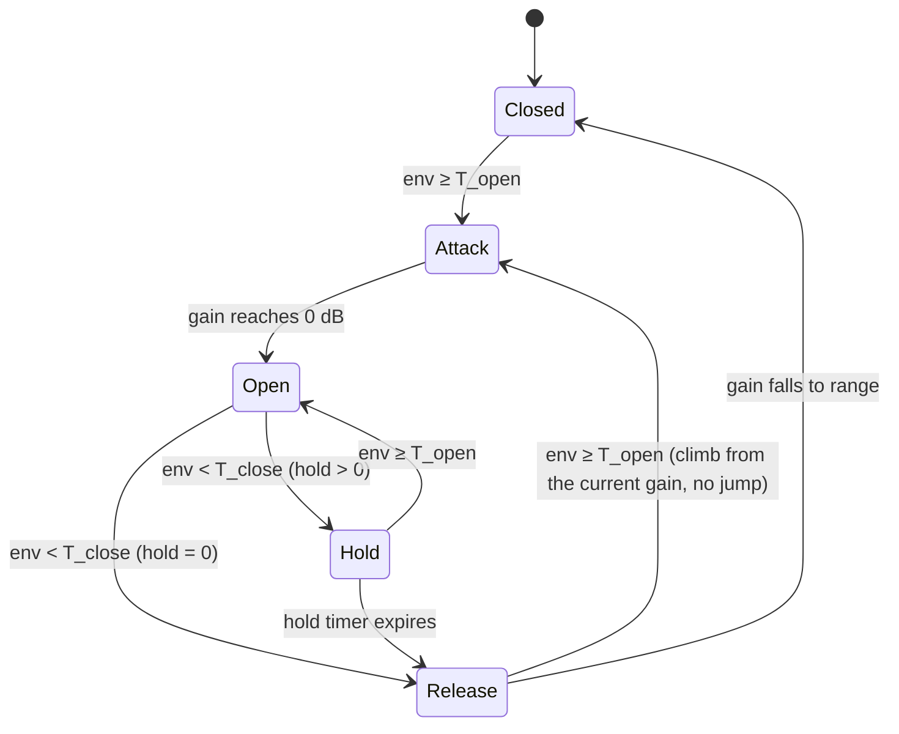

# Chapter 08: Gate, Expander, De-esser, and Transient Shaper

**English** | [繁體中文](README.zh-TW.md)

> [Course home](../../README.md) | Previous: [07 Distortion](../07-distortion/README.md) | Next: [09 Delay](../09-delay/README.md)

The compressor in Chapter 04 deals with "too loud"; the limiter in Chapter 05 pushes that to the extreme. This chapter goes in a different direction: "quiet material that is not quiet enough" (gate, expander), "one frequency band that is too harsh" (de-esser), and "caring only about the balance between attack and sustain, regardless of loudness" (transient shaper). All four components are built on the `EnvelopeFollower` from Chapter 04 and the `Biquad` from Chapter 02. You will see that by swapping the gain computer (the static curve) or the filter in front of the detector, the same skeleton grows into completely different effects.

## 1. Chapter goals

After reading this chapter and doing the exercises, you should be able to:

- Draw the transfer curves of a compressor / limiter / expander / gate, and say on which side of the threshold each one "moves" and what its slope is.
- **Symmetrically derive** the downward expander's gain computer from the compressor's soft-knee formula, and compute by hand the output dB for any threshold / ratio / knee / range.
- Explain what a noise gate's threshold, hysteresis, attack, hold, release, and range each do to the sound, draw the gate's state diagram, and explain why hysteresis eliminates chattering.
- Use a sidechain to let one track control another (a kick triggering ducking / a trance gate on a pad), and understand how lookahead preserves transients.
- Explain why sibilance is concentrated at 5-10 kHz, implement both a wideband and a split-band de-esser, and prove that a Linkwitz-Riley crossover "sums flat".
- Detect transients from the difference between a fast and a slow envelope, derive why the difference is positive during the attack and negative during the sustain, and map it to attack / sustain gain in dB.
- Understand what upward compression / upward expansion are, and know the practical settings for drum gating, vocal de-essing, and snare transient enhancement.

## 2. Theory

### 2.1 The dynamics-processing family at a glance

The static behavior of every effect that "changes gain according to level" can be described by a **transfer curve** (input dB to output dB). The 1:1 diagonal means "no processing". The only differences are: on **which side** of the threshold the curve departs from 1:1, and in **which direction**.

```
 output dB
   0 ┤                                                 ·
     │                                               ·      · = 1:1 reference line (no processing)
     │                                             ·        C = compressor 4:1, T = -20
     │                                           ·          L = limiter inf:1, T = -10
 -10 ┤                                         · L L L L    E = downward expander 1:2, T = -40
     │                                       ·              G = gate, T = -40, range -80
     │                                     ·       C C C
     │                                   ·   C C C          Each curve coincides with the
 -20 ┤                                 · C C                dots (no processing) on the other
     │                               ·                      side of its own threshold
     │                             ·
     │                           ·                          compressor / limiter: flat above T
 -30 ┤                         ·                            expander: steeper below T (slope 2)
     │                       ·                              gate: drops a full 80 dB below T,
     │                     ·                                      off the chart (the vertical G)
     │                   ·
 -40 ┤                 ·
     │               · G
     │             · E G
     │           ·     G
 -50 ┤         ·   E   G
     │       ·         G
     │     ·     E     G
     │   ·             G
 -60 ┤ ·       E       G
     └─┴───────┴───────┴───────┴───────┴───────┴───────┴
      -60     -50     -40     -30     -20     -10       0   input dB
```

(Horizontally, every 2 characters = 2.5 dB (each tick ┴ is 8 characters = 10 dB); vertically, every row = 2.5 dB. So the 1:1 line moves 2 characters right for every row up: a 45-degree diagonal. The compressor's 4:1 rises only 2.5 dB per 10 dB above T; the expander's 1:2 falls 10 dB per 5 dB below T.)

Example 2 (`l08_expander_vs_gate_curve`) prints these four curves as a table. An excerpt:

| Input (dB) | compressor 4:1, T=-20 | limiter ∞:1, T=-10 | expander 1:2, T=-40 | gate T=-40, range -80 |
|---:|---:|---:|---:|---:|
| -60 | -60.0 | -60.0 | -80.0 | -140.0 |
| -50 | -50.0 | -50.0 | -60.0 | -130.0 |
| -40 | -40.0 | -40.0 | -40.0 | -40.0 |
| -20 | -20.0 | -20.0 | -20.0 | -20.0 |
| -10 | -17.5 | -10.0 | -10.0 | -10.0 |
| 0 | -15.0 | -10.0 | 0.0 | 0.0 |

Organized as four quadrants:

| | Acts **above** the threshold | Acts **below** the threshold |
|---|---|---|
| **Toward 1:1 (reduces dynamics)** | downward compression (compressor, limiter) | upward compression (raises quiet parts) |
| **Away from 1:1 (expands dynamics)** | upward expansion (pushes loud parts louder) | downward expansion (expander, gate) |

The everyday "compressor", "expander", and "gate" are the two **downward** cells: they only pull gain down (gain ≤ 0 dB). The two upward cells push gain up, and need a separate limit on the maximum boost (section 2.7, Exercise 5).

### 2.2 The downward expander's gain computer

**Intuition**: an expander makes "quiet places quieter". For a signal below the threshold, every 1 dB it falls becomes $R$ dB lower ($R$ = ratio, e.g. 2). Microphone noise floor, bleed from the next drum, and reverb tails are usually 20-40 dB below the main signal; a 1:2 expander pushes them down by another 20-40 dB, but unlike a gate it does not "cut with a knife", so it sounds natural.

**Hard knee**: let the input level be $x$ (dB), the threshold $T$, and the ratio $R \ge 1$:

$$
y(x) = \begin{cases} x, & x \ge T \\ T + R\,(x - T), & x < T \end{cases}
$$

Because $x - T < 0$, $R(x-T)$ is more negative than $x - T$, so the output is lower than the input. The gain (dB) is

$$
g(x) = y(x) - x = (R - 1)(x - T) \le 0 \quad (x < T)
$$

> A note on terminology: a compressor's ratio "4:1" means a 4 dB change at the input gives a 1 dB change at the output; an expander's ratio is usually written "1:2", meaning a 1 dB change at the input gives a 2 dB change at the output. In this course `Expander::setRatio(2)` means 1:2 (the contract: "2 means every 1 dB below the threshold becomes 2 dB").

**Soft knee (derived symmetrically to the compressor)**: the knee of the Chapter 04 compressor places a quadratic segment inside $[T - W/2,\ T + W/2]$, so that it joins $y = x$ at the **lower edge** and a line of slope $1/R$ at the **upper edge**. The expander is exactly the reverse: the **upper edge** of the knee must join $y = x$ (slope 1), and the **lower edge** must join a line of slope $R$. So we put the quadratic term's "anchor" at the upper edge:

$$
y(x) = x + a\,(x - T - W/2)^2
$$

- At the upper edge $x = T + W/2$: the second term is 0, so the value $= x$ and the slope $= 1$, joining the 1:1 line automatically.
- At the lower edge $x = T - W/2$ the slope must equal $R$:

$$
y'(x) = 1 + 2a\,(x - T - W/2) \;\Rightarrow\; y'(T - W/2) = 1 - 2aW = R \;\Rightarrow\; a = \frac{1 - R}{2W}
$$

- Check the value at the lower edge: $y(T - W/2) = T - \tfrac{W}{2} + \tfrac{1-R}{2W}W^2 = T - \tfrac{RW}{2}$; and the line $T + R(x - T)$ at $x = T - W/2$ is also $T - \tfrac{RW}{2}$. Value and slope both match ($C^1$ continuity).

Putting it into three pieces (compare term by term with Chapter 04: $1/R - 1 \to 1 - R$, $+W/2 \to -W/2$):

$$
y(x) = \begin{cases}
x, & x \ge T + W/2 \\[4pt]
x + \dfrac{(1 - R)\,(x - T - W/2)^2}{2W}, & T - W/2 \le x < T + W/2 \\[8pt]
T + R\,(x - T), & x < T - W/2
\end{cases}
$$

At the threshold itself, $x = T$: $y(T) = T + \frac{(1-R)W}{8}$. With $R = 2$ and $W = 6$, $y = T - 0.75$; with $W = 12$, $y = T - 1.5$. The soft-knee table printed by Example 2 shows exactly these two values (-40.75, -41.50).

**Range**: without a limit, a noise floor at $x = -100$ dB with $T = -40$, $R = 2$ would get a gain of $-60$ dB; with a larger ratio the gain keeps falling toward $-\infty$ and the expander turns into a gate. The **range** is a floor on the gain:

$$
g_{\text{final}} = \max\big(\text{range},\ y(x) - x\big),\qquad \text{range} < 0
$$

Audibly: range = -10 dB means "push the bleed back a little"; range = -40 dB or more is practically switching it off. The expander in Example 2 uses range -40 dB, so the -60 dBFS segment comes out at -60 + max(-40, -20) = -80 dB.

### 2.3 Timing behavior: attack = opening the gate, release = closing it

In front of the static curve there is still a level detector (the Chapter 04 `EnvelopeFollower`). The naming convention is the "opposite" of the compressor's, which is easy to confuse the first time:

| | compressor | expander / gate |
|---|---|---|
| When the signal gets louder | gain **falls** (starts compressing) → this phase is the attack | gain **rises** (the gate opens) → this phase is the attack |
| When the signal gets quieter | gain **recovers** (lets go) → release | gain **falls** (the gate closes) → release |

These are really the same thing: **attack is always the response time when the signal gets louder**. For an expander, as soon as the signal gets louder the gate must open quickly, otherwise the head of a drum hit is eaten, so the attack is usually very short (0.1-5 ms); when the signal gets quieter it closes slowly so that natural decay (drum tails, reverb) is not chopped off, and the release is usually 50-300 ms.

`Expander` hands attack / release straight to the `EnvelopeFollower`: envelope rising (attack) → level grows → gain returns to 0 dB; envelope falling (release) → level shrinks → gain reduction slowly deepens.

One detail: `Expander` sets the detector to the Chapter 04 `SmoothingMode::Decoupled`. In Branching mode on a steady sine wave, between the peaks of each cycle the envelope drops along the release curve and is then pulled back up slowly by the attack; on average it sits below the true peak (about 1.2 dB lower with a 1 kHz sine, attack 5 ms, release 50 ms). A compressor is not very sensitive to this error (the gain slope is $1/R - 1$, whose absolute value is less than 1), but the expander's gain slope is $R - 1$, so the larger the ratio the more the error is amplified. Solution [3] of Exercise 5 measures this effect: when the upward expander ($R = 1.5$) switches to Branching, the output of the -20 dB segment falls from -15.01 dB to -15.58 dB, an error of $0.58 = (R - 1) \times 1.16$ dB. Decoupled first performs a peak-hold that "rises instantly and decays at the release rate" and only then smooths with the attack, so the steady-state level equals the peak, which is why the tone-burst measurements in Example 2 land exactly on the static curve (see section 3.5).

### 2.4 Noise gate

A gate can be seen as an expander with ratio → ∞: below the threshold it simply attenuates by |range| dB. But "cutting with a knife" brings two problems that an expander has much less of: **chattering around the threshold** and **clicks at the moment of opening and closing**. So the design focus of a gate is not the static curve but the timing behavior.

#### 2.4.1 Hysteresis: different thresholds for opening and closing

Imagine the tail of a snare slowly decaying and passing right through the threshold. The detected envelope is not a smooth line: the peak detector jumps up at each peak and falls again between two peaks, producing a ripple of a few dB. If opening and closing use the same threshold $T$:

```
 envelope (dB)
      │ ╲/\/\
  T ──┼────╲/\/\──────────   ← the envelope crosses T with ripple; every peak may cross it once
      │        ╲/\/\/\
      │              ╲/\/\
 gate │ ███████▌▐▌▐▌▐▌▐▌_____  ← open, close, open, close... = chattering (sounds like a crackling "brrt-brrt")
```

The fix borrows the **Schmitt trigger** from electronics:

- Open only when the envelope **≥ $T_\text{open}$** (= threshold);
- Close only when the envelope **< $T_\text{close}$ = threshold − hysteresis**;
- Between the two, keep the current state.

```
 envelope (dB)
      │ ╲/\/\
 T_open ──┼───╲/\/\──────────────
      │         ╲/\/\/\          ← the ripple lies between the two lines: state unchanged
 T_close ─┼───────────╲/\/\──────
      │                   ╲/\
 gate │ ████████████████████▌____  ← closes only once
```

The condition is simple: **the hysteresis must be larger than the peak-to-peak fluctuation of the envelope**. The first source of fluctuation is rectification ripple, which we can compute.

**Ripple estimate.** Let the input be a sine wave of amplitude $A$ and frequency $f$; $|x|$ has a peak every half period $\frac{1}{2f}$. After a peak the detector enters release. The one-pole smoother from Chapter 04 is
$\tau_r\,\dot e = |x| - e$; note that it decays toward the **current $|x|$**, not toward 0. Within a half period $e \approx A$, and the mean of $|x|$ is $\frac{2}{\pi}A$, so between two peaks the envelope falls by about

$$
\Delta e \approx \frac{1}{\tau_r}\int_0^{1/(2f)} \big(e - |x|\big)\,dt \approx \frac{A\,(1 - 2/\pi)}{2f\,\tau_r}
\quad\Rightarrow\quad
\text{ripple}_\text{dB} \approx 20\log_{10}\frac{A}{A - \Delta e} \approx 8.686\cdot\frac{1 - 2/\pi}{2f\,\tau_r}
$$

($8.686 = 20/\ln 10$, using $\ln(1+u) \approx u$.) For a 45 Hz kick and a detector release of 20 ms: $8.686 \times 0.363 / (2 \times 45 \times 0.02) \approx 1.75$ dB. If the detector were of the "decay toward 0" type (an analog diode + RC peak detector), it would fall by $e^{-1/(2f\tau_r)}$ between two peaks, i.e. $8.686/(2f\tau_r) \approx 4.8$ dB, which is $1/(1 - 2/\pi) \approx 2.75$ times larger. Part [4] of Example 1 measures this with the same detector `Gate` uses internally:

| Frequency | release 20 ms measured / estimate | release 50 ms measured / estimate |
|---:|---:|---:|
| 45 Hz | 1.56 / 1.75 dB | 0.66 / 0.70 dB |
| 100 Hz | 0.74 / 0.79 dB | 0.31 / 0.32 dB |
| 185 Hz | 0.41 / 0.43 dB | 0.17 / 0.17 dB |
| 1000 Hz | 0.08 / 0.08 dB | 0.03 / 0.03 dB |

The estimate is slightly higher than the measurement because a short stretch near each peak is the attack charging, not the release discharging. Two conclusions: the ripple is proportional to $1/(f\tau_r)$, so **low-frequency signals (kick, tom, bass) have the largest ripple**; lengthening the detector release reduces the ripple, but detection becomes slower.

The envelope of a real signal fluctuates far more than that of a single sine wave: beating among multiple partials, noise floor sitting on a decaying tail, and irregular decay of the drum head can all make the level wobble by several dB. So in practice kick / tom gates often use 4-10 dB of hysteresis, while for fast-decaying high-frequency signals such as a hi-hat 2-3 dB is enough.

Example 1 uses hysteresis 6 dB + hold 20 ms and compares the number of state transitions with hysteresis 0 + hold 0: on a 5-second drum loop (with -50 dBFS noise) it is **43 vs 70**, and the extra transitions are all the gate jittering around the threshold.

#### 2.4.2 State machine: Closed → Attack → Open → Hold → Release

The `Gate` in this chapter steps through this state machine once per sample:



- **Attack**: the gain climbs from its current value to 0 dB at a fixed slope (dB/sample). Once triggered it opens all the way, ignoring the threshold in the meantime, which guarantees the transient passes through intact.
- **Open**: gain = 0 dB; it leaves this state only when the envelope falls below $T_\text{close}$.
- **Hold**: gain is still 0 dB, and the gate counts hold milliseconds. If the signal rises back above $T_\text{open}$ during this time, it returns to Open (the timer is void). Hold is the second line of defense against chattering: the "brief dips below the threshold" caused by ripple usually last only a few milliseconds, and a hold of 20-50 ms absorbs them.
- **Release**: the gain falls to range at a fixed slope. If the signal grows again in the meantime, it goes straight to Attack and climbs from the **current gain**, rather than jumping back to range and then opening, which would be a click.
- **Closed**: gain = range.

**Ramp mathematics**: the attack time $t_a$ is defined as the time needed to climb "from range to 0 dB". Climbing at a constant rate in the dB domain:

$$
\Delta_a = \frac{|\text{range}|}{t_a \cdot f_s}\ \text{dB/sample},\qquad g_\text{dB}[n] = \text{range} + n\,\Delta_a
$$

With range -80 dB, attack 1 ms, 48 kHz: $\Delta_a = 80/48 \approx 1.67$ dB/sample. A constant rate in dB is an exponential change in the linear domain ($g = 10^{g_\text{dB}/20}$), which sounds like a natural fade rather than the "suddenly louder at the very end" feel of a linear fade. Release works the same way.

The timeline from Example 1 (threshold -30, hysteresis 6, attack 1 ms, hold 20 ms, release 50 ms):

```
    time(ms)   transition
        0.10   Closed  -> Attack      ← at the very start of the kick, the 0.1 ms detector exceeds -30 dB
        1.12   Attack  -> Open        ← the 1 ms attack finishes
      457.04   Open    -> Hold        ← the kick tail drops below -36 dB
      477.04   Hold    -> Release     ← hold of 20 ms
      500.00   Release -> Attack      ← the snare at 500 ms arrives mid-release and climbs from the current gain
      500.48   Attack  -> Open        ← it starts from mid-release, so it finishes opening in under 1 ms
```

#### 2.4.3 Range

The range is the amount of attenuation "when the gate is closed". Below -80 dB (this course's `dbToGain` returns 0 below -100 dB) is the same as total silence, which suits studio tom tracks; but in live or reverberant recordings, total silence makes the background "come and go", which is unnatural. In that case set the range to -10 to -20 dB so the background is lowered but does not vanish (in effect, much like an expander).

#### 2.4.4 Sidechain

The gate's detection signal does not have to be its own input. `Gate::process(main, sidechain)` drives the state machine with the sidechain's envelope and applies the gain to main:

- **A kick triggering a gate on bass / pad** (trance gate): the pad sounds only when the kick hits, making the rhythm very tight.
- **Kick-triggered ducking** (the reverse: lowering the bass by a few dB when the kick appears) keeps the two from fighting over the low end. This is really sidechain compression; Exercise 4 does both.
- **Gating a snare track while detecting from a trigger microphone under the snare, or from a high-pass-filtered signal**, to keep kick bleed from opening the gate.

#### 2.4.5 A brief note on lookahead

Even with a 1 ms attack, part of the head of a transient is still "eaten" by the ramp; and an attack that is too short produces clicks (gain changing too fast = extra wideband content in the spectrum). Lookahead works like this: the detector looks at the "present" signal, while the main signal is delayed by $L$ samples before being multiplied by the gain. The gate starts opening before the transient actually reaches the output, so the attack can be set longer (no click) and the head stays intact. The price is an overall latency of $L$, which a plugin must report to the host through `getLatencySamples()` for delay compensation (the Chapter 05 limiter works on the same principle). Exercise 6 implements it: for a gate with a 10 ms attack, without lookahead the first 2 ms of a burst is cut by 70 dB; with 10 ms of lookahead the output is within 0.5 dB of the input.

### 2.5 De-esser

#### 2.5.1 Why sibilance sits at 5-10 kHz

Fricatives such as "s", "sh", and "ts" are not produced by vibrating vocal folds, but by airflow squeezed through a narrow gap between the tip of the tongue and the upper teeth, producing turbulent noise. This noise is shaped by the resonance of the very small oral space in front of the gap (between the tongue tip and the lips); the smaller the cavity, the higher the resonant frequency: the energy of "s" is concentrated at roughly 5-10 kHz (varying from person to person; female voices are usually higher than male), while "sh", with the tongue further back and a larger cavity, sits at roughly 2.5-6 kHz. The energy of vowels, by contrast, is concentrated at the fundamental and the first few formants (resonant frequencies of the vocal tract (throat to lips), which decide whether you hear "a" or "i"; mostly < 4 kHz). So simply "listening" to 5-10 kHz is a very good way of telling whether "this is sibilance right now".

Microphones (especially the high-frequency presence peak of condenser microphones), EQ brightening, and a compressor that turns the vowels down all make sibilance relatively more prominent, so a de-esser usually goes before or after the compressor in a vocal chain.

#### 2.5.2 The detector: look only at the bandpass-filtered signal

A de-esser is just "a compressor with a bandpass in front of the detector":

```
 x ──┬──► Bandpass(f, Q = 1.5) ──► EnvelopeFollower ──► GR = clamp(level − T, 0, range) ──► g
     │                              (peak, 1 / 40 ms)                                         │
     ├── wideband:    y = x · g                                                              ◄┘
     └── split-band:  y = LP(x) + HP(x) · g   (LR4 crossover, compresses only the high band)
```

First estimate the −3 dB edges of the bandpass (0 dB peak) with an analog prototype: $f_1, f_2$ satisfy $f_1 f_2 = f_0^2$ and $f_2 - f_1 = f_0 / Q$. Solving these two equations:

$$
f_{1,2} = f_0\left(\sqrt{1 + \frac{1}{4Q^2}} \mp \frac{1}{2Q}\right)
$$

For $Q = 1.5$: $f_1 = 0.7208\,f_0$, $f_2 = 1.3874\,f_0$. For $f_0 = 7$ kHz that is about 5.05-9.71 kHz (0.945 octave).

This is only an approximation. The digital RBJ bandpass goes through the bilinear transform, which compresses the frequency axis toward Nyquist, so the actual bandwidth for the same $Q$ is narrower. The relationship given in the RBJ Cookbook is

$$
\frac{1}{Q} = 2\sinh\!\left(\frac{\ln 2}{2}\cdot \text{BW}\cdot\frac{\omega_0}{\sin\omega_0}\right),\qquad \omega_0 = 2\pi f_0 / f_s
$$

(BW in octaves). For $f_0 = 7$ kHz and $f_s = 48$ kHz, $\omega_0/\sin\omega_0 = 1.155$; substituting $Q = 1.5$ gives BW ≈ 0.82 octave, narrower than the analog 0.945 octave. Measured with `BiquadCoefficients::magnitudeDb()`, the −3 dB edges at 48 kHz are **5218-9168 Hz** (44.1 kHz: 5251-9083 Hz; 96 kHz: 5088-9561 Hz; the higher the sample rate, the closer to the analog result). Example 3 prints both the analog-formula 5046-9712 Hz and the digital measured values. Both cover the main range of sibilance, so detection behaves about the same.

The gain computer uses the most intuitive **∞:1 with an upper limit of range**: for every dB the detected level exceeds the threshold, compress by 1 dB, up to a maximum of range dB.

$$
\text{GR} = \operatorname{clamp}(L_\text{det} - T,\ 0,\ \text{range})
$$

Do not set the range (`setRangeDb`, a positive value) too large: if sibilance is over-compressed, the voice sounds as if it has a lisp. 6-10 dB is usually enough.

#### 2.5.3 Wideband vs split-band

- **Wideband**: when sibilance is detected, the whole signal is compressed together. It is simple and has no phase problems, but the vowels are compressed along with the sibilance, so you hear a "breathing in" effect or fluctuating volume. In Example 3: during sibilance the 220 Hz vowel is pulled down from -18.08 dB to -29.04 dB.
- **Split-band**: the signal is split into a low band and a high band, only the high band is compressed, and then they are summed. In Example 3: the vowel stays at -18.08 dB throughout the sibilance, completely untouched; only 7 kHz is reduced.

The split-band crossover must satisfy "with gain = 1, LP + HP = the original signal", otherwise the de-esser changes the tone even when it is not doing anything. The **4th-order Linkwitz-Riley (LR4)** is two identical 2nd-order Butterworth filters in cascade. Derived with the analog prototype ($s$ normalized to $\omega_c$):

$$
H_{LP}(s) = \left(\frac{1}{s^2 + \sqrt2\,s + 1}\right)^2,\qquad
H_{HP}(s) = \left(\frac{s^2}{s^2 + \sqrt2\,s + 1}\right)^2
$$

$$
H_{LP} + H_{HP} = \frac{1 + s^4}{(s^2 + \sqrt2\,s + 1)^2}
= \frac{(s^2 + \sqrt2\,s + 1)(s^2 - \sqrt2\,s + 1)}{(s^2 + \sqrt2\,s + 1)^2}
= \frac{s^2 - \sqrt2\,s + 1}{s^2 + \sqrt2\,s + 1}
$$

(using $s^4 + 1 = (s^2 + \sqrt2 s + 1)(s^2 - \sqrt2 s + 1)$.) The final form is a 2nd-order **allpass**: the roots of the numerator and denominator are mirror images of each other about the $j\omega$ axis, so $|H_{LP} + H_{HP}| = 1$, meaning the magnitude is perfectly flat and only the phase changes. At the crossover frequency $s = j$: each Butterworth is −3 dB with phase ∓90°; after squaring, LP and HP are both −6 dB with phases ∓180° (in phase), so the sum = 0.5 + 0.5 = 1. The bilinear transform uses the same frequency mapping for LP and HP, so the digital version keeps this property. Exercise 7 measures it: from 100 Hz to 15 kHz, $|LP + HP|$ is 0.000 dB everywhere.

(By contrast, splitting with two plain 2nd-order Butterworth filters (not squared), LP and HP differ by 180° at the crossover frequency, and summing them produces a deep notch at $f_c$; inverting one branch instead gives a +3 dB bump. This is why LR crossovers are widely used in loudspeaker crossovers and multiband dynamics.)

The `DeEsser` crossover frequency is placed at the lower −3 dB point of the analog prototype, $0.7208 f_0$ (about 5.05 kHz for 7 kHz, slightly below the 5.22 kHz lower edge of the actual digital bandpass, which leaves a bit more margin for the high band). Note that the crossover's transition is not infinitely steep: 7 kHz is only half an octave above the 5.05 kHz crossover, so part of the LP band still remains at 7 kHz and is not compressed. For the analog LR4, $|H_{LP}| = 1/(1 + (f/f_c)^4)$, which is 0.213 (-13.4 dB) at $f/f_c = 1.387$; the bilinear transform compresses high frequencies toward Nyquist, so the digital version at 48 kHz gives 0.189 (-14.5 dB). Because the LP and HP of an LR4 are in phase and $|H_{LP}| + |H_{HP}| = 1$, after applying the gain $g$ to the HP band the total gain at 7 kHz is

$$
|H_{LP}| + (1 - |H_{LP}|)\,g = 0.189 + 0.811 \times 10^{-10.94/20} \approx 0.420 \;\Rightarrow\; -7.55\ \text{dB}
$$

Example 3 measures that split-band reduces 7 kHz by $49.91 - 42.31 = 7.60$ dB, while wideband reduces it by 10.94 dB (≈ the average GR during the sibilance; the formula above uses this value). This is the typical split-band trade-off: a cleaner tone, but "shallower" reduction; to compress more deeply, move the crossover down or increase the range.

#### 2.5.4 Listen mode

`setListen(true)` makes the output the signal the detector hears (x after the bandpass). The standard procedure for setting a de-esser: turn listen on → sweep the frequency until the "hiss" is most prominent and the vowels least → turn listen off → adjust the threshold until the GR meter jumps 4-8 dB only on sibilance.

### 2.6 Transient shaper

Compressors and expanders both look at "absolute level": they act when the level goes above or below some threshold. A transient shaper does not care how loud it is; it looks only at "how fast the level changes": it splits each note into an **attack** and a **sustain**, and boosts or cuts each separately. So the same setting has the same effect on loud and quiet drums, which is the biggest difference from a compressor.

#### 2.6.1 The difference between a fast and a slow envelope

The same signal is fed to two `EnvelopeFollower`s:

- **fast**: attack 0.5 ms, release 30 ms; it hugs the signal's peaks almost exactly.
- **slow**: attack 10 ms, release 150 ms; a "mean level" lagging half a beat behind.

Define the difference (dB):

$$
d[n] = 20\log_{10}\frac{e_\text{fast}[n]}{e_\text{slow}[n]}
$$

**During the attack, $d > 0$**: suppose the signal jumps from 0 to amplitude $A$ (a step) at $t = 0$. Both followers are in attack mode, and the one-pole step response is $A(1 - e^{-t/\tau})$:

$$
d(t) = 20\log_{10}\frac{1 - e^{-t/\tau_{fa}}}{1 - e^{-t/\tau_{sa}}}
$$

Because $\tau_{fa} < \tau_{sa}$, for all $t > 0$ we have $e^{-t/\tau_{fa}} < e^{-t/\tau_{sa}}$, so the numerator > the denominator and $d > 0$. As $t \to 0$, using $1 - e^{-u} \approx u$, $d \to 20\log_{10}(\tau_{sa}/\tau_{fa}) = 20\log_{10}(10/0.5) = 26$ dB; as $t \to \infty$ both reach $A$ and $d \to 0$. So $d$ is largest at the instant of the attack and decreases afterwards, lasting about a few times the slow attack time.

**During the sustain / decay, $d < 0$**: after the attack, the signal decays exponentially with time constant $\tau_d$, $x(t) = A e^{-t/\tau_d}$, and both followers enter release mode. The steady-state solution of the first-order system $\tau_r\,\dot e = x - e$ for an exponential input is $e(t) = K A e^{-t/\tau_d}$; substituting gives

$$
-\frac{K}{\tau_d} = \frac{1 - K}{\tau_r} \;\Rightarrow\; K = \frac{\tau_d}{\tau_d - \tau_r}\quad(\tau_d > \tau_r)
$$

- If $\tau_d > \tau_r$: the envelope keeps up with the signal, just lagging slightly (higher by a factor $K$).
- If $\tau_d < \tau_r$: the signal falls faster than the release, so the envelope cannot keep up and decays along its own $e^{-t/\tau_r}$.

The fast release (30 ms) is quicker than the decay of the drum (the kick envelope in `makeDrumLoop` is $e^{-8t}$, $\tau_d = 125$ ms), so fast falls hugging the signal; the slow release (150 ms) is slower than $\tau_d$, so slow "holds up high". Fast < slow, so $d < 0$, and $|d|$ grows with time (the two decay at different rates):

$$
d(t) \approx \text{constant} - 8.686\,t\left(\frac{1}{\tau_d} - \frac{1}{\tau_{sr}}\right)
$$

The measured value falls faster than this ideal: the peak detector consumes $|x|$, every peak "recharges" slow through its attack once more, so slow actually falls slower than its 150 ms. Example 4 prints $d$ for the first kick: sample 0 is +25.8 dB (≈ the 26 dB computed above), +3.7 dB at 20 ms, a zero crossing at about 55 ms, and then it keeps going negative (about −5.3 dB at 195 ms). In the same table, fast falls from −8.3 dB (50 ms) to −18.0 dB (195 ms), about 67 dB/s ($\tau \approx 130$ ms, hugging the kick's 125 ms); slow falls only about 30 dB/s (an effective $\tau \approx 290$ ms, slower than its own 150 ms release). This is exactly "attack $d > 0$, sustain $d < 0$".

#### 2.6.2 Mapping to attack / sustain gain in dB

$d$ is mapped linearly to gain and saturates at $|d| = 6$ dB:

$$
g_\text{dB} = \begin{cases}
\text{attackDb}\cdot\min(d / 6,\ 1), & d > 0 \\
\text{sustainDb}\cdot\min(-d / 6,\ 1), & d \le 0
\end{cases}
$$

$g_\text{dB}$ is then smoothed by a 0.5 ms one-pole so that envelope ripple does not turn directly into gain jitter (zipper noise, which becomes distortion on a low-frequency kick). When the slow envelope is below −80 dBFS the signal is treated as silence and left unprocessed (otherwise random fluctuations of the noise floor would also be amplified as if they were transients).

Because the mapping looks only at $d$ (a ratio) and not at absolute level, a quiet ghost note and a loud accent receive the same enhancement; this is the "level independent" property of a transient shaper.

**What you hear**: attack +6 to +12 dB makes drums punchier and closer; attack −6 to −12 dB makes them rounder and farther away (as if at the back of the room); sustain −12 dB shortens the tail and room sound (as if making the room drier); sustain + lengthens the tail and room sound, but easily pushes the low-frequency tail of a kick louder than its attack (with sustain +12 in Example 4, the peak actually rises by 6.8 dB), so in practice only +3 to +6 dB is mostly used.

### 2.7 Upward compression / upward expansion

Back to the four-quadrant table in section 2.1:

- **Upward compression**: signals **below** the threshold are **boosted**, moving toward the 1:1 line (reduced dynamics). The effect is similar to parallel compression (Chapter 04, Exercise 3): quiet details come up while loud parts stay put. An implementation must have a range (a maximum boost), otherwise the noise floor during silence is boosted by 40 dB.
- **Upward expansion**: signals **above** the threshold are **pushed even louder** (increased dynamics). It is often used to "restore" over-compressed material, or to make drum hits stand out more. The static curve:

$$
y(x) = \begin{cases}
x, & x \le T - W/2 \\
x + \dfrac{(R - 1)(x - T + W/2)^2}{2W}, & T - W/2 < x < T + W/2 \\
T + R\,(x - T), & x \ge T + W/2
\end{cases}
$$

(The derivation is the same as in section 2.2, only with the anchor moved to the lower edge of the knee.) Here too a range is needed to limit the maximum boost, otherwise a single transient is pushed into clipping. Exercise 5 implements it and verifies it with tone bursts: with T = -30, R = 1.5, range +12, the -20 dB segment outputs -15.01 dB (theory: -15).

### 2.8 In practice: four common uses

| Scenario | Component | Typical settings | Notes |
|---|---|---|---|
| Removing bleed from tom / kick microphones | Gate | threshold: 3-6 dB above the bleed peak; hysteresis 4-10 dB; attack 0.1-1 ms; hold 30-100 ms; release 100-300 ms; range -40 to -80 dB | A release that is too short cuts the drum tail; add an HPF to the sidechain / use a trigger microphone so the kick does not open the tom's gate |
| Vocal de-essing | De-esser | female 6-9 kHz, male 5-7 kHz; threshold so that GR is 4-8 dB only on sibilance; range 8-12 dB | Find the frequency with listen first; split-band has a cleaner tone, wideband works better when the sibilance is very heavy |
| Snare transient enhancement | Transient shaper | attack +3 to +8 dB, sustain 0 to −4 dB | A larger attack raises the peak (Example 4: attack +12 → peak +11.7 dB), so leave headroom or follow with a limiter |
| Removing background from live vocals / dialogue | Expander | ratio 1:2-1:4, threshold 10-15 dB below the speaking level, range -10 to -20 dB | A range that is too deep lets you hear the background "breathing" (pumping) |

**Where to put it in the chain**: gate / expander usually go at the very front of the insert chain (right after the EQ's high-pass is enough). The reason is the same one repeated in Chapter 07: compressors, saturation, and distortion all "boost" small signals. A distortion drive of 30 dB turns a -50 dBFS noise floor into -20 dBFS while the drum peaks are flattened, shrinking the distance between signal and noise from 40-odd dB to 10-odd dB, so a gate placed afterwards can no longer find a clean threshold. A de-esser often goes after the compressor (after the compressor turns the vowels down, sibilance is more prominent), or a light one goes both before and after. A transient shaper, since it does not look at absolute level, works anywhere, but if it is placed before a compressor, the compressor will squash the attack you just boosted.

## 3. From formulas to code

This chapter adds four headers, all in `dsp/include/dawlab/dsp/`, namespace `dawlab::dsp`. Their shared design:

- Detection is always **stereo-linked**: $\max|x|$ over all channels drives a single gain; otherwise the left and right channels would open and close independently and the stereo image would jump around.
- Every class has `std::atomic<float>` measurement values, so a copy constructor / copy assignment is written by hand (`std::atomic` is not copyable), which lets Chapter 14 put them into a `std::vector`.
- The core logic is factored into `nextGain(float detectorInput)` (`Gate`, `Expander`, `TransientShaper`): it takes one detector sample and returns a linear gain. `process()` just calls it for every sample; the lookahead and sidechain in the exercises reuse it directly.

### 3.1 `Expander.h`

The static curve is a literal translation of the three-piece formula in section 2.2:

```cpp
static float computeOutputDb(float inputDb, float thresholdDb, float ratio, float kneeDb) noexcept {
    const float r = std::max(1.0f, ratio);
    const float w = std::max(0.0f, kneeDb);
    const float halfW = 0.5f * w;
    if (inputDb >= thresholdDb + halfW)
        return inputDb;                                        // y = x
    if (w > 0.0f && inputDb >= thresholdDb - halfW) {
        const float d = inputDb - thresholdDb - halfW;         // x − T − W/2 (≤ 0)
        return inputDb + (1.0f - r) * d * d / (2.0f * w);      // x + (1−R)(x−T−W/2)²/(2W)
    }
    return thresholdDb + r * (inputDb - thresholdDb);          // T + R(x − T)
}
```

`nextGain()`: envelope (Decoupled peak) → dB → `computeGainDb()` → `max(range, g)` → call `dbToGain` only when the gain changes (`std::pow` is expensive; with the gate fully open the gain stays at 0 dB, which saves a lot of computation). `getGainReductionDb()` returns a positive value (for example 20 means 20 dB of attenuation is being applied) and is updated at the end of each block. It also provides `process(main, sidechain)` and `setDetectorMode(DetectorMode)`.

Threshold, ratio, knee, and range all appear directly in the gain formula $g = \max(\text{range},\ (R-1)(x-T))$, so if they are changed between blocks, the gain jumps to the new value within one sample. For example, with a steady -50 dBFS signal at 1:2, changing the threshold from -40 to -30 makes the gain jump in one step from -10 dB to -20 dB, which is a click. So each of these four parameters passes through a Chapter 01 `SmoothedValue` and moves linearly to the new value over `Expander::kParameterRampMs` (20 ms). The example above then changes only about 0.01 dB per sample. The exception is setters called after `reset()` (which `prepare()` also calls) and before the first sample is processed: they take effect immediately, so "prepare → set parameters → start processing" does not glide in from the defaults (this is the order the Chapter 14 effect adapter uses).

### 3.2 `Gate.h`

`enum class GateState { Closed, Attack, Open, Hold, Release }` and `gateStateName()` (for printing the timeline). `nextGain()` is the `switch` of the state machine in section 2.4.2. Some implementation points:

- The detector is fixed in peak mode with attack `Gate::kDetectorAttackMs` = 0.1 ms (it has to catch transients) and a default release of 20 ms, changeable through `setDetectorReleaseMs()`. The detector's release and the gate's release are two different things: the former determines the size of the envelope ripple (section 2.4.1, which affects how much hysteresis to use), the latter the fade time at which the gate closes.
- `setRangeDb()` is sign-proof: it always treats the value as "attenuate by |db| dB". Changing the range while the gate is closed does not make the gain jump: in the Closed state, every sample moves the gain one step toward the new range (upward with the attack slope, downward with the release slope, at least 0.01 dB/sample), so range automation in the Chapter 14 DAW is also click-free.
- `updateTimes()` converts attack / release into slopes in dB/sample (the $\Delta_a$ of section 2.4.2) and hold into a sample count. When attack is shorter than 1 sample the slope is set to a huge value (the gate opens instantly); when |range| is below 1 dB the slope is computed as if it were 1 dB, to avoid a zero slope at range = 0 that would leave a gain in Attack never climbing to 0 dB.
- `isOpen()` is true in Attack / Open / Hold; during Release it counts as "closing". `getState()` is for debugging and teaching. The state is stored in a `std::atomic<GateState>` (relaxed), read once at the start of `nextGain()` and written once at the end, so the UI thread can safely call these two functions to draw a "gate open" indicator.
- `process(main, sidechain)`: the sidechain may have a different channel count from main (for example a mono kick controlling a stereo pad); the sample count is the smaller of the two.

### 3.3 `DeEsser.h`

- `prepare()` sets up five `Biquad`s: the detection bandpass (Q = 1.5), the LP×2 and HP×2 of the LR4 crossover (all Butterworth with Q = 1/√2), plus a vector that stores "the current detection sample of each channel" (for listen mode; allocated only in prepare).
- `setFrequency()` updates both the detection bandpass and the crossover frequency (`getCrossoverHz()` = 0.7208 f).
- `process()` for each sample: first replace NaN / Inf with 0 → bandpass each channel separately and take $\max|\cdot|$ (stereo-link) → `EnvelopeFollower` (attack 1 ms, release 40 ms, changeable with `setAttackMs` / `setReleaseMs`) → GR = clamp(level − T, 0, range) → apply.
- **The NaN guard must come before the biquads**: `EnvelopeFollower` blocks NaN itself, but `Biquad` (TDF-II) does not. As soon as a single NaN enters a filter, its state variables stay NaN forever, so split-band and listen mode output NaN from then on, and only `reset()` can recover. So `DeEsser` replaces non-finite values with 0 right after reading x and before feeding any biquad.
- Threshold and range appear directly in the GR formula and, like `Expander`, are smoothed with `SmoothedValue` (`DeEsser::kParameterRampMs` = 20 ms; setters called after reset and before the first sample take effect immediately).
- **The crossover always runs**, even in wideband mode: this way, when the user switches to split-band during playback, the filter state is already "warm" and does not produce a transient from starting at zero.

### 3.4 `TransientShaper.h`

The constants are all `static constexpr`, and the example uses them directly to rebuild the fast / slow followers in order to print $d$:

```cpp
static constexpr float kFastAttackMs = 0.5f,  kFastReleaseMs = 30.0f;
static constexpr float kSlowAttackMs = 10.0f, kSlowReleaseMs = 150.0f;
static constexpr float kFullScaleDb = 6.0f;   // at |d| = 6 dB the full attackDb / sustainDb is applied
static constexpr float kFloorDb = -80.0f;     // slow below this is treated as silence
static constexpr float kGainSmoothMs = 0.5f;
```

`nextGain()` is a direct translation of the mapping in section 2.6.2, and finally `gainDb_ = target + α·(gainDb_ − target)` does the one-pole smoothing. `setAttackDb` / `setSustainDb` are limited to ±24 dB. The measurement `getLastGainDb()` (positive or negative) is for the UI.

### 3.5 Examples

Build and run (Windows, from the project root):

```powershell
.\scripts\build.ps1 -Only 08-gate-expander
cd build
.\bin\Debug\l08_gate_drum_noise.exe
```

The output WAV files are in `build/dawlab_output/`. All examples use 48 kHz and a block size of 512, processing block by block.

#### Example 1: `l08_gate_drum_noise` (`examples/gate_drum_noise.cpp`)

A drum loop (2 bars, 4 seconds) + 1 second of silence, with white noise at RMS −50 dBFS laid over the whole thing (the RMS of a uniform distribution on $[-A, A)$ is $A/\sqrt3$, so $A = 10^{-50/20}\sqrt3$). Gate settings: threshold −30 dB, hysteresis 6 dB, attack 1 ms, hold 20 ms, release 50 ms, range −80 dB. You can pass your own 48 kHz WAV as `argv[1]`.

```
[1] RMS of the silent sections (left channel)
    gap at end of bar 1, 1.90-2.00 s  before   -50.0 dBFS -> after  -130.0 dBFS (improvement 80.0 dB)
    trailing silence 4.50-5.00 s      before   -50.0 dBFS -> after  -130.0 dBFS (improvement 80.0 dB)
    whole file (with drums) 0-5 s     before   -18.4 dBFS -> after   -18.4 dBFS (improvement 0.0 dB)
    peak: before -2.86 dBFS, after -2.86 dBFS (the hits' peaks should not be clipped away)
...
[3] With hysteresis = 0 and hold = 0: 70 transitions (with hysteresis + hold: 43)
    The more transitions, the more violently the gate flutters around the threshold (chattering).

[4] Envelope ripple of the gate detector (peak, attack 0.1 ms) on a steady sine wave (peak-to-peak, dB)
    Estimate (README 2.4.1): during release the one-pole decays toward |x|, not toward 0; over each half period 1/(2f) it drops by
    dE/A ~= (1 - 2/pi) / (2f*tau) -> ripple ~= 8.686 * (1 - 2/pi) / (2f*tau) dB. If the detector decayed toward 0 (analog diode + RC), it would be 8.686 / (2f*tau) dB
    freq(Hz)   release 20 ms meas. / est. / decay-to-0    release 50 ms meas. / est. / decay-to-0
         45        1.56 /  1.75 /  4.83                    0.66 /  0.70 /  1.93
        100        0.74 /  0.79 /  2.17                    0.31 /  0.32 /  0.87
        185        0.41 /  0.43 /  1.17                    0.17 /  0.17 /  0.47
       1000        0.08 /  0.08 /  0.22                    0.03 /  0.03 /  0.09
    -> hysteresis must exceed this ripple: low frequencies (kick) need a larger hysteresis or a longer detector release than high frequencies (hi-hat)

[5] With the gate closed, change the range from -80 to -20 and back to -80 (simulating automation)
    range ->  -20 dB: reached in   144 samples ( 3.00 ms), maximum change per sample 0.417 dB
    range ->  -80 dB: reached in  1800 samples (37.50 ms), maximum change per sample 0.033 dB
```

The improvement in the silent sections is exactly |range| (80 dB), while the whole-file RMS and peak are unchanged: the gate touched only the quiet places. (The -130 dBFS after processing is computed directly in double; with `gainToDb()` it would stop at its floor of -100 dB.) For the timeline see section 2.4.2, and for the ripple table of [4] see section 2.4.1. [5] verifies the range ramp from section 3.2: upward it uses the attack slope (new range 20 dB / 1 ms = 0.417 dB/sample, 60 dB takes 144 samples = 3 ms), downward it uses the release slope (80 dB / 50 ms = 0.033 dB/sample, taking 37.5 ms).

- Output: `l08_gate_input.wav` (drums + noise), `l08_gate_output.wav`, `l08_gate_no_hysteresis.wav`.
- What you should hear: the input has a layer of "hiss" in the gaps and at the end; in the output the gaps are completely silent and the punch of the hits is not cut; the no_hysteresis version may have a crackling sound near the kick tail from the gate opening and closing rapidly.

#### Example 2: `l08_expander_vs_gate_curve` (`examples/expander_vs_gate_curve.cpp`)

It prints the four transfer curves from section 2.1 (-80..0 dB), a soft-knee table of the 1:2 expander at knee 0 / 6 / 12 dB, and then feeds tone bursts (1 kHz, -20 / -40 / -50 / -60 / -20 dBFS, 0.5 second each) to an `Expander` (T = -40, 1:2, range -40, attack 5 ms, release 50 ms) and a `Gate` (T = -40, hysteresis 4 dB, range -80, attack 1 ms, hold 10 ms, release 50 ms), measuring the 1 kHz amplitude in the second half of each segment:

```
    seg   input   expander meas. / theory    gate meas. / theory
       1   -20.0     -20.0 /  -20.0            -20.0 /  -20.0
       2   -40.0     -40.0 /  -40.0            -40.0 /  -40.0
       3   -50.0     -60.0 /  -60.0           -100.0 / -130.0
       4   -60.0     -80.0 /  -80.0           -100.0 / -140.0
       5   -20.0     -20.0 /  -20.0            -20.0 /  -20.0
```

The expander's measurements land exactly on the static curve (this is also the verification technique the solutions often use). The gate's measurement stops at -100 because the floor of `gainToDb()` is -100 dB; the theoretical -130 / -140 dB are far below audibility already.

Note segment 2: the input peak is exactly equal to the threshold (-40 dB), yet the gate stays steadily open. This is the effect of hysteresis: the gate opened in segment 1 (-20 dB), and the envelope in segment 2 will not close it as long as it does not fall below the closing threshold of -44 dB (hysteresis 4 dB). If this -40 dB had appeared out of silence, the gate might not open at all whenever the detector envelope dipped slightly below -40 dB because of ripple or the attack: **a threshold sitting exactly on the signal level is the least stable setting**, and in practice the threshold should keep a few dB of distance from both the signal and the noise.

- Output: `l08_bursts_input.wav`, `l08_bursts_expander.wav`, `l08_bursts_gate.wav`.
- What you should hear: in the expander version the quiet segments are quieter but still audible; in the gate version the segments below -40 dB disappear outright, with a 1 ms fade-in at the start of each segment and a release fade-out at the end.

#### Example 3: `l08_deesser_sibilance` (`examples/deesser_sibilance.cpp`)

A synthetic "voice": a 220 Hz vowel (harmonics 1..12, amplitude 1/k; vowel-only RMS -19.1 dBFS, whole-signal RMS including sibilance -18.9 dBFS) lasting 3 seconds, with a 120 ms "sibilance" (white noise through a 7 kHz bandpass) laid over it at 0.5 / 1.5 / 2.5 seconds. The `DeEsser` is set to frequency 7 kHz, threshold -30 dB, range 12 dB, and run in wideband, split-band, and listen modes, reading `getGainReductionDb()` block by block. At the start the program first prints the −3 dB band of the detection bandpass: the analog formula gives 5046-9712 Hz (0.945 oct), the digital measurement 5218-9168 Hz (0.813 oct), compare section 2.5.2.

```
    time(ms)  GR(dB)  meter (0.5 dB per bar)
      490.7    0.00   
      501.3    6.34   |||||||||||||
      512.0    9.46   |||||||||||||||||||
      533.3   11.12   ||||||||||||||||||||||
      544.0   11.31   |||||||||||||||||||||||
      ...
      629.3    2.00   ||||
      640.0    0.00   
    Maximum GR = 11.31 dB (upper limit = range 12 dB)

    signal       vowel@vowel-only  vowel@sibilance  7 kHz@sibilance
    input                  -18.08           -18.08           -42.31
    wideband               -18.08           -29.04           -53.25
    split-band             -18.08           -18.08           -49.91
    listen                 -52.29           -52.29           -42.37
```

Reading the table: during the sibilance, wideband pulls the vowel down by 11 dB along with it (the source of the "breathing in" feel); split-band does not move the vowel at all. In listen mode 7 kHz passes almost untouched (the bandpass center is 0 dB), while the 220 Hz vowel is reduced by 34 dB. At the end the program also verifies that split-band output = input when there is no sibilance (both 220 Hz and 1760 Hz show a 0.00 dB difference).

- Output: `l08_deesser_input.wav`, `l08_deesser_wideband.wav`, `l08_deesser_splitband.wav`, `l08_deesser_listen.wav`.
- What you should hear: the input has a harsh "hiss" every second; in wideband the hiss gets smaller but the vowel also shrinks at that instant; in split-band only the hiss gets smaller; listen leaves only the hiss.

#### Example 4: `l08_transient_shaper_drums` (`examples/transient_shaper_drums.cpp`)

First, two followers with the same constants as `TransientShaper` chase the first kick, printing fast, slow, $d$, and the corresponding gain every 5 ms (section 2.6.1). Then four settings are run and the peak / RMS / crest factor are printed (crest factor = peak dB − RMS dB; larger means "more peaky"):

```
    setting       peak     RMS    crest   dcrest vs dry
    dry           -2.92  -17.43   14.51    +0.00
    attack +12     8.78  -10.60   19.38    +4.86
    attack -12    -6.63  -19.80   13.17    -1.35
    sustain -12   -3.19  -18.61   15.42    +0.91
    sustain +12    3.89  -13.56   17.44    +2.93
```

Attack ±12 dB changes the crest factor by +4.86 / −1.35 dB: boosting the attack → peakier; cutting the attack → rounder. The change for attack -12 is smaller than for +12 because the region with $d > 0$ is tens of milliseconds long, so the "body" after the attack is turned down as well and the RMS falls with it. The peak of sustain +12 actually rises: with the whole kick tail raised by 12 dB, it becomes louder than the original attack. You can pass your own drum loop as `argv[1]`.

- Output: `l08_ts_dry.wav`, `l08_ts_attack_plus12.wav`, `l08_ts_attack_minus12.wav`, `l08_ts_sustain_minus12.wav`, `l08_ts_sustain_plus12.wav` (32-bit float, because the peak exceeds 0 dBFS).
- What you should hear: attack +12 makes the drum punchier and more forward; attack -12 makes it rounder and farther away; sustain -12 shortens the tail, like a drier room; sustain +12 lengthens the tail and makes everything "fuller" and more likely to clip.

## 4. Real-time considerations

- **No allocation**: only `DeEsser::prepare()` allocates a vector (one float per channel); the `process()` of all four classes does not allocate, take locks, or do I/O.
- **The cost of `std::pow`**: calling `dbToGain` for every sample is not cheap. `Expander` / `DeEsser` recompute only when the gain changes; `Gate` uses the cached 1 and range gain directly in the Open / Closed states. `TransientShaper` changes on every sample and cannot save this; to optimize, you could smooth in the linear domain or use a lookup table.
- **Denormals**: `EnvelopeFollower` and `Biquad` already flush tiny values to 0 internally. When the gate is closed, the output = input × 1e-4, which is not recursive in itself and does not cause denormal accumulation.
- **Parameter changes**: only `Gate`'s threshold and hysteresis are parameters that "only affect the decision" (they determine when it opens or closes, while the gain itself still follows the attack / release ramps), and can be changed directly. `Gate::setRangeDb()` glides to the new range with a ramp while the gate is closed (section 3.2), with no jump. `Expander`'s threshold, ratio, knee, and range, and `DeEsser`'s threshold and range, enter the gain formula directly and the gain follows immediately when they change, so internally a `SmoothedValue` moves linearly to the new value over 20 ms (sections 3.1 and 3.3). `DeEsser::setFrequency()` replaces the biquad coefficients directly (TDF-II is quite tolerant of sudden coefficient changes), but large jumps (for example 4 kHz → 10 kHz) can still produce a brief transient; for automation, smooth with a `SmoothedValue` (Chapter 01) on the UI side and call it once per block.
- **Thread safety**: `getGainReductionDb()` / `getLastGainDb()` read a `std::atomic<float>`, and `Gate::isOpen()` / `getState()` read a `std::atomic<GateState>` (all relaxed), so the UI thread can read them at any time. The setters themselves are not thread-safe: in a plugin, read the values from the atomic parameters at the start of the audio callback and then call the setters (the approach of Chapter 13).
- **Latency**: all four components have zero latency, and `getLatencySamples()` returns 0. After adding lookahead (Exercise 6) you must report the correct latency so the host can compensate.

## 5. Common mistakes and debugging

| Symptom | Likely cause | Fix |
|---|---|---|
| The gate opens and closes rapidly near the tail, producing a crackling sound | chattering: no hysteresis, hold = 0, or a detector release so short that the envelope ripple is large | Add hysteresis (> the peak-to-peak ripple), add 20-50 ms of hold, lengthen the detector release (Exercise 3) |
| A click every time the gate opens | The attack is too short (< 0.1 ms) or the gain jumps directly | Attack 0.5-2 ms; or use lookahead so the attack can be longer (Exercise 6) |
| The head of the drum is eaten and sounds "soft" | The attack is too long, or the threshold too high | Lower the threshold, shorten the attack, add lookahead |
| The tail of the drum is cut off | The release or hold is too short; the closing threshold is too high | Lengthen the release / hold; add hysteresis to lower the closing threshold |
| Kick bleed keeps opening the tom's gate | The detection signal contains a lot of low frequency | Add an HPF to the sidechain (Chapter 02 `Biquad`), or use another track as the sidechain |
| The expander's measurement on a steady sine is about 1 dB below theory | The detector uses Branching mode and underestimates the peak during release | Use `SmoothingMode::Decoupled` (the `Expander` in this chapter already does) |
| The de-esser keeps compressing and the sound gets dull | The threshold is too low, or the frequency is so low that vowel high harmonics / formants are detected too | Turn on listen to confirm the detection signal contains only sibilance; raise the threshold |
| The tone of a split-band de-esser changes even when it is not compressing | The crossover is not LR (for example a single 2nd-order Butterworth), so the sum is not flat | Use LR4, and verify with $|LP + HP|$ (Exercise 7) |
| The transient shaper distorts a low-frequency kick | The gain smoothing is too short, so the fast envelope's ripple directly modulates the gain | Lengthen the gain smoothing time, or lengthen the fast release |
| Clipping after the transient shaper | Attack + or sustain + raises the peak | Lower the input gain first, or follow with a limiter (Chapter 05) |
| The gate shows GR of 80 on a completely silent input | Normal: with the gate closed, GR = |range| | — |

## 6. Exercises

See [`exercises/README.md`](exercises/README.md). There are 8 problems: 2 calculation problems (expander output dB, hysteresis thresholds), 1 conceptual problem (chattering), and 5 implementation problems (sidechain ducking / trance gate, upward expander, lookahead gate, LR4 split-band de-esser, transient shaper and level independence). The solutions are in [`solutions/README.md`](solutions/README.md).

## 7. Further reading

- D. Giannoulis, M. Massberg, J. D. Reiss, "Digital Dynamic Range Compressor Design—A Tutorial and Analysis", *Journal of the Audio Engineering Society*, vol. 60, no. 6, 2012. The source of the soft-knee formula and the branching / decoupled smoothers. The paper is about compressors and does not give formulas for expanders / gates; the derivation of the expander soft knee in section 2.2 of this chapter extends the paper's compressor formulas symmetrically.
- U. Zölzer (ed.), *DAFX: Digital Audio Effects*, 2nd ed., Wiley, 2011. The dynamics processing subsection of Chapter 4 (Nonlinear processing) has block diagrams of the noise gate, expander, and de-esser.
- J. D. Reiss, A. McPherson, *Audio Effects: Theory, Implementation and Application*, CRC Press, 2014. The dynamics processing chapter covers gate hysteresis / hold and sidechain.
- W. C. Pirkle, *Designing Audio Effect Plugins in C++*, 2nd ed., Routledge, 2019. Contains complete implementations of dynamics processors and Linkwitz-Riley crossover plugins.
- S. H. Linkwitz, "Active Crossover Networks for Noncoincident Drivers", *Journal of the Audio Engineering Society*, vol. 24, no. 1, 1976. The original paper on the Linkwitz-Riley crossover.
- R. Bristow-Johnson, "Cookbook formulae for audio EQ biquad filter coefficients" (the RBJ Audio EQ Cookbook). The source of the bandpass and Butterworth LP / HP coefficients in this chapter (already used in Chapter 02).

## 8. Next chapter

The next chapter, [09-delay](../09-delay/README.md), leaves dynamics and enters "time": echo, ping-pong, and tempo-synced delays built from a fractional delay line.
