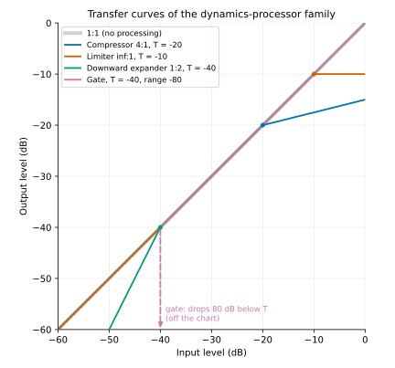
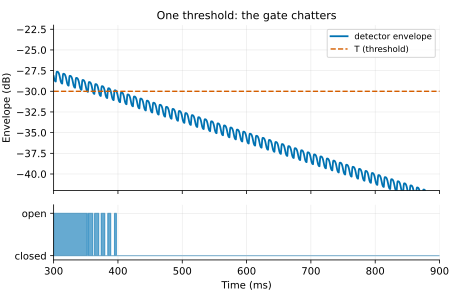
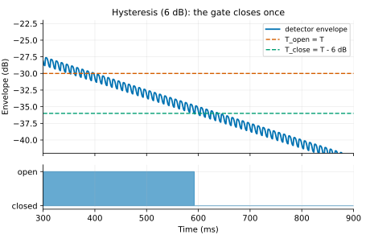
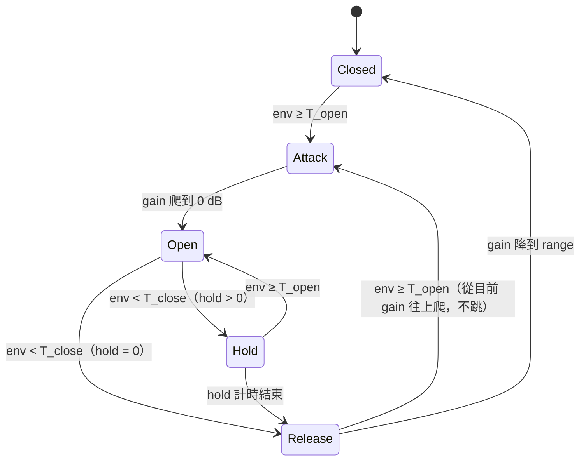
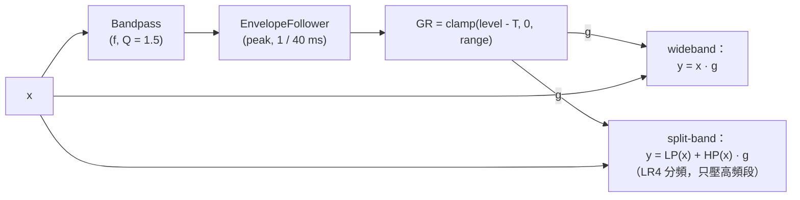

# 第 08 章：Gate、Expander、De-esser 與 Transient Shaper

[English](README.md) | **繁體中文**

> [教材首頁](../../README.zh-TW.md)　｜　上一章：[07 Distortion](../07-distortion/README.zh-TW.md)　｜　下一章：[09 Delay](../09-delay/README.zh-TW.md)

第 04 章的 compressor 處理「太大聲」的問題；第 05 章的 limiter 把它推到極端。這一章換個方向：處理「太小聲的東西不夠安靜」（gate、expander）、「某個頻段太刺」（de-esser），以及「不管大小聲，只管起音和延音的比例」（transient shaper）。四個元件全部建立在第 04 章的 `EnvelopeFollower` 與第 02 章的 `Biquad` 上，你會發現只要換掉 gain computer（靜態曲線）或偵測器前面的 filter，就能從同一套骨架長出完全不同的效果。

## 1. 本章目標

讀完本章、做完練習後，你應該能：

- 畫出 compressor / limiter / expander / gate 的 transfer curve，說出它們分別「動」threshold 的哪一側、斜率是多少。
- 從 compressor 的 soft knee 公式**對稱地推導**出 downward expander 的 gain computer，並手算任意 threshold / ratio / knee / range 下的輸出 dB。
- 解釋 noise gate 的 threshold、hysteresis、attack、hold、release、range 各自在聽感上的作用，畫出 gate 的狀態機（state diagram），並說明 hysteresis 為什麼能消除 chattering。
- 用 sidechain 讓一軌控制另一軌（kick 觸發 pad 的 ducking / trance gate），並理解 lookahead 如何保住 transient。
- 說明齒音（sibilance）為何集中在 5–10 kHz，實作 wideband 與 split-band 兩種 de-esser，並證明 Linkwitz-Riley 分頻「相加為平坦」。
- 用快慢兩個 envelope 的差值偵測 transient，推導這個差值在 attack 時為正、sustain 時為負，並把它映射成 attack / sustain 的 dB 增益。
- 了解 upward compression / upward expansion 是什麼，以及鼓組 gating、人聲 de-essing、snare transient 加強的實務設定。

## 2. 原理

### 2.1 動態處理家族全貌

所有「依音量改變增益」的效果器，靜態行為都可以用一條 **transfer curve**（輸入 dB → 輸出 dB）描述。1:1 的斜線代表「不處理」。差別只在於：曲線在 threshold 的**哪一側**偏離 1:1、往**哪個方向**偏。

<p align="center"></p>

圖中粗灰色斜線是 1:1 參考線（不處理），圓點標出各曲線的 threshold。各曲線在自己的 threshold 另一側都和斜線重疊（不處理）。compressor / limiter：T 以上「躺平」（compressor 的 4:1 在 T 以上每 10 dB 只升 2.5 dB；limiter 是 ∞:1，完全不升）。expander：T 以下「變陡」（1:2 在 T 以下每 5 dB 掉 10 dB，斜率 2）。gate：T 以下直接掉 80 dB，掉出圖外（垂直的箭頭）。

範例 2（`l08_expander_vs_gate_curve`）把這四條曲線印成表，節錄如下：

<div align="center">

| 輸入 (dB) | compressor 4:1, T=-20 | limiter ∞:1, T=-10 | expander 1:2, T=-40 | gate T=-40, range -80 |
|---:|---:|---:|---:|---:|
| -60 | -60.0 | -60.0 | -80.0 | -140.0 |
| -50 | -50.0 | -50.0 | -60.0 | -130.0 |
| -40 | -40.0 | -40.0 | -40.0 | -40.0 |
| -20 | -20.0 | -20.0 | -20.0 | -20.0 |
| -10 | -17.5 | -10.0 | -10.0 | -10.0 |
| 0 | -15.0 | -10.0 | 0.0 | 0.0 |

</div>

整理成「四象限」：

<div align="center">

| | 作用在 threshold **以上** | 作用在 threshold **以下** |
|---|---|---|
| **往 1:1 靠近（縮小動態）** | downward compression（compressor、limiter） | upward compression（把小聲的拉大） |
| **遠離 1:1（擴大動態）** | upward expansion（把大聲的推更大） | downward expansion（expander、gate） |

</div>

日常說的「compressor」「expander」「gate」都是 **downward** 的那兩格：它們只會把 gain 往下拉（gain ≤ 0 dB）。upward 的兩格會把 gain 往上推，需要另外限制最大 boost（2.7 節、練習 5）。

### 2.2 Downward expander 的 gain computer

**直覺**：expander 讓「安靜的地方更安靜」。低於 threshold 的訊號，每低 1 dB 就讓它變成低 $`R`$ dB（$`R`$ = ratio，例如 2）。麥克風底噪、隔壁鼓的串音、殘響尾巴，通常都比主要訊號小 20–40 dB，經過 1:2 的 expander 會再被壓下 20–40 dB——但不像 gate 那樣「一刀切」，所以聽起來自然。

**Hard knee**：令輸入 level 為 $`x`$（dB）、threshold 為 $`T`$、ratio 為 $`R \ge 1`$：

```math
y(x) = \begin{cases} x, & x \ge T \\ T + R\,(x - T), & x < T \end{cases}
```

因為 $`x - T < 0`$，$`R(x-T)`$ 比 $`x - T`$ 更負，所以輸出比輸入更小。gain（dB）為

```math
g(x) = y(x) - x = (R - 1)(x - T) \le 0 \quad (x < T)
```

> 名詞注意：compressor 的 ratio 「4:1」指輸入變 4 dB 輸出變 1 dB；expander 的 ratio 常寫成「1:2」，指輸入變 1 dB 輸出變 2 dB。本教材的 `Expander::setRatio(2)` 就是 1:2（合約：「2 代表低於 threshold 的每 1 dB 變成 2 dB」）。

**Soft knee（與 compressor 對稱的推導）**：第 04 章 compressor 的 knee 是在 $`[T - W/2,\ T + W/2]`$ 內放一段二次曲線，讓它在**下緣**接上 $`y = x`$、在**上緣**接上斜率 $`1/R`$ 的直線。expander 剛好反過來：knee 的**上緣**要接 $`y = x`$（斜率 1），**下緣**要接斜率 $`R`$ 的直線。所以把二次項的「錨點」放在上緣：

```math
y(x) = x + a\,(x - T - W/2)^2
```

- 在上緣 $`x = T + W/2`$：第二項為 0，值 $`= x`$、斜率 $`= 1`$，自動接上 1:1 線。
- 在下緣 $`x = T - W/2`$ 斜率要等於 $`R`$：

```math
y'(x) = 1 + 2a\,(x - T - W/2) \;\Rightarrow\; y'(T - W/2) = 1 - 2aW = R \;\Rightarrow\; a = \frac{1 - R}{2W}
```

- 檢查下緣的值：$`y(T - W/2) = T - \tfrac{W}{2} + \tfrac{1-R}{2W}W^2 = T - \tfrac{RW}{2}`$；而直線 $`T + R(x - T)`$ 在 $`x = T - W/2`$ 也是 $`T - \tfrac{RW}{2}`$。值與斜率都接上（$`C^1`$ 連續）。

整理成三段（和第 04 章逐項對照：$`1/R - 1 \to 1 - R`$、$`+W/2 \to -W/2`$）：

```math
y(x) = \begin{cases}
x, & x \ge T + W/2 \\[4pt]
x + \dfrac{(1 - R)\,(x - T - W/2)^2}{2W}, & T - W/2 \le x < T + W/2 \\[8pt]
T + R\,(x - T), & x < T - W/2
\end{cases}
```

在 threshold 本身 $`x = T`$：$`y(T) = T + \frac{(1-R)W}{8}`$。$`R = 2`$、$`W = 6`$ 時 $`y = T - 0.75`$；$`W = 12`$ 時 $`y = T - 1.5`$。範例 2 印出的 soft knee 表就是這兩個值（-40.75、-41.50）。

**Range**：如果不加限制，$`x = -100`$ dB 的底噪在 $`T = -40`$、$`R = 2`$ 時 gain 會是 $`-60`$ dB；ratio 一大，gain 會一路往 $`-\infty`$ 掉，expander 就變成 gate。**range** 是 gain 的下限：

```math
g_{\text{final}} = \max\big(\text{range},\ y(x) - x\big),\qquad \text{range} < 0
```

聽感上：range = -10 dB 是「讓串音退後一點」；range = -40 dB 以上幾乎等於關掉。範例 2 的 expander 用 range -40 dB，所以 -60 dBFS 的段落是 -60 + max(-40, -20) = -80 dB。

### 2.3 時間行為：attack = 開門、release = 關門

靜態曲線之前一樣要有 level detector（第 04 章 `EnvelopeFollower`）。命名慣例和 compressor「相反」，第一次看很容易搞混：

<div align="center">

| | compressor | expander / gate |
|---|---|---|
| 訊號變大時 | gain **下降**（開始壓）→ 這段叫 attack | gain **上升**（門打開）→ 這段叫 attack |
| 訊號變小時 | gain **回升**（放開）→ release | gain **下降**（門關上）→ release |

</div>

兩者其實是同一件事：**attack 永遠是「訊號變大時」的反應時間**。對 expander 而言，訊號一變大就要趕快把門打開，否則打擊的頭會被吃掉，所以 attack 通常很短（0.1–5 ms）；訊號變小時慢慢關，讓自然的衰減（鼓的尾音、殘響）不要被剪斷，release 通常 50–300 ms。

`Expander` 直接把 attack / release 交給 `EnvelopeFollower`：envelope 上升（attack）→ level 變大 → gain 回到 0 dB；envelope 下降（release）→ level 變小 → gain reduction 慢慢加深。

一個細節：`Expander` 把偵測器設成第 04 章的 `SmoothingMode::Decoupled`。Branching 模式在穩態正弦波上，每個週期的 peak 之間會沿 release 曲線往下掉、再被 attack 慢慢拉回，平均起來比真正的 peak 低（1 kHz、attack 5 ms、release 50 ms 時約低 1.2 dB）。compressor 對這個誤差不太敏感（gain 的斜率是 $`1/R - 1`$，絕對值小於 1），但 expander 的 gain 斜率是 $`R - 1`$，ratio 越大誤差被放得越大。練習 5 的解答 [3] 實測了這個效應：upward expander（$`R = 1.5`$）改用 Branching 後，-20 dB 段的輸出從 -15.01 dB 掉到 -15.58 dB，誤差 $`0.58 = (R - 1) \times 1.16`$ dB。Decoupled 先做「瞬間上升、按 release 衰減」的 peak-hold 再用 attack 平滑，穩態 level 就等於 peak，範例 2 的 tone burst 實測值才會精確落在靜態曲線上（見 3.5 節）。

### 2.4 Noise gate

Gate 可以看成 ratio → ∞ 的 expander：低於 threshold 就直接衰減 |range| dB。但「一刀切」帶來兩個 expander 沒那麼嚴重的問題：**門檻附近會抖**（chattering）、**開關瞬間會有 click**。所以 gate 的設計重點不是靜態曲線，而是時間行為。

#### 2.4.1 Hysteresis：開門與關門用不同門檻

想像 snare 的尾音慢慢衰減，正好經過 threshold。偵測到的 envelope 不是平滑的直線：peak detector 每遇到一個波峰就往上跳一下，兩個波峰之間又往下掉，造成數 dB 的漣漪（ripple）。如果開門和關門用同一個門檻 $`T`$：

<p align="center"></p>

圖中是一個緩慢衰減的 50 Hz 音（偵測器：peak、attack 0.1 ms、release 20 ms）的 envelope，在 threshold $`T = -30`$ dB 附近帶著約 1 dB 的漣漪，每個波峰都可能越過它一次：下方的 gate 狀態條在約 100 ms 內改變了 11 次狀態，開、關、開、關……= chattering（聽起來像碎裂的「嗶嗶剝剝」）。

解法是借用電子學的 **Schmitt trigger**：

- envelope **≥ $`T_\text{open}`$**（= threshold）才開門；
- envelope **< $`T_\text{close}`$ = threshold − hysteresis** 才關門；
- 在兩者之間，維持目前的狀態。

<p align="center"></p>

圖中同一條 envelope 在很長一段時間都落在 $`T_\text{open}`$ 與 $`T_\text{close}`$ = $`T_\text{open}`$ - 6 dB 之間：漣漪不改變狀態，直到 envelope 真的掉到 $`T_\text{close}`$ 以下，gate 才關一次。

條件很簡單：**hysteresis 必須大於 envelope 起伏的峰對峰值**。起伏的第一個來源是整流漣漪，我們可以把它算出來。

**漣漪估算**。設輸入是振幅 $`A`$、頻率 $`f`$ 的正弦波，$`|x|`$ 每半個週期 $`\frac{1}{2f}`$ 出現一個波峰。波峰之後偵測器進入 release，第 04 章的 one-pole 平滑器是
$`\tau_r\,\dot e = |x| - e`$——注意它是往**目前的 $`|x|`$** 衰減，不是往 0 衰減。在半個週期內 $`e \approx A`$，而 $`|x|`$ 的平均值是 $`\frac{2}{\pi}A`$，所以 envelope 在兩個波峰之間大約掉了

```math
\Delta e \approx \frac{1}{\tau_r}\int_0^{1/(2f)} \big(e - |x|\big)\,dt \approx \frac{A\,(1 - 2/\pi)}{2f\,\tau_r}
\quad\Rightarrow\quad
\text{ripple}_\text{dB} \approx 20\log_{10}\frac{A}{A - \Delta e} \approx 8.686\cdot\frac{1 - 2/\pi}{2f\,\tau_r}
```

（$`8.686 = 20/\ln 10`$，用到 $`\ln(1+u) \approx u`$。）45 Hz 的 kick、偵測器 release 20 ms：$`8.686 \times 0.363 / (2 \times 45 \times 0.02) \approx 1.75`$ dB。如果偵測器是「往 0 衰減」的類型（類比的 diode + RC peak detector），兩個波峰之間會掉 $`e^{-1/(2f\tau_r)}`$，也就是 $`8.686/(2f\tau_r) \approx 4.8`$ dB，大了 $`1/(1 - 2/\pi) \approx 2.75`$ 倍。範例 1 的 [4] 用 `Gate` 內部同款偵測器實測：

<div align="center">

| 頻率 | release 20 ms 實測 / 估算 | release 50 ms 實測 / 估算 |
|---:|---:|---:|
| 45 Hz | 1.56 / 1.75 dB | 0.66 / 0.70 dB |
| 100 Hz | 0.74 / 0.79 dB | 0.31 / 0.32 dB |
| 185 Hz | 0.41 / 0.43 dB | 0.17 / 0.17 dB |
| 1000 Hz | 0.08 / 0.08 dB | 0.03 / 0.03 dB |

</div>

估算略高於實測，因為波峰附近有一小段是 attack 在充電、不是 release 在放電。兩個結論：漣漪和 $`1/(f\tau_r)`$ 成正比，**低頻訊號（kick、tom、bass）的漣漪最大**；拉長偵測器 release 可以把漣漪壓小，但偵測會變慢。

真實訊號的 envelope 起伏比單一正弦大得多：多個 partial 之間的 beating、底噪疊在衰減的尾音上、鼓皮不規則的衰減，都會讓 level 抖好幾 dB。所以實務上 kick / tom 的 gate 常設 4–10 dB 的 hysteresis，hi-hat 這種高頻、衰減快的訊號 2–3 dB 就夠。

範例 1 用 hysteresis 6 dB + hold 20 ms，和 hysteresis 0 + hold 0 比較 state 轉換次數：5 秒的鼓組 loop（含 -50 dBFS 雜訊）是 **43 次 vs 70 次**，多出來的轉換都是門在門檻附近的抖動。

#### 2.4.2 狀態機：Closed → Attack → Open → Hold → Release

本章的 `Gate` 每個 sample 走一步這個狀態機：



- **Attack**：gain 從目前的值以固定斜率（dB/sample）爬到 0 dB。一旦觸發就一路開完，期間不看門檻，確保 transient 完整通過。
- **Open**：gain = 0 dB；envelope 掉到 $`T_\text{close}`$ 以下才離開。
- **Hold**：gain 仍然 0 dB，計時 hold 毫秒。這段期間訊號若回到 $`T_\text{open}`$ 以上就回到 Open（計時作廢）。hold 是對付 chattering 的第二道防線：漣漪造成的「短暫低於門檻」通常只有幾毫秒，hold 20–50 ms 就能吸收掉。
- **Release**：gain 以固定斜率降到 range。期間若訊號又變大，直接轉 Attack，從**當下的 gain**往上爬，不會跳回 range 再開，否則就是一個 click。
- **Closed**：gain = range。

**斜坡的數學**：attack 時間 $`t_a`$ 定義為「從 range 爬到 0 dB」所需時間。在 dB 域等速爬升：

```math
\Delta_a = \frac{|\text{range}|}{t_a \cdot f_s}\ \text{dB/sample},\qquad g_\text{dB}[n] = \text{range} + n\,\Delta_a
```

range -80 dB、attack 1 ms、48 kHz：$`\Delta_a = 80/48 \approx 1.67`$ dB/sample。dB 域等速 = 線性域指數變化（$`g = 10^{g_\text{dB}/20}`$），聽起來是自然的 fade，而不是線性 fade 那種「最後一下突然變大聲」的感覺。release 同理。

範例 1 的時間軸（threshold -30、hysteresis 6、attack 1 ms、hold 20 ms、release 50 ms）：

<div align="center">

| time (ms) | transition | 說明 |
|---:|---|---|
| 0.10 | Closed -> Attack | kick 一開始，0.1 ms 偵測器就超過 -30 dB |
| 1.12 | Attack -> Open | 1 ms 的 attack 走完 |
| 457.04 | Open -> Hold | kick 尾巴掉到 -36 dB 以下 |
| 477.04 | Hold -> Release | hold 20 ms |
| 500.00 | Release -> Attack | 500 ms 的 snare 在 release 途中到達，直接從當下 gain 往上爬 |
| 500.48 | Attack -> Open | 從 release 中途開，所以不到 1 ms 就開完 |

</div>

#### 2.4.3 Range

range 是「門關上時」的衰減量。-80 dB 以下（本教材的 `dbToGain` 在 -100 dB 以下回傳 0）等於完全靜音，適合錄音室裡的鼓組 tom 軌；但在現場或有殘響的錄音中，完全靜音會讓背景「忽有忽無」，很不自然，這時 range 設 -10～-20 dB，讓背景降低但不消失（效果上很像 expander）。

#### 2.4.4 Sidechain

gate 的偵測訊號不一定要是自己。`Gate::process(main, sidechain)` 用 sidechain 的 envelope 驅動狀態機，gain 套在 main 上：

- **Kick 觸發 bass / pad 的 gate**（trance gate）：pad 只有在 kick 打下去時才發聲，節奏感變得非常緊。
- **Kick 觸發的 ducking**（反過來：kick 出現時把 bass 壓低幾 dB）讓兩者不搶低頻，這其實是 sidechain compression，練習 4 會兩種都做。
- **Snare 軌加 gate、但偵測用 snare 下方的 trigger 麥克風或 high-pass 過的訊號**，避免 kick 的串音把門打開。

#### 2.4.5 Lookahead 簡述

即使 attack 只有 1 ms，transient 的頭仍然會被斜坡「吃掉」一部分；attack 太短又會出現 click（gain 變化太快 = 在頻譜上多出寬頻成分）。lookahead 的做法是：偵測器看「現在」的訊號，主訊號延遲 $`L`$ samples 再乘 gain。門在 transient 真正到達輸出之前就開始開，attack 可以設長一點（沒有 click）而頭又完整。代價是整體延遲 $`L`$，plugin 必須用 `getLatencySamples()` 回報給 host 做延遲補償（第 05 章 limiter 是同樣的道理）。練習 6 實作它：attack 10 ms 的 gate，沒有 lookahead 時 burst 開頭 2 ms 被削掉 70 dB；lookahead 10 ms 後與輸入相差 < 0.5 dB。

### 2.5 De-esser

#### 2.5.1 為什麼齒音在 5–10 kHz

「s」「sh」「ts」這類擦音（fricative）不是聲帶振動，而是氣流被舌尖與上排牙齒之間的窄縫擠壓，產生湍流雜訊（turbulent noise）。這個雜訊被縫隙前方很小的口腔空間（舌尖到嘴唇之間）共振塑形，共振腔越小、共振頻率越高：「s」的能量集中在約 5–10 kHz（因人而異，女聲通常比男聲高），「sh」舌位較後、共振腔較大，大約 2.5–6 kHz。母音的能量則集中在基頻與前幾個 formant（共振峰：聲道（喉嚨到嘴唇）的共振頻率，決定聽起來是「a」還是「i」；多半 < 4 kHz）。所以只要「聽」5–10 kHz，就能很好地分辨「現在是不是齒音」。

麥克風（尤其是電容麥克風的高頻 presence peak）、EQ 加亮、compressor 把母音壓小，都會讓齒音相對更突出，所以 de-esser 通常放在人聲 chain 的 compressor 前後。

#### 2.5.2 Detector：只看 bandpass 過的訊號

de-esser 就是「偵測器前面加一個 bandpass 的 compressor」：



先用 analog prototype 估計 bandpass（0 dB peak）的 −3 dB 邊界：$`f_1, f_2`$ 滿足 $`f_1 f_2 = f_0^2`$、$`f_2 - f_1 = f_0 / Q`$。解這兩條式子：

```math
f_{1,2} = f_0\left(\sqrt{1 + \frac{1}{4Q^2}} \mp \frac{1}{2Q}\right)
```

$`Q = 1.5`$：$`f_1 = 0.7208\,f_0`$、$`f_2 = 1.3874\,f_0`$。$`f_0 = 7`$ kHz → 約 5.05–9.71 kHz（0.945 octave）。

這只是近似。數位的 RBJ bandpass 經過 bilinear transform，頻率軸被往 Nyquist 壓縮，同一個 $`Q`$ 的實際頻寬會變窄。RBJ Cookbook 給的關係是

```math
\frac{1}{Q} = 2\sinh\!\left(\frac{\ln 2}{2}\cdot \text{BW}\cdot\frac{\omega_0}{\sin\omega_0}\right),\qquad \omega_0 = 2\pi f_0 / f_s
```

（BW 以 octave 計）。$`f_0 = 7`$ kHz、$`f_s = 48`$ kHz 時 $`\omega_0/\sin\omega_0 = 1.155`$，代入 $`Q = 1.5`$ 得 BW ≈ 0.82 octave，比 analog 的 0.945 octave 窄。用 `BiquadCoefficients::magnitudeDb()` 實測，48 kHz 的 −3 dB 邊界是 **5218–9168 Hz**（44.1 kHz：5251–9083 Hz；96 kHz：5088–9561 Hz，sample rate 越高越接近 analog）。範例 3 會同時印出 analog 公式的 5046–9712 Hz 與數位實測值。兩者都蓋住齒音的主要範圍，所以偵測效果差不多。

gain computer 用最直覺的 **∞:1、上限 range**：偵測 level 超過 threshold 幾 dB 就壓幾 dB，最多壓 range dB。

```math
\text{GR} = \mathrm{clamp}(L_\text{det} - T,\ 0,\ \text{range})
```

range（`setRangeDb`，正值）不要設太大：齒音壓過頭，人聲會變得像「大舌頭」（lisp）。6–10 dB 通常就夠。

#### 2.5.3 Wideband vs split-band

- **Wideband**：偵測到齒音時，整個訊號一起壓。簡單、沒有相位問題，但齒音瞬間母音也跟著被壓，會聽到「吸氣」或音量忽大忽小。範例 3：齒音期間 220 Hz 母音從 -18.08 dB 被壓到 -29.04 dB。
- **Split-band**：把訊號分成低頻段與高頻段，只壓高頻段再相加。範例 3：母音在齒音期間仍是 -18.08 dB，完全不動，只有 7 kHz 被壓。

split-band 的分頻器必須滿足「gain = 1 時，LP + HP = 原訊號」，否則 de-esser 沒在動作時也會改變音色。**Linkwitz-Riley 4 階（LR4）** = 兩個相同的 2 階 Butterworth 串聯。以 analog prototype（$`s`$ 以 $`\omega_c`$ 正規化）推導：

```math
H_{LP}(s) = \left(\frac{1}{s^2 + \sqrt2\,s + 1}\right)^2,\qquad
H_{HP}(s) = \left(\frac{s^2}{s^2 + \sqrt2\,s + 1}\right)^2
```

```math
H_{LP} + H_{HP} = \frac{1 + s^4}{(s^2 + \sqrt2\,s + 1)^2}
= \frac{(s^2 + \sqrt2\,s + 1)(s^2 - \sqrt2\,s + 1)}{(s^2 + \sqrt2\,s + 1)^2}
= \frac{s^2 - \sqrt2\,s + 1}{s^2 + \sqrt2\,s + 1}
```

（用到 $`s^4 + 1 = (s^2 + \sqrt2 s + 1)(s^2 - \sqrt2 s + 1)`$。）最後的形式是一個 2 階 **allpass**：分子與分母的根對 $`j\omega`$ 軸鏡像對稱，所以 $`|H_{LP} + H_{HP}| = 1`$——振幅完全平坦，只有相位改變。在分頻點 $`s = j`$：每個 Butterworth 是 −3 dB、相位 ∓90°，平方後 LP、HP 都是 −6 dB、相位都是 ∓180°（同相），相加 = 0.5 + 0.5 = 1。bilinear transform 對 LP、HP 用同一個頻率映射，所以數位版本也保有這個性質。練習 7 會實測：100 Hz–15 kHz 的 $`|LP + HP|`$ 全部在 0.000 dB。

（對照：直接用兩個 2 階 Butterworth（不平方）分頻，LP 與 HP 在分頻點相差 180°，相加會在 $`f_c`$ 出現深的 notch；把其中一路反相則會變成 +3 dB 的凸起。這就是 LR 分頻在喇叭 crossover 與多段 dynamics 被廣泛使用的原因。）

`DeEsser` 的分頻點放在 analog prototype 的下 −3 dB 點 $`0.7208 f_0`$（7 kHz 時約 5.05 kHz，比數位 bandpass 實際的下緣 5.22 kHz 低一點，等於把高頻段多留一點餘裕）。注意分頻器的 transition 不是無限陡：7 kHz 在 5.05 kHz 分頻點上方只有半個八度，LP 段在 7 kHz 仍有一部分殘留不會被壓。analog LR4 的 $`|H_{LP}| = 1/(1 + (f/f_c)^4)`$，$`f/f_c = 1.387`$ 時為 0.213（-13.4 dB）；bilinear transform 會把高頻往 Nyquist 壓縮，數位版本在 48 kHz 時是 0.189（-14.5 dB）。因為 LR4 的 LP 與 HP 同相、$`|H_{LP}| + |H_{HP}| = 1`$，套上 HP 段的 gain $`g`$ 後 7 kHz 的總增益是

```math
|H_{LP}| + (1 - |H_{LP}|)\,g = 0.189 + 0.811 \times 10^{-10.94/20} \approx 0.420 \;\Rightarrow\; -7.55\ \text{dB}
```

範例 3 實測 split-band 把 7 kHz 壓了 $`49.91 - 42.31 = 7.60`$ dB，wideband 壓了 10.94 dB（≈ 齒音期間 GR 的平均；上式用的就是這個值）。這是 split-band 的典型取捨：音色更乾淨，壓得比較「淺」；要壓得更深，可以把分頻點往下移，或把 range 加大。

#### 2.5.4 Listen 模式

`setListen(true)` 讓輸出變成偵測器聽到的訊號（bandpass 後的 x）。調 de-esser 的標準流程：開 listen → 掃 frequency 直到「嘶」最明顯、母音最少 → 關 listen → 調 threshold 直到 GR meter 只在齒音時跳 4–8 dB。

### 2.6 Transient shaper

compressor 和 expander 都看「絕對音量」：超過或低於某個 threshold 才動作。transient shaper 不在乎多大聲，只看「音量變化的快慢」：把每個音符拆成 **attack（起音）** 與 **sustain（延音）**，各自加強或減弱。所以同一個設定對大聲和小聲的鼓都有一樣的效果——這是它與 compressor 最大的不同。

#### 2.6.1 快慢兩個 envelope 的差值

同一個訊號餵給兩個 `EnvelopeFollower`：

- **fast**：attack 0.5 ms、release 30 ms，幾乎貼著訊號的 peak 走。
- **slow**：attack 10 ms、release 150 ms，慢半拍的「平均音量」。

定義差值（dB）：

```math
d[n] = 20\log_{10}\frac{e_\text{fast}[n]}{e_\text{slow}[n]}
```

**Attack 階段，$`d > 0`$**：設訊號在 $`t = 0`$ 從 0 跳到振幅 $`A`$（step）。兩個 follower 都在 attack 模式，one-pole 的 step response 是 $`A(1 - e^{-t/\tau})`$：

```math
d(t) = 20\log_{10}\frac{1 - e^{-t/\tau_{fa}}}{1 - e^{-t/\tau_{sa}}}
```

因為 $`\tau_{fa} < \tau_{sa}`$，對所有 $`t > 0`$ 都有 $`e^{-t/\tau_{fa}} < e^{-t/\tau_{sa}}`$，所以分子 > 分母、$`d > 0`$。$`t \to 0`$ 時用 $`1 - e^{-u} \approx u`$，$`d \to 20\log_{10}(\tau_{sa}/\tau_{fa}) = 20\log_{10}(10/0.5) = 26`$ dB；$`t \to \infty`$ 時兩者都到 $`A`$，$`d \to 0`$。所以 $`d`$ 在起音瞬間最大、隨後遞減，持續時間大約是 slow 的 attack 的幾倍。

**Sustain / 衰減階段，$`d < 0`$**：起音過後，訊號以時間常數 $`\tau_d`$ 指數衰減 $`x(t) = A e^{-t/\tau_d}`$，兩個 follower 都進入 release 模式。一階系統 $`\tau_r\,\dot e = x - e`$ 對指數輸入的穩態解為 $`e(t) = K A e^{-t/\tau_d}`$，代入得

```math
-\frac{K}{\tau_d} = \frac{1 - K}{\tau_r} \;\Rightarrow\; K = \frac{\tau_d}{\tau_d - \tau_r}\quad(\tau_d > \tau_r)
```

- 若 $`\tau_d > \tau_r`$：envelope 跟得上訊號，只是落後一點（高出 $`K`$ 倍）。
- 若 $`\tau_d < \tau_r`$：訊號掉得比 release 快，envelope 跟不上，以自己的 $`e^{-t/\tau_r}`$ 衰減。

fast 的 release（30 ms）比鼓的衰減（`makeDrumLoop` 的 kick 包絡是 $`e^{-8t}`$，$`\tau_d = 125`$ ms）快，所以 fast 貼著訊號掉；slow 的 release（150 ms）比 $`\tau_d`$ 慢，所以 slow「撐在高處」。fast < slow，$`d < 0`$，而且 $`|d|`$ 隨時間增加（兩者的衰減率不同）：

```math
d(t) \approx \text{常數} - 8.686\,t\left(\frac{1}{\tau_d} - \frac{1}{\tau_{sr}}\right)
```

實測會比這個理想值掉得更快：peak detector 吃的是 $`|x|`$，每個波峰都會讓 slow 用 attack 再「充電」一次，slow 實際上掉得比 150 ms 還慢。範例 4 印出第一個 kick 的 $`d`$：第 0 個 sample 是 +25.8 dB（≈ 上面算的 26 dB）、20 ms 時 +3.7 dB、約 55 ms 過零、之後一路往負走（195 ms 時約 −5.3 dB）。同一張表裡 fast 從 −8.3 dB（50 ms）掉到 −18.0 dB（195 ms），約 67 dB/s（$`\tau \approx 130`$ ms，貼著 kick 的 125 ms）；slow 只掉了約 30 dB/s（等效 $`\tau \approx 290`$ ms，比它自己的 150 ms release 還慢）。正是「起音 $`d > 0`$、延音 $`d < 0`$」。

#### 2.6.2 Attack / sustain 的 dB 增益映射

把 $`d`$ 線性映射成增益，並在 $`|d| = 6`$ dB 時飽和：

```math
g_\text{dB} = \begin{cases}
\text{attackDb}\cdot\min(d / 6,\ 1), & d > 0 \\
\text{sustainDb}\cdot\min(-d / 6,\ 1), & d \le 0
\end{cases}
```

再用 0.5 ms 的 one-pole 平滑 $`g_\text{dB}`$，避免 envelope 漣漪直接變成 gain 的抖動（zipper noise、低頻 kick 上會變成失真）。slow envelope 低於 −80 dBFS 時視為靜音、不處理（否則底噪的隨機起伏也會被當成 transient 放大）。

因為映射只看 $`d`$（比例），不看絕對 level，所以小聲的 ghost note 和大聲的 accent 會得到一樣的加強——這就是 transient shaper 的「level independent」特性。

**聽感**：attack +6～+12 dB 讓鼓更「打」、更靠近；attack −6～−12 dB 讓鼓變圓、變遠（像在房間後方）；sustain −12 dB 把尾音、房間聲縮短（像把房間變乾）；sustain + 會把尾音與房間聲拉長，但很容易把 kick 的低頻尾巴推得比起音還大聲（範例 4 的 sustain +12，peak 反而上升 6.8 dB），實務上多半只用 +3～+6 dB。

### 2.7 Upward compression / upward expansion

回到 2.1 節的四象限表：

- **Upward compression**：threshold **以下**的訊號被**拉大**，往 1:1 線靠近（動態變小）。效果類似 parallel compression（第 04 章練習 3）：小聲的細節浮上來，大聲的不動。實作時一定要有 range（最大 boost），否則靜音時的底噪會被拉大 40 dB。
- **Upward expansion**：threshold **以上**的訊號被**推得更大**（動態變大）。常用來「還原」被過度壓縮的素材，或讓鼓的打擊更突出。靜態曲線：

```math
y(x) = \begin{cases}
x, & x \le T - W/2 \\
x + \dfrac{(R - 1)(x - T + W/2)^2}{2W}, & T - W/2 < x < T + W/2 \\
T + R\,(x - T), & x \ge T + W/2
\end{cases}
```

（推導方式與 2.2 節相同，只是錨點換到 knee 下緣。）同樣要用 range 限制最大 boost，否則一個 transient 就會被推到 clipping。練習 5 會實作它並以 tone burst 驗證：T = -30、R = 1.5、range +12 時，-20 dB 的段落輸出 -15.01 dB（理論 -15）。

### 2.8 實務：四個常見的用法

<div align="center">

| 情境 | 元件 | 典型設定 | 注意 |
|---|---|---|---|
| Tom / kick 麥克風去串音 | Gate | threshold：比串音的 peak 高 3–6 dB；hysteresis 4–10 dB；attack 0.1–1 ms；hold 30–100 ms；release 100–300 ms；range -40～-80 dB | release 太短會剪掉鼓的尾音；sidechain 加 HPF / 用 trigger 麥克風避免 kick 把 tom 的門打開 |
| 人聲 de-essing | De-esser | 女聲 6–9 kHz、男聲 5–7 kHz；threshold 讓 GR 只在齒音時 4–8 dB；range 8–12 dB | 先用 listen 找頻率；split-band 音色較乾淨，wideband 在齒音很重時比較有效 |
| Snare transient 加強 | Transient shaper | attack +3～+8 dB、sustain 0～−4 dB | attack 加大會讓 peak 上升（範例 4：attack +12 → peak +11.7 dB），後面要留 headroom 或接 limiter |
| 現場人聲 / 對白去背景 | Expander | ratio 1:2–1:4、threshold 在說話音量下方 10–15 dB、range -10～-20 dB | range 太深會聽到背景「呼吸」（pumping） |

</div>

**放在 chain 的哪裡**：gate / expander 通常放在 insert chain 的最前面（EQ 的 high-pass 之後即可）。理由和第 07 章反覆提到的一樣：compressor、saturation、distortion 都會把小訊號「拉大」——distortion 的 drive 30 dB 會讓 -50 dBFS 的底噪變成 -20 dBFS，而鼓的 peak 被削平，訊號與雜訊的距離從 40 多 dB 縮到 10 幾 dB，之後再 gate 就找不到乾淨的 threshold 了。de-esser 則常放在 compressor 之後（compressor 把母音壓小後齒音更突出），或前後各放一個輕的。transient shaper 因為不看絕對 level，放在哪裡都能動作，但放在 compressor 之前時，compressor 會把剛加強的 attack 又壓回去。

## 3. 從公式到程式碼

本章新增四個 header，都在 `dsp/include/dawlab/dsp/`，namespace `dawlab::dsp`。共通的設計：

- 偵測一律 **stereo-link**：用所有 channel 的 $`\max|x|`$ 驅動同一個 gain，否則左右聲道各自開關，聲像會亂跳。
- 每個 class 都有 `std::atomic<float>` 的量測值，因此手動寫了 copy constructor / copy assignment（`std::atomic` 不可複製），這樣第 14 章才能把它們放進 `std::vector`。
- 核心邏輯抽成 `nextGain(float detectorInput)`（`Gate`、`Expander`、`TransientShaper`）：吃一個偵測 sample、回傳線性 gain。`process()` 只是對每個 sample 呼叫它；練習裡的 lookahead、sidechain 也直接重用它。

### 3.1 `Expander.h`

靜態曲線就是 2.2 節三段式的逐字翻譯：

```cpp
static float computeOutputDb(float inputDb, float thresholdDb, float ratio, float kneeDb) noexcept {
    const float r = std::max(1.0f, ratio);
    const float w = std::max(0.0f, kneeDb);
    const float halfW = 0.5f * w;
    if (inputDb >= thresholdDb + halfW)
        return inputDb;                                        // y = x
    if (w > 0.0f && inputDb >= thresholdDb - halfW) {
        const float d = inputDb - thresholdDb - halfW;         // x − T − W/2（≤ 0）
        return inputDb + (1.0f - r) * d * d / (2.0f * w);      // x + (1−R)(x−T−W/2)²/(2W)
    }
    return thresholdDb + r * (inputDb - thresholdDb);          // T + R(x − T)
}
```

`nextGain()`：envelope（Decoupled peak）→ dB → `computeGainDb()` → `max(range, g)` → 只有 gain 改變時才呼叫 `dbToGain`（`std::pow` 很貴，門全開時 gain 一直是 0 dB，省下大量計算）。`getGainReductionDb()` 回傳正值（例如 20 代表正在衰減 20 dB），在每個 block 結束時更新。額外提供 `process(main, sidechain)` 與 `setDetectorMode(DetectorMode)`。

threshold、ratio、knee、range 都直接出現在 gain 公式 $`g = \max(\text{range},\ (R-1)(x-T))`$ 裡，所以在 block 之間改它們，gain 會在一個 sample 內整段跳到新值。例如 -50 dBFS 的穩態訊號、1:2，threshold 從 -40 改成 -30，gain 會從 -10 dB 一步跳到 -20 dB，就是一聲 click。所以這四個參數各自經過一個第 01 章的 `SmoothedValue`，在 `Expander::kParameterRampMs`（20 ms）內線性走到新值。上面的例子變成每個 sample 只變約 0.01 dB。例外是 `reset()`（`prepare()` 也會呼叫）之後、處理第一個 sample 之前呼叫的 setter，它們直接生效，所以「prepare → 設定參數 → 開始處理」不會從預設值滑過來（第 14 章的 effect adapter 就是這個順序）。

### 3.2 `Gate.h`

`enum class GateState { Closed, Attack, Open, Hold, Release }` 與 `gateStateName()`（印時間軸用）。`nextGain()` 是 2.4.2 節狀態機的 `switch`。幾個實作重點：

- 偵測器固定 peak 模式、attack `Gate::kDetectorAttackMs` = 0.1 ms（要能抓到 transient），release 預設 20 ms，可用 `setDetectorReleaseMs()` 改。偵測器的 release 和 gate 的 release 是兩回事：前者決定 envelope 的漣漪大小（2.4.1 節，影響 hysteresis 要設多少），後者決定門關上的 fade 時間。
- `setRangeDb()` 對正負號防呆：一律視為「衰減 |db| dB」。門關著時改 range 不會瞬間跳變：Closed 狀態每個 sample 把 gain 往新的 range 滑一步（往上用 attack 斜率、往下用 release 斜率，至少 0.01 dB/sample），這樣第 14 章的 DAW 自動化 range 也不會有 click。
- `updateTimes()` 把 attack / release 換算成 dB/sample 的斜率（2.4.2 節的 $`\Delta_a`$），hold 換算成 sample 數。attack 小於 1 sample 時斜率設成極大值（等於瞬間開門）；|range| 小於 1 dB 時斜率以 1 dB 計算，避免 range = 0 時斜率為 0、正在 Attack 的 gain 永遠爬不到 0 dB。
- `isOpen()` 在 Attack / Open / Hold 時為 true；Release 期間視為「正在關」。`getState()` 給除錯與教學用。狀態存在 `std::atomic<GateState>`（relaxed），`nextGain()` 開頭讀一次、結尾寫一次，所以 UI thread 也可以安全地呼叫這兩個函式來畫「門開著」的燈號。
- `process(main, sidechain)`：sidechain 的 channel 數可以和 main 不同（例如 mono kick 控制 stereo pad），sample 數以兩者較小者為準。

### 3.3 `DeEsser.h`

- `prepare()` 準備五個 `Biquad`：偵測用 bandpass（Q = 1.5）、LR4 分頻的 LP×2 與 HP×2（都是 Q = 1/√2 的 Butterworth），以及一個存「每個 channel 目前偵測 sample」的 vector（listen 模式用；只在 prepare 配置）。
- `setFrequency()` 同時更新偵測 bandpass 與分頻點（`getCrossoverHz()` = 0.7208 f）。
- `process()` 每個 sample：先把 NaN / Inf 換成 0 → 每個 channel 各自 bandpass、取 $`\max|\cdot|`$（stereo-link）→ `EnvelopeFollower`（attack 1 ms、release 40 ms，可用 `setAttackMs` / `setReleaseMs` 改）→ GR = clamp(level − T, 0, range) → 套用。
- **NaN 防護要放在 biquad 之前**：`EnvelopeFollower` 自己會擋 NaN，但 `Biquad`（TDF-II）不會。只要一個 NaN 進到濾波器，狀態變數就永遠是 NaN，split-band 與 listen 模式從此一直輸出 NaN，只有 `reset()` 救得回來。所以 `DeEsser` 在讀進 x 之後、送進任何 biquad 之前，就先把非有限值換成 0。
- threshold 與 range 直接出現在 GR 公式裡，和 `Expander` 一樣用 `SmoothedValue` 平滑（`DeEsser::kParameterRampMs` = 20 ms，reset 後第一個 sample 之前的 setter 直接生效）。
- **分頻器永遠在跑**，即使是 wideband 模式：這樣使用者在播放中切換 split-band 時，濾波器狀態已經是「熱的」，不會因為從零開始而產生 transient。

### 3.4 `TransientShaper.h`

常數都是 `static constexpr`，範例直接拿來重建 fast / slow follower 以印出 $`d`$：

```cpp
static constexpr float kFastAttackMs = 0.5f,  kFastReleaseMs = 30.0f;
static constexpr float kSlowAttackMs = 10.0f, kSlowReleaseMs = 150.0f;
static constexpr float kFullScaleDb = 6.0f;   // |d| 到 6 dB 就套用完整的 attackDb / sustainDb
static constexpr float kFloorDb = -80.0f;     // slow 低於此視為靜音
static constexpr float kGainSmoothMs = 0.5f;
```

`nextGain()` 是 2.6.2 節映射的直接翻譯，最後 `gainDb_ = target + α·(gainDb_ − target)` 做 one-pole 平滑。`setAttackDb` / `setSustainDb` 限制在 ±24 dB。量測值 `getLastGainDb()`（可正可負）供 UI 使用。

### 3.5 範例

建置與執行（Windows，專案根目錄）：

```powershell
.\scripts\build.ps1 -Only 08-gate-expander
cd build
.\bin\Debug\l08_gate_drum_noise.exe
```

輸出 WAV 在 `build/dawlab_output/`。所有範例都是 48 kHz、block size 512，逐 block 處理。

#### 範例 1：`l08_gate_drum_noise`（`examples/gate_drum_noise.cpp`）

鼓組 loop（2 小節、4 秒）+ 1 秒空白，整段疊上 RMS −50 dBFS 的白雜訊（均勻分布 $`[-A, A)`$ 的 RMS 是 $`A/\sqrt3`$，所以 $`A = 10^{-50/20}\sqrt3`$）。Gate 設定 threshold −30 dB、hysteresis 6 dB、attack 1 ms、hold 20 ms、release 50 ms、range −80 dB。可以給 `argv[1]` 換成自己的 48 kHz WAV。

```
[1] RMS of the silent sections (left channel)
    gap at end of bar 1, 1.90-2.00 s  before   -50.0 dBFS -> after  -130.0 dBFS (improvement 80.0 dB)
    trailing silence 4.50-5.00 s      before   -50.0 dBFS -> after  -130.0 dBFS (improvement 80.0 dB)
    whole file (with drums) 0-5 s     before   -18.4 dBFS -> after   -18.4 dBFS (improvement 0.0 dB)
    peak: before -2.86 dBFS, after -2.86 dBFS (the hits' peaks should not be clipped away)
...
[3] With hysteresis = 0 and hold = 0: 70 transitions (with hysteresis + hold: 43)
    The more transitions, the more violently the gate flutters around the threshold (chattering).

[4] Envelope ripple of the gate detector (peak, attack 0.1 ms) on a steady sine wave (peak-to-peak, dB)
    Estimate (README 2.4.1): during release the one-pole decays toward |x|, not toward 0; over each half period 1/(2f) it drops by
    dE/A ~= (1 - 2/pi) / (2f*tau) -> ripple ~= 8.686 * (1 - 2/pi) / (2f*tau) dB. If the detector decayed toward 0 (analog diode + RC), it would be 8.686 / (2f*tau) dB
    freq(Hz)   release 20 ms meas. / est. / decay-to-0    release 50 ms meas. / est. / decay-to-0
         45        1.56 /  1.75 /  4.83                    0.66 /  0.70 /  1.93
        100        0.74 /  0.79 /  2.17                    0.31 /  0.32 /  0.87
        185        0.41 /  0.43 /  1.17                    0.17 /  0.17 /  0.47
       1000        0.08 /  0.08 /  0.22                    0.03 /  0.03 /  0.09
    -> hysteresis must exceed this ripple: low frequencies (kick) need a larger hysteresis or a longer detector release than high frequencies (hi-hat)

[5] With the gate closed, change the range from -80 to -20 and back to -80 (simulating automation)
    range ->  -20 dB: reached in   144 samples ( 3.00 ms), maximum change per sample 0.417 dB
    range ->  -80 dB: reached in  1800 samples (37.50 ms), maximum change per sample 0.033 dB
```

靜音段改善量正好等於 |range|（80 dB），整段 RMS 與 peak 不變——gate 只動了安靜的地方。（處理後的 -130 dBFS 是用 double 直接算的；若用 `gainToDb()` 會停在它的下限 -100 dB。）時間軸見 2.4.2 節，[4] 的漣漪表見 2.4.1 節。[5] 驗證 3.2 節的 range 斜坡：往上用 attack 斜率（新 range 20 dB / 1 ms = 0.417 dB/sample，60 dB 走 144 samples = 3 ms），往下用 release 斜率（80 dB / 50 ms = 0.033 dB/sample，走 37.5 ms）。

- 輸出：`l08_gate_input.wav`（鼓 + 雜訊）、`l08_gate_output.wav`、`l08_gate_no_hysteresis.wav`。
- 該聽到什麼：input 的空隙與結尾有一層「沙沙」的底噪；output 的空隙完全安靜，打擊感沒有被削掉；no_hysteresis 版在 kick 尾巴附近可能聽到門快速開關的碎裂聲。

#### 範例 2：`l08_expander_vs_gate_curve`（`examples/expander_vs_gate_curve.cpp`）

印出 2.1 節的四條 transfer curve（-80..0 dB）、expander 1:2 在 knee 0 / 6 / 12 dB 的 soft knee 表，再把 tone bursts（1 kHz，-20 / -40 / -50 / -60 / -20 dBFS，各 0.5 秒）餵給 `Expander`（T = -40、1:2、range -40、attack 5 ms、release 50 ms）與 `Gate`（T = -40、hysteresis 4 dB、range -80、attack 1 ms、hold 10 ms、release 50 ms），量每段後半的 1 kHz 振幅：

```
    seg   input   expander meas. / theory    gate meas. / theory
       1   -20.0     -20.0 /  -20.0            -20.0 /  -20.0
       2   -40.0     -40.0 /  -40.0            -40.0 /  -40.0
       3   -50.0     -60.0 /  -60.0           -100.0 / -130.0
       4   -60.0     -80.0 /  -80.0           -100.0 / -140.0
       5   -20.0     -20.0 /  -20.0            -20.0 /  -20.0
```

expander 的實測值精確落在靜態曲線上（這也是解答常用的驗證手法）。gate 的實測值停在 -100 是因為 `gainToDb()` 的下限是 -100 dB；理論值 -130 / -140 dB 早已低於可聽範圍。

注意第 2 段：輸入 peak 剛好等於 threshold（-40 dB），門卻穩穩開著。這是 hysteresis 的效果：門在第 1 段（-20 dB）就開了，第 2 段的 envelope 只要不低於關門門檻 -44 dB（hysteresis 4 dB）就不會關。如果這段 -40 dB 是從靜音中出現的，偵測器 envelope 只要因漣漪或 attack 稍微低於 -40 dB，門就可能完全不開——**threshold 剛好落在訊號 level 上是最不穩定的設定**，實務上要讓 threshold 與訊號、雜訊各保持幾 dB 的距離。

- 輸出：`l08_bursts_input.wav`、`l08_bursts_expander.wav`、`l08_bursts_gate.wav`。
- 該聽到什麼：expander 版本安靜的段落更安靜但還聽得到；gate 版本 -40 dB 以下的段落直接消失，每段開頭有 1 ms 的 fade-in、結尾有 release 的 fade-out。

#### 範例 3：`l08_deesser_sibilance`（`examples/deesser_sibilance.cpp`）

合成的「人聲」：220 Hz 母音（1..12 次諧波、振幅 1/k；純母音段 RMS -19.1 dBFS，含齒音的整段 RMS -18.9 dBFS）持續 3 秒，在 0.5 / 1.5 / 2.5 秒各疊一段 120 ms 的「齒音」（白雜訊經 7 kHz bandpass）。`DeEsser` 設 frequency 7 kHz、threshold -30 dB、range 12 dB，跑 wideband、split-band、listen 三種模式，逐 block 讀 `getGainReductionDb()`。程式開頭先印出偵測 bandpass 的 −3 dB 頻帶：analog 公式 5046–9712 Hz（0.945 oct），數位實測 5218–9168 Hz（0.813 oct），對照 2.5.2 節。

```
    time(ms)  GR(dB)  meter (0.5 dB per bar)
      490.7    0.00   
      501.3    6.34   |||||||||||||
      512.0    9.46   |||||||||||||||||||
      533.3   11.12   ||||||||||||||||||||||
      544.0   11.31   |||||||||||||||||||||||
      ...
      629.3    2.00   ||||
      640.0    0.00   
    Maximum GR = 11.31 dB (upper limit = range 12 dB)

    signal       vowel@vowel-only  vowel@sibilance  7 kHz@sibilance
    input                  -18.08           -18.08           -42.31
    wideband               -18.08           -29.04           -53.25
    split-band             -18.08           -18.08           -49.91
    listen                 -52.29           -52.29           -42.37
```

讀表：wideband 在齒音期間把母音一起壓了 11 dB（「吸氣感」的來源）；split-band 的母音完全不動。listen 模式下 7 kHz 幾乎原封不動（bandpass 中心 0 dB），220 Hz 母音被壓了 34 dB。程式最後也驗證 split-band 在沒有齒音時輸出 = 輸入（220 Hz 與 1760 Hz 都是 0.00 dB 差）。

- 輸出：`l08_deesser_input.wav`、`l08_deesser_wideband.wav`、`l08_deesser_splitband.wav`、`l08_deesser_listen.wav`。
- 該聽到什麼：input 每秒有一聲刺耳的「嘶」；wideband 嘶聲變小但母音在那一瞬間也縮；split-band 只有嘶聲變小；listen 只剩下嘶聲。

#### 範例 4：`l08_transient_shaper_drums`（`examples/transient_shaper_drums.cpp`）

先用和 `TransientShaper` 相同常數的兩個 follower 追第一個 kick，每 5 ms 印 fast、slow、$`d`$ 與對應的 gain（2.6.1 節）。再跑四種設定並印 peak / RMS / crest factor（crest factor = peak dB − RMS dB，越大代表越「尖」）：

```
    setting       peak     RMS    crest   dcrest vs dry
    dry           -2.92  -17.43   14.51    +0.00
    attack +12     8.78  -10.60   19.38    +4.86
    attack -12    -6.63  -19.80   13.17    -1.35
    sustain -12   -3.19  -18.61   15.42    +0.91
    sustain +12    3.89  -13.56   17.44    +2.93
```

attack ±12 dB 讓 crest factor 分別 +4.86 / −1.35 dB：加強起音 → 更尖；減弱起音 → 更圓。attack -12 的變化比 +12 小，因為 $`d > 0`$ 的區間有幾十毫秒長，起音後的「身體」也被一起壓小，RMS 跟著下降。sustain +12 的 peak 反而上升：kick 的尾巴整段 +12 dB 後比原本的起音還大聲。可以給 `argv[1]` 用自己的鼓 loop。

- 輸出：`l08_ts_dry.wav`、`l08_ts_attack_plus12.wav`、`l08_ts_attack_minus12.wav`、`l08_ts_sustain_minus12.wav`、`l08_ts_sustain_plus12.wav`（32-bit float，因為 peak 會超過 0 dBFS）。
- 該聽到什麼：attack +12 的鼓更「打」、更靠前；attack -12 變圓、變遠；sustain -12 尾巴變短、像更乾的房間；sustain +12 尾巴變長、整體更「滿」也更容易爆。

## 4. Real-time 注意事項

- **不 allocate**：只有 `DeEsser::prepare()` 配置 vector（每個 channel 一個 float）；四個 class 的 `process()` 都不 allocate、不拿 lock、不做 I/O。
- **`std::pow` 的成本**：每個 sample 呼叫 `dbToGain` 不便宜。`Expander` / `DeEsser` 只在 gain 改變時重算；`Gate` 在 Open / Closed 狀態直接用快取的 1 與 range gain。`TransientShaper` 每個 sample 都在變，無法省——若要最佳化可以改在線性域平滑，或用查表。
- **Denormal**：`EnvelopeFollower` 與 `Biquad` 內部已經把極小值 flush 成 0。gate 關上時輸出 = 輸入 × 1e-4，本身不會遞迴，不會產生 denormal 累積。
- **參數變化**：只有 `Gate` 的 threshold 與 hysteresis 是「只影響判斷」的參數（決定何時開關，gain 本身仍走 attack / release 斜坡），可以直接改。`Gate::setRangeDb()` 在門關著時以斜坡滑到新的 range（3.2 節），不會跳。`Expander` 的 threshold、ratio、knee、range 與 `DeEsser` 的 threshold、range 則直接進入 gain 公式，改了 gain 就立刻跟著變，所以內部用 `SmoothedValue` 在 20 ms 內線性走到新值（3.1、3.3 節）。`DeEsser::setFrequency()` 直接替換 biquad 係數（TDF-II 對係數突變相當寬容），但大幅跳動（例如 4 kHz → 10 kHz）仍可能有短暫 transient，自動化時建議在 UI 端用 `SmoothedValue`（第 01 章）平滑後，每個 block 呼叫一次。
- **Thread safety**：`getGainReductionDb()` / `getLastGainDb()` 讀 `std::atomic<float>`，`Gate::isOpen()` / `getState()` 讀 `std::atomic<GateState>`（都是 relaxed），UI thread 可以隨時讀。setter 本身不是 thread-safe：plugin 中請在 audio callback 開頭從 atomic 參數讀值再呼叫 setter（第 13 章的做法）。
- **Latency**：四個元件都是零延遲，`getLatencySamples()` 回傳 0。加上 lookahead（練習 6）後要回報正確的延遲，host 才能補償。

## 5. 常見錯誤與除錯

<div align="center">

| 症狀 | 可能原因 | 解法 |
|---|---|---|
| 門在尾音附近快速開關、聽到「嗶嗶剝剝」 | chattering：沒有 hysteresis、hold = 0、偵測器 release 太短導致 envelope 漣漪大 | 加 hysteresis（> 漣漪峰對峰值）、加 hold 20–50 ms、拉長偵測器 release（練習 3） |
| 每次開門有 click | attack 太短（< 0.1 ms）或 gain 直接跳變 | attack 0.5–2 ms；或用 lookahead 讓 attack 可以更長（練習 6） |
| 鼓的頭被吃掉、聽起來「軟」 | attack 太長、threshold 太高 | 降 threshold、縮短 attack、加 lookahead |
| 鼓的尾音被剪斷 | release 太短或 hold 太短；關門門檻太高 | 加長 release / hold；增加 hysteresis 讓關門門檻降低 |
| Kick 的串音一直把 tom 的門打開 | 偵測訊號含大量低頻 | sidechain 加 HPF（第 02 章 `Biquad`），或用另一軌當 sidechain |
| Expander 在穩態正弦波上的量測值比理論低約 1 dB | 偵測器用 Branching 模式，在 release 期間低估 peak | 用 `SmoothingMode::Decoupled`（本章 `Expander` 已採用） |
| De-esser 一直在壓、聲音變悶 | threshold 太低，或 frequency 太低把母音高次諧波 / formant 也偵測進去 | 開 listen 確認偵測訊號只有齒音；提高 threshold |
| Split-band de-esser 沒在壓時音色也變了 | 分頻器不是 LR（例如只用單一 2 階 Butterworth），相加不平坦 | 用 LR4，並以 $`|LP + HP|`$ 驗證（練習 7） |
| Transient shaper 讓低頻 kick 失真 | gain 的平滑太短，fast envelope 的漣漪直接調變了 gain | 加長 gain 平滑時間，或加長 fast 的 release |
| Transient shaper 處理後 clipping | attack + 或 sustain + 讓 peak 上升 | 先降輸入 gain，或後面接 limiter（第 05 章） |
| Gate 在完全靜音的輸入上 GR 顯示 80 | 正常：門關著時 GR = |range| | — |

</div>

## 6. 練習題

見 [`exercises/README.md`](exercises/README.zh-TW.md)。共 8 題：計算題 2 題（expander 輸出 dB、hysteresis 門檻）、觀念題 1 題（chattering）、實作題 5 題（sidechain ducking / trance gate、upward expander、lookahead gate、LR4 split-band de-esser、transient shaper 與 level independence）。解答在 [`solutions/README.md`](solutions/README.zh-TW.md)。

## 7. 延伸閱讀

- D. Giannoulis, M. Massberg, J. D. Reiss, "Digital Dynamic Range Compressor Design—A Tutorial and Analysis", *Journal of the Audio Engineering Society*, vol. 60, no. 6, 2012。soft knee 公式、branching / decoupled 平滑器的來源。這篇論文以 compressor 為主題，沒有給出 expander / gate 的公式；本章 2.2 節 expander soft knee 的推導，是把文中 compressor 的公式對稱地延伸而來。
- U. Zölzer (ed.), *DAFX: Digital Audio Effects*, 2nd ed., Wiley, 2011。第 4 章（Nonlinear processing）的 dynamics processing 小節有 noise gate、expander、de-esser 的方塊圖。
- J. D. Reiss, A. McPherson, *Audio Effects: Theory, Implementation and Application*, CRC Press, 2014。dynamics processing 一章涵蓋 gate 的 hysteresis / hold 與 sidechain。
- W. C. Pirkle, *Designing Audio Effect Plugins in C++*, 2nd ed., Routledge, 2019。有完整的 dynamics processor 與 Linkwitz-Riley 分頻 plugin 實作。
- S. H. Linkwitz, "Active Crossover Networks for Noncoincident Drivers", *Journal of the Audio Engineering Society*, vol. 24, no. 1, 1976。Linkwitz-Riley 分頻的原始論文。
- R. Bristow-Johnson, "Cookbook formulae for audio EQ biquad filter coefficients"（RBJ Audio EQ Cookbook）。本章 bandpass 與 Butterworth LP / HP 係數的來源（第 02 章已使用）。

## 8. 下一章

下一章 [09-delay](../09-delay/README.zh-TW.md) 離開 dynamics，進入「時間」：用 fractional delay line 做出 echo、ping-pong 與 tempo sync 的 delay。
