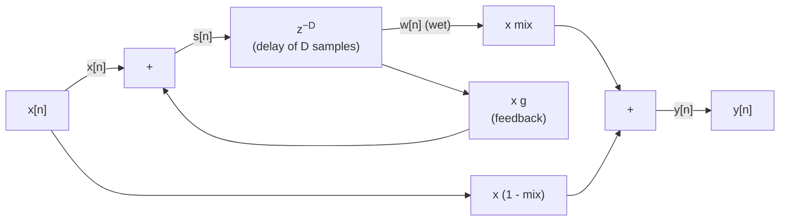
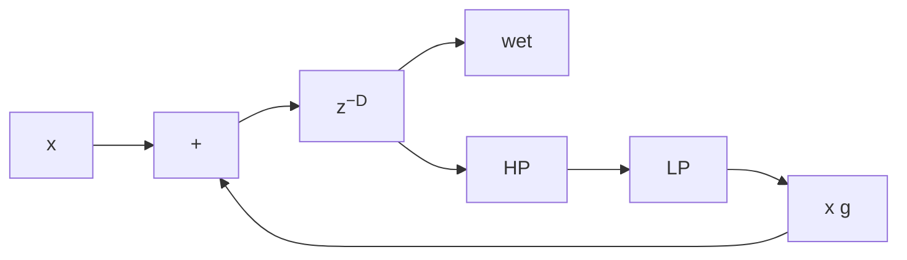
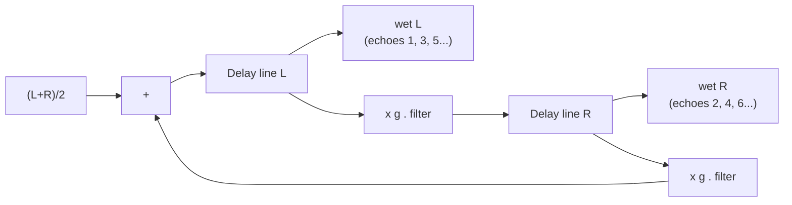
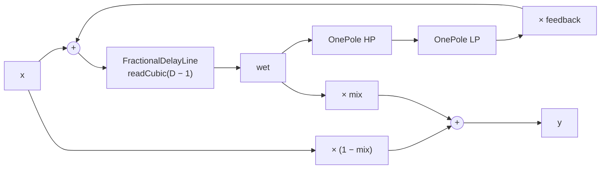

# Chapter 09: Delay and Echo -- Circular Buffers, Fractional Delay, and Feedback

**English** | [繁體中文](README.zh-TW.md)

> [Course home](../../README.md)　|　Previous: [08 Gate / Expander](../08-gate-expander/README.md)　|　Next: [10 Modulation](../10-modulation/README.md)

The first eight chapters all dealt with "now", the current sample: multiply by a gain, run it through a filter, squash it according to an envelope. This chapter starts letting the signal **remember the past**. Storing a sound and playing it back a little later sounds simple, but it is the common foundation of echo, slapback, ping-pong, chorus, flanger, comb filters, Karplus-Strong plucked-string synthesis, and the chapter 12 reverb.

This chapter has three main themes:

1. **How to store**: the circular buffer, read and write indices, and wrapping with a power-of-two mask.
2. **How to read "between two samples"**: fractional delay and interpolation. The frequency responses of linear, cubic and allpass interpolation, and why changing the delay time causes a pitch shift (Doppler).
3. **How to feed back**: the stability condition of a feedback loop, filters and saturation inside the loop (the character of tape echo), and why a short delay with feedback turns into a comb filter.

## 1. Goals

After reading this chapter and doing the exercises, you will be able to:

- Implement a real-time-safe circular buffer, and explain the relationship between the read and write indices, how to write the wrap, and why the length should be a power of two.
- Explain the four situations in which an integer delay is not enough (tempo sync, modulation, smoothly changing the delay time, and tuning a comb to an exact pitch).
- Derive the frequency response of linear interpolation, $`|H| = \sqrt{1 - 2\Delta(1-\Delta)(1-\cos\omega)}`$, and its value at $`\Delta = 0.5`$, $`|H| = |\cos(\pi f/f_s)|`$, and compare cubic Hermite / Lagrange and allpass interpolation using numbers.
- Predict the pitch change when the delay time changes using $`f_\text{out} = f_\text{in}\,(1 - d\tau/dt)`$, and choose between a "smooth transition" and a "two-read-head crossfade".
- Derive the stability condition of a feedback echo, $`|g| < 1`$, and its decay time $`T_{60} = 3D/(-\log_{10} g)`$, and add a lowpass, a highpass and saturation to the loop.
- Draw the signal paths of a stereo delay and a ping-pong delay, and use BPM to compute the delay times of dotted notes and triplets.
- Derive the peak and notch positions and heights of feedforward / feedback comb filters, and explain their relationship to the chapter 12 reverb.
- Implement and use `FractionalDelayLine` and `Delay` (chapters 10, 12 and 14 will use them later).

## 2. Theory

### 2.1 What a delay is: $`y[n] = x[n - D]`$

The purest delay does just one thing:

```math
y[n] = x[n - D] \qquad\Longleftrightarrow\qquad H(z) = z^{-D}
```

Its frequency response is $`H(e^{j\omega}) = e^{-j\omega D}`$: the **magnitude is 1 at all frequencies**, and the phase falls linearly with frequency. Listening to a delay on its own, you just hear "a bit late". A delay becomes interesting because it is usually **mixed with the original** (dry/wet mix) or **fed back into its own input** (feedback).

The length of the delay time determines what our ears hear it as. The table below gives rough rules of thumb (the numbers vary with the material and the listener):

<div align="center">

| Delay time | What it sounds like mixed with the original | Typical use |
|---|---|---|
| < 1 ms | Change of timbre (a delay $`\tau`$ added to the original puts the first notch at $`1/(2\tau)`$, i.e. above 500 Hz; at 5 kHz for $`\tau = 0.1`$ ms) | The extreme end of phaser / flanger; combs caused by microphone distance differences |
| 1-15 ms | A distinct comb-filter "metallic" or "tubular" timbre; modulating it gives a flanger | Flanger (chapter 10), Karplus-Strong |
| 15-35 ms | The sound "thickens", but you cannot hear two separate voices | Doubling, chorus (chapter 10), stereo width from the Haas effect |
| 35-50 ms | Two voices start to become distinguishable, between doubling and slapback (around the upper limit of the Haas effect) | Vocals and guitars where you want "thick" but not an obvious echo |
| 50-150 ms | A short, clear single echo | Slapback (rockabilly vocals and guitar) |
| > 150 ms | A separate, identifiable echo; usually aligned to the tempo | Rhythmic echo, ping-pong, dub delay |

</div>

### 2.2 The circular buffer: only write forward, never move the data

To compute $`x[n-D]`$ we need to remember the most recent $`D`$ samples. The most obvious way is "shift the whole array back by one slot for every new sample", but that is an O(D) move per sample -- a 2-second delay at 48 kHz would move 96000 floats per sample, which is completely impractical.

The idea of a circular buffer is: **the data stays put, the pointer moves**. A write index points at "the next position to write"; after every write it advances one slot, and when it reaches the end it wraps back to the beginning:

<div align="center">

| index | 0 | 1 | 2 | 3 | 4 | 5 | 6 | 7 |
|---|---|---|---|---|---|---|---|---|
| content | `x[n-5]` | `x[n-4]` | `x[n-3]` | `x[n-2]` | `x[n-1]` | `x[n]` | `x[n-7]` | `x[n-6]` |
| pointer | | | | | | last write | write index `w` | |

</div>

The buffer has length N = 8. Index 5 holds the most recent write `x[n]`. Index 6 is the write index $`w`$: the next write goes there, and it is also the "oldest" data.

Read the value $`d`$ samples ago: $`\text{index} = (w - 1 - d) \bmod N`$

- $`d = 0`$: index 5, which is `x[n]`
- $`d = 2`$: index 3, which is `x[n-2]`
- $`d = 7`$: index 6, which is `x[n-7]` (a buffer of length N can look back at most N - 1 samples)

**How to write the wrap, and a pitfall.** The read position $`w - 1 - d`$ may be negative. In C++, `%` returns a negative result for a negative operand (`-3 % 8 == -3`), and using that directly as an index goes out of bounds. There are two correct ways to write it:

```cpp
int idx = (w - 1 - d) % N;  if (idx < 0) idx += N;   // works for any N
int idx = (w - 1 - d + N) & (N - 1);                  // N must be a power of two
```

**The power-of-two mask trick.** When $`N = 2^k`$, the binary form of $`N - 1`$ is $`k`$ ones (for example 1024 − 1 = `0x3FF`). A bitwise AND of any integer with it equals "the remainder after dividing by $`N`$" -- and this holds for negative numbers too under two's complement (`-3 & 7 == 5`). One AND is much cheaper than an integer division, and it saves a branch. The cost is memory: a 1000-sample delay needs 1024 samples allocated; 2 seconds @ 48 kHz (96 000 samples) needs 131 072, which is 512 KB per channel -- acceptable.

**Order of writing and reading.** The `FractionalDelayLine` in this chapter follows the convention that "after `push()`, `read(0)` returns the sample that was just pushed". So in an echo effect, if we **read first and write afterwards** (feedback requires this: we must get the delayed output before we can compute the value to write back), then to get a delay of $`D`$ samples we must read `read(D − 1)`. This −1 is the most common source of off-by-one bugs in delay code; we will see it again in section 3.2.

### 2.3 Why we need fractional delay

The chapter 05 `DelayLine` supports only integer delays, which is enough for the limiter's lookahead. But a delay effect almost always needs a delay of "fractional samples":

1. **Tempo sync.** A dotted eighth note at 95 BPM is $`0.75 \times 60000 / 95 = 473.684`$ ms, which at 48 kHz is **22 736.84** samples. Rounding to 22 737 gives an error of only 0.003 ms, inaudible for a single echo -- but with feedback the error accumulates on every trip around the loop, and this is the least important reason anyway.
2. **Modulation.** Chorus, flanger and vibrato (chapter 10) make the delay time vary continuously with an LFO. If only integers were allowed, the read position would "jump one slot" every so often, and every jump is a discontinuity that sounds like a stream of fine clicks or "zipper" noise.
3. **Smoothly changing the delay time.** When the user turns the delay-time knob we want it to glide continuously (section 2.7), and nearly all the intermediate values are not integers.
4. **Exact pitch.** A short delay with feedback produces a pitch of $`f_s/D`$ (section 2.13). At 44.1 kHz, getting A4 = 440 Hz needs $`D = 100.227`$; using 100 gives 441 Hz, and using 101 gives 436.6 Hz (−13.3 cents, audibly out of tune). Exercise 7 actually measures these three numbers.

"Reading $`x[n - 10.5]`$" means: estimating the value of the original continuous signal at the instant halfway between two samples. This is **interpolation**. By the sampling theorem the ideal interpolator is the sinc function -- infinitely long and unusable. In practice we use very short approximations, and each approximation pays a price of some kind.

### 2.4 Linear interpolation and its high-frequency loss

Split the delay into an integer part $`d`$ and a fractional part $`\Delta \in [0, 1)`$: $`D = d + \Delta`$. Linear interpolation draws a straight line between two adjacent samples:

```math
y[n] = (1 - \Delta)\,x[n-d] + \Delta\,x[n-d-1]
```

This is a 2-tap FIR filter (followed by an integer delay $`z^{-d}`$). Its frequency response is:

```math
H(e^{j\omega}) = e^{-j\omega d}\bigl[(1-\Delta) + \Delta e^{-j\omega}\bigr]
```

Take the squared magnitude, expanding with $`e^{-j\omega} = \cos\omega - j\sin\omega`$:

```math
|H|^2 = (1 - \Delta + \Delta\cos\omega)^2 + (\Delta\sin\omega)^2 = 1 - 2\Delta(1-\Delta)(1 - \cos\omega)
```

Reading this expression:

- $`\Delta = 0`$ or $`\Delta = 1`$: $`|H| = 1`$, an integer delay with no distortion.
- $`\Delta = 0.5`$ is the **worst** case ($`\Delta(1-\Delta)`$ is largest). Substituting $`1 - \cos\omega = 2\sin^2(\omega/2)`$:

```math
|H|^2 = 1 - \sin^2(\omega/2) = \cos^2(\omega/2) \quad\Longrightarrow\quad |H| = \left|\cos\frac{\omega}{2}\right| = \left|\cos\frac{\pi f}{f_s}\right|
```

**Intuition.** At $`\Delta = 0.5`$, linear interpolation is "the average of two adjacent samples" -- a 2-point moving average, which is the simplest lowpass filter. At Nyquist ($`f = f_s/2`$) the signal is $`+1, -1, +1, -1\ldots`$, and averaging two neighbours gives exactly 0, so $`|H| = \cos(\pi/2) = 0`$. At $`f_s/4`$ it is $`\cos(\pi/4) = 0.707`$, i.e. −3.01 dB.

Theoretical values at 48 kHz (the example `l09_interpolation_compare` measures values that agree with theory exactly to two decimal places):

<div align="center">

| Frequency | 1 kHz | 4 kHz | 8 kHz | 12 kHz | 15 kHz | 18 kHz | 20 kHz |
|---|---|---|---|---|---|---|---|
| linear, $`\Delta = 0.5`$ (dB) | −0.02 | −0.30 | −1.25 | −3.01 | −5.11 | −8.34 | −11.74 |

</div>

How it sounds: a static −3 dB at 12 kHz is only "slightly darker", but when the delay time is modulated (chorus), $`\Delta`$ swings back and forth between 0 and 1, and the amount of high-frequency loss rises and falls at the LFO rate -- an audible "breathing". Also, linear interpolation has linear phase only at $`\Delta = 0.5`$ (a symmetric FIR); for other $`\Delta`$ the phase delay deviates slightly from $`\Delta`$ as frequency changes.

### 2.5 Cubic interpolation: Hermite and Lagrange

For a flatter high end, use more points. Two common cubics using four points ($`y_{-1}, y_0, y_1, y_2`$, with the target between $`y_0`$ and $`y_1`$ at distance $`t = \Delta`$ from $`y_0`$):

**3rd-order Lagrange**: the unique cubic polynomial that **passes through all four points**.

```math
y(t) = \sum_{k=-1}^{2} h_k(t)\, y_k, \qquad h_k(t) = \prod_{m \ne k} \frac{t - m}{k - m}
```

Expanded, this is

```math
h_{-1} = -\frac{t(t-1)(t-2)}{6},\quad h_0 = \frac{(t+1)(t-1)(t-2)}{2},\quad h_1 = -\frac{(t+1)\,t\,(t-2)}{2},\quad h_2 = \frac{(t+1)\,t\,(t-1)}{6}
```

**Cubic Hermite (Catmull-Rom)**: the curve is only required to pass through $`y_0`$ and $`y_1`$, with **slopes** at those two points taken as central differences, $`m_0 = (y_1 - y_{-1})/2`$ and $`m_1 = (y_2 - y_0)/2`$. Written as a polynomial:

```math
y(t) = c_0 + c_1 t + c_2 t^2 + c_3 t^3,\qquad
\begin{aligned}
c_0 &= y_0 \\
c_1 &= \tfrac12(y_1 - y_{-1}) \\
c_2 &= y_{-1} - \tfrac52 y_0 + 2y_1 - \tfrac12 y_2 \\
c_3 &= \tfrac12(y_2 - y_{-1}) + \tfrac32(y_0 - y_1)
\end{aligned}
```

The difference between them: Lagrange passes through four points on each segment, but the slopes of adjacent segments at their joint are not necessarily equal; Hermite has continuous slope at the joints ($`C^1`$), so the waveform is smoother as the read position moves continuously, which is why Hermite is more common in audio (especially modulation). The `readCubic()` of `FractionalDelayLine` is Hermite, and `readLagrange()` is Lagrange (for teaching comparison).

**At $`\Delta = 0.5`$ the two are identical.** Substituting $`t = 0.5`$, both sets of coefficients are

```math
\left(-\tfrac{1}{16},\ \tfrac{9}{16},\ \tfrac{9}{16},\ -\tfrac{1}{16}\right)
```

(The example `l09_interpolation_compare` pushes an impulse through a delay of 2.5, and the output of all three methods is this kernel.) Writing the frequency response of this symmetric 4-tap FIR with the centre as origin:

```math
|H(e^{j\omega})| = \left|\tfrac{9}{8}\cos\tfrac{\omega}{2} - \tfrac{1}{8}\cos\tfrac{3\omega}{2}\right|
```

At $`f_s/4`$: $`\tfrac98 \cdot 0.7071 + \tfrac18 \cdot 0.7071 = 0.884`$, i.e. **−1.07 dB** (linear is −3.01 dB). The full comparison (48 kHz, measured = theory):

<div align="center">

| Frequency | 1 kHz | 4 kHz | 8 kHz | 12 kHz | 15 kHz | 18 kHz | 20 kHz |
|---|---|---|---|---|---|---|---|
| linear (dB) | −0.02 | −0.30 | −1.25 | −3.01 | −5.11 | −8.34 | −11.74 |
| cubic (dB) | −0.00 | −0.01 | −0.23 | −1.07 | −2.53 | −5.26 | −8.41 |

</div>

Cubic is nearly flat below 8 kHz, but it is **still a lowpass** -- any finite-length polynomial interpolation falls off near Nyquist. White noise (equal energy at all frequencies) through a delay of 10.5 goes from an RMS of 0.1443 to 0.1019 for linear and 0.1153 for cubic; the missing part is high-frequency energy.

**Cubic needs the point "newer than the target", $`y_{-1}`$**, so the delay must be at least 1 sample (`readCubic` clamps delays smaller than 1 to 1).

### 2.6 A brief introduction to allpass interpolation

Another route: instead of using an FIR to "estimate" the in-between value, use a first-order allpass filter whose **magnitude is 1 at all frequencies** and which only adjusts the phase so that its low-frequency delay is exactly $`\Delta`$:

```math
H(z) = \frac{\eta + z^{-1}}{1 + \eta z^{-1}}, \qquad \eta = \frac{1 - \Delta}{1 + \Delta}
```

```math
y[n] = \eta\,\bigl(v[n] - y[n-1]\bigr) + v[n-1], \qquad v[n] = x[n - d]
```

Its phase delay (in samples) is

```math
\tau(\omega) = -\frac{\angle H}{\omega} = 1 - \frac{2}{\omega}\arctan\frac{\eta\sin\omega}{1 + \eta\cos\omega}
\;\xrightarrow{\ \omega \to 0\ }\; \frac{1-\eta}{1+\eta} = \Delta
```

The advantage: no high-frequency attenuation at all (exercise 3 measures 0.00 dB even at 20 kHz). The drawbacks:

- The delay is accurate only at low frequencies and deviates at high frequencies (at $`\Delta = 0.5`$, the delay at 8 kHz is 10.537 rather than 10.5).
- It is **recursive** (it has $`y[n-1]`$), so when $`\Delta`$ changes the old state leaves a short transient behind; with fast modulation this produces noise. So allpass is suited to a "fixed or very slowly varying" fractional delay, such as the exact tuning of Karplus-Strong plucked strings or physical-modeling waveguides; chorus / flanger mostly use cubic.
- As $`\Delta`$ approaches 0, $`\eta \to 1`$, the pole hugs the unit circle, and the transient drags on for a long time. A common trick is to arrange $`\Delta`$ in $`[0.5, 1.5)`$ (take 1 less for the integer part), so that $`\eta`$ falls in $`(-0.2, 1/3]`$.

Exercise 3 implements it and compares it with linear / cubic.

### 2.7 Changing the delay time: Doppler, clicks, and two strategies

When the delay time is $`\tau(t)`$, the output is $`y(t) = x(t - \tau(t))`$. With a sine of frequency $`f`$, $`\sin(2\pi f t)`$, as input, the output phase is $`2\pi f\,(t - \tau(t))`$, and differentiating with respect to time gives the **instantaneous frequency**:

```math
f_\text{out} = f_\text{in}\left(1 - \frac{d\tau}{dt}\right)
```

This is the Doppler effect: when the delay lengthens (the read head "flees" the write head) the pitch falls; when it shortens (the read head "chases" the write head) the pitch rises. The "wooooo" you hear when you turn the delay-time knob on a tape echo is exactly this.

A numerical example (the example `l09_doppler_sweep`): the delay increases linearly from 10 ms to 250 ms over 2 seconds, so $`d\tau/dt = 0.24/2 = 0.12`$. 440 Hz becomes $`440 \times 0.88 = 387.2`$ Hz; sweeping back it becomes $`440 \times 1.12 = 492.8`$ Hz. Measured: 387.1 Hz and 492.9 Hz.

**A ramp that is too fast plays the sound backwards.** If $`d\tau/dt > 1`$, $`f_\text{out}`$ becomes negative -- the read head runs backwards and the sound plays in reverse. The default delay ramp of `Delay` is 50 ms: changing from 375 ms to 500 ms gives $`d\tau/dt = 125/50 = 2.5`$, and for those 50 ms the sound plays in reverse at 1.5 times speed. The control case of exercise 6 is more extreme: 10 → 250 ms with a 20 ms ramp gives $`d\tau/dt = 12`$, which measures 4840 Hz. This short, sharp sound is liked by some (like turning the knob of a tape machine) and unwanted by others.

**Jumping straight there, without smoothing, clicks.** The read position leaps instantly from one place to another and the output waveform has a break. For a 440 Hz sine of amplitude 0.5, the largest difference between adjacent samples is only $`0.5 \times 2\pi \times 440/48000 = 0.0288`$; the jumping version measures 0.27 -- a broadband click.

Two common strategies:

<div align="center">

| Strategy | Method | Pros | Cons | Who uses it |
|---|---|---|---|---|
| **Smooth transition** | Ramp the delay time linearly to the new value (this chapter's `Delay` uses a double-precision `DelayRamp`; see section 3.2 for the reason) | Simple; has the "analog tape" feel; modulation (chapter 10) works exactly this way | Pitch shift during the transition; a ramp that is too short plays in reverse | This chapter's `Delay`, tape echo emulation |
| **Two-read-head crossfade** | Put a second read head directly at the new position and use a 10-50 ms raised cosine to fade the old head out and the new head in | No pitch shift, no click | When the two heads' contents are uncorrelated there is a brief level dip and a phase slip in the middle; a further change during the fade has to be queued | The tempo switching of many digital delays (exercise 6) |

</div>

Measured in exercise 6: after a crossfade switch the largest difference between adjacent samples is 0.0288 (the same as the sine itself), the measured frequency is 444 Hz (only a small deviation caused by the phase slip during the crossfade), and after the fade ends the output is exactly identical to $`x[n - 12000]`$.

### 2.8 Feedback and stability

The core of an echo effect is to multiply the delayed output by $`g`$ (the feedback) and add it back to the input:



As equations: $`s[n] = x[n] + g\,w[n]`$, $`w[n] = s[n - D]`$, so

```math
W(z) = \frac{z^{-D}}{1 - g\,z^{-D}} = z^{-D} + g\,z^{-2D} + g^2 z^{-3D} + \cdots
```

**Impulse response**: the $`k`$-th echo appears at $`kD`$ with amplitude $`g^{k-1}`$. With $`g = 0.5`$ each trip is −6.02 dB (exercise 1 measures 1, 0.5, 0.25, 0.125... using an impulse).

**Stability condition**: the roots of the denominator satisfy $`z^D = g`$, so the $`D`$ poles all lie on a circle of radius $`|z| = |g|^{1/D}`$. Stable ⇔ all poles inside the unit circle ⇔ $`|g| < 1`$. The intuition is simpler still: each trip multiplies by $`g`$; if $`|g| < 1`$ it gets smaller and smaller, $`|g| = 1`$ never decays (any noise accumulates forever), and $`|g| > 1`$ explodes exponentially ($`1.1^{100} \approx 13\,781`$). That is why `Delay::setFeedback()` clamps the value to $`[0, 0.99]`$.

**The decay time of the echoes.** The number of trips needed to decay by 60 dB is $`60 / (-20\log_{10} g)`$, and multiplying by the time per trip $`D`$ gives:

```math
T_{60} = \frac{3D}{-\log_{10} g}
```

$`D = 375`$ ms, $`g = 0.5`$ → 3.74 s; $`g = 0.7`$ → 7.26 s. Conversely, to have echoes with $`D = 500`$ ms vanish within 2 seconds: $`g = 10^{-3D/T_{60}} = 10^{-0.75} = 0.178`$. This is the same formula chapter 12's reverb uses to set RT60.

**Filters in the loop: the character of tape echo.** An analog tape loses high frequencies (heads, tape) and a little low frequency (transformers, coupling capacitors) on every trip around the loop. In the digital domain we put a one-pole lowpass $`H_{LP}`$ and a highpass $`H_{HP}`$ (the chapter 02 `OnePole`) in the feedback path:



The spectrum of the $`k`$-th echo is $`(g\,H_{HP}H_{LP})^{k-1}`$ -- each trip darker and thinner than the last. Since a one-pole has $`|H| \le 1`$, the loop gain satisfies $`|g\,H_{HP}H_{LP}| \le |g| < 1`$, so **adding filters cannot make a stable loop unstable**. This no longer holds once you switch to a filter with resonance: a Q = 4 biquad lowpass has +12 dB (a factor of 4) near its cutoff, so a loop with $`g = 0.5`$ has a loop gain of 2 there -- `l09_ex7_solution` measures such a loop overflowing to inf within 3 seconds, while a one-pole loop with $`g = 0.99`$ has decayed to $`3\times10^{-5}`$ in the same time (exercise 2). Exercise 4 measures: with fb 0.7, LP 2 kHz and HP 100 Hz, the second echo relative to the first retains 66.5% at 500 Hz and only 17.7% at 8 kHz, in agreement with the theoretical $`g\,|H_{HP}||H_{LP}|`$ (computed from the actual frequency response of the digital one-pole: 0.666 and 0.178). If you approximate with the analog one-pole formula $`1/\sqrt{1+(f/f_c)^2}`$ instead, 8 kHz gives 0.170 -- the digital one-pole differs from the analog prototype near Nyquist, by about 4% at high frequencies.

Note: the first echo does not pass through the filters in the loop (it comes straight out of the delay line); only from the second echo on does it get darker. Some designs put the filter on the wet output or in front of the delay-line input, so that the first echo is darkened too -- this is a design choice, not a matter of right or wrong.

**Saturation in the loop.** Put a $`\tanh`$ (or the chapter 06 `Saturation::shape`) into the loop as well, and the loop gain becomes **amplitude dependent**: for small signals $`\tanh(u) \approx u`$ and the gain $`= g`$; for large signals the $`\tanh`$ is flattened and the effective gain falls. The result:

- $`g < 1`$: almost the same as the linear version, except that loud echoes are slightly compressed and pick up some harmonics (the warmth of tape saturation).
- $`g > 1`$: the linear version must blow up, but with saturation the echoes grow until the amplitude at which "the effective gain is exactly 1" and stop there, becoming a self-oscillation of fixed amplitude that sings by itself -- the classic sound of a dub delay with the feedback knob turned too far. Exercise 4 predicts this amplitude with a describing function (0.298) and measures 0.305.

> **What is a describing function?** A method that approximates a nonlinear element by an equivalent gain that "looks only at the fundamental": a sine $`X\sin\theta`$ fed into $`\tanh`$ no longer comes out as a pure sine, but we take only its fundamental component (amplitude $`F_1(X)`$) and treat $`N(X) = F_1(X)/X`$ as the "gain" of this element at amplitude $`X`$. For $`\tanh`$, $`N(X)`$ is 1 at small amplitude and gets smaller as the amplitude grows. If the linear gain of the rest of the loop is $`G = g\,|H_{HP}||H_{LP}|`$, the self-oscillation settles at the amplitude $`X`$ where $`G \cdot N(X) = 1`$. The full derivation and numerical solution are in the solution to exercise 4.

### 2.9 Stereo delay and ping-pong

**Stereo delay (two independent channels)**: one delay line per side, each with its own feedback. With a stereo input, the echoes keep the original stereo image.

**Ping-pong**: the echoes bounce back and forth between left and right. How `Delay` does it:



The input is first mixed down to mono and fed into the left side; the left output (multiplied by $`g`$) goes to the right side; the right output (multiplied by $`g`$) returns to the left. For an impulse (on the left channel only, amplitude 1, which is 0.5 after the mono mix) through a ping-pong of 375 ms and $`g = 0.5`$, the example `l09_pingpong_tempo` measures:

```
  Left : [n=18000 (375 ms) amp=0.5000] [n=54000 (1125 ms) amp=0.1250] [n=90000 (1875 ms) amp=0.0312]
  Right: [n=36000 (750 ms) amp=0.2500] [n=72000 (1500 ms) amp=0.0625]
```

Alternating left and right, 375 ms apart, multiplied by 0.5 on every hop.

The reason for mixing to mono first: if the input is already panned left, the ping-pong still starts bouncing from the left, so the rhythmic pattern of the echoes is independent of the input's position. There are many variants: feed in only the left channel, start the first echo from the middle, use different delay times on the left and right (for example left 1/4, right dotted 1/8) -- they just change the connections in this diagram.

### 2.10 Tempo sync: BPM → ms

The length of one beat (a quarter note) is $`60/\text{BPM}`$ seconds:

```math
t_\text{ms} = \text{beats} \times \frac{60000}{\text{BPM}}
```

beats is counted with a quarter note as 1: eighth note 0.5, sixteenth note 0.25. A **dotted** note is the original length × 1.5 (dotted eighth = 0.75 beat), and a **triplet** is the original length × 2/3 (eighth triplet = 1/3 beat; quarter triplet = 2/3 beat). `Delay::noteToMs(bpm, beats)` is exactly this formula.

At 120 BPM (the table printed by the example `l09_pingpong_tempo`):

<div align="center">

| Note | beats | ms | samples @ 48 kHz |
|---|---|---|---|
| Half note | 2 | 1000.00 | 48000 |
| Quarter note | 1 | 500.00 | 24000 |
| Quarter triplet | 2/3 | 333.33 | 16000 |
| Dotted eighth | 0.75 | 375.00 | 18000 |
| Eighth note | 0.5 | 250.00 | 12000 |
| Dotted sixteenth | 0.375 | 187.50 | 9000 |
| Eighth triplet | 1/3 | 166.67 | 8000 |
| Sixteenth note | 0.25 | 125.00 | 6000 |

</div>

The dotted eighth is the most common delay setting for pop and rock guitar: after a melody of eighth notes, the echo lands exactly between two eighth notes, forming a "rolling" sixteenth-note groove.

(Incidentally, to convert a delay time into an LFO frequency, $`f = 1000 / t_\text{ms}`$ Hz, which the tempo-synced LFO of chapter 10 will use.)

### 2.11 Dry/wet mix

```math
y = (1 - m)\,x + m\cdot\text{wet}, \qquad m \in [0, 1]
```

$`m = 0`$ is only the original sound and $`m = 1`$ is only the delay. This is a linear crossfade: when dry and wet are correlated (for example a very short delay) the total level is unchanged; when they are uncorrelated (an ordinary echo) the total energy is about 3 dB lower near $`m = 0.5`$ (exercise 6 feeds white noise into `CrossfadeDelay` and measures −2.98 dB at the midpoint of the fade). The alternative is an equal-power ($`\cos`$ / $`\sin`$) crossfade; both are used, and this chapter takes linear because the dry signal stays almost exactly at 0 dB when $`m`$ is small, which best fits the use case of "adding a little echo on an insert".

In a DAW a delay is often placed on an **aux send / return**: several tracks send a little signal to it, the delay plugin is set to $`m = 1`$ (100% wet), and the amount of echo is controlled with the return's fader. The chapter 14 DAW uses it this way.

Both `mix` and `feedback` are smoothed with a 20 ms `SmoothedValue`, so turning the knobs does not produce zipper noise.

### 2.12 Typical parameters for slapback, echo and dub delay

The table below gives common starting points for mixing (rules of thumb, not measurements; adjust for the material, tempo and arrangement):

<div align="center">

| Type | Delay time | Feedback | Mix | Loop filter | Character |
|---|---|---|---|---|---|
| Slapback | 80-150 ms (not necessarily on the beat) | 0-10% (basically a single echo) | 15-35% | LP 3-5 kHz | A single echo right behind the sound, giving the vocal / guitar more "space" without smearing it |
| Doubling | 15-35 ms | 0 | 30-50% | none | Thickening, like the same line sung twice |
| Rhythmic echo | 1/4, dotted 1/8, 1/8 | 20-45% | 15-30% | LP 4-6 kHz, HP 100-200 Hz | A clear echo that follows the tempo, with a clean tail that does not fight the lead melody |
| Ping-pong | dotted 1/8, 1/4 | 30-50% | 20-35% | LP 3-5 kHz | Bouncing left and right, adding stereo width |
| Dub delay | 1/4, dotted 1/4 | 60% to over 100% (with saturation in the loop) | 30-60% (often used on a send, "throwing" a word into it by hand during a performance) | LP 1.5-3 kHz, HP 200-400 Hz | Darker and murkier each time, able to self-oscillate |

</div>

(The ping-pong in the example `l09_pingpong_tempo` uses a dotted eighth, fb 0.45, mix 0.35, and an in-loop HP of 150 Hz + LP of 3.5 kHz; the dub in exercise 4 uses fb 1.1 + tanh.)

### 2.13 Comb filters: short delay + feedback

Shrink the delay time to a few ms and the echoes are no longer "individual echoes" but melt into **timbre**.

**Feedforward comb**: $`y[n] = x[n] + g\,x[n-D]`$, $`H(z) = 1 + g\,z^{-D}`$.

```math
|H(e^{j\omega})|^2 = 1 + g^2 + 2g\cos(\omega D)
```

Where $`\cos(\omega D) = 1`$, i.e. $`f = k\,f_s/D`$, there is a peak of $`1 + g`$; where $`\cos(\omega D) = -1`$, i.e. $`f = (k + \tfrac12) f_s/D`$, there is a notch of $`1 - g`$. The frequency response looks like the teeth of a comb, with tooth spacing $`f_s/D`$ -- hence the name.

**Feedback comb**: $`y[n] = x[n] + g\,y[n-D]`$, $`H(z) = 1/(1 - g\,z^{-D})`$.

```math
|H(e^{j\omega})| = \frac{1}{\sqrt{1 + g^2 - 2g\cos(\omega D)}}
```

The peaks are again at $`k\,f_s/D`$, with height $`1/(1 - g)`$; the notches are at $`(k+\tfrac12) f_s/D`$ with depth $`1/(1 + g)`$.

For $`D = 48`$ (1 ms @ 48 kHz) and $`g = 0.7`$, the peaks and notches that the example `l09_comb_filter` finds automatically by sweeping 250-9750 Hz:

```
   type     freq(Hz)   gain(dB)   spacing from previous of same type (Hz)
   notch       500     -4.61   -
   peak       1000    +10.46   -
   notch      1500     -4.61   1000
   peak       2000    +10.46   1000
   ...
   peak       9000    +10.46   1000
   notch      9500     -4.61   1000
```

The peak $`+10.46`$ dB $`= 20\log_{10}(1/0.3)`$, the notch $`-4.61`$ dB $`= 20\log_{10}(1/1.7)`$, and the spacing $`f_s/D = 1000`$ Hz all agree with theory. The feedforward peaks and notches are exactly the reverse: peak $`+4.61`$ dB, notch $`-10.46`$ dB (blunt peaks, deep notches); the feedback comb has sharp peaks and shallow notches.

When `Delay` itself is turned to delayMs = 1, feedback 0.7 and mix 1, the wet transfer function is $`z^{-D}/(1 - g z^{-D})`$, with the same magnitude as a feedback comb: the example measures +10.46 dB at 1000 Hz and −4.61 dB at 1500 Hz. **An echo effect turned down to a very short delay is a comb filter**.

**Why it sounds pitched.** The peaks line up at $`f_0, 2f_0, 3f_0, \ldots`$ ($`f_0 = f_s/D`$) -- exactly the harmonic series of a fundamental $`f_0`$. White noise through a feedback comb keeps only the energy near these harmonics, and the ear hears the pitch $`f_0`$. `l09_comb_noise_1ms.wav` ($`D = 48`$, $`g = 0.9`$) has a clear 1 kHz pitch; `l09_comb_noise_10ms.wav` ($`D = 480`$) is a 100 Hz metallic / tubular resonance. Add a "two-point average" lowpass inside the loop of a feedback comb and excite it with a burst of noise, and you have Karplus-Strong plucked-string synthesis -- which is exactly what `makePluck()` in `Signals.h` does.

**Negative feedback.** When $`g < 0`$ the sign of $`-2g\cos(\omega D)`$ flips and the peaks move to $`(k + \tfrac12) f_s/D`$: only odd harmonics remain, the pitch drops an octave, and the timbre becomes hollow (like a tube closed at one end). The "negative feedback" mode of a flanger is exactly this (chapter 10).

**Paving the way to reverb.** A single comb has fixed echo spacing and sounds "metallic"; but put several feedback combs with mutually prime delay times in parallel, then follow them with a few allpasses to scatter the echoes, and the echo density becomes so high that the ear can no longer separate individual echoes -- this is the architecture of the Schroeder reverb, and chapter 12 starts from here. The $`g`$ of each comb is determined by the $`T_{60}`$ formula in section 2.8, and the lowpass in the loop makes the high frequencies decay faster than the low ones (damping), which is the same thing as the tape echo of section 2.8.

## 3. From Formulas to Code

### 3.1 `FractionalDelayLine.h`: circular buffer + three ways to read

File: [`dsp/include/dawlab/dsp/FractionalDelayLine.h`](../../dsp/include/dawlab/dsp/FractionalDelayLine.h)

<div align="center">

| Method | Description |
|---|---|
| `void prepare(int maxDelaySamples, int numChannels)` | The only place that allocates. Buffer length = `nextPowerOfTwo(maxDelaySamples + 4)` (cubic reads up to `d + 2`, so some headroom is left), `mask = size − 1` |
| `void reset() noexcept` | Clears the buffer to 0 and resets the write index to 0 |
| `void push(int ch, float x) noexcept` | Writes, and advances that channel's write index by one slot: `w = (w + 1) & mask` |
| `float readInteger(int ch, int delaySamples) const noexcept` | Integer delay, a direct lookup |
| `float readLinear(int ch, float delaySamples) const noexcept` | The linear interpolation of section 2.4 |
| `float readCubic(int ch, float delaySamples) const noexcept` | The cubic Hermite (Catmull-Rom) of section 2.5; delays below 1 are clamped to 1 |
| `float readLagrange(int ch, float delaySamples) const noexcept` | The 3rd-order Lagrange of section 2.5 (for teaching comparison) |
| `int getMaxDelaySamples() const`, `int getNumChannels() const`, `int getBufferSize() const` | Queries |
| `static int nextPowerOfTwo(int n)` | Helper function |

</div>

Convention: **after `push()`, `readXxx(ch, 0)` returns the sample that was just pushed**, and `readXxx(ch, D)` returns the sample from D pushes ago. Every read clamps the delay to `[0, maxDelaySamples]`, so it can never go out of bounds.

The core is just one line:

```cpp
// Fetch the sample from "d pushes ago": the last write was at w − 1, so the target is w − 1 − d.
// Adding size_ first makes it positive (with a power-of-two mask a negative number would wrap correctly anyway; adding it just reads better)
return channelData(ch)[(w - 1 - d + size_) & mask_];
```

`readLinear` is a direct translation of the formula in section 2.4 (`a + frac * (b − a)` is a way of writing $`(1-\Delta)a + \Delta b`$ with one fewer multiplication); `readCubic` computes $`c_0..c_3`$ according to section 2.5 and then evaluates with Horner's method, `((c3*t + c2)*t + c1)*t + c0`.

Each channel has its own contiguous block of memory and its own write index, so `push(0, …)` and `push(1, …)` can be called independently (which is exactly what ping-pong needs).

### 3.2 `Delay.h`: stereo echo

File: [`dsp/include/dawlab/dsp/Delay.h`](../../dsp/include/dawlab/dsp/Delay.h)



<div align="center">

| Method | Description |
|---|---|
| `void setMaxDelayMs(float ms)` | Call before `prepare()`; default 2000 ms; determines the buffer size (clamped to 1-60000 ms) |
| `void prepare(double sampleRate, int maxBlockSize, int numChannels)` | Allocates the delay line (up to 2 channels), prepares the `OnePole`s, the delay ramp and the `SmoothedValue`s |
| `void reset() noexcept` | Clears the delay line and filter state; parameters jump straight to their targets. Safe to call before `prepare()` (does nothing) |
| `void setDelayMs(float ms) noexcept` | The delay time, smoothed linearly by the delay ramp (default 50 ms) |
| `void setDelayRampSeconds(double s) noexcept` | Length of the delay ramp; 0 = jump straight there (clicks; for teaching) |
| `void setFeedback(float) noexcept` | Clamped to `[0, kMaxFeedback = 0.99]`, smoothed over 20 ms |
| `void setMix(float) noexcept` | 0..1, smoothed over 20 ms |
| `void setPingPong(bool) noexcept` | Section 2.9; has no effect with mono |
| `void setLowpassHz(float) noexcept` / `void setHighpassHz(float) noexcept` | One-poles inside the feedback loop; LP ≥ 20 kHz and HP ≤ 20 Hz count as off |
| `void setInterpolation(Interpolation) noexcept` | `Interpolation::Cubic` (default) or `Linear` |
| `void process(AudioBlock) noexcept` | In place |
| `static float noteToMs(double bpm, double beats) noexcept` | Section 2.10 |
| getters | `getDelayMs()`, `getCurrentDelayMs()` (the value mid-smoothing), `getMaxDelayMs()`, `getFeedback()`, `getMix()`, `isPingPong()`, `getMaxDelaySamples()` |

</div>

Going through the formulas piece by piece:

- **Read first, then write, so read `D − 1`.** For each sample: `wet = readDelayed(ch, d)` (internally reads `d − 1`) → `push(x + fb · filter(wet))` → `y = (1 − mix)·x + mix·wet`. Reading `D − 1` before this sample has been pushed is equivalent to reading `D` after the push.
- **The minimum delay is 2 samples.** `readCubic(D − 1)` requires `D − 1 ≥ 1`. `targetDelaySamples()` clamps the delay to `[2, maxDelaySamples]`.
- **The delay time is smoothed in samples, and in double.** `DelayRamp delayRamp_` stores a count of samples rather than ms and calls `getNext()` once per sample, so the read position moves continuously (the "smooth transition" strategy of section 2.7). Why not just use the chapter 01 `SmoothedValue`? It is a float and does `current += step` on every sample. A delay in samples can be large: 1900 ms @ 48 kHz = 91200 samples, which falls in $`[2^{16}, 2^{17})`$, where the float spacing (ulp) is $`2^{-7} = 0.0078`$ sample. When changing 1900 ms to 1901 ms with a 50 ms ramp, the step is 48/2400 = 0.02 = 2.56 ulp, and each addition is rounded to 3 ulp; after 2399 steps about 8 extra samples have been travelled, and the last step then "jumps back" to the target -- the read position leaps by 8 samples at once, which is a click (at 15000 ms the ulp is 0.0625 > 2 × step, so `current += step` cannot even add: it stands still for 2400 samples and then jumps 48 samples at once). `DelayRamp` uses double (an ulp $`2^{29}`$ times smaller) and does not accumulate: each time it computes `current = target − step × countdown` directly, so the error is only ever a single rounding. When reading, the double position is split into "integer + fraction" and handed to `readCubicSplit` / `readLinearSplit`, so the fractional part of a long delay does not lose precision through conversion to float either. The ranges of feedback and mix are only 0..1, for which the float `SmoothedValue` is perfectly adequate.
- **The filters in the feedback loop.** `feedbackFilter()` runs HP and then LP; both have the state for every channel allocated in `prepare()`.
- **Ping-pong** goes through `processPingPong()`, exactly following the diagram in section 2.9: `push(0, mono + fb·filter(wetR))`, `push(1, fb·filter(wetL))`.
- **NaN protection.** Every setter ignores NaN and keeps the last valid value (`std::clamp(NaN, lo, hi)` returns NaN unchanged, and once it becomes a read position it is an out-of-bounds read); ±inf is clamped to the valid range. This is consistent with what chapter 02's `OnePole::setCutoff()` does.
- **Denormals.** The value written back to the delay line goes through `flushDenormal()`: anything below $`10^{-15}`$ (−300 dBFS) is cleared to 0. Otherwise, after the input goes silent, the echoes are multiplied by $`g`$ on every trip and fall into the denormal range after a few tens of seconds, and the CPU load can suddenly spike.

### 3.3 Examples

Build and run (from the project root; ctest runs all the examples and solutions automatically):

```powershell
.\scripts\build.ps1 -Only 09-delay
cd build
.\bin\Debug\l09_interpolation_compare.exe
```

All WAVs are written to `build\dawlab_output\`.

<div align="center">

| Target | What it demonstrates | Output WAVs |
|---|---|---|
| `l09_interpolation_compare` | Buffer size and mask; the interpolation kernel of an impulse through a delay of 2.5; a measurement table of the frequency responses of linear / cubic / Lagrange at a delay of 10.5 (listed against theory) | `l09_interp_dry.wav`, `l09_interp_linear.wav`, `l09_interp_cubic.wav` |
| `l09_pingpong_tempo` | BPM → ms table; verifying the ping-pong path with an impulse; a 120 BPM plucked arpeggio + dotted-eighth ping-pong; an eighth-note stereo echo for comparison | `l09_pingpong_dry.wav`, `l09_pingpong_wet.wav`, `l09_echo_wet.wav` |
| `l09_doppler_sweep` | A 440 Hz sine with the delay swept between 10 ↔ 250 ms over 2 seconds each: measure the pitch change by zero crossings; a control with ramp = 0 measures the click; self-check: changing a long delay by just 1 ms (1900 → 1901, 15000 → 15001 ms) must not click either | `l09_doppler_smooth.wav`, `l09_doppler_abrupt.wav` |
| `l09_comb_filter` | A feedback comb with $`D = 48`$, $`g = 0.7`$: frequency sweep, automatic peak/notch finding with printed spacing; a feedforward comparison; reproducing it with `Delay`; white noise through a comb | `l09_comb_noise_dry.wav`, `l09_comb_noise_1ms.wav`, `l09_comb_noise_10ms.wav` |

</div>

**`l09_interpolation_compare`** (excerpt):

```
prepare(maxDelay = 1000) -> buffer size = 1024 (a power of two, mask = 0x3FF)

Output of an impulse through a delay of 2.5 samples (one row per sample time n):
   n   linear    cubic   lagrange
   1  +0.0000  -0.0625  -0.0625
   2  +0.5000  +0.5625  +0.5625
   3  +0.5000  +0.5625  +0.5625
   4  +0.0000  -0.0625  -0.0625

Frequency response (dB) at a delay of 10.5 samples, fs = 48000 Hz:
   freq(Hz)  linear  theory   cubic  theory  lagrange
      8000   -1.25   -1.25   -0.23   -0.23   -0.23
     12000   -3.01   -3.01   -1.07   -1.07   -1.07
     20000  -11.74  -11.74   -8.41   -8.41   -8.41

White-noise RMS: dry 0.1443, linear 0.1019, cubic 0.1153 (what linear loses is high-frequency energy)
```

What you should hear: compared with `dry`, `l09_interp_linear.wav` sounds as if a thin cloth were laid over it (the highs are darker), while `cubic` is almost indistinguishable. It is easiest to hear on headphones with A/B switching.

**`l09_pingpong_tempo`**: the impulse results are in section 2.9. The musical part: the arpeggio ends at 4 seconds, and between 4.5 and 5.0 s the dry RMS is 0 while the wet RMS is 0.00435 -- that is the echo tail still bouncing left and right. Peak: dry 0.551, ping-pong 0.395 (mix 0.35 brings the dry down to 0.65 times, and the echoes fill in between the beats). What you should hear: the echoes of `l09_pingpong_wet.wav` appear alternately on the left and right, landing between the eighth notes to form a sixteenth-note groove, each one darker and thinner than the last (the 3.5 kHz LP and 150 Hz HP in the loop). The echoes of `l09_echo_wet.wav` stay in place, aligned to the eighth notes.

**`l09_doppler_sweep`**:

```
delay 10 ms -> 250 ms over 2.0 s: d(tau)/dt = 0.120
Theory: sweeping up gives f_out = 440.0 x (1 - 0.120) = 387.2 Hz; sweeping back gives 492.8 Hz

Measured frequency of the smooth version (zero crossings):
  0.3-0.8 s (delay fixed at 10 ms)   : 440.0 Hz (expected 440.0)
  1.5-2.5 s (delay sweeping up)      : 387.2 Hz (expected 387.2)
  3.2-3.8 s (delay fixed at 250 ms)  : 440.0 Hz (expected 440.0)
  4.5-5.5 s (delay sweeping back)    : 492.8 Hz (expected 492.8)

Largest difference between adjacent samples (the sine's own limit = 0.0288):
  smooth version 1.0-1.1 s: 0.0253   4.0-4.1 s: 0.0322 (pitch rises 12% on the way back, so the limit becomes 0.0323)
  abrupt version 1.0-1.1 s: 0.2701   4.0-4.1 s: 0.2651   <- far above the limit = click

Largest adjacent-sample difference for a 1 ms change to a long delay (50 ms ramp; limit 0.0288 x 1.02 = 0.0294):
  1900 -> 1901 ms  : 0.0288
  15000 -> 15001 ms: 0.0288
```

What you should hear: the `smooth` version sounds like a tape machine changing speed, with the pitch sliding down, holding, then sliding up; the `abrupt` version keeps the pitch unchanged, but has a "click" at 1 second and at 4 seconds.

Note how this example is written: the instant at which the parameter changes (48000) is not a multiple of the block size 512, so the program **splits** that block at the event point, using the old value for the first part and the new value for the second -- this is also how a host handles sample-accurate automation.

**`l09_comb_filter`**: the peak/notch table is in section 2.13. The white-noise part prints the peak of the three WAVs (dry 0.200, 1 ms 0.164, 10 ms 0.182; the comb outputs are additionally multiplied by 0.15 / 0.25 to avoid clipping). What you should hear: `l09_comb_noise_1ms.wav` is a "hiss" with a clear 1 kHz pitch, and `10ms` is a 100 Hz metallic-tube resonance.

## 4. Real-Time Considerations

- **Only `prepare()` allocates.** The buffer size is determined by `setMaxDelayMs()` and the sample rate, and afterwards `setDelayMs()` can only change within that range. To support a longer delay, call `prepare()` again off the audio thread.
- **Memory.** 2 seconds, 48 kHz, stereo: $`131\,072 \times 2 \times 4`$ bytes = 1 MB. At 192 kHz it is 4 MB. One per track on 8 tracks is fine, but the memory a delay uses is not free; do not set `setMaxDelayMs()` thoughtlessly large.
- **Cache.** With a long delay line, the read and write positions are far apart and every sample may be a cache miss. This is one of the main reasons delay-type effects cost more than filters (not the amount of arithmetic).
- **Denormals.** The feedback loop is a recursive structure. `Delay` flushes tiny values before writing to the delay line; `OnePole` also flushes its own state. When you write your own comb / allpass remember to do the same (the allpass in exercise 3 shows how).
- **Parameter smoothing.** Delay time: a 50 ms linear ramp (with Doppler, see section 2.7); feedback and mix: 20 ms. Filter cutoffs change the coefficients directly -- an instantaneous change of a one-pole coefficient produces no noticeable click, and because it is in the loop the effect of the change is gradual.
- **Feedback limit.** `setFeedback()` clamps the value to 0.99: even if the UI passes 1.2 it will not blow up. For dub-style feedback above 1, the loop must contain saturation (exercise 4).
- **Independent of block size.** All state (write index, smoothers, filters) is updated sample by sample, so cutting the block into any lengths gives the same result.
- **Thread safety.** Setters and `process()` must be on the same thread, or the host must guarantee they are called between blocks. The components in this chapter have no measurement values for the UI to read, so there are no atomics.
- **Latency.** A delay effect **does not report** latency: the delay is part of the effect, and the host should not compensate for it (the opposite of the lookahead of the chapter 05 limiter).

## 5. Common Mistakes and Debugging

<div align="center">

| Symptom | Likely cause |
|---|---|
| The echo is 1 sample earlier or later than set | Reading first and then writing, but reading `D` instead of `D − 1` (or the reverse). Test with an impulse: the first echo should land exactly at sample `D` |
| Occasional huge noise bursts, crashes | Wrapping with `%` hits a negative number; `readCubic` reads `d + 2` out of bounds; the delay exceeds the length allocated in `prepare()` |
| A "click" when turning the delay time | The delay time is not smoothed (it jumps directly), or the ramp is too short |
| A "wooooo" or a brief reversed sound when turning the delay time | Normal behaviour of the smooth-transition strategy (Doppler; reverse playback when $`d\tau/dt > 1`$). If you do not want it, use a crossfade (exercise 6) or lengthen the ramp |
| In chorus / modulation the highs swell and shrink, with a hissing sound | Linear interpolation is being used (the amount of high-frequency loss changes with $`\Delta`$). Switch to cubic |
| With high feedback it gets louder and louder and finally blows up | Loop gain ≥ 1: feedback is not clamped, or the filter in the loop has resonance (gain > 1), or in ping-pong both paths are multiplied by $`g`$ and additionally added back |
| CPU suddenly goes up after the input has been silent for a while | Values in the loop have fallen into the denormal range. Flush small values, or enable FTZ/DAZ on the CPU |
| Ping-pong has sound on only one side | With a mono block (`numChannels = 1`) ping-pong has no effect; or the connections between the two delay lines are wrong (the left output must go to the right input) |
| A short delay sounds "metallic" or "nasal" | Not a bug: it is a comb filter (section 2.13). A delay < 30 ms with feedback always does this |
| Tempo-synced echoes slowly drift away from the beat | The delay time is rounded to an integer number of samples, or `noteToMs()` was not recomputed after the BPM changed |

</div>

A debugging tip: **an impulse is the best test signal for a delay**. Fire in an impulse and print the positions and amplitudes of all non-zero samples in the output -- a wrong position means an off-by-one or a unit-conversion error, and a wrong amplitude means a wrong feedback / mix / filter. Example 2 and exercises 1 and 5 are all verified this way.

## 6. Exercises

See [`exercises/README.md`](exercises/README.md) (7 problems: 2 calculation, 1 concept, 4 implementation); the solutions are in [`solutions/README.md`](solutions/README.md).

## 7. Further Reading

- J. O. Smith III, *Physical Audio Signal Processing*, W3K Publishing, 2010 (online version on the CCRMA website) -- full derivations of delay lines, fractional delay, comb filters, Karplus-Strong and waveguides.
- T. I. Laakso, V. Välimäki, M. Karjalainen, U. K. Laine, "Splitting the Unit Delay: Tools for Fractional Delay Filter Design", *IEEE Signal Processing Magazine*, 13(1), 1996 -- the classic survey of fractional delay designs such as Lagrange and allpass (Thiran).
- U. Zölzer (ed.), *DAFX: Digital Audio Effects*, 2nd ed., Wiley, 2011 -- chapters on delay, comb filters and delay-based effects.
- J. D. Reiss, A. McPherson, *Audio Effects: Theory, Implementation and Application*, CRC Press, 2014 (the copyright page says © 2015) -- the chapter on delay line effects (including ping-pong, multi-tap and interpolation).
- W. Pirkle, *Designing Audio Effect Plugins in C++*, 2nd ed., Routledge, 2019 -- plugin implementations of circular buffers and stereo / ping-pong delay.
- K. Karplus, A. Strong, "Digital Synthesis of Plucked-String and Drum Timbres", *Computer Music Journal*, 7(2), 1983; D. A. Jaffe, J. O. Smith, "Extensions of the Karplus-Strong Plucked-String Algorithm", *Computer Music Journal*, 7(2), 1983 (exact tuning with an allpass).
- M. R. Schroeder, "Natural Sounding Artificial Reverberation", *Journal of the Audio Engineering Society*, 10(3), 1962 -- the reverb built from combs and allpasses (the starting point of chapter 12).

## 8. Next Chapter

[10 Modulation](../10-modulation/README.md): hand the fractional delay of this chapter over to an LFO to push around -- a delay time swinging slowly around a few ms is a chorus, and swinging around 1 ms with feedback is a flanger; the Doppler of section 2.7 goes from a "side effect" to the effect itself.
