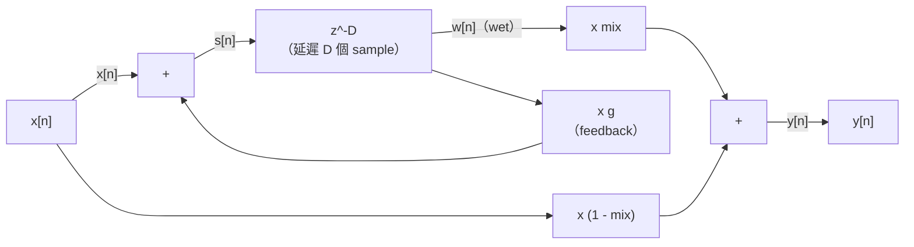
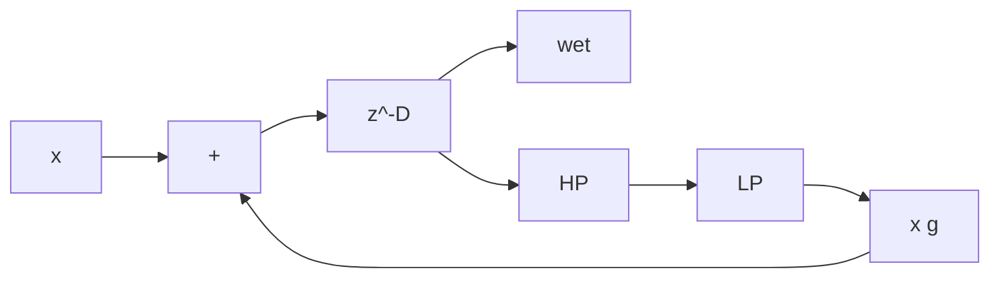
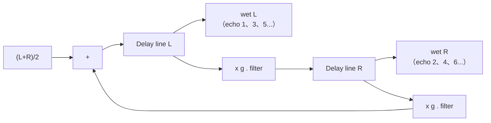
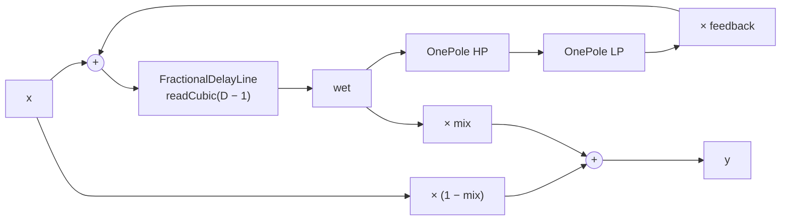

# 第 09 章：Delay 與 Echo——circular buffer、fractional delay 與 feedback

[English](README.md) | **繁體中文**

> [教材首頁](../../README.zh-TW.md)　｜　上一章：[08 Gate / Expander](../08-gate-expander/README.zh-TW.md)　｜　下一章：[10 Modulation](../10-modulation/README.zh-TW.md)

前面八章處理的都是「現在」這個 sample：乘一個 gain、過一個 filter、依 envelope 壓一壓。這一章開始讓訊號**記得過去**。把聲音存起來、晚一點再放出來，聽起來很單純，但它是 echo、slapback、ping-pong、chorus、flanger、comb filter、Karplus-Strong 撥弦合成，以及第 12 章 reverb 的共同基礎。

這一章的重點有三個：

1. **怎麼存**：circular buffer、讀寫指標、用 2 的次方遮罩做 wrap。
2. **怎麼讀「兩個 sample 之間」**：fractional delay 與插值。linear、cubic、allpass 各自的頻率響應，以及 delay time 改變時為什麼會有 pitch shift（Doppler）。
3. **怎麼回授**：feedback 迴路的穩定條件、迴路裡的 filter 與 saturation（tape echo 的質感）、短 delay 加 feedback 為什麼會變成 comb filter。

## 1. 本章目標

讀完並做完練習之後，你能夠：

- 實作一個 real-time safe 的 circular buffer，說清楚讀寫指標的關係、wrap 的寫法，以及為什麼長度要取 2 的次方。
- 說明整數 delay 不夠用的四個場合（tempo sync、modulation、平滑改變 delay time、把 comb 調到準確的音高）。
- 推導 linear interpolation 的頻率響應 $`|H| = \sqrt{1 - 2\Delta(1-\Delta)(1-\cos\omega)}`$，以及 $`\Delta = 0.5`$ 時的 $`|H| = |\cos(\pi f/f_s)|`$，並用數字比較 cubic Hermite / Lagrange 與 allpass interpolation。
- 用 $`f_\text{out} = f_\text{in}\,(1 - d\tau/dt)`$ 預測 delay time 改變時的 pitch 變化，並在「平滑過渡」與「兩條讀取頭 crossfade」之間做選擇。
- 推導 feedback echo 的穩定條件 $`|g| < 1`$、echo 的衰減時間 $`T_{60} = 3D/(-\log_{10} g)`$，並在迴路裡加入 lowpass、highpass 與 saturation。
- 畫出 stereo delay 與 ping-pong 的訊號路徑，用 BPM 算出附點與三連音的 delay time。
- 推導 feedforward / feedback comb filter 的峰谷位置與高度，並說明它和第 12 章 reverb 的關係。
- 實作並使用 `FractionalDelayLine` 與 `Delay`（之後第 10、12、14 章都會用到）。

## 2. 原理

### 2.1 Delay 是什麼：$`y[n] = x[n - D]`$

最純粹的 delay 只做一件事：

```math
y[n] = x[n - D] \qquad\Longleftrightarrow\qquad H(z) = z^{-D}
```

它的頻率響應是 $`H(e^{j\omega}) = e^{-j\omega D}`$：**幅度全頻都是 1**，相位隨頻率線性下降。單獨聽一個 delay 只會覺得「晚了一點」。delay 之所以有趣，是因為它通常會**和原音混在一起**（dry/wet mix），或**回授到自己的輸入**（feedback）。

delay time 的長短決定我們的耳朵把它聽成什麼。下表是大略的經驗值（數字因素材與個人而異）：

| Delay time | 和原音混合後聽起來像 | 典型用途 |
|---|---|---|
| < 1 ms | 音色改變（delay $`\tau`$ 與原音相加，第一個 notch 在 $`1/(2\tau)`$，即 500 Hz 以上；$`\tau = 0.1`$ ms 時在 5 kHz） | phaser / flanger 的極端、麥克風距離差造成的 comb |
| 1–15 ms | 明顯的 comb filter「金屬」或「管狀」音色；調變它就是 flanger | flanger（第 10 章）、Karplus-Strong |
| 15–35 ms | 聲音「變厚」，但還聽不出兩個獨立的聲音 | doubling、chorus（第 10 章）、Haas 效應的立體聲寬度 |
| 35–50 ms | 開始分得出兩個聲音，介於 doubling 與 slapback 之間（約在 Haas 效應的上限附近） | 想要「厚」但不想要明顯回聲的人聲、吉他 |
| 50–150 ms | 短而清楚的單一回聲 | slapback（rockabilly 人聲與吉他） |
| > 150 ms | 獨立、可辨識的 echo；通常會對齊 tempo | 節奏性 echo、ping-pong、dub delay |

### 2.2 Circular buffer：只往前寫、永遠不搬資料

要做 $`x[n-D]`$，我們需要記住最近 $`D`$ 個 sample。最直覺的做法是「每來一個新 sample 就把整個陣列往後挪一格」，但那是每個 sample O(D) 的搬移——2 秒的 delay 在 48 kHz 下要搬 96000 個 float，完全不可行。

Circular buffer（環形緩衝區）的想法是：**資料不動，指標動**。有一個 write index 指著「下一個要寫的位置」，每寫一個 sample 就往前一格，走到尾巴就繞回開頭：

| index | 0 | 1 | 2 | 3 | 4 | 5 | 6 | 7 |
|---|---|---|---|---|---|---|---|---|
| 內容 | `x[n-5]` | `x[n-4]` | `x[n-3]` | `x[n-2]` | `x[n-1]` | `x[n]` | `x[n-7]` | `x[n-6]` |
| 指標 | | | | | | 最後一次寫入 | write index `w` | |

Buffer 長度 N = 8。Index 5 存著最近一次寫入的 `x[n]`；index 6 是 write index $`w`$：下一次要寫這裡，同時也是「最舊」的資料。

讀 $`d`$ 個 sample 以前的值：$`\text{index} = (w - 1 - d) \bmod N`$

- $`d = 0`$：index 5，即 `x[n]`
- $`d = 2`$：index 3，即 `x[n-2]`
- $`d = 7`$：index 6，即 `x[n-7]`（長度 N 的 buffer 最多只能往回讀 N - 1 個 sample）


**wrap 的寫法與陷阱。** 讀取位置 $`w - 1 - d`$ 可能是負數。C++ 的 `%` 對負數的結果是負的（`-3 % 8 == -3`），直接拿來當 index 會越界。兩種正確寫法：

```cpp
int idx = (w - 1 - d) % N;  if (idx < 0) idx += N;   // 任何 N 都可以
int idx = (w - 1 - d + N) & (N - 1);                  // N 必須是 2 的次方
```

**2 的次方遮罩技巧。** 當 $`N = 2^k`$ 時，$`N - 1`$ 的二進位是 $`k`$ 個 1（例如 1024 − 1 = `0x3FF`）。任何整數和它做 bitwise AND，就等於取「除以 $`N`$ 的餘數」——而且在 two's complement 下對負數也成立（`-3 & 7 == 5`）。一個 AND 比一個整數除法便宜得多，也省掉分支。代價是記憶體：要 1000 個 sample 的 delay 就得配 1024 個；2 秒 @ 48 kHz（96 000 個 sample）要配 131 072 個，每個 channel 512 KB，可以接受。

**寫入與讀取的順序。** 本章的 `FractionalDelayLine` 約定「`push()` 之後，`read(0)` 回傳剛剛 push 的 sample」。所以在一個 echo 效果器裡，如果我們**先讀、再寫**（feedback 需要這樣：要先拿到延遲的輸出，才能算出要寫回去的值），那麼想要 $`D`$ 個 sample 的延遲就要讀 `read(D − 1)`。這個 −1 是 delay 程式裡最常見的 off-by-one bug 來源，3.2 節會再看一次。

### 2.3 為什麼需要 fractional delay

第 05 章的 `DelayLine` 只支援整數 delay，對 limiter 的 lookahead 來說夠用了。但 delay 效果器幾乎一定需要「小數 sample」的延遲：

1. **Tempo sync。** 95 BPM 的附點八分音符是 $`0.75 \times 60000 / 95 = 473.684`$ ms，在 48 kHz 下是 **22 736.84** 個 sample。四捨五入到 22 737 的誤差只有 0.003 ms，單一 echo 聽不出來——但 feedback 每繞一圈誤差就累積一次，而且這是最不重要的理由。
2. **Modulation。** chorus、flanger、vibrato（第 10 章）讓 delay time 隨 LFO 連續變化。如果只能用整數，讀取位置每隔一段時間就「跳一格」，每一跳都是一個不連續點，聽起來是一串細碎的 click 或「zipper」聲。
3. **平滑改變 delay time。** 使用者轉 delay time 旋鈕時，我們想讓它連續地滑過去（2.7 節），中間的值幾乎都不是整數。
4. **準確的音高。** 短 delay 加 feedback 會產生音高 $`f_s/D`$（2.13 節）。在 44.1 kHz 下想要 A4 = 440 Hz，需要 $`D = 100.227`$；用 100 會變成 441 Hz、用 101 會變成 436.6 Hz（−13.3 cents，聽得出來走音）。練習 7 會實際量這三個數字。

「讀 $`x[n - 10.5]`$」的意思是：估計原本的連續訊號在兩個 sample 中間那一刻的值。這就是**插值**（interpolation）。依 sampling theorem，理想的插值器是 sinc 函式——無限長、不能用。實際上我們用很短的近似，而每一種近似都要付出某種代價。

### 2.4 Linear interpolation 與它的高頻衰減

把延遲拆成整數部分 $`d`$ 與小數部分 $`\Delta \in [0, 1)`$：$`D = d + \Delta`$。Linear interpolation 在相鄰兩個 sample 之間畫一條直線：

```math
y[n] = (1 - \Delta)\,x[n-d] + \Delta\,x[n-d-1]
```

這是一個 2-tap 的 FIR filter（後面接一個整數 delay $`z^{-d}`$）。它的頻率響應：

```math
H(e^{j\omega}) = e^{-j\omega d}\bigl[(1-\Delta) + \Delta e^{-j\omega}\bigr]
```

取幅度平方，用 $`e^{-j\omega} = \cos\omega - j\sin\omega`$ 展開：

```math
|H|^2 = (1 - \Delta + \Delta\cos\omega)^2 + (\Delta\sin\omega)^2 = 1 - 2\Delta(1-\Delta)(1 - \cos\omega)
```

讀這條式子：

- $`\Delta = 0`$ 或 $`\Delta = 1`$：$`|H| = 1`$，就是整數 delay，沒有失真。
- $`\Delta = 0.5`$ 是**最壞**的情況（$`\Delta(1-\Delta)`$ 最大）。代入 $`1 - \cos\omega = 2\sin^2(\omega/2)`$：

```math
|H|^2 = 1 - \sin^2(\omega/2) = \cos^2(\omega/2) \quad\Longrightarrow\quad |H| = \left|\cos\frac{\omega}{2}\right| = \left|\cos\frac{\pi f}{f_s}\right|
```

**直覺。** $`\Delta = 0.5`$ 時，linear interpolation 就是「相鄰兩個 sample 取平均」——一個 2-point moving average，也就是最簡單的 lowpass filter。在 Nyquist（$`f = f_s/2`$）訊號是 $`+1, -1, +1, -1\ldots`$，相鄰兩點一平均剛好是 0，所以 $`|H| = \cos(\pi/2) = 0`$。在 $`f_s/4`$ 是 $`\cos(\pi/4) = 0.707`$，即 −3.01 dB。

在 48 kHz 下的理論值（範例 `l09_interpolation_compare` 實測與理論到小數第二位完全相同）：

| 頻率 | 1 kHz | 4 kHz | 8 kHz | 12 kHz | 15 kHz | 18 kHz | 20 kHz |
|---|---|---|---|---|---|---|---|
| linear，$`\Delta = 0.5`$（dB） | −0.02 | −0.30 | −1.25 | −3.01 | −5.11 | −8.34 | −11.74 |

聽感：靜態的 −3 dB @ 12 kHz 只是「稍微暗一點」，但當 delay time 被調變（chorus）時，$`\Delta`$ 在 0 和 1 之間來回走，高頻衰減量也跟著以 LFO 的速率起伏——這是一種聽得到的「呼吸感」。另外 linear 只有在 $`\Delta = 0.5`$（對稱 FIR）時是線性相位，其他 $`\Delta`$ 的相位延遲會隨頻率略微偏離 $`\Delta`$。

### 2.5 Cubic interpolation：Hermite 與 Lagrange

想要更平坦的高頻，就多用幾個點。四點（$`y_{-1}, y_0, y_1, y_2`$，目標位在 $`y_0`$ 與 $`y_1`$ 之間，距 $`y_0`$ 為 $`t = \Delta`$）的兩種常用 cubic：

**3 階 Lagrange**：唯一一條**通過四個點**的三次多項式。

```math
y(t) = \sum_{k=-1}^{2} h_k(t)\, y_k, \qquad h_k(t) = \prod_{m \ne k} \frac{t - m}{k - m}
```

展開就是

```math
h_{-1} = -\frac{t(t-1)(t-2)}{6},\quad h_0 = \frac{(t+1)(t-1)(t-2)}{2},\quad h_1 = -\frac{(t+1)\,t\,(t-2)}{2},\quad h_2 = \frac{(t+1)\,t\,(t-1)}{6}
```

**Cubic Hermite（Catmull-Rom）**：只要求曲線通過 $`y_0`$、$`y_1`$，而在這兩點的**斜率**取中央差分 $`m_0 = (y_1 - y_{-1})/2`$、$`m_1 = (y_2 - y_0)/2`$。寫成多項式：

```math
y(t) = c_0 + c_1 t + c_2 t^2 + c_3 t^3,\qquad
\begin{aligned}
c_0 &= y_0 \\
c_1 &= \tfrac12(y_1 - y_{-1}) \\
c_2 &= y_{-1} - \tfrac52 y_0 + 2y_1 - \tfrac12 y_2 \\
c_3 &= \tfrac12(y_2 - y_{-1}) + \tfrac32(y_0 - y_1)
\end{aligned}
```

兩者的差別：Lagrange 每一段各自通過四點，但相鄰兩段在接點的斜率不一定相同；Hermite 的斜率在接點連續（$`C^1`$），當讀取位置連續移動時波形更平順，所以 audio 上（尤其 modulation）較常用 Hermite。`FractionalDelayLine` 的 `readCubic()` 是 Hermite，`readLagrange()` 是 Lagrange（教學比較用）。

**$`\Delta = 0.5`$ 時兩者完全相同。** 代入 $`t = 0.5`$，兩組係數都是

```math
\left(-\tfrac{1}{16},\ \tfrac{9}{16},\ \tfrac{9}{16},\ -\tfrac{1}{16}\right)
```

（範例 `l09_interpolation_compare` 把 impulse 推過 delay 2.5，三種方法的輸出就是這組 kernel。）把這個對稱 4-tap FIR 的頻率響應以中心為原點寫出：

```math
|H(e^{j\omega})| = \left|\tfrac{9}{8}\cos\tfrac{\omega}{2} - \tfrac{1}{8}\cos\tfrac{3\omega}{2}\right|
```

在 $`f_s/4`$：$`\tfrac98 \cdot 0.7071 + \tfrac18 \cdot 0.7071 = 0.884`$，即 **−1.07 dB**（linear 是 −3.01 dB）。完整比較（48 kHz，實測 = 理論）：

| 頻率 | 1 kHz | 4 kHz | 8 kHz | 12 kHz | 15 kHz | 18 kHz | 20 kHz |
|---|---|---|---|---|---|---|---|
| linear（dB） | −0.02 | −0.30 | −1.25 | −3.01 | −5.11 | −8.34 | −11.74 |
| cubic（dB） | −0.00 | −0.01 | −0.23 | −1.07 | −2.53 | −5.26 | −8.41 |

cubic 在 8 kHz 以下幾乎是平的，但它**仍然是 lowpass**——任何有限長的多項式插值在 Nyquist 附近都會掉。白雜訊（全頻能量相同）經過 delay 10.5 之後，RMS 從 0.1443 變成 linear 0.1019、cubic 0.1153，少掉的就是高頻能量。

**cubic 需要「比目標新」的那一個點 $`y_{-1}`$**，所以 delay 至少要 1 個 sample（`readCubic` 會把小於 1 的 delay clamp 到 1）。

### 2.6 Allpass interpolation 簡介

另一條路：不要用 FIR 去「估計」中間值，而是用一個**幅度全頻為 1** 的一階 allpass filter，只調整相位，讓它在低頻的延遲剛好是 $`\Delta`$：

```math
H(z) = \frac{\eta + z^{-1}}{1 + \eta z^{-1}}, \qquad \eta = \frac{1 - \Delta}{1 + \Delta}
```

```math
y[n] = \eta\,\bigl(v[n] - y[n-1]\bigr) + v[n-1], \qquad v[n] = x[n - d]
```

它的相位延遲（單位 sample）是

```math
\tau(\omega) = -\frac{\angle H}{\omega} = 1 - \frac{2}{\omega}\arctan\frac{\eta\sin\omega}{1 + \eta\cos\omega}
\;\xrightarrow{\ \omega \to 0\ }\; \frac{1-\eta}{1+\eta} = \Delta
```

優點：沒有任何高頻衰減（練習 3 實測 20 kHz 也是 0.00 dB）。缺點：

- 延遲只在低頻精準，高頻會偏離（$`\Delta = 0.5`$ 時 8 kHz 的延遲是 10.537 而不是 10.5）。
- 它是**遞迴**的（有 $`y[n-1]`$），改變 $`\Delta`$ 時舊的狀態會留下一小段 transient；快速 modulation 時會產生雜音。所以 allpass 適合「固定或很慢變化」的 fractional delay，例如 Karplus-Strong 撥弦合成的精確調音、physical modeling 的 waveguide；chorus / flanger 則多用 cubic。
- $`\Delta`$ 接近 0 時 $`\eta \to 1`$，pole 貼近單位圓，transient 拖得很長。常見技巧是把 $`\Delta`$ 安排在 $`[0.5, 1.5)`$（整數部分少取 1），$`\eta`$ 就落在 $`(-0.2, 1/3]`$。

練習 3 會實作它並和 linear / cubic 比較。

### 2.7 改變 delay time：Doppler、click 與兩種策略

delay time 是 $`\tau(t)`$ 時，輸出是 $`y(t) = x(t - \tau(t))`$。輸入是頻率 $`f`$ 的正弦 $`\sin(2\pi f t)`$ 時，輸出的相位是 $`2\pi f\,(t - \tau(t))`$，對時間微分得到**瞬時頻率**：

```math
f_\text{out} = f_\text{in}\left(1 - \frac{d\tau}{dt}\right)
```

這就是 Doppler 效應：delay 變長（讀取頭「逃離」寫入頭）→ pitch 下降；delay 變短（讀取頭「追」寫入頭）→ pitch 上升。磁帶 echo 轉 delay time 旋鈕時聽到的「嗚——」就是這個。

數字例子（範例 `l09_doppler_sweep`）：delay 從 10 ms 線性增加到 250 ms，花 2 秒，$`d\tau/dt = 0.24/2 = 0.12`$。440 Hz 變成 $`440 \times 0.88 = 387.2`$ Hz；掃回來時變成 $`440 \times 1.12 = 492.8`$ Hz。實測 387.1 Hz 與 492.9 Hz。

**太快的 ramp 會讓聲音倒放。** 若 $`d\tau/dt > 1`$，$`f_\text{out}`$ 變成負數——讀取頭往回跑，聲音倒著播。`Delay` 預設的 delay ramp 是 50 ms：從 375 ms 改到 500 ms 時 $`d\tau/dt = 125/50 = 2.5`$，那 50 ms 內聲音以 1.5 倍速倒放。練習 6 的對照組更極端：10 → 250 ms、ramp 20 ms，$`d\tau/dt = 12`$，量到 4840 Hz。這段聲音短而尖，有人喜歡（像轉磁帶機的旋鈕），有人不要。

**不平滑、直接跳會 click。** 讀取位置瞬間從一個地方跳到另一個地方，輸出波形就有一個斷層。440 Hz、振幅 0.5 的正弦，相鄰 sample 的最大差值只有 $`0.5 \times 2\pi \times 440/48000 = 0.0288`$；直接跳的版本量到 0.27——寬頻的 click。

兩種常見策略：

| 策略 | 做法 | 優點 | 缺點 | 誰用 |
|---|---|---|---|---|
| **平滑過渡** | delay time 線性 ramp 到新值（本章 `Delay` 用 double 精度的 `DelayRamp`，理由見 3.2 節） | 簡單；有「類比磁帶」的手感；modulation（第 10 章）本來就是這樣 | 過程中有 pitch shift；ramp 太短會倒放 | 本章 `Delay`、tape echo 模擬 |
| **兩條讀取頭 crossfade** | 第二個讀取頭直接放在新位置，用 10–50 ms 的 raised-cosine 從舊頭淡出、新頭淡入 | 沒有 pitch shift、沒有 click | 兩條頭的內容不相關時中間會有短暫的音量凹陷與相位滑動；fade 期間再改值要排隊 | 許多數位 delay 的 tempo 切換（練習 6） |

練習 6 實測：crossfade 版本切換後相鄰 sample 最大差值 0.0288（和正弦本身一樣）、量到的頻率 444 Hz（只是 crossfade 期間相位滑動造成的小偏差），fade 結束後輸出與 $`x[n - 12000]`$ 完全相同。

### 2.8 Feedback 與穩定性

Echo 效果器的核心是把延遲後的輸出乘上 $`g`$（feedback）再加回輸入：



寫成方程式：$`s[n] = x[n] + g\,w[n]`$、$`w[n] = s[n - D]`$，所以

```math
W(z) = \frac{z^{-D}}{1 - g\,z^{-D}} = z^{-D} + g\,z^{-2D} + g^2 z^{-3D} + \cdots
```

**Impulse response**：第 $`k`$ 個 echo 出現在 $`kD`$，振幅 $`g^{k-1}`$。$`g = 0.5`$ 時每一圈 −6.02 dB（練習 1 用 impulse 量到 1、0.5、0.25、0.125……）。

**穩定條件**：分母的根是 $`z^D = g`$，$`D`$ 個 pole 都在半徑 $`|z| = |g|^{1/D}`$ 的圓上。穩定 ⇔ 所有 pole 在單位圓內 ⇔ $`|g| < 1`$。直覺更簡單：每一圈乘 $`g`$，$`|g| < 1`$ 就越來越小，$`|g| = 1`$ 永遠不衰減（任何雜訊都會被無限累積），$`|g| > 1`$ 指數爆炸（$`1.1^{100} \approx 13\,781`$）。所以 `Delay::setFeedback()` 把值 clamp 在 $`[0, 0.99]`$。

**Echo 的衰減時間。** 衰減 60 dB 需要的圈數是 $`60 / (-20\log_{10} g)`$，乘上每圈的時間 $`D`$：

```math
T_{60} = \frac{3D}{-\log_{10} g}
```

$`D = 375`$ ms、$`g = 0.5`$ → 3.74 s；$`g = 0.7`$ → 7.26 s。反過來，想要 $`D = 500`$ ms 的 echo 在 2 秒內消失：$`g = 10^{-3D/T_{60}} = 10^{-0.75} = 0.178`$。這和第 12 章 reverb 用來設定 RT60 的公式是同一條。

**迴路裡的 filter：tape echo 的質感。** 類比磁帶每繞一圈都會損失高頻（磁頭、磁帶）與一點低頻（變壓器、耦合電容）。在數位上，我們把 one-pole lowpass $`H_{LP}`$ 與 highpass $`H_{HP}`$（第 02 章 `OnePole`）放進 feedback 路徑：



第 $`k`$ 個 echo 的頻譜是 $`(g\,H_{HP}H_{LP})^{k-1}`$——每一圈都比上一圈更暗、更薄。因為 one-pole 的 $`|H| \le 1`$，迴路增益 $`|g\,H_{HP}H_{LP}| \le |g| < 1`$，**加 filter 不會讓穩定的迴路變不穩定**。這點在換成有 resonance 的 filter 時就不成立了：Q = 4 的 biquad lowpass 在 cutoff 附近有 +12 dB（4 倍），$`g = 0.5`$ 的迴路增益在那裡就是 2——`l09_ex7_solution` 實測這樣的迴路 3 秒內溢位成 inf，而 one-pole、$`g = 0.99`$ 的迴路同時間已衰減到 $`3\times10^{-5}`$（練習 2）。練習 4 量到：fb 0.7、LP 2 kHz、HP 100 Hz 時，第二個 echo 相對第一個在 500 Hz 剩 66.5%、在 8 kHz 只剩 17.7%，和理論 $`g\,|H_{HP}||H_{LP}|`$（用數位 one-pole 的實際頻率響應算：0.666 與 0.178）吻合。若改用類比 one-pole 的公式 $`1/\sqrt{1+(f/f_c)^2}`$ 近似，8 kHz 會得到 0.170——數位 one-pole 在接近 Nyquist 時和類比原型不同，高頻差約 4%。

注意：第一個 echo 沒有經過迴路裡的 filter（它直接從 delay line 出來），從第二個 echo 開始才變暗。有些設計把 filter 放在 wet 輸出或 delay line 輸入前面，第一個 echo 就也會變暗——這是設計選擇，不是對錯。

**迴路裡的 saturation。** 再往迴路裡放一個 $`\tanh`$（或第 06 章的 `Saturation::shape`），迴路增益就變成**振幅相關**：小訊號時 $`\tanh(u) \approx u`$，增益 $`= g`$；大訊號時 $`\tanh`$ 被壓扁，等效增益下降。結果：

- $`g < 1`$：和線性版幾乎一樣，只是大聲的 echo 被稍微壓縮、帶上一點諧波（磁帶飽和的溫暖感）。
- $`g > 1`$：線性版必定爆炸，但有 saturation 時，echo 長大到「等效增益剛好 = 1」的振幅就停住，變成一個振幅固定、會自己唱歌的 self-oscillation——這就是 dub delay 把 feedback 旋鈕轉過頭時的經典聲音。練習 4 用 describing function 預測這個振幅（0.298），實測 0.305。

> **describing function（描述函數）是什麼？** 一個把非線性元件近似成「只看基頻」的等效增益的方法：正弦 $`X\sin\theta`$ 送進 $`\tanh`$，輸出不再是純正弦，但我們只取它的基頻成分（振幅 $`F_1(X)`$），把 $`N(X) = F_1(X)/X`$ 當成這個元件在振幅 $`X`$ 時的「增益」。$`\tanh`$ 的 $`N(X)`$ 在小振幅時是 1、振幅越大越小。迴路其他部分的線性增益是 $`G = g\,|H_{HP}||H_{LP}|`$，自激振盪就會停在 $`G \cdot N(X) = 1`$ 的振幅 $`X`$。完整推導與數值解法在練習 4 的解答。

### 2.9 Stereo delay 與 ping-pong

**Stereo delay（兩聲道獨立）**：左右各一條 delay line、各自 feedback。輸入是立體聲時，echo 保持原本的立體聲像。

**Ping-pong**：echo 在左右之間來回彈跳。`Delay` 的做法：



輸入先混成 mono 送進左邊；左邊的輸出（乘 $`g`$）送進右邊；右邊的輸出（乘 $`g`$）回到左邊。impulse（只打在左聲道、振幅 1，mono 混合後是 0.5）經過 375 ms、$`g = 0.5`$ 的 ping-pong，範例 `l09_pingpong_tempo` 量到：

```
  Left : [n=18000 (375 ms) amp=0.5000] [n=54000 (1125 ms) amp=0.1250] [n=90000 (1875 ms) amp=0.0312]
  Right: [n=36000 (750 ms) amp=0.2500] [n=72000 (1500 ms) amp=0.0625]
```

左右交替、間隔 375 ms、每跳乘 0.5。

先混成 mono 的理由：如果輸入已經偏左，ping-pong 仍然從左邊開始彈，echo 的節奏型態和輸入的聲像無關。變化型很多：只把左聲道送進去、第一個 echo 從中間開始、左右用不同的 delay time（例如左 1/4、右附點 1/8）——它們都只是改變這張圖的連線。

### 2.10 Tempo sync：BPM → ms

一拍（四分音符）的長度是 $`60/\text{BPM}`$ 秒：

```math
t_\text{ms} = \text{beats} \times \frac{60000}{\text{BPM}}
```

beats 以四分音符為 1：八分音符 0.5、十六分音符 0.25。**附點**是原長度 × 1.5（附點八分 = 0.75 拍），**三連音**是原長度 × 2/3（八分三連音 = 1/3 拍；四分三連音 = 2/3 拍）。`Delay::noteToMs(bpm, beats)` 就是這條公式。

120 BPM（範例 `l09_pingpong_tempo` 印出的表）：

| 音符 | beats | ms | samples @ 48 kHz |
|---|---|---|---|
| 二分音符 | 2 | 1000.00 | 48000 |
| 四分音符 | 1 | 500.00 | 24000 |
| 四分三連音 | 2/3 | 333.33 | 16000 |
| 附點八分 | 0.75 | 375.00 | 18000 |
| 八分音符 | 0.5 | 250.00 | 12000 |
| 附點十六分 | 0.375 | 187.50 | 9000 |
| 八分三連音 | 1/3 | 166.67 | 8000 |
| 十六分音符 | 0.25 | 125.00 | 6000 |

附點八分是流行與搖滾吉他最常見的 delay 設定：在八分音符的旋律後面，echo 剛好落在兩個八分音符之間，形成一種「滾動」的十六分音符律動。

（順帶：若要把 delay time 換成 LFO 頻率，$`f = 1000 / t_\text{ms}`$ Hz，第 10 章 tempo-synced LFO 會用到。）

### 2.11 Dry/wet mix

```math
y = (1 - m)\,x + m\cdot\text{wet}, \qquad m \in [0, 1]
```

$`m = 0`$ 只有原音，$`m = 1`$ 只有 delay。這是線性 crossfade：dry 與 wet 相關（例如極短的 delay）時總音量不變；不相關時（一般 echo）在 $`m = 0.5`$ 附近總能量會少約 3 dB（練習 6 把白雜訊送進 `CrossfadeDelay`，在 fade 中點實測 −2.98 dB）。另一種選擇是 equal-power（$`\cos`$ / $`\sin`$）crossfade；兩種都有人用，本章取線性，因為它在 $`m`$ 很小時 dry 幾乎保持 0 dB，最符合「在 insert 上加一點 echo」的用法。

在 DAW 裡 delay 常放在 **aux send / return** 上：好幾軌送一點訊號過去，delay plugin 設 $`m = 1`$（100% wet），再用 return 的 fader 控制 echo 的量。第 14 章的 DAW 會這樣用。

`mix` 與 `feedback` 都用 20 ms 的 `SmoothedValue` 平滑，旋鈕轉動時不會有 zipper noise。

### 2.12 Slapback、echo、dub delay 的典型參數

下表是混音上常見的起點（經驗值，不是量測結果；實際要依素材、tempo 與編曲調整）：

| 類型 | Delay time | Feedback | Mix | 迴路 filter | 聽感 |
|---|---|---|---|---|---|
| Slapback | 80–150 ms（不一定對拍） | 0–10%（基本上只有一次 echo） | 15–35% | LP 3–5 kHz | 緊貼在後面的單一回聲，讓人聲 / 吉他更「有空間」但不糊 |
| Doubling | 15–35 ms | 0 | 30–50% | 無 | 變厚，像同一句唱了兩次 |
| 節奏 echo | 1/4、附點 1/8、1/8 | 20–45% | 15–30% | LP 4–6 kHz、HP 100–200 Hz | 跟著 tempo 的清楚回聲，尾巴乾淨不搶主旋律 |
| Ping-pong | 附點 1/8、1/4 | 30–50% | 20–35% | LP 3–5 kHz | 左右彈跳，增加立體感 |
| Dub delay | 1/4、附點 1/4 | 60% 到超過 100%（迴路有 saturation） | 30–60%（常用 send，演出時手動「丟」一個字進去） | LP 1.5–3 kHz、HP 200–400 Hz | 越來越暗、越來越糊、可以自激 |

（範例 `l09_pingpong_tempo` 的 ping-pong 用附點八分、fb 0.45、mix 0.35、迴路 HP 150 Hz + LP 3.5 kHz；練習 4 的 dub 用 fb 1.1 + tanh。）

### 2.13 Comb filter：短 delay + feedback

把 delay time 縮到幾 ms，echo 就不再是「一個個回聲」，而是融成**音色**。

**Feedforward comb**：$`y[n] = x[n] + g\,x[n-D]`$，$`H(z) = 1 + g\,z^{-D}`$。

```math
|H(e^{j\omega})|^2 = 1 + g^2 + 2g\cos(\omega D)
```

$`\cos(\omega D) = 1`$，即 $`f = k\,f_s/D`$ 時是峰 $`1 + g`$；$`\cos(\omega D) = -1`$，即 $`f = (k + \tfrac12) f_s/D`$ 時是谷 $`1 - g`$。頻率響應像梳子的齒，齒距 $`f_s/D`$——這就是名字的由來。

**Feedback comb**：$`y[n] = x[n] + g\,y[n-D]`$，$`H(z) = 1/(1 - g\,z^{-D})`$。

```math
|H(e^{j\omega})| = \frac{1}{\sqrt{1 + g^2 - 2g\cos(\omega D)}}
```

峰同樣在 $`k\,f_s/D`$，高度 $`1/(1 - g)`$；谷在 $`(k+\tfrac12) f_s/D`$，深度 $`1/(1 + g)`$。

$`D = 48`$（1 ms @ 48 kHz）、$`g = 0.7`$ 時，範例 `l09_comb_filter` 掃描 250–9750 Hz 自動找到的峰谷：

```
   type     freq(Hz)   gain(dB)   spacing from previous of same type (Hz)
   notch       500     -4.61   -
   peak       1000    +10.46   -
   notch      1500     -4.61   1000
   peak       2000    +10.46   1000
   ...
   peak       9000    +10.46   1000
   notch      9500     -4.61   1000
```

峰 $`+10.46`$ dB $`= 20\log_{10}(1/0.3)`$、谷 $`-4.61`$ dB $`= 20\log_{10}(1/1.7)`$、間距 $`f_s/D = 1000`$ Hz，全部與理論吻合。feedforward 的峰谷剛好相反：峰 $`+4.61`$ dB、谷 $`-10.46`$ dB（峰鈍、谷深）；feedback 是峰尖、谷淺。

`Delay` 本身轉到 delayMs = 1、feedback 0.7、mix 1 時，wet 的傳遞函式是 $`z^{-D}/(1 - g z^{-D})`$，幅度和 feedback comb 一樣：範例量到 1000 Hz +10.46 dB、1500 Hz −4.61 dB。**echo 效果器轉到極短的 delay 就是 comb filter**。

**為什麼聽起來有音高。** 峰排列在 $`f_0, 2f_0, 3f_0, \ldots`$（$`f_0 = f_s/D`$）——正好是一個基頻 $`f_0`$ 的諧波列。白雜訊經過 feedback comb，等於只留下這些諧波附近的能量，耳朵就聽到音高 $`f_0`$。`l09_comb_noise_1ms.wav`（$`D = 48`$、$`g = 0.9`$）有清楚的 1 kHz 音高；`l09_comb_noise_10ms.wav`（$`D = 480`$）是 100 Hz 的金屬 / 管狀共鳴。把 feedback comb 的迴路裡加一個「兩點平均」lowpass，再用一段雜訊激發它，就是 Karplus-Strong 撥弦合成——`Signals.h` 的 `makePluck()` 正是這樣做的。

**負的 feedback。** $`g < 0`$ 時 $`-2g\cos(\omega D)`$ 變號，峰移到 $`(k + \tfrac12) f_s/D`$：只剩奇次諧波，音高掉了八度、音色變得空洞（像管子一端封閉）。flanger 的「負 feedback」模式就是這個（第 10 章）。

**往 reverb 鋪路。** 單一 comb 的 echo 間距固定，聽起來是「金屬」的；但把好幾個 delay time 互質的 feedback comb 並聯，再串幾個 allpass 把 echo 打散，echo 密度就高到耳朵分不出個別的回聲——這就是 Schroeder reverb 的架構，第 12 章會從這裡開始。每個 comb 的 $`g`$ 由 2.8 節的 $`T_{60}`$ 公式決定，迴路裡的 lowpass 讓高頻衰減得比低頻快（damping），也和 2.8 節的 tape echo 是同一件事。

## 3. 從公式到程式碼

### 3.1 `FractionalDelayLine.h`：circular buffer + 三種讀法

檔案：[`dsp/include/dawlab/dsp/FractionalDelayLine.h`](../../dsp/include/dawlab/dsp/FractionalDelayLine.h)

| Method | 說明 |
|---|---|
| `void prepare(int maxDelaySamples, int numChannels)` | 唯一會 allocate 的地方。buffer 長度 = `nextPowerOfTwo(maxDelaySamples + 4)`（cubic 要讀到 `d + 2`，所以多留餘裕），`mask = size − 1` |
| `void reset() noexcept` | buffer 清 0、write index 歸 0 |
| `void push(int ch, float x) noexcept` | 寫入並把該 channel 的 write index 前進一格：`w = (w + 1) & mask` |
| `float readInteger(int ch, int delaySamples) const noexcept` | 整數延遲，直接取值 |
| `float readLinear(int ch, float delaySamples) const noexcept` | 2.4 節的 linear |
| `float readCubic(int ch, float delaySamples) const noexcept` | 2.5 節的 cubic Hermite（Catmull-Rom）；delay < 1 會被 clamp 到 1 |
| `float readLagrange(int ch, float delaySamples) const noexcept` | 2.5 節的 3 階 Lagrange（教學比較用） |
| `int getMaxDelaySamples() const`、`int getNumChannels() const`、`int getBufferSize() const` | 查詢 |
| `static int nextPowerOfTwo(int n)` | 輔助函式 |

慣例：**`push()` 之後 `readXxx(ch, 0)` 回傳剛剛 push 的 sample**，`readXxx(ch, D)` 回傳 D 次 push 以前的 sample。所有讀取都把 delay clamp 到 `[0, maxDelaySamples]`，不會越界。

核心只有一行：

```cpp
// 取「d 次 push 以前」的 sample：最後一次寫在 w − 1，所以目標是 w − 1 − d。
// 先加 size_ 讓它變成正數（其實對 2 的次方 mask 而言負數也能正確 wrap，加上去比較好讀）
return channelData(ch)[(w - 1 - d + size_) & mask_];
```

`readLinear` 是 2.4 節公式的直接翻譯（`a + frac * (b − a)` 是 $`(1-\Delta)a + \Delta b`$ 少一次乘法的寫法）；`readCubic` 依 2.5 節算出 $`c_0..c_3`$ 再用 Horner 法 `((c3*t + c2)*t + c1)*t + c0` 求值。

每個 channel 一段連續記憶體、各自一個 write index，所以 `push(0, …)`、`push(1, …)` 可以獨立呼叫（ping-pong 要的就是這個）。

### 3.2 `Delay.h`：stereo echo

檔案：[`dsp/include/dawlab/dsp/Delay.h`](../../dsp/include/dawlab/dsp/Delay.h)



| Method | 說明 |
|---|---|
| `void setMaxDelayMs(float ms)` | 在 `prepare()` 之前呼叫，預設 2000 ms，決定 buffer 大小（clamp 到 1–60000 ms） |
| `void prepare(double sampleRate, int maxBlockSize, int numChannels)` | 配置 delay line（最多 2 channel）、準備 `OnePole`、delay ramp 與 `SmoothedValue` |
| `void reset() noexcept` | 清空 delay line 與 filter 狀態；參數直接跳到目標值。`prepare()` 之前呼叫是安全的（什麼都不做） |
| `void setDelayMs(float ms) noexcept` | delay time，以 delay ramp（預設 50 ms）線性平滑 |
| `void setDelayRampSeconds(double s) noexcept` | delay ramp 長度；0 = 直接跳（會 click，教學用） |
| `void setFeedback(float) noexcept` | clamp 到 `[0, kMaxFeedback = 0.99]`，20 ms 平滑 |
| `void setMix(float) noexcept` | 0..1，20 ms 平滑 |
| `void setPingPong(bool) noexcept` | 2.9 節；mono 時沒有作用 |
| `void setLowpassHz(float) noexcept` / `void setHighpassHz(float) noexcept` | feedback 迴路內的 one-pole；LP ≥ 20 kHz、HP ≤ 20 Hz 視為關閉 |
| `void setInterpolation(Interpolation) noexcept` | `Interpolation::Cubic`（預設）或 `Linear` |
| `void process(AudioBlock) noexcept` | in-place |
| `static float noteToMs(double bpm, double beats) noexcept` | 2.10 節 |
| getter | `getDelayMs()`、`getCurrentDelayMs()`（平滑中的值）、`getMaxDelayMs()`、`getFeedback()`、`getMix()`、`isPingPong()`、`getMaxDelaySamples()` |

逐段對照公式：

- **先讀再寫，所以讀 `D − 1`。** 每個 sample：`wet = readDelayed(ch, d)`（內部讀 `d − 1`）→ `push(x + fb · filter(wet))` → `y = (1 − mix)·x + mix·wet`。因為本 sample 還沒 push 時讀 `D − 1`，就等於 push 之後讀 `D`。
- **最小 delay 是 2 sample。** `readCubic(D − 1)` 要求 `D − 1 ≥ 1`。`targetDelaySamples()` 把 delay clamp 在 `[2, maxDelaySamples]`。
- **delay time 用 sample 數平滑，而且用 double。** `DelayRamp delayRamp_` 存的是 sample 數而不是 ms，每個 sample `getNext()` 一次，讀取位置就連續移動（2.7 節的「平滑過渡」策略）。為什麼不直接用第 01 章的 `SmoothedValue`？它是 float、每個 sample `current += step`。delay 以 sample 計可以很大：1900 ms @ 48 kHz = 91200 sample，落在 $`[2^{16}, 2^{17})`$，float 在這裡的間距（ulp）是 $`2^{-7} = 0.0078`$ sample。把 1900 ms 改成 1901 ms、50 ms ramp 時 step = 48/2400 = 0.02 = 2.56 ulp，每次相加都被捨入成 3 ulp，2399 步累積多走約 8 sample，最後一步再「跳回」目標——讀取位置瞬間跳 8 sample，就是 click（15000 ms 時 ulp = 0.0625 > 2 × step，`current += step` 根本加不上去，先靜止 2400 sample 再一次跳 48 sample）。`DelayRamp` 用 double（ulp 小 $`2^{29}`$ 倍），而且不累加：每次直接算 `current = target − step × countdown`，誤差永遠只有一次捨入。讀取時把 double 位置拆成「整數 + 小數」交給 `readCubicSplit` / `readLinearSplit`，所以長 delay 的小數部分也不會因為轉成 float 而失去精度。feedback 與 mix 的範圍只在 0..1，float 的 `SmoothedValue` 完全夠用。
- **feedback 迴路的 filter。** `feedbackFilter()` 依序過 HP、LP；兩者都在 `prepare()` 配置好每個 channel 的狀態。
- **Ping-pong** 走 `processPingPong()`，完全照 2.9 節的圖：`push(0, mono + fb·filter(wetR))`、`push(1, fb·filter(wetL))`。
- **NaN 防護。** 所有 setter 都忽略 NaN、保留上一個有效值（`std::clamp(NaN, lo, hi)` 會原樣回傳 NaN，一旦變成讀取位置就是越界讀取）；±inf 則會被 clamp 到合法範圍。這和第 02 章 `OnePole::setCutoff()` 的做法一致。
- **Denormal。** 寫回 delay line 的值經過 `flushDenormal()`：小於 $`10^{-15}`$（−300 dBFS）就清成 0。否則輸入靜音之後，echo 每圈乘 $`g`$，幾十秒後會掉進 denormal 範圍，CPU 負載可能突然暴增。

### 3.3 範例

建置與執行（在專案根目錄；ctest 會自動跑所有範例與解答）：

```powershell
.\scripts\build.ps1 -Only 09-delay
cd build
.\bin\Debug\l09_interpolation_compare.exe
```

WAV 都輸出到 `build\dawlab_output\`。

| Target | 示範什麼 | 輸出 WAV |
|---|---|---|
| `l09_interpolation_compare` | buffer 大小與 mask；impulse 經過 delay 2.5 的插值 kernel；delay 10.5 時 linear / cubic / Lagrange 的頻率響應量測表（與理論並列） | `l09_interp_dry.wav`、`l09_interp_linear.wav`、`l09_interp_cubic.wav` |
| `l09_pingpong_tempo` | BPM → ms 表；impulse 驗證 ping-pong 路徑；120 BPM 撥弦琶音 + 附點八分 ping-pong；對照八分音符 stereo echo | `l09_pingpong_dry.wav`、`l09_pingpong_wet.wav`、`l09_echo_wet.wav` |
| `l09_doppler_sweep` | 440 Hz 正弦，delay 10 ↔ 250 ms 各花 2 秒掃動：zero-crossing 量 pitch 變化；ramp = 0 的對照組量 click；self-check：長 delay 只改 1 ms（1900 → 1901、15000 → 15001 ms）也不能 click | `l09_doppler_smooth.wav`、`l09_doppler_abrupt.wav` |
| `l09_comb_filter` | $`D = 48`$、$`g = 0.7`$ 的 feedback comb 掃頻、自動找峰谷並印出間距；feedforward 對照；用 `Delay` 重現；白雜訊過 comb | `l09_comb_noise_dry.wav`、`l09_comb_noise_1ms.wav`、`l09_comb_noise_10ms.wav` |

**`l09_interpolation_compare`**（節錄）：

```
prepare(maxDelay = 1000) -> buffer size = 1024 (a power of two, mask = 0x3FF)

Output of an impulse through a delay of 2.5 samples (one row per sample time n):
   n   linear    cubic   lagrange
   1  +0.0000  -0.0625  -0.0625
   2  +0.5000  +0.5625  +0.5625
   3  +0.5000  +0.5625  +0.5625
   4  +0.0000  -0.0625  -0.0625

Frequency response (dB) at a delay of 10.5 samples, fs = 48000 Hz:
   freq(Hz)  linear  theory   cubic  theory  lagrange
      8000   -1.25   -1.25   -0.23   -0.23   -0.23
     12000   -3.01   -3.01   -1.07   -1.07   -1.07
     20000  -11.74  -11.74   -8.41   -8.41   -8.41

White-noise RMS: dry 0.1443, linear 0.1019, cubic 0.1153 (what linear loses is high-frequency energy)
```

該聽到：`l09_interp_linear.wav` 和 `dry` 相比像蓋了一層薄布（高頻變暗），`cubic` 幾乎聽不出差別。用耳機、A/B 切換最容易聽出來。

**`l09_pingpong_tempo`**：impulse 的結果見 2.9 節。音樂部分：琶音在 4 秒結束，4.5–5.0 s 之間 dry 的 RMS 是 0，wet 是 0.00435——那就是還在左右彈跳的 echo 尾巴。peak：dry 0.551、ping-pong 0.395（mix 0.35 讓 dry 降到 0.65 倍，echo 填進拍子之間）。該聽到：`l09_pingpong_wet.wav` 的 echo 在左、右交替出現，落在八分音符之間形成十六分音符的律動，而且一次比一次暗、一次比一次薄（迴路裡的 3.5 kHz LP 與 150 Hz HP）。`l09_echo_wet.wav` 的 echo 則留在原位、對齊八分音符。

**`l09_doppler_sweep`**：

```
delay 10 ms -> 250 ms over 2.0 s: d(tau)/dt = 0.120
Theory: sweeping up gives f_out = 440.0 x (1 - 0.120) = 387.2 Hz; sweeping back gives 492.8 Hz

Measured frequency of the smooth version (zero crossings):
  0.3-0.8 s (delay fixed at 10 ms)   : 440.0 Hz (expected 440.0)
  1.5-2.5 s (delay sweeping up)      : 387.2 Hz (expected 387.2)
  3.2-3.8 s (delay fixed at 250 ms)  : 440.0 Hz (expected 440.0)
  4.5-5.5 s (delay sweeping back)    : 492.8 Hz (expected 492.8)

Largest difference between adjacent samples (the sine's own limit = 0.0288):
  smooth version 1.0-1.1 s: 0.0253   4.0-4.1 s: 0.0322 (pitch rises 12% on the way back, so the limit becomes 0.0323)
  abrupt version 1.0-1.1 s: 0.2701   4.0-4.1 s: 0.2651   <- far above the limit = click

Largest adjacent-sample difference for a 1 ms change to a long delay (50 ms ramp; limit 0.0288 x 1.02 = 0.0294):
  1900 -> 1901 ms  : 0.0288
  15000 -> 15001 ms: 0.0288
```

該聽到：`smooth` 版本像磁帶變速，音高往下滑、停住、再往上滑；`abrupt` 版本音高不變，但在 1 秒與 4 秒各有一聲「喀」。

注意這支範例的寫法：參數改變的時間點（48000）不是 block size 512 的倍數，所以程式把那個 block 在事件點**切開**，前半段用舊值、後半段用新值——host 處理 sample-accurate automation 也是這樣做的。

**`l09_comb_filter`**：峰谷表見 2.13 節。白雜訊的部分會印出三個 WAV 的 peak（dry 0.200、1 ms 0.164、10 ms 0.182；comb 的輸出另外乘了 0.15 / 0.25 避免 clip）。該聽到：`l09_comb_noise_1ms.wav` 是帶著清楚 1 kHz 音高的「嘶」聲，`10ms` 是 100 Hz 的金屬管共鳴。

## 4. Real-time 注意事項

- **只有 `prepare()` 會 allocate。** buffer 大小由 `setMaxDelayMs()` 與 sample rate 決定，之後 `setDelayMs()` 只能在這個範圍內改。想支援更長的 delay，要在非 audio thread 重新 `prepare()`。
- **記憶體。** 2 秒、48 kHz、立體聲：$`131\,072 \times 2 \times 4`$ bytes = 1 MB。192 kHz 時是 4 MB。8 軌各插一台還可以，但 delay 用的記憶體不是免費的；`setMaxDelayMs()` 不要無腦設很大。
- **Cache。** delay line 很長時，讀取位置與寫入位置相距很遠，每個 sample 都可能 cache miss。這是 delay 類效果器比 filter 貴的主要原因之一（不是運算量）。
- **Denormal。** feedback 迴路是遞迴結構。`Delay` 在寫入 delay line 前 flush 極小值；`OnePole` 自己也會 flush 狀態。自己寫 comb / allpass 時要記得做同樣的事（練習 3 的 allpass 有示範）。
- **參數平滑。** delay time：50 ms 線性 ramp（會有 Doppler，見 2.7 節）；feedback 與 mix：20 ms。filter cutoff 直接改係數——one-pole 係數瞬間改變不會產生明顯的 click，而且它在迴路裡，改變的效果是漸進的。
- **Feedback 上限。** `setFeedback()` 把值 clamp 到 0.99：即使 UI 傳來 1.2 也不會爆。若要做 dub 式的 >1 feedback，迴路裡一定要有 saturation（練習 4）。
- **Block 大小無關。** 所有狀態（write index、smoother、filter）逐 sample 更新，block 長度任意切都得到同樣的結果。
- **Thread safety。** setter 與 `process()` 要在同一個 thread，或由 host 保證在 block 之間呼叫。本章元件沒有給 UI 讀的量測值，所以沒有 atomic。
- **Latency。** delay 效果器**不回報** latency：延遲本來就是效果的一部分，host 不該補償它（和第 05 章 limiter 的 lookahead 相反）。

## 5. 常見錯誤與除錯

| 症狀 | 可能原因 |
|---|---|
| echo 比設定的早或晚 1 個 sample | 先讀再寫卻讀 `D` 而不是 `D − 1`（或反過來）。用 impulse 測：第一個 echo 應該剛好在 sample `D` |
| 偶發的巨大雜訊、crash | wrap 用 `%` 遇到負數；`readCubic` 讀 `d + 2` 越界；delay 超過 `prepare()` 時配置的長度 |
| 轉 delay time 時「喀」一聲 | delay time 沒有平滑（直接跳），或 ramp 太短 |
| 轉 delay time 時「嗚——」或短促的倒放聲 | 平滑過渡策略的正常現象（Doppler，$`d\tau/dt > 1`$ 時倒放）。不想要就用 crossfade（練習 6）或把 ramp 拉長 |
| chorus / modulation 時高頻忽大忽小、有沙沙聲 | 用了 linear interpolation（$`\Delta`$ 改變時高頻衰減量跟著變）。改 cubic |
| feedback 一高就越來越大聲、最後爆掉 | 迴路增益 ≥ 1：沒有 clamp feedback、或迴路裡的 filter 有 resonance（增益 > 1）、或 ping-pong 兩條路徑都乘了 $`g`$ 又額外加回 |
| 輸入靜音一段時間後 CPU 突然變高 | 迴路裡的值掉進 denormal。flush 小值，或在 CPU 上開 FTZ/DAZ |
| ping-pong 只有一邊有聲音 | 單聲道 block（`numChannels = 1`）時 ping-pong 不作用；或兩條 delay line 的連線接錯（左的輸出要送進右的輸入） |
| 短 delay 聽起來「金屬」「鼻音」 | 不是 bug：comb filter（2.13 節）。delay < 30 ms 加 feedback 一定會這樣 |
| tempo sync 的 echo 慢慢和節拍錯開 | delay time 被四捨五入成整數 sample、或 BPM 改變後沒重算 `noteToMs()` |

除錯技巧：**impulse 是 delay 最好的測試訊號**。打一個 impulse，印出輸出中所有非零 sample 的位置與振幅——位置錯就是 off-by-one 或單位換算錯，振幅錯就是 feedback / mix / filter 錯。範例 2 與練習 1、5 都是這樣驗證的。

## 6. 練習題

見 [`exercises/README.zh-TW.md`](exercises/README.zh-TW.md)（7 題：計算 2、觀念 1、實作 4），解答在 [`solutions/README.zh-TW.md`](solutions/README.zh-TW.md)。

## 7. 延伸閱讀

- J. O. Smith III, *Physical Audio Signal Processing*, W3K Publishing, 2010（線上版在 CCRMA 網站）——delay line、fractional delay、comb filter、Karplus-Strong 與 waveguide 的完整推導。
- T. I. Laakso, V. Välimäki, M. Karjalainen, U. K. Laine, "Splitting the Unit Delay: Tools for Fractional Delay Filter Design", *IEEE Signal Processing Magazine*, 13(1), 1996——Lagrange、allpass（Thiran）等 fractional delay 設計的經典整理。
- U. Zölzer (ed.), *DAFX: Digital Audio Effects*, 2nd ed., Wiley, 2011——delay、comb filter 與 delay-based 效果器的章節。
- J. D. Reiss, A. McPherson, *Audio Effects: Theory, Implementation and Application*, CRC Press, 2014（版權頁標示 © 2015）——delay line effects 一章（含 ping-pong、multi-tap、插值）。
- W. Pirkle, *Designing Audio Effect Plugins in C++*, 2nd ed., Routledge, 2019——circular buffer、stereo / ping-pong delay 的 plugin 實作。
- K. Karplus, A. Strong, "Digital Synthesis of Plucked-String and Drum Timbres", *Computer Music Journal*, 7(2), 1983；D. A. Jaffe, J. O. Smith, "Extensions of the Karplus-Strong Plucked-String Algorithm", *Computer Music Journal*, 7(2), 1983（用 allpass 做精確調音）。
- M. R. Schroeder, "Natural Sounding Artificial Reverberation", *Journal of the Audio Engineering Society*, 10(3), 1962——comb 與 allpass 組成的 reverb（第 12 章的起點）。

## 8. 下一章

[10 Modulation](../10-modulation/README.zh-TW.md)：把本章的 fractional delay 交給 LFO 來推——delay time 在幾 ms 附近緩慢擺動就是 chorus，在 1 ms 附近加 feedback 擺動就是 flanger；2.7 節的 Doppler 從「副作用」變成了效果本身。
