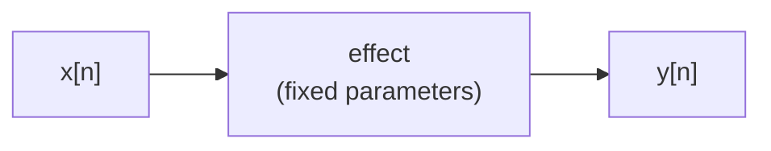
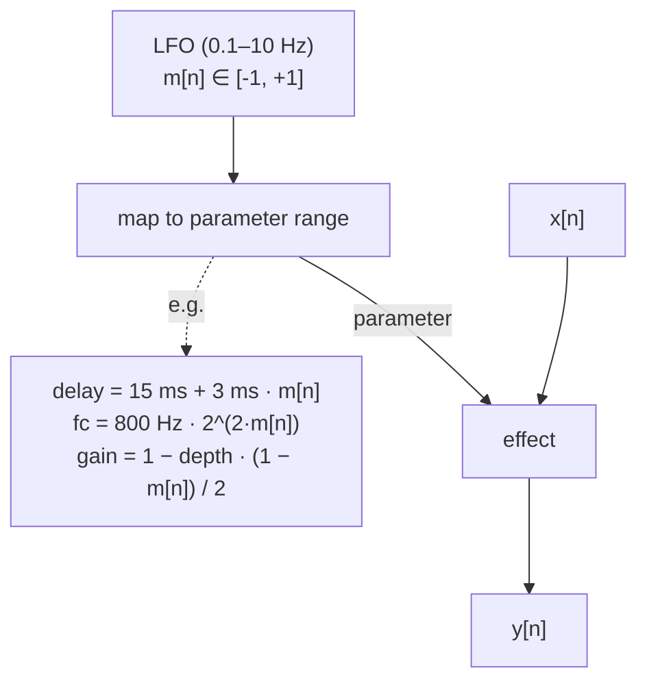
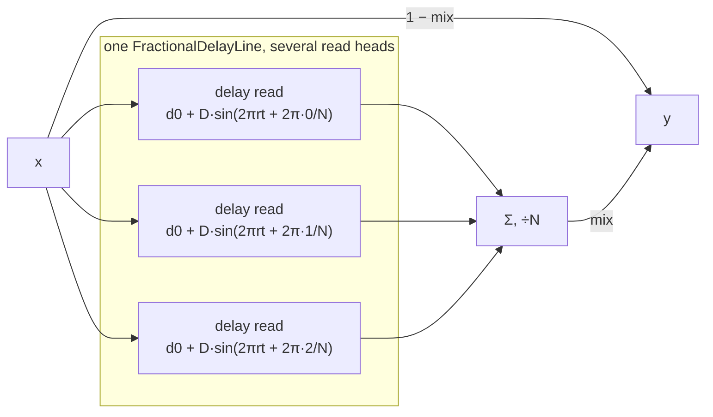
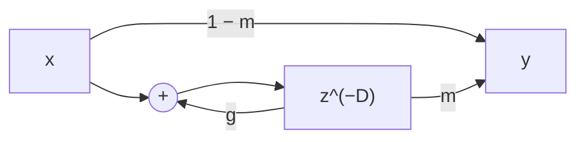
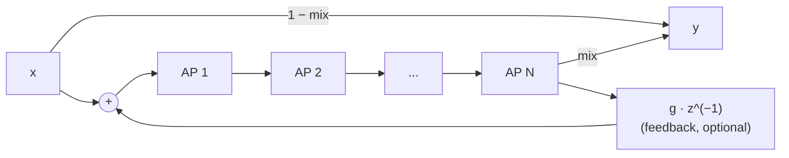

# Chapter 10: Modulation -- Chorus, Flanger, Phaser, Tremolo

**English** | [繁體中文](README.zh-TW.md)

> [Course home](../../README.md)　|　Previous: [09 Delay](../09-delay/README.md)　|　Next: [11 Metering and FFT](../11-metering-fft/README.md)

The effects in the previous nine chapters all have one thing in common: once you set the parameters, they stay put. The EQ cutoff sits at 2 kHz, the compressor threshold at −18 dB, the delay at 375 ms. In this chapter the parameters **start moving by themselves**. A very slow oscillator (an LFO) pushes the delay time, the allpass frequency, or the gain, and you get the classic row of stompboxes at a guitarist's feet: chorus, flanger, phaser and tremolo.

All four effects are short in code, but each hides a beautiful signal-processing idea: chorus is the **Doppler effect**, flanger is a **comb filter that walks**, phaser is **allpass phase magic**, and tremolo is **AM modulation**. This chapter takes them apart one at a time and checks each with numbers. At the end you will have five DSP components you can plug straight into the Chapter 14 DAW.

## 1. Learning objectives

After reading this chapter and doing the exercises, you should be able to:

- Implement an LFO with a phase accumulator (sine / triangle / saw / square / sample & hold), explain how rate, phase and tempo sync convert into one another, and explain **why an LFO does not need to be band-limited, yet the jumps of a square / saw must be smoothed**.
- Derive "modulated delay ⇒ pitch change" from $`y(t) = x(t - d(t))`$: the pitch ratio is $`1 - d'(t)`$. Compute the detuning (in cents) of chorus / vibrato.
- Describe the structure of a chorus (5–30 ms delay + LFO + dry signal), what multiple voices and stereo spread do, and measure the left/right correlation coefficient.
- Derive the flanger frequency response $`H = (1-m) + m\,z^{-D}/(1 - g z^{-D})`$: notches at $`(2k+1)/(2d)`$, peaks at $`k/d`$, how the sign of feedback affects peaks and valleys, and how it connects to the Chapter 09 comb filter. Know what through-zero flanging is.
- Derive the phase of a first-order allpass, $`\varphi(\omega) = -2\arctan\!\big(\tan(\omega/2)/\tan(\omega_c/2)\big)`$, show that the phase is exactly −90° at $`f_c`$, compute the number of notches of an N-stage phaser (= N/2) and their frequencies, and explain **why the notches are not evenly spaced**.
- Tell apart tremolo (AM: carrier kept + two sidebands), ring modulation (carrier gone, only sum and difference frequencies), vibrato (modulated delay with no dry signal mixed in) and autopan (a tremolo with opposite phase on left and right).
- Know that aliasing risk is small for these effects, but that **delay interpolation quality** directly affects the high frequencies (and be able to compute that linear interpolation loses 1.76 dB on average at $`f_s/4`$).

## 2. Theory

### 2.1 Modulation: using a slow signal to control a parameter

So far, the signal flow has looked like this:



A modulation effect adds one more line, a "control signal":



The LFO (Low-Frequency Oscillator) output is not meant to be heard. Its frequency is usually 0.05–10 Hz, far below the audible range (20 Hz). Its job is to make a "parameter" change slowly over time. Which parameter is controlled determines the kind of effect:

<div align="center">

| Modulated parameter | Effect | Component in this chapter |
|---|---|---|
| gain | tremolo / autopan | `Tremolo` |
| delay time (5–30 ms), dry mixed in | chorus | `Chorus` |
| delay time (0.5–10 ms), dry mixed in + feedback | flanger | `Flanger` |
| delay time, no dry mixed in | vibrato | Exercise 3 |
| allpass corner frequency, dry mixed in | phaser | `Phaser` |
| multiplication by an "LFO" in the audible range (the carrier) | ring modulation | Exercise 4 |

</div>

### 2.2 The LFO

#### Phase accumulator

Every waveform starts from the same thing: a **phase** $`p`$ that cycles through $`[0, 1)`$. On every sample it advances by $`r / f_s`$ ($`r`$ = rate, in Hz):

```math
p[n+1] = \mathrm{frac}\!\left(p[n] + \frac{r}{f_s}\right), \qquad \mathrm{frac}(x) = x - \lfloor x \rfloor
```

One cycle = $`f_s / r`$ samples. For example, with $`r = 2`$ Hz and $`f_s = 48`$ kHz, the phase advances $`4.17 \times 10^{-5}`$ per sample and goes around once every 24000 samples.

The waveforms are functions of the phase (all outputs lie in $`[-1, +1]`$):

<div align="center">

| Waveform | $`m(p)`$ | Character |
|---|---|---|
| Sine | $`\sin(2\pi p)`$ | Smoothest; the default for chorus / flanger / phaser |
| Triangle | $`p<\tfrac14: 4p`$; $`p<\tfrac34: 2-4p`$; otherwise $`4p-4`$ | In phase with the sine; constant rate of change, so a flanger sweep sounds more "even-paced" |
| Saw | $`2p - 1`$ | Rises all the way, then drops back instantly; good for "one-directional" sweeps |
| Square | $`p < \tfrac12 ? +1 : -1`$ | Switches between two values; the "chopped" tremolo |
| Sample & Hold | pick a random number at the start of each cycle and hold it for the whole cycle | A random staircase with a "robot / computer" feel |

</div>

<p align="center"></p>

(`l10_lfo_shapes` prints more precise ASCII plots from the real values.)

**Why use a phase instead of computing $`\sin(2\pi r n / f_s)`$ directly?** Because the rate changes. If $`r`$ goes from 1 Hz to 1.1 Hz, $`\sin(2\pi \cdot 1.1 \cdot n / f_s)`$ jumps instantly to a completely different phase when $`n`$ is large (since $`n`$ is multiplied by the new rate), producing a discontinuity. A phase accumulator changes only "how far to step each time", so the phase itself is always continuous.

**Why is the phase a `double`?** At a low rate the increment per step is tiny: 0.05 Hz at 48 kHz is $`1.04\times10^{-6}`$, while the resolution of a float near 0.5 is about $`6\times10^{-8}`$. Each addition can then carry up to 3% rounding error, and the LFO frequency drifts by several percent. With a double (resolution $`10^{-16}`$) the problem disappears.

#### Phase: offsetting several LFOs

The starting phase $`p_0`$ decides where in the waveform the LFO begins. This chapter uses "the same rate with different starting phases" a lot:

- The N voices of a chorus: phases $`0, \tfrac1N, \tfrac2N, \ldots`$, so that each copy is detuned at a different time.
- Stereo chorus: the right channel has phase $`+0.25`$ (90°).
- Autopan: the right channel uses $`-m`$, which equals a phase of $`+0.5`$ (180°).
- Measurement: set the rate to 0 and the phase to 0.75 ($`\sin(2\pi \cdot 0.75) = -1`$), and the LFO **parks** at its lowest point, so you can measure the frequency response in a fixed state.

#### Tempo sync

In a DAW, an LFO often has to follow the beat. One beat (a quarter note) = $`60/\text{bpm}`$ seconds. If one LFO cycle = $`b`$ beats ($`b = 1`$ for a quarter note, 0.5 for an eighth, 0.75 for a dotted eighth, $`1/3`$ for one eighth triplet since three eighth triplets fill one beat; a quarter-note triplet is $`b = 2/3`$), then

```math
r = \frac{\text{bpm}}{60 \cdot b} \ \text{Hz}
```

<div align="center">

| Note length | $`b`$ | 90 bpm | 120 bpm | 140 bpm |
|---|---:|---:|---:|---:|
| One bar (4/4) | 4 | 0.375 Hz | 0.500 Hz | 0.583 Hz |
| Quarter note | 1 | 1.500 Hz | 2.000 Hz | 2.333 Hz |
| Dotted eighth | 0.75 | 2.000 Hz | 2.667 Hz | 3.111 Hz |
| Eighth note | 0.5 | 3.000 Hz | 4.000 Hz | 4.667 Hz |
| Eighth triplet | 1/3 | 4.500 Hz | 6.000 Hz | 7.000 Hz |
| Sixteenth note | 0.25 | 6.000 Hz | 8.000 Hz | 9.333 Hz |

</div>

A correct rate is not enough: when you start playback from bar 37, the LFO peaks must also land on the beats. The way to do this is to recompute the phase at the start of every block from the song position given by the host (ppq, the number of beats counted in quarter notes): $`p = \mathrm{frac}(\text{ppq} / b + p_0)`$. Exercise 6 implements this.

#### Why an LFO does not need band-limiting, but a square must be smoothed

Chapters 06 and 07 spent a lot of effort on aliasing: a 440 Hz square wave has harmonics at 1320, 2200, 3080 Hz and so on, with amplitude $`\propto 1/k`$, extending beyond Nyquist and folding back into harsh inharmonic components. That is why synthesizer oscillators have to be band-limited.

An LFO does not, for two reasons:

1. **The frequency is too low.** For a 2 Hz square, the $`k`$-th harmonic sits at $`2k`$ Hz. You must reach the 12000th harmonic to touch 24 kHz, and by then the amplitude is only $`4/(\pi \cdot 12000) \approx 10^{-4}`$ (−80 dB). The amount that folds back is negligible.
2. **The LFO itself is never heard.** It is a control signal; what the ear hears is the audio after it has been controlled.

That does not mean the jumps are harmless. The problem is not the LFO's spectrum but **the thing it controls**. If a square LFO is used directly as a gain, the gain jumps from 1 to 0 within a single sample, which multiplies the audio by a step function. Chapter 01 explained that this creates a broadband click in the audio. The same happens when it controls a delay time: the delay jumps 3 ms instantly, the read position jumps 144 samples away, and the waveform is discontinuous.

The fix is to smooth the edges of the square / saw / S&H with a very short one-pole lowpass:

```math
s[n] = s[n-1] + k\,(m[n] - s[n-1]), \qquad k = 1 - e^{-1/(\tau f_s)}
```

With $`\tau = 1`$ ms the equivalent cutoff is $`\approx 1/(2\pi\tau) = 159`$ Hz. The LFO shape barely changes (a 2 Hz square is still square), but each jump is stretched into a ramp of about 5 ms, and the click disappears. `Lfo` enables 1 ms smoothing by default for Square / Saw / S&H (`setSmoothingMs(0)` turns it off for comparison); Sine / Triangle are continuous already and are left unsmoothed to keep an exact waveform. Measured by `l10_lfo_shapes`:

```
Square LFO as a gain (4 Hz) chopping a 441 Hz sine (amplitude 0.5):
  The sine's own largest single-step jump = 0.0289 (theory A*2*pi*f/fs = 0.0289)
  smoothing  0.0 ms: largest single-step jump = 0.5000 (17.3x the sine's)  -> l10_lfo_square_click.wav
  smoothing  1.0 ms: largest single-step jump = 0.0289 (1.0x the sine's)  -> l10_lfo_square_smooth.wav
  smoothing  5.0 ms: largest single-step jump = 0.0289 (1.0x the sine's)
```

Without smoothing, the gain cuts to 0 instantly at the sine's peak (0.5), a single-step jump of 0.5, which is 17 times the steepest slope of the sine itself. That is the click. With 1 ms smoothing the largest jump returns to the sine's own 0.0289: the gain now changes more slowly than the signal itself, so it no longer adds any extra broadband energy.

(The example deliberately uses 441 Hz rather than 440 Hz. A 4 Hz square switches every 6000 samples, and at sample 6000·k a 440 Hz sine has completed exactly 55·k whole cycles, i.e. it is at a zero crossing, so its amplitude is already 0 at the switch and no click can be measured. Real music is never that lucky. This is also a reminder: when you measure with a test signal, watch out for special cases where the signal and the parameter happen to be "perfectly aligned".)

### 2.3 Modulated delay = the Doppler effect

Chorus, flanger and vibrato are all "a delay time pushed around by an LFO". What happens when the delay time changes?

The output of a delay line is $`y(t) = x(t - d(t))`$. Replace $`x`$ with a sine $`x(t) = \sin(2\pi f t)`$:

```math
y(t) = \sin\!\big(2\pi f\,(t - d(t))\big)
```

The instantaneous frequency is the derivative of the phase with respect to time, divided by $`2\pi`$:

```math
f_{\text{inst}}(t) = \frac{1}{2\pi}\frac{d}{dt}\Big[2\pi f\,(t - d(t))\Big] = f\,\big(1 - d'(t)\big)
```

**When the delay is getting longer ($`d' > 0`$) the pitch goes down; when it is getting shorter the pitch goes up.** This is exactly the Doppler effect of an ambulance approaching and receding: the read head is "retreating from" or "advancing on" the write head.

With a sine LFO, $`d(t) = d_0 + D\sin(2\pi r t)`$ and $`d'(t) = 2\pi r D \cos(2\pi r t)`$, so

```math
\frac{f_{\text{inst}}}{f} = 1 - 2\pi r D\cos(2\pi r t) \in \big[\,1 - 2\pi r D,\ 1 + 2\pi r D\,\big]
```

In cents (100 cents = one semitone), the maximum upward shift is $`1200 \log_2(1 + 2\pi r D)`$ and the maximum downward shift is $`1200 \log_2(1 - 2\pi r D)`$. Because the log curve bends downward (it is concave), the downward magnitude is slightly larger; when $`2\pi r D`$ is small the two are almost symmetric.

<div align="center">

| $`D`$ (depth) | $`r`$ (rate) | $`2\pi r D`$ | Maximum deviation (up / down) |
|---|---|---|---|
| 3 ms | 0.8 Hz | 0.0151 | +25.9 / −26.3 cents (chorus default) |
| 1 ms | 5 Hz | 0.0314 | +53.6 / −55.3 cents (clear vibrato) |
| 0.6 ms | 5.5 Hz | 0.0207 | +35.5 / −36.3 cents (the sound of Exercise 3) |
| 5 ms | 2 Hz | 0.0628 | +105 / −112 cents (more than a semitone, already "drunk") |

</div>

Note that the amount of detuning depends only on **$`r \times D`$**: doubling the depth and halving the rate gives the same detuning, just slower. `l10_chorus` verifies this by measuring zero crossings:

```
Doppler pitch drift (1 kHz sine, 1 voice, mix 1, rate 0.8 Hz, depth 3 ms):
  Theory: ratio 1 +/- 2*pi*r*D = 1 +/- 0.0151 -> 984.9 .. 1015.1 Hz (+25.9 / -26.3 cents)
  Measured: instantaneous frequency 984.9 .. 1015.1 Hz
```

**Vibrato** is exactly this "detuning only" effect: the output is **entirely** the delayed signal, with no dry signal mixed in. With no dry signal there are no two paths to interfere, so the amplitude does not change and only the pitch wobbles (Exercise 3).

### 2.4 Chorus

#### Intuition

A choir sounds "thicker" than a solo singer because each person is slightly different in pitch and timing, and that difference keeps changing. A chorus effect imitates this electronically: copy the signal a few times and delay each copy by 5–30 ms (short enough that the ear does not hear an echo; Chapter 09 explained that below about 35 ms the copies fuse into one sound (the table in Section 2.1)), then let an LFO slowly push each delay time → each copy gets a slight, slowly changing detune (Section 2.3) → mix them with the dry signal, and it sounds like several "slightly out-of-tune doubles" playing together.



```math
y[n] = (1-\text{mix})\,x[n] + \frac{\text{mix}}{N}\sum_{v=0}^{N-1} x\!\left[n - d_v[n]\right], \qquad d_v[n] = d_0 + D\sin\!\left(2\pi\Big(p[n] + \tfrac{v}{N}\Big)\right)
```

#### Multiple voices and stereo spread

- **Number of voices N**: the LFO starting phases of the voices are staggered by $`1/N`$ of a cycle, so at any moment some voices are sharp and some are flat. Together they sound more like "a crowd" than a single voice, and you are less likely to hear the whole thing rocking up and down together like seasickness. The wet signal is divided by N so that more voices do not get louder.
- **Stereo spread**: each voice in the right channel gets an extra phase of $`0.25 \times \text{spread}`$ cycles. The left and right delays are therefore out of sync, the two ears hear different wet signals → the image widens. Quantify it with the Pearson correlation coefficient $`\rho = \sum LR / \sqrt{\sum L^2 \sum R^2}`$: 1 = left and right identical (in the centre), 0 = completely uncorrelated (very wide).

Measured (`l10_chorus`, 2 voices, mix 0.5):

```
   spread   L/R LFO offset   white noise   plucked arpeggio
    0.00        0.0°          1.000         1.000
    0.10        9.0°          0.711         0.766
    0.25       22.5°          0.713         0.730
    1.00       90.0°          0.711         0.733
```

This result is worth thinking about: **for broadband material, a tiny left/right delay difference makes the wet signal almost completely uncorrelated** (white noise delayed by a single sample is already uncorrelated). The correlation stops at 0.7 rather than 0 because half of the output is the dry signal, identical in both channels. Let the dry power be $`\sigma^2`$; the wet signal of 2 voices, $`w = (x_1 + x_2)/2`$, has power $`\sigma^2/2`$. Then $`L = 0.5x + 0.5w_L`$ has power $`0.25\sigma^2 + 0.125\sigma^2 = 0.375\sigma^2`$, and if the left and right wet signals are completely uncorrelated, $`E[LR] = 0.25\sigma^2`$, so $`\rho = 0.25/0.375 = 2/3 \approx 0.667`$. The measured value is slightly higher (0.711) because of interpolation: the fractional part of the read position keeps changing, and the cubic (Catmull-Rom) interpolator acts as a time-varying lowpass that keeps on average only $`\alpha \approx 0.814`$ of the power of white noise (about −0.9 dB; linear interpolation is worse, averaging $`2/3`$, i.e. −1.76 dB, see Section 2.8). The wet power is therefore $`\alpha\sigma^2/2`$ rather than $`\sigma^2/2`$, and substituting gives $`\rho = 0.25/(0.25 + 0.125\alpha) \approx 0.71`$, matching the measurement (with linear interpolation the prediction would be 0.750). So spread is almost an on/off switch for "how wide"; what it really changes is how dynamically the left and right detuning drift apart. Exercise 5 uses the same power argument to derive the loss when the channels are summed to mono.

#### Sound and typical parameters

<div align="center">

| Parameter | Typical range | Sound |
|---|---|---|
| centre delay | 10–25 ms | Longer sounds more "separate" and more like doubling; too long (> 35 ms) and you begin to hear two distinct voices, approaching slapback |
| depth | 1–5 ms | Amount of detuning (together with rate, see 2.3) |
| rate | 0.1–2 Hz | Too fast becomes a vibrato-like "wobble" |
| voices | 1–4 | More = thicker, more ensemble-like |
| mix | 0.3–0.5 | The effect is strongest at 0.5; at 1.0 it becomes vibrato |

</div>

### 2.5 Flanger

#### Relationship to the Chapter 09 comb filter

Shorten the chorus delay to 0.5–10 ms and things change: with such a short delay added to the dry signal, the ear no longer hears "two voices" but one **coloured** voice. This is the feedforward comb filter of Chapter 09, Section 2.13 (the example `l09_comb_filter` sweeps its peaks and valleys). The only difference is that this chapter weights the paths with the mix, $`(1-m)`$ and $`m`$, whereas Chapter 09 writes $`x[n] + g\,x[n-D]`$.

```math
y[n] = (1-m)\,x[n] + m\,x[n-D] \quad\Longrightarrow\quad H(e^{j\omega}) = (1-m) + m\,e^{-j\omega D}
```

For $`m = 0.5`$:

```math
H = \tfrac12\left(1 + e^{-j\omega D}\right) = e^{-j\omega D/2}\cos\!\left(\tfrac{\omega D}{2}\right) \;\Rightarrow\; |H(f)| = |\cos(\pi f d)|
```

($`d = D/f_s`$ is the delay in seconds.)

- **Notch** (complete cancellation): $`\pi f d = (2k+1)\pi/2 \Rightarrow f_k = \dfrac{2k+1}{2d}`$. The delay is an odd multiple of half a period, so the two paths are in antiphase.
- **Peak** (0 dB): $`f_k = k/d`$. The delay is a whole number of periods, so the two paths are in phase.

With $`d = 2`$ ms the notches are at 250, 750, 1250 Hz and so on, spaced $`1/d = 500`$ Hz apart, **evenly spaced**, like a comb on the spectrum. A flanger lets the LFO push $`d`$: the whole comb slides left and right together, which is the "whoosh" of a jet flying past.

<p align="center"></p>

*Left: d = 2 ms, notches at 250, 750, 1250 and 1750 Hz. Right: d = 1 ms (the LFO shortens the delay), so the teeth spread out and move up: notches at 500 and 1500 Hz.*

`l10_flanger` parks the LFO at a fixed delay and sweeps the frequency to find the notches:

```
Notches found sweeping 100-4000 Hz (every 25 Hz), vs f_k = (2k+1)/(2d), d = 2 ms:
   k   measured notch(Hz)   gain(dB)   theory(Hz)
   0              250        -100.0        250
   1              750        -100.0        750
   2             1250        -100.0       1250
   ...
   7             3750        -100.0       3750
```

(−100 dB is the floor of `gainToDb` and means the signal really cancelled to 0.)

#### Feedback

Send part of the delay output back to the delay-line input (the feedback comb of Chapter 09):



The signal inside the delay line is $`w[n] = x[n] + g\,w[n-D]`$ and the output is $`y = (1-m)x + m\,w[n-D]`$:

```math
H(z) = (1-m) + m\,\frac{z^{-D}}{1 - g\,z^{-D}}
```

At the peak frequencies ($`z^{-D} = 1`$) and the notch frequencies ($`z^{-D} = -1`$):

```math
H_{\text{peak}} = (1-m) + \frac{m}{1-g}, \qquad H_{\text{notch}} = (1-m) - \frac{m}{1+g}
```

<div align="center">

| feedback $`g`$ | peak ($`f = k/d`$) | former notch position ($`f = (2k+1)/2d`$) | Sound |
|---|---|---|---|
| 0 | 1.0 (0 dB) | 0 (−∞ dB) | Clean sweep |
| +0.5 | 1.5 (**+3.5 dB**) | 0.167 (**−15.6 dB**) | Peaks get sharp, metallic resonance |
| −0.7 | 0.794 (**−2.0 dB**) | −1.167 (**+1.3 dB**) | Peaks and valleys swap; a "hollow" sound |

</div>

Positive feedback makes the integer multiples of $`k/d`$ resonate (like a pipe of length $`d`$), and the sound becomes more and more "pitched". Negative feedback moves the resonances to the odd multiples $`(2k+1)/(2d)`$, just as a pipe closed at one end has only odd harmonics. The loop is stable only for $`|g| < 1`$ (each trip around multiplies by $`g`$), so `setFeedback` is limited to ±0.99. The measurements in the example match the theory exactly:

```
d = 1 ms, mix 0.5: gain at each frequency (measured / theory, dB)
   freq(Hz)  type        fb +0.0            fb +0.5            fb -0.7
       500   notch    -100.0 /  -100.0    -15.6 /   -15.6     +1.3 /    +1.3
      1000   peak       +0.0 /    +0.0     +3.5 /    +3.5     -2.0 /    -2.0
```

#### Sweep range

The `Flanger` in this chapter sweeps the delay between $`[d_{\min}, d_{\min} + \text{depth}]`$:

```math
d(t) = \text{delayMs} + \text{depthMs}\cdot\frac{1 + m(t)}{2}
```

With the default 1–3 ms, the first notch sweeps from $`1/(2 \cdot 0.001) = 500`$ Hz down to $`1/(2 \cdot 0.003) = 167`$ Hz, and the whole comb follows. Note that the notch frequency is **inversely** proportional to $`d`$: going from 1 ms to 3 ms is a factor of 3, and the notch moves by a factor of 3 (about 1.6 octaves).

The flanger's LFO also causes detuning (Section 2.3), but the rate is usually very low (0.05–0.5 Hz) and the depth is only a few ms, so $`2\pi r D`$ is small. What the ear mainly hears is the comb sliding, not the pitch wobbling. This is the **essential difference between a chorus and a flanger**: both are "modulated delay + dry signal", but with a long delay (> 10 ms) the comb teeth are so dense that you cannot hear them, and the main impression is the detuned double; with a short delay (< 10 ms) the teeth are sparse and fall within the audible band, and the main impression is the timbre being coloured by a sweeping filter.

#### Through-zero flanging

Flanging in the 1960s used two tape machines playing the same music at the same time, while an engineer pressed a finger against the edge (the flange) of one tape reel to slow it down (which is where the name comes from). The delay difference between the two machines can go from positive, through 0, to negative. At the instant of **passing through zero** the two are exactly identical (or cancel completely if one is inverted), which a digital flanger (whose delay is always > 0) cannot do.

The digital emulation: also delay the dry signal by a fixed amount $`d_0`$, and sweep the wet delay on both sides of $`d_0`$:

```math
y = \tfrac12\big(x[n - d_0] - x[n - d(t)]\big), \qquad d(t) = d_0 + \Delta\sin(\cdot)
```

At the instant the delay difference $`\delta = d(t) - d_0`$ passes through 0, $`|H| = |\sin(\pi f \delta)| \to 0`$ and **all frequencies vanish at once**, as if the sound were sucked away and spat back out. `l10_flanger` measures this with a 500 Hz sine: the quietest block (512 samples) of the through-zero version is only −34.4 dB relative to the dry signal (not −∞, because within one block the delay difference is exactly 0 for only an instant). The price is that the whole effect gains $`d_0`$ of latency.

#### Typical parameters

<div align="center">

| Parameter | Typical range | Sound |
|---|---|---|
| delay | 0.5–3 ms | Lower bound of the sweep (the position of the highest notch) |
| depth | 1–5 ms | How wide the sweep is |
| rate | 0.05–0.5 Hz | Slow = jet plane; fast (> 2 Hz) = warble |
| feedback | ±0.3–0.9 | Larger = more metallic and more pitched |
| mix | 0.5 | At 0.5 the notches are deepest (both paths must be equal to cancel completely) |

</div>

### 2.6 Phaser

#### Intuition: rotate only the phase, not the amplitude

A flanger uses "delay" to make the phase difference between two paths grow linearly with frequency ($`\Delta\varphi = 2\pi f d`$), giving evenly spaced notches. A phaser uses a different tool: the **allpass filter**. It leaves the amplitude of every frequency unchanged ($`|H| = 1`$) and changes only the phase, and the phase shift goes from 0° to −180° **non-linearly** with frequency. Chain N stages, add the result to the dry signal, and the frequencies where the phase differs by exactly 180° cancel into notches.



#### First-order allpass: deriving the phase and the 90° frequency

Start from the analog prototype. The first-order allpass:

```math
H_a(s) = \frac{\omega_a - s}{\omega_a + s}
```

On $`s = j\Omega`$, the numerator $`\omega_a - j\Omega`$ and the denominator $`\omega_a + j\Omega`$ are complex conjugates of equal length, so $`|H_a| = 1`$. The phase = numerator angle − denominator angle:

```math
\angle H_a(j\Omega) = -\arctan\frac{\Omega}{\omega_a} - \arctan\frac{\Omega}{\omega_a} = -2\arctan\frac{\Omega}{\omega_a}
```

At DC ($`\Omega = 0`$) it is 0°; at $`\Omega = \omega_a`$ it is $`-2 \cdot 45° = -90°`$; as $`\Omega \to \infty`$ it is −180°.

Convert to digital with the bilinear transform (Chapter 02): $`s = \dfrac{1 - z^{-1}}{1 + z^{-1}}`$, with the corresponding frequency relation $`\Omega = \tan(\omega/2)`$ ($`\omega = 2\pi f / f_s`$). Let $`t = \tan(\omega_c/2) = \tan(\pi f_c / f_s)`$ stand in for $`\omega_a`$:

```math
H(z) = \frac{t - \frac{1 - z^{-1}}{1 + z^{-1}}}{t + \frac{1 - z^{-1}}{1 + z^{-1}}} = \frac{t(1+z^{-1}) - (1-z^{-1})}{t(1+z^{-1}) + (1-z^{-1})} = \frac{(t-1) + (t+1)z^{-1}}{(t+1) + (t-1)z^{-1}}
```

Divide top and bottom by $`(t+1)`$ and let $`a = \dfrac{t - 1}{t + 1}`$:

```math
\boxed{H(z) = \frac{a + z^{-1}}{1 + a\,z^{-1}}, \qquad a = \frac{\tan(\pi f_c/f_s) - 1}{\tan(\pi f_c/f_s) + 1}}
```

The phase follows directly by substituting $`\Omega = \tan(\omega/2)`$ and $`\omega_a = \tan(\omega_c/2)`$ into the analog version:

```math
\boxed{\varphi(\omega) = -2\arctan\!\left(\frac{\tan(\omega/2)}{\tan(\omega_c/2)}\right)}
```

At $`\omega = \omega_c`$, $`\varphi = -2 \cdot \pi/4 = -\pi/2`$, i.e. **exactly −90° at $`f_c`$**; it is 0° at DC and −180° at Nyquist. This $`f_c`$ is the phaser's "centre frequency" parameter.

`l10_phaser` verifies the formula using `BiquadCoefficients::response()` from Chapter 02 and taking `std::arg` (substituting $`z = e^{j\omega}`$ directly into $`H(z)`$) ($`f_c = 1`$ kHz, $`a = -0.87698`$):

```
   freq(Hz)   |H|(dB)   phase Biquad::response   phase formula
        100    -0.00       -11.41°              -11.41°
       1000    -0.00       -90.00°              -90.00°
       2000    +0.00      -127.07°             -127.07°
      20000    -0.00      -177.99°             -177.99°
```

#### N stages in series → N/2 notches

With all N stages at the same $`f_c`$, the total phase is $`N\varphi(\omega)`$ and the total amplitude is still 1. Adding equal parts of the dry signal:

```math
H_{\text{total}} = \tfrac12\left(1 + e^{jN\varphi}\right) \;\Rightarrow\; |H_{\text{total}}| = \left|\cos\frac{N\varphi}{2}\right|
```

Notches appear at $`N\varphi = -(2k+1)\pi`$ (antiphase). Since $`\varphi`$ falls monotonically from 0 to $`-\pi`$, $`N\varphi`$ sweeps $`(-N\pi, 0)`$, which contains the odd multiples of $`\pi`$: $`\pi, 3\pi, \ldots, (N-1)\pi`$, a total of **$`N/2`$** (for even N). So:

<div align="center">

| stages | Total phase range | Number of notches |
|---|---|---|
| 2 | 0 to −360° | 1 |
| 4 | 0 to −720° | 2 |
| 6 | 0 to −1080° | 3 |
| 8 | 0 to −1440° | 4 |

</div>

(This is also why `setStages` accepts only even numbers: with an odd number of stages the total phase at Nyquist, $`-N\pi`$, is an odd multiple of $`\pi`$, so the last "notch" is stuck at Nyquist and becomes a lowpass slope falling away through the highs, wasting one stage.)

**Notch positions**: solve $`N \cdot \big(-2\arctan(\tan(\omega/2)/t)\big) = -(2k+1)\pi`$:

```math
\boxed{\tan\frac{\omega_k}{2} = \tan\frac{\omega_c}{2}\cdot\tan\frac{(2k+1)\pi}{2N}, \qquad k = 0, 1, \ldots, \tfrac{N}{2} - 1}
```

`l10_phaser` sweeps the frequency to find the notches and compares with the formula (centre 1 kHz, mix 0.5, feedback 0):

```
4 stages:   414.7 / 2397.8 Hz                        (theory 414.7 / 2397.8)
6 stages:   268.3 / 1000.0 / 3665.4 Hz               (theory the same)
8 stages:   199.2 /  668.7 / 1493.9 / 4863.3 Hz      (theory 199.2 / 668.7 / 1494.0 / 4863.3)
```

The middle notch of the 6-stage version sits exactly at $`f_c`$: $`6 \times (-90°) = -540° \equiv -180°`$.

#### Why are a phaser's notches not evenly spaced?

The flanger's phase difference $`2\pi f d`$ is **linear** in frequency: every additional $`1/d`$ Hz adds one more full turn, so the notches are evenly spaced. The phaser's phase $`\varphi(\omega)`$ has an arctan shape: **measured in log frequency (octaves)**, the phase turns fastest near $`f_c`$ and more slowly the more octaves you move away from $`f_c`$ (note this is "per octave": on a linear Hz axis, the phase change per Hz is actually largest near DC and only half as large at $`f_c`$). So the notches are symmetric about $`f_c`$ on a log axis, and on a linear Hz axis they are dense at low frequencies and sparse at high frequencies. From the formula above, the notches are set by $`\tan\frac{(2k+1)\pi}{2N}`$, and at low frequencies ($`\tan(\omega/2) \approx \omega/2`$)

```math
f_k \approx f_c \cdot \tan\frac{(2k+1)\pi}{2N}
```

Since $`\tan\theta \cdot \tan(\pi/2 - \theta) = 1`$, paired notches satisfy $`f_k \cdot f_{N/2-1-k} \approx f_c^2`$: they are **geometrically symmetric about $`f_c`$**, neither equally spaced in difference nor in ratio (for 8 stages the ratios of adjacent notches are 3.36, 2.23, 3.26). Example: for 4 stages, $`f_0 f_1 = 414.7042 \times 2397.7862 = 994372 \approx 10^6 = f_c^2`$ (off by 0.56%, from bilinear frequency warping). With the exact form, with no approximation, the two sides are exactly equal. `l10_phaser` prints:

```
     Example: for 4 stages, f0 · f1 = 414.7042 x 2397.7862 = 994372 ≈ fc² = 1000000 (off by 0.56%, from the bilinear frequency warping)
     Exact form: tan(πf0/fs) · tan(πf1/fs) = 0.0042959455, tan²(πfc/fs) = 0.0042959455
```

Audibly, this is the biggest difference between a phaser and a flanger: a flanger has many evenly spaced comb teeth and sounds like a pitched resonance (metallic, jet-like); a phaser has only a few broad notches placed irregularly, produces no harmonic-like resonance, and sounds softer and more "watery".

#### Exponential-scale LFO

The ear hears frequency logarithmically: 200 → 400 Hz and 2000 → 4000 Hz sound like the same movement (one octave each). If the LFO pushed $`f_c`$ linearly (say 200–3200 Hz), most of the time would be spent in the high frequencies and the lows would flash by. So the phaser uses an **exponential scale**:

```math
f_c(t) = f_{\text{centre}} \cdot 2^{\,\text{depth}\cdot\text{octaves}\cdot m(t)}
```

With the defaults octaves = 2 and depth = 1, $`f_c`$ sweeps from $`f_{\text{centre}}/4`$ to $`4 f_{\text{centre}}`$, at a constant speed measured in octaves.

#### Feedback

As with a flanger, send the output of the allpass chain back to the input so that the frequencies between the notches resonate. The implementation differs a little: the output of the allpass chain depends on the "current" input ($`H(z)`$ has a $`z^0`$ term), so feeding it back with no delay gives the implicit equation $`w = x + g \cdot A(w)`$. The simplest approach is to put a one-sample delay in the feedback path:

```math
W = X + g\,z^{-1}\,Y,\quad Y = A\,W \;\Rightarrow\; H = (1-\text{mix}) + \text{mix}\cdot\frac{A}{1 - g\,A\,z^{-1}}
```

Frequencies where $`A = 1`$ (with 4 stages, that is $`f_c`$) are boosted and the notches get shallower. The measurements of `l10_phaser` agree with the theory that includes $`z^{-1}`$:

```
Effect of feedback on 4 stages (centre 1 kHz, mix 0.5) (measured / theory, dB):
   freq(Hz)       fb 0.0            fb 0.5            fb 0.8
        415    -59.9 /  -59.9    -15.6 /  -15.6    -13.1 /  -13.1
       1000     -0.0 /   -0.0     +3.4 /   +3.4     +8.3 /   +8.3
```

#### Second-order allpass (extension)

`BiquadCoefficients::makeAllpass(sr, f0, Q)` from Chapter 02 is a second-order allpass: its phase goes from 0 to −360° and is −180° at $`f_0`$. Adding one second-order allpass section to the dry signal produces a notch at $`f_0`$, and Q decides how fast the phase turns around $`f_0`$, i.e. the width of the notch. A phaser built from second-order sections lets you control the position and width of each notch independently (many analog phaser circuits are first order, so the `Phaser` in this chapter uses first-order sections and treats the Chapter 02 `Biquad` as a container: $`b_0 = a, b_1 = 1, a_1 = a, b_2 = a_2 = 0`$).

#### Typical parameters

<div align="center">

| Parameter | Typical range | Sound |
|---|---|---|
| stages | 4–8 | More = more notches, a stronger effect |
| centre | 300–2000 Hz | Centre of the sweep |
| depth | 0.5–1 (× ±2 octaves) | How wide the sweep is |
| rate | 0.1–2 Hz | Slow = psychedelic; fast = rotary-speaker-like wobble |
| feedback | 0–0.7 | Larger = more "wah-wah", more resonant |

</div>

### 2.7 Tremolo, autopan, ring modulation

#### Tremolo = AM

Tremolo modulates the amplitude directly:

```math
y(t) = x(t)\cdot g(t), \qquad g(t) = 1 - \text{depth}\cdot\frac{1 - m(t)}{2}
```

When $`m = +1`$, $`g = 1`$; when $`m = -1`$, $`g = 1 - \text{depth}`$. With a sine LFO, $`g(t) = (1 - \tfrac{D}{2}) + \tfrac{D}{2}\sin(2\pi r t)`$. For an input sine $`A\sin(2\pi f t)`$, using the product-to-sum identity $`\sin a \sin b = \tfrac12[\cos(a-b) - \cos(a+b)]`$:

```math
y(t) = A\left(1 - \tfrac{D}{2}\right)\sin(2\pi f t) + \frac{AD}{4}\Big[\cos\big(2\pi(f-r)t\big) - \cos\big(2\pi(f+r)t\big)\Big]
```

The spectrum is the **original frequency (amplitude × $`(1 - D/2)`$) plus two sidebands at $`f \pm r`$ (each with amplitude × $`D/4`$)**, which is the spectrum of AM radio. The Goertzel measurement of `l10_tremolo` (1 kHz, $`A = 0.5`$, 10 Hz, depth 1):

```
   freq(Hz)   measured   theory
       1000     0.2500     0.2500   (carrier x(1 − depth/2))
        990     0.1250     0.1250   (sideband x depth/4)
       1010     0.1250     0.1250   (sideband x depth/4)
```

At rates of 2–10 Hz the sidebands are too close to the carrier for the ear to separate them, and you hear "the volume wobbling". Above about 20 Hz the sidebands separate enough that you start to hear them as a new timbre (roughness, then additional pitches).

#### Autopan

The left channel uses $`m`$ and the right channel uses $`-m`$:

```math
g_L = 1 - D\frac{1 - m}{2}, \qquad g_R = 1 - D\frac{1 + m}{2}, \qquad g_L + g_R = 2 - D
```

When the left is loud the right is quiet, the image moves back and forth, and the sum of the amplitudes is constant (the linear pan law of Chapter 01). The example measures the largest $`|g_L + g_R - (2 - D)|`$ per block as $`5.96 \times 10^{-8}`$ (float rounding). For constant power you can switch to $`g_L = \cos\theta`$, $`g_R = \sin\theta`$ (the Chapter 01 `Panner`).

#### Ring modulation

Remove the DC offset of the tremolo and multiply directly by a carrier that swings between −1 and +1:

```math
y(t) = x(t)\cdot\sin(2\pi f_c t) \quad\Rightarrow\quad A\sin(2\pi f t)\sin(2\pi f_c t) = \frac{A}{2}\Big[\cos\big(2\pi(f - f_c)t\big) - \cos\big(2\pi(f + f_c)t\big)\Big]
```

The original frequency $`f`$ **disappears**, leaving only the sum $`f + f_c`$ and the difference $`f - f_c`$ (each with amplitude $`A/2`$). When the carrier is in the audible range (for example 500 Hz), the sum and difference frequencies are not integer multiples of the original, which gives the inharmonic sound of metal, bells and Dalek robots. Exercise 4 implements it and verifies it with Goertzel.

### 2.8 Aliasing and interpolation quality

The aliasing risk of modulation effects is **small**:

- Tremolo multiplies by a very slow gain and produces only sidebands at $`f \pm r`$; $`r`$ is only a few Hz, so nothing goes beyond Nyquist (unless you use an unsmoothed square, which is a click problem, see 2.2).
- Modulated delay is really phase modulation (PM): the delay $`d(t)`$ directly changes the phase $`2\pi f\,d(t)`$. For a sine LFO this is equivalent to frequency modulation (FM) with a frequency deviation of $`f \cdot 2\pi r D`$, with sideband spacing = $`r`$. For a 12 kHz component under the chorus defaults the deviation is about ±180 Hz, still far from 24 kHz.
- Phasers and flangers are (time-varying) linear filters and create no new frequencies.

What really affects sound quality is the **fractional-delay interpolation** (Chapter 09). The delay time keeps changing, so the fractional part $`\Delta`$ of the read position keeps sweeping through 0..1. Linear interpolation $`y = (1-\Delta)x_0 + \Delta x_1`$ is a two-point FIR,

```math
|H(\omega)|^2 = (1-\Delta)^2 + \Delta^2 + 2\Delta(1-\Delta)\cos\omega
```

At $`f_s/4`$ ($`\omega = \pi/2`$, 12 kHz at 48 kHz) the cos term is 0; with $`\Delta`$ sweeping uniformly through 0..1, the average power is

```math
\int_0^1\big[(1-\Delta)^2 + \Delta^2\big]\,d\Delta = \tfrac13 + \tfrac13 = \tfrac23 \;\Rightarrow\; 10\log_{10}\tfrac23 = -1.76\ \text{dB}
```

Moreover this loss **fluctuates with the LFO** (no loss at $`\Delta = 0`$, darkest at $`\Delta = 0.5`$), which amounts to extra modulation of the high frequencies. Measured by `l10_chorus`: linear −1.73 dB, cubic (Catmull-Rom) −0.52 dB. This is why `Chorus` / `Flanger` in this chapter use `readCubic` by default.

## 3. From formulas to code

This chapter adds five headers (`dsp/include/dawlab/dsp/`), which depend on `FractionalDelayLine` from Chapter 09 and `Biquad` from Chapter 02. All effects follow the standard interface: `prepare()` is the only place that allocates, and the parameter setters only set target values, which an internal one-pole smoother (τ = 20 ms) then smooths on the audio thread.

### 3.1 `Lfo.h`

```cpp
enum class LfoShape { Sine, Triangle, Saw, Square, SampleAndHold };

class Lfo {
public:
    void prepare(double sampleRate);
    void reset() noexcept;                       // back to the starting phase set by setPhase; the S&H random sequence also restarts from its seed
    void setShape(LfoShape) noexcept;
    void setRateHz(float hz) noexcept;           // 0 Hz is legal: the LFO stands still
    void setPhase(float phase01) noexcept;       // sets the current phase and also records it as the reset starting phase
    void setSmoothingMs(float ms) noexcept;      // edge smoothing for Square / Saw / S&H (default 1 ms)
    void setSeed(uint32_t seed) noexcept;        // S&H random seed (takes effect on the next reset / prepare)
    float getNextValue() noexcept;               // returns -1..1 and advances the phase by one sample
    static float shapeValue(LfoShape, float phase01) noexcept;   // stateless waveform function
    static float tempoToRateHz(double bpm, double beats) noexcept;
};
```

Key points:

- `getNextValue()` computes the value from the "current" phase first and then advances, so the first value after `setPhase(0.25)` is $`\sin(\pi/2) = 1`$.
- The phase accumulator is a `double` (Section 2.2).
- `shapeValue()` is a static pure function. `Chorus` uses it to derive the "right channel plus 0.25 cycles" value from the same phase, so there is no need to maintain a second set of LFOs.
- The file also contains a `detail::ModParamSmoother` (a one-pole parameter smoother: $`y \mathrel{+}= k(\text{target} - y)`$, snapping to the target once it converges to within $`10^{-6}`$), shared by all five components in this chapter.

### 3.2 `Chorus.h`

```cpp
class Chorus {
public:
    static constexpr int kMaxVoices = 4;
    void prepare(double sampleRate, int maxBlockSize, int numChannels);
    void reset() noexcept;
    void setRateHz(float);           // 0..20
    void setDepthMs(float);          // 0..30, the maximum deviation (±) of the delay from the centre
    void setCentreDelayMs(float);    // 1..50
    void setVoices(int);             // 1..4; does nothing if the value is unchanged (see Section 4)
    void setMix(float);              // 0..1
    void setStereoSpread(float);     // 0..1 → right-channel LFO phase +0..0.25 cycles
    void setUseCubicInterpolation(bool);
    float processSample(int channel, float x) noexcept;
    void process(AudioBlock) noexcept;
};
```

At each time step, `process()` first calls `advanceModulation()` once (smooth the parameters, record each voice's phase, advance the LFO), then calls `renderSample()` for each channel:

```cpp
delay_.push(ch, x);                                       // write first: read(d) = d samples ago
const float phaseOffset = 0.25f * spread_ * ch;            // right channel gets 0.25·spread extra cycles
for (int v = 0; v < voices_; ++v) {
    const float m = Lfo::shapeValue(LfoShape::Sine, voicePhase_[v] + phaseOffset);
    const float delayMs = centreMs_ + depthMs_ * m;        // d_v = d0 + D·sin(…)
    wet += delay_.readCubic(ch, clamp(delayMs · fs/1000, 2, maxRead));
}
wet /= voices_;                                            // ÷N: the number of voices does not affect loudness
return (1 - mix_) * x + mix_ * wet;
```

The longest delay is fixed in `prepare()` at 50 + 30 ms (plus 8 samples for interpolation), so changing parameters later never allocates. Defaults: rate 0.8 Hz, depth 3 ms, centre 15 ms, 2 voices, mix 0.5, spread 1.

### 3.3 `Flanger.h`

```cpp
class Flanger {
public:
    void prepare(double sampleRate, int maxBlockSize, int numChannels);
    void reset() noexcept;
    void setRateHz(float);        // 0..20
    void setDepthMs(float);       // 0..20
    void setDelayMs(float);       // 0.1..20: the lower bound of the sweep
    void setFeedback(float);      // -0.99..0.99
    void setMix(float);           // 0..1
    void setLfoShape(LfoShape);
    void setLfoPhase(float);      // for measurement: rate 0 + phase 0.75 → parks at delayMs
    float getCurrentDelayMs() const noexcept;
    static double notchFrequencyHz(int k, double delayMs) noexcept;   // (2k+1)/(2d)
    static double peakFrequencyHz(int k, double delayMs) noexcept;    // k/d
    float processSample(int channel, float x) noexcept;
    void process(AudioBlock) noexcept;
};
```

With feedback, the order matters: first **read** the delayed value, compute $`w = x + g\cdot\text{delayed}`$, and only then **write** $`w`$ in. The read happens before the push, and the convention of `FractionalDelayLine` is "after a push, read(0) = the value just written", so before the push you must read $`d - 1`$ to get a true delay of $`d`$ samples:

```cpp
const float delayed = delay_.readCubic(ch, std::max(1.0f, currentDelaySamples_ - 1.0f));
float w = x + feedback_ * delayed;           // w[n] = x[n] + g·w[n−D]
if (std::abs(w) < 1e-20f) w = 0.0f;          // flush tiny values in the loop to 0 (denormals)
delay_.push(ch, w);
return (1.0f - mix_) * x + mix_ * delayed;   // H = (1−m) + m·z^−D/(1 − g z^−D)
```

The "measured / theory" table of Example 3 agrees digit for digit, which is the evidence that this order is correct (with the wrong order, the delay would be off by one sample and the notch frequencies would drift).

### 3.4 `Phaser.h`

```cpp
class Phaser {
public:
    static constexpr int kMinStages = 2, kMaxStages = 12;
    void prepare(double sampleRate, int maxBlockSize, int numChannels);
    void reset() noexcept;
    void setRateHz(float);
    void setDepth(float);            // 0..1 (× ±sweepOctaves octaves)
    void setCentreHz(float);         // 20..20000
    void setFeedback(float);         // -0.95..0.95
    void setStages(int);             // 2..12, even
    void setMix(float);
    void setSweepOctaves(float);     // default 2
    float getCurrentCentreHz() const noexcept;
    static double allpassCoefficient(double fcHz, double sampleRate) noexcept;
    static double allpassPhase(double fHz, double fcHz, double sampleRate) noexcept;
    static double notchFrequencyHz(int k, int stages, double fcHz, double sampleRate) noexcept;
    static BiquadCoefficients makeFirstOrderAllpass(double fcHz, double sampleRate) noexcept;
    float processSample(int channel, float x) noexcept;
    void process(AudioBlock) noexcept;
};
```

For each sample:

```cpp
const float octaves = depth * sweepOctaves_ * lfo_.getNextValue();
currentHz_ = clamp(centre * std::exp2(octaves), 20, 0.45·fs);   // exponential scale
const BiquadCoefficients c = makeFirstOrderAllpass(currentHz_, sampleRate_); // a = (t−1)/(t+1)
for (int s = 0; s < numStages_; ++s) stages_[s].setCoefficients(c);
...
float w = x + feedback_ * lastOut_[ch];          // feedback goes through a 1-sample delay
for (int s = 0; s < numStages_; ++s) w = stages_[s].processSample(ch, w);
lastOut_[ch] = w;
return (1 - mix_) * x + mix_ * w;
```

Each stage uses the Chapter 02 `Biquad` (TDF-II) as a container, and $`b_2 = a_2 = 0`$ makes it a first-order section. The four static functions correspond directly to the formulas in Section 2.6, and the examples and exercises use them as "theory values".

### 3.5 `Tremolo.h`

```cpp
class Tremolo {
public:
    void prepare(double sampleRate, int maxBlockSize, int numChannels);
    void reset() noexcept;
    void setRateHz(float);            // 0..50
    void setDepth(float);             // 0..1
    void setShape(LfoShape);
    void setAutoPan(bool);            // true: the right channel uses −lfo
    void setLfoPhase(float);
    void setSmoothingMs(float);       // forwarded to Lfo
    float getCurrentGain(int channel) const noexcept;
    float processSample(int channel, float x) noexcept;
    void process(AudioBlock) noexcept;
};
```

The core is just two lines: `gain_[0] = 1 - depth·(1 − m)/2` and `gain_[1] = 1 - depth·(1 + m)/2`. When `autoPan` is false, both channels use `gain_[0]`.

### 3.6 Example 1: `l10_lfo_shapes` (`examples/lfo_shapes.cpp`)

Build and run (Windows, from the project root; the default build directory of `build.ps1` is `build\`, and WAV files are written to `dawlab_output\` in the current working directory):

```powershell
.\scripts\build.ps1 -Only 10-modulation      # build and run all ctest tests of this chapter
cd build
.\bin\Debug\l10_lfo_shapes.exe
```

All the examples below assume you have already done `cd build`.

It prints ASCII plots of the five waveforms with their min / max / mean, the "largest single-step jump" of the square before and after smoothing, and the tempo sync conversion table. Output:

<div align="center">

| File | Content | What to listen for / look at |
|---|---|---|
| `l10_lfo_sine.wav` … `l10_lfo_sample_hold.wav` | The LFO itself (2 Hz; S&H 8 Hz), amplitude 0.5 | Too low to hear; open it in a waveform editor and "look" |
| `l10_lfo_square_click.wav` | 441 Hz × 4 Hz square gain, no smoothing | A "click" at every note start and end |
| `l10_lfo_square_smooth.wav` | Same, with 1 ms smoothing | A clean "da-da-da-da" |

</div>

### 3.7 Example 2: `l10_chorus` (`examples/chorus_demo.cpp`)

```powershell
bin\Debug\l10_chorus.exe                 # optional: bin\Debug\l10_chorus.exe my_guitar.wav
```

<div align="center">

| File | Parameters | What you should hear |
|---|---|---|
| `l10_chorus_dry.wav` | The original plucked arpeggio | — |
| `l10_chorus_wet.wav` | 2 voices, 0.8 Hz, depth 3 ms, centre 15 ms, mix 0.5, spread 1 | Thicker and wider than the dry, like two guitars slightly out of tune with each other |
| `l10_chorus_3voice.wav` | 3 voices, 0.5 Hz, depth 4 ms, centre 18 ms | More like a crowd |
| `l10_chorus_mono.wav` | Same as wet, spread 0 | Just as thick, but squeezed into the centre |

</div>

The numbers: L/R correlation (dry 1.000, wet 0.729, 3voice 0.787, mono 1.000), the Doppler measurement (Section 2.3), spread vs correlation (Section 2.4), and linear vs cubic interpolation (Section 2.8).

### 3.8 Example 3: `l10_flanger` (`examples/flanger_demo.cpp`)

```powershell
bin\Debug\l10_flanger.exe
```

1. Park the LFO at 2 ms, sweep 100–4000 Hz to find the notches automatically, and compare with $`(2k+1)/(2d)`$ (the table in Section 2.5).
2. The peak and valley gains for feedback 0 / +0.5 / −0.7 at a 1 ms delay, measured vs theory.
3. Through-zero flanging.

<div align="center">

| File | Parameters | What you should hear |
|---|---|---|
| `l10_flanger_dry.wav` | Plucked arpeggio | — |
| `l10_flanger_wet.wav` | 0.3 Hz, delay 1 ms, depth 2 ms, fb 0.5, mix 0.5 | A metallic "whoosh" sweep |
| `l10_flanger_noise_dry.wav` | White noise | — |
| `l10_flanger_noise.wav` | 0.2 Hz, delay 0.5 ms, depth 4 ms, fb 0.7 | A jet taking off and landing; the easiest place to hear the comb sliding |
| `l10_flanger_through_zero.wav` | Dry delayed by 2 ms, wet 0.1–3.9 ms (triangle 0.25 Hz) | The sound nearly vanishes for an instant at every zero crossing |

</div>

### 3.9 Example 4: `l10_phaser` (`examples/phaser_demo.cpp`)

```powershell
bin\Debug\l10_phaser.exe
```

1. $`|H|`$ and phase of a first-order allpass (formula vs the angle from `BiquadCoefficients::response()`).
2. Number and positions of the notches for 4 / 6 / 8 stages (sweep + ternary search to refine each notch, compared with the formula).
3. The effect of feedback 0 / 0.5 / 0.8 (measured vs theory including $`z^{-1}`$).

<div align="center">

| File | Parameters | What you should hear |
|---|---|---|
| `l10_phaser_dry.wav` | Plucked arpeggio | — |
| `l10_phaser_wet.wav` | 4 stages, 0.4 Hz, centre 800 Hz, depth 1, fb 0.3, mix 0.5 | A soft, "watery" sweep |
| `l10_phaser_8stage.wav` | 8 stages, fb 0.6 | More notches, more obvious |
| `l10_phaser_noise.wav` | White noise, 6 stages, fb 0.5, 0.25 Hz | The easiest place to hear the notches sweep (compare with `l10_flanger_noise.wav`: no "pitch") |

</div>

### 3.10 Example 5: `l10_tremolo` (`examples/tremolo_demo.cpp`)

```powershell
bin\Debug\l10_tremolo.exe
```

1. AM spectrum: Goertzel measurements at 990 / 1000 / 1010 / 10 Hz (the table in Section 2.7).
2. Contrast with ring modulation: the carrier vanishes and only 990 / 1010 Hz remain (0.25 each = $`A/2`$).
3. Autopan: the error of $`g_L + g_R`$, and an ASCII bar of the left/right RMS every 0.25 seconds.

<div align="center">

| File | Parameters | What you should hear |
|---|---|---|
| `l10_tremolo_dry.wav` | Plucked arpeggio | — |
| `l10_tremolo_sine.wav` | sine 5 Hz, depth 0.8 | Volume rises and falls like waves |
| `l10_tremolo_square.wav` | square 4 Hz, depth 1, 1 ms smoothing | A hard "da-da-da" chop with no click |
| `l10_tremolo_autopan.wav` | sine 0.5 Hz, depth 1, autopan | Constant volume; the image goes back and forth about once every 2 seconds (use headphones) |

</div>

## 4. Real-time considerations

- **Only `prepare()` allocates.** The maximum length of the delay buffer is fixed in `prepare()` (Chorus 80 ms, Flanger 40 ms) and never reallocated no matter how the parameters change. The `Chorus` LFOs use `std::array`, so calling a setter before `prepare()` is also safe.
- **All continuous parameters are smoothed.** Delay, depth, mix, feedback and centre are chased to their targets by a `ModParamSmoother` (τ = 20 ms). An unsmoothed delay time is the most dangerous: a jump in read position = a discontinuous waveform = a click. The rate does not need smoothing (the phase accumulator itself keeps the phase continuous).
- **`setVoices()` / `setStages()` are "configuration"-level operations.** Both do nothing when "the value is unchanged". Plugins / DAWs often push every parameter once per block; if each push reset the LFO phase, the delay would jump back every block and become a periodic detuning glitch. When the voice count really changes, voice 0 keeps its current phase and the other voices are redistributed evenly behind it, so their delays jump. When the stage count changes the allpass chain length changes abruptly (newly enabled stages are reset first). Both can cause a slight discontinuity, so in a UI they are best offered as discrete choices, or with a short crossfade when switching.
- **Calling order of `processSample()`.** The LFO and the smoothers advance only on channel 0, so at each time step you must call channel 0 first, then channel 1, and so on. `process(AudioBlock)` already does this; when calling sample by sample yourself, follow the same order.
- **Denormals.** Flanger and Phaser have feedback loops; once the input goes silent, the values in the loop decay exponentially into the denormal range, which on some CPUs makes the arithmetic a hundred times slower. Values below $`10^{-20}`$ in the loop are flushed straight to 0; `Biquad` also flushes its own state.
- **Phaser CPU.** `tan()` and the coefficients are recomputed on every sample. That is fine for one track; to save work you can update the coefficients every 16–32 samples (at 48 kHz, depth 1 and ±2 octaves, $`f_c`$ changes by at most about 0.2% (rate 0.4 Hz) to 1.2% (rate 2 Hz) within 32 samples: the maximum rate of change of $`\log_2 f_c`$ is $`2 \cdot 2\pi r`$ octaves per second. At fast rates, update every 8–16 samples instead, or interpolate the coefficients linearly between updates).
- **Use double for the LFO phase.** See Section 2.2; a float makes the frequency drift by several percent at low rates.
- **Thread safety as in the previous chapters.** The setters write plain floats (the target values), so call them between blocks and from the same thread; Chapter 13 handles this properly with the JUCE parameter system. The measurement values that go the other way, for the UI to read (`Tremolo::getCurrentGain`, `Flanger::getCurrentDelayMs`, `Phaser::getCurrentCentreHz`), are stored in `std::atomic<float>` (relaxed): the audio thread computes with plain floats on every sample and then stores one copy for the UI thread to read, so there is no data race.
- **Latency.** Chorus / Flanger / Phaser / Tremolo do **not** report latency: the delay is part of the effect itself and needs no compensation. Through-zero flanging is the exception (the dry signal is deliberately delayed by $`d_0`$); if you build it into a plugin, report $`d_0`$.

## 5. Common mistakes and debugging

<div align="center">

| Symptom | Likely cause | How to check |
|---|---|---|
| Tremolo with a square has "clicks" | The LFO jumps are not smoothed (`setSmoothingMs(0)`) | Compute the largest single-step jump of the output (Example 1) and compare with the sine's own $`A\cdot2\pi f/f_s`$ |
| A "squeal" or click when turning the delay / depth knob | The delay time is not smoothed and the read position jumps instantly | Print the delay for every sample and see whether it ever jumps by more than 1 sample |
| Chorus sounds like a badly detuned vibrato | depth × rate is too large, or mix = 1 | Compute the cents with $`1200\log_2(1 \pm 2\pi r D)`$; more than 30 cents is very noticeable |
| Flanger notch frequencies are slightly off from the formula | Read/write order is wrong with feedback, the delay is off by one sample | Park the LFO, measure the notches, compare with $`(2k+1)/(2d)`$ (Example 3) |
| Flanger blows up / NaN when feedback is turned up | $`|g| \ge 1`$, or at mix 0.5 the peak gain $`0.5 + 0.5/(1-g)`$ is very large (+20 dB at $`g = 0.95`$) | Limit feedback to ±0.99; add a limiter on the output or lower the gain |
| Phaser seems to do nothing | mix = 0 or 1 (with only one path there is no interference); or depth = 0 and the centre sits where the material has no energy | mix 0.5 is the most obvious; test with white noise |
| Wrong number of phaser notches | stages is odd; or the wrong formula (number of notches = stages/2, not stages) | The sweep in Example 4 |
| The highs get dark and "breathe" in chorus / flanger | Linear interpolation (the highs fluctuate as $`\Delta`$ sweeps through 0..1) | Switch to cubic; measure the RMS of a 12 kHz sine (Example 2) |
| The period of a low-rate LFO is inaccurate | The phase accumulator is a float | Switch to double; measure the total length of a thousand periods |
| Stereo chorus thins out when played in mono | The opposite left/right wet signals partly cancel when summed | Measure the RMS of $`(L+R)/2`$ (Exercise 5); reduce spread or mix |
| Autopan gets quieter when passing the centre | Linear pan law: $`1 - D/2`$ in each channel at the centre | Switch to constant power if you need it |
| S&H values are all similar / not random enough | An xorshift started from a very small seed gives a poor distribution for the first few outputs | `Lfo` scrambles the seed with a hash first; do the same when writing your own |

</div>

## 6. Exercises

See [`exercises/README.md`](exercises/README.md). There are 8 problems: 3 conceptual / calculation problems (the essential difference between chorus and flanger, numerical calculations for flanger / chorus / phaser, why the phaser notches are not evenly spaced) and 5 implementation problems (vibrato, ring modulator, stereo chorus and correlation, tempo-synced tremolo, and a staggered phaser with a different $`f_c`$ per stage). Solutions are in [`solutions/README.md`](solutions/README.md).

## 7. Further reading

- Udo Zölzer (ed.), *DAFX: Digital Audio Effects*, 2nd ed., Wiley, 2011 -- the chapters "Filters and Delays" and "Modulators and Demodulators" cover allpass, comb, vibrato, chorus, flanger, phaser, tremolo and ring modulation.
- Joshua D. Reiss & Andrew P. McPherson, *Audio Effects: Theory, Implementation and Application*, CRC Press, 2014 (copyright page © 2015) -- there are dedicated chapters on delay-based effects (chorus, flanger, vibrato) and on the phaser, with analog circuit background.
- Will Pirkle, *Designing Audio Effect Plugins in C++*, 2nd ed., Routledge, 2019 -- plugin implementations of modulated delay and the phaser.
- Julius O. Smith III, *Physical Audio Signal Processing* (CCRMA, Stanford, free online) -- the sections on "Flanging", "Phasing", "Chorus Effect" and fractional-delay interpolation.
- Julius O. Smith III, *Introduction to Digital Filters* (same site) -- the mathematics of allpass filters and the bilinear transform.
- Jon Dattorro, "Effect Design, Part 2: Delay-Line Modulation and Chorus", *Journal of the Audio Engineering Society*, Vol. 45, No. 10, 1997 -- the classic paper on modulated delay, interpolation and chorus / flanger design.

## 8. Next chapter

So far we have used our ears and Goertzel to "poke" at a handful of frequencies. Chapter 11, [11-metering-fft](../11-metering-fft/README.md), builds an FFT and a spectrum analyzer so you can see the whole spectrum at once; you will be able to watch the flanger's comb and the phaser's notches slide.
