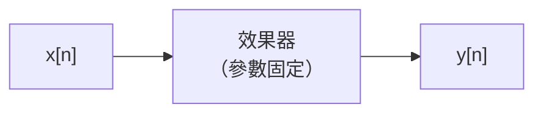
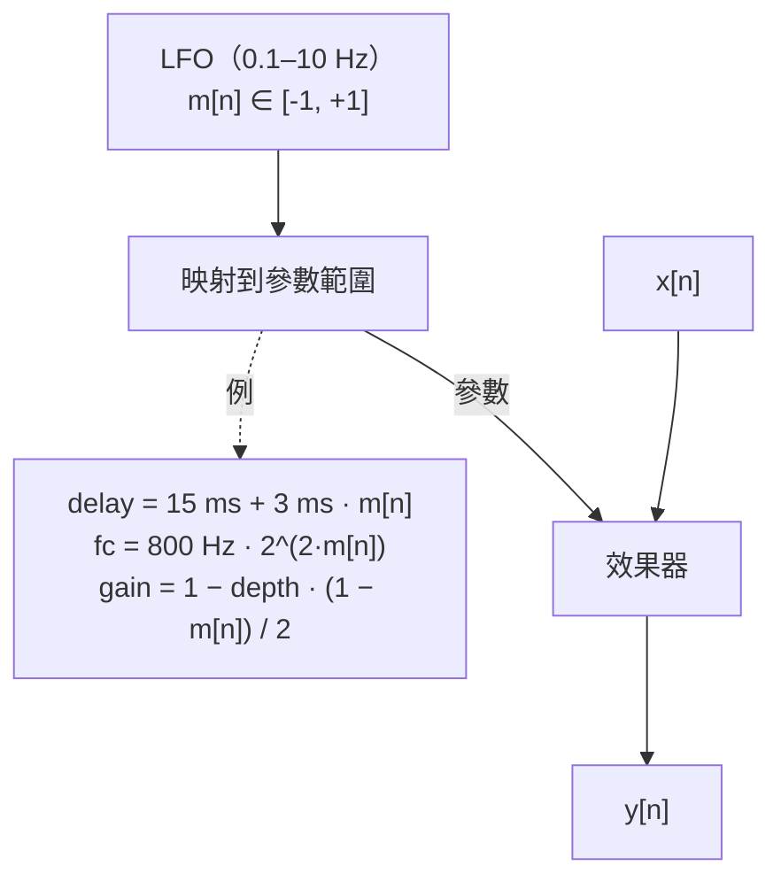
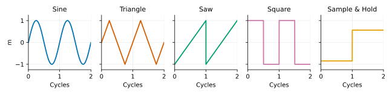
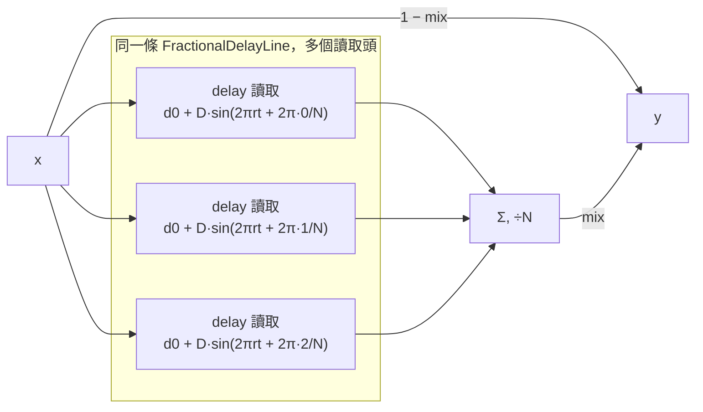
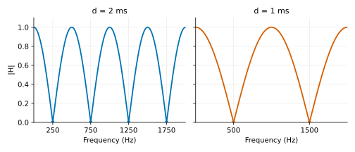
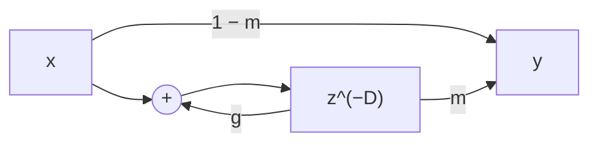
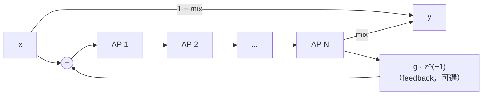

# 第 10 章：Modulation —— Chorus、Flanger、Phaser、Tremolo

[English](README.md) | **繁體中文**

> [教材首頁](../../README.zh-TW.md)　｜　上一章：[09 Delay](../09-delay/README.zh-TW.md)　｜　下一章：[11 Metering 與 FFT](../11-metering-fft/README.zh-TW.md)

前面九章的效果器有一個共同點：參數設好之後就不動了。EQ 的 cutoff 停在 2 kHz，compressor 的 threshold 停在 −18 dB，delay 停在 375 ms。本章要讓參數**自己動起來**——用一個很慢的振盪器（LFO）去推 delay 時間、推 allpass 的頻率、推 gain，就得到吉他手腳邊那一排最經典的踏板：chorus、flanger、phaser、tremolo。

這四個效果在程式上都很短，但每一個都藏著一個漂亮的訊號處理觀念：chorus 是 **Doppler 效應**，flanger 是**會走路的 comb filter**，phaser 是 **allpass 的相位魔術**，tremolo 是 **AM 調變**。本章把它們一個一個拆開，用數字驗證，最後你會有五個可以直接插進第 14 章 DAW 的 DSP 元件。

## 1. 本章目標

讀完本章並做完練習，你應該能夠：

- 用 phase accumulator 實作 LFO（sine / triangle / saw / square / sample & hold），說明 rate、phase、tempo sync 怎麼換算，以及**為什麼 LFO 不需要 band-limit、但 square / saw 的跳變一定要平滑**。
- 從 $`y(t) = x(t - d(t))`$ 推導「調變延遲 ⇒ 音高變化」：音高比例 $`= 1 - d'(t)`$，並算出 chorus / vibrato 的走音量（cents）。
- 說明 chorus 的結構（5–30 ms 延遲 + LFO + 原音）、多 voice 與 stereo spread 的作用，並量測左右相關係數。
- 推導 flanger 的頻率響應 $`H = (1-m) + m\,z^{-D}/(1 - g z^{-D})`$：notch 在 $`(2k+1)/(2d)`$、peak 在 $`k/d`$，feedback 正負號對峰谷的影響，並和第 09 章的 comb filter 連起來；知道 through-zero flanging 是什麼。
- 推導一階 allpass 的相位 $`\varphi(\omega) = -2\arctan\!\big(\tan(\omega/2)/\tan(\omega_c/2)\big)`$，證明 $`f_c`$ 處相位剛好 −90°，算出 N 級 phaser 的 notch 數（= N/2）與 notch 頻率，並解釋 **notch 為什麼不是等間距**。
- 區分 tremolo（AM，載波保留 + 兩個 sideband）、ring modulation（載波消失，只剩和差頻）、vibrato（調變延遲但不混原音）、autopan（左右反相的 tremolo）。
- 知道這類效果 aliasing 風險不大，但 **delay 插值品質**會直接影響高頻（並能算出 linear 插值在 $`f_s/4`$ 平均損失 1.76 dB）。

## 2. 原理

### 2.1 Modulation：用一個慢的訊號去控制參數

到目前為止，訊號流程長這樣：



Modulation 效果多了一條「控制訊號」：



LFO（Low-Frequency Oscillator，低頻振盪器）的輸出不是拿來聽的，它的頻率通常在 0.05–10 Hz，遠低於聽覺範圍（20 Hz）。它的任務是讓「參數」隨時間緩慢變化。被控制的參數決定了效果的種類：

| 被調變的參數 | 效果 | 本章的元件 |
|---|---|---|
| gain | tremolo / autopan | `Tremolo` |
| delay 時間（5–30 ms），混原音 | chorus | `Chorus` |
| delay 時間（0.5–10 ms），混原音 + feedback | flanger | `Flanger` |
| delay 時間，不混原音 | vibrato | 練習 3 |
| allpass 的轉折頻率，混原音 | phaser | `Phaser` |
| 乘上可聽頻率範圍的「LFO」（載波） | ring modulation | 練習 4 |

### 2.2 LFO

#### Phase accumulator

所有波形都從同一個東西出發：一個在 $`[0, 1)`$ 之間循環的**相位** $`p`$。每個 sample 前進 $`r / f_s`$（$`r`$ = rate，Hz）：

```math
p[n+1] = \mathrm{frac}\!\left(p[n] + \frac{r}{f_s}\right), \qquad \mathrm{frac}(x) = x - \lfloor x \rfloor
```

一個週期 = $`f_s / r`$ 個 sample。例如 $`r = 2`$ Hz、$`f_s = 48`$ kHz → 每個 sample 前進 $`4.17 \times 10^{-5}`$，24000 個 sample 繞一圈。

波形是相位的函式（輸出都在 $`[-1, +1]`$）：

| 波形 | $`m(p)`$ | 特性 |
|---|---|---|
| Sine | $`\sin(2\pi p)`$ | 最平滑，chorus / flanger / phaser 的預設 |
| Triangle | $`p<\tfrac14: 4p`$；$`p<\tfrac34: 2-4p`$；否則 $`4p-4`$ | 和 sine 同相；變化速度固定，flanger 的掃動聽起來比較「等速」 |
| Saw | $`2p - 1`$ | 一路上升、瞬間掉回來；適合「單向」的掃動 |
| Square | $`p < \tfrac12 ? +1 : -1`$ | 兩個值之間切換，tremolo 的「斷音」 |
| Sample & Hold | 每個週期開頭抽一個亂數，整個週期保持 | 隨機的階梯，「機器人 / 電腦」感 |



（`l10_lfo_shapes` 會用真正的數值印出更精確的 ASCII 圖。）

**為什麼要用相位、而不是直接算 $`\sin(2\pi r n / f_s)`$？** 因為 rate 會變。如果 $`r`$ 從 1 Hz 改成 1.1 Hz，$`\sin(2\pi \cdot 1.1 \cdot n / f_s)`$ 在 $`n`$ 很大時會瞬間跳到完全不同的相位（$`n`$ 乘上新的 rate），產生不連續；phase accumulator 只改「每步走多少」，相位本身永遠連續。

**相位為什麼用 `double`？** rate 很低時每步的增量很小：0.05 Hz 在 48 kHz 下是 $`1.04\times10^{-6}`$，而 float 在 0.5 附近的解析度約 $`6\times10^{-8}`$，每加一次就有最多 3% 的捨入誤差，LFO 的頻率會偏掉好幾 %。改用 double（解析度 $`10^{-16}`$）就沒有這個問題。

#### Phase：錯開多個 LFO

起始相位 $`p_0`$ 決定 LFO 從波形的哪裡開始。本章大量用到「同一個 rate、不同起始相位」：

- chorus 的 N 個 voice：相位 $`0, \tfrac1N, \tfrac2N, \ldots`$，讓每個分身在不同時間走音。
- stereo chorus：右聲道相位 $`+0.25`$（90°）。
- autopan：右聲道用 $`-m`$，等於相位 $`+0.5`$（180°）。
- 量測：把 rate 設 0、相位設 0.75（$`\sin(2\pi \cdot 0.75) = -1`$），LFO 就**停在**最低點，可以量固定狀態下的頻率響應。

#### Tempo sync

DAW 裡的 LFO 常常要跟著拍子走。一拍（四分音符）= $`60/\text{bpm}`$ 秒。如果一個 LFO 週期 = $`b`$ 拍（$`b = 1`$ 四分音符、0.5 八分、0.75 附點八分、$`1/3`$ 八分三連音的一個——三個八分三連音佔一拍；四分三連音則是 $`b = 2/3`$），則

```math
r = \frac{\text{bpm}}{60 \cdot b} \ \text{Hz}
```

| 音符長度 | $`b`$ | 90 bpm | 120 bpm | 140 bpm |
|---|---:|---:|---:|---:|
| 一小節（4/4） | 4 | 0.375 Hz | 0.500 Hz | 0.583 Hz |
| 四分音符 | 1 | 1.500 Hz | 2.000 Hz | 2.333 Hz |
| 附點八分 | 0.75 | 2.000 Hz | 2.667 Hz | 3.111 Hz |
| 八分音符 | 0.5 | 3.000 Hz | 4.000 Hz | 4.667 Hz |
| 八分三連音 | 1/3 | 4.500 Hz | 6.000 Hz | 7.000 Hz |
| 十六分音符 | 0.25 | 6.000 Hz | 8.000 Hz | 9.333 Hz |

rate 對了還不夠：從第 37 小節開始播放時，LFO 的峰值也要落在拍點上。做法是每個 block 開頭用 host 給的歌曲位置（ppq，以四分音符計的拍數）重新算相位：$`p = \mathrm{frac}(\text{ppq} / b + p_0)`$。練習 6 會實作它。

#### 為什麼 LFO 不用 band-limit，但 square 一定要平滑？

第 06、07 章花了很多力氣對付 aliasing：一個 440 Hz 的 square wave 有 1320、2200、3080 Hz……的諧波，振幅 $`\propto 1/k`$，一路延伸到 Nyquist 之上，折回來就變成刺耳的非諧波成分，所以合成器的振盪器要 band-limit。

LFO 不需要，原因有兩個：

1. **頻率太低。** 2 Hz 的 square，第 $`k`$ 次諧波在 $`2k`$ Hz，要到第 12000 次諧波才碰到 24 kHz，那時振幅只剩 $`4/(\pi \cdot 12000) \approx 10^{-4}`$（−80 dB）。折回來的量微不足道。
2. **LFO 本身不會被聽到。** 它是控制訊號，耳朵聽的是被控制之後的音訊。

但這不代表跳變沒問題。問題不在 LFO 的頻譜，而在**被它控制的東西**：square LFO 直接當 gain，gain 在一個 sample 內從 1 跳到 0，等於把音訊乘上一個階梯（step function）——第 01 章講過，這會在音訊上產生寬頻的 click。拿去控制 delay 時間也一樣：延遲瞬間跳 3 ms，讀取位置瞬間跳到 144 個 sample 之外，波形不連續。

解法是把 square / saw / S&H 的邊緣用一個很短的 one-pole lowpass 平滑：

```math
s[n] = s[n-1] + k\,(m[n] - s[n-1]), \qquad k = 1 - e^{-1/(\tau f_s)}
```

$`\tau = 1`$ ms 時，等效 cutoff $`\approx 1/(2\pi\tau) = 159`$ Hz：LFO 的形狀幾乎不變（2 Hz 的 square 仍然是方的），但跳變被拉成約 5 ms 的滑坡，click 消失。`Lfo` 預設對 Square / Saw / S&H 開啟 1 ms 平滑（`setSmoothingMs(0)` 可關掉做對照），Sine / Triangle 本身連續，不平滑以保持精確的波形。`l10_lfo_shapes` 的實測：

```
Square LFO as a gain (4 Hz) chopping a 441 Hz sine (amplitude 0.5):
  The sine's own largest single-step jump = 0.0289 (theory A*2*pi*f/fs = 0.0289)
  smoothing  0.0 ms: largest single-step jump = 0.5000 (17.3x the sine's)  -> l10_lfo_square_click.wav
  smoothing  1.0 ms: largest single-step jump = 0.0289 (1.0x the sine's)  -> l10_lfo_square_smooth.wav
  smoothing  5.0 ms: largest single-step jump = 0.0289 (1.0x the sine's)
```

不平滑時，gain 在正弦的波峰（0.5）瞬間切成 0，單步跳變 0.5，是正弦本身最陡處的 17 倍——這就是 click。平滑 1 ms 後，最大跳變回到正弦本身的 0.0289：gain 的變化已經比訊號本身的變化慢，不再產生額外的寬頻能量。

（範例刻意用 441 Hz 而不是 440 Hz：4 Hz 的 square 每 6000 個 sample 切換一次，而 440 Hz 在第 6000·k 個 sample 剛好是 55·k 個整週期、也就是過零點，切換時振幅本來就是 0，量不到 click。真實音樂不會這麼巧，這也提醒我們：用測試訊號做量測時，要小心訊號和參數之間「剛好對齊」的特例。）

### 2.3 調變延遲 = Doppler 效應

Chorus、flanger、vibrato 都是「延遲時間被 LFO 推著走」。延遲時間在變，會發生什麼事？

延遲線的輸出是 $`y(t) = x(t - d(t))`$。把 $`x`$ 換成一個正弦 $`x(t) = \sin(2\pi f t)`$：

```math
y(t) = \sin\!\big(2\pi f\,(t - d(t))\big)
```

瞬時頻率是相位對時間的微分除以 $`2\pi`$：

```math
f_{\text{inst}}(t) = \frac{1}{2\pi}\frac{d}{dt}\Big[2\pi f\,(t - d(t))\Big] = f\,\big(1 - d'(t)\big)
```

**延遲在變長時（$`d' > 0`$）音高變低，在變短時音高變高**——這就是救護車開近開遠的 Doppler 效應：讀取頭相對於寫入頭在「後退」或「前進」。

用 sine LFO：$`d(t) = d_0 + D\sin(2\pi r t)`$，$`d'(t) = 2\pi r D \cos(2\pi r t)`$，所以

```math
\frac{f_{\text{inst}}}{f} = 1 - 2\pi r D\cos(2\pi r t) \in \big[\,1 - 2\pi r D,\ 1 + 2\pi r D\,\big]
```

換成 cents（100 cents = 一個半音）：向上最多 $`1200 \log_2(1 + 2\pi r D)`$、向下最多 $`1200 \log_2(1 - 2\pi r D)`$。因為 log 曲線向下彎（concave），向下的絕對值略大；$`2\pi r D`$ 很小時兩者幾乎對稱。

| $`D`$（depth） | $`r`$（rate） | $`2\pi r D`$ | 最大偏移（向上 / 向下） |
|---|---|---|---|
| 3 ms | 0.8 Hz | 0.0151 | +25.9 / −26.3 cents（chorus 預設） |
| 1 ms | 5 Hz | 0.0314 | +53.6 / −55.3 cents（明顯的 vibrato） |
| 0.6 ms | 5.5 Hz | 0.0207 | +35.5 / −36.3 cents（練習 3 的聲音） |
| 5 ms | 2 Hz | 0.0628 | +105 / −112 cents（超過一個半音，已經「醉了」） |

注意走音量只和 **$`r \times D`$** 有關：depth 加倍、rate 減半，走音量一樣，只是走得慢。`l10_chorus` 用零交叉量測驗證：

```
Doppler pitch drift (1 kHz sine, 1 voice, mix 1, rate 0.8 Hz, depth 3 ms):
  Theory: ratio 1 +/- 2*pi*r*D = 1 +/- 0.0151 -> 984.9 .. 1015.1 Hz (+25.9 / -26.3 cents)
  Measured: instantaneous frequency 984.9 .. 1015.1 Hz
```

**Vibrato** 就是這個「只有走音」的效果：輸出**全部**是延遲後的訊號、不混原音。沒有原音就沒有兩條路徑互相干涉，振幅不變，只剩音高在晃（練習 3）。

### 2.4 Chorus

#### 直覺

合唱團聽起來比獨唱「厚」，因為每個人的音高、時間點都差一點點，而且這個「差」一直在變。Chorus 用電子的方式模仿：把訊號複製幾份，每份延遲 5–30 ms（短到耳朵不會聽成 echo，第 09 章說過約 35 ms 以下會融合成一個聲音（2.1 節的表）），延遲時間各自被 LFO 慢慢推動 → 每份都有輕微、緩慢變化的走音（2.3 節）→ 和原音混在一起，就像幾個「稍微走音的分身」一起演奏。



```math
y[n] = (1-\text{mix})\,x[n] + \frac{\text{mix}}{N}\sum_{v=0}^{N-1} x\!\left[n - d_v[n]\right], \qquad d_v[n] = d_0 + D\sin\!\left(2\pi\Big(p[n] + \tfrac{v}{N}\Big)\right)
```

#### 多 voice 與 stereo spread

- **voice 數 N**：每個 voice 的 LFO 起始相位錯開 $`1/N`$ 週期，在任一時刻有的 voice 偏高、有的偏低，合起來比單一 voice 更像「一群人」，也比較不會聽到整體一起上下晃的「暈船感」。濕訊號除以 N，避免 voice 越多越大聲。
- **stereo spread**：右聲道的每個 voice 再多加 $`0.25 \times \text{spread}`$ 週期的相位。左右的延遲因此不同步，兩耳聽到的濕訊號不一樣 → 聲像變寬。用 Pearson 相關係數 $`\rho = \sum LR / \sqrt{\sum L^2 \sum R^2}`$ 量化：1 = 左右相同（在中間），0 = 完全不相關（很寬）。

實測（`l10_chorus`，2 voice、mix 0.5）：

```
   spread   L/R LFO offset   white noise   plucked arpeggio
    0.00        0.0°          1.000         1.000
    0.10        9.0°          0.711         0.766
    0.25       22.5°          0.713         0.730
    1.00       90.0°          0.711         0.733
```

這個結果值得想一下：**寬頻素材只要左右延遲差一點點，濕訊號就幾乎完全不相關**（白雜訊延遲差一個 sample 就不相關了）。相關係數停在 0.7 而不是 0，是因為一半的輸出是左右相同的原音。設原音功率 $`\sigma^2`$，2 個 voice 的濕訊號 $`w = (x_1 + x_2)/2`$ 功率 $`\sigma^2/2`$：$`L = 0.5x + 0.5w_L`$ 的功率是 $`0.25\sigma^2 + 0.125\sigma^2 = 0.375\sigma^2`$，若左右濕訊號完全不相關，$`E[LR] = 0.25\sigma^2`$，所以 $`\rho = 0.25/0.375 = 2/3 \approx 0.667`$。實測略高（0.711），原因是插值：讀取位置的小數部分一直在變，cubic（Catmull-Rom）插值器等於一個時變的 lowpass，對白雜訊平均只留下 $`\alpha \approx 0.814`$ 倍的功率（約 −0.9 dB；linear 插值更糟，平均 $`2/3`$ 倍、−1.76 dB，見 2.8 節）。濕訊號功率因此是 $`\alpha\sigma^2/2`$ 而不是 $`\sigma^2/2`$，代回去得 $`\rho = 0.25/(0.25 + 0.125\alpha) \approx 0.71`$，和實測吻合（改成 linear 插值則預測 0.750）。所以 spread 對「寬不寬」幾乎是開關，它真正改變的是左右走音錯開的動態感。練習 5 會再用功率推導 mono 相加的損失。

#### 聽感與典型參數

| 參數 | 典型範圍 | 聽感 |
|---|---|---|
| centre delay | 10–25 ms | 越長越「分得開」、越像 doubling；太長（> 35 ms）開始分得出兩個聲音，往 slapback 靠近 |
| depth | 1–5 ms | 走音量（和 rate 一起決定，見 2.3） |
| rate | 0.1–2 Hz | 太快會變成 vibrato 般的「晃」 |
| voices | 1–4 | 越多越厚、越像合奏 |
| mix | 0.3–0.5 | 0.5 時效果最濃；1.0 就變 vibrato |

### 2.5 Flanger

#### 和第 09 章 comb filter 的關係

把 chorus 的延遲縮短到 0.5–10 ms，事情就變了：這麼短的延遲和原音相加，耳朵不再聽到「兩個聲音」，而是聽到一個被**染色**的聲音——第 09 章 2.13 節的 feedforward comb filter（範例 `l09_comb_filter` 掃描過它的峰谷）。差別只在本章用 mix 加權 $`(1-m)`$、$`m`$，而第 09 章寫成 $`x[n] + g\,x[n-D]`$。

```math
y[n] = (1-m)\,x[n] + m\,x[n-D] \quad\Longrightarrow\quad H(e^{j\omega}) = (1-m) + m\,e^{-j\omega D}
```

$`m = 0.5`$ 時：

```math
H = \tfrac12\left(1 + e^{-j\omega D}\right) = e^{-j\omega D/2}\cos\!\left(\tfrac{\omega D}{2}\right) \;\Rightarrow\; |H(f)| = |\cos(\pi f d)|
```

（$`d = D/f_s`$ 是以秒計的延遲。）

- **notch**（完全抵消）：$`\pi f d = (2k+1)\pi/2 \Rightarrow f_k = \dfrac{2k+1}{2d}`$，延遲剛好是半個週期的奇數倍，兩條路徑反相。
- **peak**（0 dB）：$`f_k = k/d`$，延遲剛好是整數個週期，兩條路徑同相。

$`d = 2`$ ms 時 notch 在 250、750、1250 Hz……，間距 $`1/d = 500`$ Hz，**等間距**，在頻譜上像一把梳子（comb）。Flanger 就是讓 LFO 推動 $`d`$：整把梳子一起左右滑動，就是噴射機飛過的「咻——」。



*左：d = 2 ms，notch 在 250、750、1250、1750 Hz。右：d = 1 ms（LFO 把延遲縮短），梳齒間距變寬、往高頻移，notch 在 500、1500 Hz。*

`l10_flanger` 把 LFO 停在固定延遲、掃描頻率找 notch：

```
Notches found sweeping 100-4000 Hz (every 25 Hz), vs f_k = (2k+1)/(2d), d = 2 ms:
   k   measured notch(Hz)   gain(dB)   theory(Hz)
   0              250        -100.0        250
   1              750        -100.0        750
   2             1250        -100.0       1250
   ...
   7             3750        -100.0       3750
```

（−100 dB 是 `gainToDb` 的下限，代表真的抵消到 0。）

#### Feedback

把延遲輸出的一部分送回延遲線的輸入（第 09 章的 feedback comb）：



延遲線裡的訊號 $`w[n] = x[n] + g\,w[n-D]`$，輸出 $`y = (1-m)x + m\,w[n-D]`$：

```math
H(z) = (1-m) + m\,\frac{z^{-D}}{1 - g\,z^{-D}}
```

在 peak 頻率（$`z^{-D} = 1`$）與 notch 頻率（$`z^{-D} = -1`$）：

```math
H_{\text{peak}} = (1-m) + \frac{m}{1-g}, \qquad H_{\text{notch}} = (1-m) - \frac{m}{1+g}
```

| feedback $`g`$ | peak（$`f = k/d`$） | 原 notch 位置（$`f = (2k+1)/2d`$） | 聽感 |
|---|---|---|---|
| 0 | 1.0（0 dB） | 0（−∞ dB） | 乾淨的掃動 |
| +0.5 | 1.5（**+3.5 dB**） | 0.167（**−15.6 dB**） | peak 變尖，金屬共鳴 |
| −0.7 | 0.794（**−2.0 dB**） | −1.167（**+1.3 dB**） | 峰谷對調，「空心」、偏中空的聲音 |

正 feedback 讓 $`k/d`$ 的整數倍頻率共振（像一根長度 $`d`$ 的管子），聲音越來越「有音高」；負 feedback 讓共振移到奇數倍 $`(2k+1)/(2d)`$——就像一端封閉的管子只有奇次諧波。$`|g| < 1`$ 才穩定（迴路每繞一圈乘 $`g`$），所以 `setFeedback` 限制在 ±0.99。範例的實測和理論完全吻合：

```
d = 1 ms, mix 0.5: gain at each frequency (measured / theory, dB)
   freq(Hz)  type        fb +0.0            fb +0.5            fb -0.7
       500   notch    -100.0 /  -100.0    -15.6 /   -15.6     +1.3 /    +1.3
      1000   peak       +0.0 /    +0.0     +3.5 /    +3.5     -2.0 /    -2.0
```

#### 掃動範圍

本章的 `Flanger` 讓延遲在 $`[d_{\min}, d_{\min} + \text{depth}]`$ 之間掃：

```math
d(t) = \text{delayMs} + \text{depthMs}\cdot\frac{1 + m(t)}{2}
```

預設 1–3 ms：第一個 notch 從 $`1/(2 \cdot 0.001) = 500`$ Hz 掃到 $`1/(2 \cdot 0.003) = 167`$ Hz，整把梳子跟著走。注意 notch 頻率和 $`d`$ 成**反比**，延遲從 1 ms 到 3 ms 是 3 倍，notch 也移動 3 倍（約 1.6 個八度）。

Flanger 的 LFO 也會造成走音（2.3 節），但 rate 通常很低（0.05–0.5 Hz），depth 也只有幾 ms，$`2\pi r D`$ 很小，耳朵聽到的主要是梳子在滑，而不是音高在晃。這正是 **chorus 和 flanger 的本質差異**：同樣是「調變延遲 + 原音」，延遲長（> 10 ms）時梳齒密到聽不出來，主要感受是走音的分身；延遲短（< 10 ms）時梳齒稀疏、落在聽得到的頻段，主要感受是音色被掃動的濾波器染色。

#### Through-zero flanging

1960 年代的 flanging 是用兩台磁帶機同時播放同一段音樂，工程師用手指壓住其中一台的磁帶盤邊緣（flange，這就是名字的由來）讓它慢下來。兩台機器的延遲差可以從正、經過 0、變成負——**穿過零點**的瞬間兩者完全相同（若一路反相則完全抵消），這是數位 flanger（延遲永遠 > 0）做不出來的。

數位模擬法：把乾訊號也延遲一個固定量 $`d_0`$，濕訊號的延遲在 $`d_0`$ 兩側掃：

```math
y = \tfrac12\big(x[n - d_0] - x[n - d(t)]\big), \qquad d(t) = d_0 + \Delta\sin(\cdot)
```

延遲差 $`\delta = d(t) - d_0`$ 經過 0 的瞬間，$`|H| = |\sin(\pi f \delta)| \to 0`$，**所有頻率同時消失**，聲音像被吸走再吐回來。`l10_flanger` 用 500 Hz 正弦實測：through-zero 時最安靜的 block（512 sample）相對乾訊號只剩 −34.4 dB（不是 −∞，因為一個 block 裡延遲差只有一瞬間剛好是 0）。代價是整個效果多了 $`d_0`$ 的 latency。

#### 典型參數

| 參數 | 典型範圍 | 聽感 |
|---|---|---|
| delay | 0.5–3 ms | 掃動範圍的下限（最高的 notch 位置） |
| depth | 1–5 ms | 掃多寬 |
| rate | 0.05–0.5 Hz | 慢 = 噴射機；快（> 2 Hz）= 顫動 |
| feedback | ±0.3–0.9 | 越大越金屬、越有音高 |
| mix | 0.5 | 0.5 時 notch 最深（兩條路徑等量才能完全抵消） |

### 2.6 Phaser

#### 直覺：只轉相位、不動振幅

Flanger 用「延遲」讓兩條路徑的相位差隨頻率線性增加（$`\Delta\varphi = 2\pi f d`$），結果是等間距的 notch。Phaser 換一個工具：**allpass filter**——它讓所有頻率的振幅都不變（$`|H| = 1`$），只改變相位，而且相位偏移隨頻率**非線性**地從 0° 變到 −180°。串 N 級、再和原音相加，相位剛好差 180° 的頻率就抵消成 notch。



#### 一階 allpass：推導相位與 90° 頻率

從類比原型開始。一階 allpass：

```math
H_a(s) = \frac{\omega_a - s}{\omega_a + s}
```

在 $`s = j\Omega`$ 上，分子 $`\omega_a - j\Omega`$ 和分母 $`\omega_a + j\Omega`$ 互為共軛，長度相同，所以 $`|H_a| = 1`$。相位 = 分子角度 − 分母角度：

```math
\angle H_a(j\Omega) = -\arctan\frac{\Omega}{\omega_a} - \arctan\frac{\Omega}{\omega_a} = -2\arctan\frac{\Omega}{\omega_a}
```

DC（$`\Omega = 0`$）時 0°；$`\Omega = \omega_a`$ 時 $`-2 \cdot 45° = -90°`$；$`\Omega \to \infty`$ 時 −180°。

用 bilinear transform 轉成數位（第 02 章）：$`s = \dfrac{1 - z^{-1}}{1 + z^{-1}}`$，對應的頻率關係是 $`\Omega = \tan(\omega/2)`$（$`\omega = 2\pi f / f_s`$）。令 $`t = \tan(\omega_c/2) = \tan(\pi f_c / f_s)`$ 代替 $`\omega_a`$：

```math
H(z) = \frac{t - \frac{1 - z^{-1}}{1 + z^{-1}}}{t + \frac{1 - z^{-1}}{1 + z^{-1}}} = \frac{t(1+z^{-1}) - (1-z^{-1})}{t(1+z^{-1}) + (1-z^{-1})} = \frac{(t-1) + (t+1)z^{-1}}{(t+1) + (t-1)z^{-1}}
```

上下同除 $`(t+1)`$，令 $`a = \dfrac{t - 1}{t + 1}`$：

```math
\boxed{H(z) = \frac{a + z^{-1}}{1 + a\,z^{-1}}, \qquad a = \frac{\tan(\pi f_c/f_s) - 1}{\tan(\pi f_c/f_s) + 1}}
```

相位直接從類比版代入 $`\Omega = \tan(\omega/2)`$、$`\omega_a = \tan(\omega_c/2)`$：

```math
\boxed{\varphi(\omega) = -2\arctan\!\left(\frac{\tan(\omega/2)}{\tan(\omega_c/2)}\right)}
```

$`\omega = \omega_c`$ 時 $`\varphi = -2 \cdot \pi/4 = -\pi/2`$，也就是 **$`f_c`$ 處剛好 −90°**；DC 是 0°，Nyquist 是 −180°。這個 $`f_c`$ 就是 phaser 的「中心頻率」參數。

`l10_phaser` 用第 02 章 `BiquadCoefficients::response()` 取 `std::arg`（直接把 $`z = e^{j\omega}`$ 代進 $`H(z)`$）驗證公式（$`f_c = 1`$ kHz，$`a = -0.87698`$）：

```
   freq(Hz)   |H|(dB)   phase Biquad::response   phase formula
        100    -0.00       -11.41°              -11.41°
       1000    -0.00       -90.00°              -90.00°
       2000    +0.00      -127.07°             -127.07°
      20000    -0.00      -177.99°             -177.99°
```

#### N 級串接 → notch 數 = N/2

N 級都設在同一個 $`f_c`$，總相位是 $`N\varphi(\omega)`$，總振幅仍然是 1。和原音各一半相加：

```math
H_{\text{total}} = \tfrac12\left(1 + e^{jN\varphi}\right) \;\Rightarrow\; |H_{\text{total}}| = \left|\cos\frac{N\varphi}{2}\right|
```

notch 出現在 $`N\varphi = -(2k+1)\pi`$（反相）。因為 $`\varphi`$ 從 0 單調降到 $`-\pi`$，$`N\varphi`$ 掃過 $`(-N\pi, 0)`$，其中包含的奇數倍 $`\pi`$ 有 $`\pi, 3\pi, \ldots, (N-1)\pi`$，共 **$`N/2`$ 個**（N 為偶數）。所以：

| stages | 總相位範圍 | notch 數 |
|---|---|---|
| 2 | 0 ~ −360° | 1 |
| 4 | 0 ~ −720° | 2 |
| 6 | 0 ~ −1080° | 3 |
| 8 | 0 ~ −1440° | 4 |

（這也是為什麼 `setStages` 只收偶數：奇數級時 Nyquist 處的總相位 $`-N\pi`$ 是 $`\pi`$ 的奇數倍，最後一個「notch」卡在 Nyquist，變成高頻一路往下掉的 lowpass 斜坡，等於浪費了一級。）

**notch 的位置**：解 $`N \cdot \big(-2\arctan(\tan(\omega/2)/t)\big) = -(2k+1)\pi`$：

```math
\boxed{\tan\frac{\omega_k}{2} = \tan\frac{\omega_c}{2}\cdot\tan\frac{(2k+1)\pi}{2N}, \qquad k = 0, 1, \ldots, \tfrac{N}{2} - 1}
```

`l10_phaser` 掃描頻率找 notch 並對照公式（centre 1 kHz、mix 0.5、feedback 0）：

```
4 stages:   414.7 / 2397.8 Hz                        (theory 414.7 / 2397.8)
6 stages:   268.3 / 1000.0 / 3665.4 Hz               (theory the same)
8 stages:   199.2 /  668.7 / 1493.9 / 4863.3 Hz      (theory 199.2 / 668.7 / 1494.0 / 4863.3)
```

6 stages 的中間那個 notch 剛好在 $`f_c`$：$`6 \times (-90°) = -540° \equiv -180°`$。

#### 為什麼 phaser 的 notch 不是等間距？

flanger 的相位差 $`2\pi f d`$ 對頻率是**線性**的，每多 $`1/d`$ Hz 就多轉一圈，notch 等間距。phaser 的相位 $`\varphi(\omega)`$ 是 arctan 形狀：**以對數頻率（八度）來看**，相位在 $`f_c`$ 附近轉得最快，離 $`f_c`$ 越多個八度轉得越慢（注意是「每八度」：在線性 Hz 軸上，每 Hz 的相位變化反而在 DC 附近最大，到 $`f_c`$ 只剩一半）。所以 notch 在對數軸上以 $`f_c`$ 為中心對稱，在線性 Hz 軸上則是低頻密、高頻疏。從上面的公式看，notch 由 $`\tan\frac{(2k+1)\pi}{2N}`$ 決定，在低頻（$`\tan(\omega/2) \approx \omega/2`$）時

```math
f_k \approx f_c \cdot \tan\frac{(2k+1)\pi}{2N}
```

而 $`\tan\theta \cdot \tan(\pi/2 - \theta) = 1`$，所以成對的 notch 滿足 $`f_k \cdot f_{N/2-1-k} \approx f_c^2`$——**以 $`f_c`$ 為中心幾何對稱**，既不等差、也不等比（8 stages 相鄰比值是 3.36、2.23、3.26）。例：4 stages 的 $`f_0 f_1 = 414.7042 \times 2397.7862 = 994372 \approx 10^6 = f_c^2`$（差 0.56%，來自 bilinear 的頻率扭曲）。改用不做近似的精確式就完全相等，`l10_phaser` 印出：

```
     Example: for 4 stages, f0 · f1 = 414.7042 x 2397.7862 = 994372 ≈ fc² = 1000000 (off by 0.56%, from the bilinear frequency warping)
     Exact form: tan(πf0/fs) · tan(πf1/fs) = 0.0042959455, tan²(πfc/fs) = 0.0042959455
```

聽感上這是 phaser 和 flanger 最大的差別：flanger 的梳齒很多、等間距，像一個有音高的共鳴（金屬、噴射機）；phaser 只有少數幾個寬 notch、分布不規則，不會產生諧波般的共鳴，聽起來比較「柔」、比較「水」。

#### 指數刻度的 LFO

耳朵聽頻率是對數的：200 → 400 Hz 和 2000 → 4000 Hz 聽起來移動一樣多（都是一個八度）。如果 LFO 線性地推 $`f_c`$（例如 200–3200 Hz），大部分時間都花在高頻，低頻一閃而過。所以 phaser 用**指數刻度**：

```math
f_c(t) = f_{\text{centre}} \cdot 2^{\,\text{depth}\cdot\text{octaves}\cdot m(t)}
```

預設 octaves = 2、depth = 1：$`f_c`$ 在 $`f_{\text{centre}}/4`$ 到 $`4 f_{\text{centre}}`$ 之間掃，以八度來看是等速的。

#### Feedback

和 flanger 一樣，把 allpass 鏈的輸出送回輸入讓 notch 之間的頻率共振。實作上有一點不同：allpass 鏈的輸出和「當下」的輸入有關（$`H(z)`$ 有 $`z^0`$ 項），如果不經過延遲直接回授，會變成 $`w = x + g \cdot A(w)`$ 的隱式方程。最簡單的作法是在回授路徑上放一個 sample 的延遲：

```math
W = X + g\,z^{-1}\,Y,\quad Y = A\,W \;\Rightarrow\; H = (1-\text{mix}) + \text{mix}\cdot\frac{A}{1 - g\,A\,z^{-1}}
```

$`A = 1`$ 的頻率（4 stages 時就是 $`f_c`$）被放大、notch 變淺。`l10_phaser` 的量測和含 $`z^{-1}`$ 的理論一致：

```
Effect of feedback on 4 stages (centre 1 kHz, mix 0.5) (measured / theory, dB):
   freq(Hz)       fb 0.0            fb 0.5            fb 0.8
        415    -59.9 /  -59.9    -15.6 /  -15.6    -13.1 /  -13.1
       1000     -0.0 /   -0.0     +3.4 /   +3.4     +8.3 /   +8.3
```

#### 二階 allpass（延伸）

第 02 章的 `BiquadCoefficients::makeAllpass(sr, f0, Q)` 是二階 allpass：相位從 0 到 −360°，在 $`f_0`$ 處 −180°。一級二階 allpass 和原音相加，就在 $`f_0`$ 得到一個 notch，而 Q 決定相位在 $`f_0`$ 附近轉得多快——也就是 notch 的寬度。用二階 section 做 phaser 可以獨立控制每個 notch 的位置與寬度（很多類比 phaser 的電路就是一階的，所以本章的 `Phaser` 用一階、把第 02 章 `Biquad` 當容器：$`b_0 = a, b_1 = 1, a_1 = a, b_2 = a_2 = 0`$）。

#### 典型參數

| 參數 | 典型範圍 | 聽感 |
|---|---|---|
| stages | 4–8 | 越多 notch 越多、效果越濃 |
| centre | 300–2000 Hz | 掃動的中心 |
| depth | 0.5–1（× ±2 八度） | 掃多寬 |
| rate | 0.1–2 Hz | 慢 = 迷幻；快 = 旋轉喇叭般的晃動 |
| feedback | 0–0.7 | 越大越「哇哇」、越有共鳴 |

### 2.7 Tremolo、autopan、ring modulation

#### Tremolo = AM

Tremolo 直接調變振幅：

```math
y(t) = x(t)\cdot g(t), \qquad g(t) = 1 - \text{depth}\cdot\frac{1 - m(t)}{2}
```

$`m = +1`$ 時 $`g = 1`$，$`m = -1`$ 時 $`g = 1 - \text{depth}`$。用 sine LFO，$`g(t) = (1 - \tfrac{D}{2}) + \tfrac{D}{2}\sin(2\pi r t)`$。輸入一個正弦 $`A\sin(2\pi f t)`$，用積化和差 $`\sin a \sin b = \tfrac12[\cos(a-b) - \cos(a+b)]`$：

```math
y(t) = A\left(1 - \tfrac{D}{2}\right)\sin(2\pi f t) + \frac{AD}{4}\Big[\cos\big(2\pi(f-r)t\big) - \cos\big(2\pi(f+r)t\big)\Big]
```

頻譜是**原本的頻率（振幅 × $`(1 - D/2)`$）加上兩個 sideband $`f \pm r`$（振幅各 × $`D/4`$）**——這就是 AM 廣播的頻譜。`l10_tremolo` 的 Goertzel 量測（1 kHz、$`A = 0.5`$、10 Hz、depth 1）：

```
   freq(Hz)   measured   theory
       1000     0.2500     0.2500   (carrier x(1 − depth/2))
        990     0.1250     0.1250   (sideband x depth/4)
       1010     0.1250     0.1250   (sideband x depth/4)
```

rate 在 2–10 Hz 時，sideband 離載波太近，耳朵分不開，聽到的是「音量在晃」；rate 超過約 20 Hz，sideband 分得夠開，就開始聽成新的音色（粗糙、然後是額外的音高）。

#### Autopan

左聲道用 $`m`$，右聲道用 $`-m`$：

```math
g_L = 1 - D\frac{1 - m}{2}, \qquad g_R = 1 - D\frac{1 + m}{2}, \qquad g_L + g_R = 2 - D
```

左大聲時右小聲，聲像左右來回，而且振幅和是常數（第 01 章的 linear pan law）。範例實測每個 block 的 $`|g_L + g_R - (2 - D)|`$ 最大 $`5.96 \times 10^{-8}`$（float 捨入）。若要 constant power，可以改成 $`g_L = \cos\theta`$、$`g_R = \sin\theta`$（第 01 章 `Panner`）。

#### Ring modulation

把 tremolo 的 DC 偏移拿掉，直接乘上一個在 −1..+1 之間的載波：

```math
y(t) = x(t)\cdot\sin(2\pi f_c t) \quad\Rightarrow\quad A\sin(2\pi f t)\sin(2\pi f_c t) = \frac{A}{2}\Big[\cos\big(2\pi(f - f_c)t\big) - \cos\big(2\pi(f + f_c)t\big)\Big]
```

原本的頻率 $`f`$ **消失**了，只剩和頻 $`f + f_c`$ 與差頻 $`f - f_c`$（振幅各 $`A/2`$）。載波進入可聽頻率範圍（例如 500 Hz）時，和差頻與原音不成整數倍關係，就是金屬、鐘聲、Dalek 機器人那種不和諧的聲音。練習 4 會實作並用 Goertzel 驗證。

### 2.8 Aliasing 與插值品質

Modulation 效果的 aliasing 風險**不大**：

- Tremolo 是乘上一個很慢的 gain，只產生 $`f \pm r`$ 的 sideband，$`r`$ 只有幾 Hz，不會跑到 Nyquist 之外（除非你用不平滑的 square，那是 click 問題，見 2.2）。
- 調變延遲其實是相位調變（PM，phase modulation）：延遲 $`d(t)`$ 直接改的是相位 $`2\pi f\,d(t)`$。對 sine LFO 而言，它等同於頻偏 $`f \cdot 2\pi r D`$ 的頻率調變（FM，frequency modulation），sideband 間距 = $`r`$。12 kHz 的成分在 chorus 預設下頻偏約 ±180 Hz，離 24 kHz 還很遠。
- Phaser 和 flanger 是（時變的）線性濾波器，不產生新頻率。

真正影響音質的是**分數延遲的插值**（第 09 章）。延遲時間一直在變，讀取位置的小數部分 $`\Delta`$ 不斷掃過 0..1。linear 插值 $`y = (1-\Delta)x_0 + \Delta x_1`$ 是一個二點 FIR，

```math
|H(\omega)|^2 = (1-\Delta)^2 + \Delta^2 + 2\Delta(1-\Delta)\cos\omega
```

在 $`f_s/4`$（$`\omega = \pi/2`$，48 kHz 下是 12 kHz）cos 項為 0；$`\Delta`$ 均勻掃過 0..1 時平均功率

```math
\int_0^1\big[(1-\Delta)^2 + \Delta^2\big]\,d\Delta = \tfrac13 + \tfrac13 = \tfrac23 \;\Rightarrow\; 10\log_{10}\tfrac23 = -1.76\ \text{dB}
```

而且這個損失是**隨 LFO 起伏**的（$`\Delta = 0`$ 時無損、$`\Delta = 0.5`$ 時最暗），等於高頻在被額外調變。`l10_chorus` 的實測：linear −1.73 dB，cubic（Catmull-Rom）−0.52 dB。所以本章的 `Chorus` / `Flanger` 預設用 `readCubic`。

## 3. 從公式到程式碼

本章新增五個 header（`dsp/include/dawlab/dsp/`），依賴第 09 章的 `FractionalDelayLine` 與第 02 章的 `Biquad`。所有效果器都遵守標準介面：`prepare()` 是唯一 allocate 的地方，參數 setter 只設目標值，由內部 one-pole smoother（τ = 20 ms）在 audio thread 上平滑。

### 3.1 `Lfo.h`

```cpp
enum class LfoShape { Sine, Triangle, Saw, Square, SampleAndHold };

class Lfo {
public:
    void prepare(double sampleRate);
    void reset() noexcept;                       // 回到 setPhase 設定的起始相位，S&H 亂數序列也從種子重來
    void setShape(LfoShape) noexcept;
    void setRateHz(float hz) noexcept;           // 0 Hz 合法：LFO 停住
    void setPhase(float phase01) noexcept;       // 設定目前相位，同時記成 reset 的起始相位
    void setSmoothingMs(float ms) noexcept;      // Square / Saw / S&H 的邊緣平滑（預設 1 ms）
    void setSeed(uint32_t seed) noexcept;        // S&H 亂數種子（下一次 reset / prepare 生效）
    float getNextValue() noexcept;               // 回傳 -1..1，相位前進一個 sample
    static float shapeValue(LfoShape, float phase01) noexcept;   // 無狀態波形函式
    static float tempoToRateHz(double bpm, double beats) noexcept;
};
```

重點：

- `getNextValue()` 先用「目前」相位算值、再前進——所以 `setPhase(0.25)` 之後的第一個值就是 $`\sin(\pi/2) = 1`$。
- 相位累加器是 `double`（2.2 節）。
- `shapeValue()` 是 static 純函式。`Chorus` 用它從同一個相位推出「右聲道再加 0.25 週期」的值，不必維護第二組 LFO。
- 檔案裡還有一個 `detail::ModParamSmoother`（one-pole 參數平滑：$`y \mathrel{+}= k(\text{target} - y)`$，收斂到 $`10^{-6}`$ 內直接貼齊目標），本章五個元件共用。

### 3.2 `Chorus.h`

```cpp
class Chorus {
public:
    static constexpr int kMaxVoices = 4;
    void prepare(double sampleRate, int maxBlockSize, int numChannels);
    void reset() noexcept;
    void setRateHz(float);           // 0..20
    void setDepthMs(float);          // 0..30，延遲偏離 centre 的最大量（±）
    void setCentreDelayMs(float);    // 1..50
    void setVoices(int);             // 1..4；值沒變時什麼都不做（見第 4 節）
    void setMix(float);              // 0..1
    void setStereoSpread(float);     // 0..1 → 右聲道 LFO 相位 +0..0.25 週期
    void setUseCubicInterpolation(bool);
    float processSample(int channel, float x) noexcept;
    void process(AudioBlock) noexcept;
};
```

`process()` 的每個時間點先做一次 `advanceModulation()`（平滑參數、記下每個 voice 的相位、讓 LFO 前進），再對每個 channel 呼叫 `renderSample()`：

```cpp
delay_.push(ch, x);                                       // 先寫入：read(d) = d 個 sample 前
const float phaseOffset = 0.25f * spread_ * ch;            // 右聲道多 0.25·spread 週期
for (int v = 0; v < voices_; ++v) {
    const float m = Lfo::shapeValue(LfoShape::Sine, voicePhase_[v] + phaseOffset);
    const float delayMs = centreMs_ + depthMs_ * m;        // d_v = d0 + D·sin(…)
    wet += delay_.readCubic(ch, clamp(delayMs · fs/1000, 2, maxRead));
}
wet /= voices_;                                            // ÷N：voice 數不影響音量
return (1 - mix_) * x + mix_ * wet;
```

最長延遲在 `prepare()` 固定為 50 + 30 ms（再多 8 個 sample 給插值），所以之後改參數絕不 allocate。預設：rate 0.8 Hz、depth 3 ms、centre 15 ms、2 voices、mix 0.5、spread 1。

### 3.3 `Flanger.h`

```cpp
class Flanger {
public:
    void prepare(double sampleRate, int maxBlockSize, int numChannels);
    void reset() noexcept;
    void setRateHz(float);        // 0..20
    void setDepthMs(float);       // 0..20
    void setDelayMs(float);       // 0.1..20：掃動範圍的下限
    void setFeedback(float);      // -0.99..0.99
    void setMix(float);           // 0..1
    void setLfoShape(LfoShape);
    void setLfoPhase(float);      // 量測用：rate 0 + phase 0.75 → 停在 delayMs
    float getCurrentDelayMs() const noexcept;
    static double notchFrequencyHz(int k, double delayMs) noexcept;   // (2k+1)/(2d)
    static double peakFrequencyHz(int k, double delayMs) noexcept;    // k/d
    float processSample(int channel, float x) noexcept;
    void process(AudioBlock) noexcept;
};
```

有 feedback 時順序很重要：要先**讀**出延遲的值、算出 $`w = x + g\cdot\text{delayed}`$，再把 $`w`$ **寫**進去。讀取發生在 push 之前，而 `FractionalDelayLine` 的慣例是「push 之後 read(0) = 剛寫入的值」，所以 push 之前要讀 $`d - 1`$ 才是真正的 $`d`$ 個 sample 前：

```cpp
const float delayed = delay_.readCubic(ch, std::max(1.0f, currentDelaySamples_ - 1.0f));
float w = x + feedback_ * delayed;           // w[n] = x[n] + g·w[n−D]
if (std::abs(w) < 1e-20f) w = 0.0f;          // 迴路裡的極小值 flush 成 0（denormal）
delay_.push(ch, w);
return (1.0f - mix_) * x + mix_ * delayed;   // H = (1−m) + m·z^−D/(1 − g z^−D)
```

範例 3 的「量測 / 理論」表格逐位數吻合，就是這個順序正確的證據（順序錯了，延遲會差一個 sample，notch 頻率會偏掉）。

### 3.4 `Phaser.h`

```cpp
class Phaser {
public:
    static constexpr int kMinStages = 2, kMaxStages = 12;
    void prepare(double sampleRate, int maxBlockSize, int numChannels);
    void reset() noexcept;
    void setRateHz(float);
    void setDepth(float);            // 0..1（× ±sweepOctaves 八度）
    void setCentreHz(float);         // 20..20000
    void setFeedback(float);         // -0.95..0.95
    void setStages(int);             // 2..12 偶數
    void setMix(float);
    void setSweepOctaves(float);     // 預設 2
    float getCurrentCentreHz() const noexcept;
    static double allpassCoefficient(double fcHz, double sampleRate) noexcept;
    static double allpassPhase(double fHz, double fcHz, double sampleRate) noexcept;
    static double notchFrequencyHz(int k, int stages, double fcHz, double sampleRate) noexcept;
    static BiquadCoefficients makeFirstOrderAllpass(double fcHz, double sampleRate) noexcept;
    float processSample(int channel, float x) noexcept;
    void process(AudioBlock) noexcept;
};
```

每個 sample：

```cpp
const float octaves = depth * sweepOctaves_ * lfo_.getNextValue();
currentHz_ = clamp(centre * std::exp2(octaves), 20, 0.45·fs);   // 指數刻度
const BiquadCoefficients c = makeFirstOrderAllpass(currentHz_, sampleRate_); // a = (t−1)/(t+1)
for (int s = 0; s < numStages_; ++s) stages_[s].setCoefficients(c);
...
float w = x + feedback_ * lastOut_[ch];          // 回授經過 1 個 sample 延遲
for (int s = 0; s < numStages_; ++s) w = stages_[s].processSample(ch, w);
lastOut_[ch] = w;
return (1 - mix_) * x + mix_ * w;
```

每一級用第 02 章的 `Biquad`（TDF-II）當容器，$`b_2 = a_2 = 0`$ 就是一階 section。四個 static 函式直接對應 2.6 節的公式，範例與練習用它們當「理論值」。

### 3.5 `Tremolo.h`

```cpp
class Tremolo {
public:
    void prepare(double sampleRate, int maxBlockSize, int numChannels);
    void reset() noexcept;
    void setRateHz(float);            // 0..50
    void setDepth(float);             // 0..1
    void setShape(LfoShape);
    void setAutoPan(bool);            // true：右聲道用 −lfo
    void setLfoPhase(float);
    void setSmoothingMs(float);       // 轉給 Lfo
    float getCurrentGain(int channel) const noexcept;
    float processSample(int channel, float x) noexcept;
    void process(AudioBlock) noexcept;
};
```

核心只有兩行：`gain_[0] = 1 - depth·(1 − m)/2`、`gain_[1] = 1 - depth·(1 + m)/2`。`autoPan` 為 false 時兩個聲道都用 `gain_[0]`。

### 3.6 範例 1：`l10_lfo_shapes`（`examples/lfo_shapes.cpp`）

建置與執行（Windows，在專案根目錄；`build.ps1` 預設的 build 目錄是 `build\`，WAV 會寫到目前工作目錄的 `dawlab_output\`）：

```powershell
.\scripts\build.ps1 -Only 10-modulation      # 建置並跑完本章所有 ctest
cd build
.\bin\Debug\l10_lfo_shapes.exe
```

以下範例都假設你已經 `cd build`。

印出五種波形的 ASCII 圖與 min / max / mean、square 平滑前後的「最大單步跳變」、tempo sync 換算表。輸出：

| 檔案 | 內容 | 該聽 / 看到什麼 |
|---|---|---|
| `l10_lfo_sine.wav` … `l10_lfo_sample_hold.wav` | LFO 本身（2 Hz；S&H 8 Hz），振幅 0.5 | 太低頻聽不到，用波形編輯器打開「看」 |
| `l10_lfo_square_click.wav` | 441 Hz × 4 Hz square gain，不平滑 | 每個音頭音尾一聲「喀」 |
| `l10_lfo_square_smooth.wav` | 同上，1 ms 平滑 | 乾淨的「噠噠噠噠」 |

### 3.7 範例 2：`l10_chorus`（`examples/chorus_demo.cpp`）

```powershell
bin\Debug\l10_chorus.exe                 # 可選：bin\Debug\l10_chorus.exe my_guitar.wav
```

| 檔案 | 參數 | 該聽到什麼 |
|---|---|---|
| `l10_chorus_dry.wav` | 原始撥弦琶音 | — |
| `l10_chorus_wet.wav` | 2 voice、0.8 Hz、depth 3 ms、centre 15 ms、mix 0.5、spread 1 | 比 dry 厚、寬，像兩把吉他沒對準 |
| `l10_chorus_3voice.wav` | 3 voice、0.5 Hz、depth 4 ms、centre 18 ms | 更像一群人 |
| `l10_chorus_mono.wav` | 同 wet，spread 0 | 一樣厚，但縮在中間 |

數字：L/R 相關係數（dry 1.000、wet 0.729、3voice 0.787、mono 1.000）、Doppler 量測（2.3 節）、spread 對相關係數（2.4 節）、linear vs cubic 插值（2.8 節）。

### 3.8 範例 3：`l10_flanger`（`examples/flanger_demo.cpp`）

```powershell
bin\Debug\l10_flanger.exe
```

1. LFO 停在 2 ms、掃描 100–4000 Hz 自動找 notch，對照 $`(2k+1)/(2d)`$（2.5 節的表）。
2. 1 ms 延遲下 feedback 0 / +0.5 / −0.7 的峰谷增益，量測 vs 理論。
3. through-zero flanging。

| 檔案 | 參數 | 該聽到什麼 |
|---|---|---|
| `l10_flanger_dry.wav` | 撥弦琶音 | — |
| `l10_flanger_wet.wav` | 0.3 Hz、delay 1 ms、depth 2 ms、fb 0.5、mix 0.5 | 金屬感的「咻──」掃動 |
| `l10_flanger_noise_dry.wav` | 白雜訊 | — |
| `l10_flanger_noise.wav` | 0.2 Hz、delay 0.5 ms、depth 4 ms、fb 0.7 | 噴射機起降；最容易聽出 comb 在滑 |
| `l10_flanger_through_zero.wav` | 乾訊號延遲 2 ms，濕訊號 0.1–3.9 ms（triangle 0.25 Hz） | 每次穿過零點聲音幾乎消失一瞬 |

### 3.9 範例 4：`l10_phaser`（`examples/phaser_demo.cpp`）

```powershell
bin\Debug\l10_phaser.exe
```

1. 一階 allpass 的 $`|H|`$ 與相位（公式 vs `BiquadCoefficients::response()` 的角度）。
2. 4 / 6 / 8 stages 的 notch 數與位置（掃描 + 三分搜尋細找 notch，對照公式）。
3. feedback 0 / 0.5 / 0.8 的影響（量測 vs 含 $`z^{-1}`$ 的理論）。

| 檔案 | 參數 | 該聽到什麼 |
|---|---|---|
| `l10_phaser_dry.wav` | 撥弦琶音 | — |
| `l10_phaser_wet.wav` | 4 stages、0.4 Hz、centre 800 Hz、depth 1、fb 0.3、mix 0.5 | 柔和、「水水的」掃動 |
| `l10_phaser_8stage.wav` | 8 stages、fb 0.6 | notch 更多、更明顯 |
| `l10_phaser_noise.wav` | 白雜訊、6 stages、fb 0.5、0.25 Hz | 最容易聽到 notch 在掃（和 `l10_flanger_noise.wav` 對比：沒有「音高」） |

### 3.10 範例 5：`l10_tremolo`（`examples/tremolo_demo.cpp`）

```powershell
bin\Debug\l10_tremolo.exe
```

1. AM 頻譜：Goertzel 量 990 / 1000 / 1010 / 10 Hz（2.7 節的表）。
2. 對照 ring modulation：載波消失、只剩 990 / 1010 Hz（各 0.25 = $`A/2`$）。
3. autopan：$`g_L + g_R`$ 的誤差，以及每 0.25 秒左右 RMS 的 ASCII 長條。

| 檔案 | 參數 | 該聽到什麼 |
|---|---|---|
| `l10_tremolo_dry.wav` | 撥弦琶音 | — |
| `l10_tremolo_sine.wav` | sine 5 Hz、depth 0.8 | 音量像波浪起伏 |
| `l10_tremolo_square.wav` | square 4 Hz、depth 1、1 ms 平滑 | 「噠噠噠」硬切，沒有 click |
| `l10_tremolo_autopan.wav` | sine 0.5 Hz、depth 1、autopan | 音量不變，聲像每 2 秒左右來回一次（用耳機聽） |

## 4. Real-time 注意事項

- **只有 `prepare()` allocate。** delay buffer 的最大長度在 `prepare()` 決定（Chorus 80 ms、Flanger 40 ms），參數再怎麼改都不會重新配置；`Chorus` 的 LFO 用 `std::array`，在 `prepare()` 前呼叫 setter 也安全。
- **所有連續參數都經過平滑。** delay、depth、mix、feedback、centre 都由 `ModParamSmoother`（τ = 20 ms）追目標。延遲時間不平滑最危險：讀取位置跳變 = 波形不連續 = click。rate 不需要平滑（phase accumulator 本身就讓相位連續）。
- **`setVoices()` / `setStages()` 是「設定」級的操作。** 兩者在「值沒變」時什麼都不做——plugin / DAW 常常每個 block 都把所有參數推一次，如果每次都重設 LFO 相位，延遲會每個 block 跳回去，變成週期性的走音 glitch。voice 數真的改變時，voice 0 保持目前相位，其他 voice 重新均分在它後面，它們的延遲會跳；stage 數改變時 allpass 鏈長度突變（新啟用的 stage 會先 reset）。都可能有一點點不連續，UI 上適合做成離散選項，或在切換時做短暫 crossfade。
- **`processSample()` 的呼叫順序。** LFO 與平滑器只在 channel 0 前進，所以每個時間點必須先呼叫 channel 0、再 channel 1……。`process(AudioBlock)` 已經照這個順序做；自己逐 sample 呼叫時要遵守。
- **Denormal。** Flanger 與 Phaser 有回授迴路，輸入靜音後迴路裡的值會指數衰減到 denormal 範圍，在某些 CPU 上讓運算慢上百倍。迴路裡小於 $`10^{-20}`$ 的值直接 flush 成 0；`Biquad` 本身也會 flush 狀態。
- **Phaser 的 CPU。** 每個 sample 都重算 `tan()` 與係數。對一個 track 沒問題；若要省，可以每 16–32 個 sample 更新一次係數（48 kHz、depth 1、±2 個八度時，32 個 sample 內 $`f_c`$ 最多變化約 0.2%（rate 0.4 Hz）到 1.2%（rate 2 Hz）：$`\log_2 f_c`$ 的最大變化率是 $`2 \cdot 2\pi r`$ 八度 / 秒。rate 快時改成每 8–16 個 sample 更新，或在兩次更新之間對係數做線性插值）。
- **LFO 相位用 double。** 見 2.2 節；float 在低 rate 下會讓頻率偏掉好幾 %。
- **thread safety 同前幾章。** setter 寫的是普通 float（目標值），請在 block 之間、由同一個 thread 呼叫；第 13 章會用 JUCE 的 parameter 系統正式處理。反方向給 UI 讀的量測值（`Tremolo::getCurrentGain`、`Flanger::getCurrentDelayMs`、`Phaser::getCurrentCentreHz`）存在 `std::atomic<float>`（relaxed）裡：audio thread 每個 sample 用普通 float 計算，再 store 一份給 UI thread 讀，沒有 data race。
- **Latency。** Chorus / Flanger / Phaser / Tremolo 都**不**回報 latency：延遲是效果本身的一部分，不需要補償。through-zero flanging 例外（乾訊號被刻意延遲 $`d_0`$），若做成 plugin 要回報 $`d_0`$。

## 5. 常見錯誤與除錯

| 症狀 | 可能原因 | 怎麼查 |
|---|---|---|
| Tremolo 用 square 有「喀喀」聲 | LFO 跳變沒平滑（`setSmoothingMs(0)`） | 算輸出的最大單步跳變（範例 1），和正弦本身的 $`A\cdot2\pi f/f_s`$ 比 |
| 轉 delay / depth 旋鈕時「嘰」一聲或 click | 延遲時間沒平滑，讀取位置瞬間跳 | 印出每個 sample 的延遲，看有沒有跳超過 1 sample |
| Chorus 聽起來像走音很嚴重的 vibrato | depth × rate 太大，或 mix = 1 | 用 $`1200\log_2(1 \pm 2\pi r D)`$ 算 cents，> 30 cents 就很明顯 |
| Flanger 的 notch 頻率和公式差一點 | feedback 時讀寫順序錯，延遲差一個 sample | LFO 停住、量 notch，對照 $`(2k+1)/(2d)`$（範例 3） |
| Flanger feedback 開大就爆音 / NaN | $`|g| \ge 1`$，或 mix 0.5 時 peak 增益 $`0.5 + 0.5/(1-g)`$ 很大（$`g = 0.95`$ 時 +20 dB） | 限制 feedback 在 ±0.99；輸出加 limiter 或降 gain |
| Phaser 好像沒效果 | mix = 0 或 1（只有一條路徑就沒有干涉）；或 depth = 0 且 centre 在素材沒有能量的地方 | mix 0.5 最明顯；用白雜訊測試 |
| Phaser 的 notch 數不對 | stages 是奇數；或拿錯公式（notch 數 = stages/2，不是 stages） | 範例 4 的掃描 |
| 高頻在 chorus / flanger 裡變暗、還會「呼吸」 | linear 插值（$`\Delta`$ 掃過 0..1 時高頻起伏） | 改 cubic；量 12 kHz 正弦的 RMS（範例 2） |
| 低 rate 的 LFO 週期不準 | 相位累加器用 float | 改 double；量一千個週期的總長度 |
| 立體聲 chorus 在 mono 播放時變薄 | 左右相反的濕訊號在相加時部分抵消 | 量 $`(L+R)/2`$ 的 RMS（練習 5）；降低 spread 或 mix |
| Autopan 經過中央時變小聲 | linear pan law：中央各 $`1 - D/2`$ | 需要的話改 constant power |
| S&H 的值都差不多 / 不夠隨機 | xorshift 從很小的種子起跑時，前幾個輸出分布差 | `Lfo` 會先用 hash 打散種子；自己寫時也要 |

## 6. 練習題

見 [`exercises/README.zh-TW.md`](exercises/README.zh-TW.md)。8 題：3 題觀念 / 計算（chorus 與 flanger 的本質差異、flanger / chorus / phaser 的數字計算、phaser notch 為什麼不等間距）、5 題實作（vibrato、ring modulator、stereo chorus 與相關係數、tempo-synced tremolo、每級 $`f_c`$ 不同的 staggered phaser）。解答在 [`solutions/README.zh-TW.md`](solutions/README.zh-TW.md)。

## 7. 延伸閱讀

- Udo Zölzer (ed.), *DAFX: Digital Audio Effects*, 2nd ed., Wiley, 2011 —— "Filters and Delays" 與 "Modulators and Demodulators" 兩章涵蓋 allpass、comb、vibrato、chorus、flanger、phaser、tremolo、ring modulation。
- Joshua D. Reiss & Andrew P. McPherson, *Audio Effects: Theory, Implementation and Application*, CRC Press, 2014（版權頁 © 2015）—— delay-based 效果（chorus、flanger、vibrato）與 phaser 各有專章，含類比電路背景。
- Will Pirkle, *Designing Audio Effect Plugins in C++*, 2nd ed., Routledge, 2019 —— modulated delay 與 phaser 的 plugin 實作。
- Julius O. Smith III, *Physical Audio Signal Processing*（CCRMA, Stanford，線上免費）—— "Flanging"、"Phasing"、"Chorus Effect" 與分數延遲插值的章節。
- Julius O. Smith III, *Introduction to Digital Filters*（同上）—— allpass filter 與 bilinear transform 的數學。
- Jon Dattorro, "Effect Design, Part 2: Delay-Line Modulation and Chorus", *Journal of the Audio Engineering Society*, Vol. 45, No. 10, 1997 —— 調變延遲、插值與 chorus / flanger 設計的經典論文。

## 8. 下一章

到目前為止，我們都用耳朵和 Goertzel「點」測少數幾個頻率；第 11 章 [11-metering-fft](../11-metering-fft/README.zh-TW.md) 要做出 FFT 與頻譜分析儀，一次看到整個頻譜——本章 flanger 的梳子、phaser 的 notch 都可以直接「看」到它們在滑動。
