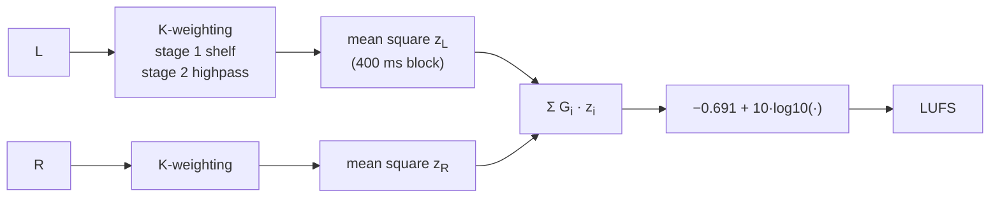
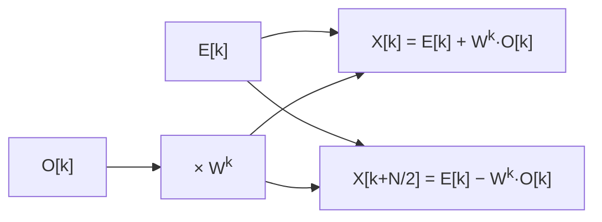
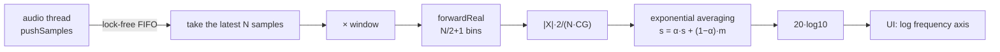
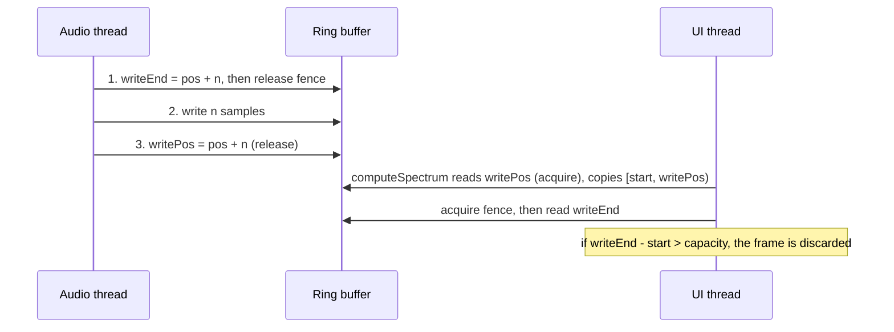

# Chapter 11: Metering and FFT Spectrum Analysis

**English** | [繁體中文](README.zh-TW.md)

> [Course home](../../README.md)　｜　Previous: [10 Modulation](../10-modulation/README.md)　｜　Next: [12 Reverb](../12-reverb/README.md)

For the first ten chapters we have been *changing* sound; in this chapter we learn to *look at* it. Open any DAW and every
mixer channel has a bouncing meter, the master has a loudness meter, and behind the EQ plugin there is a live spectrum.
These look like pure UI, but behind them sits a whole body of standards and mathematics:

- Why does a peak meter jump up fast and fall slowly? How slow is "slow"?
- Chapter 05 said a limiter's ceiling should be set to "-1 dBTP" rather than "-1 dBFS", and introduced the LUFS formula. This chapter implements true peak and loudness in full and measures them for you.
- Spotify says it adjusts songs to "-14 LUFS". How is LUFS actually computed? Why do two songs with the same peak level sound so different in loudness?
- How does a spectrum analyzer turn 48000 samples into "how much energy at which frequency" within a display that refreshes 30 times per second?
- The audio thread can't wait and can't lock, so how does it safely hand what it computed to the UI thread?

This chapter builds four components from scratch: `Fft` (our own radix-2 FFT), `LevelMeter`, `LoudnessMeter` (ITU-R BS.1770-4 / EBU R128),
and `SpectrumAnalyzer` (with a lock-free FIFO). They are used directly in Chapter 12's convolution reverb and in the Chapter 14 DAW mixer.

## 1. Chapter goals

After this chapter you should be able to:

- Say what sample peak, true peak, RMS, VU, PPM and LUFS each measure, where each is appropriate, and what their ballistics (response speed) are.
- Convert "decay of 24 dB/s" into a per-sample multiplication coefficient; implement a peak meter with peak hold and a sliding-window RMS.
- Implement a loudness meter according to ITU-R BS.1770-4: K-weighting (two biquad stages, including redesign for other sample rates),
  channel weighting, 400 ms blocks with 75% overlap, momentary / short-term / integrated loudness, and absolute and relative gating.
- Derive the intuition of the DFT from its definition ("correlate with a sinusoid at every frequency"), derive the radix-2 Cooley-Tukey FFT, and explain why it is $`O(N \log N)`$.
- Explain bin resolution $`f_s/N`$, spectral leakage, the main lobe / side lobe trade-off of windows, and coherent gain normalization.
- Smooth a spectrum with exponential averaging and display it on a logarithmic frequency axis.
- Use a single-producer / single-consumer lock-free ring buffer to send data from the audio thread to the UI thread.

## 2. Theory

### 2.1 Kinds of meters: what exactly is being measured?

Every meter answers "how loud is the signal?", but "loud" has many definitions:

<div align="center">

| Meter | What it measures | Response speed (ballistics) | Unit | Use |
|---|---|---|---|---|
| **Sample peak** | The maximum of $`\lvert x[n]\rvert`$ over the samples | Instant rise; fall rate is configurable (dB/s) | dBFS | Preventing digital clipping (the default on DAW mixers) |
| **True peak** | The peak of the reconstructed continuous waveform (estimated with 4x oversampling) | Same as above | dBTP | Mastering and streaming delivery specs (e.g. ≤ -1 dBTP) |
| **RMS** | The root mean square over a window, $`\sqrt{\frac{1}{W}\sum x^2}`$ | Set by the window length (300 ms is common) | dBFS | "Average energy"; closer to perceived loudness than peak |
| **VU** | Rectified average passed through a needle with mass | 300 ms to reach 99%, overshoot 1–1.5% | VU | The analog-era sense of "volume"; common in analog-modeling plugins |
| **PPM** | Quasi-peak | Integration time about 5–10 ms; very slow fall (about 20 dB / 1.5 s or 24 dB / 2.8 s depending on Type) | dB | Broadcast (traditional in Europe) |
| **LUFS** | Mean square after K-weighting, with gating | momentary 400 ms / short-term 3 s / integrated over the whole programme | LUFS / LU | Loudness standards (broadcast, streaming platforms) |

</div>

A few concepts to settle first:

- **dBFS** (dB relative to Full Scale): 0 dBFS is the largest value a digital system can represent (±1.0 in float).
  A sine of amplitude 1.0 has a peak of 0 dBFS and an RMS of $`1/\sqrt{2}`$ = **-3.01 dBFS**.
  (Note: some meters follow AES17 and label a sine's RMS as 0 dB too, i.e. the RMS reading is shifted by +3.01 dB; this chapter does not apply that offset.)
- **Crest factor** = peak / RMS (in dB, the difference between the two). A sine has 3.01 dB, a drum kit often 15–20 dB,
  and a pop track squashed by a limiter may have only 6–8 dB.
- **Peak is not loudness.** Take two songs whose peaks are both -1 dBFS: one is heavily squashed, the other very dynamic. The former can sound more than 10 dB louder.
  This is the root of the 2000s "loudness war" and the reason LUFS appeared.

### 2.2 Peak meter: hold and decay

#### Intuition

If the meter displayed "the maximum of this block" directly, the display would flicker 30 times a second and be unreadable. So peak meters follow two conventions:

1. **Instant rise**: if a new peak is larger than the current reading, jump up immediately (a peak meter must never miss a peak; that is its whole job).
2. **Slow fall**: after that, fall at a fixed rate in **dB/s** (12–26 dB/s is typical).
3. In addition there is a **peak hold** marker: it stays at the most recent maximum for a while (e.g. 1–2 s, or indefinitely until the user clicks) before starting to fall.

<p align="center"></p>

#### Math: dB/s → per-sample coefficient

In the dB domain, "falling $`D`$ dB per second" is a straight line; back in the linear domain it means **multiplying by the same coefficient $`g`$ every sample**:

```math
20\log_{10}\left(g^{f_s}\right) = -D \quad\Longrightarrow\quad g = 10^{-D / (20 f_s)}
```

With $`D = 24`$ dB/s and $`f_s = 48`$ kHz → $`g = 10^{-24/960000} \approx 0.9999424`$ (more precisely 0.9999424370;
`LevelMeter` stores it as float, so the float value printed in the first section of `l11_level_meter` is 0.99994242, because the float spacing near 1 is about $`6\times10^{-8}`$).
This is better than "subtract $`D \cdot B / f_s`$ dB per block": it is independent of the block size and needs no log per sample.

The hold logic:

```text
if |x| >= hold:      hold = |x|, counter = holdSamples
elif counter > 0:    counter -= 1
else:                hold = max(hold * g, peak)      // hold never falls below peak
```

### 2.3 RMS and window length

```math
\text{RMS}[n] = \sqrt{\frac{1}{W}\sum_{i=0}^{W-1} x[n-i]^2}
```

- If the window $`W`$ is too short (say 10 ms), it cannot even hold one period of a low-frequency sine, and the reading jitters with the waveform.
  Rule of thumb: $`W`$ should cover several periods of the lowest frequency you care about.
- If the window is too long (say 3 s), the response is too slow. Music meters commonly use **300 ms** (the same order of magnitude as the VU time constant, and close to the ear's integration time for "volume").

**Implementation**: re-summing $`W`$ squared values for every sample is $`O(W)`$. Instead, keep the most recent $`W`$ values of $`x^2`$ in a ring buffer
and maintain a running "sum over the window": add the new one, subtract the one pushed out, and each sample costs only $`O(1)`$.
Floating-point adds and subtracts accumulate error, so every time the ring wraps around once we re-sum it exactly (still amortized $`O(1)`$).

Another common approach is to estimate $`E[x^2]`$ with an exponential moving average (a one-pole lowpass), which needs only one number of memory,
but its "window" decays exponentially and has no definite length. The `LevelMeter` in this chapter uses a true sliding window; the correlation meter in Exercise 7 uses an EMA.

### 2.4 VU and PPM: meters with "mass"

The VU meter (volume unit, IEC 60268-17) is a needle meter designed in 1939 for telephony and broadcast. It is not RMS; it is the
**average of the full-wave rectified signal**, passed through the mechanical inertia of the needle itself: when a 0 VU sine suddenly appears, the needle must reach 99% of its final reading in **300 ms**
and overshoot by 1–1.5%. In a digital system it is modeled as a second-order system (spring + damper):

```math
\ddot p + 2\zeta\omega_n \dot p + \omega_n^2\,p = \omega_n^2\,u(t)
```

$`\zeta`$ sets the overshoot ($`M_p = e^{-\pi\zeta/\sqrt{1-\zeta^2}}`$, $`\zeta = 0.82`$ → 1.11%) and $`\omega_n`$ sets the speed.
Exercise 4 builds this. In a digital system 0 VU is usually calibrated to a sine at **-18 dBFS** (EBU R68) or -20 dBFS.

Perceptually, a VU meter barely reacts to each drum hit (a 10 ms 0 VU burst only pushes the needle to −24.8 VU, verified in Exercise 4;
because of the needle's inertia it keeps climbing for about 80 ms after the burst ends before reaching its maximum).
It reflects "how loud this passage sounds", which is why many mixers like to watch a VU on an analog-modeled bus.

PPM (peak programme meter) is the broadcast "quasi-peak" meter: its integration time is only 5–10 ms (much faster than VU, but still ignoring extremely short transients),
and it falls very slowly so that the operator can read the peaks clearly. This chapter does not implement PPM; the peak of `LevelMeter` plus a short integration approximates it.

### 2.5 True peak: peaks between samples

> Chapter 05 section 2.8 already introduced inter-sample peaks and dBTP, and Chapter 05 Exercise 4 built a simple 4x true-peak meter with a 64-tap polyphase FIR.
> Here is a quick review, focusing on this chapter's approach: Exercise 3 reuses Chapter 06's polyphase halfband `Oversampler` directly, and uses the Chapter 05 version as a reference,
> comparing the reading error and CPU cost of the two on the same signal.

A digital signal is only samples of a continuous waveform, and the DAC fills in between samples with (approximately) sinc interpolation. **The true peak may fall between two samples.**
The classic example: a sine at $`f_s/4`$ with 45° phase has every sample at $`\pm 0.707`$ (sample peak -3.01 dBFS), but the continuous waveform peaks at 1.0 (0 dBTP):

<p align="center"></p>

The approach in ITU-R BS.1770-4 Annex 2: **oversample the signal 4x** (48 kHz → 192 kHz, using an FIR interpolation filter),
take the maximum $`|x|`$ at the higher rate, and report it in **dBTP**. 4x can still miss a little: for a sine near Nyquist, the peak can fall exactly between two 4x samples,
underestimating by at most $`20\log_{10}\cos(\pi/8) = 0.69`$ dB. That is why streaming platforms and EBU R128 require true peak ≤ -1 dBTP, to leave headroom.

Exercise 3 verifies this example with this chapter's meter: sample peak −3.010 dBFS, 4x true peak 0.000 dBTP, error 0.
Chapter 05 Exercise 4 measures the same kind of signal (amplitude 0.5) but gets −6.18 dBTP, about 0.17 dB below the true −6.02. The difference is **where the interpolation points fall**:

- The Chapter 06 `Oversampler` is two cascaded 2x halfband stages. When a halfband upsamples, one phase is a pure delay (the output is the original sample),
  so after two stages the 4 points land exactly at 0, 1/4, 1/2, 3/4 between the original samples; the 1/2 point steps right onto the peak of this $`f_s/4`$ sine.
- The Chapter 05 64-tap FIR has even length, so its center is not on an integer, and the 4 interpolation points land at 1/8, 3/8, 5/8, 7/8.
  The nearest to the peak is still 1/8 sample away (phase 11.25°), so it reads $`\cos 11.25° = 0.981`$ times the peak (−0.17 dB).

This does not mean the halfband version is "more accurate": change to a signal whose peak falls at 1/8 and the result reverses. Exercise 3 sweeps the phase of the fs/4 sine from 0° to 90°,
and the worst error of both meters is -0.17 dB; it just occurs at the phase where the other one is most accurate. The real differences lie elsewhere (all numbers come from Exercise 3, feeding the same signal to both meters):

<div align="center">

| | `Oversampler` (two halfband stages) | Chapter 05 64-tap windowed-sinc |
|---|---|---|
| Interpolation point positions | 0, 1/4, 1/2, 3/4 | 1/8, 3/8, 5/8, 7/8 |
| Worst-phase error (fs/4 sine) | -0.17 dB | -0.17 dB |
| Reading error for a 22 kHz sine | 0.00 dB | -0.43 dB |
| Hard-clipped drum kit (ideal FFT interpolation +5.30 dBTP) | +5.20 dBTP | +4.59 dBTP |
| Multiplications per input sample | 56 | 64 |
| Measured time (Release, machine-dependent) | about 20 ns / sample | about 59 ns / sample |

</div>

Material like hard-clipped signals and plucked strings has plenty of content near Nyquist, which is exactly where the two filters' frequency responses differ the most: the 64-tap Hann window gives a wide
transition band, so the windowed-sinc version reads 0.7–1.2 dB below the ideal, while the halfband version is only 0.1–0.75 dB low. The multiplication counts differ by only 14%,
yet the real speed differs by about 3x, because of how the inner loop is written (contiguous memory, float accumulation, no branches; see the Exercise 3 solution).

Hard-clipped signals have especially severe inter-sample peaks: Exercise 3 pushes the drum kit up by +12 dB and clips it to 0 dBFS, and the true peak is **+5.20 dBTP**.
A master like this will clip after conversion to AAC / MP3 (a lossy codec reconstructs the waveform and adds quantization error).

### 2.6 Loudness: ITU-R BS.1770-4 and EBU R128

Chapter 05 section 2.10 already covered the LUFS formula and the streaming platform targets; this chapter implements it in full: where the K-weighting coefficients come from, how the
400 ms blocks are cut, and how gating is done on the audio thread without allocating.

#### Why not just use RMS?

The ear's sensitivity differs across frequency (equal-loudness contours): 50 Hz and 3 kHz with the same energy, and the 3 kHz one sounds much louder.
BS.1770 approximates this with a very simple filter called **K-weighting**, then computes the mean square. It is deliberately simple (two biquads),
so that any vendor can produce exactly the same numbers; that matters more than "perfectly simulating the ear".



#### K-weighting: two biquad stages

<div align="center">

| Stage | Shape | Purpose |
|---|---|---|
| 1. pre-filter | High shelf, midpoint about 1.7 kHz, +4 dB at high frequencies | Models the acoustic gain of the head (a "sphere") at high frequencies |
| 2. RLB filter | Second-order highpass, about 38 Hz (-6 dB point) | "Revised low-frequency B-curve"; removes the very low frequencies the ear is not very sensitive to |

</div>

The standard gives coefficients only for **48 kHz** ($`a_0`$ normalized to 1):

<div align="center">

| | $`b_0`$ | $`b_1`$ | $`b_2`$ | $`a_1`$ | $`a_2`$ |
|---|---|---|---|---|---|
| stage 1 | 1.53512485958697 | −2.69169618940638 | 1.19839281085285 | −1.69065929318241 | 0.73248077421585 |
| stage 2 | 1.0 | −2.0 | 1.0 | −1.99004745483398 | 0.99007225036621 |

</div>

**You cannot use these coefficients directly at other sample rates** (a digital filter's frequencies are relative to $`f_s`$; applying the 48 kHz coefficients at 44.1 kHz shifts the whole curve toward low frequencies by 8%).
`l11_loudness` prints this counter-example: when the 48 kHz coefficient table is misused at 44.1 kHz, the gain at 997 Hz becomes +0.900 dB (correct: +0.694 dB) and
at 2 kHz becomes +3.30 dB (correct: +3.08 dB); the measured LUFS comes out about 0.2 LU too high, which is about the size of the EBU tolerance and hard to notice.
You have to go back to the analog prototype and redo the bilinear transform. Work the table above backwards into analog parameters (open-source implementations such as libebur128 use the same set).
The analog prototype of stage 1 is a second-order high shelf ($`s`$ normalized to $`\omega_0 = 2\pi f_0`$):

```math
H_1(s) = \frac{V_h\, s^2 + V_b\, s/Q + 1}{s^2 + s/Q + 1}
```

- At $`s \to 0`$ (DC), $`H_1 = 1`$ (0 dB); at $`s \to \infty`$ (high frequency), $`H_1 = V_h`$. So **$`V_h`$ is the linear gain at the high end**:
  $`V_h = 10^{G/20}`$, $`G = 3.99984`$ dB (about +4 dB).
- **$`V_b`$ is the coefficient of the middle term of the numerator and sets the gain in the transition band (near $`f_0`$)**: $`V_b = V_h^{0.49967}`$, an exponent of about 0.5,
  i.e. $`V_b \approx \sqrt{V_h}`$, which in dB is about half the high-frequency gain (+2.00 dB), letting the shelf climb smoothly from 0 dB to +4 dB.
  (The actual gain at $`f_0`$ is $`|H_1(j)| = \sqrt{V_b^2 + Q^2(V_h-1)^2}`$ = +2.44 dB, because the $`Q`$ in the denominator also affects the shape of the transition band.)
- $`f_0 = 1681.974`$ Hz, $`Q = 0.70718`$.

These numbers (including the exponent 0.49967) are all back-derived from the standard's 48 kHz coefficients and are not additional design choices: we just look for a set of analog parameters
that reproduces the standard's table exactly after a bilinear transform at 48 kHz, then use the same parameters to redo the transform at other sample rates.

The bilinear transform uses $`s = \frac{1}{K}\cdot\frac{1 - z^{-1}}{1 + z^{-1}}`$ with $`K = \tan(\pi f_0 / f_s)`$ (this $`K`$ maps $`f_0`$ exactly to $`f_0`$).
Substituting into $`H_1(s)`$, multiplying top and bottom by $`K^2(1+z^{-1})^2`$ and expanding into polynomials in $`z^{-1}`$ gives:

```math
b_0 = \frac{V_h + V_b K/Q + K^2}{a_0},\quad b_1 = \frac{2(K^2 - V_h)}{a_0},\quad b_2 = \frac{V_h - V_b K/Q + K^2}{a_0},\quad
a_1 = \frac{2(K^2-1)}{a_0},\quad a_2 = \frac{1 - K/Q + K^2}{a_0}
```

where $`a_0 = 1 + K/Q + K^2`$.

- Stage 2: the second-order highpass $`H_2(s) = \dfrac{s^2}{s^2 + s/Q + 1}`$ with $`f_0 = 38.135`$ Hz and $`Q = 0.50033`$. The numerator is fixed at $`1, -2, 1`$ (that is how the standard's table is given, without dividing by $`a_0`$), and the denominator is as above.

`l11_loudness` prints both sets of coefficients, verifies that they differ by only $`8.9\times10^{-16}`$, and then lists the frequency responses at 44.1 / 48 / 96 kHz; the three curves are almost identical:

<div align="center">

| Frequency | 20 Hz | 38 Hz | 100 Hz | 997 Hz | 2 kHz | 5 kHz | 16 kHz |
|---|---|---|---|---|---|---|---|
| K-weighting @ 48 kHz | −13.28 dB | −6.00 dB | −1.13 dB | **+0.691 dB** | +3.07 dB | +4.01 dB | +4.04 dB |
| Redesigned @ 44.1 kHz | −13.27 dB | −6.00 dB | −1.13 dB | +0.694 dB | +3.08 dB | +4.02 dB | +4.05 dB |
| Redesigned @ 96 kHz | −13.30 dB | −6.02 dB | −1.16 dB | +0.674 dB | +3.05 dB | +3.99 dB | +4.02 dB |

</div>

(The three curves differ by < 0.03 dB; `l11_loudness` verifies < 0.05 dB with `DAWLAB_CHECK`. The small remaining difference comes from the bilinear transform's
frequency warping not being exactly the same at different $`f_s`$, and from the standard's 48 kHz coefficients themselves having finite digits.)

Note that stage 1 is **not** the RBJ cookbook high shelf: RBJ defines the shelf "corner" at the half-gain point, and uses $`Q`$ differently in the numerator and denominator,
so you cannot just throw $`f_0`$, $`Q`$ and gain into Chapter 02's `makeHighShelf()`. We still run this set of coefficients on Chapter 02's `Biquad` (TDF-II).

#### From mean square to LUFS

For each channel $`i`$, compute the mean square of the K-weighted signal $`y_i`$ over a period $`T`$:

```math
z_i = \frac{1}{T}\int_0^T y_i^2(t)\,dt \;\approx\; \frac{1}{N}\sum_n y_i[n]^2
```

then take the weighted sum and convert to a logarithm:

```math
L_K = -0.691 + 10\log_{10}\sum_i G_i\, z_i \quad \text{[LUFS]}
```

- **$`G_i`$**: L, R, C = 1.0; left and right surround Ls, Rs = 1.41 (about +1.5 dB, since sounds from behind seem louder); LFE is not counted.
- **Why $`10\log_{10}`$ and not $`20\log_{10}`$**: $`z`$ is already a "square" (power).
- **Where −0.691 comes from**: the K-weighting gain at 997 Hz is +0.691 dB. Subtracting it makes "a 0 dBFS 997 Hz sine fed into a single channel"
  read exactly $`10\log_{10}(0.5) = -3.01`$ LUFS (the mean square of a sine is $`A^2/2`$).
  So **a -20 dBFS 997 Hz sine → −23.01 LUFS**, which is the standard's verification condition and the number measured in section 2 of `l11_loudness`.
- **The same signal on both channels**: $`\sum G_i z_i`$ doubles → **+3.01 LU** → −20.00 LUFS (section 3 of `l11_loudness`).
  It does sound louder than a single channel, since both speakers are playing.
- **LU** (loudness unit) is the "difference" unit of LUFS; 1 LU = 1 dB.

#### 400 ms blocks, 75% overlap, momentary / short-term / integrated

<p align="center"></p>

- **momentary**: the most recent 400 ms (one block); fast response, a fairly steady meter.
- **short-term**: the most recent 3 s (EBU Tech 3341); used to see the loudness of a passage and to compute LRA.
- **integrated**: the average of **all** blocks from pressing "start" until now, but passed through two gates. This is what a streaming platform means by "this song is -14 LUFS".

Implementation trick: there is no need to re-square and re-sum 400 ms of data every 100 ms. We accumulate the sum of squares in units of 100 ms (sub-blocks),
and momentary = the average of the latest 4 sub-blocks, short-term = the average of the latest 30 sub-blocks. Each sample is squared and accumulated only once.

#### Gating: why exclude silence?

If a song has 10 seconds of silence in the middle, plain averaging would pull the integrated value down, yet listeners would not feel that "this song is quieter". BS.1770-4 uses two gates:

1. **absolute gate**: discard blocks whose loudness is < **−70 LUFS** (essentially silence).
2. **relative gate**: compute the average $`\bar L`$ of the blocks that passed the first gate (**averaged in the power domain**), and discard blocks < $`\bar L - 10`$ LU.
3. integrated = the power average of the blocks that passed both gates:

```math
\Gamma_r = -0.691 + 10\log_{10}\Big(\frac{1}{|J_a|}\sum_{j\in J_a}\sum_i G_i z_{ij}\Big) - 10,\qquad
L_{\text{int}} = -0.691 + 10\log_{10}\Big(\frac{1}{|J_g|}\sum_{j\in J_g}\sum_i G_i z_{ij}\Big)
```

$`J_a`$ is the set of blocks that pass the absolute gate and $`J_g`$ the set that pass both. Section 4 of `l11_loudness`: 3 s at −20 dBFS → 3 s of silence → 3 s at −50 dBFS:

<div align="center">

| | Value |
|---|---|
| Without gating, averaging the power over 9 s | −27.78 LUFS (diluted by the silence) |
| Integrated after gating (measured) | **−23.23 LUFS** |
| Theoretical value | 27 full blocks (power $`P`$) + 3 blocks straddling the boundary ($`\tfrac34P, \tfrac24P, \tfrac14P`$) → $`-23.01 + 10\log_{10}(28.5/30) = -23.23`$ |

</div>

The silent blocks are blocked by the absolute gate; the −53 LUFS blocks are below the relative gate (about −36 LUFS) and are blocked too.

**The implementation challenge**: integrated needs "the loudness of all blocks", and continuously pushing into a `std::vector` would allocate on the audio thread.
`LoudnessMeter` uses a **histogram** instead: [−70, +10) LUFS is divided into 800 bins of 0.1 LU, and each bin records the block count and the power sum.
The relative gate is decided at the bin centers, with an error of at most 0.05 LU, and the memory is fixed with no allocation at all.

#### LRA (Loudness Range)

Integrated tells you "how loud on average"; LRA (EBU Tech 3342) tells you "how far apart the loud and quiet passages are":
take the distribution of short-term loudness (after the −70 LUFS and **−20 LU** relative gates) and subtract its 10th percentile from its 95th percentile.
Pop songs are typically 4–8 LU and classical music can reach 15–20 LU. Exercise 5 implements it.

#### Streaming platform and broadcast targets

<div align="center">

| Context | Integrated target | True peak limit |
|---|---|---|
| EBU R128 (European broadcast) | −23 LUFS (±0.5) | −1 dBTP |
| ATSC A/85 (US broadcast) | −24 LKFS | −2 dBTP |
| Spotify, YouTube, Tidal, etc. | about −14 LUFS | about −1 dBTP |
| Apple Music | about −16 LUFS | about −1 dBTP |

</div>

(Streaming platform numbers are "playback normalization targets"; each service adjusts them, so consult the official documentation. LKFS and LUFS are two names for the same thing.)

An important point: platforms **turn down songs that are too loud**. Squashing a master to −8 LUFS will not make it louder on Spotify; it just gets turned down by 6 dB and loses its dynamics.
Section 5 of `l11_loudness` measures the synthetic drum kit (−16.67 LUFS, sample peak −2.92 dBFS): getting it to −14 LUFS requires adding 2.7 dB,
which puts the sample peak at −0.24 dBFS, already over −1 dBTP; this is when you need Chapter 05's limiter.

### 2.7 DFT: correlating the signal with a sinusoid at every frequency

#### Intuition

Want to know "how much 440 Hz is in" a signal $`x[n]`$? Take a 440 Hz sine $`s[n]`$, multiply it with $`x`$ point by point and sum: $`\sum x[n]\,s[n]`$.
If $`x`$ contains 440 Hz with the phase aligned, the products are mostly positive and the sum is large; if not, positives and negatives cancel and the sum is near 0.
That is **correlation**. The catch is phase: if the 440 Hz in $`x`$ is a cosine and we compare with a sine, the sum is also 0.
The fix is to compare with both cos and sin at once, using the complex number $`e^{-j\omega n} = \cos\omega n - j\sin\omega n`$:

```math
X[k] = \sum_{n=0}^{N-1} x[n]\, e^{-j 2\pi k n / N},\qquad k = 0, 1, \dots, N-1
```

$`|X[k]|`$ is "how much of the $`k`$-th frequency", and $`\arg X[k]`$ is its phase. The frequency of bin $`k`$ is

```math
f_k = k \cdot \frac{f_s}{N}
```

So the **bin width (frequency resolution) is $`\Delta f = f_s / N`$**. At 48 kHz with N = 2048 that is 23.4375 Hz. To get finer resolution you can only increase N,
that is, **look at a longer stretch of time**; frequency resolution and time resolution are a seesaw.

The inverse transform (IDFT) is almost identical, differing only in the rotation direction and $`1/N`$:

```math
x[n] = \frac{1}{N}\sum_{k=0}^{N-1} X[k]\, e^{+j 2\pi k n / N}
```

#### Symmetry for real signals

Audio is real. Replace $`k`$ by $`N-k`$: $`e^{-j2\pi(N-k)n/N} = e^{+j2\pi kn/N}`$, so

```math
X[N-k] = \overline{X[k]}\qquad(\text{conjugate symmetry})
```

The second half is entirely a mirror of the first, so **we only need to keep $`k = 0 \dots N/2`$, a total of $`N/2 + 1`$ bins**: bin 0 is DC and bin $`N/2`$ is Nyquist ($`f_s/2`$),
and these two are real. `Fft::forwardReal()` outputs only these $`N/2+1`$ bins, and `inverseReal()` uses the symmetry to restore the other half.

#### Amplitude and dB

A sine of amplitude $`A`$ centered exactly on bin $`k`$, $`A\cos(2\pi k n/N)`$, splits its energy evenly between bin $`k`$ and bin $`N-k`$, with $`|X[k]| = AN/2`$ on each side. So

```math
A = \frac{2\,|X[k]|}{N} \qquad(\text{DC and Nyquist have no mirror image, so the factor is } 1/N)
```

With a window applied you must also divide by the coherent gain (section 2.9). In dB: $`20\log_{10} A`$ (amplitude) or $`10\log_{10}|X|^2`$ (power); the two are the same.

### 2.8 FFT: radix-2 Cooley-Tukey

Computing the DFT directly from the definition: N outputs, each a sum of N terms → $`O(N^2)`$. At N = 4096 that is 16 million complex multiply-adds, which is heavy to do 30 times per second.

#### Derivation

Let $`W_N = e^{-j2\pi/N}`$ (the twiddle factor). Split $`x[n]`$ into even and odd terms (decimation in time):

```math
X[k] = \sum_{m=0}^{N/2-1} x[2m]\,W_N^{2mk} + \sum_{m=0}^{N/2-1} x[2m+1]\,W_N^{(2m+1)k}
```

Since $`W_N^{2mk} = W_{N/2}^{mk}`$:

```math
X[k] = \underbrace{\sum_m x[2m]\,W_{N/2}^{mk}}_{E[k]\text{: the } N/2 \text{-point DFT of the even terms}} + W_N^k \underbrace{\sum_m x[2m+1]\,W_{N/2}^{mk}}_{O[k]\text{: the } N/2 \text{-point DFT of the odd terms}}
```

$`E`$ and $`O`$ are periodic with period $`N/2`$, and $`W_N^{k+N/2} = -W_N^k`$, so the second half needs no recomputation:

```math
\boxed{X[k] = E[k] + W_N^k\,O[k],\qquad X[k + N/2] = E[k] - W_N^k\,O[k]},\qquad k = 0 \dots N/2-1
```

This pair of equations is called a **butterfly**:



One N-point DFT = two N/2-point DFTs + N/2 butterflies. Recursing:

```math
T(N) = 2\,T(N/2) + O(N) \;\Longrightarrow\; T(N) = O(N\log_2 N)
```

There are $`\log_2 N`$ layers in total, each with $`N/2`$ butterflies (one complex multiplication each). At N = 4096: $`N^2 / (N\log_2 N) = 4096/12 \approx 341`$ times fewer operations.

#### Iterative form and bit reversal

At the bottom of the recursion, the input order is "the binary representation of the index reversed". For N = 8:

<div align="center">

| | | | | | | | | |
|---|---|---|---|---|---|---|---|---|
| index | 0 | 1 | 2 | 3 | 4 | 5 | 6 | 7 |
| binary | 000 | 001 | 010 | 011 | 100 | 101 | 110 | 111 |
| reversed | 000 | 100 | 010 | 110 | 001 | 101 | 011 | 111 |
| **new order** | **0** | **4** | **2** | **6** | **1** | **5** | **3** | **7** |

</div>

So `Fft` first applies a bit-reversal permutation, then performs $`\log_2 N`$ layers of butterflies from small to large (lengths 2, 4, 8, ..., N).
The twiddle factors and the bit-reversal table are computed at construction (which allocates); afterwards `forward()` / `inverse()` allocate no memory at all.

#### Verification

`l11_fft_basics` compares the FFT against a naive DFT computed from the definition (accumulated in double):

<div align="center">

| N | forward max error | inverse max error |
|---|---|---|
| 16 | 4.9e-7 | 1.2e-7 |
| 1024 | 8.6e-6 | 3.6e-7 |
| 4096 | 2.3e-5 | 4.8e-7 |

</div>

(The input is random with $`|x| \le 1`$; the forward output has magnitude about $`\sqrt N`$, so the absolute error grows with N while the relative error stays at float precision, around $`10^{-7}`$.)
It also cross-checks the amplitude at a single frequency using Goertzel (`Analysis.h`).

Timing (Debug configuration, one run on the author's machine, look at the trend only; Release is much faster, and every run varies by ±30% or more):

<div align="center">

| N | FFT | naive DFT | Ratio |
|---|---|---|---|
| 256 | 0.05 ms | 1.7 – 3.4 ms | 34 – 68 |
| 1024 | 0.24 – 0.28 ms | 27 – 32 ms | 110 – 113 |
| 4096 | 1.2 ms | 448 – 488 ms | 375 – 415 |
| 16384 | 5.4 – 9.3 ms | (skipped) | |

</div>

The ratio grows with N, on the same order of magnitude as the theoretical $`N / \log_2 N`$ (341 at 4096). The self-check only requires the FFT to be at least 20 times faster at N = 4096,
to avoid false failures when the machine is busy.

### 2.9 Windows and spectral leakage

#### Where leakage comes from

The DFT sees only N samples and **implicitly assumes they repeat forever**. If the frame does not contain a whole number of periods of the sine, joining the end to the start produces a jump:

<p align="center"></p>

In the frequency domain: "taking only N samples" = multiplying by a rectangular window; multiplication in time = convolution in frequency.
So the true spectrum (a single line) is convolved with the spectrum of the rectangular window, a sinc: a central **main lobe** plus **side lobes** on both sides that decay slowly (the highest at −13 dB).

#### The window trade-off

Before the transform, multiply by a function $`w[n]`$ that tapers to 0 at both ends, removing the jump at the seam. The cost: the main lobe gets wider (less ability to resolve frequencies).

<div align="center">

| Window | Formula ($`t = 2\pi n/(N-1)`$) | Coherent gain | −3 dB width (bins) | Highest side lobe | Scalloping loss |
|---|---|---|---|---|---|
| Rectangular | $`1`$ | 1.00 | 0.88 | −13.3 dB | 3.92 dB |
| Hann | $`0.5 - 0.5\cos t`$ | 0.50 | 1.44 | −31.5 dB | 1.42 dB |
| Hamming | $`0.54 - 0.46\cos t`$ | 0.54 | 1.30 | −42.7 dB | 1.75 dB |
| Blackman-Harris (4-term) | $`0.35875 - 0.48829\cos t + 0.14128\cos 2t - 0.01168\cos 3t`$ | 0.36 | 1.90 | −92.0 dB | 0.82 dB |

</div>

All the numbers in the table were measured by `l11_window_leakage`, which samples each window's DTFT very densely using 16x zero-padding
(**scalloping loss** = how much lower the peak reading is when a sine lies exactly midway between two bins than when it is at a bin center), and compares them with `DAWLAB_CHECK`
against the theoretical values of Harris (1978): 0.89 / 1.44 / 1.30 / 1.90 bins, −13.3 / −31.5 / −42.7 / −92 dB, 3.92 / 1.42 / 1.78 / 0.83 dB.
The only difference is Hamming's scalloping: Harris's table says 1.78 dB, but plugging directly into the formula
$`\frac{0.54\,\text{sinc}(\frac12) + 0.23\,[\text{sinc}(\frac12) + \text{sinc}(\frac32)]}{0.54} = 0.8174`$ gives 1.75 dB, matching the measurement.

The rule is simple: **the lower the side lobes, the wider the main lobe**. There is no universal window:

- To see very small signals (the noise floor, −90 dB harmonics) → Blackman-Harris.
- To resolve two close frequencies of similar size → Rectangular / Hann, with a large N.
- For a general-purpose spectrum analyzer → **Hann** (balanced, with side lobes falling a further 18 dB per octave); this is also the default of `SpectrumAnalyzer`.

The test signal in `l11_window_leakage` is a 0 dBFS 1 kHz tone plus a **−60 dBFS 3.3 kHz tone** (N = 2048, with 1000 Hz at bin 42.67):

<div align="center">

| Window | 1 kHz reading | bin ±10 | Near 3.3 kHz |
|---|---|---|---|
| Rectangular | −1.67 dB | −30 / −32 dB | −50 dB (drowned by leakage; the −60 dB tone is invisible) |
| Hann | −0.63 dB | −70 / −72 dB | **−60.2 dB** (clearly visible) |
| Hamming | −0.77 dB | −47 / −49 dB | −57.8 dB (barely) |
| Blackman-Harris | −0.37 dB | −99 / −100 dB | **−60.1 dB** |

</div>

ASCII spectrum (actual output, linear axis from 0 to 5 kHz, 78 Hz per column, taking the maximum within each column):

```text
---- Rectangular ----
      0 dB |                                                                |
    -10 dB |            #                                                   |
    -20 dB |           ###                                                  |
    -30 dB |          #####                                                 |
    -40 dB |####################                                            |
    -50 dB |##################################                              |
    -60 dB |################################################################|   <- the skirt of leakage covers everything
    ...
---- Hann ----
      0 dB |                                                                |
    -10 dB |            #                                                   |
    -20 dB |            ##                                                  |
    -30 dB |            ##                                                  |
    -40 dB |           ###                                                  |
    -50 dB |           ####                                                 |
    -60 dB |           ####                                                 |
    -70 dB |          ######                         ##                     |   <- the −60 dB tone at 3.3 kHz
    -80 dB |        #########                        ##                     |
    -90 dB |      #############                      ##                     |
   -100 dB |   ###################                   ##                     |
   -110 dB |##########################..............####....................|
```

The same signals as curves, with the Blackman-Harris window added (the rectangular window's skirt buries the weak tone, while Hann and Blackman-Harris show it clearly):

<p align="center"></p>

The 1 kHz reading is not 0 dB because 1000 Hz is not at a bin center (it is 0.33 bin off); this is called **scalloping loss**. The theoretical values:
the rectangular window's response is $`\text{sinc}(\delta)`$, and with $`\delta = 1/3`$ → $`\frac{\sin(\pi/3)}{\pi/3} = 0.827`$ → **−1.65 dB**;
Hann is $`\frac{\text{sinc}(\delta)}{1-\delta^2} = 0.930`$ → **−0.63 dB**. The measured −1.67 dB and −0.63 dB agree to within 0.02 dB
(`l11_window_leakage` checks with ±0.1 dB). The worst case is a sine exactly midway between two bins ($`\delta = 0.5`$), and the loss is the scalloping loss in the table above.

#### Leakage is "invisible" when exactly on a bin center

The second table of the same example uses 1007.8125 Hz (exactly bin 43, a whole number of periods): the rectangular window's bin 44 is −200 dB,
because the zeros of the sinc fall exactly on every bin and the FFT samples only at the zeros. The skirt is still there; it just isn't sampled.
Hann's bin 44 is −6 dB: that is the main lobe itself being wider (±2 bins), not leakage.

> A small detail: this chapter's `makeWindow()` produces **symmetric** windows (denominator $`N-1`$). Spectrum analysis sometimes uses **periodic** windows (denominator $`N`$),
> whose zeros fall exactly on bins (Hann's bins ±2 would be −∞). The difference is small; the symmetric version is more common in filter design.

#### Coherent gain and normalization

A window shrinks the signal overall: the reading of a bin-centered sine becomes $`\text{CG} = \frac1N\sum w[n]`$ times the original (Hann 0.5 = −6.02 dB). To compensate:

```math
A = \frac{2\,|X[k]|}{N \cdot \text{CG}}
```

`SpectrumAnalyzer` normalizes this way, so a full-scale sine reads 0 dBFS (in the second table, bin 43 reads 0.000 dB for every window).

> Note: this normalization is for **sinusoids**. The energy of broadband noise is spread across all bins, and each bin's reading changes with N (doubling N lowers every bin by 3 dB);
> comparing noise levels requires power spectral density and the window's ENBW (equivalent noise bandwidth), which this chapter does not go into.

### 2.10 Real-time spectrum: overlap, smoothing, logarithmic frequency axis



- **Overlap**: frames overlap. hop = $`N(1 - \text{overlap})`$. With 50% overlap and N = 4096, a new spectrum is computed every 2048 new samples (23 times per second at 48 kHz).
  The more overlap, the more frequent the updates and the less likely events near a frame's edges (where the window weight is close to 0) are missed, at the cost of computation.
- **Exponential averaging**: $`s[k] \leftarrow \alpha\,s[k] + (1-\alpha)\,m[k]`$, done on the **linear amplitude** (averaging in dB reads low).
  With $`\alpha = 0.8`$ and hop 2048 @ 48 kHz: each frame decays to 0.8x = −1.94 dB, a fall rate of about 45 dB/s, the same idea as the decay of a peak meter.
  The comparison at the end of `l11_spectrum_analyzer`: when 440 Hz suddenly stops, with $`\alpha = 0`$ the first frame after silence still contains half of the sine (50% overlap)
  and reads −18.7 dB, and the second frame drops to −100 dB; with $`\alpha = 0.8`$ it falls about 2 dB every 43 ms.
  The measurement in the example: each frame after the silence drops 1.94 dB, the same as $`20\log_{10}0.8 = -1.94`$ dB (there is a self-check).
  The first frame is used as is (smoothing does not start from 0), otherwise the first few frames would read too low.
- **Calibration**: `l11_spectrum_analyzer` also verifies the normalization: a sine of amplitude 0.5 (−6.02 dBFS) exactly on bin 100 reads **−6.02 dB**;
  moving the frequency to bin 100.5 (midway between two bins) reads −7.44 dB, and the missing 1.42 dB is exactly Hann's scalloping loss.
  Likewise, the 440 Hz sine in the example (at bin 37.55, 0.45 bin off) reads −7.2 dB rather than −6.0 dB.
- **Logarithmic frequency axis**: the ear perceives pitch logarithmically (every octave is equally important). On a linear axis, 20 Hz to 1 kHz takes only 5% of the width, so spectrum analyzers almost always use a log axis:

```math
\text{column}(f) = C \cdot \frac{\ln f - \ln f_{\text{low}}}{\ln f_{\text{high}} - \ln f_{\text{low}}}
```

  In the high-frequency region many bins are squeezed into one column (take the maximum), while in the low-frequency region one bin spans several columns (at N = 4096 the bin width is 11.7 Hz, so 20–40 Hz contains only two bins).
  So seeing the low end clearly requires a larger N, which brings us back to the time / frequency resolution trade-off.

### 2.11 audio thread → UI thread: the lock-free FIFO

The audio thread must deliver a block every 10 ms or so and cannot wait for anything. If it takes a mutex while the UI thread happens to hold it while drawing (or while the OS has suspended the UI thread),
the audio breaks up (a dropout). So passing meter and spectrum data must be **lock-free**. There are two cases:

1. **A single value** (peak, RMS, LUFS, gain reduction): just use `std::atomic<float>`, with the audio thread doing `store` and the UI thread `load`.
   `memory_order_relaxed` is enough (we only need to "read some complete value", not any ordering relative to other data).
2. **A stream of samples** (the spectrum analyzer needs the most recent N samples): use a single-producer / single-consumer (SPSC) ring buffer.

```text
                       ring buffer (capacity 4N, a power of two)
audio thread   +---+---+---+---+---+---+---+---+---+---+---+---+
pushSamples -->| x | x | x | x | x | x | x | x |   |   |   |   |
               +---+---+---+---+---+---+---+---+---+---+---+---+
                 ^ start = writePos - N          ^ writePos
                                         (atomic, monotonically increasing uint64)
```

The producer and the consumer act in this order:



Key details:

- The producer writes the data first, then updates `writePos` with `memory_order_release`; the consumer reads `writePos` with `memory_order_acquire`,
  guaranteeing that "when the new writePos is seen, the samples written before it are also visible".
- **Overwrite detection must look at `writeEnd`, not just `writePos`.** `writePos` is updated only after the whole push has been written; if, while the consumer is partway through copying,
  a push that has **not yet finished** has already wrapped around and overwritten the slots the consumer is reading, `writePos` still holds the old value, the check "writePos − start > capacity" lets it pass,
  and the frame becomes a patchwork of old and new data. This can certainly happen when one push has length $`n > 3N`$ (e.g. N = 64 with a block of 512),
  and it can also happen with ordinary block sizes (the UI thread gets suspended by the OS partway through copying). So the producer announces `writeEnd` **before** writing the samples,
  then issues a release fence; the consumer issues an acquire fence after copying and then reads `writeEnd`. As long as the consumer reads any sample overwritten by a new push,
  the fence synchronization rules guarantee it also sees that push's `writeEnd` (this is the standard **seqlock** pattern).
  The author also wrote a stress test (not part of this chapter's examples; N = 16 / 64, 512 samples per push, two threads running flat out, about 100,000 frames per round):
  the version that looks only at `writePos` let 33 patchwork frames through over 12 rounds, and after switching to `writeEnd` all 12 rounds had 0.
  Bugs like this show up only a few times per 100,000 frames and cannot be found by "run it and see"; you have to reason about every possible interleaving.
- The consumer takes only the **latest N samples** each time, not consuming in order. If the UI is slow nothing piles up; it just skips intermediate frames, since a spectrum display only cares about the latest state anyway.
- The ring's elements are `std::atomic<float>` (relaxed): in the C++ memory model, two threads reading and writing the same non-atomic float at the same time is a data race (undefined behavior),
  even though it happens to work on x86. Relaxed atomic float loads and stores are plain loads / stores on x86 / ARM, with no extra cost.
- `writePos` is a 64-bit counter that never wraps (at 48 kHz it would take millions of years to overflow), avoiding the classic problem of "is it empty or full when the read and write positions are equal?".

The last section of `l11_spectrum_analyzer` really starts a `std::thread` to act as the audio thread, pushing a 1 kHz sine at full speed (not in real time, as fast as possible),
while the main thread acts as the UI thread and keeps reading until it has obtained 50 frames. How do we decide a frame is "bad"? If the FIFO is wrong, a frame is stitched together from
old and new data, and the discontinuity at the seam leaks energy across the whole band; a clean Hann frame should be at −100 dB (our floor) above 5 kHz.
So the self-check requires: the strongest bin of every frame is at 1 kHz, **and** the maximum reading above 5 kHz is < −80 dB. The measured result was 0 bad frames, with
the maximum above 5 kHz at −100.0 dB. During this the audio thread pushed thousands of blocks (anything from a bit over a thousand to over seven thousand has been seen; it varies a lot between runs depending on thread scheduling);
the 50 frames use only a small part of that data, which is exactly the UI behavior of "skip frames and look only at the latest".

The Chapter 14 DAW uses the same pattern: one `LevelMeter` per track (atomic readings), one `SpectrumAnalyzer` on the master, and a UI timer reading 30 times a second.

## 3. From formulas to code

### 3.1 `Fft.h`

```cpp
namespace dawlab::dsp {
enum class WindowType { Rectangular, Hann, Hamming, BlackmanHarris };
const char* windowTypeName(WindowType);
void naiveDft(const std::complex<float>* in, std::complex<float>* out, int n, bool inverse = false); // O(N²), for verification

class Fft {
public:
    Fft() = default;
    explicit Fft(int order);                       // size = 2^order, precomputes the twiddle and bit-reversal tables
    void setOrder(int order);                      // allocates
    int getOrder() const; int getSize() const; int getNumRealBins() const;  // N/2+1
    void forward(std::complex<float>* data) const;             // in-place
    void inverse(std::complex<float>* data) const;             // in-place, includes 1/N
    void forwardReal(const float* in, std::complex<float>* out) const;   // N → N/2+1 bins
    void inverseReal(const std::complex<float>* in, float* out) const;   // N/2+1 bins → N, includes 1/N
    static void makeWindow(std::vector<float>& w, int size, WindowType type);  // symmetric
    static double coherentGain(const float* w, int size);
    static double coherentGain(WindowType type);   // theoretical value (N → ∞)
};
}
```

- `transform()` is a direct translation of the derivation in section 2.8: first a bit-reversal swap (swapping only when `j > i`, so pairs are not swapped back),
  then `for (len = 2; len <= N; len <<= 1)` performs the butterflies layer by layer. The layer of length `len` needs $`W_{len}^k = W_N^{k \cdot N/len}`$,
  so we store just one table of $`W_N^k`$ and read it with a stride.
- inverse simply conjugates the twiddles (opposite rotation direction) and finally multiplies by $`1/N`$.
- The twiddles are computed with cos / sin in double and then converted to float, so angle error does not accumulate for large N.
- `forwardReal()` currently puts the real data into a complex buffer, performs an N-point complex FFT, and takes the first N/2+1 bins.
  A faster approach is to "treat the N real numbers as N/2 complex numbers, do an N/2-point FFT, then separate them using symmetry" (about twice as fast); this is left as an extension.
- **`forwardReal` / `inverseReal` use an internal `mutable` scratch buffer**: the same `Fft` object **must not be used by two threads at the same time**.
  `forward()` / `inverse()` are pure functions (they only read the twiddle table) and can be shared.

First build this chapter (every example afterwards runs from the build directory):

```powershell
.\scripts\build.ps1 -Only 11-metering-fft
cd build
```

**Example 1: `l11_fft_basics` (`examples/fft_basics.cpp`)**

```powershell
.\bin\Debug\l11_fft_basics.exe
```

The error table of FFT vs naive DFT (section 2.8), `forwardReal` / `inverseReal`
agreeing with the complex version (error 0), conjugate symmetry, the Goertzel cross-check (1 kHz, N = 1024 → largest bin 21 = 984.4 Hz, rectangular reads 0.4148,
Goertzel 0.5000; the difference is exactly the scalloping loss of section 2.9), the timing table, and finally a `forwardReal → inverseReal` round-trip of the pluck sequence in blocks of 2048 samples,
writing `dawlab_output/l11_fft_roundtrip.wav` (maximum error 1.8e-7; it sounds exactly like the original).

**Example 2: `l11_window_leakage` (`examples/window_leakage.cpp`)**

```powershell
.\bin\Debug\l11_window_leakage.exe
```

All the tables and ASCII plots of section 2.9 (27 self-checks). It writes
`dawlab_output/l11_window_test_tone.wav` (1 kHz + a −60 dB 3.3 kHz tone, output at −6 dBFS): by ear you can barely hear the 3.3 kHz tone,
yet a good window shows it clearly in the spectrum. **Meters and spectra often catch problems earlier than the ear does** (hum, DC, harmonic distortion).

### 3.2 `LevelMeter.h`

```cpp
class LevelMeter {
public:
    static constexpr float kMaxRmsWindowMs = 3000.0f;
    void prepare(double sampleRate, int numChannels);   // the only place that allocates
    void reset() noexcept;
    void setPeakHoldMs(float ms) noexcept;              // < 0 = infinite hold; default 1000
    void setDecayDbPerSecond(float dbPerSecond) noexcept; // default 24
    void setRmsWindowMs(float ms) noexcept;             // 1 .. 3000, default 300
    void process(const AudioBlock& block) noexcept;     // audio thread
    float getPeakDb(int ch) const noexcept;             // thread-safe (atomic)
    float getRmsDb(int ch) const noexcept;
    float getPeakHoldDb(int ch) const noexcept;
    void resetPeakHold() noexcept;                      // any thread: sets a flag, cleared by the next process()
    static float decayCoefficient(float dbPerSecond, double sampleRate) noexcept;  // 10^(−D/(20·fs))
    // plus getNumChannels / getPeakHoldMs / getDecayDbPerSecond / getRmsWindowMs
};
```

- The peak / hold logic is exactly the pseudocode of section 2.2, with decay using the per-sample coefficient computed by `decayCoefficient()`.
- RMS keeps $`x^2`$ in a ring buffer (its capacity is allocated in `prepare()` according to `kMaxRmsWindowMs`), so changing the window length later does not allocate;
  when the length changes, the ring is cleared and accumulation starts over (the reading is temporarily low).
- The readings are written into a `std::atomic<float>` only at the end of each block: the UI reads only 30 times a second, so there is no need to write on every sample.
- `resetPeakHold()` is normally called from the UI thread (the user clicks the meter), so it does not modify the audio thread's state directly but sets an atomic flag.
- Tiny values are flushed to 0 (< 1e-10) to avoid denormals, and so that the reading can really return to −100 dB (`kMinusInfinityDb`).

**Example 3: `l11_level_meter` (`examples/level_meter_timeline.cpp`)**

```powershell
.\bin\Debug\l11_level_meter.exe              # optional: pass a WAV path as argv[1]
```

The first section is the ballistics verification (a −6 dBFS 1 kHz sine for 0.5 s, then silence; the amplitude of −6 dBFS is 0.501, and at 48 points per cycle a 1 kHz sine lands exactly on the peak,
so the peak reads −6.00). It first prints a timeline with blocks of 512, then re-runs with blocks of 480 (10 ms) so the readings fall on whole-number times, and verifies them with
`DAWLAB_CHECK`. Excerpt of the actual output:

```text
 time(s)   peak dB    RMS dB   hold dB   expected (peak / hold)
     0.5     -6.01     -9.01     -6.00   -6.00 / -6.00     <- sine RMS = peak − 3.01 dB
     1.0    -18.01   -100.00     -6.00   -18.00 / -6.00    <- 0.5 s after stopping: −6 − 24 × 0.5 = −18; hold is still parked
     1.5    -30.01   -100.00     -6.01   -30.00 / -6.00    <- 1 s after stopping: −30; the 1 s of hold has just run out
     2.0    -42.01   -100.00    -18.01   -42.00 / -18.00   <- hold has fallen for 0.5 s: −6 − 12 = −18
```

(300 ms after stopping the RMS window is all zeros, so it reads −100 dB = `kMinusInfinityDb`.)

The second section is the timeline of a drum loop (1 bar = 2 s), one line every 50 ms, with an ASCII bar (`#` = RMS, `P` = peak, `|` = hold).
It writes `dawlab_output/l11_level_meter_drums.wav` (the measured material itself). Things to notice: on each kick the peak jumps to −3.5 dB and then slopes down;
RMS wanders slowly between about −12 and −27 dB (dropping to −39 dB after the last snare); the two differ by more than 10 dB, which is the drum kit's crest factor.
The final hold reads −3.46 dB, lower than the sample peak of the whole clip, −3.31 dB: the maximum was on the first kick, whose 1 s hold expired long ago,
and what it is now parked on is the kick at 1.0 s. At the end the example calls `resetPeakHold()`, and after the next block the hold equals the current peak (there is a self-check).

### 3.3 `LoudnessMeter.h`

```cpp
class LoudnessMeter {
public:
    static constexpr float kAbsoluteGateLufs = -70.0f, kRelativeGateLu = -10.0f, kLufsOffset = -0.691f;
    static constexpr int kMaxChannels = 8;
    static BiquadCoefficients makeKWeightingStage1(double sampleRate) noexcept;   // redesign for any fs
    static BiquadCoefficients makeKWeightingStage2(double sampleRate) noexcept;
    static float powerToLufs(double weightedMeanSquare) noexcept;   // −0.691 + 10·log10(p)
    static double lufsToPower(float lufs) noexcept;
    void prepare(double sampleRate, int numChannels);   // numChannels ≤ 8
    void reset() noexcept;
    void setChannelWeight(int channel, float weight) noexcept;  // default 1.0; 5.1: Ls/Rs = 1.41, LFE = 0
    void process(const AudioBlock& block) noexcept;     // does not allocate
    float getMomentaryLufs() const noexcept;            // 400 ms
    float getShortTermLufs() const noexcept;            // 3 s
    float getIntegratedLufs() const noexcept;           // gated
    float getMaxMomentaryLufs() const noexcept;  float getMaxShortTermLufs() const noexcept;  // only counts complete windows
    uint32_t getUpdateCount() const noexcept;           // +1 every 100 ms
    // plus kStage1Table48k / kStage2Table48k (the standard's coefficient tables), the analog prototype constants, getSampleRate, etc.
};
```

- K-weighting uses two of Chapter 02's `Biquad` (each channel has its own state), and the coefficients are produced by `makeKWeightingStage1/2(sampleRate)` using the formulas of section 2.6.
- For each sample, `process()` does K-weighting → squaring → accumulation into that channel's 100 ms accumulator. Every 100 ms it calls `finishStep()`:
  the weighted sum goes into a 30-slot ring, momentary (latest 4 slots) and short-term (latest 30 slots) are updated, and this 400 ms block is put into the gating histogram.
- During the first 400 ms (less than one complete block), momentary averages over the slots accumulated so far (so the meter reacts right from the start), but it is **not** put into the integrated histogram
  and does **not** update max momentary; likewise the short-term maximum is only updated after a full 3 s. The reason: with less than a full window the denominator is smaller,
  so a kick at the very beginning averaged over only 100 ms instead of 400 ms would be overestimated by up to 6 dB ($`10\log_{10}4`$), and the result would change with where the material sits in the stream.
  The drum loop in `l11_loudness` is an example: the momentary reading of the first 100 ms (containing only one kick) is −10.26 LUFS,
  but the largest of all complete 400 ms blocks is only −12.99 LUFS; max momentary reports the latter.
- `computeIntegrated()` scans the 800-bin histogram every 100 ms (a fixed cost of about 1600 additions) and does not allocate at all.

**Example 4: `l11_loudness` (`examples/loudness_verify.cpp`)**

```powershell
.\bin\Debug\l11_loudness.exe                 # optional: argv[1] = any WAV; prints its integrated / max momentary / max short-term
```

<div align="center">

| Section | What it verifies | Measured |
|---|---|---|
| 1 | 48 kHz coefficients: the standard's table vs the redesign | Maximum difference 8.9e-16; the 44.1 / 96 kHz curves agree (see the table in section 2.6); counter-example: misusing the 48 kHz coefficients at 44.1 kHz gives +0.900 dB at 997 Hz |
| 2 | −20 dBFS 997 Hz, single channel | momentary / short-term / integrated are all **−23.01 LUFS** |
| 3 | The same signal on L and R | **−20.00 LUFS** (+3.01 LU) |
| 4 | Gating (−20 dBFS → silence → −50 dBFS) | **−23.23 LUFS** (theory −23.23; without gating −27.78) |
| 5 | Drum loop / pluck sequence timeline | drum −16.67 LUFS (max momentary −12.99), pluck −15.17 LUFS |

</div>

Every section has `DAWLAB_CHECK`s (for example −23.01 ± 0.02, −20.00 ± 0.02, and the gating result within 0.05 LU of theory), and at the end it prints `[PASS] l11_loudness`.

Output WAVs: `l11_loudness_997hz_mono.wav`, `l11_loudness_997hz_stereo.wav`, `l11_loudness_gated.wav`.
By ear: the stereo version is clearly louder than the mono version (3 dB); the third part of the gated version (−50 dBFS) is very quiet, but it does not pull the integrated value down.
The momentary loudness of the drum loop swings widely between −13 and −32 LUFS (jumping up on each kick), while short-term stays steady around −16 to −17; the 3 s window averages out the rhythm.

### 3.4 `SpectrumAnalyzer.h`

```cpp
class SpectrumAnalyzer {
public:
    void prepare(double sampleRate, int fftOrder = 11);   // allocates; N = 2^order, ring capacity 4N
    void reset() noexcept;                                // UI thread: clears the smoothing state
    void setWindowType(WindowType type);                  // UI thread (recomputes the window)
    void setSmoothing(float alpha) noexcept;              // 0 .. 0.99, default 0.8 (weight of the old value)
    void setOverlap(float fraction) noexcept;             // 0 .. 0.9, default 0.5
    void pushSamples(const float* x, int n) noexcept;     // audio thread, lock-free
    void pushBlock(const AudioBlock& block) noexcept;     // audio thread: averages the channels to mono, then pushes
    bool computeSpectrum(std::vector<float>& magnitudesDb);  // UI thread; N/2+1 dBFS values; returns false if there is no new frame
    double getBinFrequency(int bin) const noexcept;       // bin · fs / N
    double getBinWidthHz() const noexcept; int getFftSize() const noexcept; int getNumBins() const noexcept;
    int getHopSize() const noexcept; double getSampleRate() const noexcept;
    WindowType getWindowType() const noexcept; float getSmoothing() const noexcept;
    uint64_t getPendingSamples() const noexcept;
};
```

- `pushSamples()` / `pushBlock()` are the producer of section 2.11: `beginWrite()` (`writeEnd_.store` + release fence) →
  write the ring (relaxed) → `endWrite()` (`writePos_.store(release)`). A push can be of any length.
- `computeSpectrum()` is the consumer: it reads `writePos_` (acquire); if fewer than N samples have accumulated, or fewer than one hop of new samples has arrived, it returns false;
  otherwise it copies the latest N samples and multiplies by the window → after an acquire fence it reads `writeEnd_` to check whether anything was overwritten (including a push still in progress)
  → `forwardReal` → normalizes by $`2|X|/(N\cdot\text{CG})`$ → smooths → dB.
- `magnitudesDb.resize()` happens on the UI thread, which may allocate; passing in the same vector each time means it allocates only the first time.
- All setters and `computeSpectrum()` must be called from the **same** (UI) thread; only `push*()` runs on the audio thread.

**Example 5: `l11_spectrum_analyzer` (`examples/spectrum_analyzer.cpp`)**

```powershell
.\bin\Debug\l11_spectrum_analyzer.exe        # optional: argv[1] = WAV
```

N = 4096 (bin width 11.72 Hz), Hann, smoothing 0.8, overlap 50%. It calls `pushBlock()` every 512 samples (simulating the audio callback),
then immediately `computeSpectrum()` (simulating the UI timer): of 375 calls, 92 get a new frame (one every 4 blocks;
theory $`(192000 - 4096)/2048 + 1 = 92`$, with a self-check).
At 0.16 / 1.11 / 2.10 / 3.10 s it prints an ASCII spectrum on a 20 Hz–20 kHz log axis and the strongest bin (550.8, 1652.3, 328.1, 996.1 Hz).
The harmonic distribution of a Karplus-Strong pluck is determined by the initial noise, so the strongest bin is often one of the harmonics rather than the fundamental; also the earlier notes are still ringing (each note lasts 1.5 s),
so 328.1 Hz could be the fundamental of E4 (329.6 Hz), or the third harmonic of A2 (110 Hz), or the second harmonic of E3 (164.8 Hz):
the harmonics in an arpeggio overlap each other, which is exactly why it sounds harmonious.
It writes `dawlab_output/l11_spectrum_plucks.wav`.

> All five examples in this chapter use `DAWLAB_CHECK` to verify the key numbers they print, and end by printing `[PASS] l11_xxx`; only the numbers that depend on timing and thread scheduling
> (FFT timings, the number of blocks pushed by the two threads) change from run to run, and they are checked only for order of magnitude or not at all.

### 3.5 All targets and outputs in this chapter

<div align="center">

| target | Source file | Output WAV (`<build>/dawlab_output/`) |
|---|---|---|
| `l11_fft_basics` | `examples/fft_basics.cpp` | `l11_fft_roundtrip.wav` |
| `l11_window_leakage` | `examples/window_leakage.cpp` | `l11_window_test_tone.wav` |
| `l11_level_meter` | `examples/level_meter_timeline.cpp` | `l11_level_meter_drums.wav` |
| `l11_loudness` | `examples/loudness_verify.cpp` | `l11_loudness_997hz_mono.wav`, `l11_loudness_997hz_stereo.wav`, `l11_loudness_gated.wav` |
| `l11_spectrum_analyzer` | `examples/spectrum_analyzer.cpp` | `l11_spectrum_plucks.wav` |
| `l11_ex3_solution` … `l11_ex7_solution` | `solutions/ex*.cpp` | `l11_ex3_true_peak_normalized.wav`, `l11_ex6_convolved.wav`, `l11_ex7_out_of_phase.wav` |
| `l11_ex3_starter` … `l11_ex7_starter` | `exercises/starter/ex*.cpp` | (built only, tests are not run) |

</div>

```powershell
.\scripts\build.ps1 -Only 11-metering-fft                      # build + run all tests
.\scripts\build.ps1 -Only 11-metering-fft -TestLabel solution  # run only the solutions' self-checks
```

## 4. Real-time considerations

- **Allocation only in prepare**: `Fft(order)` / `setOrder()`, `LevelMeter::prepare()`, `LoudnessMeter::prepare()` and
  `SpectrumAnalyzer::prepare()` all allocate memory. `process()` / `pushSamples()` never allocate.
  `LoudnessMeter` uses a fixed-size histogram for integrated loudness rather than an ever-growing vector.
- **Meter readings are atomic**: every `getXxxDb()` / `getXxxLufs()` is a relaxed load of a `std::atomic<float>`, so the UI thread can read at any time.
  But **there is no guarantee that several readings come from the same instant** (for example the peak has been updated while the RMS is still from the previous block); for meter display this does not matter at all.
- **Which thread calls setters**: `LevelMeter`'s setters and `process()` read and write the same set of coefficients, so call them on the audio thread between blocks
  (or apply them on the audio thread through the host's parameter mechanism). Only `resetPeakHold()` is designed to be callable from any thread.
  `SpectrumAnalyzer` is the opposite: its setters belong to the UI thread (the same thread as `computeSpectrum()`), and the audio thread only calls `push*()`.
- **`Fft` must not be shared across threads**: `forwardReal()` / `inverseReal()` use an internal scratch buffer. Every user (each analyzer, each convolver) owns its own `Fft`.
- **FFT is expensive; don't compute it "while you're at it" on the audio thread**: a 4096-point FFT takes tens of microseconds in Release, which doesn't sound like much, but a spectrum display has no need to run on the audio thread at all.
  `SpectrumAnalyzer` puts the FFT on the UI thread, and the audio thread only copies samples.
- **Denormals**: the recursive quantities inside the meters (the exponential fall of the peak, hold) are flushed to 0 below 1e-10; the K-weighting `Biquad` already handles denormals itself.
- **Block length**: `LoudnessMeter` supports arbitrary block lengths (it counts internally in 100 ms units); the LRA example in Exercise 5 requires each `process()` call to be ≤ 100 ms.
- **Sample rate changes**: always call `prepare()` again. The K-weighting coefficients are redesigned for the sample rate, and the LevelMeter's decay coefficient and RMS window length also depend on the sample rate.

## 5. Common mistakes and debugging

<div align="center">

| Symptom | Likely cause |
|---|---|
| A 0 dBFS sine reads −6 dB on the spectrum | Forgot to multiply by 2 (positive and negative frequencies each hold half); or used Hann without dividing by the coherent gain 0.5 |
| Readings off by 3 dB | Mixed up amplitude and power: $`10\log_{10}`$ applied to an amplitude, or $`20\log_{10}`$ applied to a mean square |
| The spectrum peak is at the wrong frequency | Wrote the bin frequency as $`k f_s / (N/2)`$; or plotted all N bins (the second half is a mirror image) |
| The 1 kHz sine's peak is "fat" with a wide skirt around it | Spectral leakage: no window (rectangular); or the window was applied twice |
| A tall bar at low frequency in the spectrum | The signal has a DC offset; or DC was not handled before the window (Karplus-Strong's noise excitation naturally has a DC component) |
| The amplitude is N times larger after the IFFT | Forgot the $`1/N`$; this chapter's `inverse()` / `inverseReal()` already include $`1/N`$, so don't divide again |
| The FFT result is a mess | N is not a power of two; or bit-reversal swapped every pair twice (you need `if (j > i)`) |
| LUFS differs from other software by a few tenths of a dB | Used the 48 kHz K-weighting coefficients at 44.1 kHz; or stage 2's numerator was normalized (the standard does not do that) |
| Integrated is pulled down by silence | No absolute gate; or averaged in dB (average in power, then convert to dB) |
| The relative gate result is wrong | Computed the gate threshold by averaging in dB; or used −20 LU for the gate (that is LRA's) |
| The meter reading sticks at −80 dB and won't fall | An exponential decay never reaches 0: flush tiny values |
| The meter suddenly jumps in one block | The RMS window length was changed on the audio thread → the ring was cleared and re-accumulated (expected behavior); or the UI thread directly modified the audio thread's state (a data race) |
| The spectrum occasionally shows a strange frame | The lock-free FIFO has no overwrite detection; or the overwrite detection only looks at the finished position `writePos` and misses a push in progress (it must look at `writeEnd`, section 2.11); or `writePos` doesn't use release / acquire |
| Occasional audio pops, only when the spectrum is open | Computing the FFT on the audio thread, or allocating / taking a mutex inside `process()` |

</div>

## 6. Exercises

See [`exercises/README.md`](exercises/README.md):

1. ★☆☆ Calculation: bin resolution and the N you need
2. ★☆☆ Concept: why windows? The cause of leakage
3. ★★☆ Implementation: build a true-peak meter reusing Chapter 06's `Oversampler`, and compare its error and CPU with the Chapter 05 Exercise 4 windowed-sinc version
4. ★★☆ Implementation: VU meter ballistics
5. ★★★ Implementation: Loudness Range (LRA)
6. ★★★ Implementation: fast convolution with FFT overlap-add (a precursor to Chapter 12)
7. ★★☆ Implementation: stereo correlation meter

Solutions: [`solutions/README.md`](solutions/README.md).

## 7. Further reading

- ITU-R BS.1770-4, *Algorithms to measure audio programme loudness and true-peak audio level* (2015): the K-weighting coefficients, gating, and true peak (Annex 2).
- EBU R 128, *Loudness normalisation and permitted maximum level of audio signals*; EBU Tech 3341 (loudness metering: the meter specification for momentary / short-term / integrated);
  EBU Tech 3342 (Loudness Range). All can be downloaded for free from the EBU website, with test signals included.
- Fredric J. Harris, "On the Use of Windows for Harmonic Analysis with the Discrete Fourier Transform", *Proceedings of the IEEE*, Vol. 66, No. 1, 1978: the classic paper on comparing windows; this chapter's window table comes from it.
- James W. Cooley & John W. Tukey, "An Algorithm for the Machine Calculation of Complex Fourier Series", *Mathematics of Computation*, Vol. 19, 1965: the original FFT paper.
- Julius O. Smith III, *Mathematics of the Discrete Fourier Transform (DFT)* and *Spectral Audio Signal Processing* (CCRMA online books): complete derivations of the DFT, windows, and overlap-add.
- Steven W. Smith, *The Scientist and Engineer's Guide to Digital Signal Processing* (free online): chapters 8–12 give an intuitive explanation of the DFT / FFT, and chapter 18 covers FFT convolution.
- Bob Katz, *Mastering Audio: The Art and the Science*: meters, the K-System, loudness and mastering practice.
- libebur128 (GitHub: jiixyj/libebur128): an open-source EBU R128 implementation you can use to cross-check this chapter's numbers.

## 8. Next chapter

With the FFT in hand, Chapter 12 [12-reverb](../12-reverb/README.md) builds two kinds of reverb: an algorithmic reverb assembled from delays and allpasses,
and a convolution reverb that uses this chapter's `Fft` for uniform partitioned convolution. The overlap-add of Exercise 6 is exactly its starting point.
