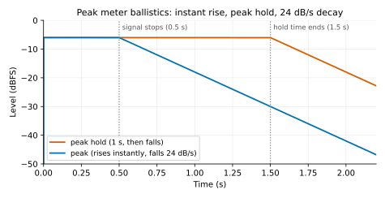
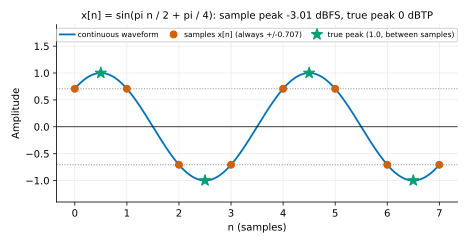
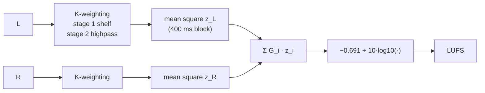
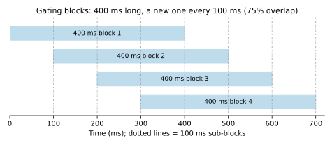
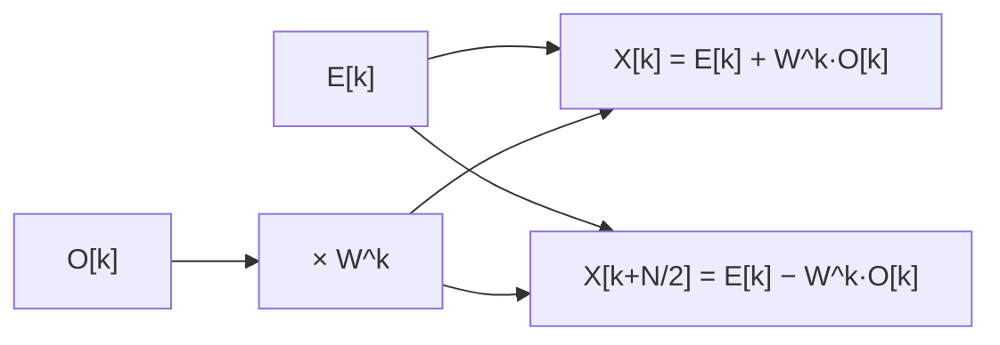
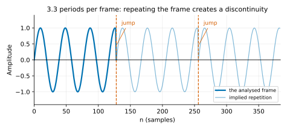
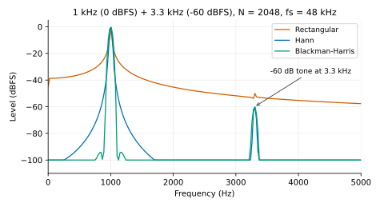
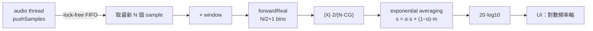
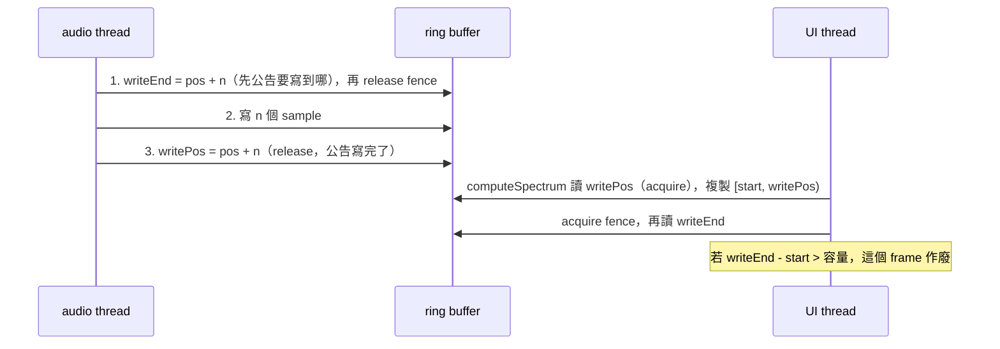

# 第 11 章：Metering 與 FFT 頻譜分析

[English](README.md) | **繁體中文**

> [教材首頁](../../README.zh-TW.md)　｜　上一章：[10 Modulation](../10-modulation/README.zh-TW.md)　｜　下一章：[12 Reverb](../12-reverb/README.zh-TW.md)

前十章我們一直在「改變」聲音；這一章要學會「看」聲音。打開任何一套 DAW，混音台每一軌都有一條跳動的 meter，
master 上有 loudness meter，EQ 外掛背後有一片即時的頻譜。這些東西看起來只是 UI，背後其實是一整套規範與數學：

- 一條 peak meter 為什麼跳上去很快、掉下來很慢？「慢」要多慢？
- 第 05 章說 limiter 的 ceiling 要設「-1 dBTP」而不是「-1 dBFS」，也先介紹了 LUFS 的公式——本章把 true peak 和 loudness 完整實作出來、實際量給你看。
- Spotify 說它把歌曲調到「-14 LUFS」——LUFS 到底怎麼算？為什麼兩首 peak 一樣高的歌，聽起來一首比另一首大聲很多？
- 頻譜分析儀怎麼在每秒 30 次的畫面更新裡，把 48000 個 sample 變成「哪個頻率有多少能量」？
- audio thread 不能等、不能鎖，那它算出來的東西要怎麼安全地交給 UI thread？

本章會從零寫出四個元件：`Fft`（自己實作 radix-2 FFT）、`LevelMeter`、`LoudnessMeter`（ITU-R BS.1770-4 / EBU R128）、
`SpectrumAnalyzer`（含 lock-free FIFO）。它們會直接用在第 12 章的 convolution reverb 與第 14 章 DAW 的混音台上。

## 1. 本章目標

讀完本章，你應該能夠：

- 說出 sample peak、true peak、RMS、VU、PPM、LUFS 各自量的是什麼、適合什麼場合，以及它們的 ballistics（反應速度）。
- 把「decay 24 dB/s」換算成每個 sample 的乘法係數；實作含 peak hold 的 peak meter 與滑動視窗 RMS。
- 依 ITU-R BS.1770-4 實作 loudness meter：K-weighting（兩級 biquad，含其他 sample rate 的重新設計）、
  channel 加權、400 ms block / 75% overlap、momentary / short-term / integrated、absolute 與 relative gating。
- 從定義推導 DFT 的直覺（「和每個頻率的正弦做相關」），推導 radix-2 Cooley-Tukey FFT 並說明為什麼是 $`O(N \log N)`$。
- 解釋 bin 解析度 $`f_s/N`$、spectral leakage、window 的 main lobe / side lobe 取捨、coherent gain 正規化。
- 用 exponential averaging 平滑頻譜、用對數頻率軸顯示。
- 用 single-producer / single-consumer 的 lock-free ring buffer 把資料從 audio thread 送到 UI thread。

## 2. 原理

### 2.1 Meter 的種類：到底在量什麼？

所有 meter 都在回答「訊號有多大」，但「大」有很多種定義：

| Meter | 量什麼 | 反應速度（ballistics） | 單位 | 用途 |
|---|---|---|---|---|
| **Sample peak** | 每個 sample 的 $`\lvert x[n]\rvert`$ 的最大值 | 瞬間上升；下降速度自訂（dB/s） | dBFS | 防止數位 clipping（DAW 混音台的預設） |
| **True peak** | 重建後連續波形的峰值（4x oversampling 估計） | 同上 | dBTP | 母帶、串流交付規範（例如 ≤ -1 dBTP） |
| **RMS** | 一段視窗內的均方根 $`\sqrt{\frac{1}{W}\sum x^2}`$ | 視窗長度決定（常見 300 ms） | dBFS | 「平均能量」，比 peak 接近聽感 |
| **VU** | 整流後的平均，經過有質量的指針 | 300 ms 到 99%，過衝 1~1.5% | VU | 類比時代的「音量感」，類比模擬外掛常用 |
| **PPM** | 準峰值（quasi-peak） | 積分時間約 5~10 ms；下降很慢（約 20 dB / 1.5 s 或 24 dB / 2.8 s，依 Type） | dB | 廣播（歐洲傳統） |
| **LUFS** | K-weighting 後的均方值，含 gating | momentary 400 ms / short-term 3 s / integrated 整段 | LUFS / LU | 響度標準（廣播、串流平台） |

幾個要先釐清的觀念：

- **dBFS**（dB relative to Full Scale）：0 dBFS = 數位系統能表示的最大值（float 裡的 ±1.0）。
  一個振幅 1.0 的正弦，peak 是 0 dBFS，RMS 是 $`1/\sqrt{2}`$ = **-3.01 dBFS**。
  （注意：有些 meter 依 AES17 把正弦的 RMS 也標成 0 dB，也就是 RMS 讀數 +3.01 dB；本章不做這個偏移。）
- **crest factor** = peak / RMS（以 dB 表示就是兩者的差）。正弦 3.01 dB，鼓組常常 15~20 dB，
  被 limiter 壓扁的流行歌可能只剩 6~8 dB。
- **peak 不等於響度**。兩首 peak 都是 -1 dBFS 的歌，一首壓得很扁、一首動態很大，前者聽起來可以大聲 10 dB 以上。
  這就是 2000 年代「loudness war」的根源，也是 LUFS 出現的原因。

### 2.2 Peak meter：hold 與 decay

#### 直覺

如果 meter 直接顯示「這個 block 的最大值」，畫面會每秒閃 30 次、根本看不清楚。所以 peak meter 有兩個慣例：

1. **瞬間上升**：新的峰值比目前讀數大，就立刻跳上去（不可以錯過任何一個 peak，這是 peak meter 的本分）。
2. **慢慢下降**：之後以固定的 **dB/s** 速度往下掉（常見 12~26 dB/s）。
3. 另外有一個 **peak hold** 標記：停在最近的最大值上一段時間（例如 1~2 s，或無限直到使用者點擊），再開始下降。



#### 數學：dB/s → 每個 sample 的係數

在 dB 域「每秒下降 $`D`$ dB」是一條直線；換回線性域就是**每個 sample 乘上同一個係數 $`g`$**：

```math
20\log_{10}\left(g^{f_s}\right) = -D \quad\Longrightarrow\quad g = 10^{-D / (20 f_s)}
```

$`D = 24`$ dB/s、$`f_s = 48`$ kHz → $`g = 10^{-24/960000} \approx 0.9999424`$（精確一點是 0.9999424370；
`LevelMeter` 用 float 存，所以 `l11_level_meter` 第一段印出的 float 值是 0.99994242——float 在 1 附近的間距約 $`6\times10^{-8}`$）。
這比「每個 block 減 $`D \cdot B / f_s`$ dB」好：與 block size 無關，而且不需要每個 sample 做 log。

hold 的邏輯：

```text
if |x| >= hold:      hold = |x|, counter = holdSamples
elif counter > 0:    counter -= 1
else:                hold = max(hold * g, peak)      // hold never falls below peak
```

（最後一行的意思：hold 永遠不低於 peak。）

### 2.3 RMS 與視窗長度

```math
\text{RMS}[n] = \sqrt{\frac{1}{W}\sum_{i=0}^{W-1} x[n-i]^2}
```

- 視窗 $`W`$ 太短（例如 10 ms）：低頻正弦的一個週期都裝不滿，讀數會跟著波形抖動。
  經驗法則：$`W`$ 至少要涵蓋最低關心頻率的好幾個週期。
- 視窗太長（例如 3 s）：反應太慢。音樂 meter 常用 **300 ms**（和 VU 的時間常數同一個數量級，接近人耳對「音量」的積分時間）。

**實作**：每來一個 sample 就重新加總 $`W`$ 個平方值是 $`O(W)`$。用 ring buffer 存最近 $`W`$ 個 $`x^2`$，
維護一個「視窗內的總和」：加上新的、減掉被擠出去的，每個 sample 只要 $`O(1)`$。
浮點的加加減減會累積誤差，所以每繞 ring 一圈就重新精確加總一次（攤平後仍是 $`O(1)`$）。

另一種常見做法是 exponential moving average（一階 lowpass）估計 $`E[x^2]`$，記憶體只要一個數字，
但它的「視窗」是指數衰減的、沒有明確的長度。本章的 `LevelMeter` 用真的滑動視窗；練習 7 的 correlation meter 用 EMA。

### 2.4 VU 與 PPM：有「質量」的 meter

VU meter（volume unit，IEC 60268-17）是 1939 年為電話與廣播設計的指針表。它不是 RMS，而是
**全波整流後的平均**，再通過指針本身的機械慣性：一個 0 VU 的正弦突然出現時，指針要在 **300 ms** 到達最終讀數的 99%，
並且過衝 1~1.5%。在數位系統裡用一個二階系統（彈簧 + 阻尼）模擬：

```math
\ddot p + 2\zeta\omega_n \dot p + \omega_n^2\,p = \omega_n^2\,u(t)
```

$`\zeta`$ 決定過衝（$`M_p = e^{-\pi\zeta/\sqrt{1-\zeta^2}}`$，$`\zeta = 0.82`$ → 1.11%），$`\omega_n`$ 決定快慢。
練習 4 會把它做出來。0 VU 在數位系統裡通常校準成 **-18 dBFS**（EBU R68）或 -20 dBFS 的正弦。

聽感上：VU 對鼓的每一下幾乎沒反應（10 ms 的 0 VU burst 只能把指針推到 −24.8 VU，練習 4 驗證；
指針有慣性，burst 結束後還會再往上走約 80 ms 才到最高點），
它反映的是「這一段聽起來多大聲」，所以很多混音師喜歡在類比模擬的 bus 上看 VU。

PPM（peak programme meter）則是廣播用的「準峰值」：積分時間只有 5~10 ms（比 VU 快很多，但仍會忽略極短的 transient），
下降非常慢，讓操作員看得清楚峰值。本章不實作 PPM——用 `LevelMeter` 的 peak 加上一個短的積分就能近似。

### 2.5 True peak：sample 之間的峰值

> 第 05 章 2.8 節已經介紹過 inter-sample peak 與 dBTP，第 05 章練習 4 也用 64 tap 的 polyphase FIR 做過一個簡易的 4x true-peak meter。
> 這裡快速複習，重點放在本章的做法：練習 3 直接重用第 06 章的 polyphase halfband `Oversampler`，並把第 05 章那一版當對照組，
> 用同一段訊號比較兩者的讀數誤差與 CPU 成本。

數位訊號只是連續波形的取樣，DAC 會用（近似）sinc 內插把 sample 之間補起來。**真正的峰值可能落在兩個 sample 之間**。
經典例子：$`f_s/4`$ 的正弦、相位 45°，每個 sample 都是 $`\pm 0.707`$（sample peak -3.01 dBFS），但連續波形的峰值是 1.0（0 dBTP）：



ITU-R BS.1770-4 Annex 2 的作法：把訊號 **4x oversampling**（48 kHz → 192 kHz，用 FIR 內插 filter），
在高取樣率下取 $`|x|`$ 最大值，單位 **dBTP**。4x 仍可能錯過一點點：Nyquist 附近的正弦，峰值可能剛好在兩個 4x sample 中間，
最多低估 $`20\log_{10}\cos(\pi/8) = 0.69`$ dB。所以串流平台與 EBU R128 都要求 true peak ≤ -1 dBTP 留餘裕。

練習 3 用本章的 meter 驗證了這個例子：sample peak −3.010 dBFS、4x true peak 0.000 dBTP，誤差是 0。
第 05 章練習 4 量同一種訊號（振幅 0.5）卻得到 −6.18 dBTP，比真正的 −6.02 低約 0.17 dB。差別在**插值點落在哪裡**：

- 第 06 章的 `Oversampler` 是兩級 2x halfband。halfband 升頻時有一個 phase 是純延遲（輸出就是原始 sample），
  所以兩級之後的 4 個點剛好落在原始 sample 之間的 0、1/4、1/2、3/4 處——1/2 正好踩到這個 $`f_s/4`$ 正弦的峰值。
- 第 05 章的 64 tap FIR 是偶數長度，中心不在整數上，4 個插值點落在 1/8、3/8、5/8、7/8 處，
  離峰值最近也差 1/8 sample（相位 11.25°），所以讀到 $`\cos 11.25° = 0.981`$ 倍（−0.17 dB）。

這不代表 halfband 版本「比較準」：換一個峰值落在 1/8 處的訊號，結果就反過來。練習 3 把 fs/4 正弦的相位從 0° 掃到 90°，
兩種 meter 的最差誤差都是 -0.17 dB，只是出現在對方量得最準的相位。真正的差別在別處（數字都來自練習 3，同一段訊號同時餵兩種 meter）：

| | `Oversampler`（兩級 halfband） | 第 05 章 64 tap windowed-sinc |
|---|---|---|
| 插值點位置 | 0、1/4、1/2、3/4 | 1/8、3/8、5/8、7/8 |
| 最差相位誤差（fs/4 正弦） | -0.17 dB | -0.17 dB |
| 22 kHz 正弦的讀數誤差 | 0.00 dB | -0.43 dB |
| hard clip 鼓組（FFT 理想內插 +5.30 dBTP） | +5.20 dBTP | +4.59 dBTP |
| 每個輸入 sample 的乘法數 | 56 | 64 |
| 實際計時（Release，依機器而異） | 約 20 ns / sample | 約 59 ns / sample |

hard clip 與撥弦這類素材有大量接近 Nyquist 的成分，正是兩種 filter 的頻率響應差最多的地方：64 tap 的 Hann window 讓
transition band 很寬，windowed-sinc 版比理想值低 0.7～1.2 dB，halfband 版只低 0.1～0.75 dB。乘法數只差 14%，
實際速度卻差 3 倍左右，原因是內迴圈的寫法（連續記憶體、float 累加、沒有分支，見練習 3 解答）。

hard clip 過的訊號 inter-sample peak 特別嚴重：練習 3 把鼓組推 +12 dB 再 clip 到 0 dBFS，true peak 是 **+5.20 dBTP**。
這種母帶轉成 AAC / MP3（lossy codec 會重建波形並加入量化誤差）之後就會 clip。

### 2.6 Loudness：ITU-R BS.1770-4 與 EBU R128

第 05 章 2.10 節已經提過 LUFS 的公式與串流平台的 target；本章把它完整實作出來：K-weighting 的係數怎麼來、
400 ms block 怎麼切、gating 怎麼在 audio thread 上不 allocate 地完成。

#### 為什麼不能直接用 RMS？

人耳對不同頻率的敏感度不同（等響曲線）：同樣能量的 50 Hz 和 3 kHz，3 kHz 聽起來大聲得多。
BS.1770 用一個很簡單的 filter 近似這件事，叫 **K-weighting**，再算均方值。它故意簡單（兩個 biquad），
這樣任何廠商都能做出一模一樣的數字——這比「完美模擬人耳」更重要。



#### K-weighting：兩級 biquad

| stage | 形狀 | 作用 |
|---|---|---|
| 1. pre-filter | high shelf，中點約 1.7 kHz，高頻 +4 dB | 模擬頭部（一個「球」）對高頻的聲學增益 |
| 2. RLB filter | 二階 highpass，約 38 Hz（-6 dB 點）| 「revised low-frequency B-curve」，去掉耳朵不太敏感的極低頻 |

規範只給 **48 kHz** 的係數（$`a_0`$ 正規化為 1）：

| | $`b_0`$ | $`b_1`$ | $`b_2`$ | $`a_1`$ | $`a_2`$ |
|---|---|---|---|---|---|
| stage 1 | 1.53512485958697 | −2.69169618940638 | 1.19839281085285 | −1.69065929318241 | 0.73248077421585 |
| stage 2 | 1.0 | −2.0 | 1.0 | −1.99004745483398 | 0.99007225036621 |

**其他 sample rate 不能直接用這組係數**（數位 filter 的頻率是相對於 $`f_s`$ 的，44.1 kHz 套 48 kHz 的係數，整條曲線會往低頻移 8%）。
`l11_loudness` 印了這個反例：44.1 kHz 誤用 48 kHz 係數表時，997 Hz 的增益變成 +0.900 dB（正確是 +0.694 dB）、
2 kHz 變成 +3.30 dB（正確 +3.08 dB）——量出來的 LUFS 會偏高約 0.2 LU，剛好是 EBU 允許誤差的量級，很難察覺。
要回到類比原型重新做 bilinear transform。把上表反推回類比參數（libebur128 等開源實作也用同一組）。
stage 1 的類比原型是一個二階 high shelf（$`s`$ 已對 $`\omega_0 = 2\pi f_0`$ 正規化）：

```math
H_1(s) = \frac{V_h\, s^2 + V_b\, s/Q + 1}{s^2 + s/Q + 1}
```

- $`s \to 0`$（DC）時 $`H_1 = 1`$（0 dB）；$`s \to \infty`$（高頻）時 $`H_1 = V_h`$。所以 **$`V_h`$ 是高頻端的線性增益**：
  $`V_h = 10^{G/20}`$，$`G = 3.99984`$ dB（約 +4 dB）。
- **$`V_b`$ 是分子中間項的係數，決定過渡帶（$`f_0`$ 附近）的增益**：$`V_b = V_h^{0.49967}`$，指數約 0.5，
  也就是 $`V_b \approx \sqrt{V_h}`$——以 dB 計大約是高頻增益的一半（+2.00 dB），讓 shelf 從 0 dB 平順地爬到 +4 dB。
  （在 $`f_0`$ 處實際的增益是 $`|H_1(j)| = \sqrt{V_b^2 + Q^2(V_h-1)^2}`$ = +2.44 dB，因為分母的 $`Q`$ 也會影響過渡帶的形狀。）
- $`f_0 = 1681.974`$ Hz、$`Q = 0.70718`$。

這些數字（包括 0.49967 這個指數）都是從規範的 48 kHz 係數反推出來的，不是額外的設計選擇——我們只是找一組類比參數，
讓它在 48 kHz 做完 bilinear transform 剛好還原出規範的表，然後在其他 sample rate 用同一組參數重新轉換。

bilinear transform 用 $`s = \frac{1}{K}\cdot\frac{1 - z^{-1}}{1 + z^{-1}}`$、$`K = \tan(\pi f_0 / f_s)`$（這個 $`K`$ 讓 $`f_0`$ 剛好映射到 $`f_0`$）。
代入 $`H_1(s)`$、上下同乘 $`K^2(1+z^{-1})^2`$，展開成 $`z^{-1}`$ 的多項式就得到：

```math
b_0 = \frac{V_h + V_b K/Q + K^2}{a_0},\quad b_1 = \frac{2(K^2 - V_h)}{a_0},\quad b_2 = \frac{V_h - V_b K/Q + K^2}{a_0},\quad
a_1 = \frac{2(K^2-1)}{a_0},\quad a_2 = \frac{1 - K/Q + K^2}{a_0}
```

其中 $`a_0 = 1 + K/Q + K^2`$。

- stage 2：二階 highpass $`H_2(s) = \dfrac{s^2}{s^2 + s/Q + 1}`$，$`f_0 = 38.135`$ Hz、$`Q = 0.50033`$，分子固定 $`1, -2, 1`$（規範的表就是這樣，沒有除以 $`a_0`$），分母同上式。

`l11_loudness` 會印出兩組係數並驗證差異只有 $`8.9\times10^{-16}`$，再列出 44.1 / 48 / 96 kHz 的頻率響應——三條曲線幾乎一致：

| 頻率 | 20 Hz | 38 Hz | 100 Hz | 997 Hz | 2 kHz | 5 kHz | 16 kHz |
|---|---|---|---|---|---|---|---|
| K-weighting @ 48 kHz | −13.28 dB | −6.00 dB | −1.13 dB | **+0.691 dB** | +3.07 dB | +4.01 dB | +4.04 dB |
| 重新設計 @ 44.1 kHz | −13.27 dB | −6.00 dB | −1.13 dB | +0.694 dB | +3.08 dB | +4.02 dB | +4.05 dB |
| 重新設計 @ 96 kHz | −13.30 dB | −6.02 dB | −1.16 dB | +0.674 dB | +3.05 dB | +3.99 dB | +4.02 dB |

（三條曲線相差 < 0.03 dB，`l11_loudness` 用 `DAWLAB_CHECK` 驗證 < 0.05 dB。剩下的一點差異來自 bilinear transform
的頻率扭曲在不同 $`f_s`$ 下不完全相同，以及規範的 48 kHz 係數本身只有有限位數。）

注意 stage 1 **不是** RBJ cookbook 的 high shelf：RBJ 的 shelf「corner」定義在增益一半的地方，而且分子分母的 $`Q`$ 用法不同，
不能直接把 $`f_0`$、$`Q`$、gain 丟進第 02 章的 `makeHighShelf()`。我們仍然用第 02 章的 `Biquad`（TDF-II）來跑這組係數。

#### 從 mean square 到 LUFS

對每個 channel $`i`$，在一段時間 $`T`$ 內算 K-weighted 訊號 $`y_i`$ 的 mean square：

```math
z_i = \frac{1}{T}\int_0^T y_i^2(t)\,dt \;\approx\; \frac{1}{N}\sum_n y_i[n]^2
```

再加權相加、換成對數：

```math
L_K = -0.691 + 10\log_{10}\sum_i G_i\, z_i \quad \text{[LUFS]}
```

- **$`G_i`$**：L、R、C = 1.0；左右環繞 Ls、Rs = 1.41（約 +1.5 dB，後方的聲音聽起來比較大聲）；LFE 不計。
- **為什麼是 $`10\log_{10}`$ 而不是 $`20\log_{10}`$**：$`z`$ 已經是「平方」（功率）了。
- **−0.691 從哪來**：K-weighting 在 997 Hz 的增益是 +0.691 dB。減掉它，讓「0 dBFS 的 997 Hz 正弦送進單一聲道」
  正好讀 $`10\log_{10}(0.5) = -3.01`$ LUFS（正弦的 mean square = $`A^2/2`$）。
  所以 **-20 dBFS 的 997 Hz 正弦 → −23.01 LUFS**，這是規範的驗證條件，也是 `l11_loudness` 第 2 段量到的數字。
- **兩聲道送同一個訊號**：$`\sum G_i z_i`$ 變成兩倍 → **+3.01 LU** → −20.00 LUFS（`l11_loudness` 第 3 段）。
  聽起來確實比單一聲道大聲——兩個喇叭都在響。
- **LU**（loudness unit）是 LUFS 的「差值」單位，1 LU = 1 dB。

#### 400 ms block、75% overlap、momentary / short-term / integrated



- **momentary**：最近 400 ms（一個 block），反應快，像一條比較穩的 meter。
- **short-term**：最近 3 s（EBU Tech 3341），用來看段落的響度、算 LRA。
- **integrated**：從按下「開始」到現在**所有** block 的平均，但要經過兩道 gate。這就是串流平台說的「這首歌 -14 LUFS」。

實作技巧：不必每 100 ms 把 400 ms 的資料重新平方加總。我們以 100 ms 為單位累積平方和（子區塊），
momentary = 最近 4 個子區塊、short-term = 最近 30 個子區塊的平均。每個 sample 只做一次平方累加。

#### Gating：為什麼要排除靜音？

如果一首歌中間有 10 秒的靜音，直接平均會把 integrated 拉低，但聽眾不會覺得「這首歌比較小聲」。BS.1770-4 用兩道 gate：

1. **absolute gate**：丟掉 loudness < **−70 LUFS** 的 block（幾乎是靜音）。
2. **relative gate**：算出通過第一道的 block 的平均 $`\bar L`$（**在功率域平均**），丟掉 < $`\bar L - 10`$ LU 的 block。
3. integrated = 通過兩道 gate 的 block 的功率平均：

```math
\Gamma_r = -0.691 + 10\log_{10}\Big(\frac{1}{|J_a|}\sum_{j\in J_a}\sum_i G_i z_{ij}\Big) - 10,\qquad
L_{\text{int}} = -0.691 + 10\log_{10}\Big(\frac{1}{|J_g|}\sum_{j\in J_g}\sum_i G_i z_{ij}\Big)
```

$`J_a`$ 是通過 absolute gate 的 block，$`J_g`$ 是兩道都通過的。`l11_loudness` 第 4 段：3 s 的 −20 dBFS → 3 s 靜音 → 3 s 的 −50 dBFS：

| | 數值 |
|---|---|
| 不 gating，直接平均 9 s 的功率 | −27.78 LUFS（被靜音稀釋） |
| gating 後的 integrated（實測） | **−23.23 LUFS** |
| 理論值 | 27 個完整 block（功率 $`P`$）+ 跨邊界的 3 個 block（$`\tfrac34P, \tfrac24P, \tfrac14P`$）→ $`-23.01 + 10\log_{10}(28.5/30) = -23.23`$ |

靜音 block 被 absolute gate 擋掉；−53 LUFS 的 block 低於 relative gate（約 −36 LUFS）也被擋掉。

**實作上的難題**：integrated 需要「所有 block 的 loudness」，用 `std::vector` 一直 push 會在 audio thread allocate。
`LoudnessMeter` 改用**直方圖**：[−70, +10) LUFS 以 0.1 LU 切成 800 格，每格記錄 block 數與功率總和。
relative gate 以格中心判斷，誤差最多 0.05 LU，而且記憶體固定、完全不 allocate。

#### LRA（Loudness Range）

integrated 告訴你「平均多大聲」，LRA（EBU Tech 3342）告訴你「大聲和小聲的段落差多少」：
把 short-term loudness 的分布（先過 −70 LUFS 與 **−20 LU** relative gate）取第 95 百分位數減第 10 百分位數。
流行歌常見 4~8 LU，古典樂可達 15~20 LU。練習 5 會實作它。

#### 串流平台與廣播的 target

| 場合 | integrated target | true peak 上限 |
|---|---|---|
| EBU R128（歐洲廣播） | −23 LUFS（±0.5） | −1 dBTP |
| ATSC A/85（美國廣播） | −24 LKFS | −2 dBTP |
| Spotify、YouTube、Tidal 等 | 約 −14 LUFS | 約 −1 dBTP |
| Apple Music | 約 −16 LUFS | 約 −1 dBTP |

（串流平台的數字是「播放時的正規化目標」，各家會調整，請以官方文件為準。LKFS 與 LUFS 是同一個東西的兩種名稱。）

重要觀念：平台會**把太大聲的歌往下調**。把母帶壓到 −8 LUFS 不會讓它在 Spotify 上更大聲，只會讓它被調低 6 dB 而且失去動態。
`l11_loudness` 第 5 段量了合成的鼓組（−16.67 LUFS、sample peak −2.92 dBFS）：要推到 −14 LUFS 得加 2.7 dB，
sample peak 會到 −0.24 dBFS，已經超過 −1 dBTP——這時候就需要第 05 章的 limiter。

### 2.7 DFT：把訊號和每個頻率的正弦做相關

#### 直覺

想知道訊號 $`x[n]`$ 裡「有多少 440 Hz」？拿一個 440 Hz 的正弦 $`s[n]`$ 和它逐點相乘再加總：$`\sum x[n]\,s[n]`$。
如果 $`x`$ 裡有 440 Hz 而且相位對齊，乘積大多是正的，總和很大；如果沒有，正負互相抵消，總和接近 0。
這就是**相關**（correlation）。問題是相位：如果 $`x`$ 的 440 Hz 是 cos 而我們拿 sin 去比，總和也會是 0。
解法是同時跟 cos 和 sin 比——用複數 $`e^{-j\omega n} = \cos\omega n - j\sin\omega n`$ 一次做完：

```math
X[k] = \sum_{n=0}^{N-1} x[n]\, e^{-j 2\pi k n / N},\qquad k = 0, 1, \dots, N-1
```

$`|X[k]|`$ 是「第 $`k`$ 個頻率有多少」，$`\arg X[k]`$ 是它的相位。第 $`k`$ 個 bin 的頻率是

```math
f_k = k \cdot \frac{f_s}{N}
```

所以 **bin 寬（頻率解析度）$`\Delta f = f_s / N`$**。48 kHz、N = 2048 → 23.4375 Hz。想要更細的解析度，只能加大 N，
也就是**看更長的一段時間**——頻率解析度和時間解析度是一個蹺蹺板。

逆轉換（IDFT）幾乎一模一樣，只差旋轉方向與 $`1/N`$：

```math
x[n] = \frac{1}{N}\sum_{k=0}^{N-1} X[k]\, e^{+j 2\pi k n / N}
```

#### 實數訊號的對稱性

音訊是實數。把 $`k`$ 換成 $`N-k`$：$`e^{-j2\pi(N-k)n/N} = e^{+j2\pi kn/N}`$，所以

```math
X[N-k] = \overline{X[k]}\qquad(\text{共軛對稱})
```

後半段完全是前半段的鏡像，**只需要保留 $`k = 0 \dots N/2`$，共 $`N/2 + 1`$ 個 bin**：bin 0 是 DC，bin $`N/2`$ 是 Nyquist（$`f_s/2`$），
這兩個是實數。`Fft::forwardReal()` 只輸出這 $`N/2+1`$ 個 bin，`inverseReal()` 用對稱性把另一半補回來。

#### 振幅與 dB

一個振幅 $`A`$、正好落在 bin $`k`$ 中心的正弦 $`A\cos(2\pi k n/N)`$，能量平分在 bin $`k`$ 與 bin $`N-k`$，每邊 $`|X[k]| = AN/2`$。所以

```math
A = \frac{2\,|X[k]|}{N} \qquad(\text{DC 與 Nyquist 沒有鏡像，係數是 } 1/N)
```

加了 window 之後還要再除以 coherent gain（2.9 節）。換成 dB：$`20\log_{10} A`$（振幅）或 $`10\log_{10}|X|^2`$（功率），兩者相同。

### 2.8 FFT：radix-2 Cooley-Tukey

直接照定義算 DFT：N 個輸出、每個加總 N 項 → $`O(N^2)`$。N = 4096 時是 1600 萬次複數乘加，一秒要做 30 次就很吃力。

#### 推導

令 $`W_N = e^{-j2\pi/N}`$（旋轉因子，twiddle factor）。把 $`x[n]`$ 拆成偶數項與奇數項（decimation in time）：

```math
X[k] = \sum_{m=0}^{N/2-1} x[2m]\,W_N^{2mk} + \sum_{m=0}^{N/2-1} x[2m+1]\,W_N^{(2m+1)k}
```

因為 $`W_N^{2mk} = W_{N/2}^{mk}`$：

```math
X[k] = \underbrace{\sum_m x[2m]\,W_{N/2}^{mk}}_{E[k]\text{：偶數項的 } N/2 \text{ 點 DFT}} + W_N^k \underbrace{\sum_m x[2m+1]\,W_{N/2}^{mk}}_{O[k]\text{：奇數項的 } N/2 \text{ 點 DFT}}
```

$`E`$、$`O`$ 以 $`N/2`$ 為週期，而且 $`W_N^{k+N/2} = -W_N^k`$，所以後半段不用重算：

```math
\boxed{X[k] = E[k] + W_N^k\,O[k],\qquad X[k + N/2] = E[k] - W_N^k\,O[k]},\qquad k = 0 \dots N/2-1
```

這一對式子叫 **butterfly**（蝴蝶）：



一個 N 點 DFT = 兩個 N/2 點 DFT + N/2 個 butterfly。遞迴下去：

```math
T(N) = 2\,T(N/2) + O(N) \;\Longrightarrow\; T(N) = O(N\log_2 N)
```

總共 $`\log_2 N`$ 層、每層 $`N/2`$ 個 butterfly（各一次複數乘法）。N = 4096：$`N^2 / (N\log_2 N) = 4096/12 \approx 341`$ 倍的差距。

#### 迭代寫法與 bit reversal

遞迴到最底層時，輸入的順序是「index 的二進位倒過來」。N = 8：

| | | | | | | | | |
|---|---|---|---|---|---|---|---|---|
| index | 0 | 1 | 2 | 3 | 4 | 5 | 6 | 7 |
| 二進位 | 000 | 001 | 010 | 011 | 100 | 101 | 110 | 111 |
| 倒過來 | 000 | 100 | 010 | 110 | 001 | 101 | 011 | 111 |
| **新的順序** | **0** | **4** | **2** | **6** | **1** | **5** | **3** | **7** |

所以 `Fft` 先做一次 bit-reversal 排列，再由小到大做 $`\log_2 N`$ 層 butterfly（長度 2、4、8……N）。
twiddle factor 與 bit-reversal 表在建構時算好（會 allocate），之後的 `forward()` / `inverse()` 完全不配置記憶體。

#### 驗證

`l11_fft_basics` 把 FFT 和照定義算的 naive DFT（double 累加）比對：

| N | forward 最大誤差 | inverse 最大誤差 |
|---|---|---|
| 16 | 4.9e-7 | 1.2e-7 |
| 1024 | 8.6e-6 | 3.6e-7 |
| 4096 | 2.3e-5 | 4.8e-7 |

（輸入是 $`|x| \le 1`$ 的亂數；forward 的輸出量級是 $`\sqrt N`$，所以絕對誤差隨 N 增加，相對誤差維持在 float 精度 $`10^{-7}`$ 左右。）
並用 Goertzel（`Analysis.h`）交叉驗證單一頻率的振幅。

計時（Debug 組態、作者機器上的某一次執行，只看趨勢；Release 會快很多，每次執行也會有 ±30% 以上的浮動）：

| N | FFT | naive DFT | 倍數 |
|---|---|---|---|
| 256 | 0.05 ms | 1.7 ~ 3.4 ms | 34 ~ 68 |
| 1024 | 0.24 ~ 0.28 ms | 27 ~ 32 ms | 110 ~ 113 |
| 4096 | 1.2 ms | 448 ~ 488 ms | 375 ~ 415 |
| 16384 | 5.4 ~ 9.3 ms | （略過） | |

倍數隨 N 增加，與理論的 $`N / \log_2 N`$ 同一個數量級（4096 時理論 341）。self-check 只要求 N = 4096 時至少快 20 倍，
避免機器忙碌時誤判。

### 2.9 Window 與 spectral leakage

#### leakage 從哪來

DFT 只看到 N 個 sample，並**隱含地假設它們無限循環**。如果 frame 裡的正弦不是整數個週期，首尾接起來會有一個跳躍：



從頻域看：「只取 N 個 sample」= 乘上一個 rectangular window；時域相乘 = 頻域卷積。
所以真正的頻譜（一根線）被卷上 rectangular window 的頻譜——一個 sinc：中間的 **main lobe** 加上兩側緩慢衰減的 **side lobe**（最高 −13 dB）。

#### window 的取捨

在取樣之前先乘上一個兩端漸漸變 0 的函數 $`w[n]`$，消除接縫的跳躍。代價：main lobe 變寬（頻率分辨能力下降）。

| window | 公式（$`t = 2\pi n/(N-1)`$） | coherent gain | −3 dB 寬（bin） | 最高 side lobe | scalloping loss |
|---|---|---|---|---|---|
| Rectangular | $`1`$ | 1.00 | 0.88 | −13.3 dB | 3.92 dB |
| Hann | $`0.5 - 0.5\cos t`$ | 0.50 | 1.44 | −31.5 dB | 1.42 dB |
| Hamming | $`0.54 - 0.46\cos t`$ | 0.54 | 1.30 | −42.7 dB | 1.75 dB |
| Blackman-Harris（4 項） | $`0.35875 - 0.48829\cos t + 0.14128\cos 2t - 0.01168\cos 3t`$ | 0.36 | 1.90 | −92.0 dB | 0.82 dB |

表中的數字全部是 `l11_window_leakage` 用 16 倍 zero-padding 把 window 的 DTFT 取樣得很密、實際量出來的
（**scalloping loss** = 正弦剛好落在兩個 bin 正中間時，峰值讀數比在 bin 中心時低多少），並以 `DAWLAB_CHECK`
和 Harris（1978）的理論值比對：0.89 / 1.44 / 1.30 / 1.90 bin、−13.3 / −31.5 / −42.7 / −92 dB、3.92 / 1.42 / 1.78 / 0.83 dB。
唯一的差異是 Hamming 的 scalloping：Harris 的表寫 1.78 dB，直接代公式
$`\frac{0.54\,\text{sinc}(\frac12) + 0.23\,[\text{sinc}(\frac12) + \text{sinc}(\frac32)]}{0.54} = 0.8174`$ → 1.75 dB，與實測一致。

規則很簡單：**side lobe 越低，main lobe 越寬**。沒有萬用的 window：

- 要看很小的訊號（雜訊底、−90 dB 的諧波）→ Blackman-Harris。
- 要分辨兩個很近、差不多大的頻率 → Rectangular / Hann，而且 N 要大。
- 一般的頻譜分析儀 → **Hann**（平衡、side lobe 每八度再掉 18 dB），這也是 `SpectrumAnalyzer` 的預設。

`l11_window_leakage` 的測試訊號是 0 dBFS 的 1 kHz 加上 **−60 dBFS 的 3.3 kHz**（N = 2048，1000 Hz 落在 bin 42.67）：

| window | 1 kHz 讀數 | bin ±10 | 3.3 kHz 附近 |
|---|---|---|---|
| Rectangular | −1.67 dB | −30 / −32 dB | −50 dB（被 leakage 淹沒，看不到 −60 dB 的音） |
| Hann | −0.63 dB | −70 / −72 dB | **−60.2 dB**（清楚看到） |
| Hamming | −0.77 dB | −47 / −49 dB | −57.8 dB（勉強） |
| Blackman-Harris | −0.37 dB | −99 / −100 dB | **−60.1 dB** |

ASCII 頻譜（實際輸出，0~5 kHz 線性軸，每欄 78 Hz，取欄內最大值）：

```text
---- Rectangular ----
      0 dB |                                                                |
    -10 dB |            #                                                   |
    -20 dB |           ###                                                  |
    -30 dB |          #####                                                 |
    -40 dB |####################                                            |
    -50 dB |##################################                              |
    -60 dB |################################################################|
    ...
---- Hann ----
      0 dB |                                                                |
    -10 dB |            #                                                   |
    -20 dB |            ##                                                  |
    -30 dB |            ##                                                  |
    -40 dB |           ###                                                  |
    -50 dB |           ####                                                 |
    -60 dB |           ####                                                 |
    -70 dB |          ######                         ##                     |
    -80 dB |        #########                        ##                     |
    -90 dB |      #############                      ##                     |
   -100 dB |   ###################                   ##                     |
   -110 dB |##########################..............####....................|
```

Rectangular 那張的 -60 dB 那一列整排都是 `#`：leakage 的裙襬蓋住了一切。Hann 那張的 -70 dB 那一列右邊多出來的兩個 `#` 就是 3.3 kHz 的 -60 dB 音。
下面的圖把同樣的訊號畫成曲線，並加上 Blackman-Harris window（rectangular 的裙襬淹沒了微弱的音，Hann 與 Blackman-Harris 都能清楚看到）：



1 kHz 的讀數不是 0 dB，是因為 1000 Hz 不在 bin 中心（偏 0.33 bin），這叫 **scalloping loss**。理論值：
rectangular 的響應是 $`\text{sinc}(\delta)`$，$`\delta = 1/3`$ → $`\frac{\sin(\pi/3)}{\pi/3} = 0.827`$ → **−1.65 dB**；
Hann 是 $`\frac{\text{sinc}(\delta)}{1-\delta^2} = 0.930`$ → **−0.63 dB**。實測 −1.67 dB 與 −0.63 dB，吻合到 0.02 dB
（`l11_window_leakage` 以 ±0.1 dB 檢查）。最壞情況是正弦落在兩個 bin 正中間（$`\delta = 0.5`$），損失就是上表的 scalloping loss。

#### 正好在 bin 中心時「看不到」leakage

同一支範例的第二張表用 1007.8125 Hz（正好 bin 43，整數個週期）：rectangular 的 bin 44 是 −200 dB——
因為 sinc 的零點剛好落在每一個 bin 上，FFT 只在零點取樣。裙襬其實還在，只是沒被取樣到。
Hann 的 bin 44 是 −6 dB：那是 main lobe 本身比較寬（±2 bin），不是 leakage。

> 小細節：本章的 `makeWindow()` 產生 **symmetric** window（分母 $`N-1`$）。頻譜分析有時用 **periodic** window（分母 $`N`$），
> 它的零點剛好落在 bin 上（Hann 的 bin ±2 會是 −∞）。兩者差異很小；symmetric 版本在濾波器設計時比較常用。

#### Coherent gain 與正規化

window 把訊號整體縮小了：bin 中心正弦的讀數變成原本的 $`\text{CG} = \frac1N\sum w[n]`$ 倍（Hann 0.5 = −6.02 dB）。補償：

```math
A = \frac{2\,|X[k]|}{N \cdot \text{CG}}
```

`SpectrumAnalyzer` 這樣正規化，所以 full-scale 正弦讀 0 dBFS（第二張表每個 window 的 bin 43 都是 0.000 dB）。

> 注意：這個正規化是針對「正弦」的。寬頻雜訊的能量分散在所有 bin，每個 bin 的讀數會隨 N 改變（N 加倍、每個 bin 低 3 dB），
> 要比較雜訊位準得用功率頻譜密度與 window 的 ENBW（equivalent noise bandwidth），本章不深入。

### 2.10 即時頻譜：overlap、平滑、對數頻率軸



- **overlap**：frame 之間重疊。hop = $`N(1 - \text{overlap})`$。overlap 50%、N = 4096 → 每 2048 個新 sample 算一次（48 kHz 時每秒 23 次）。
  overlap 越大更新越頻繁、越不會漏掉 frame 邊緣（window 兩端權重接近 0）的事件，代價是計算量。
- **exponential averaging**：$`s[k] \leftarrow \alpha\,s[k] + (1-\alpha)\,m[k]`$，在**線性振幅**上做（在 dB 上平均會偏低）。
  $`\alpha = 0.8`$、hop 2048 @ 48 kHz：每個 frame 衰減到 0.8 倍 = −1.94 dB，約 45 dB/s 的下降速度——跟 peak meter 的 decay 是同一個概念。
  `l11_spectrum_analyzer` 最後的對照：440 Hz 突然停止時，$`\alpha = 0`$ 的靜音後第一個 frame 還含有一半的正弦（50% overlap），
  讀 −18.7 dB，第二個 frame 就掉到 −100 dB；$`\alpha = 0.8`$ 每 43 ms 約掉 2 dB。
  範例實測：靜音後每個 frame 下降 1.94 dB，與 $`20\log_{10}0.8 = -1.94`$ dB 相同（有 self-check）。
  第一個 frame 直接採用（不從 0 開始平滑），否則剛開始的幾個 frame 會讀得太低。
- **校準**：`l11_spectrum_analyzer` 也驗證了正規化——振幅 0.5（−6.02 dBFS）、正好在 bin 100 的正弦讀 **−6.02 dB**；
  頻率改成 bin 100.5（兩個 bin 正中間）時讀 −7.44 dB，少的 1.42 dB 正是 Hann 的 scalloping loss。
  同理，範例裡 440 Hz 的正弦（落在 bin 37.55，偏 0.45 bin）讀 −7.2 dB 而不是 −6.0 dB。
- **對數頻率軸**：人耳對音高是對數感知的（每個八度同樣重要）。線性軸上 20 Hz~1 kHz 只佔 5% 的寬度，所以頻譜分析儀幾乎都用對數軸：

```math
\text{column}(f) = C \cdot \frac{\ln f - \ln f_{\text{low}}}{\ln f_{\text{high}} - \ln f_{\text{low}}}
```

  高頻區好幾個 bin 擠在同一欄（取最大值），低頻區一個 bin 橫跨好幾欄（N = 4096 時 bin 寬 11.7 Hz，20~40 Hz 只有兩個 bin）。
  所以想看清楚低頻就要更大的 N——這又回到時間 / 頻率解析度的取捨。

### 2.11 audio thread → UI thread：lock-free FIFO

audio thread 每 10 ms 左右必須交出一個 block，不能等任何東西。如果它要拿 mutex，而 UI thread 正好拿著 mutex 在畫圖（或被作業系統暫停），
audio 就會斷掉（dropout）。所以 meter 與頻譜的資料傳遞必須是 **lock-free** 的。兩種情況：

1. **單一數值**（peak、RMS、LUFS、gain reduction）：直接用 `std::atomic<float>`，audio thread `store`、UI thread `load`，
   `memory_order_relaxed` 就夠了（我們只需要「讀到某個完整的值」，不需要和其他資料的先後順序）。
2. **一串 sample**（頻譜分析需要最近 N 個 sample）：用 single-producer / single-consumer（SPSC）ring buffer。

```text
                       ring buffer (capacity 4N, a power of two)
audio thread   +---+---+---+---+---+---+---+---+---+---+---+---+
pushSamples -->| x | x | x | x | x | x | x | x |   |   |   |   |
               +---+---+---+---+---+---+---+---+---+---+---+---+
                 ^ start = writePos - N          ^ writePos
```

ring buffer 的容量是 4N（2 的冪次，所以用 `& mask` 取代 `%`）；`writePos` 是 atomic、單調遞增的 uint64；`start = writePos − N` 是 consumer 要複製的最新 N 個 sample 的起點。
producer 與 consumer 的動作順序如下：



關鍵細節：

- producer 先寫資料、再用 `memory_order_release` 更新 `writePos`；consumer 用 `memory_order_acquire` 讀 `writePos`，
  保證「看到新的 writePos 時，之前寫的 sample 一定也看得到」。
- **覆寫偵測要看 `writeEnd`，不能只看 `writePos`**。`writePos` 要等整個 push 寫完才更新；如果 consumer 複製到一半時，
  有一個**還沒結束**的 push 已經繞一圈蓋掉了 consumer 正在讀的格子，`writePos` 仍是舊值，「writePos − start > 容量」的檢查會放行，
  frame 就變成新舊資料拼起來的。這在一次 push 的長度 $`n > 3N`$ 時一定可能發生（例如 N = 64、block 512），
  在一般的 block 大小下也可能發生（UI thread 複製到一半被作業系統暫停）。所以 producer 在寫 sample **之前**先把 `writeEnd`
  公告出去，再放一個 release fence；consumer 複製完放一個 acquire fence 再讀 `writeEnd`。只要 consumer 讀到任何一個被新 push
  蓋過的 sample，fence 的同步規則就保證它也看得到那次 push 的 `writeEnd`（這是 **seqlock** 的標準寫法）。
  作者另外寫了一個壓力測試（不在本章範例裡；N = 16 / 64、每次 push 512 個 sample、兩個 thread 全速跑、每輪約 10 萬個 frame）：
  只看 `writePos` 的版本 12 輪裡有 33 個新舊拼接的 frame 沒被擋下來，改看 `writeEnd` 之後 12 輪都是 0 個。
  這類 bug 每 10 萬個 frame 才出現幾個，靠「跑跑看沒事」是找不到的，要靠推理每一個交錯的可能。
- consumer 每次只取**最新的 N 個 sample**，不是依序消費。UI 慢了也不會越積越多，只會跳過中間的 frame——頻譜顯示本來就只在乎最新的狀態。
- ring 的元素用 `std::atomic<float>`（relaxed）：在 C++ 記憶體模型裡，兩個 thread 同時讀寫同一個非 atomic 的 float 是 data race（未定義行為），
  即使在 x86 上實際上沒事。relaxed 的 atomic float 讀寫在 x86 / ARM 上就是普通的 load / store，沒有額外成本。
- `writePos` 用 64-bit 計數器，永不歸零（以 48 kHz 要跑幾百萬年才會溢位），避免「讀寫位置相等時到底是空還是滿」的經典問題。

`l11_spectrum_analyzer` 的最後一段真的開一個 `std::thread` 當 audio thread、全速推 1 kHz 正弦（不照真實時間，盡快推），
主 thread 當 UI thread 一直讀，直到拿到 50 個 frame 為止。怎麼判斷一個 frame 是「壞的」？如果 FIFO 寫錯，frame 會由
新舊兩段資料拼成，接縫的不連續會讓能量漏到整個頻帶；乾淨的 Hann frame 在 5 kHz 以上應該是 −100 dB（我們的下限）。
所以 self-check 要求：每個 frame 的最強 bin 在 1 kHz，**而且** 5 kHz 以上的最大讀數 < −80 dB。實測壞 frame 0 個、
5 kHz 以上最大 −100.0 dB。audio thread 在這段期間推了上千個 block（一千多到七千多都出現過，每次執行差很多，取決於 thread 排程）——
50 個 frame 只用到其中一小部分的資料，這正是 UI「跳過 frame、只看最新」的行為。

第 14 章的 DAW 會用同樣的模式：每一軌一個 `LevelMeter`（atomic 讀數），master 上一個 `SpectrumAnalyzer`，UI timer 每秒 30 次去讀。

## 3. 從公式到程式碼

### 3.1 `Fft.h`

```cpp
namespace dawlab::dsp {
enum class WindowType { Rectangular, Hann, Hamming, BlackmanHarris };
const char* windowTypeName(WindowType);
void naiveDft(const std::complex<float>* in, std::complex<float>* out, int n, bool inverse = false); // O(N²)，驗證用

class Fft {
public:
    Fft() = default;
    explicit Fft(int order);                       // size = 2^order，預先算 twiddle 與 bit-reversal 表
    void setOrder(int order);                      // 會 allocate
    int getOrder() const; int getSize() const; int getNumRealBins() const;  // N/2+1
    void forward(std::complex<float>* data) const;             // in-place
    void inverse(std::complex<float>* data) const;             // in-place，含 1/N
    void forwardReal(const float* in, std::complex<float>* out) const;   // N → N/2+1 bins
    void inverseReal(const std::complex<float>* in, float* out) const;   // N/2+1 bins → N，含 1/N
    static void makeWindow(std::vector<float>& w, int size, WindowType type);  // symmetric
    static double coherentGain(const float* w, int size);
    static double coherentGain(WindowType type);   // 理論值（N → ∞）
};
}
```

- `transform()` 是 2.8 節推導的直接翻譯：先 bit-reversal swap（只在 `j > i` 時交換，避免換回來），
  再 `for (len = 2; len <= N; len <<= 1)` 一層一層做 butterfly。第 `len` 層需要的 $`W_{len}^k = W_N^{k \cdot N/len}`$，
  所以只存一張 $`W_N^k`$ 的表、用 stride 取。
- inverse 只是把 twiddle 取共軛（旋轉方向相反），最後乘 $`1/N`$。
- twiddle 用 double 算 cos / sin 再轉 float，避免大 N 時角度誤差累積。
- `forwardReal()` 目前的作法是把實數放進複數 buffer 做 N 點複數 FFT，再取前 N/2+1 個 bin。
  更快的作法是「把 N 個實數當成 N/2 個複數做 N/2 點 FFT，再用對稱性拆開」（快約一倍），留作延伸。
- **`forwardReal` / `inverseReal` 用到內部的 `mutable` scratch buffer**：同一個 `Fft` 物件**不可以同時被兩個 thread 使用**。
  `forward()` / `inverse()` 是純函式（只讀 twiddle 表），可以共用。

先建置本章（之後每支範例都在 build 目錄裡執行）：

```powershell
.\scripts\build.ps1 -Only 11-metering-fft
cd build
```

**範例 1：`l11_fft_basics`（`examples/fft_basics.cpp`）**

```powershell
.\bin\Debug\l11_fft_basics.exe
```

FFT vs naive DFT 的誤差表（2.8 節）、`forwardReal` / `inverseReal`
與複數版一致（誤差 0）、共軛對稱、Goertzel 交叉驗證（1 kHz、N = 1024 → 最大 bin 21 = 984.4 Hz，rectangular 讀 0.4148，
Goertzel 0.5000——差異就是 2.9 節的 scalloping loss）、計時表，最後把 pluck sequence 每 2048 個 sample 做一次
`forwardReal → inverseReal` round-trip，輸出 `dawlab_output/l11_fft_roundtrip.wav`（最大誤差 1.8e-7，聽起來和原音完全一樣）。

**範例 2：`l11_window_leakage`（`examples/window_leakage.cpp`）**

```powershell
.\bin\Debug\l11_window_leakage.exe
```

2.9 節的所有表格與 ASCII 圖（27 個 self-check）。輸出
`dawlab_output/l11_window_test_tone.wav`（1 kHz + −60 dB 的 3.3 kHz，以 −6 dBFS 輸出）：用耳朵幾乎聽不到 3.3 kHz，
但好的 window 能在頻譜上清楚看到它——**meter 和頻譜常常比耳朵更早發現問題**（hum、DC、諧波失真）。

### 3.2 `LevelMeter.h`

```cpp
class LevelMeter {
public:
    static constexpr float kMaxRmsWindowMs = 3000.0f;
    void prepare(double sampleRate, int numChannels);   // 唯一 allocate 的地方
    void reset() noexcept;
    void setPeakHoldMs(float ms) noexcept;              // < 0 = 無限 hold；預設 1000
    void setDecayDbPerSecond(float dbPerSecond) noexcept; // 預設 24
    void setRmsWindowMs(float ms) noexcept;             // 1 .. 3000，預設 300
    void process(const AudioBlock& block) noexcept;     // audio thread
    float getPeakDb(int ch) const noexcept;             // thread-safe（atomic）
    float getRmsDb(int ch) const noexcept;
    float getPeakHoldDb(int ch) const noexcept;
    void resetPeakHold() noexcept;                      // 任何 thread：設 flag，下一次 process() 清
    static float decayCoefficient(float dbPerSecond, double sampleRate) noexcept;  // 10^(−D/(20·fs))
    // 另有 getNumChannels / getPeakHoldMs / getDecayDbPerSecond / getRmsWindowMs
};
```

- peak / hold 的邏輯就是 2.2 節的虛擬碼，decay 用 `decayCoefficient()` 算好的每 sample 係數。
- RMS 用 ring buffer 存 $`x^2`$（容量在 `prepare()` 依 `kMaxRmsWindowMs` 配置），所以之後改視窗長度不會 allocate；
  改長度時 ring 會清空重新累積（讀數會暫時偏低）。
- 每個 block 結束才把讀數寫進 `std::atomic<float>`：UI 每秒只讀 30 次，沒必要每個 sample 都寫。
- `resetPeakHold()` 通常由 UI thread 呼叫（使用者點 meter），所以它不直接改 audio thread 的狀態，而是設一個 atomic flag。
- 極小值 flush 成 0（< 1e-10），避免 denormal，也讓讀數真的能回到 −100 dB（`kMinusInfinityDb`）。

**範例 3：`l11_level_meter`（`examples/level_meter_timeline.cpp`）**

```powershell
.\bin\Debug\l11_level_meter.exe              # 可選：給一個 WAV 路徑當 argv[1]
```

第一段是 ballistics 驗證（−6 dBFS 1 kHz 正弦 0.5 s 後靜音；−6 dBFS 的振幅是 0.501，1 kHz 每週期 48 點會剛好踩到峰值，
所以 peak 讀 −6.00）。先用 512 的 block 印出時間軸，再用 480（10 ms）的 block 重跑，讓讀數剛好落在整數時間點並以
`DAWLAB_CHECK` 驗證。實際輸出節錄：

```text
 time(s)   peak dB    RMS dB   hold dB   expected (peak / hold)
     0.5     -6.01     -9.01     -6.00   -6.00 / -6.00
     1.0    -18.01   -100.00     -6.00   -18.00 / -6.00
     1.5    -30.01   -100.00     -6.01   -30.00 / -6.00
     2.0    -42.01   -100.00    -18.01   -42.00 / -18.00
```

逐列說明：

- 0.5 s：正弦 RMS = peak − 3.01 dB。
- 1.0 s：停止 0.5 s，−6 − 24 × 0.5 = −18；hold 還停著。
- 1.5 s：停止 1 s，−30；hold 的 1 s 剛好用完。
- 2.0 s：hold 下降 0.5 s，−6 − 12 = −18。

（停止 300 ms 之後 RMS 視窗裡全是 0，所以讀 −100 dB = `kMinusInfinityDb`。）

第二段是 drum loop（1 小節 = 2 s）的時間軸，每 50 ms 一行，附 ASCII bar（`#` = RMS、`P` = peak、`|` = hold）。
輸出 `dawlab_output/l11_level_meter_drums.wav`（量測的素材本身）。觀察重點：kick 一打 peak 就跳到 −3.5 dB、之後斜斜往下掉；
RMS 大致在 −12 ~ −27 dB 之間緩慢起伏（最後一下 snare 之後掉到 −39 dB）；兩者差 10 dB 以上——這就是鼓組的 crest factor。
最後的 hold 讀 −3.46 dB，比整段的 sample peak −3.31 dB 低：最大值在第一下 kick，它的 1 s hold 早就過期了，
現在停著的是 1.0 s 那一下 kick。範例最後呼叫 `resetPeakHold()`，下一個 block 之後 hold 就等於目前的 peak（有 self-check）。

### 3.3 `LoudnessMeter.h`

```cpp
class LoudnessMeter {
public:
    static constexpr float kAbsoluteGateLufs = -70.0f, kRelativeGateLu = -10.0f, kLufsOffset = -0.691f;
    static constexpr int kMaxChannels = 8;
    static BiquadCoefficients makeKWeightingStage1(double sampleRate) noexcept;   // 任意 fs 重新設計
    static BiquadCoefficients makeKWeightingStage2(double sampleRate) noexcept;
    static float powerToLufs(double weightedMeanSquare) noexcept;   // −0.691 + 10·log10(p)
    static double lufsToPower(float lufs) noexcept;
    void prepare(double sampleRate, int numChannels);   // numChannels ≤ 8
    void reset() noexcept;
    void setChannelWeight(int channel, float weight) noexcept;  // 預設 1.0；5.1 的 Ls/Rs = 1.41、LFE = 0
    void process(const AudioBlock& block) noexcept;     // 不 allocate
    float getMomentaryLufs() const noexcept;            // 400 ms
    float getShortTermLufs() const noexcept;            // 3 s
    float getIntegratedLufs() const noexcept;           // gated
    float getMaxMomentaryLufs() const noexcept;  float getMaxShortTermLufs() const noexcept;  // 只統計完整視窗
    uint32_t getUpdateCount() const noexcept;           // 每 100 ms +1
    // 另有 kStage1Table48k / kStage2Table48k（規範係數表）、類比原型常數、getSampleRate 等
};
```

- K-weighting 用兩個第 02 章的 `Biquad`（每個 channel 各自的狀態），係數由 `makeKWeightingStage1/2(sampleRate)` 依 2.6 節的公式產生。
- `process()` 每個 sample：K-weighting → 平方 → 累加到該 channel 的 100 ms 累加器。每滿 100 ms 呼叫 `finishStep()`：
  加權相加放進 30 格的 ring，更新 momentary（最近 4 格）、short-term（最近 30 格），並把這個 400 ms block 放進 gating 直方圖。
- 開始的前 400 ms（不到一個完整 block）momentary 用目前累積到的格數平均（讓 meter 一開始就有反應），但**不**放進 integrated 的直方圖，
  也**不**更新 max momentary；同理 short-term 的最大值只在滿 3 s 之後才更新。原因：不滿一個視窗時分母比較小，
  一個落在開頭的 kick 只平均了 100 ms 而不是 400 ms，會被高估最多 6 dB（$`10\log_{10}4`$），而且結果會隨素材在串流中的位置改變。
  `l11_loudness` 的 drum loop 就是例子：第一個 100 ms（只有一下 kick）的 momentary 讀 −10.26 LUFS，
  但所有完整 400 ms block 裡最大的只有 −12.99 LUFS——max momentary 回報的是後者。
- `computeIntegrated()` 每 100 ms 掃一次 800 格的直方圖（固定成本，約 1600 次加法），完全不 allocate。

**範例 4：`l11_loudness`（`examples/loudness_verify.cpp`）**

```powershell
.\bin\Debug\l11_loudness.exe                 # 可選：argv[1] = 任一 WAV，印出它的 integrated / max momentary / max short-term
```

| 段落 | 驗證什麼 | 實測 |
|---|---|---|
| 1 | 48 kHz 係數：規範表 vs 重新設計 | 最大差異 8.9e-16；44.1 / 96 kHz 曲線一致（見 2.6 節的表）；反例：44.1 kHz 誤用 48 kHz 係數，997 Hz 處 +0.900 dB |
| 2 | −20 dBFS 997 Hz、單一聲道 | momentary / short-term / integrated 都是 **−23.01 LUFS** |
| 3 | 同訊號送 L、R | **−20.00 LUFS**（+3.01 LU） |
| 4 | gating（−20 dBFS → 靜音 → −50 dBFS） | **−23.23 LUFS**（理論 −23.23；不 gating −27.78） |
| 5 | drum loop / pluck sequence 時間軸 | drum −16.67 LUFS（max momentary −12.99）、pluck −15.17 LUFS |

每一段都有 `DAWLAB_CHECK`（例如 −23.01 ± 0.02、−20.00 ± 0.02、gating 結果與理論值差 < 0.05 LU），最後印出 `[PASS] l11_loudness`。

輸出 WAV：`l11_loudness_997hz_mono.wav`、`l11_loudness_997hz_stereo.wav`、`l11_loudness_gated.wav`。
聽感：stereo 版本比 mono 版本明顯大聲（3 dB）；gated 版本的第三段（−50 dBFS）非常小聲，但它沒有把 integrated 拉低。
drum loop 的 momentary 在 −13 ~ −32 LUFS 之間大幅擺動（kick 進來就跳高），short-term 則穩定在 −16 ~ −17 附近——3 s 的視窗把節奏平均掉了。

### 3.4 `SpectrumAnalyzer.h`

```cpp
class SpectrumAnalyzer {
public:
    void prepare(double sampleRate, int fftOrder = 11);   // 會 allocate；N = 2^order，ring 容量 4N
    void reset() noexcept;                                // UI thread：清平滑狀態
    void setWindowType(WindowType type);                  // UI thread（會重算 window）
    void setSmoothing(float alpha) noexcept;              // 0 .. 0.99，預設 0.8（舊值的比重）
    void setOverlap(float fraction) noexcept;             // 0 .. 0.9，預設 0.5
    void pushSamples(const float* x, int n) noexcept;     // audio thread，lock-free
    void pushBlock(const AudioBlock& block) noexcept;     // audio thread：各 channel 平均成 mono 後推入
    bool computeSpectrum(std::vector<float>& magnitudesDb);  // UI thread；N/2+1 個 dBFS；沒有新 frame 回傳 false
    double getBinFrequency(int bin) const noexcept;       // bin · fs / N
    double getBinWidthHz() const noexcept; int getFftSize() const noexcept; int getNumBins() const noexcept;
    int getHopSize() const noexcept; double getSampleRate() const noexcept;
    WindowType getWindowType() const noexcept; float getSmoothing() const noexcept;
    uint64_t getPendingSamples() const noexcept;
};
```

- `pushSamples()` / `pushBlock()` 是 2.11 節的 producer：`beginWrite()`（`writeEnd_.store` + release fence）→
  寫 ring（relaxed）→ `endWrite()`（`writePos_.store(release)`）。一次推多長都可以。
- `computeSpectrum()` 是 consumer：讀 `writePos_`（acquire）；沒累積滿 N 個、或新 sample 不到一個 hop 就回傳 false；
  否則複製最新 N 個 sample 並乘 window → acquire fence 後讀 `writeEnd_` 檢查有沒有被覆寫（含還在進行中的 push）
  → `forwardReal` → 正規化 $`2|X|/(N\cdot\text{CG})`$ → 平滑 → dB。
- `magnitudesDb.resize()` 在 UI thread，可以 allocate；傳同一個 vector 進來就只會在第一次配置。
- 所有 setter 與 `computeSpectrum()` 必須在**同一個**（UI）thread 呼叫；只有 `push*()` 在 audio thread。

**範例 5：`l11_spectrum_analyzer`（`examples/spectrum_analyzer.cpp`）**

```powershell
.\bin\Debug\l11_spectrum_analyzer.exe        # 可選：argv[1] = WAV
```

N = 4096（bin 寬 11.72 Hz）、Hann、smoothing 0.8、overlap 50%。每 512 個 sample `pushBlock()` 一次（模擬 audio callback），
之後立刻 `computeSpectrum()`（模擬 UI timer）：375 次呼叫中有 92 次拿到新 frame（每 4 個 block 一個；
理論 $`(192000 - 4096)/2048 + 1 = 92`$，有 self-check）。
在 0.16 / 1.11 / 2.10 / 3.10 s 印出 20 Hz~20 kHz 對數軸的 ASCII 頻譜與最強的 bin（550.8、1652.3、328.1、996.1 Hz）。
Karplus-Strong 撥弦的諧波分布由初始雜訊決定，所以最強的 bin 常常是某個諧波而不是基頻；而且前面幾個音還在響（每個音持續 1.5 s），
例如 328.1 Hz 可能是 E4（329.6 Hz）的基頻，也可能是 A2（110 Hz）的三次諧波或 E3（164.8 Hz）的二次諧波——
琶音裡的諧波互相重疊，這正是它聽起來和諧的原因。
輸出 `dawlab_output/l11_spectrum_plucks.wav`。

> 本章五支範例都用 `DAWLAB_CHECK` 驗證自己印出的關鍵數字，結尾印 `[PASS] l11_xxx`；只有計時與 thread 排程相關的數字
> （FFT 計時、兩個 thread 的 block 數）會隨每次執行改變，它們只檢查數量級或不檢查。

### 3.5 本章所有 target 與輸出

| target | 原始檔 | 輸出 WAV（`<build>/dawlab_output/`） |
|---|---|---|
| `l11_fft_basics` | `examples/fft_basics.cpp` | `l11_fft_roundtrip.wav` |
| `l11_window_leakage` | `examples/window_leakage.cpp` | `l11_window_test_tone.wav` |
| `l11_level_meter` | `examples/level_meter_timeline.cpp` | `l11_level_meter_drums.wav` |
| `l11_loudness` | `examples/loudness_verify.cpp` | `l11_loudness_997hz_mono.wav`、`l11_loudness_997hz_stereo.wav`、`l11_loudness_gated.wav` |
| `l11_spectrum_analyzer` | `examples/spectrum_analyzer.cpp` | `l11_spectrum_plucks.wav` |
| `l11_ex3_solution` … `l11_ex7_solution` | `solutions/ex*.cpp` | `l11_ex3_true_peak_normalized.wav`、`l11_ex6_convolved.wav`、`l11_ex7_out_of_phase.wav` |
| `l11_ex3_starter` … `l11_ex7_starter` | `exercises/starter/ex*.cpp` | （只建置、不跑測試） |

```powershell
.\scripts\build.ps1 -Only 11-metering-fft                      # 建置 + 跑全部測試
.\scripts\build.ps1 -Only 11-metering-fft -TestLabel solution  # 只跑解答的 self-check
```

## 4. Real-time 注意事項

- **allocation 只在 prepare**：`Fft(order)` / `setOrder()`、`LevelMeter::prepare()`、`LoudnessMeter::prepare()`、
  `SpectrumAnalyzer::prepare()` 都會配置記憶體。`process()` / `pushSamples()` 完全不配置。
  `LoudnessMeter` 的 integrated 用固定大小的直方圖，而不是不斷長大的 vector。
- **meter 的讀數是 atomic**：所有 `getXxxDb()` / `getXxxLufs()` 都是 `std::atomic<float>` 的 relaxed load，UI thread 隨時可以讀。
  但**多個讀數之間不保證是同一個時間點的**（例如 peak 已經更新、RMS 還是上一個 block 的）——對 meter 顯示完全無所謂。
- **setter 的 thread**：`LevelMeter` 的 setter 與 `process()` 會讀寫同一組係數，請在 audio thread 的 block 之間呼叫
  （或由 host 的參數機制在 audio thread 套用）。只有 `resetPeakHold()` 設計成可從任何 thread 呼叫。
  `SpectrumAnalyzer` 則相反：setter 屬於 UI thread（和 `computeSpectrum()` 同一個 thread），audio thread 只呼叫 `push*()`。
- **`Fft` 不可跨 thread 共用**：`forwardReal()` / `inverseReal()` 用內部 scratch buffer。每個使用者（每個 analyzer、每個 convolver）各自擁有一個 `Fft`。
- **FFT 很貴，不要在 audio thread 上「順便」算**：一個 4096 點 FFT 在 Release 下約數十微秒，看起來不多，但頻譜顯示根本不需要在 audio thread 上做。
  `SpectrumAnalyzer` 把 FFT 放在 UI thread，audio thread 只複製 sample。
- **denormal**：meter 內部的遞迴量（peak 的指數下降、hold）在 < 1e-10 時 flush 成 0；K-weighting 的 `Biquad` 本身已處理 denormal。
- **block 長度**：`LoudnessMeter` 支援任意 block 長度（內部以 100 ms 為單位計數）；練習 5 的 LRA 範例則要求每次 `process()` ≤ 100 ms。
- **sample rate 改變**：一定要重新 `prepare()`。K-weighting 係數依 sample rate 重新設計，LevelMeter 的 decay 係數與 RMS 視窗長度也跟 sample rate 有關。

## 5. 常見錯誤與除錯

| 症狀 | 可能原因 |
|---|---|
| 0 dBFS 正弦在頻譜上讀 −6 dB | 忘了乘 2（正負頻率各一半）；或用了 Hann 卻沒除以 coherent gain 0.5 |
| 讀數差 3 dB | 振幅與功率混用：$`10\log_{10}`$ 用在振幅上、或 $`20\log_{10}`$ 用在 mean square 上 |
| 頻譜的峰值在錯的頻率 | bin 頻率寫成 $`k f_s / (N/2)`$；或把全部 N 個 bin 都畫出來（後半段是鏡像） |
| 1 kHz 正弦的峰「很胖」、旁邊一大片 | spectral leakage：沒加 window（rectangular）；或 window 乘了兩次 |
| 頻譜在低頻有一根很高的柱子 | 訊號有 DC offset；或 window 前沒處理 DC（Karplus-Strong 的雜訊激發本來就有 DC 成分） |
| IFFT 之後振幅變成 N 倍 | 忘了 $`1/N`$；本章 `inverse()` / `inverseReal()` 已經內含 $`1/N`$，不要再除一次 |
| FFT 結果亂七八糟 | N 不是 2 的冪次；bit-reversal 時把每一對交換了兩次（要 `if (j > i)`） |
| LUFS 比別的軟體差了零點幾 dB | 在 44.1 kHz 用了 48 kHz 的 K-weighting 係數；或 stage 2 的分子被正規化了（規範沒有） |
| integrated 被靜音拉低 | 沒做 absolute gate；或在 dB 上平均（應在功率上平均再換 dB） |
| relative gate 結果不對 | 用 dB 平均算 gate 門檻；或 gate 用了 −20 LU（那是 LRA 的） |
| meter 讀數卡在 −80 dB 降不下去 | 指數下降永遠不會到 0：要 flush 極小值 |
| meter 在某個 block 突然跳一下 | 在 audio thread 改 RMS 視窗長度 → ring 清空重新累積（預期行為）；或 UI thread 直接改了 audio thread 的狀態（data race） |
| 頻譜偶爾出現一個奇怪的 frame | lock-free FIFO 沒做覆寫偵測；覆寫偵測只看「寫完的位置」`writePos`，漏掉還在進行中的 push（要看 `writeEnd`，2.11 節）；或 `writePos` 沒用 release / acquire |
| audio 偶爾爆音、只在打開頻譜時發生 | 在 audio thread 上算 FFT 或在 `process()` 裡 allocate / 拿 mutex |

## 6. 練習題

見 [`exercises/README.zh-TW.md`](exercises/README.zh-TW.md)：

1. ★☆☆ 計算：bin 解析度與需要的 N
2. ★☆☆ 觀念：為什麼要 window？leakage 的成因
3. ★★☆ 實作：重用第 06 章 `Oversampler` 做 true-peak meter，並與第 05 章練習 4 的 windowed-sinc 版比較誤差與 CPU
4. ★★☆ 實作：VU meter 的 ballistics
5. ★★★ 實作：Loudness Range（LRA）
6. ★★★ 實作：用 FFT 做 overlap-add 快速卷積（第 12 章的前導）
7. ★★☆ 實作：stereo correlation meter

解答：[`solutions/README.zh-TW.md`](solutions/README.zh-TW.md)。

## 7. 延伸閱讀

- ITU-R BS.1770-4, *Algorithms to measure audio programme loudness and true-peak audio level*（2015）——K-weighting 係數、gating、true peak（Annex 2）。
- EBU R 128, *Loudness normalisation and permitted maximum level of audio signals*；EBU Tech 3341（loudness metering：momentary / short-term / integrated 的 meter 規範）；
  EBU Tech 3342（Loudness Range）——都可以在 EBU 網站免費下載，附有測試訊號。
- Fredric J. Harris, "On the Use of Windows for Harmonic Analysis with the Discrete Fourier Transform", *Proceedings of the IEEE*, Vol. 66, No. 1, 1978——window 比較的經典論文，本章的 window 表格出自這裡。
- James W. Cooley & John W. Tukey, "An Algorithm for the Machine Calculation of Complex Fourier Series", *Mathematics of Computation*, Vol. 19, 1965——FFT 的原始論文。
- Julius O. Smith III, *Mathematics of the Discrete Fourier Transform (DFT)* 與 *Spectral Audio Signal Processing*（CCRMA 線上書）——DFT、window、overlap-add 的完整推導。
- Steven W. Smith, *The Scientist and Engineer's Guide to Digital Signal Processing*（線上免費）——第 8~12 章 DFT / FFT 的直覺講解，第 18 章 FFT convolution。
- Bob Katz, *Mastering Audio: The Art and the Science*——meter、K-System、響度與母帶實務。
- libebur128（GitHub: jiixyj/libebur128）——開源的 EBU R128 實作，可以拿來和本章的數字互相比對。

## 8. 下一章

有了 FFT，第 12 章 [12-reverb](../12-reverb/README.zh-TW.md) 要做兩種 reverb：用 delay 與 allpass 堆出來的 algorithmic reverb，
以及用本章 `Fft` 做 uniform partitioned convolution 的 convolution reverb——練習 6 的 overlap-add 正是它的起點。
