# Chapter 12: Reverb -- Algorithmic and Convolution

**English** | [繁體中文](README.zh-TW.md)

> [Course home](../../README.md)　|　Previous: [11 Metering and FFT](../11-metering-fft/README.md)　|　Next: [13 VST3 hosting](../13-vst-hosting/README.md)

Clap your hands in an empty room and you hear more than a single "clap": it is followed by a tail of sound that keeps getting quieter and blurrier. That tail is reverberation. In a mix, almost every track goes through a reverb: it takes a dry recording and "places it in a space", and it decides how far away the listener thinks the instrument is and how big the room is that it is being played in.

This chapter builds two kinds of reverb:

- **Algorithmic reverb**: a pile of delay lines plus feedback that "simulates" the statistical properties of reverberation. It is cheap, and its parameters can be changed in real time (decay, size, damping, freeze, ...). We implement an 8-line **FDN (Feedback Delay Network)** and also describe another classic architecture, **Freeverb**.
- **Convolution reverb**: take the **impulse response** of a real (or synthetic) space and convolve the signal with it, so that it sounds like "that space". The price is computation, so we use the FFT and cut the IR into pieces (**uniform partitioned convolution**) to make real-time processing possible. This uses the `Fft` from chapter 11.

---

## 1. Chapter goals

After reading this chapter and doing the exercises, you should be able to:

- Explain the three parts of reverberation (direct sound, early reflections, late reverb) and the definition of **RT60**, and estimate the RT60 of a room with Sabine's formula.
- Derive **g = 10^(-3*D/(RT60*fs))** for a feedback comb from "each trip around the loop attenuates by a factor of g", and verify it by measurement.
- Explain Schroeder's parallel-comb + series-allpass architecture and the structure of Freeverb (8 combs + 4 allpasses, damping, a stereo spread of 23 samples).
- Explain why "orthogonal matrix => lossless" holds for an FDN, how g_i makes all modes decay at the same rate, and how to add damping inside the loop.
- Explain why delay lengths should be mutually coprime, why modulation reduces metallic ringing, and what pre-delay and early reflections contribute perceptually.
- Compute the cost of direct convolution versus FFT convolution, implement overlap-save **uniform partitioned convolution**, and explain where its latency and memory come from.
- Use reverb correctly in a mix: send/return, pre-fader vs post-fader, and why a reverb on a bus is 100% wet.

---

## 2. Theory

### 2.1 The physics of reverb: direct sound, early reflections, late reverb

Imagine standing in a room with someone clapping in front of you. Sound spreads in all directions at about 343 m/s:

<p align="center">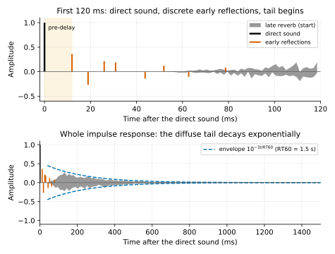</p>

1. **Direct sound**: the sound travelling in a straight line from the source to the ear. It is the earliest and the loudest, and it determines "which direction the sound comes from".
2. **Early reflections**: sound that reaches the ear after one or two bounces off a wall, the floor or the ceiling. They are sparse and can be told apart from one another (but they are usually not heard as "echoes"; the brain fuses them into the direct sound), and they provide cues about "the size and shape of the room and how far you are from the walls".
3. **Late reverb (diffuse tail)**: sound that has been reflected many times. As the number of reflections grows, the arrival times get denser and denser: in a room of volume V, the number of reflections arriving per second around time t is roughly proportional to $`t^2`$ ($`\approx 4\pi c^3 t^2 / V`$). After some point the reflections are so dense that they sound like a clump of noise, and the energy decays **exponentially**.

The time gap between the direct sound and the first reflection is called the **pre-delay**. In a large space the walls are farther away, so the pre-delay is longer, which is an important cue the brain uses to judge "a large space".

#### RT60

The most important parameter of reverberation is **RT60** (reverberation time): the time it takes for the sound pressure level to decay by **60 dB** after the source stops. Why 60 dB? Because 60 dB is roughly the range "from a loud instrument down to the background noise", i.e. the time until the reverb "sounds like it has disappeared"; this is a convention set by Sabine around 1900.

Because late reverb decays exponentially, "dB against time" is a straight line:

```math
L(t) = L_0 - 60\cdot\frac{t}{\mathrm{RT60}}\ \ \text{dB}
\qquad\Longleftrightarrow\qquad
a(t) = a_0\cdot 10^{-3t/\mathrm{RT60}} = a_0\, e^{-\ln(1000)\,t/\mathrm{RT60}}
```

(An amplitude drop of 60 dB means dropping to 1/1000, so $`a(\mathrm{RT60}) = a_0/1000`$.)

In real measurements you rarely wait until -60 dB (the background noise swamps it first). Instead you measure the slope over the range from -5 to -25 dB (T20) or from -5 to -35 dB (T30) and extrapolate to 60 dB. This chapter's `measureRt60()` and exercise 6 both do this.

**Sabine's formula**: the RT60 of a room can be estimated roughly from its volume V (m³) and its total absorption A (m², the sum over all surfaces of area × absorption coefficient α):

```math
\mathrm{RT60} \approx 0.161\cdot\frac{V}{A},\qquad A = \sum_i S_i\,\alpha_i
```

Intuition: the larger the room (large V), the longer the sound travels before it hits a wall and is absorbed -> the longer the reverb; the more absorptive the walls (large α) -> the shorter the reverb. For example, for a 6 × 4 × 3 m room (V = 72 m³, surface area 108 m²) with an average α = 0.3 -> A = 32.4 m² -> RT60 ≈ 0.36 s (an ordinary living room); a concert hall has an RT60 of about 1.8–2.2 s.

Absorption coefficients usually rise with frequency (carpets, curtains and the air itself all absorb the highs more), so **the RT60 of the high frequencies is shorter than that of the low frequencies**: the further into the tail, the "darker" the reverb. This is the phenomenon that the **damping** parameter of a reverb is meant to simulate.

### 2.2 The impulse-response view

If we treat the room (source position -> listener position) as an LTI (linear time-invariant) system, it is completely described by its **impulse response** $`h[n]`$: what you record after a clap (≈ an impulse) is $`h`$, and the result of any sound $`x`$ passing through this room is the convolution:

```math
y[n] = (h * x)[n] = \sum_{k=0}^{M-1} h[k]\,x[n-k]
```

This gives two routes:

<div align="center">

| | Convolution reverb | Algorithmic reverb |
|---|---|---|
| Approach | Convolve directly with a measured (or synthesized) $`h`$ | Build a recursive system out of delays + feedback whose IR "statistically resembles a room" |
| Realism | It is that space (at that source/listener position) | It sounds "like" some kind of space, depending on the design |
| Parameters | The IR can only be fixed afterwards (truncate, EQ, reshape the envelope) | decay, size, damping, modulation and freeze can all be changed in real time |
| Cost | Proportional to the IR length (needs the FFT) | Independent of the RT60; a few dozen delay lines are enough |

</div>

This chapter takes both routes. We also use the "measure the IR" viewpoint to verify the algorithmic reverb: feed an impulse into it and check whether its IR decays with the RT60 we set and whether the echoes are dense enough.

### 2.3 The feedback comb filter: where the decay comes from

The simplest structure that produces "a train of decaying echoes" is the feedback comb:

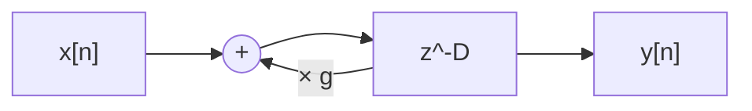

```math
y[n] = x[n-D] + g\,y[n-D]
\qquad\Longrightarrow\qquad
H(z) = \frac{z^{-D}}{1 - g\,z^{-D}}
```

Feed in an impulse and the output is $`\delta[n-D] + g\,\delta[n-2D] + g^2\,\delta[n-3D] + \dots`$: **each trip around the loop (D samples) multiplies the amplitude by g**.

#### Derivation: RT60 and g

After t seconds the signal has made $`t\cdot f_s / D`$ trips and the amplitude is $`g^{t f_s / D}`$. We require the amplitude at t = RT60 to be $`10^{-60/20} = 10^{-3}`$:

```math
g^{\mathrm{RT60}\cdot f_s / D} = 10^{-3}
\;\Longrightarrow\;
\frac{\mathrm{RT60}\cdot f_s}{D}\log_{10} g = -3
\;\Longrightarrow\;
\boxed{\,g = 10^{-3D/(\mathrm{RT60}\cdot f_s)}\,}
\qquad
\boxed{\,\mathrm{RT60} = \frac{-3D}{f_s\log_{10} g}\,}
```

Example: D = 1557 samples, fs = 48 kHz, RT60 = 2 s -> $`g = 10^{-3\cdot1557/96000} = 10^{-0.04866} = 0.89401`$. The example `l12_comb_rt60` feeds an impulse through the comb with this g: counting from the first echo (at t = D/fs, amplitude 1, taken as the 0 dB reference), the decay to below -60 dB takes 62 trips = 2.011 s (quantized to an integer multiple of D/fs = 32.4 ms, hence slightly above 2.000 s).

Note that g depends on D: **for the same RT60, the longer the loop, the more each trip has to attenuate** (the smaller g is). This is why every line of an FDN computes its own g_i.

#### Frequency response: why it is called a comb

$`|H(e^{j\omega})| = 1/|1 - g e^{-j\omega D}|`$. When $`\omega D = 2\pi k`$ (the frequency is an integer multiple of $`f_s/D`$) the denominator is at its smallest -> peak $`= 1/(1-g)`$; at half-integer multiples the denominator is at its largest -> notch $`= 1/(1+g)`$. With g = 0.894 the peak is +19.49 dB and the notch is -5.55 dB, a difference of 25 dB, and the spectrum looks like a comb:

<p align="center">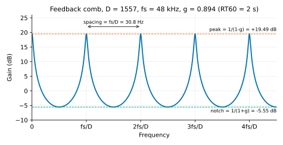</p>

These peaks are the comb's **modes (resonant frequencies)**. The impulse response of a single comb is a regular train of clicks (it sounds like the flutter echo when you clap between two parallel walls), and its spectrum is a set of separate resonances -- with a distinct pitch, it sounds "metallic". To make a reverb that sounds like a room you need:

- **many modes, distributed densely and irregularly enough** (frequency domain);
- **many echoes, getting denser and denser** (time domain).

#### Adding damping: a lowpass in the feedback path

Real rooms attenuate high frequencies faster. Put a lowpass in the loop (Freeverb uses a one-pole):

```math
y[n] = x[n-D] + g\cdot \mathrm{LP}\{y\}[n-D],\qquad
\mathrm{LP}(z) = \frac{1-d}{1-d\,z^{-1}}
```

Now the gain per trip becomes frequency dependent: $`g\,|\mathrm{LP}(e^{j\omega})|`$. Substituting this into the RT60 formula:

```math
\mathrm{RT60}(\omega) = \frac{-3D}{f_s\log_{10}\!\big(g\,|\mathrm{LP}(e^{j\omega})|\big)},\qquad
|\mathrm{LP}(e^{j\omega})| = \frac{1-d}{\sqrt{1 - 2d\cos\omega + d^2}}
```

At DC $`|\mathrm{LP}| = 1`$ (the RT60 of the low frequencies is unchanged), and at Nyquist $`|\mathrm{LP}| = (1-d)/(1+d)`$. Plugging in d = 0.5, g = 0.894, D = 1557 at 4008 Hz (ω = 0.5246): $`|\mathrm{LP}| = 0.5/\sqrt{1.25 - \cos 0.5246} = 0.806`$, RT60 = 0.685 s. The example measures 0.685 s.

### 2.4 The Schroeder allpass: scatter without coloring

The echoes of a comb alone are not dense enough. Schroeder's other invention is the **allpass**:

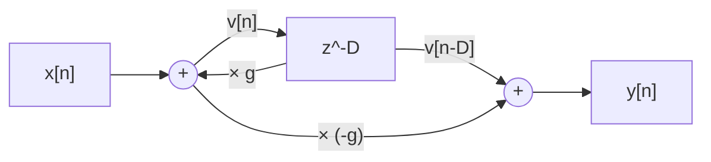

```math
v[n] = x[n] + g\,v[n-D],\qquad y[n] = -g\,v[n] + v[n-D]
\qquad\Longrightarrow\qquad
H(z) = \frac{-g + z^{-D}}{1 - g\,z^{-D}}
```

**Why |H| = 1**: let $`u = e^{-j\omega D}`$ ($`|u| = 1`$). The numerator is $`u - g = u\,(1 - g\,\bar u)`$, so $`|u - g| = |1 - g\bar u| = |\overline{1 - g u}| = |1 - g u|`$, and the numerator and denominator have the same magnitude. The magnitude response is 0 dB at every frequency (the example measures it for you: ±0.00 dB from 100 Hz to 12 kHz).

So what does it do? **It scrambles the phase**: an impulse goes in, and out comes a train of echoes $`-g, 0,\dots,0, (1-g^2), 0,\dots, (1-g^2)g, \dots`$. Cascading several allpasses of different lengths, each stage splits every echo into a train of its own and the densities multiply -- a click goes in and a clump of "hiss" comes out, yet the long-term spectrum is still flat. This is called **diffusion**.

> Note: an allpass is non-coloring only on a long-time average. Over a short time (say a 20 ms window) its echoes still carry some coloration, and with a large g or a long D you hear "buzzing" or a "spring" quality. That is why the D of a diffuser is usually very short (a few ms) and g is between 0.5 and 0.7.

### 2.5 The Schroeder reverb and Freeverb

Schroeder (1962) combined the two:

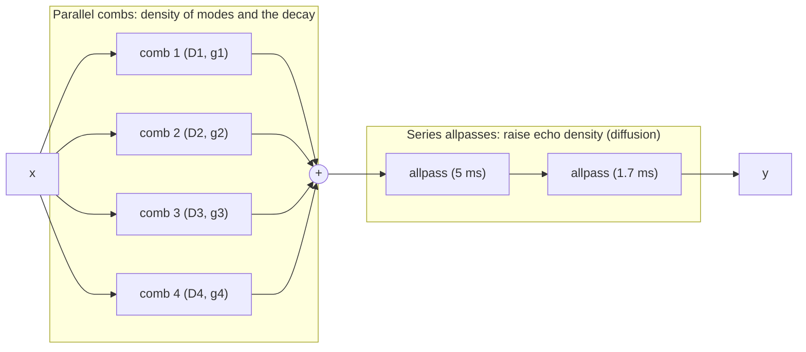

- **Parallel combs**: the mode spacing of each comb is $`f_s/D_i`$, and stacking 4 combs of different lengths quadruples the number of modes; each comb uses its own $`g_i = 10^{-3D_i/(\mathrm{RT60}f_s)}`$, so they all decay with the same RT60.
- **Series allpasses**: they scatter the regular echoes coming out of the combs into a dense, noise-like tail without changing the overall spectrum.

**Freeverb** (by Jezar at Dreampoint, released as public domain in 2000) is the most widely circulated version of this architecture:

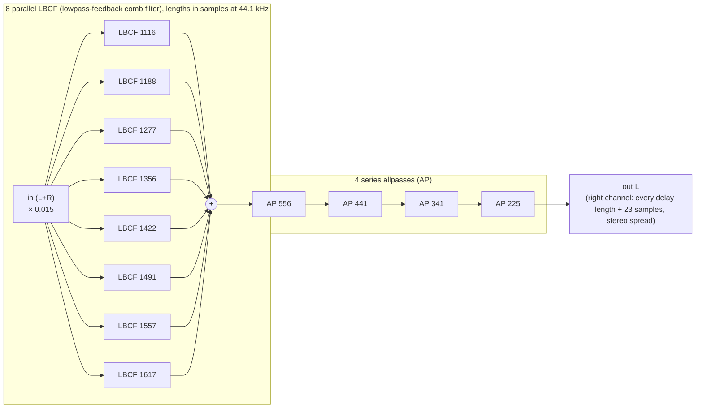

- **8 lowpass-feedback combs (LBCF) in parallel**: the one-pole lowpass in the loop is the damping of section 2.3. Freeverb's implementation is `filterstore = output·(1−damp) + filterstore·damp`, `buffer = input + filterstore·feedback` -- this chapter's `CombFilter` is written the same way.
- **4 allpasses in series**, with g = 0.5. A detail: Freeverb's allpass code is `output = bufout − input`, `buffer = input + bufout·g`, i.e. $`v[n] = x[n] + g\,v[n-D]`$, $`y[n] = v[n-D] - x[n]`$, with transfer function
  $`\displaystyle H(z) = \frac{-1 + (1+g)\,z^{-D}}{1 - g\,z^{-D}}`$
  For this to be an allpass, the numerator coefficients must be a multiple of the denominator coefficients reversed: $`[-1,\ 1+g] = c\,[-g,\ 1]`$ => $`c = 1/g`$, $`1 + g = 1/g`$ => $`g^2 + g - 1 = 0`$ => $`g = (\sqrt5 - 1)/2 \approx 0.618`$. Freeverb uses g = 0.5, so it is **not** a strict allpass (it is 0 dB at integer multiples of $`f_s/D`$ and has a ripple of $`2.5/1.5`$ -> +4.4 dB at half-integer multiples); in practice it "sounds right", but do not take it as the definition of an allpass (the section "Freeverb Allpass Approximation" in J. O. Smith's *Physical Audio Signal Processing* gives the same analysis). Our `AllpassDiffuser` uses the standard form of section 2.4.
- **Stereo spread**: every delay of the right channel is 23 samples longer than that of the left channel, so the reverbs of the two channels are decorrelated and sound wide.
- **Parameter mapping**: `roomsize` 0..1 -> feedback = roomsize·0.28 + 0.7 (0.7–0.98), `damp` 0..1 -> damping coefficient = damp·0.4. Note that Freeverb's roomsize controls the feedback directly and is **not** the RT60: the 8 combs share one g, so the longer combs decay a little more slowly than the shorter ones and the RT60 differs from comb to comb (e.g. for g = 0.84, the 1116-sample comb has an RT60 of 1.00 s and the 1617-sample one has 1.45 s).
- **Freeze**: feedback = 1, damping = 0, input gain = 0 -> the tail is extended indefinitely.

Freeverb's strengths are that it is simple, cheap and sounds decent; its weaknesses are: the total length of the 8 combs is not large (the mode density is limited, so a long decay is slightly metallic), all combs use the same g (so it is not strictly "one RT60"), and there is no energy exchange between combs (each line decays on its own, so the echo density does not grow over time). The FDN solves the last two.

This chapter's `ReverbBuildingBlocks.h` already provides `CombFilter` (with damping) and `AllpassDiffuser`: you can assemble a Freeverb yourself following the figure above as an extension challenge (hint: at 48 kHz, multiply the lengths by 48000/44100).

### 2.6 The FDN: Feedback Delay Network

The combs in a Schroeder structure are independent of one another. If the outputs of N delay lines are **mixed through a matrix** and fed back to all lines, then on the next trip each echo splits into N echoes, and the echo density grows exponentially over time -- which is closer to a real room (the more times sound has been reflected, the denser it is). This is the FDN (Stautner & Puckette 1982; systematized by Jot & Chaigne 1991):

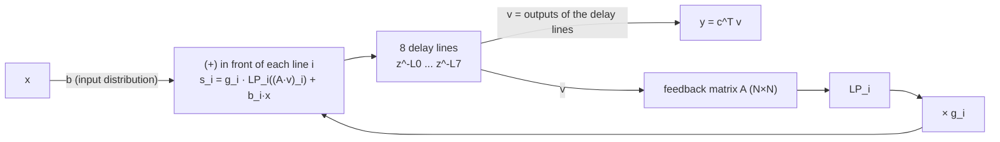

The state equations (N lines, line i has length $`L_i`$):

```math
v_i[n] = s_i[n - L_i],\qquad
\mathbf s[n] = \boldsymbol\Gamma\,\mathbf A\,\mathbf v[n] + \mathbf b\,x[n],\qquad
y[n] = \mathbf c^{\mathsf T}\mathbf v[n]
```

$`\boldsymbol\Gamma = \mathrm{diag}(g_0,\dots,g_{N-1})`$ is the per-line attenuation (damping is added after it).

#### Why an orthogonal matrix => lossless

First consider the case $`\boldsymbol\Gamma = \mathbf I`$ with no input. The "energy" of the whole system is the sum of squares of all the samples stored in the delay lines, $`E[n]`$. With every sample that passes, each line emits one $`v_i`$ and takes in one $`s_i`$:

```math
E[n+1] - E[n] = \sum_i s_i^2 - \sum_i v_i^2 = \|\mathbf A\mathbf v\|^2 - \|\mathbf v\|^2
```

If $`\mathbf A`$ is an **orthogonal matrix** ($`\mathbf A^{\mathsf T}\mathbf A = \mathbf I`$), then $`\|\mathbf A\mathbf v\|^2 = \mathbf v^{\mathsf T}\mathbf A^{\mathsf T}\mathbf A\mathbf v = \|\mathbf v\|^2`$, and the energy is **completely unchanged**: the system neither blows up nor decays by itself, which makes it a "lossless" prototype. All the decay is then controlled by the $`g_i`$ and the damping that we add deliberately. Exercise 4 verifies this: with g = 1 the RMS at 1.0 s and at 2.5 s differs by only 0.01 dB.

Commonly used orthogonal matrices:

- **Householder**: $`\mathbf A = \mathbf I - \frac{2}{N}\mathbf 1\mathbf 1^{\mathsf T}`$. Check: $`\mathbf A^{\mathsf T}\mathbf A = \mathbf I - \frac4N\mathbf 1\mathbf 1^{\mathsf T} + \frac{4}{N^2}\mathbf 1(\mathbf 1^{\mathsf T}\mathbf 1)\mathbf 1^{\mathsf T} = \mathbf I - \frac4N\mathbf 1\mathbf 1^{\mathsf T} + \frac4N\mathbf 1\mathbf 1^{\mathsf T} = \mathbf I`$. It costs only O(N) to apply: first compute the sum $`S = \sum v_j`$, then $`u_i = v_i - \frac2N S`$. For N = 8 the diagonal entries are 0.75 and the off-diagonal entries are -0.25: each line keeps 75% for itself and spreads the rest evenly over the others. (For N = 4 the diagonal is 0.5, a more "even" mix.)
- **Hadamard**: $`\mathbf H_2 = \frac{1}{\sqrt2}\begin{bmatrix}1&1\\1&-1\end{bmatrix}`$, $`\mathbf H_{2N} = \mathbf H_2\otimes\mathbf H_N`$ (N a power of 2). All entries have magnitude $`1/\sqrt N`$ -- it mixes the most thoroughly, and it can be computed in O(N log N) with an FFT-like butterfly.
- Any rotation matrix, or a random orthogonal matrix (generated by a QR decomposition), also works.

This chapter's `Reverb.h` uses the Householder matrix (simple, cheap, and the diffusion is already sufficient for N = 8).

#### Making all modes decay at the same rate: $`g_i = \gamma^{L_i}`$

We want every frequency to decay with the same RT60. Jot's approach: make the attenuation of each line proportional to its length -- in dB, every "single sample" attenuates by the same amount:

```math
g_i = \gamma^{L_i},\qquad \gamma = 10^{-3/(\mathrm{RT60}\cdot f_s)}
\quad\Longrightarrow\quad
g_i = 10^{-3L_i/(\mathrm{RT60}\cdot f_s)}
```

Why this is right: replacing every $`z^{-1}`$ of the lossless system by $`\gamma z^{-1}`$ multiplies each delay $`z^{-L_i}`$ by $`\gamma^{L_i}`$ -- exactly the $`g_i`$ we added. And the effect of "$`z^{-1} \to \gamma z^{-1}`$" is to multiply the radius of all the system's poles by γ: the poles of the lossless system all lie on the unit circle, and now they all lie on a circle of radius γ, so **every mode decays by a factor of γ per sample** and the RT60 is the same for all of them. This has the same form as the comb formula, except that now each line plugs in its own $`L_i`$.

#### Damping: a frequency-dependent RT60

Replace each line's $`g_i`$ by a filter $`G_i(z)`$ whose magnitude is $`|G_i(e^{j\omega})| = 10^{-3L_i/(\mathrm{RT60}(\omega) f_s)}`$, and different frequencies can have different RT60 values (Jot's absorptive filter). An exact design needs shelving filters; this chapter uses a simplified version: put the chapter 02 `OnePole` lowpass (cutoff = `setDampingHz`) in each line and then multiply by $`g_i`$. The result is an RT60 ≈ the set value at low frequencies and increasingly shorter at high frequencies, which matches the trend of real rooms (example 2 measures the RT60 of each frequency band).

#### Input and output vectors

- **b**: which lines the input is fed into. We feed the left channel into the even lines and the right channel into the odd lines.
- **c**: which lines are taken as output and with what signs. We take $`y_L = v_0 - v_2 + v_4 - v_6`$ and $`y_R = v_1 - v_3 + v_5 - v_7`$. Alternating signs cancel part of the "all lines in phase" component that the Householder matrix produces, and using different lines for left and right -> decorrelated left/right channels (a wide stereo image).

#### Echo density and mode density

- Time domain: on the next trip every echo splits into N echoes (matrix mixing), so the echo density fills up very quickly. Example 2 prints the number of non-zero samples in each 10 ms: 0, 0, 1, 6, 27, 71, 145, 231, 319, 398 (out of a possible 480), nearly full within 100 ms.
- Frequency domain: the total number of modes of an FDN equals the sum of all the delay lengths $`\sum L_i`$, so the average **mode density = $`\sum L_i / f_s`$ modes per Hz**. The 8 lines of this chapter total 19502 samples -> 0.41 modes/Hz (on average one mode every 2.5 Hz). The 4-line FDN of exercise 4 has only 0.14 modes/Hz (one every 7 Hz), and its tail already sounds pitched. A frequently quoted rule of thumb comes from Schroeder and Logan: for RT60 = 1 s a mode density of about 0.15 modes/Hz is enough, and the required density is proportional to RT60; that is, the mode density (modes/Hz, equal to the total delay length in seconds) should be at least about 0.15 × RT60, which in terms of total delay length is $`\sum L_i \ge 0.15\cdot\mathrm{RT60}\cdot f_s`$ (the section "Mode Density Requirement" in J. O. Smith's *Physical Audio Signal Processing*). If it is not enough, a long decay sounds like a bunch of separate resonances (ringing tones). The 0.41 of this chapter is sufficient for RT60 = 2 s (which needs 0.3); at RT60 = 4 s (which needs 0.6) it is no longer quite enough -- increasing size or adding modulation helps then.

### 2.7 Why the delay lengths should be mutually coprime

Suppose two lines have lengths 1500 and 2000 samples (gcd = 500):

- **Frequency domain**: the modes of the first lie at integer multiples of $`f_s/1500 = 32`$ Hz and those of the second at integer multiples of 24 Hz. They **overlap** at integer multiples of $`f_s/500 = 96`$ Hz -- those frequencies are resonated by both lines at once, so they carry particularly large energy and decay particularly slowly, and they sound "metallic" (metallic ringing).
- **Time domain**: the echoes of the two lines **arrive together** once every lcm(1500, 2000) = 6000 samples (125 ms), forming a regular flutter.

If the lengths are coprime (say 1427 and 1783, both prime), then apart from DC there are no common modes, and the period at which echoes arrive together is lcm = 1427·1783 = 2,544,341 samples (53 seconds), which in practice means it never repeats.

That is why `Reverb.h` converts each line's length to samples and then applies `nextPrime()`: all 8 lines are prime, so any two are necessarily coprime. Besides being coprime, the lengths should preferably not be in simple integer ratios and should not be bunched together: this chapter uses lengths spread roughly evenly between 30 and 73 ms (longest/shortest ≈ 2.5).

### 2.8 Modulation: don't let the modes "stand still"

Even with coprime delays, a long decay (several seconds) still leaves a tail made of thousands of resonances at fixed frequencies. The ear is very sensitive to "stationary, slowly decaying narrowband resonances" and hears a faint pitch or ringing. The fix: **modulate the delay lengths slowly** (e.g. an LFO of ±0.5–2 ms at 0.5–2 Hz, with a different phase for every line).

- The mode frequency is ≈ $`k f_s / L_i`$; as $`L_i`$ moves, the modes drift back and forth along the frequency axis.
- Averaged over time, the energy is smeared into the neighboring frequencies, the spectrum becomes smooth, and the ringing disappears.
- The cost: modulating a delay is a tiny vibrato (the principle of the chorus in chapter 10); too large a depth produces audible pitch wobble, which is obvious on sustained sounds such as a piano.

Exercise 4 quantifies this: the standard deviation of the tail spectrum (in dB) of a 4-line FDN is 8.85 dB when static and drops to 5.89 dB with 1 ms / 1.3 Hz modulation (close to the theoretical value for a white-noise spectrum, about 5.6 dB). `Reverb.h` also provides `setModulationDepthMs()` / `setModulationRateHz()` (off by default).

> A modulated delay has to read samples at "non-integer positions", so it uses chapter 09's `FractionalDelayLine` (linear or cubic interpolation). This is also why `Reverb.h` does not use the integer `DelayLine`: `setSize()` also needs smoothly varying non-integer lengths when it changes the delay lengths.
>
> One cost: linear interpolation at a non-integer position is itself a mild lowpass (with a fractional part of 0.5 it goes straight to zero at Nyquist), and inside the loop that means a little extra loss on every trip. Normally this small loss is mixed into the attenuation of $`g_i`$ and is inaudible, but freeze requires the loop to be **strictly lossless**, so `Reverb` fades the modulation out while frozen so that the read positions return to integer lengths (section 3.2).

### 2.9 Pre-delay and early reflections

- **Pre-delay**: put a pure delay (0–250 ms) at the very front of the reverb. Perceptually, the pre-delay lets the transient of the direct sound come out in full first and the reverb follow a little later -> vocals and drums stay clearer and are not smeared by the reverb; it also suggests "a large space with distant walls". A common mixing practice is to align the pre-delay with a small note value of the song's tempo (e.g. a 1/64 or 1/32 note).
- **Early reflections (ER)**: implemented with a **tapped delay line** -- one delay line with several read points (taps), each tap having its own delay and gain:

```math
y_{\mathrm{ER}}[n] = \sum_{k} a_k\, x[n - d_k]
```

The tap positions can be set by hand or computed geometrically: the **image-source method** (Allen & Berkley 1979) mirrors the source across each wall, so that a reflection off a wall is equivalent to a virtual source emitting from the mirrored position. There are 6 first-order reflections (the 6 walls of a shoebox room), and for each one

```math
d_k = \frac{|\mathbf r_{\mathrm{img},k} - \mathbf r_{\mathrm{listener}}| - |\mathbf r_{\mathrm{src}} - \mathbf r_{\mathrm{listener}}|}{c},\qquad
a_k = \sqrt{1-\alpha}\cdot\frac{|\mathbf r_{\mathrm{src}} - \mathbf r_{\mathrm{listener}}|}{|\mathbf r_{\mathrm{img},k} - \mathbf r_{\mathrm{listener}}|}
```

(the delay and gain relative to the direct sound; $`\sqrt{1-\alpha}`$ is the wall's amplitude reflection coefficient and the distance ratio is the 1/r spherical spreading.) Exercise 3 implements this and connects the ER to the FDN (pre-delay = the latest ER) to form a complete "ER + late" reverb.

A complete algorithmic reverb looks roughly like this:

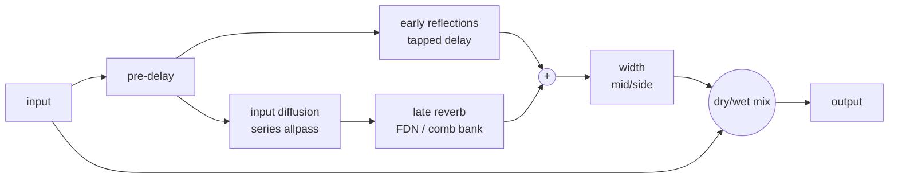

### 2.10 Convolution reverb

#### The cost of direct convolution

$`y[n] = \sum_{k=0}^{M-1} h[k]x[n-k]`$: every output sample needs M multiply-adds. A 2-second IR at 48 kHz has M = 96000, and in stereo that is 2 × 48000 × 96000 ≈ 9.2 × 10⁹ multiply-adds per second -- a single core of an ordinary CPU cannot do it in real time. Example 3 processes 1 second of audio with a 0.33-second IR (15840 samples), and direct convolution takes about 0.9 seconds in a Release build (measured on this machine; several seconds in a Debug build).

#### Fast convolution with the FFT

The convolution theorem: **convolution in the time domain = multiplication in the frequency domain**. What an N-point FFT computes is **circular convolution**; for it to equal linear convolution, N must be ≥ the sum of the two lengths − 1, with zero-padding for whatever is missing.

For an infinitely long input, cut the input into blocks of length B and process them one at a time. There are two standard ways:

**Overlap-add (OLA)**: zero-pad each input block $`x_j`$ (length B) to N ≥ B + M − 1, FFT, multiply by $`H`$, IFFT, and obtain a result of length B + M − 1; the results of adjacent blocks overlap by M − 1 samples, and the overlapping parts are **added**.

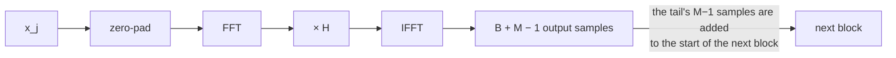

**Overlap-save (OLS)**: each time take N input samples (B new ones + the previous N − B old ones), FFT, multiply by $`H`$, IFFT; the first M − 1 samples of the result are contaminated by the circular convolution "wrapping around" (wrap-around) and are **discarded**, and only the last B correct output samples are kept.

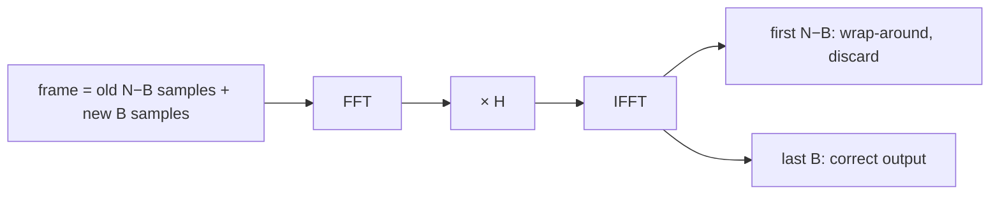

The two cost the same. This chapter uses overlap-save (no extra accumulation buffer needed).

#### Uniform partitioned convolution

Plain FFT convolution requires N ≥ B + M − 1: when the IR is long the FFT is long too, and you have to wait until a large block of input has accumulated before you can compute anything -> too much latency. The fix is to **cut the IR into pieces as well**:

```math
h = [\,h_0 \,|\, h_1 \,|\, \cdots \,|\, h_{K-1}\,],\quad\text{each piece of length } P,\quad K = \lceil M/P\rceil
```

Convolution is linear, so

```math
y = h * x = \sum_{k=0}^{K-1} \big(h_k * x\big)\ \text{delayed by } kP
```

Each piece $`h_k`$ is only P long, and paired with an input block of length P an FFT with N = 2P is enough (overlap-save: frame = [previous P | this P]). The key observation: "delay by kP and then convolve with $`h_k`$" is, in the frequency domain, "**the input spectrum from k blocks ago** $`X_{j-k}`$ multiplied by $`H_k`$". So if we store the spectrum of every input block (a **frequency-domain delay line, FDL**), each output block is:

```math
Y_j = \sum_{k=0}^{K-1} H_k \cdot X_{j-k}
\qquad\text{(complex multiply-accumulate, bin by bin)}
```

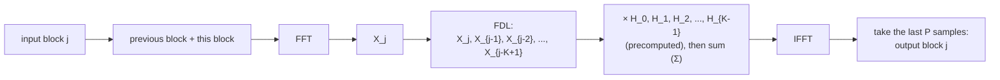

One FFT, K spectrum multiply-accumulates and one IFFT produce P output samples. The IR spectra $`H_k`$ are precomputed in `setImpulseResponse()`.

#### Where the latency comes from

The output of block j needs **all P inputs** of block j before it can be computed (the FFT needs a complete frame). If the input arrives one sample at a time, then after the first sample arrives you still have to wait P − 1 more samples before you can start computing, so the output as a whole has to be P samples late: **latency = partition size P**.

`ConvolutionReverb` accepts host blocks of any length through a FIFO: every time P samples have been collected it does one round of computation, and the P outputs it produces are emitted over the next P samples. Its latency is therefore fixed at P (48 kHz, P = 512 -> 10.67 ms), and it is reported to the host through `getLatencySamples()` for latency compensation (chapters 13 and 14).

> If the host guarantees that every callback delivers exactly P samples (aligned to the partition boundary), the block can be collected, computed and emitted within the same callback, and the extra latency is 0 -- the delay of "waiting until P samples have accumulated" has already been absorbed by the host's buffer. To support arbitrary block lengths, our implementation chooses to pay a fixed extra latency of P. Exercise 7 discusses this.

#### Cost and memory analysis

For every P output samples: one N-point real FFT + K·(N/2 + 1) complex multiply-adds + one N-point IFFT. With N = 2P, per output sample on average:

```math
\underbrace{\frac{K(P+1)}{P}}_{\approx K\ \text{complex MACs}} \approx \frac{M}{P}\ \text{complex MACs}\ \approx \frac{4M}{P}\ \text{real multiplications}
\;+\;\underbrace{O(\log_2 P)}_{\text{two FFTs, amortized}}
```

Compared with the M multiply-adds of direct convolution, this saves roughly a factor of **P/4**. With P = 512 and M = 15840 (K = 31): 15840 for direct convolution vs. about 31 complex MACs ≈ 124 real multiplications for partitioned, a theoretical factor of 128; example 3 measures about 114 times in a Release build (repeated runs fall between about 110 and 140 times, depending on the machine and the current load; a Debug build has no optimization, neither the `std::complex` operations nor the `std::vector` indexing get inlined, and it reaches only about 15–20 times).

Memory: for each IR channel we store K spectra of P + 1 `complex<float>` (8 bytes) each ≈ **8M bytes** (2 times the time-domain IR), and the FDL of each processed channel is the same size. For a 2-second stereo IR (M = 105600, K = 207): IR spectra 2 × 207 × 513 × 8 = 1.70 MB, plus 1.70 MB for the FDL, about 3.4 MB in total (the example prints 3.24 MiB).

**The trade-off in P**: the smaller P is -> the smaller the latency, but the larger K = M/P becomes -> the more complex MACs per sample ≈ K (for a 3-second IR: K = 282 with P = 512 and K = 2250 with P = 64, i.e. 8 times the CPU).

#### Non-uniform partitions (a brief introduction)

If you want low latency without high CPU: use small partitions for the **beginning** of the IR (even a direct time-domain FIR, with latency 0), and use larger and larger partitions further back. The output of the later partitions is not needed until much later anyway, so there is plenty of time to compute it slowly with a large FFT. Gardner (1995) proposed a layout in which the partition size doubles (P, P, 2P, 2P, 4P, ...), which achieves zero latency with a per-sample cost of only O(log M); in practice two or three tiers are common (e.g. 128 + 1024 + 8192). The price is scheduling complexity: the FFTs of the large partitions must be spread over several callbacks (or a background thread) to avoid CPU spikes.

#### Where IRs come from

- **Recording a real space**: play an **exponential sine sweep** through a loudspeaker in the space, record it, and deconvolve with an inverse filter to obtain the IR (Farina 2000, the mainstream method today, which can separate out the loudspeaker's harmonic distortion); some people also use near-impulsive sources such as a starter pistol or a bursting balloon (simple, but with worse SNR and bandwidth). The recorded IR also contains the timbre of the loudspeaker and microphone.
- **Sampling hardware units**: feed a classic plate, spring or digital reverb a sweep to get their IRs (this only captures "the LTI part"; time-varying effects such as modulation cannot be captured).
- **Synthesis**: the simplest synthetic IR is **exponentially decaying noise**: $`h[n] = w[n]\cdot e^{-\ln(1000)\,n/(\mathrm{RT60}\,f_s)}`$, where $`w`$ is white noise (a lowpass can be added to make the highs decay). This is exactly the statistical model of late reverb. `ConvolutionReverb::makeSyntheticImpulseResponse()` does exactly this: each channel uses a different seed (stereo decorrelation), an 8 kHz one-pole lowpass, a linear fade-out over the last 10% to avoid truncation, and normalization to unit energy $`\sum h^2 = 1`$ (so that input and output have roughly the same loudness).
- You can also record an IR from an algorithmic reverb (example 2's `l12_fdn_ir_2s.wav`) and use it as the IR of a convolution.

### 2.11 The character of plate, hall and room

<div align="center">

| Type | Source | Perceptual character | Typical parameters (suggested starting points) |
|---|---|---|---|
| **Room** | Small to medium room | Prominent early reflections, short tail, a close "in the room" feel | RT60 0.3–1 s, pre-delay 0–10 ms, small size, medium damping |
| **Hall** | Concert hall | Slower build-up, sparse ER, a long and smooth tail that leans dark (longer RT60 at low frequencies) | RT60 1.8–3 s, pre-delay 20–60 ms, large size, damping 4–6 kHz |
| **Plate** | A suspended metal plate + driver + pickups (EMT 140 etc.) | No distinct ER, very dense from the start, bright and smooth; a classic choice for vocals and snare | RT60 1.5–4 s, pre-delay 0–20 ms, high diffusion, high damping (above 7 kHz) |
| **Chamber** | A hard-walled room built specifically for recording reverb | Between room and hall, dense and characterful | RT60 1–2.5 s |
| **Spring** | The spring in a guitar amp | A dispersive echo with a "boing" sound | Usually done with a dedicated model; not an FDN strength |

</div>

Mapping to this chapter's `Reverb`: large size -> long delays, dense modes, slow echo build-up (hall); small size -> dense and short (room); pre-delay 0 with small size but long decay and high damping -> close to the feel of a plate.

### 2.12 Reverb in a mix: send / return

In a mix, reverb is rarely inserted directly on each track; it sits on an **aux / return bus**:

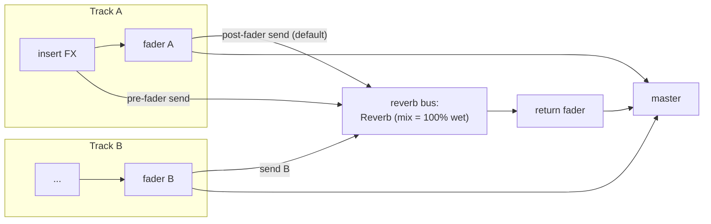

- **A reverb on a bus is always mix = 1 (100% wet)**: the dry signal already travels from each track's fader to the master. If the reverb on the bus also mixed in dry, the dry would be added twice (and if the reverb has latency, there would also be comb filtering).
- **How much to send / how much to mix back**: each track's **send level** decides how "wet" that track is, and the bus's **return fader** decides the overall amount of reverb.
- **One reverb for many tracks**: it saves CPU (one reverb replaces N), and all the instruments sound like they are in **the same space**, which gives the mix more cohesion.
- **Post-fader send** (default): the send is taken after the fader -- pull the track fader down and the amount sent into the reverb goes down with it, so the dry/wet proportion stays the same. This is almost always what you want.
- **Pre-fader send**: the send is taken before the fader -- with the fader all the way down the reverb is still there. It is used for headphone monitor mixes (a cue mix that is independent of the main mix) or for "reverb only" effects.
- Common tricks: put an EQ on the reverb return (cut below 200–300 Hz to avoid muddy lows, cut a little of the highs to make it "recede"), use a compressor so the reverb is ducked by the lead vocal's sidechain, or, as in exercise 5, chop the tail with a gate (the gated-reverb drum sound of the 1980s).

Example 4 (`l12_send_return`) verifies these behaviors with numbers: with post-fader, a fader at -12 dB -> the return also drops by exactly -12.00 dB; with pre-fader and the fader at -∞, the return is unchanged (+0.00 dB).

---

## 3. From formulas to code

This chapter adds three headers (all in `dsp/include/dawlab/dsp/`):

<div align="center">

| Header | Contents |
|---|---|
| `ReverbBuildingBlocks.h` | Teaching components: `CombFilter`, `AllpassDiffuser`, `TappedDelay`, `measureRt60()` / `DecayMeasurement`, `nextPrime()` |
| `Reverb.h` | `class Reverb`: an 8-line FDN algorithmic reverb (contract API) |
| `ConvolutionReverb.h` | `class ConvolutionReverb`: uniform partitioned FFT convolution (overlap-save) (contract API) |

</div>

### 3.1 `ReverbBuildingBlocks.h`

**`CombFilter`**: the lowpass-feedback comb of section 2.3. The core is only three lines:

```cpp
float processSample(float x) noexcept {
    const float delayed = ring_.read(delay_ - 1);                          // y[n] = the value written D samples ago in the buffer
    lowpassState_ = flushDenormal(delayed * (1.0f - damping_) + lowpassState_ * damping_); // LP: Freeverb's damping
    ring_.push(x + feedback_ * lowpassState_);                             // write back: x[n] + g·LP{y}[n]
    return delayed;
}
```

Note `read(delay_ - 1)`: the convention of the internal ring buffer is that "after a push, `read(0)` is the value just written", but here we **read first and write afterwards**, so the value pushed last time is already one sample old, and reading D − 1 gives "the value written D samples ago", making the loop length exactly D. This kind of off-by-one is the most common mistake in reverb code (it causes small deviations in the RT60 and the mode frequencies).

The two static functions correspond to the formulas of section 2.3: `feedbackForRt60(D, RT60, fs)` returns $`10^{-3D/(\mathrm{RT60} f_s)}`$ and `rt60ForFeedback(D, g, fs)` returns $`-3D/(f_s\log_{10}g)`$.

**`AllpassDiffuser`**: the standard Schroeder allpass of section 2.4, `v = x + g·v[n−D]`, `y = v[n−D] − g·v`.

**`TappedDelay`**: `setTaps(std::vector<Tap>)` (allocates; call it only during the preparation phase), and `processSample()` returns $`\sum a_k x[n-d_k]`$.

**`measureRt60(x, n, fs, windowMs, fitStartDb, fitEndDb)`**: computes an RMS envelope (in dB) in units of windowMs, and runs a linear regression from the first point after the peak that falls below -5 dB down to -35 dB; RT60 = −60 / slope. The window must be longer than the echo spacing (the comb has D = 32 ms, so example 1 uses 40 ms), otherwise it would measure the zeros between echoes. Exercise 6 implements the more standard Schroeder backward integration.

### 3.2 `Reverb.h`: the 8-line FDN

Signal flow (per sample, compare with section 2.6):

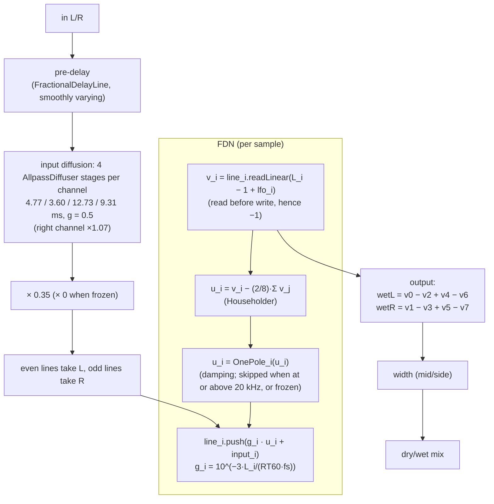

A few design points:

- **Delay lengths**: the base lengths are 29.7–73.1 ms (`kBaseDelaysMs`), multiplied by the factor 0.5 + size (0.5–1.5) given by `size`, converted to samples and passed through `nextPrime()`. At size = 0.5 and 48 kHz they are 1427, 1783, 1973, 2099, 2579, 2879, 3251, 3511 (all prime).
- **`setDecaySeconds()`** recomputes $`g_i`$ immediately; **`setSize()`** changes the target lengths, and the actual lengths glide there with a time constant of about 30 ms (a jump in delay length clicks, whereas a smooth glide is only a brief pitch change), and it recomputes $`g_i`$ at the same time.
- **`setFreeze(true)`**: $`g_i = 1`$, damping is skipped, the input gain is 0, and the modulation fades out to 0 with a time constant of about 30 ms. The Householder matrix is lossless, so the tail never decays (example 2: after freezing, the RMS differs by only +0.02 dB over 1.1 seconds). The modulation must stop: reading a delay line at a fractional position (linear interpolation) amounts to an extra lowpass on every trip; with 1 ms modulation left on, a freeze of 28 seconds loses about 4 dB and gets steadily darker, while with it stopped the difference over 28 seconds is only 0.03 dB. Likewise, the smoothing of the delay lengths snaps straight to the integer length when it gets close to the target (the delay length is a float of a few thousand samples; when the gap is below about 0.1–0.2 sample, the smoothing increment is smaller than half a ulp and cannot be added, so it would stay on a fractional value forever). When the freeze is released the modulation fades back in.
- **`setWidth()`**: mid/side on the wet signal, side × width. width = 0 -> the wet signal becomes mono.
- **`setMix()`**: a linear dry/wet, `out = dry·(1−mix) + wet·mix`, smoothed.
- **NaN parameters**: every float setter begins with `if (std::isnan(x)) return;`, so a NaN keeps the previous valid value (see section 4 for the reason).
- **Modulation** (extra parameters): `setModulationDepthMs()` (0–2 ms, default 0), `setModulationRateHz()`; the LFO phases of the lines are 45° apart.
- **Mono**: when the block has only 1 channel, the same signal is used for both left and right inputs, and only the left wet output is produced.
- **`processSampleStereo(inL, inR, wetL, wetR)`**: computes only the wet signal (no width / mix), for those who want to assemble their own.

**Why an FDN rather than Freeverb**: for the same number of delays, the FDN has energy exchange (the echo density grows over time), and $`g_i`$ makes all modes follow strictly one RT60 (example 2 measures errors < 1%), whereas Freeverb's roomsize is merely a feedback amount. Freeverb's components (`CombFilter`, `AllpassDiffuser`) are all in `ReverbBuildingBlocks.h`, so you can assemble one yourself and compare.

### 3.3 `ConvolutionReverb.h`

- `prepare(sr, maxBlockSize, nch)`: partition size P = the smallest power of 2 that is ≥ maxBlockSize (at least 64), FFT size N = 2P; it creates chapter 11's `Fft(order)` and the FIFOs, frame and FDL of each channel.
- `setImpulseResponse(ir)`: **not on the audio thread**. It cuts the IR into K pieces, puts the IR in the first half of each and zero-pads the second half to N, and `forwardReal` gives $`H_k`$ (N/2 + 1 bins). The IR may have 1 channel (shared by all channels) or at least as many channels as are processed. It may be called before or after prepare.
- `process(block)`: for each sample it first takes from the output FIFO the wet value "computed P samples ago" and then puts the input into the input FIFO; once P samples have been collected it calls `processPartition()`. The dry used in the dry/wet mix must also be P samples late; otherwise wet is P late and dry is not, and the two have different latencies: when the IR has a direct sound (every recorded IR does), dry summed with the direct sound that is P late becomes comb filtering with spacing fs/P (at 48 kHz, P = 512, one notch every 93.75 Hz), and after the host applies latency compensation based on `getLatencySamples()`, the dry of this track would actually be P earlier than the other tracks. Fortunately no extra delay line is needed: before it is overwritten, slot `fifoPos` of the input FIFO holds exactly the input from P samples ago, $`x[n-P]`$:

```cpp
const float dryDelayed = inputFifo[fifoPos];   // x[n-P] (not yet overwritten)
const float wet        = outputFifo[fifoPos];  // the wet signal, P samples late
inputFifo[fifoPos] = in;                        // store x[n]
...
out = dryDelayed * (1 - mix) + wet * mix;       // both components are P late → uniform overall latency = P
```

What `processPartition()` does:

```cpp
// overlap-save: frame = [previous P | this P]
std::copy(frame.begin() + P, frame.end(), frame.begin());
std::copy(inputFifo.begin(), inputFifo.end(), frame.begin() + P);
fdlPos = (fdlPos + 1) % K;                     // the FDL is a ring buffer: the new spectrum overwrites the oldest
fft.forwardReal(frame, fdl[fdlPos]);           // X_j
Y = Σ_k H_k · fdl[fdlPos − k]                  // complex multiply-accumulate bin by bin
fft.inverseReal(Y, ifftOut);
copy(second half (P samples) of ifftOut → outputFifo)   // the first half is circular wrap, discard it
```

- `getLatencySamples()` = P, the same at every mix (at mix = 0 the output is simply the dry signal delayed by P). It also provides `getPartitionSize()`, `getFftSize()`, `getNumPartitions()`, `getImpulseResponseLength()` and `getSpectraMemoryBytes()` for printing tables.
- `makeSyntheticImpulseResponse(sr, rt60, nch, seed)`: the exponentially decaying noise IR of section 2.10, with length 1.1 × RT60.

### 3.4 The examples

All examples run with no arguments, and the WAV output goes to `dawlab_output/` in the build directory. To build and run:

```powershell
.\scripts\build.ps1 -Only 12-reverb                  # build (Debug) + run all ctest tests
cd build
.\bin\Debug\l12_comb_rt60.exe                        # run by hand (the working directory must be the build directory)
```

The running time and speedup of example 3 are **Release build** numbers (a Debug build has no optimization and the speedup is only about 15–20 times). To reproduce the numbers in the text:

```powershell
.\scripts\build.ps1 -Only 12-reverb -Config Release   # Release build + run ctest
cd build
.\bin\Release\l12_convolution_reverb.exe
```

#### Example 1: `l12_comb_rt60` (`examples/comb_rt60.cpp`)

Uses D = 1557 (the length of one of Freeverb's combs) to verify all the formulas of section 2.3. Actual output (excerpt):

```
--- RT60 verification (the k-th echo of the impulse response = g^(k-1)) ---
 RT60(s)          g   rounds k-1  -60dB time(s)  regression(s)
    0.50    0.63881           16          0.519          0.519
    1.00    0.79926           31          1.006          0.965
    2.00    0.89401           62          2.011          2.037
    4.00    0.94552          124          4.022          4.018

--- Frequency response (g = 0.8940) ---
Theoretical peak = 1/(1-g) = +19.49 dB, notch = 1/(1+g) = -5.55 dB
  f = 10.0 x fs/D =   308.29 Hz :  +19.49 dB  (peak)
  f = 10.5 x fs/D =   323.70 Hz :   -5.55 dB  (notch)

--- Magnitude response of a Schroeder allpass (D = 556, g = 0.5) ---
       100 Hz :  +0.00 dB   ...   12000 Hz :  +0.00 dB

--- Effect of damping on the RT60 at each frequency (two 0.2 s windows, at 0.1 s and 0.9 s) ---
  freq(Hz)       damp=0     damp=0.5
     246.6        1.999        1.982
     986.5        1.999        1.745
    4007.7        1.999        0.685
    8015.4        1.999        0.339
```

- The "-60dB time" is counted from the first echo (t = D/fs, amplitude 1): the amplitude of the k-th echo is $`g^{k-1}`$; find the first echo whose amplitude is ≤ 10⁻³, and the decay time = the number of trips (k − 1) × D/fs. For RT60 = 2 s, k − 1 = ⌈61.65⌉ = 62 trips -> 2.011 s, quantized to an integer multiple of D/fs = 32.4 ms, hence slightly above the set value. In absolute time that echo (the 63rd) appears at 63 × D/fs = 2.044 s; the extra D/fs is the propagation delay of the first echo itself and does not count as decay.
- With damp = 0.5 the RT60 at 4 kHz is 0.685 s, which agrees with the hand calculation in section 2.3.
- It writes `l12_comb_ir.wav` (the comb IR for RT60 2 s: a train of clicks every 32 ms, each one quieter, like a flutter echo) and `l12_comb_damped_ir.wav` (the clicks get duller and duller).

#### Example 2: `l12_reverb_impulse` (`examples/reverb_impulse.cpp`)

Feeds an impulse into `Reverb` (mix = 1, damping off) and prints the lengths and $`g_i`$ of the 8 lines, the set vs measured RT60, an ASCII decay curve, the echo density, and the effects of damping and freeze. Actual output (excerpt):

```
--- RT60 verification (no damping; windowed-RMS regression over the -5 .. -35 dB range) ---
    set(s)  measured(s)   error(%)
      0.50        0.505        0.9
      1.00        1.003        0.3
      2.00        2.004        0.2
      4.00        3.997       -0.1

  Decay curve for RT60 = 2 s (left channel, RMS every 100 ms):
   t(s)   dB   |-60 dB                                   0 dB|
   0.00   -0.5  |################################################# |
   0.10    0.0  |##################################################|
   0.20   -3.2  |###############################################   |
   0.50  -12.2  |#######################################           |
   1.00  -27.3  |###########################                       |
   1.50  -42.2  |##############                                    |
   2.10  -60.1  |                                                  |

--- Echo density: number of samples with |h[n]| > 1e-4 in each 10 ms (diffusion quickly drives it toward 480 = completely full) ---
      0   0   1   6  27  71 145 231 319 398

--- damping = 4 kHz (RT60 set to 2 s) ---
  Measured broadband RT60 = 1.487 s (shorter than the set value: the highs vanish first, so the RMS curve gets steeper)
  freq(Hz)  no damping(s)   damping4k(s)
       250          1.865          1.852
      1000          1.998          1.634
      4000          1.969          0.771
      8000          2.078          0.446

--- Freeze (frozen at 0.2 s; the RT60 was originally 1 s) ---
  RMS @0.5s = 0.00488, RMS @1.6s = 0.00489, difference = +0.02 dB (without freeze it would drop 66 dB over 1.1 s)
```

- The decay curve drops about 3 dB every 100 ms = 60 dB / 2 s, a straight line (exponential decay). The first 0–0.1 s is the echoes building up (build-up).
- There is no output at all in the first 29.7 ms: the shortest delay line is 1427 samples (29.7 ms), and the first echo only emerges after travelling around it -- this is the FDN's own "natural pre-delay" (the larger the size, the longer it is).
- The "per-band RT60" sums the energy within a ±12% band and compares two time windows; without damping every band is around 2 s (±7%; the modes of the FDN make measurements in narrow bands fluctuate), and with damping the highs are clearly shorter.
- It writes `l12_fdn_ir_2s.wav`, `l12_fdn_ir_damped.wav` and `l12_fdn_ir_frozen.wav`. What you should hear: a smooth tail with no flutter; the damped version sounds like a carpeted room; the frozen version is a pad that never dissipates.

#### Example 3: `l12_convolution_reverb` (`examples/convolution_reverb.cpp`)

1. Synthesize a stereo IR with RT60 = 0.3 s (15840 samples, 31 partitions), process 1 second of a pluck sequence with both direct convolution and `ConvolutionReverb`, and compare the error, speed and latency.
2. Process 4 seconds of a pluck sequence with an IR of RT60 = 2 s (mix = 0.35) and write the WAVs.

Actual output of a Release build (the `-Config Release` command of section 3.4) (excerpt; the timings vary with the machine and from run to run, and the speedup lies between about 110 and 140 times. A Debug build is much slower: direct convolution takes several seconds, partitioned about 0.4 s (about 15–20 times), and 4 s of audio with a 2 s IR takes several seconds, only about 1–2 times real time):

```
partition size P = 512, FFT size N = 2P = 1024, latency = 512 samples (10.67 ms)
direct convolution :    918.4 ms (1.52e+09 multiply-adds)
partitioned        :      8.1 ms (about 3.01e+06 complex multiply-adds + 376 FFTs)
speedup            : 113.6 x
max error          : 1.788e-07 (signal peak 0.695 -> below -100.0 dB)
peak of the first 512 outputs = 0.000e+00 (the output must be 0 during the latency)

--- Long IR (RT60 = 2.0 s -> 105600 samples, 207 partitions) ---
Spectrum memory: IR spectra + FDL = 3.24 MiB (513 complex<float> bins per partition)
IR energy sum(h^2) = 1.0000 (the synthetic IR is normalized to 1), IR peak = 0.027
Processing 4.0 s of audio took 108.8 ms (37 x real time)
```

- The error ≈ 1.8 × 10⁻⁷ is at the level of the rounding error of a float FFT (below -100 dB relative to the signal), which proves that the result of the partitioned algorithm **is** the convolution.
- The first P = 512 outputs are all 0: the latency is exactly P.
- It writes `l12_conv_ir.wav` (the synthetic IR: a "thump" followed by a noisy tail), `l12_conv_dry.wav` and `l12_conv_wet.wav` (mix = 0.35; the dry inside it is also delayed by P = 512 samples to line up with the wet, so the whole file is 10.67 ms later than `l12_conv_dry.wav`). What you should hear: the plucks are joined by a smooth tail, with no metallic ringing (the IR itself is noise, with no regular modes).

#### Example 4: `l12_send_return` (`examples/send_return.cpp`)

The drum loop and the pluck, two tracks, share one reverb bus (`Reverb`: mix 1, RT60 1.6 s, pre-delay 20 ms, damping 5 kHz, size 0.6). Actual output:

```
dry, two tracks summed : RMS 0.1127, peak 0.784
post-fader, fader 0 dB : master RMS 0.1344, peak 0.871, return(wet) RMS 0.0752
post-fader, fader -12dB: return RMS 0.0189 (-12.00 dB relative to 0 dB -> follows the fader down)
pre-fader,  fader -inf : return RMS 0.0752 (+0.00 dB relative to 0 dB -> unaffected by the fader), master = reverb only
```

It writes `l12_send_dry.wav`, `l12_send_mix.wav` (dry + return) and `l12_send_prefader.wav` (reverb only). What you should hear: the mix version gains a sense of space while the drum transients remain (thanks to the 20 ms pre-delay); the prefader version contains only "the sound of the room".

---

## 4. Real-time considerations

- **Allocation**: `Reverb::prepare()`, `ConvolutionReverb::prepare()` / `setImpulseResponse()` and `TappedDelay::setTaps()` allocate and may only be called off the audio thread. The other setters and `process()` do not allocate, lock or throw.
- **Swapping the IR**: `setImpulseResponse()` must not run at the same time as `process()`. The real-plugin approach is to prepare "a new set of IR spectra" on a background thread and then swap it in through an atomic pointer (the old set is released later, off the audio thread), crossfading the two outputs when necessary to avoid a click at the switch. For clarity this chapter does not implement that layer.
- **CPU spikes**: all the work of uniform partitioned convolution is done at the moment "P samples have been collected". If the host block = 128 and P = 512, only one callback in four has to do all the FFT work and the K spectrum multiply-accumulates -- the average CPU is very low, but the worst-case callback decides whether the audio drops out. This is one reason `prepare()` makes P ≥ maxBlockSize, and it is why non-uniform partitioning spreads the large FFTs over several callbacks.
- **`Fft` objects cannot be shared**: chapter 11's `Fft::forwardReal()` uses an internal scratch buffer, so one object cannot be used by two threads at the same time. Each `ConvolutionReverb` has its own `Fft`.
- **Denormals**: the tail of a recursive structure eventually decays into the denormal range, and the CPU load can jump by tens of times. `flushDenormal()` in `ReverbBuildingBlocks.h` turns |x| < 10⁻²⁰ straight into 0, and the FDN also flushes before writing back to the delay lines; `OnePole` has a flush as well. In a plugin you should also set FTZ/DAZ at the start of the callback (JUCE's `ScopedNoDenormals`).
- **Parameter smoothing**: `setMix()`, `setWidth()`, `setPreDelayMs()` and `setSize()` are all smoothed (about a 30 ms time constant). A change of `setSize()` or the pre-delay is essentially a delay length sliding -> a brief pitch change (Doppler), which is far better than a click, but do not use it for fast automation. `setDecaySeconds()` takes effect immediately (it only changes the decay rate and does not click).
- **`reset()` makes the smoothed values jump straight to their targets**: after a reset there is no sound inside, so the jump cannot click. The usual order for offline processing is therefore `prepare()` -> the various setters -> `reset()`, and the parameters are in place from the first sample (otherwise the first ~0.1 s would glide in from the defaults, e.g. mix gliding from 0.3 to 1 and leaking the dry signal).
- **Latency reporting**: `ConvolutionReverb::getLatencySamples()` = P. The built-in dry/wet mix already delays the dry signal by P as well (section 3.3), so whatever the mix, the latency of the whole output is uniformly P; but the host must still apply latency compensation, otherwise this path would be P samples late when mixed in parallel with other tracks or with the dry signal of a send/return. `Reverb` (the FDN) has no latency.
- **NaN parameters**: `std::clamp(NaN, lo, hi)` returns the NaN unchanged. If a setter relies on clamp alone, a single NaN parameter (e.g. a faulty host automation) turns $`g_i`$ or mix into NaN, the output becomes NaN permanently, and even `reset()` cannot rescue it (reset just sets the smoothed values to a target that is already NaN). All setters in this chapter, like those of `OnePole` and `Delay`, start with `if (std::isnan(x)) return;`.
- **Safety of freeze**: with freeze, $`g_i = 1`$, which only avoids divergence if the matrix is strictly orthogonal. Do not enable gains other than damping while frozen (or swap A for a non-orthogonal matrix); float errors can also accumulate slowly -- in practice you can make the frozen g 0.99999 instead of 1.

---

## 5. Common mistakes and debugging

<div align="center">

| Symptom | Possible cause | How to check / fix |
|---|---|---|
| The reverb gets louder and louder and finally blows up (NaN / full-scale noise) | Some line has g ≥ 1; the matrix is not orthogonal (e.g. Householder written with 1/N instead of 2/N); the damping filter has gain > 1 at some frequencies | Check with `hasNanOrInf()`; set g to 1 and turn damping off, and see whether the RMS of the IR stays constant (the lossless test of exercise 4) |
| The measured RT60 differs a lot from the set value | Off-by-one in the loop length (read-before-write must read L − 1); the g formula uses the wrong D (e.g. ms instead of samples); the damping in the loop is actually still active when "off" (a one-pole with a 20 kHz cutoff still has −1.3 dB at Nyquist, which accumulates every trip) | Measure with `measureRt60()` or exercise 6's Schroeder method; when damping is off, really bypass it |
| The tail has an obvious pitch, "metallic", "buzzing" | The delay lengths share common factors or are in integer ratios; too few lines / total length too short (insufficient mode density); the diffuser's g is too large | Use prime delay lengths; add lines or length; add modulation |
| Regular flutter echo ("ta-ta-ta") | Only combs and no diffusion; or the delay lengths are too close together | Add allpass diffusion to the input; spread the delay lengths further apart |
| A dry "clap" leaks out at the start (when mix = 1) | mix glides in from its default value | Call `reset()` after setting the parameters |
| A click when size is changed | The delay length jumps directly (an integer delay changes suddenly) | The length must change smoothly with a fractional read |
| The convolution output has periodic "clicking" or aliasing-like noise | overlap-save keeps the wrong half; the FFT length is too short (N < 2P) causing circular wrap; the IR segments are not zero-padded | Compare sample by sample with direct convolution (as in example 3); the error should be below 10⁻⁶ |
| Convolution wet and dry are misaligned, and the timbre thins out in a parallel mix (comb filtering with spacing fs/P) | The internal mix delays only wet and not dry; or externally you add a mix = 1 wet to an undelayed dry yourself | The dry in the internal mix must be taken from the input P samples ago (section 3.3); for external parallel mixing, use `getLatencySamples()` to delay the dry by P too, or let the host do PDC |
| After some automation the output is permanently NaN and `reset()` does not help | The setter uses only `std::clamp` and the NaN passes straight through | Start the setter with `if (std::isnan(x)) return;` |
| The freeze tail still gets slowly darker and quieter | While frozen, the delay read positions are still at fractional values (modulation not stopped, or the length smoothing is stuck a little short of the target), and linear interpolation is a lowpass on every trip | Fade the modulation out when frozen, and snap the length smoothing to an integer when it is near the target |
| The convolution reverb is deafeningly loud | The IR is not normalized (the energy of a recorded IR can be very large) | Normalize to unit energy, or measure the RMS of wet and adjust |
| The CPU gets higher and higher after playback ends | Denormals | Flush denormals, FTZ/DAZ |
| A stereo reverb gets quieter or hollow when played in mono | The left and right wet signals are too decorrelated, or even out of phase | Control it with width; check in mono |

</div>

---

## 6. Exercises

See [exercises/README.md](exercises/README.md). There are 7 in total: comb feedback computation, the idea of coprime delays, early reflections (image-source + tapped delay), FDN modulation, gated reverb, estimating RT60 with Schroeder backward integration, and the latency and cost of partitioned convolution. The solutions are in [solutions/README.md](solutions/README.md).

---

## 7. Further reading

- M. R. Schroeder, "Natural Sounding Artificial Reverberation," *Journal of the Audio Engineering Society*, vol. 10, no. 3, 1962. -- the original paper on the comb + allpass architecture.
- M. R. Schroeder, "New Method of Measuring Reverberation Time," *Journal of the Acoustical Society of America*, vol. 37, 1965. -- backward integration (exercise 6).
- J.-M. Jot and A. Chaigne, "Digital Delay Networks for Designing Artificial Reverberators," AES 90th Convention, 1991. -- the systematic design of FDNs, $`g_i = \gamma^{L_i}`$, absorptive filters.
- J. Dattorro, "Effect Design, Part 1: Reverberator and Other Filters," *JAES*, vol. 45, no. 9, 1997. -- the classic plate reverb topology (this chapter's input diffuser lengths are taken from here).
- V. Välimäki, J. D. Parker, L. Savioja, J. O. Smith, J. S. Abel, "Fifty Years of Artificial Reverberation," *IEEE Transactions on Audio, Speech, and Language Processing*, vol. 20, no. 5, 2012. -- an excellent survey.
- Julius O. Smith III, *Physical Audio Signal Processing* (CCRMA online book) -- chapters on the Schroeder reverb, Freeverb and FDNs, with detailed derivations.
- W. G. Gardner, "Efficient Convolution without Input-Output Delay," *JAES*, vol. 43, no. 3, 1995. -- non-uniform partitioned convolution.
- A. Farina, "Simultaneous Measurement of Impulse Response and Distortion with a Swept-Sine Technique," AES 108th Convention, 2000. -- the modern IR measurement method.
- J. B. Allen and D. A. Berkley, "Image Method for Efficiently Simulating Small-Room Acoustics," *JASA*, vol. 65, no. 4, 1979. -- the image-source method (exercise 3).
- Heinrich Kuttruff, *Room Acoustics* (Spon Press / CRC) -- the physics of reverberation, the Sabine / Eyring formulas, echo density.
- Will Pirkle, *Designing Audio Effect Plugins in C++* (2nd ed., Routledge, 2019) -- the reverb chapter has a complete plugin implementation.

---

## 8. Next chapter

By now we have a complete set of pure C++ DSP components that can be tested offline; [chapter 13](../13-vst-hosting/README.md) moves on to JUCE: wrapping chapter 04's `Compressor` into a VST3 plugin, and writing hosting code that can load and run third-party VST3 plugins inside our own program.
