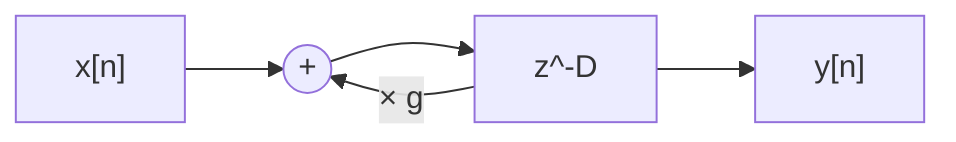
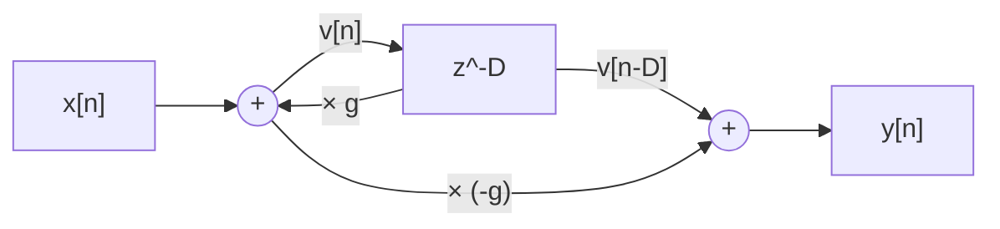
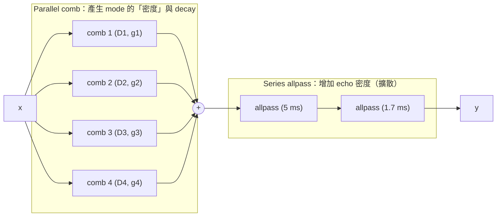
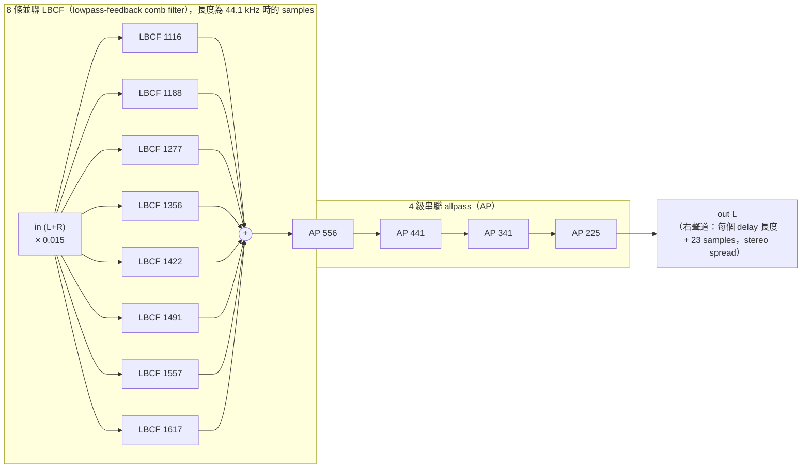
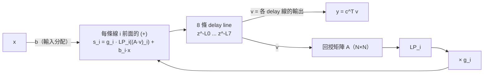
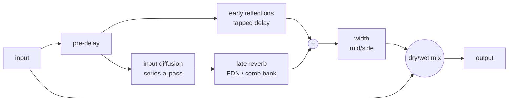
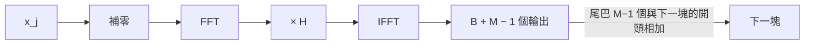
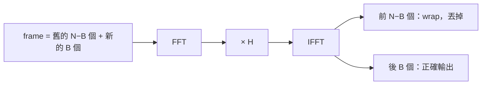
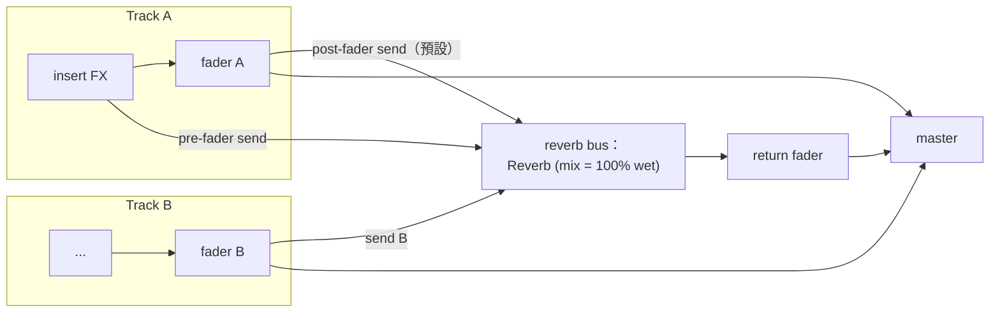
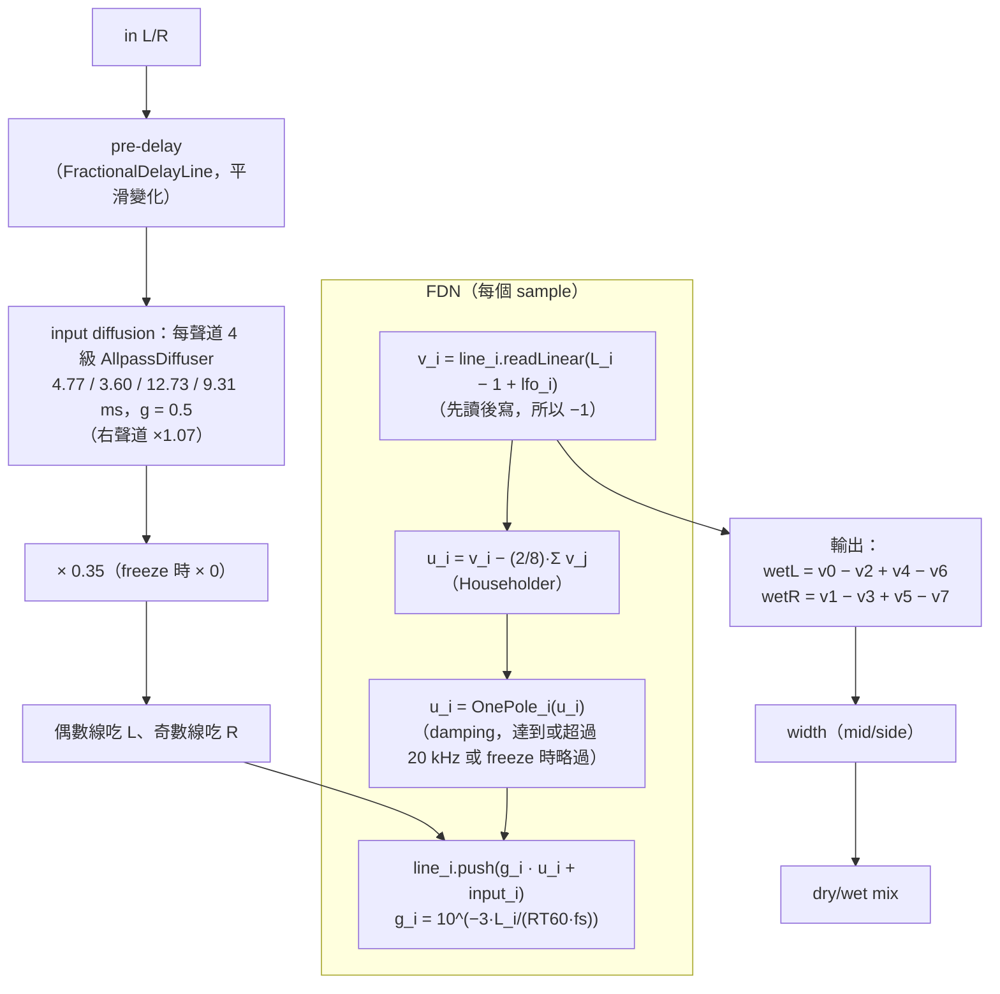

# 第 12 章：Reverb —— Algorithmic 與 Convolution

[English](README.md) | **繁體中文**

> [教材首頁](../../README.zh-TW.md)　｜　上一章：[11 Metering 與 FFT](../11-metering-fft/README.zh-TW.md)　｜　下一章：[13 VST3 hosting](../13-vst-hosting/README.zh-TW.md)

在空房間裡拍一下手，你聽到的不只是「啪」一聲：之後還有一段越來越小、越來越糊的聲音尾巴，這就是殘響（reverberation）。混音時幾乎每一軌都會經過 reverb：它讓乾巴巴的錄音「放進一個空間」，決定聽眾覺得樂器離自己多遠、在多大的房間裡演奏。

這一章做兩種 reverb：

- **Algorithmic reverb**：用一堆 delay line + feedback「模擬」殘響的統計特性。便宜、參數可以即時調（decay、size、damping、freeze……）。我們實作 8 線 **FDN（Feedback Delay Network）**，並說明另一個經典架構 **Freeverb**。
- **Convolution reverb**：直接拿一個真實（或合成）空間的 **impulse response** 跟訊號做卷積，聽起來就「是那個空間」。代價是運算量，所以要用 FFT，並把 IR 切段（**uniform partitioned convolution**）才能即時處理。這裡會用到第 11 章的 `Fft`。

---

## 1. 本章目標

讀完本章、做完練習，你應該能夠：

- 說明殘響的三個部分（直達音、early reflections、late reverb）與 **RT60** 的定義，並用 Sabine 公式估算房間的 RT60。
- 從「每繞一圈衰減 g 倍」推導 feedback comb 的 **g = 10^(−3·D/(RT60·fs))**，並用量測驗證。
- 解釋 Schroeder 的 parallel comb + series allpass 架構、Freeverb 的結構（8 comb + 4 allpass、damping、stereo spread 23 samples）。
- 解釋 FDN 為什麼「矩陣正交 ⇒ 無損」、怎麼用 g_i 讓所有 mode 以同一速率衰減、怎麼在迴路裡加 damping。
- 說明 delay 長度為什麼要互質、modulation 為什麼能減少 metallic ringing、pre-delay 與 early reflections 在聽感上的作用。
- 計算直接卷積與 FFT 卷積的成本，實作 overlap-save 的 **uniform partitioned convolution**，並說明它的 latency 與記憶體從哪裡來。
- 在混音中正確使用 reverb：send/return、pre-fader vs post-fader、bus 上的 reverb 為什麼 mix = 100%。

---

## 2. 原理

### 2.1 殘響的物理：直達音、early reflections、late reverb

想像你站在一個房間裡，前方有人拍手。聲音以約 343 m/s 的速度向四面八方擴散：

<p align="center"></p>

1. **直達音（direct sound）**：聲源直線傳到耳朵，最早、最大聲。決定「聲音從哪個方向來」。
2. **Early reflections（早期反射）**：經過一、兩次牆面 / 地板 / 天花板反射才到的聲音。它們很稀疏、彼此可以分辨（但通常不會被聽成「回音」，而是被大腦融合進直達音），提供「房間大小、形狀、自己離牆多遠」的線索。
3. **Late reverb（diffuse tail）**：反射了很多次的聲音。反射次數一多，到達的時間點越來越密：在一個體積 V 的房間裡，第 t 秒附近每秒到達的反射數大約與 $`t^2`$ 成正比（$`\approx 4\pi c^3 t^2 / V`$）。到了某個時間點以後，反射密到聽起來像一團雜訊，而且能量以**指數**衰減。

直達音與第一個反射之間的時間差叫 **pre-delay**。大空間的牆比較遠，pre-delay 比較長，這是大腦判斷「大空間」的重要線索。

#### RT60

殘響最重要的參數是 **RT60**（reverberation time）：聲源停止後，聲壓位準衰減 **60 dB** 所需的時間。為什麼是 60 dB？因為 60 dB 大約是「從樂器的大聲到背景雜訊」的範圍，也就是殘響「聽起來消失」的時間；這是 Sabine 在 1900 年左右定下的慣例。

因為 late reverb 是指數衰減，「dB 對時間」會是一條直線：

```math
L(t) = L_0 - 60\cdot\frac{t}{\mathrm{RT60}}\ \ \text{dB}
\qquad\Longleftrightarrow\qquad
a(t) = a_0\cdot 10^{-3t/\mathrm{RT60}} = a_0\, e^{-\ln(1000)\,t/\mathrm{RT60}}
```

（振幅掉 60 dB = 掉到 1/1000，所以 $`a(\mathrm{RT60}) = a_0/1000`$。）

實際量測時很少真的等到 −60 dB（背景雜訊會先淹沒它），而是在 −5 到 −25 dB（T20）或 −5 到 −35 dB（T30）的區段量斜率，再外插到 60 dB。本章的 `measureRt60()` 與練習 6 都是這麼做。

**Sabine 公式**：一個房間的 RT60 可以粗略用體積 V（m³）與總吸音量 A（m²，各表面面積 × 吸音係數 α 的總和）估計：

```math
\mathrm{RT60} \approx 0.161\cdot\frac{V}{A},\qquad A = \sum_i S_i\,\alpha_i
```

直覺：房間越大（V 大），聲音要走越久才撞牆、才被吸收 → 殘響越長；牆越吸音（α 大）→ 殘響越短。例如 6 × 4 × 3 m 的房間（V = 72 m³、表面積 108 m²），平均 α = 0.3 → A = 32.4 m² → RT60 ≈ 0.36 s（一般客廳）；音樂廳的 RT60 大約 1.8–2.2 s。

吸音係數通常隨頻率上升（地毯、窗簾、空氣本身都更吸高頻），所以**高頻的 RT60 比低頻短**：殘響越到後面越「暗」。這就是 reverb 上 **damping** 參數要模擬的現象。

### 2.2 Impulse response 的觀點

如果把房間（聲源位置 → 聽者位置）當成一個 LTI（線性非時變）系統，那它完全由 **impulse response** $`h[n]`$ 描述：拍手（≈ impulse）錄下來的東西就是 $`h`$，而任何聲音 $`x`$ 經過這個房間的結果是卷積：

```math
y[n] = (h * x)[n] = \sum_{k=0}^{M-1} h[k]\,x[n-k]
```

這給了兩條路：

<div align="center">

| | Convolution reverb | Algorithmic reverb |
|---|---|---|
| 做法 | 直接用量到（或合成）的 $`h`$ 做卷積 | 用 delay + feedback 做一個「IR 統計上像房間」的遞迴系統 |
| 真實度 | 就是那個空間（在那個聲源/聽者位置） | 「像」某種空間，取決於設計 |
| 參數 | 只能事後修 IR（截短、EQ、改包絡） | decay、size、damping、modulation、freeze 都可即時調 |
| 成本 | 跟 IR 長度成正比（要靠 FFT） | 跟 RT60 無關，幾十條 delay 就夠 |

</div>

本章兩條都走。我們也會用「量 IR」的角度來驗證 algorithmic reverb：把 impulse 餵進去，看它的 IR 是否以設定的 RT60 衰減、echo 是否夠密。

### 2.3 Feedback comb filter：衰減的來源

最簡單能產生「一串衰減 echo」的結構是 feedback comb：



```math
y[n] = x[n-D] + g\,y[n-D]
\qquad\Longrightarrow\qquad
H(z) = \frac{z^{-D}}{1 - g\,z^{-D}}
```

餵一個 impulse，輸出是 $`\delta[n-D] + g\,\delta[n-2D] + g^2\,\delta[n-3D] + \dots`$：**每繞一圈（D 個 sample）振幅乘 g**。

#### 推導：RT60 與 g

經過 t 秒，總共繞了 $`t\cdot f_s / D`$ 圈，振幅是 $`g^{t f_s / D}`$。要求 t = RT60 時振幅是 $`10^{-60/20} = 10^{-3}`$：

```math
g^{\mathrm{RT60}\cdot f_s / D} = 10^{-3}
\;\Longrightarrow\;
\frac{\mathrm{RT60}\cdot f_s}{D}\log_{10} g = -3
\;\Longrightarrow\;
\boxed{\,g = 10^{-3D/(\mathrm{RT60}\cdot f_s)}\,}
\qquad
\boxed{\,\mathrm{RT60} = \frac{-3D}{f_s\log_{10} g}\,}
```

例：D = 1557 samples、fs = 48 kHz、RT60 = 2 s → $`g = 10^{-3\cdot1557/96000} = 10^{-0.04866} = 0.89401`$。範例 `l12_comb_rt60` 會用這個 g 餵 impulse：從第一個 echo（t = D/fs，振幅 1，當作 0 dB 的參考點）起算，衰減到 −60 dB 以下花了 62 圈 = 2.011 s（量化到 D/fs = 32.4 ms 的整數倍，所以略大於 2.000 s）。

注意 g 跟 D 有關：**同樣的 RT60，迴路越長、每圈要衰減越多**（g 越小）。這是 FDN 每條線各自算 g_i 的原因。

#### 頻率響應：為什麼叫 comb

$`|H(e^{j\omega})| = 1/|1 - g e^{-j\omega D}|`$。當 $`\omega D = 2\pi k`$（頻率是 $`f_s/D`$ 的整數倍）時分母最小 → peak $`= 1/(1-g)`$；半整數倍時分母最大 → notch $`= 1/(1+g)`$。g = 0.894 時 peak = +19.49 dB、notch = −5.55 dB，相差 25 dB，頻譜像一把梳子：

<p align="center"></p>

這些 peak 就是 comb 的 **mode（共振頻率）**。單一個 comb 的 impulse response 是規律的 click 串（聽起來像在兩面平行牆間拍手的 flutter echo），頻譜是一根根分開的共振 —— 有明顯音高，聽起來「金屬」。要做出像房間的殘響，需要：

- **很多 mode，而且分布得夠密、夠不規則**（頻域）；
- **很多 echo，而且越來越密**（時域）。

#### 加上 damping：lowpass-in-feedback

真實房間高頻衰減較快。在迴路裡放一個 lowpass（Freeverb 用 one-pole）：

```math
y[n] = x[n-D] + g\cdot \mathrm{LP}\{y\}[n-D],\qquad
\mathrm{LP}(z) = \frac{1-d}{1-d\,z^{-1}}
```

現在每繞一圈的增益變成與頻率有關的 $`g\,|\mathrm{LP}(e^{j\omega})|`$。把它代進 RT60 公式：

```math
\mathrm{RT60}(\omega) = \frac{-3D}{f_s\log_{10}\!\big(g\,|\mathrm{LP}(e^{j\omega})|\big)},\qquad
|\mathrm{LP}(e^{j\omega})| = \frac{1-d}{\sqrt{1 - 2d\cos\omega + d^2}}
```

DC 時 $`|\mathrm{LP}| = 1`$（低頻 RT60 不變），Nyquist 時 $`|\mathrm{LP}| = (1-d)/(1+d)`$。代 d = 0.5、g = 0.894、D = 1557，在 4008 Hz（ω = 0.5246）：$`|\mathrm{LP}| = 0.5/\sqrt{1.25 - \cos 0.5246} = 0.806`$，RT60 = 0.685 s。範例量到 0.685 s。

### 2.4 Schroeder allpass：只打散、不染色

光是 comb 的 echo 不夠密。Schroeder 的另一個發明是 **allpass**：



```math
v[n] = x[n] + g\,v[n-D],\qquad y[n] = -g\,v[n] + v[n-D]
\qquad\Longrightarrow\qquad
H(z) = \frac{-g + z^{-D}}{1 - g\,z^{-D}}
```

**為什麼 |H| = 1**：令 $`u = e^{-j\omega D}`$（$`|u| = 1`$），分子 $`u - g = u\,(1 - g\,\bar u)`$，所以 $`|u - g| = |1 - g\bar u| = |\overline{1 - g u}| = |1 - g u|`$，分子分母大小相同。振幅響應在每個頻率都是 0 dB（範例會量給你看：100 Hz 到 12 kHz 都是 ±0.00 dB）。

那它做了什麼？**把相位打亂**：一個 impulse 進去，出來是 $`-g, 0,\dots,0, (1-g^2), 0,\dots, (1-g^2)g, \dots`$ 一串 echo。把幾個不同長度的 allpass 串起來，每一級把每個 echo 再拆成一串，密度相乘 —— 一個 click 進去，出來是一團「沙沙」聲，但長時間的頻譜還是平的。這叫 **diffusion（擴散）**。

> 注意：allpass 是「長時間平均」上不染色。短時間看（例如 20 ms 的 window），它的 echo 仍然會帶點音色，g 太大或 D 太長會聽到「嗡嗡」或「彈簧」感。所以 diffuser 的 D 通常很短（幾 ms），g 在 0.5–0.7。

### 2.5 Schroeder reverb 與 Freeverb

Schroeder（1962）把兩者組合起來：



- **Parallel combs**：每個 comb 的 mode 間距是 $`f_s/D_i`$，4 個不同長度的 comb 疊起來，mode 數量變成 4 倍；每個 comb 用自己的 $`g_i = 10^{-3D_i/(\mathrm{RT60}f_s)}`$，所以全部以同一個 RT60 衰減。
- **Series allpass**：把 comb 輸出的規律 echo 打散成密集的雜訊狀尾巴，又不改變整體頻譜。

**Freeverb**（Jezar at Dreampoint，2000 年公開為 public domain）是這個架構最廣為流傳的版本：



- **8 個 lowpass-feedback comb（LBCF）並聯**：迴路裡的 one-pole lowpass 就是 2.3 節的 damping。Freeverb 的實作是 `filterstore = output·(1−damp) + filterstore·damp`、`buffer = input + filterstore·feedback` —— 本章 `CombFilter` 用同樣的寫法。
- **4 個 allpass 串聯**，g = 0.5。細節：Freeverb 的 allpass 程式碼是 `output = bufout − input`、`buffer = input + bufout·g`，也就是 $`v[n] = x[n] + g\,v[n-D]`$、$`y[n] = v[n-D] - x[n]`$，transfer function
  $`\displaystyle H(z) = \frac{-1 + (1+g)\,z^{-D}}{1 - g\,z^{-D}}`$
  要成為 allpass，分子係數必須是分母係數「倒過來」的倍數：$`[-1,\ 1+g] = c\,[-g,\ 1]`$ ⇒ $`c = 1/g`$、$`1 + g = 1/g`$ ⇒ $`g^2 + g - 1 = 0`$ ⇒ $`g = (\sqrt5 - 1)/2 \approx 0.618`$。Freeverb 用 g = 0.5，所以它**不是**嚴格的 allpass（在 $`f_s/D`$ 的整數倍是 0 dB，半整數倍是 $`2.5/1.5`$ → +4.4 dB 的起伏）；它在實務上「聽起來對」，但不要拿它當 allpass 的定義（J. O. Smith 的 *Physical Audio Signal Processing*「Freeverb Allpass Approximation」一節有同樣的分析）。我們的 `AllpassDiffuser` 用的是 2.4 節的標準式。
- **Stereo spread**：右聲道每一條 delay 都比左聲道長 23 samples，兩聲道的殘響因此去相關（decorrelated），聽起來很寬。
- **參數映射**：`roomsize` 0..1 → feedback = roomsize·0.28 + 0.7（0.7–0.98），`damp` 0..1 → damping 係數 = damp·0.4。注意 Freeverb 的 roomsize 直接控制 feedback，**不是** RT60：8 個 comb 用同一個 g，所以長的 comb 衰減得比短的慢一點，RT60 依 comb 而異（例如 g = 0.84 時，1116 samples 的 comb RT60 = 1.00 s，1617 的是 1.45 s）。
- **Freeze**：feedback = 1、damping = 0、輸入增益 = 0 → 尾巴無限延長。

Freeverb 的優點是簡單、便宜、聽起來不錯；缺點是：8 個 comb 的總長度不大（mode 密度有限，長 decay 時會有一點 metallic）、所有 comb 用同一個 g（不是嚴格的「同一個 RT60」）、comb 與 comb 之間沒有能量交換（每條線各自衰減，echo 密度不會隨時間增加）。FDN 解決了後兩點。

本章的 `ReverbBuildingBlocks.h` 已經提供 `CombFilter`（含 damping）與 `AllpassDiffuser`：你可以照上圖自己拼一個 Freeverb 當延伸挑戰（提示：48 kHz 時把長度乘 48000/44100）。

### 2.6 FDN：Feedback Delay Network

Schroeder 結構的 comb 彼此獨立。如果讓 N 條 delay line 的輸出**經過一個矩陣混合**再回授給所有線，每一個 echo 下一圈就會分裂成 N 個，echo 密度隨時間指數成長 —— 這比較像真實房間（反射越多次、越密）。這就是 FDN（Stautner & Puckette 1982；Jot & Chaigne 1991 把它系統化）：



狀態方程式（N 條線，第 i 條長 $`L_i`$）：

```math
v_i[n] = s_i[n - L_i],\qquad
\mathbf s[n] = \boldsymbol\Gamma\,\mathbf A\,\mathbf v[n] + \mathbf b\,x[n],\qquad
y[n] = \mathbf c^{\mathsf T}\mathbf v[n]
```

$`\boldsymbol\Gamma = \mathrm{diag}(g_0,\dots,g_{N-1})`$ 是每條線的衰減（之後再加 damping）。

#### 為什麼正交矩陣 ⇒ 無損

先看 $`\boldsymbol\Gamma = \mathbf I`$、沒有輸入的情況。整個系統的「能量」是所有 delay line 裡面存的 sample 平方和 $`E[n]`$。每過一個 sample，每條線吐出一個 $`v_i`$、吃進一個 $`s_i`$：

```math
E[n+1] - E[n] = \sum_i s_i^2 - \sum_i v_i^2 = \|\mathbf A\mathbf v\|^2 - \|\mathbf v\|^2
```

如果 $`\mathbf A`$ 是**正交矩陣**（$`\mathbf A^{\mathsf T}\mathbf A = \mathbf I`$），則 $`\|\mathbf A\mathbf v\|^2 = \mathbf v^{\mathsf T}\mathbf A^{\mathsf T}\mathbf A\mathbf v = \|\mathbf v\|^2`$，能量**完全不變**：系統既不會爆掉、也不會自己衰減，是一個「無損（lossless）」的原型。所有 decay 都由我們刻意加入的 $`g_i`$ 與 damping 控制。練習 4 會驗證：g = 1 時 1.0 s 與 2.5 s 的 RMS 只差 0.01 dB。

常用的正交矩陣：

- **Householder**：$`\mathbf A = \mathbf I - \frac{2}{N}\mathbf 1\mathbf 1^{\mathsf T}`$。驗證：$`\mathbf A^{\mathsf T}\mathbf A = \mathbf I - \frac4N\mathbf 1\mathbf 1^{\mathsf T} + \frac{4}{N^2}\mathbf 1(\mathbf 1^{\mathsf T}\mathbf 1)\mathbf 1^{\mathsf T} = \mathbf I - \frac4N\mathbf 1\mathbf 1^{\mathsf T} + \frac4N\mathbf 1\mathbf 1^{\mathsf T} = \mathbf I`$。計算只要 O(N)：先算總和 $`S = \sum v_j`$，再 $`u_i = v_i - \frac2N S`$。N = 8 時對角是 0.75、非對角是 −0.25：每條線把 75% 留給自己、其餘平均分給別人。（N = 4 時對角是 0.5，混合更「平均」。）
- **Hadamard**：$`\mathbf H_2 = \frac{1}{\sqrt2}\begin{bmatrix}1&1\\1&-1\end{bmatrix}`$、$`\mathbf H_{2N} = \mathbf H_2\otimes\mathbf H_N`$（N 為 2 的次方）。所有元素的大小都是 $`1/\sqrt N`$ —— 混合得最徹底，可以用類似 FFT 的 butterfly 在 O(N log N) 算完。
- 任意旋轉矩陣、或隨機正交矩陣（QR 分解產生）也都可以。

本章 `Reverb.h` 用 Householder（簡單、便宜、N = 8 時擴散已經足夠）。

#### 讓所有 mode 以同一速率衰減：$`g_i = \gamma^{L_i}`$

我們希望每個頻率都以同一個 RT60 衰減。Jot 的做法：讓每條線的衰減與它的長度成正比 —— 在 dB 上，每「一個 sample」都衰減一樣多：

```math
g_i = \gamma^{L_i},\qquad \gamma = 10^{-3/(\mathrm{RT60}\cdot f_s)}
\quad\Longrightarrow\quad
g_i = 10^{-3L_i/(\mathrm{RT60}\cdot f_s)}
```

為什麼這樣就對：把無損系統的每一個 $`z^{-1}`$ 換成 $`\gamma z^{-1}`$，等於把每條 delay $`z^{-L_i}`$ 乘上 $`\gamma^{L_i}`$ —— 正好是我們加的 $`g_i`$。而「$`z^{-1} \to \gamma z^{-1}`$」的效果是把系統所有的 pole 半徑乘以 γ：無損系統的 pole 全在單位圓上，現在全在半徑 γ 的圓上，**每個 mode 每個 sample 都衰減 γ 倍**，所以 RT60 全部相同。這跟 comb 的公式長得一樣，只是現在每條線各自代入自己的 $`L_i`$。

#### Damping：頻率相依的 RT60

把每條線的 $`g_i`$ 換成一個 filter $`G_i(z)`$，讓它的大小 $`|G_i(e^{j\omega})| = 10^{-3L_i/(\mathrm{RT60}(\omega) f_s)}`$，就可以讓不同頻率有不同 RT60（Jot 的 absorptive filter）。精確設計需要 shelving filter；本章用簡化版：每條線放一個第 02 章的 `OnePole` lowpass（cutoff = `setDampingHz`），再乘 $`g_i`$。結果是低頻 RT60 ≈ 設定值、高頻越來越短，跟真實房間的趨勢一致（範例 2 會量出每個頻帶的 RT60）。

#### 輸入、輸出向量

- **b**：輸入要灌進哪些線。我們讓左聲道進偶數線、右聲道進奇數線。
- **c**：輸出取哪些線、正負號。我們取 $`y_L = v_0 - v_2 + v_4 - v_6`$、$`y_R = v_1 - v_3 + v_5 - v_7`$。正負交錯可以抵消一部分 Householder 造成的「所有線同相」成分，左右用不同的線 → 左右聲道去相關（寬的 stereo）。

#### Echo 密度與 mode 密度

- 時域：每一個 echo 下一圈分裂成 N 個（矩陣混合），echo 密度很快就滿了。範例 2 會印每 10 ms 內非零 sample 的數量：0, 0, 1, 6, 27, 71, 145, 231, 319, 398（滿分 480），100 ms 內就接近全滿。
- 頻域：FDN 的 mode 總數 = 所有 delay 長度的總和 $`\sum L_i`$，所以平均 **mode 密度 = $`\sum L_i / f_s`$ 個 / Hz**。本章的 8 條線總長 19502 samples → 0.41 個 / Hz（平均每 2.5 Hz 一個 mode）。練習 4 的 4 線 FDN 只有 0.14 個 / Hz（每 7 Hz 一個），尾巴就聽得出音高。常被引用的經驗法則來自 Schroeder 與 Logan：RT60 = 1 s 時 mode 密度約 0.15 個 / Hz 就夠，而需要的密度與 RT60 成正比，也就是 mode 密度（個 / Hz，等於總 delay 長度的秒數）至少要約 0.15 × RT60，寫成 delay 總長度就是 $`\sum L_i \ge 0.15\cdot\mathrm{RT60}\cdot f_s`$（J. O. Smith 的 *Physical Audio Signal Processing*「Mode Density Requirement」一節）。不夠的話，長 decay 會聽起來像一堆分開的共振（ringing tones）。本章 0.41 對 RT60 = 2 s（需要 0.3）足夠；RT60 = 4 s 時（需要 0.6）就不太夠了 —— 這時把 size 調大、或加 modulation 會有幫助。

### 2.7 為什麼 delay 長度要互質

假設兩條線長 1500 與 2000 samples（gcd = 500）：

- **頻域**：第一條的 mode 在 $`f_s/1500 = 32`$ Hz 的整數倍、第二條在 24 Hz 的整數倍。兩者在 $`f_s/500 = 96`$ Hz 的整數倍**重疊** —— 那些頻率被兩條線同時共振，能量特別大、衰減特別久，聽起來就是「金屬聲」（metallic ringing）。
- **時域**：兩條線的 echo 每 lcm(1500, 2000) = 6000 samples（125 ms）就**同時抵達**一次，形成規律的 flutter。

如果長度互質（例如 1427 與 1783，都是質數），除了 DC 以外沒有共同的 mode，echo 同時抵達的週期是 lcm = 1427·1783 = 2,544,341 samples（53 秒），實務上等於不會重複。

所以 `Reverb.h` 把每條線的長度換算成 samples 之後再取 `nextPrime()`：8 條線全是質數，兩兩必然互質。除了互質，長度最好也不要成簡單整數比、也不要都擠在一起：本章用 30–73 ms 之間大致均勻分布的長度（最長/最短 ≈ 2.5）。

### 2.8 Modulation：讓 mode 不要「站著不動」

即使 delay 互質，長 decay（數秒）時尾巴仍然是成千上萬個固定頻率的共振。耳朵對「靜止不動、衰減很慢的窄頻共振」很敏感，會聽到隱約的音高或 ringing。解法：讓 delay 長度**緩慢地調變**（例如 ±0.5–2 ms、0.5–2 Hz 的 LFO，每條線相位不同）。

- mode 的頻率 ≈ $`k f_s / L_i`$；$`L_i`$ 在動，mode 就在頻率軸上來回漂移。
- 長時間平均下來，能量被抹到相鄰頻率，頻譜變平滑，ringing 消失。
- 代價：調變 delay 等於微小的 vibrato（第 10 章 chorus 的原理），深度太大會聽到音高晃動，對鋼琴等長音很明顯。

練習 4 會量化這件事：4 線 FDN 尾巴頻譜（dB）的標準差，靜態時 8.85 dB，加 1 ms / 1.3 Hz modulation 後降到 5.89 dB（接近白雜訊頻譜的理論值，約 5.6 dB）。`Reverb.h` 也提供 `setModulationDepthMs()` / `setModulationRateHz()`（預設關閉）。

> 調變的 delay 需要讀「非整數位置」的 sample，所以用第 09 章的 `FractionalDelayLine`（linear 或 cubic 插值）。這也是 `Reverb.h` 不用整數 `DelayLine` 的原因：`setSize()` 改變 delay 長度時也需要平滑的非整數長度。
>
> 代價之一：在非整數位置做 linear interpolation 本身就是一個輕微的 lowpass（小數部分 0.5 時，Nyquist 直接歸零），放在迴路裡就是每繞一圈多一點損失。平常這點損失混在 $`g_i`$ 的衰減裡聽不出來，但 freeze 要求迴路**嚴格無損**，所以 `Reverb` 在 freeze 時會把 modulation 淡出，讓讀取位置回到整數長度（3.2 節）。

### 2.9 Pre-delay 與 early reflections

- **Pre-delay**：在 reverb 最前面放一條純 delay（0–250 ms）。聽感上，pre-delay 讓直達音的 transient 先完整出來、殘響晚一點才跟上 → 人聲、鼓更清楚，不會被殘響糊掉；同時暗示「空間很大、牆很遠」。混音常見做法是把 pre-delay 對齊歌曲 tempo 的小音符（例如 1/64 或 1/32 音符）。
- **Early reflections（ER）**：用一條 **tapped delay line** 實作 —— 一條 delay、多個讀取點（tap），每個 tap 有自己的 delay 與 gain：

```math
y_{\mathrm{ER}}[n] = \sum_{k} a_k\, x[n - d_k]
```

tap 的位置可以手調，也可以用幾何算：**image-source 法**（Allen & Berkley 1979）把聲源對每一面牆做鏡射，牆面反射就等於從鏡像位置發出的虛擬聲源。一階反射有 6 個（shoebox 房間的 6 面牆），每個的

```math
d_k = \frac{|\mathbf r_{\mathrm{img},k} - \mathbf r_{\mathrm{listener}}| - |\mathbf r_{\mathrm{src}} - \mathbf r_{\mathrm{listener}}|}{c},\qquad
a_k = \sqrt{1-\alpha}\cdot\frac{|\mathbf r_{\mathrm{src}} - \mathbf r_{\mathrm{listener}}|}{|\mathbf r_{\mathrm{img},k} - \mathbf r_{\mathrm{listener}}|}
```

（相對直達音的延遲與增益；$`\sqrt{1-\alpha}`$ 是牆面的振幅反射係數，距離比是 1/r 的球面擴散。）練習 3 就是實作這個，並把 ER 接上 FDN（pre-delay = 最晚的一個 ER）組成完整的「ER + late」reverb。

完整的 algorithmic reverb 大致長這樣：



### 2.10 Convolution reverb

#### 直接卷積的成本

$`y[n] = \sum_{k=0}^{M-1} h[k]x[n-k]`$：每個輸出 sample 要 M 次乘加。一個 2 秒的 IR 在 48 kHz 是 M = 96000，stereo 每秒就要 2 × 48000 × 96000 ≈ 9.2 × 10⁹ 次乘加 —— 一般 CPU 一個 core 做不到即時。範例 3 用 0.33 秒的 IR（15840 samples）處理 1 秒音訊，直接卷積在 Release build 就要約 0.9 秒（本機實測；Debug build 要好幾秒）。

#### FFT 快速卷積

卷積定理：**時域卷積 = 頻域相乘**。用 N 點 FFT 計算的是**循環卷積**（circular convolution），要讓它等於線性卷積，N 必須 ≥ 兩段長度和 − 1，不夠長的部分補零。

對無限長的輸入，把輸入切成長 B 的 block 逐塊處理，有兩種標準做法：

**Overlap-add（OLA）**：每塊輸入 $`x_j`$（長 B）補零到 N ≥ B + M − 1，FFT、乘 $`H`$、IFFT，得到長 B + M − 1 的結果；相鄰塊的結果有 M − 1 個 sample 重疊，**相加**起來。



**Overlap-save（OLS）**：每次取 N 個輸入（新的 B 個 + 前面舊的 N − B 個），FFT、乘 $`H`$、IFFT；結果的前 M − 1 個 sample 被循環卷積「繞回來」的部分污染（wrap-around），**丟掉**，只留後面 B 個正確的輸出。



兩者成本相同。本章用 overlap-save（不需要額外的累加 buffer）。

#### Uniform partitioned convolution

單純的 FFT 卷積要求 N ≥ B + M − 1：IR 很長時 FFT 也很長，而且要等到湊滿一大塊輸入才能算 → latency 太大。解法是**把 IR 也切段**：

```math
h = [\,h_0 \,|\, h_1 \,|\, \cdots \,|\, h_{K-1}\,],\quad\text{每段長 } P,\quad K = \lceil M/P\rceil
```

卷積是線性的，所以

```math
y = h * x = \sum_{k=0}^{K-1} \big(h_k * x\big)\ \text{延遲 } kP
```

每一段 $`h_k`$ 只有 P 長，配上長 P 的輸入塊，用 N = 2P 的 FFT 就夠（overlap-save：frame = [上一塊 P 個 | 這一塊 P 個]）。關鍵觀察：「延遲 kP 再跟 $`h_k`$ 卷積」在頻域就是「**k 塊以前的輸入頻譜** $`X_{j-k}`$ 乘上 $`H_k`$」。所以只要把每一塊輸入的頻譜存起來（**frequency-domain delay line，FDL**），每一塊輸出就是：

```math
Y_j = \sum_{k=0}^{K-1} H_k \cdot X_{j-k}
\qquad\text{（逐 bin 的 complex 乘加）}
```


一次 FFT、K 個頻譜乘加、一次 IFFT，就算出 P 個輸出。IR 的頻譜 $`H_k`$ 在 `setImpulseResponse()` 時就算好。

#### Latency 從哪裡來

第 j 塊的輸出需要第 j 塊的**全部 P 個輸入**才能算（FFT 需要完整的 frame）。如果輸入是一個 sample 一個 sample 到來，第一個 sample 進來之後要再等 P − 1 個 sample 才能開始算，所以輸出整體必須晚 P 個 sample：**latency = partition size P**。

`ConvolutionReverb` 用一個 FIFO 接受任意長度的 host block：每收滿 P 個 sample 做一次運算，算出來的 P 個輸出在接下來的 P 個 sample 吐出。所以它的 latency 固定是 P（48 kHz、P = 512 → 10.67 ms），並由 `getLatencySamples()` 回報給 host 做延遲補償（第 13、14 章）。

> 如果 host 保證每次 callback 剛好給 P 個 sample（而且對齊 partition 邊界），可以在同一個 callback 裡收完、算完、吐出這一塊的輸出，額外 latency 就是 0 —— 「等湊滿 P 個 sample」的延遲已經被 host 的 buffer 吸收了。我們的實作為了支援任意 block 長度，選擇固定多付 P 的 latency。練習 7 會討論這點。

#### 成本與記憶體分析

每 P 個輸出 sample：1 次 N 點實數 FFT + K·(N/2 + 1) 次 complex 乘加 + 1 次 N 點 IFFT。N = 2P 時，每個輸出 sample 平均：

```math
\underbrace{\frac{K(P+1)}{P}}_{\approx K\ \text{次 complex MAC}} \approx \frac{M}{P}\ \text{次 complex MAC}\ \approx \frac{4M}{P}\ \text{次實數乘法}
\;+\;\underbrace{O(\log_2 P)}_{\text{兩次 FFT 攤提}}
```

相對於直接卷積的 M 次乘加，大約省 **P/4 倍**。P = 512、M = 15840（K = 31）：直接 15840 次 vs. partitioned 約 31 次 complex MAC ≈ 124 次實數乘法，理論 128 倍；範例 3 在 Release build 量到約 114 倍（多次執行約在 110–140 倍之間，依機器與當下負載而異；Debug build 沒有最佳化，`std::complex` 的運算與 `std::vector` 的索引都不會被 inline，只有約 15–20 倍）。

記憶體：每個 IR channel 存 K 個頻譜、每個頻譜 P + 1 個 `complex<float>`（8 bytes）≈ **8M bytes**（時域 IR 的 2 倍），每個處理 channel 的 FDL 也是同樣大小。2 秒 stereo IR（M = 105600、K = 207）：IR 頻譜 2 × 207 × 513 × 8 = 1.70 MB，FDL 再 1.70 MB，合計約 3.4 MB（範例印出 3.24 MiB）。

**P 的取捨**：P 越小 → latency 越小，但 K = M/P 越大 → 每個 sample 的 complex MAC 數 ≈ K 越多（3 秒 IR：P = 512 時 K = 282，P = 64 時 K = 2250，CPU 多 8 倍）。

#### Non-uniform partition（簡介）

想要低 latency 又不要高 CPU：IR 的**開頭**用小 partition（甚至直接用時域 FIR，latency 0），越後面的部分用越大的 partition。後段 partition 的輸出本來就要延遲很久才需要，有充裕的時間用大 FFT 慢慢算。Gardner（1995）提出了 partition 大小倍增（P, P, 2P, 2P, 4P, …）的配置，做到零 latency 而且每 sample 成本只有 O(log M) 級；實務上常見的是兩到三層（例如 128 + 1024 + 8192）。代價是排程複雜：大 partition 的 FFT 要分散到多個 callback（或背景 thread）裡做，才不會造成 CPU 尖峰。

#### IR 從哪裡來

- **真實空間錄製**：在空間裡放喇叭播 **exponential sine sweep**，錄下來再用反濾波器 deconvolve 得到 IR（Farina 2000，目前的主流方法，能把喇叭的諧波失真分離出去）；也有人用起始槍、氣球爆破這種近似 impulse 的聲源（簡單，但 SNR 與頻寬較差）。錄到的 IR 也包含喇叭、麥克風的音色。
- **硬體效果器取樣**：把經典的 plate、spring、數位 reverb 餵 sweep，得到它們的 IR（只能取到「LTI 的部分」，modulation 等時變效果取不到）。
- **合成**：最簡單的合成 IR 是**指數衰減的雜訊**：$`h[n] = w[n]\cdot e^{-\ln(1000)\,n/(\mathrm{RT60}\,f_s)}`$，$`w`$ 是白雜訊（可再加 lowpass 讓高頻衰減）。這正是 late reverb 的統計模型。`ConvolutionReverb::makeSyntheticImpulseResponse()` 就是這樣做的：每個 channel 用不同 seed（stereo 去相關），8 kHz one-pole lowpass，最後 10% 線性 fade-out 避免截斷，並正規化成單位能量 $`\sum h^2 = 1`$（讓輸入輸出的響度大致相同）。
- 也可以用 algorithmic reverb 錄出 IR（範例 2 的 `l12_fdn_ir_2s.wav`）再拿去當 convolution 的 IR。

### 2.11 Plate、hall、room 的特徵

<div align="center">

| 類型 | 來源 | 聽感特徵 | 典型參數（起點建議） |
|---|---|---|---|
| **Room** | 小到中型房間 | early reflections 明顯，尾巴短，有「在房間裡」的貼近感 | RT60 0.3–1 s、pre-delay 0–10 ms、size 小、damping 中等 |
| **Hall** | 音樂廳 | 開頭建立較慢、ER 稀疏，尾巴長而平滑、偏暗（低頻 RT60 較長） | RT60 1.8–3 s、pre-delay 20–60 ms、size 大、damping 4–6 kHz |
| **Plate** | 懸吊的金屬板 + 驅動器 + 拾音器（EMT 140 等） | 沒有明顯 ER，一開始就很密，明亮、光滑；人聲、小鼓的經典選擇 | RT60 1.5–4 s、pre-delay 0–20 ms、高 diffusion、damping 高（7 kHz 以上） |
| **Chamber** | 專門蓋來錄殘響的硬牆房間 | 介於 room 與 hall，密而有個性 | RT60 1–2.5 s |
| **Spring** | 吉他音箱裡的彈簧 | 有「boing」聲的色散 echo | 通常用專門模型，不是 FDN 的強項 |

</div>

用本章的 `Reverb` 對應：size 大 → delay 長、mode 密、echo 建立慢（hall）；size 小 → 密集、短（room）；把 pre-delay 設 0、size 小但 decay 長、damping 高 → 接近 plate 的感覺。

### 2.12 混音裡的 reverb：send / return

混音時 reverb 很少直接插（insert）在每一軌上，而是放在 **aux / return bus**：



- **Bus 上的 reverb 一律 mix = 1（100% wet）**：dry 已經從各軌的 fader 走到 master 了。如果 bus 上的 reverb 還混了 dry，dry 會被加兩次（而且如果 reverb 有 latency 還會 comb filtering）。
- **送多少 / 混多少**：每軌的 **send level** 決定這軌「多濕」，bus 的 **return fader** 決定整體 reverb 的量。
- **一條 reverb 給很多軌用**：省 CPU（一個 reverb 取代 N 個），而且所有樂器聽起來在**同一個空間**，混音更有整體感。
- **Post-fader send**（預設）：send 在 fader 之後 —— 把軌道 fader 拉小，送進 reverb 的量也跟著變小，乾濕比例維持不變。這幾乎總是你要的。
- **Pre-fader send**：send 在 fader 之前 —— fader 拉到底 reverb 還在。用在耳機監聽混音（cue mix，和主混音互不影響），或「只剩殘響」的特效。
- 常見技巧：在 reverb return 上放 EQ（切掉 200–300 Hz 以下避免低頻糊、切掉一點高頻讓它「退後」）、用 compressor 讓 reverb 被主唱 sidechain 壓住（ducking），或像練習 5 一樣用 gate 砍斷尾巴（1980 年代的 gated reverb 鼓聲）。

範例 4（`l12_send_return`）用數字驗證這些行為：post-fader 時 fader −12 dB → return 也正好掉 −12.00 dB；pre-fader 時 fader 拉到 −∞，return 不變（+0.00 dB）。

---

## 3. 從公式到程式碼

本章新增三個 header（都在 `dsp/include/dawlab/dsp/`）：

<div align="center">

| Header | 內容 |
|---|---|
| `ReverbBuildingBlocks.h` | 教學用元件：`CombFilter`、`AllpassDiffuser`、`TappedDelay`、`measureRt60()` / `DecayMeasurement`、`nextPrime()` |
| `Reverb.h` | `class Reverb`：8 線 FDN algorithmic reverb（合約 API） |
| `ConvolutionReverb.h` | `class ConvolutionReverb`：uniform partitioned FFT convolution（overlap-save）（合約 API） |

</div>

### 3.1 `ReverbBuildingBlocks.h`

**`CombFilter`**：2.3 節的 lowpass-feedback comb。核心只有三行：

```cpp
float processSample(float x) noexcept {
    const float delayed = ring_.read(delay_ - 1);                          // y[n] = buffer 裡 D 個 sample 前寫入的值
    lowpassState_ = flushDenormal(delayed * (1.0f - damping_) + lowpassState_ * damping_); // LP：Freeverb 的 damping
    ring_.push(x + feedback_ * lowpassState_);                             // 寫回：x[n] + g·LP{y}[n]
    return delayed;
}
```

注意 `read(delay_ - 1)`：內部 ring buffer 的慣例是「push 之後 `read(0)` 是剛寫入的值」，而這裡是**先讀後寫**，上一次 push 的值已經是一個 sample 以前了，所以讀 D − 1 才是「D 個 sample 前寫入」的值，迴路長度剛好是 D。這種 off-by-one 是 reverb 程式最常見的錯（會讓 RT60 與 mode 頻率有微小偏差）。

兩個 static 函式對應 2.3 節的公式：`feedbackForRt60(D, RT60, fs)` 回傳 $`10^{-3D/(\mathrm{RT60} f_s)}`$、`rt60ForFeedback(D, g, fs)` 回傳 $`-3D/(f_s\log_{10}g)`$。

**`AllpassDiffuser`**：2.4 節的標準 Schroeder allpass，`v = x + g·v[n−D]`、`y = v[n−D] − g·v`。

**`TappedDelay`**：`setTaps(std::vector<Tap>)`（會 allocate，只在準備階段呼叫），`processSample()` 回傳 $`\sum a_k x[n-d_k]`$。

**`measureRt60(x, n, fs, windowMs, fitStartDb, fitEndDb)`**：以 windowMs 為單位算 RMS envelope（dB），從 peak 之後第一次低於 −5 dB 的點開始、到 −35 dB 為止做線性回歸，RT60 = −60 / slope。window 要比 echo 間距長（comb 的 D = 32 ms，所以範例 1 用 40 ms），否則會量到 echo 之間的 0。練習 6 會實作更標準的 Schroeder backward integration。

### 3.2 `Reverb.h`：8 線 FDN

訊號流（每個 sample，對照 2.6 節）：



幾個設計重點：

- **delay 長度**：基礎長度 29.7–73.1 ms（`kBaseDelaysMs`），乘上 `size` 對應的倍率 0.5 + size（0.5–1.5），換算成 samples 後取 `nextPrime()`。size = 0.5、48 kHz 時是 1427, 1783, 1973, 2099, 2579, 2879, 3251, 3511（全是質數）。
- **`setDecaySeconds()`** 立刻重算 $`g_i`$；**`setSize()`** 改變目標長度，實際長度以約 30 ms 的時間常數平滑滑過去（delay 長度跳動會 click，平滑滑動則只是短暫的音高變化），同時重算 $`g_i`$。
- **`setFreeze(true)`**：$`g_i = 1`$、略過 damping、輸入增益 0，而且 modulation 以約 30 ms 的時間常數淡出到 0。Householder 矩陣無損，所以尾巴永遠不衰減（範例 2：凍結後 1.1 秒 RMS 只差 +0.02 dB）。modulation 一定要停：在小數位置讀 delay 線（linear interpolation）等於每圈多一個 lowpass，開著 1 ms 的 modulation 凍結 28 秒會掉約 4 dB、而且越來越暗；停掉之後 28 秒只差 0.03 dB。同理，delay 長度的平滑在接近目標時會直接吸附到整數長度（delay 長度是幾千 samples 的 float，差距小於約 0.1–0.2 sample 時，平滑的增量小於半個 ulp，加不上去，會永遠停在小數點上）。解除 freeze 時 modulation 再淡入。
- **`setWidth()`**：對 wet 做 mid/side，side × width。width = 0 → wet 變 mono。
- **`setMix()`**：線性 dry/wet，`out = dry·(1−mix) + wet·mix`，有平滑。
- **NaN 參數**：所有 float setter 開頭都有 `if (std::isnan(x)) return;`，收到 NaN 時保留上一個有效值（理由見第 4 節）。
- **Modulation**（額外參數）：`setModulationDepthMs()`（0–2 ms，預設 0）、`setModulationRateHz()`；每條線的 LFO 相位相差 45°。
- **Mono**：block 只有 1 個 channel 時，左右輸入都用同一個訊號，只輸出左聲道的 wet。
- **`processSampleStereo(inL, inR, wetL, wetR)`**：只算 wet（不含 width / mix），給想自己組合的人用。

**為什麼 FDN 而不是 Freeverb**：同樣的 delay 數量，FDN 有能量交換（echo 密度隨時間增加）、$`g_i`$ 讓所有 mode 嚴格同一 RT60（範例 2 量到的誤差 < 1%），而 Freeverb 的 roomsize 只是 feedback。Freeverb 的元件（`CombFilter`、`AllpassDiffuser`）都在 `ReverbBuildingBlocks.h`，你可以自己組一個比較看看。

### 3.3 `ConvolutionReverb.h`

- `prepare(sr, maxBlockSize, nch)`：partition size P = 大於等於 maxBlockSize 的最小 2 的次方（至少 64），FFT size N = 2P；建立第 11 章的 `Fft(order)`、每個 channel 的 FIFO、frame、FDL。
- `setImpulseResponse(ir)`：**非 audio thread**。把 IR 切成 K 段、每段前半放 IR、後半補零到 N，`forwardReal` 得到 $`H_k`$（N/2 + 1 個 bin）。IR 的 channel 數可以是 1（所有 channel 共用）或 ≥ 處理的 channel 數。可在 prepare 之前或之後呼叫。
- `process(block)`：每個 sample 先從 output FIFO 取出「P 個 sample 前算好的」wet，再把輸入放進 input FIFO；收滿 P 個就呼叫 `processPartition()`。dry/wet mix 用的 dry 也要晚 P 個 sample，否則 wet 晚 P、dry 不晚，兩者的 latency 不一樣：IR 有直達音時（真實錄製的 IR 都有），dry 和晚 P 的直達音疊加會變成間距 fs/P 的 comb filtering（48 kHz、P = 512 時每 93.75 Hz 一個 notch），而 host 依 `getLatencySamples()` 做延遲補償後，這一軌的 dry 反而比其他軌早 P。好在不需要另一條 delay line：input FIFO 的第 `fifoPos` 格在被覆寫之前，存的正好是 P 個 sample 前的輸入 $`x[n-P]`$：

```cpp
const float dryDelayed = inputFifo[fifoPos];   // x[n-P]（還沒被覆寫）
const float wet        = outputFifo[fifoPos];  // 晚 P 個 sample 的 wet
inputFifo[fifoPos] = in;                        // 寫入 x[n]
...
out = dryDelayed * (1 - mix) + wet * mix;       // 兩個成分都晚 P → 整體 latency 一致 = P
```

`processPartition()` 做的事：

```cpp
// overlap-save：frame = [上一塊 P 個 | 這一塊 P 個]
std::copy(frame.begin() + P, frame.end(), frame.begin());
std::copy(inputFifo.begin(), inputFifo.end(), frame.begin() + P);
fdlPos = (fdlPos + 1) % K;                     // FDL 是 ring buffer：新的頻譜覆蓋最舊的
fft.forwardReal(frame, fdl[fdlPos]);           // X_j
Y = Σ_k H_k · fdl[fdlPos − k]                  // 逐 bin complex 乘加
fft.inverseReal(Y, ifftOut);
copy(ifftOut 的後半 P 個 → outputFifo)         // 前半是 circular wrap，丟掉
```

- `getLatencySamples()` = P，任何 mix 都一樣（mix = 0 時輸出就是延遲 P 的 dry）。另外提供 `getPartitionSize()`、`getFftSize()`、`getNumPartitions()`、`getImpulseResponseLength()`、`getSpectraMemoryBytes()` 方便印表格。
- `makeSyntheticImpulseResponse(sr, rt60, nch, seed)`：2.10 節的指數衰減雜訊 IR，長度 1.1 × RT60。

### 3.4 範例

所有範例都不帶參數執行，WAV 輸出在 build 目錄的 `dawlab_output/`。建置與執行：

```powershell
.\scripts\build.ps1 -Only 12-reverb                  # 建置（Debug）+ 跑全部 ctest
cd build
.\bin\Debug\l12_comb_rt60.exe                        # 手動執行（工作目錄要是 build 目錄）
```

範例 3 的執行時間與加速比是 **Release build** 的數字（Debug build 沒有最佳化，加速比只有約 15–20 倍）。要重現書上的數字：

```powershell
.\scripts\build.ps1 -Only 12-reverb -Config Release   # Release 建置 + 跑 ctest
cd build
.\bin\Release\l12_convolution_reverb.exe
```

#### 範例 1：`l12_comb_rt60`（`examples/comb_rt60.cpp`）

用 D = 1557（Freeverb 的一條 comb 長度）驗證 2.3 節的所有公式。實際輸出（節錄）：

```
--- RT60 verification (the k-th echo of the impulse response = g^(k-1)) ---
 RT60(s)          g   rounds k-1  -60dB time(s)  regression(s)
    0.50    0.63881           16          0.519          0.519
    1.00    0.79926           31          1.006          0.965
    2.00    0.89401           62          2.011          2.037
    4.00    0.94552          124          4.022          4.018

--- Frequency response (g = 0.8940) ---
Theoretical peak = 1/(1-g) = +19.49 dB, notch = 1/(1+g) = -5.55 dB
  f = 10.0 x fs/D =   308.29 Hz :  +19.49 dB  (peak)
  f = 10.5 x fs/D =   323.70 Hz :   -5.55 dB  (notch)

--- Magnitude response of a Schroeder allpass (D = 556, g = 0.5) ---
       100 Hz :  +0.00 dB   ...   12000 Hz :  +0.00 dB

--- Effect of damping on the RT60 at each frequency (two 0.2 s windows, at 0.1 s and 0.9 s) ---
  freq(Hz)       damp=0     damp=0.5
     246.6        1.999        1.982
     986.5        1.999        1.745
    4007.7        1.999        0.685
    8015.4        1.999        0.339
```

- 「衰減 −60dB」從第一個 echo（t = D/fs，振幅 1）起算：第 k 個 echo 的振幅是 $`g^{k-1}`$，找第一個振幅 ≤ 10⁻³ 的 echo，衰減時間 = 圈數 (k − 1) × D/fs。RT60 = 2 s 時 k − 1 = ⌈61.65⌉ = 62 圈 → 2.011 s，被量化到 D/fs = 32.4 ms 的整數倍，所以略大於設定值。如果看絕對時間，那個 echo（第 63 個）出現在 63 × D/fs = 2.044 s，多出來的 D/fs 是第一個 echo 本身的傳播延遲，不算衰減。
- damp = 0.5 時 4 kHz 的 RT60 = 0.685 s，與 2.3 節的手算一致。
- 輸出 `l12_comb_ir.wav`（RT60 2 s 的 comb IR：一串每 32 ms 一個、越來越小的 click，像 flutter echo）、`l12_comb_damped_ir.wav`（click 越來越悶）。

#### 範例 2：`l12_reverb_impulse`（`examples/reverb_impulse.cpp`）

把 impulse 餵進 `Reverb`（mix = 1、damping 關閉），印出 8 條線的長度與 $`g_i`$、RT60 設定 vs 量測、ASCII 衰減曲線、echo density、damping 與 freeze 的效果。實際輸出（節錄）：

```
--- RT60 verification (no damping; windowed-RMS regression over the -5 .. -35 dB range) ---
    set(s)  measured(s)   error(%)
      0.50        0.505        0.9
      1.00        1.003        0.3
      2.00        2.004        0.2
      4.00        3.997       -0.1

  Decay curve for RT60 = 2 s (left channel, RMS every 100 ms):
   t(s)   dB   |-60 dB                                   0 dB|
   0.00   -0.5  |################################################# |
   0.10    0.0  |##################################################|
   0.20   -3.2  |###############################################   |
   0.50  -12.2  |#######################################           |
   1.00  -27.3  |###########################                       |
   1.50  -42.2  |##############                                    |
   2.10  -60.1  |                                                  |

--- Echo density: number of samples with |h[n]| > 1e-4 in each 10 ms (diffusion quickly drives it toward 480 = completely full) ---
      0   0   1   6  27  71 145 231 319 398

--- damping = 4 kHz (RT60 set to 2 s) ---
  Measured broadband RT60 = 1.487 s (shorter than the set value: the highs vanish first, so the RMS curve gets steeper)
  freq(Hz)  no damping(s)   damping4k(s)
       250          1.865          1.852
      1000          1.998          1.634
      4000          1.969          0.771
      8000          2.078          0.446

--- Freeze (frozen at 0.2 s; the RT60 was originally 1 s) ---
  RMS @0.5s = 0.00488, RMS @1.6s = 0.00489, difference = +0.02 dB (without freeze it would drop 66 dB over 1.1 s)
```

- 衰減曲線每 100 ms 掉約 3 dB = 60 dB / 2 s，是一條直線（指數衰減）。開頭 0–0.1 s 是 echo 正在建立（build-up）。
- 前 29.7 ms 完全沒有輸出：最短的 delay 線是 1427 samples（29.7 ms），第一個 echo 要繞完它才出來 —— 這就是 FDN 本身的「天然 pre-delay」（size 越大越長）。
- 「每頻帶 RT60」是在 ±12% 頻帶內加總能量後比較兩個時間窗；沒有 damping 時各頻帶都在 2 s 附近（±7%，FDN 的 mode 讓窄頻帶的量測有起伏），有 damping 時高頻明顯變短。
- 輸出 `l12_fdn_ir_2s.wav`、`l12_fdn_ir_damped.wav`、`l12_fdn_ir_frozen.wav`。聽：平滑、沒有 flutter 的尾巴；damped 版本像鋪了地毯；frozen 版本是一團不散的 pad。

#### 範例 3：`l12_convolution_reverb`（`examples/convolution_reverb.cpp`）

1. 合成 RT60 = 0.3 s 的 stereo IR（15840 samples、31 個 partition），用直接卷積與 `ConvolutionReverb` 處理 1 秒的 pluck sequence，比較誤差、速度與 latency。
2. 用 RT60 = 2 s 的 IR 處理 4 秒的 pluck sequence（mix = 0.35），輸出 WAV。

Release build（3.4 節的 `-Config Release` 指令）的實際輸出（節錄；時間會隨機器與每次執行而變動，加速比約在 110–140 倍之間。Debug build 慢很多：直接卷積要好幾秒、partitioned 約 0.4 s（約 15–20 倍），4 s 音訊配 2 s IR 要好幾秒，只剩約 1–2 倍即時）：

```
partition size P = 512, FFT size N = 2P = 1024, latency = 512 samples (10.67 ms)
direct convolution :    918.4 ms (1.52e+09 multiply-adds)
partitioned        :      8.1 ms (about 3.01e+06 complex multiply-adds + 376 FFTs)
speedup            : 113.6 x
max error          : 1.788e-07 (signal peak 0.695 -> below -100.0 dB)
peak of the first 512 outputs = 0.000e+00 (the output must be 0 during the latency)

--- Long IR (RT60 = 2.0 s -> 105600 samples, 207 partitions) ---
Spectrum memory: IR spectra + FDL = 3.24 MiB (513 complex<float> bins per partition)
IR energy sum(h^2) = 1.0000 (the synthetic IR is normalized to 1), IR peak = 0.027
Processing 4.0 s of audio took 108.8 ms (37 x real time)
```

- 誤差 ≈ 1.8 × 10⁻⁷，是 float FFT 的捨入誤差等級（相對訊號 −100 dB 以下），證明 partitioned 的結果**就是**卷積。
- 前 P = 512 個輸出全為 0：latency 正好等於 P。
- 輸出 `l12_conv_ir.wav`（合成 IR：一聲「噗」接著雜訊尾巴）、`l12_conv_dry.wav`、`l12_conv_wet.wav`（mix = 0.35；裡面的 dry 也延遲了 P = 512 個 sample，和 wet 對齊，所以整個檔案比 `l12_conv_dry.wav` 晚 10.67 ms）。聽：pluck 之間被平滑的尾巴連起來，沒有 metallic ringing（IR 本身就是雜訊，沒有規律的 mode）。

#### 範例 4：`l12_send_return`（`examples/send_return.cpp`）

drum loop 與 pluck 兩軌共用一條 reverb bus（`Reverb`：mix 1、RT60 1.6 s、pre-delay 20 ms、damping 5 kHz、size 0.6）。實際輸出：

```
dry, two tracks summed : RMS 0.1127, peak 0.784
post-fader, fader 0 dB : master RMS 0.1344, peak 0.871, return(wet) RMS 0.0752
post-fader, fader -12dB: return RMS 0.0189 (-12.00 dB relative to 0 dB -> follows the fader down)
pre-fader,  fader -inf : return RMS 0.0752 (+0.00 dB relative to 0 dB -> unaffected by the fader), master = reverb only
```

輸出 `l12_send_dry.wav`、`l12_send_mix.wav`（dry + return）、`l12_send_prefader.wav`（只剩殘響）。聽：mix 版本多了空間感但鼓的 transient 還在（20 ms pre-delay 的功勞）；prefader 版本只有「房間的聲音」。

---

## 4. Real-time 注意事項

- **Allocation**：`Reverb::prepare()`、`ConvolutionReverb::prepare()` / `setImpulseResponse()`、`TappedDelay::setTaps()` 會 allocate，只能在非 audio thread 呼叫。其他 setter 與 `process()` 都不 allocate、不 lock、不 throw。
- **換 IR**：`setImpulseResponse()` 不可以和 `process()` 同時執行。真正的 plugin 做法是在背景 thread 準備好「新的一組 IR 頻譜」，再用 atomic 指標交換（舊的那組延後到非 audio thread 釋放），必要時兩組輸出交叉淡化，避免切換時 click。本章為了清楚沒有做這一層。
- **CPU 尖峰**：uniform partitioned convolution 的所有工作都在「收滿 P 個 sample」的那一刻做。如果 host block = 128、P = 512，每 4 個 callback 才有一個要做全部的 FFT 與 K 次頻譜乘加 —— 平均 CPU 很低，但最壞情況的那個 callback 決定會不會掉音。這是 `prepare()` 讓 P ≥ maxBlockSize 的原因之一，也是 non-uniform partition 要把大 FFT 分散到多個 callback 的原因。
- **`Fft` 物件不可共用**：第 11 章的 `Fft::forwardReal()` 使用內部 scratch buffer，同一個物件不能同時被兩個 thread 使用。每個 `ConvolutionReverb` 有自己的 `Fft`。
- **Denormal**：遞迴結構的尾巴最後會衰減到 denormal 範圍，CPU 可能暴增數十倍。`ReverbBuildingBlocks.h` 的 `flushDenormal()` 把 |x| < 10⁻²⁰ 直接變 0，FDN 寫回 delay 線前也會 flush；`OnePole` 本身也有 flush。在 plugin 裡還應該在 callback 開頭設定 FTZ/DAZ（JUCE 的 `ScopedNoDenormals`）。
- **參數平滑**：`setMix()`、`setWidth()`、`setPreDelayMs()`、`setSize()` 都會平滑（約 30 ms 時間常數）。`setSize()` 與 pre-delay 的變化本質上是 delay 長度在滑動 → 短暫的音高變化（Doppler），比 click 好得多，但不要拿來做快速自動化。`setDecaySeconds()` 立即生效（只改變衰減率，不會 click）。
- **`reset()` 會讓平滑值直接跳到目標**：reset 之後內部沒有任何聲音，跳值不會 click。所以離線處理時的慣用順序是 `prepare()` → 各種 setter → `reset()`，第一個 sample 起參數就到位（否則前 ~0.1 s 會從預設值滑過來，例如 mix 從 0.3 滑到 1，漏出 dry）。
- **Latency 回報**：`ConvolutionReverb::getLatencySamples()` = P。內建的 dry/wet mix 已經把 dry 也延遲 P（3.3 節），所以不論 mix 多少，整個輸出的 latency 都一致是 P；但 host 仍然必須做延遲補償，否則和其他軌或 send/return 的 dry 訊號平行混音時，這一路會晚 P 個 sample。`Reverb`（FDN）沒有 latency。
- **NaN 參數**：`std::clamp(NaN, lo, hi)` 會原樣回傳 NaN。如果 setter 只靠 clamp，一個 NaN 參數（例如 host automation 出錯）就會讓 $`g_i`$ 或 mix 變 NaN，輸出永久變 NaN，連 `reset()` 都救不回來（reset 只是把平滑值設成已經是 NaN 的目標）。本章所有 setter 都和 `OnePole`、`Delay` 一樣，開頭先 `if (std::isnan(x)) return;`。
- **Freeze 的安全性**：freeze 時 $`g_i = 1`$，只有在矩陣嚴格正交時才不會發散。不要在 freeze 時打開 damping 以外的增益（或把 A 換成非正交矩陣），float 誤差也可能慢慢累積 —— 實務上可以讓 freeze 的 g 是 0.99999 而不是 1。

---

## 5. 常見錯誤與除錯

<div align="center">

| 症狀 | 可能原因 | 怎麼查 / 怎麼修 |
|---|---|---|
| 殘響越來越大聲、最後爆掉（NaN / 滿格雜訊） | 某條線 g ≥ 1；矩陣不是正交（例如 Householder 寫成 1/N 而不是 2/N）；damping filter 在某些頻率增益 > 1 | 用 `hasNanOrInf()` 檢查；把 g 設 1、關 damping，量 IR 的 RMS 是否維持不變（練習 4 的 lossless 測試） |
| 量到的 RT60 和設定值差很多 | 迴路長度 off-by-one（先讀後寫要讀 L − 1）；g 公式用了錯的 D（例如 ms 而不是 samples）；迴路裡的 damping 在「沒開」時其實還在（cutoff 20 kHz 的 one-pole 在 Nyquist 仍有 −1.3 dB，每圈累積） | 用 `measureRt60()` 或練習 6 的 Schroeder 法量；關掉 damping 時要真的 bypass |
| 尾巴有明顯音高、「金屬聲」、「嗡嗡」 | delay 長度有公因數或成整數比；線太少 / 總長度太短（mode 密度不夠）；diffuser 的 g 太大 | delay 取質數；增加線數或長度；加 modulation |
| 規律的 flutter echo（「噠噠噠」） | 只有 comb 沒有 diffusion；或 delay 長度太接近 | 輸入加 allpass diffusion；拉開 delay 長度的分布 |
| 開頭有一聲 dry 的「啪」漏出來（mix = 1 時） | mix 從預設值平滑滑過來 | 設定參數後呼叫 `reset()` |
| 改 size 時有 click | delay 長度直接跳（整數 delay 突然改變） | 長度要平滑變化並用 fractional read |
| Convolution 輸出有週期性的「咔咔」或 aliasing 般的雜訊 | overlap-save 留錯半邊、FFT 長度不夠（N < 2P）造成 circular wrap；IR 段沒有補零 | 和直接卷積逐 sample 比對（範例 3 的作法），誤差應該在 10⁻⁶ 以下 |
| Convolution wet 和 dry 對不齊、平行混音時音色變薄（間距 fs/P 的 comb filtering） | 內部 mix 只延遲了 wet、dry 沒延遲；或在外面自己拿 mix = 1 的 wet 和未延遲的 dry 相加 | 內部 mix 的 dry 要取 P 個 sample 前的輸入（3.3 節）；外部平行混音用 `getLatencySamples()` 把 dry 也延遲 P，或讓 host 做 PDC |
| 某次自動化之後輸出永久變 NaN，`reset()` 也救不回來 | setter 只用 `std::clamp`，NaN 直接穿過去 | setter 開頭 `if (std::isnan(x)) return;` |
| Freeze 的尾巴還是慢慢變暗、變小 | freeze 時 delay 讀取位置仍在小數點上（modulation 沒停、或長度平滑卡在離目標一點點的地方），linear interpolation 每圈都是 lowpass | freeze 時把 modulation 淡出，長度平滑在接近目標時吸附到整數 |
| Convolution reverb 大聲到爆 | IR 沒有正規化（錄來的 IR 能量可能很大） | 正規化成單位能量，或量 wet 的 RMS 再調整 |
| 播完之後 CPU 越來越高 | denormal | flush denormal、FTZ/DAZ |
| Stereo 的 reverb 在 mono 播放時變小聲或變空洞 | 左右 wet 太去相關、甚至反相 | 用 width 控制；在 mono 下檢查 |

</div>

---

## 6. 練習題

見 [exercises/README.zh-TW.md](exercises/README.zh-TW.md)。共 7 題：comb feedback 計算、互質 delay 觀念、early reflections（image-source + tapped delay）、FDN modulation、gated reverb、Schroeder backward integration 估 RT60、partitioned convolution 的 latency 與成本。解答在 [solutions/README.zh-TW.md](solutions/README.zh-TW.md)。

---

## 7. 延伸閱讀

- M. R. Schroeder, "Natural Sounding Artificial Reverberation," *Journal of the Audio Engineering Society*, vol. 10, no. 3, 1962. —— comb + allpass 架構的原始論文。
- M. R. Schroeder, "New Method of Measuring Reverberation Time," *Journal of the Acoustical Society of America*, vol. 37, 1965. —— backward integration（練習 6）。
- J.-M. Jot and A. Chaigne, "Digital Delay Networks for Designing Artificial Reverberators," AES 90th Convention, 1991. —— FDN 的系統化設計、$`g_i = \gamma^{L_i}`$、absorptive filter。
- J. Dattorro, "Effect Design, Part 1: Reverberator and Other Filters," *JAES*, vol. 45, no. 9, 1997. —— 經典的 plate reverb 拓樸（本章 input diffuser 的長度取自這裡）。
- V. Välimäki, J. D. Parker, L. Savioja, J. O. Smith, J. S. Abel, "Fifty Years of Artificial Reverberation," *IEEE Transactions on Audio, Speech, and Language Processing*, vol. 20, no. 5, 2012. —— 很好的綜述。
- Julius O. Smith III, *Physical Audio Signal Processing*（CCRMA 線上書）—— Schroeder reverb、Freeverb、FDN 的章節，有詳細推導。
- W. G. Gardner, "Efficient Convolution without Input-Output Delay," *JAES*, vol. 43, no. 3, 1995. —— non-uniform partitioned convolution。
- A. Farina, "Simultaneous Measurement of Impulse Response and Distortion with a Swept-Sine Technique," AES 108th Convention, 2000. —— 現代 IR 量測方法。
- J. B. Allen and D. A. Berkley, "Image Method for Efficiently Simulating Small-Room Acoustics," *JASA*, vol. 65, no. 4, 1979. —— image-source 法（練習 3）。
- Heinrich Kuttruff, *Room Acoustics*（Spon Press / CRC）—— 殘響的物理、Sabine / Eyring 公式、echo density。
- Will Pirkle, *Designing Audio Effect Plugins in C++*（2nd ed., Routledge, 2019）—— reverb 章節有完整的 plugin 實作。

---

## 8. 下一章

到這裡，我們已經有了一整套純 C++、可離線測試的 DSP 元件；[第 13 章](../13-vst-hosting/README.zh-TW.md)要進入 JUCE：把第 04 章的 `Compressor` 包成 VST3 plugin，並寫出能在自己的程式裡載入、執行第三方 VST3 的 hosting 程式碼。
