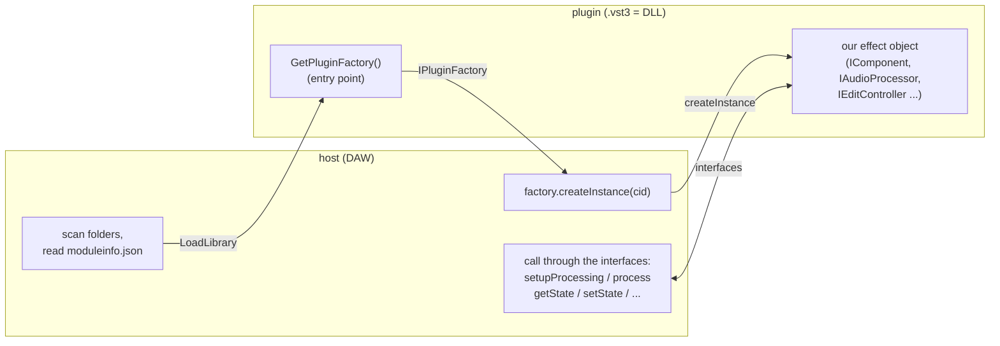
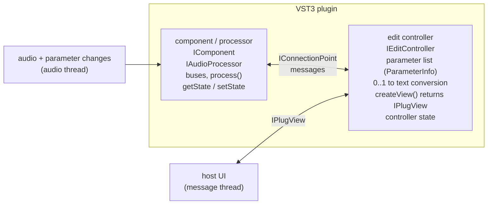
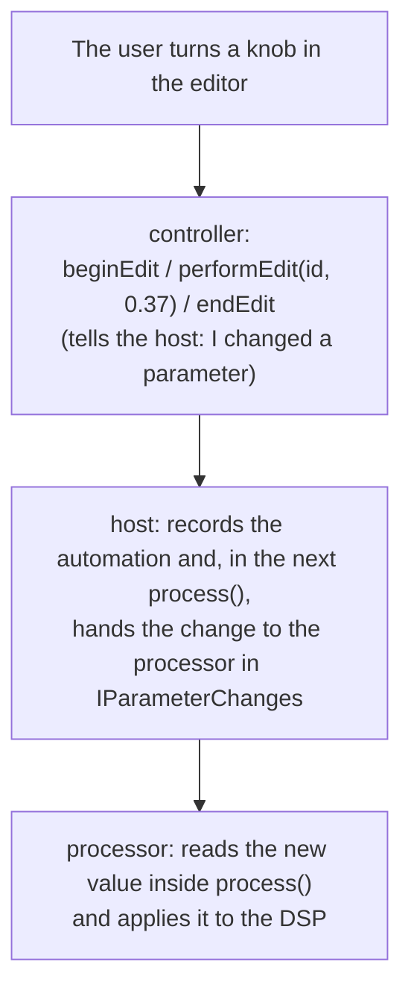
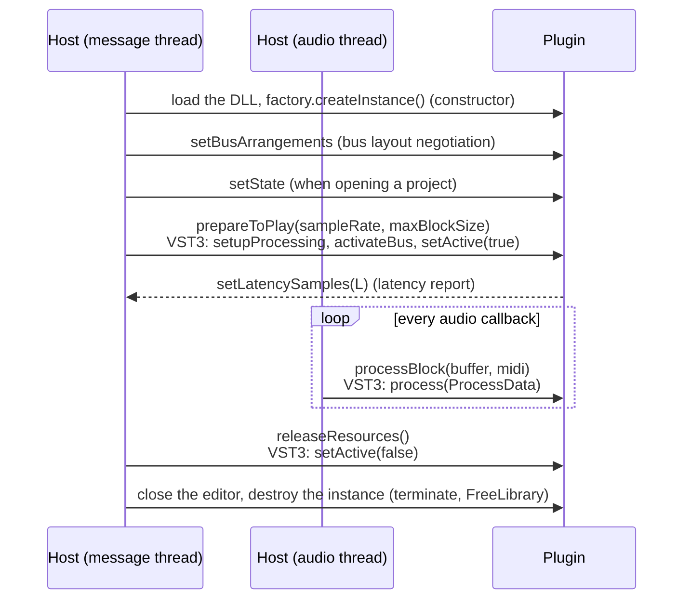
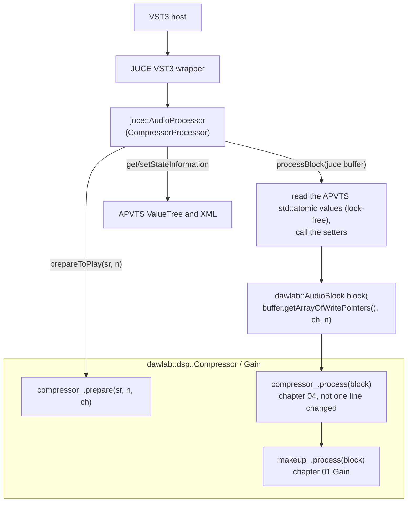
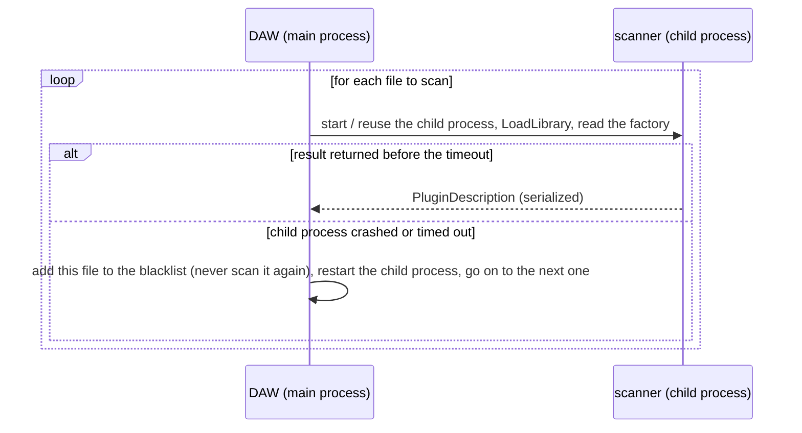
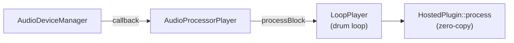

# Chapter 13: VST3 Plugins -- Build One Yourself, Then Host It Yourself
**English** | [繁體中文](README.zh-TW.md)

> [Course home](../../README.md)　|　Previous: [12 Reverb](../12-reverb/README.md)　|　Next: [14 8-track DAW](../14-daw-8track/README.md)

Up to the previous chapter, every effect we wrote was a C++ class: `prepare()`, `process()`, and a few setters. They could only live inside our own programs. Real-world musicians use a DAW (Reaper, Cubase, Ableton Live, Logic, ...), and effects are "plugged into" the DAW's tracks as **plugins**. This chapter connects the two ends:

- **Making a plugin**: wrap chapter 04's `Compressor` and chapter 01's `Gain` into a real VST3 plugin, `DawLabCompressor` (and wrap chapter 05's `Limiter` as `DawLabLimiter`, which we use to practice latency). It can be loaded by a DAW such as Reaper.
- **Making a host**: write a reusable hosting library, `dawlab_plugin_host`, that can scan, load, process, save and restore state, and open editors. The 8-track DAW in chapter 14 uses it to put VST3 plugins on its tracks.

When you build a plugin yourself and then load it with your own host, the contract between the two ends becomes perfectly clear: which things are the plugin's responsibility, which are the host's, and which thread each thing happens on.

> This chapter needs JUCE (`third_party/JUCE`, version 9.0.4). Build: `.\scripts\build.ps1 -Only 13-vst-hosting -Juce`

---

## 1. Chapter goals

After reading this chapter and doing the exercises, you will be able to:

- Describe the differences between the mainstream plugin formats (VST3, AU, AAX, CLAP, LV2) and where each is used.
- Explain the VST3 architecture: the split between the component (processor) and the edit controller, buses and speaker arrangements, **normalized parameters (0..1)**, sample-accurate automation (parameter queues), the `IPlugView` editor, and state.
- Derive and compute JUCE's `NormalisableRange` conversion between normalized and real values (including skew and `setSkewForCentre`).
- Describe a plugin's lifecycle: instantiate → `prepareToPlay` → `processBlock` × N → `releaseResources` → destroy, and map it onto VST3's `setupProcessing` / `setActive` / `process`.
- List the host's responsibilities: scanning and caching, out-of-process scanning, bus layout negotiation, latency reporting and **PDC (plugin delay compensation)**, state storage, editor windows, and the division of work between the message thread and the audio thread.
- Wrap your own DSP class as a VST3 plugin with JUCE (`juce_add_plugin`, `AudioProcessorValueTreeState`, a custom editor, a gain reduction meter).
- Write a host with JUCE: `AudioPluginFormatManager`, `KnownPluginList`, `PluginDescription`, `AudioPluginInstance`, `AudioProcessorEditor`, `AudioProcessorGraph`, `AudioProcessorPlayer`.
- Verify with numbers: the plugin wrapper does not change the DSP result (difference = 0), the sound after a state save/restore round trip is identical sample by sample, and the latency measured through a graph = the reported latency.

---

## 2. Principles

### 2.1 What a plugin is: a dynamic library that obeys a contract

A plugin is a **dynamic library** (a DLL on Windows, a bundle on macOS, a `.so` on Linux) with an entry point of an agreed-upon name. At run time the host `LoadLibrary`s it, calls the entry point to obtain a "factory", and asks the factory to produce the effect object. After that the host talks to it through a set of **pure virtual interfaces** (abstract classes in C++, or a table of function pointers in C).



This contract has two consequences that recur throughout the chapter:

1. **The plugin's code runs inside the host's process.** A bug in the plugin (a null pointer, a stack overflow, an infinite loop) takes down the whole DAW -- which is why professional DAWs scan plugins in a separate process (§2.6).
2. **The two sides can communicate only through the interfaces and cannot assume how the other side is implemented.** The host does not know what "threshold" means, and the plugin does not know what the host's audio callback looks like. All semantics must be encoded in the interface: parameters are expressed as 0..1, state is an opaque binary blob, and latency is reported in samples.

### 2.2 Plugin formats at a glance

| Format | Developer | Platforms | Main hosts | License / how to obtain | Features |
|---|---|---|---|---|---|
| **VST3** | Steinberg | Windows, macOS, Linux | Almost every DAW (Cubase, Reaper, Studio One, Bitwig, Ableton Live, FL Studio, ...) | The SDK ships inside JUCE; according to the LICENSE file of the SDK bundled with JUCE it is currently MIT (see §3.7) | component / controller split, sample-accurate automation, multiple buses, fast scanning via `moduleinfo.json` |
| **AU** (Audio Unit v2 / v3) | Apple | macOS / iOS only | Logic Pro, GarageBand, MainStage (Logic only accepts AU) | Apple SDK | Registration is managed by the OS; AUv3 is an app extension and can run in a separate process |
| **AAX** | Avid | Windows, macOS | Pro Tools only | You must apply to Avid for the SDK and signing (PACE) | Has a DSP-hardware-accelerated version; must be digitally signed before release |
| **CLAP** | An open-source community started by Bitwig + u-he | Windows, macOS, Linux | Bitwig, Reaper, etc.; support keeps growing | Pure C headers under the MIT license | Pure C ABI, clearly written thread rules, per-voice modulation, polyphonic parameters |
| **LV2** | Open-source community | Mainly Linux (also cross-platform) | Ardour, Carla, etc. | ISC license | Plugins are described by RDF (Turtle) files; a very flexible extension mechanism |
| VST2 (legacy) | Steinberg | -- | Old hosts | Steinberg has stopped licensing the VST2 SDK to new developers | Exists only for compatibility with old projects; hosting VST2 in JUCE 9 requires you to have the old SDK yourself |

The nice thing about JUCE is that the same `juce::AudioProcessor` code can output VST3, AU, AAX, LV2 and Standalone at once (this chapter enables only VST3 and Standalone). The host side of this chapter registers only the VST3 format: AU exists only on macOS, and VST2 needs a separate SDK.

### 2.3 VST3 architecture

#### 2.3.1 Two roles: the processor (component) and the edit controller

VST3 splits an effect into two halves:



- **component / processor** (`IComponent` + `IAudioProcessor`): the half that actually processes audio. It declares which **buses** exist, receives `process(ProcessData&)` calls, and stores the DSP's state. It is called on the audio thread.
- **edit controller** (`IEditController`): the "parameters and UI" half. It lists the parameters (name, unit, step count, default value), converts 0..1 values into display text, and creates the editor window (`createView` returns an `IPlugView`). It is called on the UI thread.

In principle the two can live in different processes, even on different computers (the spec allows it; in practice it is rare), so they **cannot share memory** and can only exchange messages. The path of a parameter change is:



A plugin written with JUCE is a "single component": the processor and the controller are implemented by one C++ object (the same `juce::AudioProcessor`), and JUCE's wrapper maps both VST3 interfaces onto it.

#### 2.3.2 Buses and speaker arrangements

Audio in VST3 is not simply "some number of channels" but a number of **buses**, each with a speaker arrangement (mono, stereo, 5.1, ...):

| Bus | Name | Arrangement | Note |
|---|---|---|---|
| input bus 0 | `"Input"` | stereo | main input |
| input bus 1 | `"Sidechain"` | mono | sidechain, aux; may be disabled by default |
| output bus 0 | `"Output"` | stereo | |

The host proposes a configuration with `setBusArrangements()` and the plugin answers whether it accepts it -- this is **bus layout negotiation**. Our `DawLabCompressor` accepts only mono→mono or stereo→stereo (`isBusesLayoutSupported`).

#### 2.3.3 Normalized parameters: the host sees only 0..1

Every VST3 parameter has a `ParamID` (a 32-bit integer), and its value is always a **`double` in 0..1** (`ParamValue`). The host does not know what "−20 dB" means; it only knows "the threshold parameter is now 0.6667". The benefits of this design:

- Automation lanes, MIDI learn and controller hardware can all handle every parameter with **one and the same** 0..1 logic;
- The "meaning" of a parameter (range, curve, unit) is decided entirely by the plugin, so a plugin can adjust its curves in a new version without breaking the host;
- Discrete parameters (for example a waveform menu) are also expressed in 0..1: a parameter with `stepCount = N` steps has values $`k / N`$.

The conversion is the plugin's job. The formula used by JUCE's `NormalisableRange<float>(start s, end e, interval, skew k)` is:

```math
n = \left(\frac{v - s}{e - s}\right)^{k}, \qquad v = s + (e - s)\, n^{1/k}
```

$`k = 1`$ is linear; $`k < 1`$ gives the first part of the slider to small values -- parameters such as attack, release and ratio, where "the small-value region matters more", should use $`k < 1`$.

**Derivation of `setSkewForCentre(c)`**: we want the exact middle of the knob ($`n = 0.5`$) to be $`v = c`$:

```math
0.5 = \left(\frac{c - s}{e - s}\right)^{k} \;\Longrightarrow\; k = \frac{\ln 0.5}{\ln\!\left(\dfrac{c - s}{e - s}\right)}
```

The parameters of this chapter's plugin (`plugin/compressor/CompressorProcessor.cpp`):

| Parameter | Range | skew $`k`$ | Default → normalized |
|---|---|---|---|
| Threshold | −60 … 0 dB | 1 | −20 dB → 0.6667 |
| Ratio | 1 … 20 | 0.5 | 4 → $`(3/19)^{0.5}`$ = 0.3974 |
| Knee | 0 … 24 dB | 1 | 6 dB → 0.25 |
| Attack | 0.1 … 200 ms | centre 10 ms → $`k`$ = 0.23064 | 10 ms → 0.5 |
| Release | 5 … 2000 ms | centre 100 ms → $`k`$ = 0.22767 | 100 ms → 0.5 |
| Makeup | −12 … +24 dB | 1 | 0 dB → 0.3333 |
| Mix | 0 … 100 % | 1 | 100 % → 1.0 |

All of these numbers are verified by the parameter table printed by `l13_offline_host` (the text the plugin itself displays = the value we compute with the formula, see §3.4). In addition, JUCE's VST3 wrapper automatically adds a `Bypass` parameter to a plugin that has none, so the host sees 8 parameters.

#### 2.3.4 Sample-accurate automation

In VST3's `process(ProcessData& data)`, parameter changes are placed in `data.inputParameterChanges`: every changed parameter has a **queue** holding a number of `(sampleOffset, value)` points, meaning "at sample number sampleOffset of this block, the value becomes value", with linear interpolation between the points:


A plugin may choose: (a) to interpolate along the queue for every sample (truly sample-accurate); (b) to split the block at the sampleOffsets and use one value per segment; (c) to take only the last value (block-accurate). JUCE's `AudioProcessor` model is (c): the parameters have already been updated at the start of `processBlock` and do not change within the block.

So when the **host side** wants a finer time resolution, the most general method is to **slice into sub-blocks**: cut 512 samples into 16 segments of 32 samples and set the parameter at the start of each segment (exercise 4). The cost and the error:

- Timing error ≤ the sub-block length $`S`$: with $`S = 32`$ and $`f_s = 48`$ kHz that is 0.67 ms;
- With a parameter slope of $`r`$ (units/second), the value error at any moment is ≤ $`r \cdot S / f_s`$; for example, for a threshold falling 40 dB in 8 seconds ($`r`$ = 5 dB/s), the error is ≤ 5 × 32 / 48000 ≈ 0.0033 dB;
- The cost: the plugin is called $`512/S`$ times as often, and the fixed overhead of every call (function call, parameter reads, smoother updates) grows accordingly.

#### 2.3.5 The editor: IPlugView

The controller's `createView("editor")` returns an `IPlugView`. The host prepares a native window (an HWND on Windows) and calls `view->attached(hwnd, "HWND")`, and the plugin draws its own UI inside. The size is decided by the plugin (`getSize`), and when the plugin wants to resize it calls the host's `IPlugFrame::resizeView`. On close, the host calls `removed()` and then releases the view. **The editor must be closed before the plugin is destroyed.**

#### 2.3.6 State

VST3 state comes in two parts: `IComponent::getState(IBStream*)` (what the DSP needs) and `IEditController::getState` (purely UI things, such as the editor's current tab). The host stores both in the project file and sends them back with `setState` when the project is opened. **The state format is decided entirely by the plugin**; the host only stores the bytes.

A JUCE plugin's `getStateInformation` is the component state; on the JUCE host side (`AudioPluginInstance::getStateInformation`) the component and controller states are wrapped in one XML (`<VST3PluginState><IComponent>…</IComponent><IEditController>…</IEditController></VST3PluginState>`). That is why what `l13_state_roundtrip` prints has **two layers of wrapping**: the outer layer is the host's XML, and the inner layer (JUCE's own base64 variant encoding) is our plugin's APVTS XML.

#### 2.3.7 The `.vst3` bundle and `moduleinfo.json`

A VST3 on Windows is a **folder** (a bundle):

```text
DawLabCompressor.vst3/
+-- Contents/
    +-- Resources/
    |   +-- moduleinfo.json        <- name, vendor, category, class ID ... (generated automatically by JUCE after the build)
    +-- x86_64-win/
        +-- DawLabCompressor.vst3  <- the real DLL (its extension is also .vst3)
```

`moduleinfo.json` (the ModuleInfo-JSON page of the VST 3 Developer Portal states that it was added in VST SDK 3.7.5; `public.sdk/source/vst/moduleinfo/moduleinfo.h` in the SDK is likewise marked as created in December 2021) lets the host know which plugins are inside **without loading the DLL**, which makes scanning much faster and keeps a broken plugin from crashing it. The price is that information such as the channel counts is only known after instantiation -- this is why the `ins / outs` in the first table of `l13_scan_plugins` are 0 and only become 2 after instantiation.

### 2.4 The plugin lifecycle



Rules:

- The constructor and `prepareToPlay` may be slow and may allocate; `processBlock` may not (chapter 00's real-time rules).
- The second argument of `prepareToPlay` is the **maximum** block size: the host promises to give at most this many samples each time (but not necessarily the same number every time; the last block may be shorter, and sub-block automation also hands in shorter blocks).
- Changing the sample rate, block size or bus layout requires `releaseResources()` first and then `prepareToPlay()` again.
- Latency is reported in `prepareToPlay`; when latency changes during playback (for example a limiter changes its lookahead), the plugin notifies the host (VST3: `restartComponent(kLatencyChanged)`), and the host usually recomputes PDC at the next prepare.

### 2.5 Wrapping our DSP class as a plugin

This course has insisted since chapter 00 that DSP components "do not depend on JUCE and take a `dawlab::AudioBlock`", precisely for this moment. Wrapping needs just one **adapter**:



`dawlab::AudioBlock` is just a view of "an array of channel pointers + a length" and wraps the JUCE buffer's pointers directly, with **zero copying**. `l13_offline_host` proves with numbers that the wrapper changes nothing: the result through the VST3 plugin and the result of calling `dsp::Compressor` directly have a **maximum difference of 0**.

Parameters go through `juce::AudioProcessorValueTreeState` (APVTS):

- Declare the parameters (ID, name, `NormalisableRange`, default value, a function for the display text);
- The audio thread reads the `std::atomic<float>*` obtained from `getRawParameterValue(id)` once per block;
- The editor binds knobs to parameters with `SliderAttachment` (two-way, and it notifies the host so automation can be recorded);
- `copyState()` / `replaceState()` make saving and restoring state a matter of a few lines.

### 2.6 The host's responsibilities

#### 2.6.1 Scanning and caching

Scanning = finding all the `.vst3` files and reading each plugin's `PluginDescription` (name, vendor, category, uid, file path and modification time). An old plugin without `moduleinfo.json` must have its DLL loaded and its factory created before this information can be read, and for hundreds of plugins that may take several minutes. So the host **caches** the result (`KnownPluginList` → XML) and at the next startup rescans only files that are "new or whose modification time changed". `l13_scan_plugins` demonstrates the cache, saving it, and reading it back.

#### 2.6.2 Why professional DAWs use out-of-process scanning


Scanning executes the plugin's code (the DLL's initialization, the factory, even constructors). If even one plugin has a bug, in-process scanning crashes the whole DAW, and it will crash again every time the user starts it. The solution:



JUCE provides the `KnownPluginList::CustomScanner` hook, and `extras/AudioPluginHost` uses it to move scanning into a child process (`CustomPluginScanner` in `MainHostWindow.cpp`). Going further, DAWs such as Bitwig can even **run** plugins in separate processes (plugin sandboxing), at the price of extra latency and CPU for passing audio between processes. To keep things simple for teaching, this chapter's `PluginHost::scan()` is in-process (exercise 2 asks you to design the out-of-process version).

#### 2.6.3 Bus layout negotiation

The host proposes a layout based on the track's channel count, and the plugin falls back to the next best if it does not accept it. The strategy of `HostedPlugin::prepare()`: try to set both the main input and the main output to the track's channel count, and keep the plugin's default if it is not accepted; if the channels still do not match during processing (for example a mono track with a stereo-only plugin), `process()` fills the gap: missing input channels get a copy of channel 0, and extra output channels are discarded.

#### 2.6.4 Latency reporting and PDC

Lookahead limiters, linear-phase EQs and oversampling all make the output $`L`$ samples later than the input. The plugin must report $`L`$ so that the host can do **PDC (plugin delay compensation)**:

Let the total latency of the $`i`$-th path in the project (track + its inserts) be $`L_i`$. To align all the paths at the mix bus, the host adds to the $`i`$-th path an extra delay of

```math
d_i = L_{\max} - L_i, \qquad L_{\max} = \max_i L_i
```

and the output of the whole project is $`L_{\max}`$ later than the "ideal". During playback the host reads the timeline $`L_{\max}`$ early, so what the user hears is still on the beat.

What happens without PDC? The same kick appears on two tracks, one of them $`D`$ samples late, and adding the two gives a comb filter:

```math
y[n] = x[n] + x[n - D] \;\Longrightarrow\; |H(f)| = 2\,\left|\cos\!\left(\frac{\pi f D}{f_s}\right)\right|
```

which cancels completely at $`f_k = \dfrac{(2k+1) f_s}{2D}`$. With $`D = 240`$ (5 ms) and $`f_s = 48`$ kHz, 100 Hz, 300 Hz, 500 Hz ... are all carved out -- the kick's low end simply disappears. Exercise 3 computes this, exercise 6 uses `AudioProcessorGraph` (which does PDC automatically) to measure the latency of a whole chain, and exercise 7 shows that bypass must compensate latency too -- and so must a plugin's own Bypass parameter: a plugin with latency must override `processBlockBypassed()` and output the original audio delayed by $`L`$ when bypassed (DawLabLimiter in §3.2); otherwise, the moment bypass is switched on, this track arrives $`L`$ earlier than PDC expects.

#### 2.6.5 Saving state, editor windows

- Saving a project: call `getStateInformation()` on every plugin and store the blob together with the plugin's identity (format, name, uid); opening a project: create the instance → `setStateInformation()`. `l13_state_roundtrip` proves that "a new instance + setState" sounds identical, sample by sample, to the original (difference 0).
- Editor: the host gives the plugin a window (`PluginWindow`); when the plugin has no editor the host generates one itself from the parameter list (`GenericAudioProcessorEditor`).

#### 2.6.6 Message thread vs audio thread

| Action | Thread | Why |
|---|---|---|
| Scanning, instantiating, destroying a plugin | message thread | Required by the VST3 spec; many plugins crash if created on other threads |
| `prepareToPlay` / `releaseResources` / bus layout | message thread, **while audio is stopped** | They allocate and change the DSP state |
| `setStateInformation` | message thread, preferably while audio is stopped | The plugin may rebuild a lot of internal data inside |
| Opening / closing the editor, the editor's timer, reading meter values | message thread | The GUI may only be operated on the message thread |
| `processBlock` | audio thread | Must not allocate / lock / do I/O |
| Parameter values (`setValue` / `getValue`) | any | In JUCE's VST3 hosting `setValue` first goes into a lock-free cache and is only sent into the plugin by the next `process`. Note that `HostedPlugin::setParameterValue` also notifies listeners (briefly taking `listenerLock`), so strictly speaking it is not lock-free; see the comment in `PluginHost.h` |

`HostedPlugin::process()` also has a detail to deal with: JUCE's `AudioProcessor` has a **callback lock** that the message thread holds during `suspendProcessing(true)`. The audio thread must never "wait" for this lock (it would cause dropouts, even priority inversion), so we use a **try-lock**: if it cannot be taken, that segment keeps the original audio.

Note that this try-lock takes effect only during `suspendProcessing(true)`. `setState` and `prepare` are **not** protected by it (JUCE's VST3 hosting takes a `MessageManagerLock` when changing state and does not touch the callback lock), so the host itself must guarantee that the audio thread is not calling `process()` at that time -- that is exactly what "while audio is stopped" in the table above means, and the thread rules in `PluginHost.h` require the same. In addition, JUCE's VST3 hosting spin-waits on a `processMutex` (a `SpinLock`) inside `processBlock`, and `prepareToPlay`, `releaseResources`, `reset` and `isBusesLayoutSupported` all take the same lock on the message thread; so "`process()` does not wait on a lock" holds only if the host obeys the rules above.

### 2.7 How JUCE abstracts it

| JUCE class | Role | Used in this chapter for |
|---|---|---|
| `juce::AudioProcessor` | The abstraction of "one effect": prepare / process / parameters / state / editor | The plugins themselves, `gui_host`'s `LoopPlayer` |
| `juce::AudioProcessorValueTreeState` | Parameter declaration, atomic reads, state, UI attachments | Both plugins |
| `juce::AudioPluginFormatManager` | Manages the registered formats (VST3, AU, ...) and creates instances from a description | `PluginHost` |
| `juce::VST3PluginFormat` | Scanning and loading of the VST3 format (with editor support; `VST3PluginFormatHeadless` has none) | The `PluginHost` constructor |
| `juce::KnownPluginList` | The list and cache of scan results, the blacklist, XML saving and loading | `PluginHost::scan` |
| `juce::PluginDescription` | A plugin's ID card (name, format, uid, path, ...) | The return value of scan |
| `juce::AudioPluginInstance` | A plugin loaded by the host (also an `AudioProcessor`) | Wrapped by `HostedPlugin` |
| `juce::AudioProcessorEditor` | A plugin's UI (VST3's `IPlugView` is wrapped into it) | `CompressorEditor`, `PluginWindow` |
| `juce::GenericAudioProcessorEditor` | A UI generated automatically from the parameter list | The `PluginWindow` fallback |
| `juce::AudioProcessorGraph` | Modular routing: node = processor, connection = (node, channel), automatic PDC | Exercise 6 |
| `juce::AudioProcessorPlayer` | Connects an `AudioProcessor` to the audio device's callback | `l13_gui_host` |
| `juce::AudioDeviceManager` | Opens / configures the audio device | `l13_gui_host` |

The differences between JUCE 9 and the older (6/7) tutorials commonly found online that this chapter runs into are as follows (according to `third_party/JUCE/BREAKING_CHANGES.md`; these changes actually began to appear gradually in late JUCE 8):

- `AudioPluginFormatManager::addDefaultFormats()` has been removed (the 8.0.9 section of BREAKING_CHANGES) and replaced by the free function `addDefaultFormatsToManager()`; we simply call `addFormat(std::make_unique<juce::VST3PluginFormat>())`.
- The hosting classes were split into `juce_audio_processors_headless` (no UI) and `juce_audio_processors` (with UI), and the VST3 SDK also moved to `juce_audio_processors_headless/format_types/VST3_SDK`. For plugins loaded through `VST3PluginFormatHeadless`, `hasEditor()` is always false.
- You can no longer call `createEditor()` directly; use `createEditorAndMakeActive()` (since JUCE 8.0.13) so that `getActiveEditor()` is correct.

---

## 3. From formulas to code

### 3.1 File structure

```text
lessons/13-vst-hosting/
+-- CMakeLists.txt                 # return() if JUCE is not enabled
+-- plugin/
|   +-- CMakeLists.txt             # juce_add_plugin x2 (VST3 + Standalone, COPY_PLUGIN_AFTER_BUILD FALSE)
|   +-- compressor/CompressorProcessor.{h,cpp}   # DawLabCompressor: Compressor + Gain + Mix, APVTS, state
|   +-- compressor/CompressorEditor.{h,cpp}      # 7 knobs + gain reduction meter
|   +-- limiter/LimiterProcessor.{h,cpp}         # DawLabLimiter: Limiter, reports latency, no editor
+-- host/
|   +-- CMakeLists.txt             # dawlab_plugin_host_juce (JUCE modules) + dawlab_plugin_host
|   +-- include/dawlab/host/PluginHost.h         # PluginHost / HostedPlugin / PluginWindow
|   +-- src/{PluginHost,HostedPlugin,PluginWindow}.cpp
+-- examples/
|   +-- L13Common.h                # small utilities shared by this chapter's examples (paths, normalized conversion, offline render)
|   +-- scan_plugins.cpp           # l13_scan_plugins
|   +-- offline_host.cpp           # l13_offline_host
|   +-- state_roundtrip.cpp        # l13_state_roundtrip
|   +-- gui_host.cpp               # l13_gui_host (GUI)
+-- exercises/README.md, exercises/starter/ex4..ex7_*.cpp
+-- solutions/README.md, solutions/ex4..ex7_*.cpp
```

This chapter adds no `dsp/` header -- the plugins use chapters 01, 04 and 05's `Gain.h`, `Compressor.h` and `Limiter.h` directly.

### 3.2 The plugin: `DawLabCompressor`

**CMake** (`plugin/CMakeLists.txt`):

```cmake
juce_add_plugin(DawLabCompressor
    COMPANY_NAME "DawLab"
    PLUGIN_MANUFACTURER_CODE Dwlb        # 4 characters, at least one uppercase
    PLUGIN_CODE Dcmp                     # 4 characters, exactly one uppercase
    FORMATS VST3 Standalone
    PRODUCT_NAME "DawLabCompressor"
    VST3_CATEGORIES Fx Dynamics
    COPY_PLUGIN_AFTER_BUILD FALSE        # never install automatically into system folders
    ...)
```

The manufacturer code + plugin code become part of the VST3 class ID and **can never be changed after release**, otherwise users' old projects will not find your plugin. `juce_add_plugin` produces three targets: `DawLabCompressor` (the shared code), `DawLabCompressor_VST3` and `DawLabCompressor_Standalone`.

**Signal flow** (`processChunk` in `CompressorProcessor.cpp`):

```math
\text{wet}[n] = g_{\text{makeup}}[n] \cdot \text{Compressor}(x)[n], \qquad
y[n] = (1 - m[n])\,x[n] + m[n]\,\text{wet}[n]
```

$`m`$ is Mix (0..1, with 50 ms linear smoothing), and $`g_{\text{makeup}}`$ comes from chapter 01's `Gain` (which has its own 50 ms ramp). Mix is **parallel compression** (also called New York compression): blend a heavily compressed signal with the original, keeping the original's transients while gaining the density of compression. Because the compressor has no lookahead (latency 0), dry is aligned without any delay; if there were latency, dry would first have to be delayed by $`L`$ (the extension question of exercise 7). When `mix = 100 %` and it is not ramping, the blend is skipped entirely, so the output is **bit-exact** with `dsp::Compressor`.

**Reading parameters**: the `std::atomic<float>*` pointers are obtained at construction, and `processBlock` calls `updateDspParameters()` once at its start. Setters such as `Compressor::setAttackMs()` were designed from the start to be callable between blocks.

**Gain reduction meter**: `Compressor::getGainReductionDb()` is a `std::atomic<float>` (written by the audio thread, read by the UI thread). `CompressorEditor` reads it with a 30 Hz `juce::Timer`, adding display ballistics of "rise immediately, fall at most 1 dB per frame" and a 1.5-second peak hold. The editor never touches the audio buffer.

**State**:

```cpp
void CompressorProcessor::getStateInformation(juce::MemoryBlock& destData) {
    const auto tree = state_.copyState();          // the APVTS ValueTree (thread-safe)
    if (auto xml = tree.createXml())
        copyXmlToBinary(*xml, destData);            // XML → binary (with a magic number and a length)
}
```

**What is different about DawLabLimiter**: (1) in `prepareToPlay` it calls `setLatencySamples(limiter_.getLatencySamples())`; a 5 ms lookahead @ 48 kHz = 240 samples, and changing the lookahead during playback also updates the latency; (2) `hasEditor()` returns false, so the host falls back to `GenericAudioProcessorEditor`; (3) `getTailLengthSeconds()` reports the lookahead length; (4) it overrides `processBlockBypassed()`. The VST3 wrapper automatically adds a Bypass parameter and calls `processBlockBypassed()` when it is on, while JUCE's default implementation is a plain pass-through (delay 0) -- but the latency the plugin reports is still 240 and the host's PDC still compensates 240, so the bypassed signal would arrive 240 samples earlier than the other tracks. **A plugin with latency must override `processBlockBypassed()` to keep the delay**: when bypassed, DawLabLimiter outputs the original audio delayed by $`L`$ (using `dsp::DelayLine`, with capacity = the lookahead upper bound + maxBlockSize, allocated in `prepareToPlay`) and switches between wet / dry with a 10 ms crossfade (exercise 7's same trick, only done inside the plugin); the limiter keeps running while bypassed, so when bypass is released its internal state is already up to date and no stale sound comes out. The solution to exercise 7 verifies that with Bypass = 1 an impulse at position 1000 appears at $`1000 + 240`$.

### 3.3 The host library: `dawlab_plugin_host`

`host/include/dawlab/host/PluginHost.h` (namespace `dawlab::host`). This is the contract that chapter 14 depends on:

```cpp
class PluginHost {                                   // everything on the message thread
public:
    PluginHost();                                    // creates the AudioPluginFormatManager and registers VST3
    juce::Array<juce::PluginDescription> scan(const juce::File& fileOrFolder, bool recursive = true);
    std::unique_ptr<juce::AudioPluginInstance> loadFromFile(const juce::File& vst3File, double sampleRate,
                                                            int blockSize, juce::String& error);
    std::unique_ptr<juce::AudioPluginInstance> createInstance(const juce::PluginDescription& desc,
                                                              double sampleRate, int blockSize, juce::String& error);
    juce::AudioPluginFormatManager& getFormatManager();
    // extras: getDefaultSearchPaths, findPluginFiles, getKnownPluginList, save/loadKnownPluginList, getLastScanFailures
};

class HostedPlugin {
public:
    explicit HostedPlugin(std::unique_ptr<juce::AudioPluginInstance> instance);
    void prepare(double sampleRate, int maxBlockSize, int numChannels);  // message thread (while audio is stopped)
    void releaseResources();
    void process(dawlab::AudioBlock block) noexcept;                     // audio thread
    int getLatencySamples() const;
    int getNumParameters() const;  juce::String getParameterName(int) const;  int findParameter(const juce::String&) const;
    float getParameterValue(int) const;  void setParameterValue(int, float normalizedValue);   // 0..1
    juce::MemoryBlock getState();  void setState(const juce::MemoryBlock&);
    juce::String getName() const;  bool hasEditor() const;  juce::AudioPluginInstance& getInstance();
};

class PluginWindow : public juce::DocumentWindow {   // message thread
public:
    explicit PluginWindow(HostedPlugin&);            // the editor; without one, a GenericAudioProcessorEditor
    std::function<void()> onCloseRequested;          // when not set, close = hide; it never deletes the plugin
};
```

Implementation highlights:

- **`process()` is zero-copy and allocation-free**: `prepare()` pre-allocates the channel pointer array, the scratch buffer and the `MidiBuffer`. `process()` only fills in pointers and wraps the block with the **referencing constructor** `juce::AudioBuffer<float>(float* const*, int numChannels, int numSamples)` (up to 32 channels use the object's built-in array, so nothing is malloc'ed).
- **A block larger than maxBlockSize is split into segments**: the host promised an upper bound in `prepareToPlay` and must never break it.
- **The callback lock uses a try-lock** (§2.6.6).
- **mono / stereo mismatch**: missing input channels get a copy of channel 0 (in the scratch buffer), and extra outputs are discarded.
- **Parameters**: `setParameterValue` calls `AudioProcessorParameter::setValue()` (JUCE's VST3 hosting sends it into the plugin through `IParameterChanges` at the next `process`) and then notifies listeners so an open editor follows along. `findParameter` compares names first (case-insensitive), then parameter IDs.
- **`PluginWindow`'s destruction order**: its destructor first calls `clearContentComponent()` to delete the editor (the editor's destructor calls `processor.editorBeingDeleted()`), so **the window must disappear before the plugin**.

CMake structure: a JUCE module is an "INTERFACE library that carries source code", so every target that links it recompiles JUCE. `host/CMakeLists.txt` gathers the modules it needs (`juce_audio_utils` and below) into one static library, `dawlab_plugin_host_juce`, compiled once, and forwards JUCE's include paths and compile definitions (including `JUCE_PLUGINHOST_VST3=1`) as INTERFACE; `dawlab_plugin_host` links it and `dawlab::dsp` as PUBLIC. A user only needs:

```cmake
target_link_libraries(my_app PRIVATE dawlab_plugin_host)
```

and can then `#include <dawlab/host/PluginHost.h>` and any `<juce_xxx/juce_xxx.h>` (`juce_audio_utils` and below). That way the dozen-plus executables of this chapter compile JUCE only once. `/W4` applies only to our own sources and not to JUCE's (the plugin targets use `set_source_files_properties` to enable `/W4` for their own `.cpp` files only).

### 3.4 Examples

All the examples run from the build folder (WAV output goes to `<build>/dawlab_output/`):

```powershell
.\scripts\build.ps1 -Only 13-vst-hosting -Juce          # build + run every ctest
cd build
.\bin\Debug\l13_offline_host.exe
```

Every console example loads the plugins built by this chapter (their paths are compiled into the programs by CMake as `DAWLAB_L13_COMPRESSOR_VST3` / `DAWLAB_L13_LIMITER_VST3`), so they run with no arguments.

#### `l13_scan_plugins` (`examples/scan_plugins.cpp`)

Demonstrates: the system default VST3 folders (file names only, nothing loaded), scanning this chapter's plugin folder, the `KnownPluginList` cache, saving to XML and reading it back, and reading the actual I/O after instantiation.

```
l13_scan_plugins                    scans this chapter's plugin folder
l13_scan_plugins <folder or .vst3>  scans the given location
l13_scan_plugins --system           really scans the system default folders (in-process, beware of crash risk)
```

Actual output (excerpt):

```
== System default VST3 search paths ==
  C:\Users\<you>\AppData\Local\Programs\Common\VST3  (does not exist, 0 .vst3)
  C:\Program Files\Common Files\VST3  (does not exist, 0 .vst3)
  name                 format     category           version    ins  outs  uid
  DawLabCompressor     VST3       Fx|Dynamics        0.1.0        0     0  dd419ed8
  DawLabLimiter        VST3       Fx|Dynamics|Mastering 0.1.0     0     0  dd4a9ad5
(ins / outs = 0 means "not known yet": the information comes from moduleinfo.json in the bundle, no DLL was loaded)
== Instantiate this chapter's plugins and read the actual bus configuration ==
  DawLabCompressor   ins 2  outs 2  latency 0  editor yes
  DawLabLimiter      ins 2  outs 2  latency 0  editor no
[PASS] l13_scan_plugins (6 checks passed)
```

(The uid is a hash of the class ID and stays fixed as long as the manufacturer / plugin code is unchanged.) Note that the latency DawLabLimiter reports right after instantiation is 0 -- latency is only settled after `prepareToPlay`, so the host must read the latency **after** prepare. Output file: `dawlab_output/l13_known_plugins.xml`.

#### `l13_offline_host` (`examples/offline_host.cpp`)

Demonstrates the plugin lifecycle and normalized parameters: load → `prepare(48000, 512, 2)` → list the parameters → set Threshold −30 dB, Ratio 4:1, Attack 5 ms and Release 80 ms using normalized values computed with the formula → process a 4-bar drum loop block by block (512 samples) → write WAVs.

```
l13_offline_host                          # default DawLabCompressor
l13_offline_host <plugin.vst3> [in.wav]   # any VST3 (48 kHz WAV)
```

Actual output (excerpt):

```
Set: Threshold -30.0 dB -> 0.5000, Ratio 4.0 -> 0.3974, Attack 5.0 ms -> 0.4251, Release 80.0 ms -> 0.4738
    0  Threshold    602006635      0.5000   -30.0 dB
    1  Ratio        108285963      0.3974   4.00 : 1
    3  Attack       740224584      0.4251   5.00 ms
    4  Release      1090594823     0.4738   80.0 ms
    7  Bypass       1652125811     0.0000   Off
          peak dBFS   RMS dBFS     crest (dB)
dry           -2.90     -17.43          14.53
wet           -7.75     -30.71          22.96
diff          -4.85     -13.28           8.43
Max difference between the plugin and calling dsp::Compressor directly: 0 (-100.0 dB)
[PASS] l13_offline_host (10 checks passed)
```

(The id column is VST3's `ParamID`: JUCE hashes it from the parameter ID string.)

Output: `l13_offline_dry.wav`, `l13_offline_wet.wav`.

**How it sounds, and the numbers**: the RMS dropped by 13.3 dB and the peak by only 4.85 dB -- the crest factor actually **grew** by 8.4 dB. The reason is the 5 ms attack: the first few ms (the transient) of every drum hit pass through before the gain reduction has built up, and only the body after it is pushed down. This is exactly the principle behind "a compressor with a medium attack gives drums more punch" (to make the crest factor smaller you need a shorter attack, or a limiter). The wet signal has no makeup, so it is much quieter overall; set `Makeup` to about +10 dB and compare again, and you will hear the drums become shorter and "tighter", with the tails between hits becoming relatively larger.

#### `l13_state_roundtrip` (`examples/state_roundtrip.cpp`)

Demonstrates saving and restoring state: parameter set A → save state → render; back to the defaults (B) → render; `setState(A)` → check the parameters → render; open a brand-new instance → `setState(A)` → render.

Actual output (excerpt):

```
== Parameter set A ==
  Threshold  0.4000  (-36.0 dB)
  Ratio      0.6070  (8.00 : 1)
  Attack     0.4000  (3.86 ms)
  Release    0.6000  (216.6 ms)
  state size: 643 bytes
  outer layer (the host's wrapper): <?xml version="1.0" encoding="UTF-8"?> <VST3PluginState><IComponent>398.VMjLgjT....
Max difference between A and B: 0.2218
== After setState(A) ==
  Attack     0.3999  (3.86 ms)
Max difference between A and restored: 0
Max difference between A and "new instance + setState(A)": 0
Exercise 1 check: Threshold 0.6 -> -24.0 dB, Ratio 0.60698 -> 8.00, Attack 0.4 -> 3.86 ms, Release 0.6 -> 216.6 ms, Release 0.25 -> 9.5 ms
[PASS] l13_state_roundtrip (10 checks passed)
```

Note that after restoring, Attack is 0.3999 and not 0.4000: the plugin snaps the value to its interval (0.01 ms), 3.8624 ms is stored as 3.86 ms, and converting back to normalized is off by a tiny amount. **The state stores the plugin's actual values, not the normalized values the host sent in** -- this is exactly where state differs from automation.

Output: `l13_state_A.wav`, `l13_state_B.wav`, `l13_state_restored.wav` (A is parallel compression with −36 dB, 8:1, +8 dB makeup and 70 % mix, so the drums are dense and thick; B is the defaults; restored is identical to A).

#### `l13_gui_host` (`examples/gui_host.cpp`)

A mini host with a window: buttons to load any `.vst3` (or directly DawLabCompressor / DawLabLimiter), open and close the editor, Play / Bypass, and Audio Settings (`AudioDeviceSelectorComponent`). The playback architecture:



The steps for switching plugins (message thread) are the thread rules in practice: **close the editor → `player.setProcessor(nullptr)` (the audio thread no longer touches it) → delete the old plugin → create the new plugin → `player.setProcessor(&loop)` (triggers prepare)**.

`l13_gui_host --smoke-test` opens no audio device, automatically loads both plugins, opens the editors and renders a few hundred blocks offline; the result is written to `dawlab_output/l13_gui_host_smoke.txt` (GUI programs are not registered as ctests). Actual result:

```
[ok]   DawLabCompressor uses its own editor
  editor size: 720 x 250
  peak (plugin) = 0.391462, peak (bypass) = 0.446644
[ok]   DawLabLimiter has no editor -> GenericAudioProcessorEditor
  DawLabLimiter latency = 240 samples, peak = 0.446644
[ok]   DawLabLimiter reports a latency of 240 samples (5 ms @ 48 kHz)
[PASS] l13_gui_host smoke test
```

How it sounds: after Play, a 120 BPM drum loop; turn DawLabCompressor's Threshold down and the drum heads get squashed while the GR meter grows downward; press Bypass to compare with the original (switching directly gives a slight click -- exercise 7 fixes that with a crossfade).

### 3.5 Building and testing

```powershell
.\scripts\build.ps1 -Only 13-vst-hosting -Juce                       # everything
.\scripts\build.ps1 -Only 13-vst-hosting -Juce -TestLabel example    # run only the examples
.\scripts\build.ps1 -Only 13-vst-hosting -Juce -TestLabel solution   # run only the solutions
```

The first configure builds JUCE's `juceaide` tool first (1–2 minutes), and a full build (two plugins + the host library + 12 example and exercise executables) takes several minutes in Debug. ctest has 7 tests for this chapter (3 examples, 4 solutions), and all of them really load the `.vst3` built by this chapter. Both the Debug and Release (`-Config Release`) configurations were actually built and run: 0 warnings, all tests pass, and the numbers quoted in this chapter (the offline host's peak / RMS, the results of exercises 4 and 7, `--smoke-test`) are identical in both configurations.

Where the products are:

| Product | Path (relative to the build folder) |
|---|---|
| VST3 | `lessons/13-vst-hosting/plugin/DawLabCompressor_artefacts/Debug/VST3/DawLabCompressor.vst3` (likewise for the Limiter) |
| Standalone | `lessons/13-vst-hosting/plugin/DawLabCompressor_artefacts/Debug/Standalone/DawLabCompressor.exe` |
| Examples, exercises | `bin/Debug/l13_*.exe` |

### 3.6 Handing the plugins to other DAWs (for example Reaper)

`COPY_PLUGIN_AFTER_BUILD` is FALSE, so the build never touches your system. To try the plugins in Reaper:

1. Build in Release (the Debug version is slow, and JUCE's assertions may interrupt the DAW):
   `.\scripts\build.ps1 -Only 13-vst-hosting -Juce -Config Release -NoTest`
2. Copy the **whole bundle folder** `DawLabCompressor.vst3` to one of these locations:
   - `C:\Program Files\Common Files\VST3` (all users; needs administrator rights)
   - `%LOCALAPPDATA%\Programs\Common\VST3` (current user only; the VST3 spec's per-user location, needs no administrator rights, but not every DAW scans it)

   For example (PowerShell, as administrator):
   ```powershell
   Copy-Item -Recurse build\lessons\13-vst-hosting\plugin\DawLabCompressor_artefacts\Release\VST3\DawLabCompressor.vst3 "C:\Program Files\Common Files\VST3\"
   ```
3. Reaper: Options → Preferences → Plug-ins → VST, make sure the VST plug-in paths include the folder above, and press **Re-scan**; then search for `DawLab` in a track's FX window. (Menu names may differ slightly between Reaper versions; this course has not verified every DAW version one by one -- if you cannot find them, consult that DAW's manual under "plug-in paths / rescan".)
4. To remove them: simply delete that `.vst3` folder and re-scan.

After changing the code and rebuilding, copy again; the DAW usually has to be restarted to load the new DLL (a loaded DLL is locked, so copying fails -- close the DAW first).

### 3.7 Licensing

The following is based on the actual files in this project's `third_party/JUCE` (JUCE 9.0.4):

- **JUCE** (`third_party/JUCE/LICENSE.md`): JUCE's modules are **dual-licensed** -- AGPLv3, or the commercial JUCE 9 End User Licence Agreement (EULA). If you do not use it under AGPLv3, you are bound by the JUCE EULA. JUCE's example programs are under the ISC license; the list of third-party dependencies and their licenses is in `JUCE.spdx.json`. In practice: if you use JUCE under AGPLv3 and distribute your plugin, your plugin's source code must also be published under AGPLv3; if you do not want to publish it, you must obtain a commercial license under the JUCE EULA. The code in this course is for learning only; before distributing anything, read the terms yourself or seek legal advice.
- **VST3 SDK** (`modules/juce_audio_processors_headless/format_types/VST3_SDK/LICENSE.txt`, plus the separate `LICENSE.txt` files under `base/`, `pluginterfaces/` and `public.sdk/`): the **MIT License**, Copyright (c) 2025 Steinberg Media Technologies GmbH. The SDK's `README.md` states that the VST 3 SDK is under the MIT license, that the GPLv3 and Steinberg proprietary license options are no longer offered, and that using the "VST" trademark or logo requires complying with Steinberg's trademark guidelines (`VST3_Usage_Guidelines.pdf`). `JUCE.spdx.json` records this SDK's version as 3.8.0.
- The same SPDX file also lists the ASIO SDK bundled with JUCE as "Steinberg ASIO License or GPLv3" -- that is the ASIO support of `juce_audio_devices`, which this chapter does not enable (`JUCE_ASIO` defaults to 0).

---

## 4. Real-time notes

1. **Plugin side**: `processBlock` only reads `std::atomic<float>` and only calls DSP that does not allocate. All buffers (the dry buffer, the DSP's internal state) are allocated in `prepareToPlay`. Even if the host breaks its promise and gives a block larger than `samplesPerBlock`, we process it in segments rather than reallocating.
2. **Host side**: `HostedPlugin::process` does not allocate, does not copy audio and does not wait on locks (the callback lock uses a try-lock; the `processMutex` inside JUCE's VST3 hosting is never contended as long as the host does not call prepare / release / setState while `process()` is in progress, see §2.6.6); only `prepare` allocates. `juce::AudioBuffer`'s referencing constructor does not malloc up to 32 channels -- beyond that it does, so a multichannel host must handle that separately.
3. **Parameter smoothing**: the parameters sent by the host are "staircases", and the plugin must smooth them itself. `Gain` (makeup) and Mix use a 50 ms linear ramp; changes of the Compressor's threshold / ratio are smoothed by the attack / release themselves and do not click.
4. **Denormals**: both the plugin and the host use `juce::ScopedNoDenormals` (which sets the CPU's flush-to-zero / denormals-are-zero), so the compressor's envelope does not make the CPU spike after a long stretch of silence.
5. **Reading values for the GUI**: the meter only reads atomics, and a 30 Hz timer is enough; never call `repaint()` or any GUI function from the audio thread.
6. **Latency changes**: call `setLatencySamples` only in `prepareToPlay` or between blocks; on the host side, read the latency after prepare. A latency change during playback throws PDC out of alignment until the host prepares again.
7. **Plugins are independent of each other**: every instance has its own DSP objects; do not keep state in global / static variables (the same DLL may be instantiated many times -- chapter 14's 8 tracks will do exactly that).

---

## 5. Common mistakes and debugging

| Symptom | Likely cause | Fix |
|---|---|---|
| `loadFromFile` fails: "no loadable VST3 plugin" | The path points to the DLL inside the bundle instead of the bundle folder; or the Debug / Release path is wrong | Pass `…/VST3/DawLabCompressor.vst3` (the folder). `scan()` handles both |
| A console program crashes or hangs when loading a plugin | No MessageManager was created | Put `juce::ScopedJuceInitialiser_GUI` at the start of `main` so the main thread becomes the message thread |
| `juce::String` prints garbage, or an assertion appears in Debug | `juce::String("…")` accepts only ASCII | Use `juce::String::fromUTF8(...)` (the examples' `l13::u8()`), and print with `toRawUTF8()` |
| A parameter was set but has no effect | You sent the real value (e.g. −30) instead of 0..1; or the parameter name is misspelled (`findParameter` returns −1) | Convert with the normalized formula; check the return value of `findParameter` |
| After saving state and restoring, the sound differs | The render was not re-prepared (the DSP's internal envelope state differs); or the plugin's state leaves something out | `prepare()` before comparing so both start from the same state; the plugin's state must cover everything that affects the sound |
| Crash when closing the host (near `editorBeingDeleted`) | The plugin was deleted before the editor window | Delete the `PluginWindow` first, then the `HostedPlugin` |
| Occasional crash when switching plugins | The audio thread is still calling the old plugin | First `player.setProcessor(nullptr)` (or stop audio), then delete the plugin |
| Drums on different tracks sound "thin", low end disappears | No PDC; a track with latency is offset from the other tracks → comb filter | Read `getLatencySamples()` and add delay to the other paths (§2.6.4, exercises 3 and 6) |
| Clicks when bypassing | A hard switch; differing latency makes the timeline jump | Crossfade + delay compensation for dry (exercise 7) |
| `/W4` produces thousands of warnings | `/W4` was applied to a target that contains JUCE module sources | Enable `/W4` only for your own `.cpp` files (`set_source_files_properties`), or gather JUCE in a separate library |
| After changing the plugin and rebuilding, the DAW still has the old version | The DLL is locked by the DAW / the DAW did not reload it | Close the DAW and copy again; re-scan |
| The whole host crashes when scanning a folder | A plugin crashed during initialization (in-process scanning) | Move it out of the folder; a production product needs out-of-process scanning + a blacklist |

Debugging tips:

- First use `l13_offline_host <your.vst3>` to confirm in an offline environment that the plugin loads and its parameter table is correct, and only then put it into a DAW.
- Visual Studio can "Attach to Process" (Reaper.exe), letting you set a breakpoint in the plugin's `processBlock` (use a Debug build and copy the Debug `.vst3` over).
- Steinberg's VST3 SDK (the full version) ships a `validator` tool that runs spec-conformance tests on a plugin; in the JUCE ecosystem Tracktion's pluginval is also widely used.

---

## 6. Exercises

See [`exercises/README.md`](exercises/README.md) (7 problems: calculation ×2, concepts ×1, hands-on ×4). Solutions and explanations are in [`solutions/README.md`](solutions/README.md).

| # | Type | Topic | Program |
|---|---|---|---|
| 1 ★☆☆ | Calculation | normalized ↔ real values, deriving `setSkewForCentre` | (verified by `l13_state_roundtrip`) |
| 2 ★★☆ | Concepts | thread rules, try-lock, out-of-process scanning, destruction order | — |
| 3 ★★☆ | Calculation | latency, PDC, comb filter | (240 samples verified by `l13_ex6_solution`) |
| 4 ★★☆ | Hands-on | host-side automation: slicing into sub-blocks | `l13_ex4_starter` / `l13_ex4_solution` |
| 5 ★★☆ | Hands-on | save a preset to a file and load it back | `l13_ex5_starter` / `l13_ex5_solution` |
| 6 ★★★ | Hands-on | chain two plugins with `AudioProcessorGraph`, measure latency | `l13_ex6_starter` / `l13_ex6_solution` |
| 7 ★★★ | Hands-on | a bypass with latency compensation + crossfade | `l13_ex7_starter` / `l13_ex7_solution` |

---

## 7. Further reading

- Steinberg, **VST 3 Developer Portal**: <https://steinbergmedia.github.io/vst3_dev_portal/> (the official explanations of the architecture, `IComponent` / `IEditController`, parameters, automation, buses and state). The SDK headers bundled with this project are in `third_party/JUCE/modules/juce_audio_processors_headless/format_types/VST3_SDK/pluginterfaces/vst/`, for example `ivstaudioprocessor.h`, `ivsteditcontroller.h` and `ivstparameterchanges.h`; their comments are good documentation in themselves.
- JUCE's official documentation and tutorials: <https://juce.com/learn/>; this project's `third_party/JUCE/docs/CMake API.md` (all parameters of `juce_add_plugin`), `examples/CMake/AudioPlugin`, and `extras/AudioPluginHost` (a complete JUCE host, including out-of-process scanning and a graph editor).
- CLAP: <https://github.com/free-audio/clap> (pure C headers whose thread-rule comments are written very clearly; worth reading alongside VST3).
- LV2: <https://lv2plug.in/>.
- Will Pirkle, *Designing Audio Effect Plugins in C++*, 2nd ed., Routledge, 2019 (a complete textbook from plugin architecture to DSP).
- Ross Bencina, "Real-time audio programming 101: time waits for nothing", 2011 (a blog post; what the audio thread must not do).
- Talks by Timur Doumler and others at CppCon / ADC (Audio Developer Conference) on real-time audio and lock-free programming.

---

## 8. Next chapter

[Chapter 14: 8-track DAW](../14-daw-8track/README.md) -- puts all the previous chapters together: a pure C++ engine (transport, tracks, mixer, PDC) plus a JUCE app, using this chapter's `dawlab_plugin_host` to put VST3 plugins on every track. (Chapter 14 follows the same bilingual layout, with English as the primary edition.)
