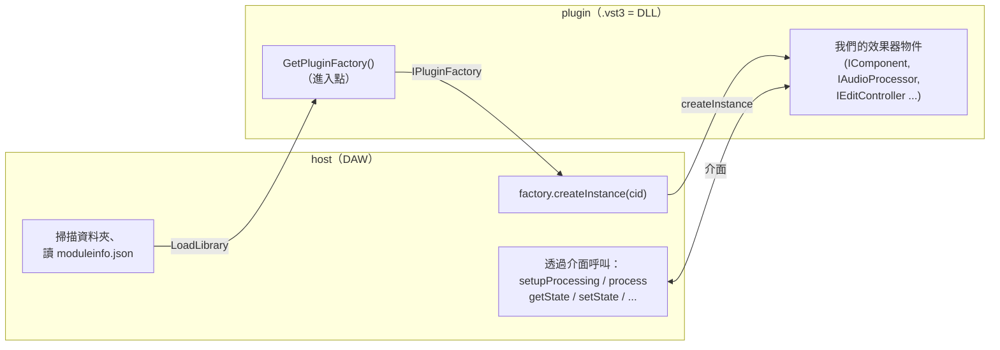
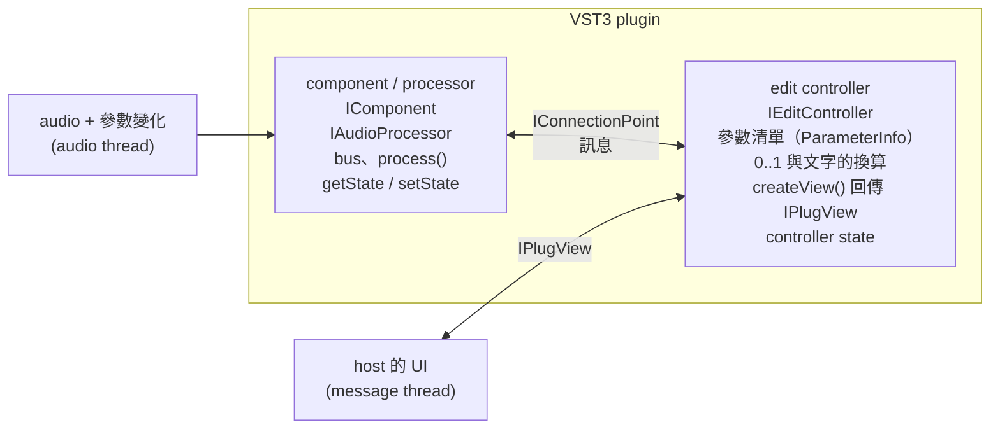
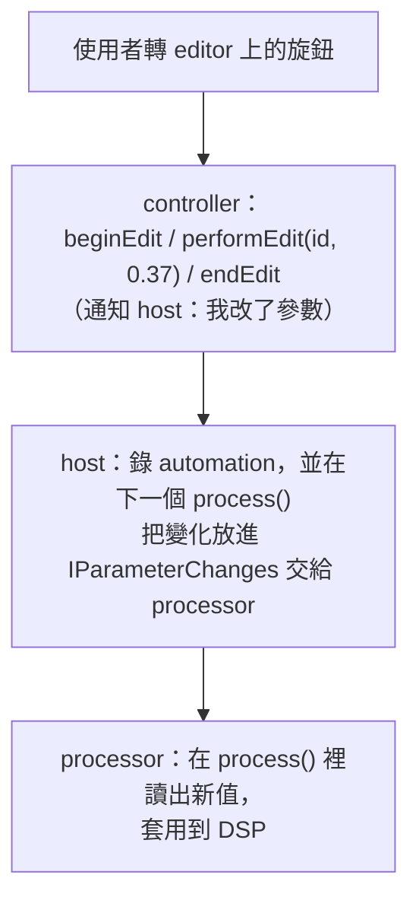
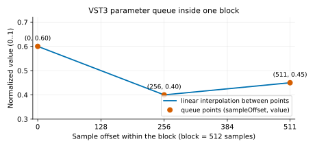
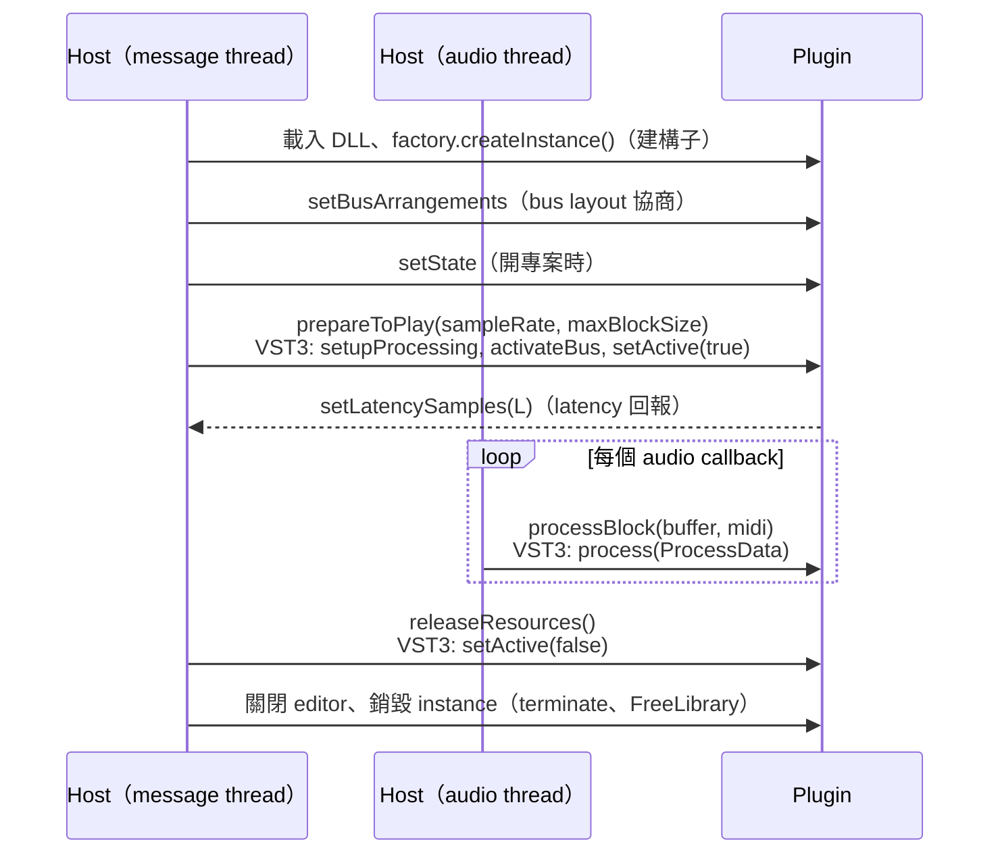
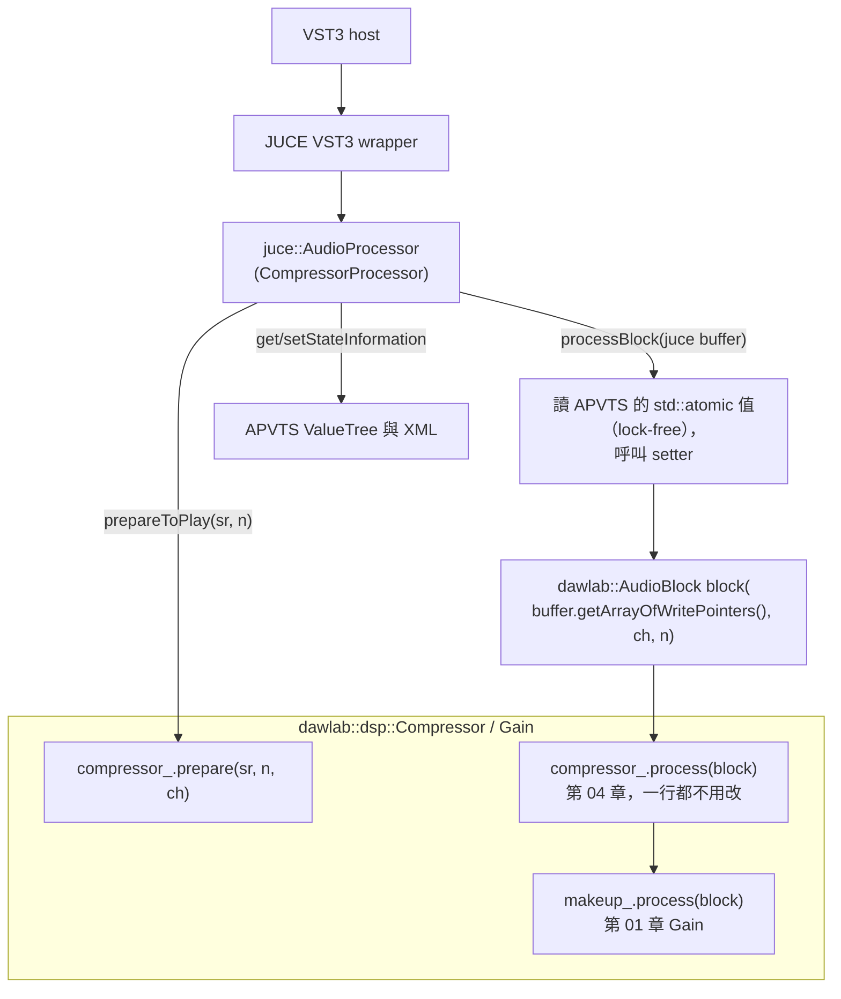
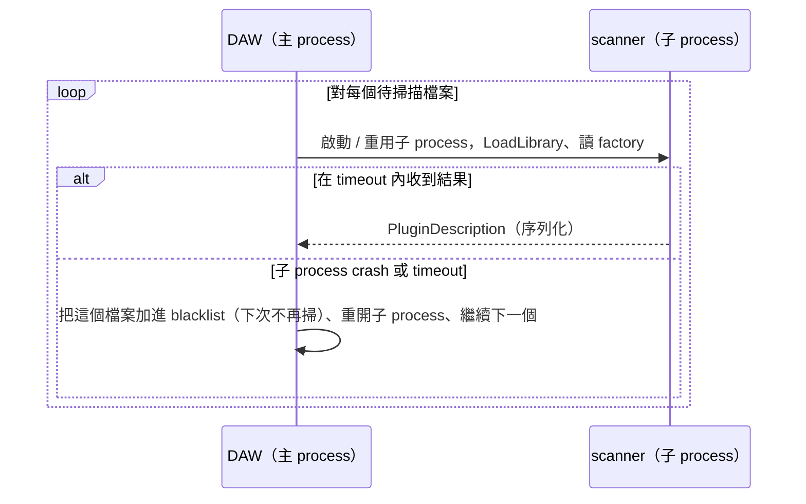
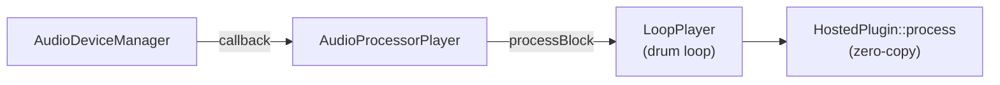

# 第 13 章：VST3 plugin —— 自己做一個，再自己 host
[English](README.md) | **繁體中文**

> [教材首頁](../../README.zh-TW.md)　｜　上一章：[12 Reverb](../12-reverb/README.zh-TW.md)　｜　下一章：[14 8-track DAW](../14-daw-8track/README.zh-TW.md)

到上一章為止，我們寫的每個效果器都是一個 C++ class：`prepare()`、`process()`、幾個 setter。它們只能活在我們自己的程式裡。真實世界的音樂人用的是 DAW（Reaper、Cubase、Ableton Live、Logic……），效果器以 **plugin** 的形式「插」進 DAW 的 track。這一章要從兩端打通這件事：

- **做 plugin**：把第 04 章的 `Compressor` 和第 01 章的 `Gain` 包成一個真正的 VST3 plugin `DawLabCompressor`（另外把第 05 章的 `Limiter` 包成 `DawLabLimiter`，用來練習 latency），它可以被 Reaper 之類的 DAW 載入。
- **做 host**：寫一個可重用的 hosting 函式庫 `dawlab_plugin_host`，能掃描、載入、處理、存取 state、開啟 editor。第 14 章的 8 軌 DAW 就用它在 track 上插 VST3。

自己做 plugin、再用自己的 host 載入它，兩端的合約（contract）就會看得一清二楚：哪些事是 plugin 的責任、哪些是 host 的責任、哪些事情在哪個 thread 發生。

> 本章需要 JUCE（`third_party/JUCE`，版本 9.0.4）。建置：`.\scripts\build.ps1 -Only 13-vst-hosting -Juce`

---

## 1. 本章目標

讀完本章、做完練習後，你能夠：

- 說出主流 plugin 格式（VST3、AU、AAX、CLAP、LV2）的差異與適用場合。
- 解釋 VST3 的架構：component（processor）與 edit controller 的分工、bus 與 speaker arrangement、**normalized parameter（0..1）**、sample-accurate automation（parameter queue）、`IPlugView` editor、state。
- 推導並計算 JUCE `NormalisableRange` 的 normalized ↔ 實際值換算（含 skew 與 `setSkewForCentre`）。
- 說出 plugin 的生命週期：instantiate → `prepareToPlay` → `processBlock` × N → `releaseResources` → 銷毀，並對應到 VST3 的 `setupProcessing` / `setActive` / `process`。
- 列出 host 的責任：掃描與快取、out-of-process scanning、bus layout 協商、latency 回報與 **PDC（plugin delay compensation）**、state 保存、editor 視窗、message thread 與 audio thread 的分工。
- 用 JUCE 把自己的 DSP class 包成 VST3 plugin（`juce_add_plugin`、`AudioProcessorValueTreeState`、自訂 editor、gain reduction meter）。
- 用 JUCE 寫 host：`AudioPluginFormatManager`、`KnownPluginList`、`PluginDescription`、`AudioPluginInstance`、`AudioProcessorEditor`、`AudioProcessorGraph`、`AudioProcessorPlayer`。
- 以數字驗證：plugin 包裝不改變 DSP 結果（差異 = 0）、state 存取來回後聲音逐 sample 相同、graph 量到的 latency = 回報的 latency。

---

## 2. 原理

### 2.1 Plugin 是什麼：一個遵守合約的動態函式庫

plugin 就是一個 **動態連結函式庫**（Windows 的 DLL、macOS 的 bundle、Linux 的 `.so`），裡面有一個約定好名字的進入點。host 在執行期 `LoadLibrary` 它、呼叫進入點拿到一個「工廠（factory）」，再請工廠生出效果器物件。之後 host 透過一組 **純虛擬介面**（C++ 的 abstract class，或 C 的 function pointer 表）跟它溝通。



這個合約有兩個後果，整章都會一再出現：

1. **plugin 的程式碼跑在 host 的 process 裡。** plugin 裡的 bug（null pointer、stack overflow、無窮迴圈）會直接讓整個 DAW 當掉——這就是為什麼專業 DAW 要在另一個 process 裡掃描 plugin（§2.6）。
2. **兩邊只能透過介面溝通，不能假設對方怎麼實作。** host 不知道「threshold」是什麼意思，plugin 也不知道 host 的 audio callback 長什麼樣子。所有語意都要編碼在介面裡：參數用 0..1 表示、state 是不透明的 binary blob、latency 用 sample 數回報。

### 2.2 Plugin 格式概覽

<div align="center">

| 格式 | 開發者 | 平台 | 主要 host | 授權 / 取得方式 | 特色 |
|---|---|---|---|---|---|
| **VST3** | Steinberg | Windows、macOS、Linux | 幾乎所有 DAW（Cubase、Reaper、Studio One、Bitwig、Ableton Live、FL Studio…） | SDK 隨 JUCE 內附；依 JUCE 內附 SDK 的 LICENSE 檔，目前為 MIT（見 §3.7） | component / controller 分離、sample-accurate automation、多 bus、`moduleinfo.json` 快速掃描 |
| **AU**（Audio Unit v2 / v3） | Apple | 僅 macOS / iOS | Logic Pro、GarageBand、MainStage（Logic 只吃 AU） | Apple SDK | 由 OS 管理註冊；AUv3 是 app extension，可在獨立 process 中執行 |
| **AAX** | Avid | Windows、macOS | 只有 Pro Tools | 需向 Avid 申請 SDK 與簽章（PACE） | 有 DSP 硬體加速版本；發佈前必須數位簽章 |
| **CLAP** | Bitwig + u-he 發起的開源社群 | Windows、macOS、Linux | Bitwig、Reaper 等支援度持續增加 | MIT 授權的純 C header | 純 C ABI、thread 規則寫得很清楚、per-voice modulation、polyphonic 參數 |
| **LV2** | 開源社群 | 主要 Linux（也可跨平台） | Ardour、Carla 等 | ISC 授權 | 以 RDF（Turtle）檔描述 plugin；擴充機制非常彈性 |
| VST2（舊） | Steinberg | — | 舊 host | Steinberg 已停止授權新的 VST2 SDK | 只為了相容舊專案存在；JUCE 9 hosting VST2 需要你自己有舊 SDK |

</div>

JUCE 的好處是：同一份 `juce::AudioProcessor` 程式碼可以同時輸出 VST3、AU、AAX、LV2、Standalone（本章只開 VST3 與 Standalone）。本章 host 端只註冊 VST3 格式：AU 只存在於 macOS，VST2 需要另外的 SDK。

### 2.3 VST3 架構

#### 2.3.1 兩個角色：processor（component）與 edit controller

VST3 把一個效果器拆成兩半：



- **component / processor**（`IComponent` + `IAudioProcessor`）：真正處理 audio 的那一半。宣告有哪些 **bus**、收 `process(ProcessData&)` 呼叫、保存 DSP 的 state。它在 audio thread 上被呼叫。
- **edit controller**（`IEditController`）：「參數與 UI」的那一半。列出參數（名稱、單位、步數、預設值）、把 0..1 的值轉成顯示文字、建立 editor 視窗（`createView` 回傳 `IPlugView`）。它在 UI thread 上被呼叫。

兩者原則上可以活在不同的 process，甚至不同的電腦（規格允許，實務上很少見），所以它們之間 **不能共享記憶體**，只能交換訊息。參數改變的路徑是：



JUCE 寫的 plugin 是「single component」：processor 與 controller 由同一個 C++ 物件實作（同一個 `juce::AudioProcessor`），JUCE 的 wrapper 負責把 VST3 的兩個介面都轉接到它身上。

#### 2.3.2 Bus 與 speaker arrangement

VST3 的音訊不是「幾個 channel」這麼簡單，而是若干個 **bus**，每個 bus 有一個 speaker arrangement（mono、stereo、5.1……）：

<div align="center">

| Bus | 名稱 | Arrangement | 說明 |
|---|---|---|---|
| input bus 0 | `"Input"` | stereo | 主輸入（main） |
| input bus 1 | `"Sidechain"` | mono | sidechain，aux；預設可能是關閉的 |
| output bus 0 | `"Output"` | stereo | |

</div>

host 用 `setBusArrangements()` 提議一組配置，plugin 回答接不接受——這就是 **bus layout 協商**。我們的 `DawLabCompressor` 只接受 mono→mono 或 stereo→stereo（`isBusesLayoutSupported`）。

#### 2.3.3 Normalized parameter：host 只看得到 0..1

VST3 的每個參數都有一個 `ParamID`（32-bit 整數），值一律是 **0..1 的 `double`**（`ParamValue`）。host 不知道 "−20 dB" 是什麼意思，它只知道「threshold 參數現在是 0.6667」。這樣設計的好處：

- automation lane、MIDI learn、控制器硬體都可以用 **同一套** 0..1 的邏輯處理所有參數；
- 參數的「意義」（範圍、曲線、單位）完全由 plugin 決定，plugin 改版時可以調整曲線而不破壞 host；
- 離散參數（例如 waveform 選單）也用 0..1 表示：有 `stepCount = N` 個步的參數，值是 $`k / N`$。

換算由 plugin 負責。JUCE 的 `NormalisableRange<float>(start s, end e, interval, skew k)` 用的公式是：

```math
n = \left(\frac{v - s}{e - s}\right)^{k}, \qquad v = s + (e - s)\, n^{1/k}
```

$`k = 1`$ 是線性；$`k < 1`$ 讓滑桿前段分配給小數值——attack、release、ratio 這種「小值區域比較重要」的參數都該用 $`k < 1`$。

**`setSkewForCentre(c)` 的推導**：我們想要旋鈕正中間（$`n = 0.5`$）剛好是 $`v = c`$：

```math
0.5 = \left(\frac{c - s}{e - s}\right)^{k} \;\Longrightarrow\; k = \frac{\ln 0.5}{\ln\!\left(\dfrac{c - s}{e - s}\right)}
```

本章 plugin 的參數（`plugin/compressor/CompressorProcessor.cpp`）：

<div align="center">

| 參數 | 範圍 | skew $`k`$ | 預設值 → normalized |
|---|---|---|---|
| Threshold | −60 … 0 dB | 1 | −20 dB → 0.6667 |
| Ratio | 1 … 20 | 0.5 | 4 → $`(3/19)^{0.5}`$ = 0.3974 |
| Knee | 0 … 24 dB | 1 | 6 dB → 0.25 |
| Attack | 0.1 … 200 ms | centre 10 ms → $`k`$ = 0.23064 | 10 ms → 0.5 |
| Release | 5 … 2000 ms | centre 100 ms → $`k`$ = 0.22767 | 100 ms → 0.5 |
| Makeup | −12 … +24 dB | 1 | 0 dB → 0.3333 |
| Mix | 0 … 100 % | 1 | 100 % → 1.0 |

</div>

這些數字都被 `l13_offline_host` 印出的參數表驗證（plugin 自己顯示的文字 = 我們用公式算的值，見 §3.4）。另外 JUCE 的 VST3 wrapper 會自動幫沒有 bypass 參數的 plugin 加一個 `Bypass` 參數，所以 host 看到的是 8 個參數。

#### 2.3.4 Sample-accurate automation

VST3 的 `process(ProcessData& data)` 裡，參數變化放在 `data.inputParameterChanges`：每個變了的參數有一個 **queue**，裡面是若干個 `(sampleOffset, value)` 的點，代表「在這個 block 的第 sampleOffset 個 sample，值變成 value」，點與點之間線性內插：

<p align="center"></p>

plugin 可以選擇：(a) 每個 sample 都依 queue 內插（真正的 sample-accurate）；(b) 把 block 依 sampleOffset 切段，每段用一個值；(c) 只取最後一個值（block-accurate）。JUCE 的 `AudioProcessor` 模型屬於 (c)：參數在 `processBlock` 開頭已經更新好，block 內不變。

所以 **host 端** 想要更細的時間解析度時，最通用的做法是 **切 sub-block**：把 512 個 sample 切成 16 段 32 sample，每段開頭設一次參數（練習 4）。代價與誤差：

- 時間誤差 ≤ sub-block 長度 $`S`$：$`S = 32`$、$`f_s = 48`$ kHz 時是 0.67 ms；
- 參數斜率為 $`r`$（單位/秒）時，任一時刻的值誤差 ≤ $`r \cdot S / f_s`$；例如 threshold 在 8 秒內掉 40 dB（$`r`$ = 5 dB/s），誤差 ≤ 5 × 32 / 48000 ≈ 0.0033 dB；
- 代價：plugin 被呼叫的次數變成 $`512/S`$ 倍，每次呼叫的固定開銷（函式呼叫、參數讀取、平滑器更新）跟著變多。

#### 2.3.5 Editor：IPlugView

controller 的 `createView("editor")` 回傳一個 `IPlugView`。host 準備一個原生視窗（Windows 的 HWND），呼叫 `view->attached(hwnd, "HWND")`，plugin 就在裡面畫自己的 UI。尺寸由 plugin 決定（`getSize`），plugin 想改大小時呼叫 host 的 `IPlugFrame::resizeView`。關閉時 host 呼叫 `removed()` 再釋放 view。**editor 一定要在 plugin 被銷毀之前關閉。**

#### 2.3.6 State

VST3 的 state 分兩份：`IComponent::getState(IBStream*)`（DSP 需要的東西）與 `IEditController::getState`（純 UI 的東西，例如 editor 的分頁）。host 把兩者都存進專案檔，開專案時用 `setState` 送回去。**state 的格式完全由 plugin 決定**，host 只負責保存 bytes。

JUCE plugin 的 `getStateInformation` 就是 component state；JUCE host 端（`AudioPluginInstance::getStateInformation`）會把 component 與 controller 兩份 state 用一個 XML 包起來（`<VST3PluginState><IComponent>…</IComponent><IEditController>…</IEditController></VST3PluginState>`）。所以 `l13_state_roundtrip` 印出來的是 **兩層包裝**：外層是 host 的 XML，內層（JUCE 自己的 base64 變體編碼）才是我們 plugin 的 APVTS XML。

#### 2.3.7 `.vst3` bundle 與 `moduleinfo.json`

Windows 上的 VST3 是一個 **資料夾**（bundle）：

```text
DawLabCompressor.vst3/
+-- Contents/
    +-- Resources/
    |   +-- moduleinfo.json
    +-- x86_64-win/
        +-- DawLabCompressor.vst3
```

- `moduleinfo.json`：名稱、廠商、類別、class ID……（JUCE 在 build 後自動產生）。
- 內層的 `DawLabCompressor.vst3`：真正的 DLL（副檔名也是 .vst3）。

`moduleinfo.json`（VST 3 Developer Portal 的 ModuleInfo-JSON 頁面寫明它是在 VST SDK 3.7.5 加入的；SDK 裡 `public.sdk/source/vst/moduleinfo/moduleinfo.h` 也標註建立於 2021 年 12 月）讓 host **不必載入 DLL** 就能知道裡面有哪些 plugin，掃描快很多、也不會被壞掉的 plugin 弄當。代價是 channel 數之類的資訊要 instantiate 之後才知道——`l13_scan_plugins` 的第一張表裡 `ins / outs` 是 0，instantiate 之後才變成 2，就是這個原因。

### 2.4 Plugin 的生命週期



規則：

- 建構子與 `prepareToPlay` 可以慢、可以 allocate；`processBlock` 不行（第 00 章的 real-time 規則）。
- `prepareToPlay` 的第二個參數是 **最大** block size：host 承諾之後每次最多給這麼多 sample（但不保證每次都一樣多，最後一塊可能比較短，sub-block automation 也會給更短的 block）。
- 改變 sample rate、block size、bus layout 都要先 `releaseResources()`，再重新 `prepareToPlay()`。
- latency 在 `prepareToPlay` 裡回報；播放中改變 latency（例如 limiter 改 lookahead）時，plugin 通知 host（VST3：`restartComponent(kLatencyChanged)`），host 通常在下次 prepare 時重新計算 PDC。

### 2.5 把我們的 DSP class 包成 plugin

這套教材從第 00 章就堅持 DSP 元件「不依賴 JUCE、吃 `dawlab::AudioBlock`」，就是為了這一刻。包裝只需要一個 **adapter**：



`dawlab::AudioBlock` 只是「channel 指標陣列 + 長度」的 view，直接包住 JUCE buffer 的指標，**零複製**。`l13_offline_host` 用數字證明了包裝沒有改變任何東西：經過 VST3 plugin 的結果與直接呼叫 `dsp::Compressor` 的結果 **最大差異為 0**。

參數走 `juce::AudioProcessorValueTreeState`（APVTS）：

- 宣告參數（ID、名稱、`NormalisableRange`、預設值、顯示文字的函式）；
- audio thread 用 `getRawParameterValue(id)` 拿到的 `std::atomic<float>*` 每個 block 讀一次；
- editor 用 `SliderAttachment` 把旋鈕綁到參數（雙向，並會通知 host 錄 automation）；
- `copyState()` / `replaceState()` 讓 state 存取只要幾行。

### 2.6 Host 的責任

#### 2.6.1 掃描與快取

掃描 = 找出所有 `.vst3`，讀出每個 plugin 的 `PluginDescription`（名稱、廠商、類別、uid、檔案路徑與修改時間）。沒有 `moduleinfo.json` 的舊 plugin 必須載入 DLL、建立 factory 才能讀到這些資訊，數百個 plugin 可能要好幾分鐘。所以 host 會把結果 **快取**（`KnownPluginList` → XML），下次啟動只重掃「新的或修改時間變了」的檔案。`l13_scan_plugins` 示範了快取、存檔、讀回。

#### 2.6.2 為什麼專業 DAW 用 out-of-process scanning

掃描時會執行 plugin 的程式碼（DLL 的初始化、factory、甚至建構子）。只要有一個 plugin 有 bug，in-process 掃描就會把整個 DAW 弄當，而且使用者每次啟動都會再當一次。解法：



JUCE 提供了 `KnownPluginList::CustomScanner` 這個掛勾，`extras/AudioPluginHost` 就是用它把掃描放到子 process（`MainHostWindow.cpp` 的 `CustomPluginScanner`）。更進一步，Bitwig 等 DAW 連 **執行** 都可以放在獨立 process（plugin sandboxing），代價是 process 之間傳 audio 的額外延遲與 CPU。本章的 `PluginHost::scan()` 為了教學簡潔是 in-process 的（練習 2 請你設計 out-of-process 版本）。

#### 2.6.3 Bus layout 協商

host 根據 track 的 channel 數提議 layout，plugin 不接受就退而求其次。`HostedPlugin::prepare()` 的策略：主輸入 / 主輸出都試著設成 track 的 channel 數，不接受就保留 plugin 的預設；處理時 channel 不一致（例如 mono track 插 stereo-only 的 plugin）由 `process()` 補上：缺的輸入 channel 用 channel 0 的複本，多出來的輸出丟掉。

#### 2.6.4 Latency 回報與 PDC

lookahead limiter、linear-phase EQ、oversampling 都會讓輸出比輸入晚 $`L`$ 個 sample。plugin 必須回報 $`L`$，host 才能做 **PDC（plugin delay compensation）**：

設專案裡第 $`i`$ 條路徑（track + 它的 insert）總 latency 是 $`L_i`$，為了讓所有路徑在 mix bus 對齊，host 在第 $`i`$ 條路徑額外加上

```math
d_i = L_{\max} - L_i, \qquad L_{\max} = \max_i L_i
```

的延遲，整個專案的輸出比「理想」晚 $`L_{\max}`$。播放時 host 會把 timeline 提早 $`L_{\max}`$ 讀取，所以使用者聽到的仍然對準節拍。

沒有 PDC 會怎樣？同一個 kick 出現在兩條 track、一條晚了 $`D`$ 個 sample，兩者相加就是一個 comb filter：

```math
y[n] = x[n] + x[n - D] \;\Longrightarrow\; |H(f)| = 2\,\left|\cos\!\left(\frac{\pi f D}{f_s}\right)\right|
```

在 $`f_k = \dfrac{(2k+1) f_s}{2D}`$ 完全抵消。$`D = 240`$（5 ms）、$`f_s = 48`$ kHz 時，100 Hz、300 Hz、500 Hz……全部被挖掉——kick 的低頻直接消失。練習 3 會算這個，練習 6 用 `AudioProcessorGraph`（它會自動做 PDC）量測整條鏈的 latency，練習 7 示範 bypass 時也要補償 latency——plugin 自己的 Bypass 參數也一樣：有 latency 的 plugin 必須 override `processBlockBypassed()`，bypass 時輸出延遲 $`L`$ 的原音（§3.2 的 DawLabLimiter），否則 bypass 一打開，這條 track 就比 PDC 預期的提早 $`L`$。

#### 2.6.5 State 保存、editor 視窗

- 存專案：對每個 plugin 呼叫 `getStateInformation()`，把 blob 連同 plugin 的身分（format、名稱、uid）存起來；開專案：建 instance → `setStateInformation()`。`l13_state_roundtrip` 證明「新 instance + setState」與原本的聲音逐 sample 相同（差異 0）。
- editor：host 給 plugin 一個視窗（`PluginWindow`），plugin 沒有 editor 時 host 自己用參數清單產生一個（`GenericAudioProcessorEditor`）。

#### 2.6.6 Message thread vs audio thread

<div align="center">

| 動作 | thread | 為什麼 |
|---|---|---|
| 掃描、instantiate、銷毀 plugin | message thread | VST3 規格要求；很多 plugin 在其他 thread 建立會 crash |
| `prepareToPlay` / `releaseResources` / bus layout | message thread，**audio 停止時** | 會 allocate、會改變 DSP 狀態 |
| `setStateInformation` | message thread，最好 audio 停止時 | plugin 可能在裡面重建大量內部資料 |
| 開關 editor、editor 的 timer、meter 讀值 | message thread | GUI 只能在 message thread 操作 |
| `processBlock` | audio thread | 不可 allocate / lock / I/O |
| 參數值（`setValue` / `getValue`） | 任意 | JUCE 的 VST3 hosting 的 `setValue` 先放進 lock-free cache，下一個 `process` 才送進 plugin。注意 `HostedPlugin::setParameterValue` 另外會通知 listener（短暫拿 `listenerLock`），嚴格說不是 lock-free，見 `PluginHost.h` 的註解 |

</div>

`HostedPlugin::process()` 還要面對一個細節：JUCE 的 `AudioProcessor` 有一個 **callback lock**，message thread 在 `suspendProcessing(true)` 期間會拿著它。audio thread 絕不能「等」這個 lock（會造成 dropout，甚至 priority inversion），所以我們用 **try-lock**：拿不到就讓這一段維持原音。

注意這個 try-lock 只在 `suspendProcessing(true)` 期間生效。`setState` 與 `prepare` **不受**它保護（JUCE 的 VST3 hosting 換 state 時拿的是 `MessageManagerLock`，不碰 callback lock），所以必須由 host 自己保證這時 audio thread 沒有同時呼叫 `process()`——這正是上表「audio 停止時」的意思，`PluginHost.h` 的 thread 規則也這樣要求。另外，JUCE 的 VST3 hosting 在 `processBlock` 內部會 spin 等待一把 `processMutex`（`SpinLock`），`prepareToPlay`、`releaseResources`、`reset`、`isBusesLayoutSupported` 都在 message thread 拿同一把鎖；所以「`process()` 不等待 lock」只在 host 遵守上述規則時才成立。

### 2.7 JUCE 如何抽象化

<div align="center">

| JUCE class | 角色 | 本章用在 |
|---|---|---|
| `juce::AudioProcessor` | 「一個效果器」的抽象：prepare / process / 參數 / state / editor | plugin 本體、`gui_host` 的 `LoopPlayer` |
| `juce::AudioProcessorValueTreeState` | 參數宣告、atomic 讀值、state、UI attachment | 兩個 plugin |
| `juce::AudioPluginFormatManager` | 管理已註冊的格式（VST3、AU…），依 description 建立 instance | `PluginHost` |
| `juce::VST3PluginFormat` | VST3 格式的掃描與載入（有 editor 支援；`VST3PluginFormatHeadless` 沒有） | `PluginHost` 建構子 |
| `juce::KnownPluginList` | 掃描結果的清單與快取、blacklist、XML 存取 | `PluginHost::scan` |
| `juce::PluginDescription` | 一個 plugin 的身分證（名稱、格式、uid、路徑……） | scan 的回傳值 |
| `juce::AudioPluginInstance` | 被 host 載入的 plugin（也是一個 `AudioProcessor`） | `HostedPlugin` 包住它 |
| `juce::AudioProcessorEditor` | plugin 的 UI（VST3 的 `IPlugView` 被包成它） | `CompressorEditor`、`PluginWindow` |
| `juce::GenericAudioProcessorEditor` | 依參數清單自動產生的 UI | `PluginWindow` 的 fallback |
| `juce::AudioProcessorGraph` | 模組化 routing：node = processor、connection = (node, channel)，自動 PDC | 練習 6 |
| `juce::AudioProcessorPlayer` | 把一個 `AudioProcessor` 接到 audio device 的 callback | `l13_gui_host` |
| `juce::AudioDeviceManager` | 開啟 / 設定音訊裝置 | `l13_gui_host` |

</div>

JUCE 9 跟網路上常見的舊版（6/7）教學的差別，本章碰到的有（依 `third_party/JUCE/BREAKING_CHANGES.md`，這些改變其實在 JUCE 8 後期就陸續出現）：

- `AudioPluginFormatManager::addDefaultFormats()` 已移除（BREAKING_CHANGES 的 8.0.9 段落），改用自由函式 `addDefaultFormatsToManager()`；我們直接 `addFormat(std::make_unique<juce::VST3PluginFormat>())`。
- hosting 類別拆成 `juce_audio_processors_headless`（無 UI）與 `juce_audio_processors`（有 UI），VST3 SDK 也搬到 `juce_audio_processors_headless/format_types/VST3_SDK`。`VST3PluginFormatHeadless` 載入的 plugin `hasEditor()` 永遠是 false。
- 不能再直接呼叫 `createEditor()`；要用 `createEditorAndMakeActive()`（JUCE 8.0.13 起），`getActiveEditor()` 才會正確。

---

## 3. 從公式到程式碼

### 3.1 檔案結構

```text
lessons/13-vst-hosting/
+-- CMakeLists.txt
+-- plugin/
|   +-- CMakeLists.txt
|   +-- compressor/CompressorProcessor.{h,cpp}
|   +-- compressor/CompressorEditor.{h,cpp}
|   +-- limiter/LimiterProcessor.{h,cpp}
+-- host/
|   +-- CMakeLists.txt
|   +-- include/dawlab/host/PluginHost.h
|   +-- src/{PluginHost,HostedPlugin,PluginWindow}.cpp
+-- examples/
|   +-- L13Common.h
|   +-- scan_plugins.cpp
|   +-- offline_host.cpp
|   +-- state_roundtrip.cpp
|   +-- gui_host.cpp
+-- exercises/README.md, exercises/starter/ex4..ex7_*.cpp
+-- solutions/README.md, solutions/ex4..ex7_*.cpp
```

- `CMakeLists.txt`：沒開 JUCE 就 `return()`。
- `plugin/CMakeLists.txt`：`juce_add_plugin` 兩次（VST3 + Standalone，`COPY_PLUGIN_AFTER_BUILD FALSE`）。
- `plugin/compressor/CompressorProcessor.{h,cpp}`：DawLabCompressor，Compressor + Gain + Mix、APVTS、state。
- `plugin/compressor/CompressorEditor.{h,cpp}`：7 個旋鈕 + gain reduction meter。
- `plugin/limiter/LimiterProcessor.{h,cpp}`：DawLabLimiter，Limiter、回報 latency、沒有 editor。
- `host/CMakeLists.txt`：`dawlab_plugin_host_juce`（JUCE modules）+ `dawlab_plugin_host`。
- `host/include/dawlab/host/PluginHost.h`：`PluginHost` / `HostedPlugin` / `PluginWindow`。
- `examples/L13Common.h`：本章範例共用的小工具（路徑、normalized 換算、離線 render）。
- `examples/scan_plugins.cpp`、`offline_host.cpp`、`state_roundtrip.cpp`、`gui_host.cpp`：依序是 `l13_scan_plugins`、`l13_offline_host`、`l13_state_roundtrip`、`l13_gui_host`（GUI）。

本章沒有新增 `dsp/` header——plugin 直接使用第 01、04、05 章的 `Gain.h`、`Compressor.h`、`Limiter.h`。

### 3.2 Plugin：`DawLabCompressor`

**CMake**（`plugin/CMakeLists.txt`）：

```cmake
juce_add_plugin(DawLabCompressor
    COMPANY_NAME "DawLab"
    PLUGIN_MANUFACTURER_CODE Dwlb        # 4 個字元、至少一個大寫
    PLUGIN_CODE Dcmp                     # 4 個字元、恰好一個大寫
    FORMATS VST3 Standalone
    PRODUCT_NAME "DawLabCompressor"
    VST3_CATEGORIES Fx Dynamics
    COPY_PLUGIN_AFTER_BUILD FALSE        # 絕不自動安裝到系統資料夾
    ...)
```

manufacturer code + plugin code 會變成 VST3 的 class ID 的一部分，**發佈後就不能改**，否則使用者的舊專案會找不到你的 plugin。`juce_add_plugin` 產生三個 target：`DawLabCompressor`（shared code）、`DawLabCompressor_VST3`、`DawLabCompressor_Standalone`。

**訊號流程**（`CompressorProcessor.cpp` 的 `processChunk`）：

```math
\text{wet}[n] = g_{\text{makeup}}[n] \cdot \text{Compressor}(x)[n], \qquad
y[n] = (1 - m[n])\,x[n] + m[n]\,\text{wet}[n]
```

$`m`$ 是 Mix（0..1，50 ms 線性平滑），$`g_{\text{makeup}}`$ 由第 01 章的 `Gain` 提供（自帶 50 ms ramp）。Mix 就是 **parallel compression**（又稱 New York compression）：把壓得很重的訊號跟原音混合，保留原音的 transient、又得到壓縮的密度。因為 compressor 沒有 lookahead（latency 0），dry 不需要延遲就能對齊；如果有 latency，dry 就要先延遲 $`L`$（練習 7 的延伸題）。`mix = 100 %` 而且沒在 ramp 時直接跳過混合，所以輸出與 `dsp::Compressor` **bit-exact**。

**參數讀取**：建構時取得 `std::atomic<float>*`，`processBlock` 開頭呼叫 `updateDspParameters()` 一次。`Compressor::setAttackMs()` 等 setter 本來就設計成可以在 block 之間呼叫。

**Gain reduction meter**：`Compressor::getGainReductionDb()` 是 `std::atomic<float>`（audio thread 寫、UI thread 讀）。`CompressorEditor` 用 30 Hz 的 `juce::Timer` 讀它，加上「上升立刻、下降每 frame 最多 1 dB」的顯示 ballistics 與 1.5 秒 peak hold。editor 絕不碰 audio buffer。

**state**：

```cpp
void CompressorProcessor::getStateInformation(juce::MemoryBlock& destData) {
    const auto tree = state_.copyState();          // APVTS 的 ValueTree（thread-safe）
    if (auto xml = tree.createXml())
        copyXmlToBinary(*xml, destData);            // XML → binary（含 magic number 與長度）
}
```

**DawLabLimiter** 的不同處：(1) `prepareToPlay` 裡 `setLatencySamples(limiter_.getLatencySamples())`，lookahead 5 ms @ 48 kHz = 240 samples；播放中改 lookahead 也會更新 latency；(2) `hasEditor()` 回傳 false，host 會改用 `GenericAudioProcessorEditor`；(3) `getTailLengthSeconds()` 回報 lookahead 長度；(4) override `processBlockBypassed()`。VST3 wrapper 會自動加一個 Bypass 參數，打開時改呼叫 `processBlockBypassed()`，而 JUCE 的預設實作是直接 pass-through（延遲 0）——但 plugin 回報的 latency 仍是 240，host 的 PDC 也仍在補償 240，bypass 的訊號就會比其他 track 提早 240 個 sample。**有 latency 的 plugin 必須 override `processBlockBypassed()` 來維持延遲**：DawLabLimiter 在 bypass 時輸出延遲 $`L`$ 的原音（用 `dsp::DelayLine`，容量 = lookahead 上限 + maxBlockSize，在 `prepareToPlay` 配置），並用 10 ms crossfade 在 wet / dry 之間切換（練習 7 的同一招，只是做在 plugin 裡）；limiter 在 bypass 時照常運作，取消 bypass 時內部狀態已經是最新的，不會吐出舊的聲音。練習 7 的解答驗證了 Bypass = 1 時位置 1000 的 impulse 出現在 $`1000 + 240`$。

### 3.3 Host 函式庫：`dawlab_plugin_host`

`host/include/dawlab/host/PluginHost.h`（namespace `dawlab::host`）。這是第 14 章依賴的合約：

```cpp
class PluginHost {                                   // 全部在 message thread
public:
    PluginHost();                                    // 建立 AudioPluginFormatManager，註冊 VST3
    juce::Array<juce::PluginDescription> scan(const juce::File& fileOrFolder, bool recursive = true);
    std::unique_ptr<juce::AudioPluginInstance> loadFromFile(const juce::File& vst3File, double sampleRate,
                                                            int blockSize, juce::String& error);
    std::unique_ptr<juce::AudioPluginInstance> createInstance(const juce::PluginDescription& desc,
                                                              double sampleRate, int blockSize, juce::String& error);
    juce::AudioPluginFormatManager& getFormatManager();
    // 額外：getDefaultSearchPaths、findPluginFiles、getKnownPluginList、save/loadKnownPluginList、getLastScanFailures
};

class HostedPlugin {
public:
    explicit HostedPlugin(std::unique_ptr<juce::AudioPluginInstance> instance);
    void prepare(double sampleRate, int maxBlockSize, int numChannels);  // message thread（audio 停止時）
    void releaseResources();
    void process(dawlab::AudioBlock block) noexcept;                     // audio thread
    int getLatencySamples() const;
    int getNumParameters() const;  juce::String getParameterName(int) const;  int findParameter(const juce::String&) const;
    float getParameterValue(int) const;  void setParameterValue(int, float normalizedValue);   // 0..1
    juce::MemoryBlock getState();  void setState(const juce::MemoryBlock&);
    juce::String getName() const;  bool hasEditor() const;  juce::AudioPluginInstance& getInstance();
};

class PluginWindow : public juce::DocumentWindow {   // message thread
public:
    explicit PluginWindow(HostedPlugin&);            // editor；沒有就用 GenericAudioProcessorEditor
    std::function<void()> onCloseRequested;          // 沒設定時，關閉 = 隱藏；永遠不會刪 plugin
};
```

實作重點：

- **`process()` 零複製、零 allocate**：`prepare()` 預先配置 channel 指標陣列、scratch buffer、`MidiBuffer`。`process()` 只填指標，用 `juce::AudioBuffer<float>(float* const*, int numChannels, int numSamples)` 這個 **referencing constructor** 包住 block（32 個 channel 以內用物件內建的陣列，不會 malloc）。
- **超過 maxBlockSize 的 block 會被切段**：host 在 `prepareToPlay` 承諾過上限，絕不能違約。
- **callback lock 用 try-lock**（§2.6.6）。
- **mono / stereo 不一致**：缺的輸入 channel 放 channel 0 的複本（scratch buffer），多出的輸出丟掉。
- **參數**：`setParameterValue` 呼叫 `AudioProcessorParameter::setValue()`（JUCE 的 VST3 hosting 會在下一個 `process` 透過 `IParameterChanges` 送進 plugin），再通知 listener 讓開著的 editor 跟著動。`findParameter` 先比對名稱（不分大小寫），再比對 parameter ID。
- **`PluginWindow` 的銷毀順序**：解構時先 `clearContentComponent()` 刪掉 editor（editor 解構會呼叫 `processor.editorBeingDeleted()`），所以 **視窗必須比 plugin 先消失**。

CMake 結構：JUCE 的 module 是「帶原始碼的 INTERFACE library」，每個連結它的 target 都會重新編譯一份 JUCE。`host/CMakeLists.txt` 把需要的 module（`juce_audio_utils` 以下）集中編譯在 `dawlab_plugin_host_juce` 這個靜態函式庫裡，再把 JUCE 的 include 路徑與 compile definitions（含 `JUCE_PLUGINHOST_VST3=1`）以 INTERFACE 轉交出去；`dawlab_plugin_host` PUBLIC 連結它與 `dawlab::dsp`。使用者只要：

```cmake
target_link_libraries(my_app PRIVATE dawlab_plugin_host)
```

就能 `#include <dawlab/host/PluginHost.h>` 與任何 `<juce_xxx/juce_xxx.h>`（`juce_audio_utils` 以下）。本章十幾個執行檔因此只編譯一次 JUCE。`/W4` 只套在我們自己的原始碼上，JUCE 的原始碼不套（plugin target 用 `set_source_files_properties` 只對自己的 `.cpp` 開 `/W4`）。

### 3.4 範例

所有範例都在 build 資料夾執行（WAV 輸出在 `<build>/dawlab_output/`）：

```powershell
.\scripts\build.ps1 -Only 13-vst-hosting -Juce          # 建置 + 跑全部 ctest
cd build
.\bin\Debug\l13_offline_host.exe
```

每支 console 範例都會載入本章 build 出來的 plugin（路徑在 CMake 時以 `DAWLAB_L13_COMPRESSOR_VST3` / `DAWLAB_L13_LIMITER_VST3` 編進程式），所以不帶參數就能執行。

#### `l13_scan_plugins`（`examples/scan_plugins.cpp`）

示範：系統預設 VST3 資料夾（只列檔名，不載入）、掃描本章的 plugin 資料夾、`KnownPluginList` 快取、存成 XML 再讀回、instantiate 後讀出實際 I/O。

```
l13_scan_plugins
l13_scan_plugins <folder or .vst3>
l13_scan_plugins --system
```

- 不帶參數：掃描本章的 plugin 資料夾。
- `<資料夾或 .vst3>`：掃描指定位置。
- `--system`：真的掃描系統預設資料夾（in-process，注意 crash 風險）。

實際輸出（節錄）：

```
== System default VST3 search paths ==
  C:\Users\<you>\AppData\Local\Programs\Common\VST3  (does not exist, 0 .vst3)
  C:\Program Files\Common Files\VST3  (does not exist, 0 .vst3)
  name                 format     category           version    ins  outs  uid
  DawLabCompressor     VST3       Fx|Dynamics        0.1.0        0     0  dd419ed8
  DawLabLimiter        VST3       Fx|Dynamics|Mastering 0.1.0     0     0  dd4a9ad5
(ins / outs = 0 means "not known yet": the information comes from moduleinfo.json in the bundle, no DLL was loaded)
== Instantiate this chapter's plugins and read the actual bus configuration ==
  DawLabCompressor   ins 2  outs 2  latency 0  editor yes
  DawLabLimiter      ins 2  outs 2  latency 0  editor no
[PASS] l13_scan_plugins (6 checks passed)
```

（uid 由 class ID 雜湊而來，只要 manufacturer / plugin code 不變就固定。）注意 DawLabLimiter instantiate 後回報的 latency 是 0——latency 要到 `prepareToPlay` 之後才確定，所以 host 一定要在 prepare **之後** 讀 latency。輸出檔：`dawlab_output/l13_known_plugins.xml`。

#### `l13_offline_host`（`examples/offline_host.cpp`）

示範 plugin 生命週期與 normalized parameter：載入 → `prepare(48000, 512, 2)` → 列出參數 → 用公式算 normalized 值設定 Threshold −30 dB、Ratio 4:1、Attack 5 ms、Release 80 ms → 一塊一塊（512 samples）處理 4 小節 drum loop → 輸出 WAV。

```
l13_offline_host
l13_offline_host <plugin.vst3> [in.wav]
```

- 不帶參數：預設載入 DawLabCompressor。
- `<plugin.vst3> [in.wav]`：載入任意 VST3，輸入為 48 kHz WAV。

實際輸出（節錄）：

```
Set: Threshold -30.0 dB -> 0.5000, Ratio 4.0 -> 0.3974, Attack 5.0 ms -> 0.4251, Release 80.0 ms -> 0.4738
    0  Threshold    602006635      0.5000   -30.0 dB
    1  Ratio        108285963      0.3974   4.00 : 1
    3  Attack       740224584      0.4251   5.00 ms
    4  Release      1090594823     0.4738   80.0 ms
    7  Bypass       1652125811     0.0000   Off
          peak dBFS   RMS dBFS     crest (dB)
dry           -2.90     -17.43          14.53
wet           -7.75     -30.71          22.96
diff          -4.85     -13.28           8.43
Max difference between the plugin and calling dsp::Compressor directly: 0 (-100.0 dB)
[PASS] l13_offline_host (10 checks passed)
```

（id 欄是 VST3 的 `ParamID`：JUCE 由參數 ID 字串雜湊出來。）

輸出：`l13_offline_dry.wav`、`l13_offline_wet.wav`。

**聽感與數字**：RMS 掉了 13.3 dB、peak 只掉 4.85 dB——crest factor 反而 **變大** 8.4 dB。原因是 attack 5 ms：每一下鼓的前幾 ms（transient）在 gain reduction 建立起來之前就通過了，之後的 body 才被壓下去。這正是「中等 attack 的 compressor 讓鼓更有 punch」的原理（想要讓 crest factor 變小，要用更短的 attack，或用 limiter）。wet 沒開 makeup 所以整體小聲很多；把 `Makeup` 調到 +10 dB 左右再比較，會聽到鼓變短、變「緊」，鼓與鼓之間的殘響相對變大。

#### `l13_state_roundtrip`（`examples/state_roundtrip.cpp`）

示範 state 的保存與還原：參數組 A → 存 state → render；改回預設值（B）→ render；`setState(A)` → 檢查參數 → render；開一個全新的 instance → `setState(A)` → render。

實際輸出（節錄）：

```
== Parameter set A ==
  Threshold  0.4000  (-36.0 dB)
  Ratio      0.6070  (8.00 : 1)
  Attack     0.4000  (3.86 ms)
  Release    0.6000  (216.6 ms)
  state size: 643 bytes
  outer layer (the host's wrapper): <?xml version="1.0" encoding="UTF-8"?> <VST3PluginState><IComponent>398.VMjLgjT....
Max difference between A and B: 0.2218
== After setState(A) ==
  Attack     0.3999  (3.86 ms)
Max difference between A and restored: 0
Max difference between A and "new instance + setState(A)": 0
Exercise 1 check: Threshold 0.6 -> -24.0 dB, Ratio 0.60698 -> 8.00, Attack 0.4 -> 3.86 ms, Release 0.6 -> 216.6 ms, Release 0.25 -> 9.5 ms
[PASS] l13_state_roundtrip (10 checks passed)
```

注意 Attack 還原後是 0.3999 而不是 0.4000：plugin 把值 snap 到 interval（0.01 ms），3.8624 ms 存成 3.86 ms，換回 normalized 就差了一點點。**state 存的是 plugin 的實際值，不是 host 送進去的 normalized 值**——這正是 state 與 automation 不同的地方。

輸出：`l13_state_A.wav`、`l13_state_B.wav`、`l13_state_restored.wav`（A 是 −36 dB、8:1、+8 dB makeup、70 % mix 的 parallel compression，鼓很密很厚；B 是預設值；restored 與 A 完全相同）。

#### `l13_gui_host`（`examples/gui_host.cpp`）

有視窗的迷你 host：按鈕載入任意 `.vst3`（或直接載入 DawLabCompressor / DawLabLimiter）、開關 editor、Play / Bypass、Audio Settings（`AudioDeviceSelectorComponent`）。播放架構：



換 plugin 的步驟（message thread）就是 thread 規則的實踐：**關 editor → `player.setProcessor(nullptr)`（audio thread 不再碰它）→ 刪舊 plugin → 建新 plugin → `player.setProcessor(&loop)`（觸發 prepare）**。

`l13_gui_host --smoke-test` 不開音訊裝置，自動載入兩個 plugin、開 editor、離線跑幾百個 block，結果寫在 `dawlab_output/l13_gui_host_smoke.txt`（GUI 程式不登記成 ctest）。實際結果：

```
[ok]   DawLabCompressor uses its own editor
  editor size: 720 x 250
  peak (plugin) = 0.391462, peak (bypass) = 0.446644
[ok]   DawLabLimiter has no editor -> GenericAudioProcessorEditor
  DawLabLimiter latency = 240 samples, peak = 0.446644
[ok]   DawLabLimiter reports a latency of 240 samples (5 ms @ 48 kHz)
[PASS] l13_gui_host smoke test
```

聽感：Play 之後是 120 BPM 的鼓；把 DawLabCompressor 的 Threshold 往下轉，鼓頭被壓扁、GR meter 往下長；按 Bypass 可以比較原音（直接切換會有一點 click——練習 7 用 crossfade 解決）。

### 3.5 建置與測試

```powershell
.\scripts\build.ps1 -Only 13-vst-hosting -Juce                       # 全部
.\scripts\build.ps1 -Only 13-vst-hosting -Juce -TestLabel example    # 只跑範例
.\scripts\build.ps1 -Only 13-vst-hosting -Juce -TestLabel solution   # 只跑解答
```

第一次 configure 會先 build JUCE 的工具 `juceaide`（1–2 分鐘），完整建置（兩個 plugin + host 函式庫 + 12 個範例與練習執行檔）在 Debug 下需要數分鐘。ctest 有 7 個本章測試（3 個 example、4 個 solution），全部會真的載入本章 build 出來的 `.vst3`。Debug 與 Release（`-Config Release`）兩種組態都實際建置並跑過：0 warning、測試全過，而且本章引用的數字（offline host 的 peak / RMS、練習 4、7 的結果、`--smoke-test`）在兩種組態下完全相同。

產物位置：

<div align="center">

| 產物 | 路徑（相對於 build 資料夾） |
|---|---|
| VST3 | `lessons/13-vst-hosting/plugin/DawLabCompressor_artefacts/Debug/VST3/DawLabCompressor.vst3`（Limiter 同理） |
| Standalone | `lessons/13-vst-hosting/plugin/DawLabCompressor_artefacts/Debug/Standalone/DawLabCompressor.exe` |
| 範例、練習 | `bin/Debug/l13_*.exe` |

</div>

### 3.6 把 plugin 交給其他 DAW（例如 Reaper）

`COPY_PLUGIN_AFTER_BUILD` 是 FALSE，build 不會動你的系統。想在 Reaper 裡試用時：

1. 用 Release 建置（Debug 版很慢，而且 JUCE 的 assertion 可能讓 DAW 中斷）：
   `.\scripts\build.ps1 -Only 13-vst-hosting -Juce -Config Release -NoTest`
2. 把 **整個 bundle 資料夾** `DawLabCompressor.vst3` 複製到下列其中一個位置：
   - `C:\Program Files\Common Files\VST3`（所有使用者；需要系統管理員權限）
   - `%LOCALAPPDATA%\Programs\Common\VST3`（只有目前使用者；VST3 規格的 per-user 位置，不需要管理員權限，但不是每個 DAW 都會掃這裡）

   例如（PowerShell，以系統管理員身分）：
   ```powershell
   Copy-Item -Recurse build\lessons\13-vst-hosting\plugin\DawLabCompressor_artefacts\Release\VST3\DawLabCompressor.vst3 "C:\Program Files\Common Files\VST3\"
   ```
3. Reaper：Options → Preferences → Plug-ins → VST，確認 VST plug-in paths 包含上面的資料夾，按 **Re-scan**；之後在 track 的 FX 視窗搜尋 `DawLab`。（選單名稱依 Reaper 版本可能略有不同；本教材沒有在每個 DAW 版本上逐一確認，找不到時請查該 DAW 手冊的「plug-in 路徑 / 重新掃描」。）
4. 想移除：直接刪掉那個 `.vst3` 資料夾，再 re-scan。

改了程式碼重新 build 後要再複製一次；DAW 通常要重開才會載入新版 DLL（DLL 被載入時檔案是鎖住的，複製會失敗——先關 DAW）。

### 3.7 授權

以下依據本專案 `third_party/JUCE` 裡的實際檔案（JUCE 9.0.4）：

- **JUCE**（`third_party/JUCE/LICENSE.md`）：JUCE 的 modules 採 **雙授權**——AGPLv3，或商業的 JUCE 9 End User Licence Agreement（EULA）。不以 AGPLv3 授權使用時，就受 JUCE EULA 約束。JUCE 的範例程式採 ISC 授權；第三方相依套件的清單與授權列在 `JUCE.spdx.json`。實際意義：如果你用 AGPLv3 授權使用 JUCE 並散佈你的 plugin，你的 plugin 原始碼也必須以 AGPLv3 公開；不想公開就要依 JUCE EULA 取得商業授權。本教材的程式碼只供學習，散佈前請自行閱讀條款或諮詢法律意見。
- **VST3 SDK**（`modules/juce_audio_processors_headless/format_types/VST3_SDK/LICENSE.txt`，以及 `base/`、`pluginterfaces/`、`public.sdk/` 底下各自的 `LICENSE.txt`）：**MIT License**，Copyright (c) 2025 Steinberg Media Technologies GmbH。SDK 的 `README.md` 說明 VST 3 SDK 採 MIT 授權、GPLv3 與 Steinberg 專有授權的選項已不再提供，並說明若使用「VST」商標或 logo 必須遵守 Steinberg 的商標規範（`VST3_Usage_Guidelines.pdf`）。`JUCE.spdx.json` 記錄這份 SDK 的版本為 3.8.0。
- 同一個 SPDX 檔也列出 JUCE 內附的 ASIO SDK 採「Steinberg ASIO License 或 GPLv3」——那是 `juce_audio_devices` 的 ASIO 支援，本章沒有開啟（`JUCE_ASIO` 預設為 0）。

---

## 4. Real-time 注意事項

1. **plugin 端**：`processBlock` 只讀 `std::atomic<float>`、只呼叫不 allocate 的 DSP。所有 buffer（dry buffer、DSP 內部狀態）在 `prepareToPlay` 配置。即使 host 違約給了超過 `samplesPerBlock` 的 block，我們也切段處理而不是重新配置。
2. **host 端**：`HostedPlugin::process` 不 allocate、不複製 audio、不等待 lock（callback lock 用 try-lock；JUCE VST3 hosting 內部的 `processMutex` 只要 host 不在 `process()` 進行中呼叫 prepare / release / setState 就不會有競爭，見 §2.6.6）；`prepare` 才配置。`juce::AudioBuffer` 的 referencing constructor 在 32 channel 以內不會 malloc——超過的話會，所以多聲道 host 要另外處理。
3. **參數平滑**：host 送來的參數是「階梯」，plugin 要自己平滑。`Gain`（makeup）與 Mix 用 50 ms 線性 ramp；Compressor 的 threshold / ratio 變化經過 attack / release 平滑本身就不會 click。
4. **denormal**：plugin 與 host 都用 `juce::ScopedNoDenormals`（設定 CPU 的 flush-to-zero / denormals-are-zero），compressor 的 envelope 在長時間靜音後才不會讓 CPU 飆高。
5. **GUI 讀值**：meter 只讀 atomic，30 Hz timer 就夠了；不要在 audio thread 呼叫 `repaint()` 或任何 GUI 函式。
6. **latency 改變**：只在 `prepareToPlay` 或 block 之間呼叫 `setLatencySamples`；host 端讀 latency 要在 prepare 之後。播放中 latency 改變會讓 PDC 失準，直到 host 重新 prepare。
7. **plugin 互相獨立**：每個 instance 有自己的 DSP 物件，不要用 global / static 變數存狀態（同一個 DLL 可能被 instantiate 很多次，第 14 章 8 軌就會）。

---

## 5. 常見錯誤與除錯

<div align="center">

| 症狀 | 可能原因 | 解法 |
|---|---|---|
| `loadFromFile` 失敗：「沒有可以載入的 VST3 plugin」 | 路徑指到 bundle 裡的 DLL 而不是 bundle 資料夾；或 Debug / Release 路徑弄錯 | 傳 `…/VST3/DawLabCompressor.vst3`（資料夾）。`scan()` 兩者都能處理 |
| console 程式載入 plugin 就 crash 或卡住 | 沒有建立 MessageManager | `main` 開頭放 `juce::ScopedJuceInitialiser_GUI`，main thread 才會成為 message thread |
| `juce::String` 印出亂碼、Debug 下出現 assertion | `juce::String("中文")` 只接受 ASCII | 用 `juce::String::fromUTF8(...)`（範例的 `l13::u8()`），印出時用 `toRawUTF8()` |
| 參數設了沒效果 | 送了實際值（例如 −30）而不是 0..1；或參數名稱打錯（`findParameter` 回傳 −1） | 用 normalized 公式換算；檢查 `findParameter` 的回傳值 |
| 存 state 後還原，聲音不一樣 | render 前沒有重新 prepare（DSP 內部的 envelope 狀態不同）；或 plugin 的 state 漏存東西 | 比較前 `prepare()` 讓兩邊從同一個狀態開始；plugin 的 state 要涵蓋所有影響聲音的東西 |
| 關閉 host 時 crash（`editorBeingDeleted` 附近） | plugin 比 editor 視窗先被刪除 | 先刪 `PluginWindow`，再刪 `HostedPlugin` |
| 換 plugin 時偶爾 crash | audio thread 還在呼叫舊的 plugin | 先 `player.setProcessor(nullptr)`（或停止 audio），再刪 plugin |
| 不同 track 的鼓聲「變薄」、低頻消失 | 沒做 PDC，有 latency 的 track 跟其他 track 錯開 → comb filter | 讀 `getLatencySamples()`，其他路徑加延遲（§2.6.4、練習 3、6） |
| bypass 時有 click | 硬切換；latency 不同導致時間軸跳動 | crossfade + dry 延遲補償（練習 7） |
| `/W4` 冒出上千個 warning | 把 `/W4` 套到含 JUCE module 原始碼的 target | 只對自己的 `.cpp` 開 `/W4`（`set_source_files_properties`），或把 JUCE 集中在另一個 library |
| 改了 plugin 重新 build 後，DAW 還是舊版 | DLL 被 DAW 鎖住／DAW 沒重新載入 | 關掉 DAW 再複製；re-scan |
| 掃描某個資料夾時 host 整個當掉 | 某個 plugin 在初始化時 crash（in-process 掃描） | 把它移出資料夾；正式產品要用 out-of-process 掃描 + blacklist |

</div>

除錯技巧：

- 用 `l13_offline_host <你的.vst3>` 先在離線環境確認 plugin 能載入、參數表正確，再放進 DAW。
- Visual Studio 可以「附加到 process」（Reaper.exe），在 plugin 的 `processBlock` 下中斷點（要 Debug build 並把 Debug 版 `.vst3` 複製過去）。
- Steinberg 的 VST3 SDK（完整版）附有 `validator` 工具，可以對 plugin 做規格一致性測試；JUCE 生態系也常用 Tracktion 的 pluginval。

---

## 6. 練習題

見 [`exercises/README.zh-TW.md`](exercises/README.zh-TW.md)（7 題：計算 ×2、觀念 ×1、實作 ×4）。解答與說明在 [`solutions/README.zh-TW.md`](solutions/README.zh-TW.md)。

<div align="center">

| 題 | 類型 | 主題 | 程式 |
|---|---|---|---|
| 1 ★☆☆ | 計算 | normalized ↔ 實際值、`setSkewForCentre` 推導 | （由 `l13_state_roundtrip` 驗證） |
| 2 ★★☆ | 觀念 | thread 規則、try-lock、out-of-process 掃描、銷毀順序 | — |
| 3 ★★☆ | 計算 | latency、PDC、comb filter | （由 `l13_ex6_solution` 驗證 240 samples） |
| 4 ★★☆ | 實作 | host 端 automation：切 sub-block | `l13_ex4_starter` / `l13_ex4_solution` |
| 5 ★★☆ | 實作 | preset 存成檔案再載回 | `l13_ex5_starter` / `l13_ex5_solution` |
| 6 ★★★ | 實作 | `AudioProcessorGraph` 串兩個 plugin、量測 latency | `l13_ex6_starter` / `l13_ex6_solution` |
| 7 ★★★ | 實作 | latency 補償 + crossfade 的 bypass | `l13_ex7_starter` / `l13_ex7_solution` |

</div>

---

## 7. 延伸閱讀

- Steinberg, **VST 3 Developer Portal**：<https://steinbergmedia.github.io/vst3_dev_portal/>（架構、`IComponent` / `IEditController`、parameter、automation、bus、state 的官方說明）。本專案內附的 SDK 標頭在 `third_party/JUCE/modules/juce_audio_processors_headless/format_types/VST3_SDK/pluginterfaces/vst/`，例如 `ivstaudioprocessor.h`、`ivsteditcontroller.h`、`ivstparameterchanges.h`，註解本身就是很好的文件。
- JUCE 官方文件與教學：<https://juce.com/learn/>；本專案的 `third_party/JUCE/docs/CMake API.md`（`juce_add_plugin` 的所有參數）、`examples/CMake/AudioPlugin`、`extras/AudioPluginHost`（完整的 JUCE host，含 out-of-process 掃描與 graph 編輯器）。
- CLAP：<https://github.com/free-audio/clap>（純 C 標頭，thread 規則的註解寫得非常清楚，值得對照 VST3 讀）。
- LV2：<https://lv2plug.in/>。
- Will Pirkle, *Designing Audio Effect Plugins in C++*, 2nd ed., Routledge, 2019（從 plugin 架構到 DSP 的完整教科書）。
- Ross Bencina, "Real-time audio programming 101: time waits for nothing", 2011（部落格文章；audio thread 不能做的事）。
- Timur Doumler 等人在 CppCon / ADC（Audio Developer Conference）關於 real-time audio 與 lock-free 程式設計的演講。

---

## 8. 下一章

[第 14 章：8-track DAW](../14-daw-8track/README.zh-TW.md) —— 把前面所有章節組起來：純 C++ 的 engine（transport、track、mixer、PDC）加上 JUCE app，並用本章的 `dawlab_plugin_host` 在每條 track 上插 VST3。（第 14 章同樣採雙語編排，以英文為主要版本。）
