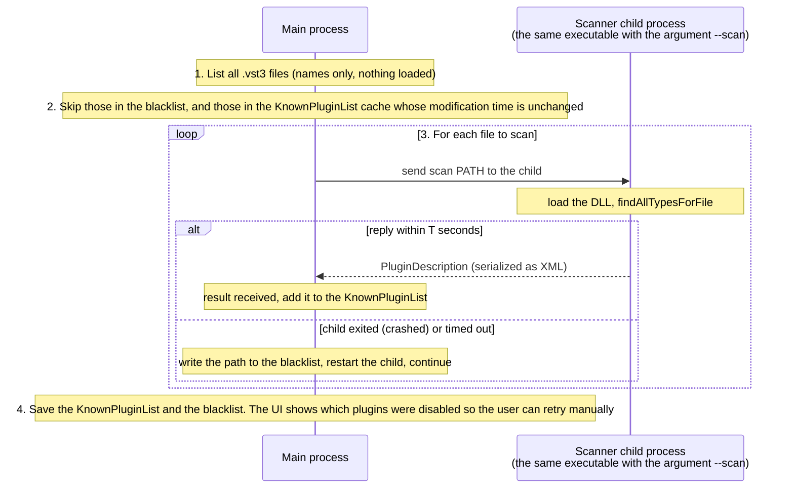

# Chapter 13 Exercise Solutions
**English** | [繁體中文](README.zh-TW.md)

The questions are in [`../exercises/README.md`](../exercises/README.md). The complete programs for the hands-on exercises are in this folder; they run automatically under `ctest -L solution` and are verified with numbers:

```powershell
.\scripts\build.ps1 -Only 13-vst-hosting -Juce -TestLabel solution
```

All program output quoted below is real output (Debug build, 48 kHz).

---

## Exercise 1 (calculation): normalized parameter conversion

Formulas: $`n = \left(\dfrac{v - s}{e - s}\right)^{k}`$, $`v = s + (e - s)\,n^{1/k}`$.

**1. Threshold −24 dB, Ratio 8:1**

- Threshold (linear, $`k = 1`$): $`n = \dfrac{-24 - (-60)}{0 - (-60)} = \dfrac{36}{60} = 0.6`$
- Ratio ($`k = 0.5`$): $`n = \left(\dfrac{8 - 1}{20 - 1}\right)^{0.5} = \sqrt{7/19} = \sqrt{0.36842} = 0.60698`$

**2. The skew of `setSkewForCentre(c)`**

We require $`v = c`$ when $`n = 0.5`$:

```math
0.5 = \left(\frac{c - s}{e - s}\right)^{k} \;\Longrightarrow\; \ln 0.5 = k \ln\frac{c - s}{e - s} \;\Longrightarrow\; k = \frac{\ln 0.5}{\ln\!\left(\frac{c - s}{e - s}\right)}
```

- Attack (0.1 … 200 ms, centre 10): $`\dfrac{9.9}{199.9} = 0.049525`$, $`\ln = -3.00527`$, $`k = \dfrac{-0.693147}{-3.00527} = 0.23064`$
- Release (5 … 2000 ms, centre 100): $`\dfrac{95}{1995} = 0.047619`$, $`\ln = -3.04452`$, $`k = 0.22767`$

**3. Release turned to 1/4 ($`n = 0.25`$)**

$`n^{1/k} = (0.5^2)^{1/k} = \left(0.5^{1/k}\right)^2`$, and by definition $`0.5^{1/k} = \dfrac{c - s}{e - s}`$, so

```math
v = s + (e - s)\left(\frac{c - s}{e - s}\right)^2 = s + \frac{(c - s)^2}{e - s} = 5 + \frac{95^2}{1995} = 5 + 4.524 = 9.524\ \text{ms}
```

Likewise, for $`n = 0.5^m`$, $`v = s + (e - s)\left(\frac{c-s}{e-s}\right)^m`$: every time the knob is "halved" toward the left, the real value (minus $`s`$) is multiplied by $`\frac{c-s}{e-s} \approx 0.0476`$ -- this is exactly how the skew widens the small-value region.

**Verification**: `l13_state_roundtrip` asks the plugin itself to convert the normalized values to display text:

```
Exercise 1 check: Threshold 0.6 -> -24.0 dB, Ratio 0.60698 -> 8.00, Attack 0.4 -> 3.86 ms, Release 0.6 -> 216.6 ms, Release 0.25 -> 9.5 ms
```

(Attack 0.4 → $`0.1 + 199.9 \times 0.4^{1/0.23064} = 3.862`$ ms; Release 0.6 → $`5 + 1995 \times 0.6^{1/0.22767} = 216.6`$ ms.) `l13_offline_host` also verifies the opposite direction: −30 dB → 0.5, 4:1 → 0.3974, 5 ms → 0.4251, 80 ms → 0.4738, and the texts the plugin displays are −30.0 dB, 4.00 : 1, 5.00 ms, 80.0 ms respectively.

**4. Why only 0..1 is passed**

- The host does not need to understand the meaning of any parameter: automation lanes, MIDI learn, controllers, undo, and "draw a parameter as a curve" can all be handled by one body of code for every parameter of every plugin.
- The curve (linear, logarithmic, skew) and the unit are the plugin's design decisions and can be adjusted in a new version without breaking old projects (as long as the meaning of the normalized value stays compatible).
- Discrete parameters (menus, switches) can be represented uniformly too ($`k / N`$).
- The value range is bounded, so the host does not need to know the upper and lower limits when drawing automation; interpolation is also well defined (linear interpolation between 0 and 1, converted on the plugin side, so the "linearity" of automation on a skewed parameter is really linearity in knob position, which is also what the user sees on screen).

---

## Exercise 2 (concepts): threads, scanning and crashes

**1. The thread for each action**

<div align="center">

| Action | Thread | Reason |
|---|---|---|
| (a) `scan()` | message thread (or a dedicated scanner process / thread, but as the format requires) | VST3 requires the factory and instances to be created on the UI thread; scanning loads DLLs and can be slow, so a production product puts it in a child process |
| (b) `process()` | audio thread | It is the only one inside the audio callback; it does not allocate and does not wait on locks |
| (c) `setState()` | message thread, and preferably while audio is stopped (or after taking the plugin out of the callback) | The plugin may rebuild data structures and allocate inside; running concurrently with `process()` can cause a data race |
| (d) creating a `PluginWindow` | message thread | All GUI operations may only happen on the message thread |
| (e) `setParameterValue()` every 32 samples | audio thread (the same thread as `process()`, before each sub-block) | JUCE's VST3 hosting writes the parameter value into a lock-free cache, and it is only sent to the plugin by the next `process`; a parameter change must be on the same timeline as the audio, so it has to be set on the audio thread, right before the corresponding sub-block (exercise 4). A small detail: when `setParameterValue` also notifies listeners it briefly takes `listenerLock`; a strict real-time host can use `setValue()`, which does not notify listeners |

</div>

**2. Why `ScopedTryLock`**

`AudioProcessor::getCallbackLock()` is a `CriticalSection`. In JUCE the message thread holds it only during `suspendProcessing(true)` (changing state, `prepareToPlay` and changing the bus layout do **not** take this lock). If the audio thread waited with a `ScopedLock`, it would have to wait for the message thread to finish (possibly tens of ms, or even longer because the message thread has a low priority -- priority inversion), and the audio callback would miss its deadline → a dropout (a glitch).

A try-lock gives up immediately when it cannot get the lock: we leave that block's audio as the original (equivalent to an instantaneous bypass). The cost: for those few ms the sound does not pass through the plugin, so you may hear a momentary change of tone (for a compressor it is a short stretch without compression; for a plugin whose latency is not 0, the original and the processed signal are at different times, so there may be a click). A better approach is for the host to take the plugin out of the audio graph itself before changing state, or to use a crossfaded bypass (exercise 7), so that a try-lock failure almost never happens.

Note that the try-lock protects only a small range: it takes effect **only** during `suspendProcessing(true)`. `setState()` and `prepare()` are not protected by it at all -- JUCE's VST3 hosting takes a `MessageManagerLock` when changing state and does not touch the callback lock -- so the host itself must guarantee that the audio thread is not calling `process()` at that time (this is what the thread rules in `PluginHost.h` require, see (c)). Also, inside JUCE's `VST3PluginInstance::processBlock()` there is an unconditional spin-wait on a `processMutex` (a `SpinLock`), and `prepareToPlay`, `releaseResources`, `reset` and `isBusesLayoutSupported` all take the same lock on the message thread; as long as the host obeys the rule that "these calls never overlap with `process()`", this lock is never contended, and only then does `process()` really "not wait on a lock".

**3. Out-of-process scanning**

A plugin's code runs inside the host's process; scanning executes the DLL's initialization and its factory (old plugins even have to be instantiated before their information can be queried). With in-process scanning, if any one plugin crashes → the whole DAW exits; worse, the next launch scans the same file again and crashes again, and the user can never open the DAW at all.

Design:



Key points: (1) every time, write to a file "which file is being scanned", so that even if the main process crashes too, the next launch knows who the culprit was; (2) timeout handling (some plugins pop up a licensing dialog and hang); (3) JUCE's `KnownPluginList::CustomScanner` is the interface for hooking into this flow, and `CustomPluginScanner` in `extras/AudioPluginHost` is a complete example. This chapter's `PluginHost::scan()` is in-process: if a plugin crashes during the scan, `l13_scan_plugins` simply exits (ctest counts it as failed), and since the KnownPluginList has not been saved yet, the next run crashes in the same way.

**4. Destruction order**

The editor (`AudioProcessorEditor`) holds a reference to the processor; its destructor calls `processor.editorBeingDeleted(this)`, and a VST3 editor must also call `removed()` on the plugin's `IPlugView` and release it (the view belongs to the plugin's edit controller). If the plugin is deleted first, the editor's destructor uses objects that have already been freed (use-after-free) → a random crash, usually at a hard-to-debug moment such as "closing the program". That is why the comment in `PluginWindow` requires: delete the window first, then the `HostedPlugin`; `l13_gui_host`'s `loadPlugin()` and its destructor both follow this order.

---

## Exercise 3 (calculation): latency and PDC

**1.** DawLabLimiter: $`5\ \text{ms} \times 48\ \text{kHz} = 240`$ samples. The linear-phase EQ: 1024 samples = $`1024 / 48000 = 21.33`$ ms. Track C: 0.

**2.** $`L_{\max} = 1024`$, $`d_i = L_{\max} - L_i`$:

<div align="center">

| track | plugin latency $`L_i`$ | extra delay $`d_i`$ from the host |
|---|---|---|
| A | 240 | 784 samples (16.33 ms) |
| B | 1024 | 0 |
| C | 0 | 1024 samples (21.33 ms) |

</div>

The total latency of the whole project = 1024 samples = 21.33 ms (during playback the host reads the timeline 21.33 ms early, so it still sounds on the beat).

**3.** Without PDC: Track A is 240 samples = 5 ms later than C. Adding two identical kicks: $`y[n] = x[n] + x[n - D]`$, $`|H(f)| = 2\left|\cos\!\left(\dfrac{\pi f D}{f_s}\right)\right|`$, with zeros at $`\dfrac{\pi f D}{f_s} = \dfrac{\pi}{2} + k\pi`$, that is,

```math
f_k = \frac{(2k+1) f_s}{2D} = \frac{(2k+1) \times 48000}{480} = 100,\ 300,\ 500,\ \dots\ \text{Hz}
```

The kick's fundamental (about 45–120 Hz, see `makeDrumLoop`) lands right around the 100 Hz zero: the low end is largely cancelled and the kick gets thin. (Exercise 6 measures DawLabLimiter's 240 samples with an impulse.)

**4.** While recording, when the input signal is monitored through a plugin with latency, the headphones carry yourself delayed by $`L_{\max}`$ (plus the audio device's buffer latency), and anything beyond 21 ms clearly disturbs playing. What DAWs do: tracks that are recording / being monitored go through a "low-latency mode" (Cubase's Constrain Delay Compensation, Logic's Low Latency Mode, etc.), temporarily bypassing the plugins that would cause a large latency, or not applying PDC on the monitoring path; and the recorded audio must be shifted back in time by the latency so that it lines up with the other tracks.

---

## Exercise 4 (hands-on): host-side automation -- slicing into sub-blocks

Solution: [`ex4_automation.cpp`](ex4_automation.cpp) (`l13_ex4_solution`)

The key is one more level of slicing inside the block:

```cpp
for (int start = 0; start < total; start += kBlockSize) {            // audio callback (512)
    const int blockLen = std::min(kBlockSize, total - start);
    for (int sub = 0; sub < blockLen; sub += kSubBlock) {             // sub-block (32)
        const int len = std::min(kSubBlock, blockLen - sub);
        const float db = thresholdAt(start + sub, total);
        plugin->setParameterValue(thresholdIndex, l13::toNormalized(db, -60.0f, 0.0f));
        plugin->process(all.getSubBlock(start + sub, len));           // an AudioBlock sub-block is a zero-copy view
    }
}
```

`thresholdAt()` snaps the value to 0.1 dB -- consistent with the plugin's interval, so that the reference answer matches exactly.

Actual output:

```
Parameter changes: 12000 (once every 32 samples, time resolution 0.67 ms)
RMS change in the first 0.5 s: +0.00 dB; in the last 1 s: -17.05 dB
Max difference from the reference (dsp::Compressor): 8.94e-08
[PASS] l13_ex4_automation (5 checks passed)
```

8.94e-08 is not 0 because the threshold makes a round trip "dB → normalized (float) → VST3 double → the plugin converts back to dB and snaps", and the rounding of the last bit may differ; the difference is below −140 dB and inaudible.

**Further thought**: the smaller the sub-block, the more often the plugin is called (here 512/32 = 16 times as often), and the fixed overhead of every call (the VST3 `process` wrapper, parameter-queue handling, the DSP's per-block setup) is amplified accordingly; some plugins are very inefficient on extremely small blocks, and FFT-type plugins even have to collect a fixed length internally before processing. So a DAW usually lets the user choose the automation resolution, or splits blocks only where the parameter actually changes. The truly sample-accurate approach is for the host to fill VST3's parameter queue (with a sampleOffset) and let the plugin decide how to interpolate.

---

## Exercise 5 (hands-on): save a preset to a file and load it back

Solution: [`ex5_preset_file.cpp`](ex5_preset_file.cpp) (`l13_ex5_solution`)

Approach:

- **The data is the state blob**: `plugin.getState()` → `MemoryBlock::toBase64Encoding()` goes into `<STATE>`. The host does not interpret it, so this format works for any plugin.
- **Identity**: store `pluginName` and `uid` (`PluginDescription::uniqueId`). Do not use `createIdentifierString()`: it contains a hash of the file path (for example the middle part of `VST3-DawLabCompressor-b2512fcf-dd419ed8`; `l13_scan_plugins` prints the value on your machine, and with a different build folder that part differs), so a plugin moved to another folder would no longer be recognized.
- **Guarding against bad input**: parse failure, name or uid mismatch, base64 that cannot be decoded or has length 0 → return false with an error message, and do **not** feed garbage into `setState()` (many plugins do not check it and may crash).
- `<PARAMS>` is only for humans (convenient for diffing two presets with a text comparison tool) and is not used when loading.

Actual output:

```
preset -> ...\dawlab_output\l13_ex5_preset.dawpreset (1615 bytes)
After loading back: max parameter error 0, max sound difference 0
Load into DawLabLimiter: rejected (preset belongs to DawLabCompressor)
Load the corrupted file: rejected (missing or corrupted STATE)
[PASS] l13_ex5_preset_file (6 checks passed)
```

---

## Exercise 6 (hands-on): chain two plugins with AudioProcessorGraph and measure the latency

Solution: [`ex6_graph_chain.cpp`](ex6_graph_chain.cpp) (`l13_ex6_solution`)

Steps to build the graph:

```cpp
auto graph = std::make_unique<juce::AudioProcessorGraph>();
graph->setPlayConfigDetails(2, 2, kSampleRate, kBlockSize);            // the graph itself: 2 in, 2 out
const auto in  = graph->addNode(std::make_unique<IOProcessor>(IOProcessor::audioInputNode))->nodeID;
const auto out = graph->addNode(std::make_unique<IOProcessor>(IOProcessor::audioOutputNode))->nodeID;
const auto c   = graph->addNode(std::move(comp))->nodeID;              // the graph owns the plugin instance
const auto l   = graph->addNode(std::move(lim))->nodeID;
for (int ch = 0; ch < 2; ++ch) {
    graph->addConnection({{in, ch}, {c, ch}});
    graph->addConnection({{c, ch}, {l, ch}});
    graph->addConnection({{l, ch}, {out, ch}});
}
graph->prepareToPlay(kSampleRate, kBlockSize);                         // works out the render sequence and the latency
```

Note that once the plugin instance is handed to the graph there is no `HostedPlugin` to use, so parameters are set directly through `AudioProcessor::getParameters()` (`setByName`).

Measuring the latency: send an impulse of amplitude 0.25 at sample 1000 and find the position of the largest absolute output value. The compressor's 10 ms attack barely reacts to a single sample, the +12 dB makeup turns it into about 1.0, and the limiter then squashes it to −1 dBFS -- the *position* of the peak is unaffected; it is only delayed by the length of the lookahead.

Actual output:

```
Latency reported by the graph: 240 samples (5.00 ms); compressor-only graph: 0
Impulse in at 1000, out at 1240 -> measured latency = 240 samples
peak: input -2.92 dBFS, compressor only 7.25 dBFS, compressor -> limiter -1.00 dBFS
[PASS] l13_ex6_graph_chain (5 checks passed)
```

`l13_ex6_comp_only.wav` is written as 32-bit float so that the +7.25 dBFS overs are kept (a 24-bit integer WAV would be clipped at 0 dBFS); it will clip when you play it in a player. The peak of `l13_ex6_chain.wav` is exactly −1.00 dBFS: loud but not broken.

Extension: if you change the graph into "compressor and limiter in parallel, with the two paths summed", the graph automatically inserts a 240-sample delay (PDC) on the compressor's path so the two paths line up -- wire it up yourself and use the same impulse method to confirm that the output has only one peak.

---

## Exercise 7 (hands-on): a bypass without clicks (latency compensation + crossfade)

Solution: [`ex7_bypass_crossfade.cpp`](ex7_bypass_crossfade.cpp) (`l13_ex7_solution`)

```cpp
void process(dawlab::AudioBlock block, dawlab::host::HostedPlugin& plugin) noexcept {
    // 1) align dry: dry[n] = x[n - L]
    for (int ch ...) for (int i ...) { delay_.push(ch, x[i]); d[i] = delay_.read(ch, latency_); }
    // 2) wet: the plugin always runs (also while bypassed, to keep the internal state continuous)
    plugin.process(block);
    // 3) y = dry + g*(wet - dry), with g moving between 0 and 1 on a 10 ms linear ramp
}
```

Why both are needed:

- Crossfade only, without delaying dry: during the fade $`x[n]`$ and $`x[n-L]`$ are added together, which is exactly exercise 3's comb filter (within the 10 ms you hear a "whoosh" of tone change), and after bypass the whole track is $`L`$ samples early;
- Delay only, without a crossfade: the timing is aligned, but wet (squashed to 0.1 by the limiter) and dry (0.3) have different amplitudes, so the instantaneous switch is still a discontinuity.

Actual output:

```
plugin latency: 240 samples
Sine's own maximum sample-to-sample change: 0.0173
crossfade + compensation: max jump 0.0173; hard bypass: max jump 0.2680
Max difference between the bypassed output and "input delayed by 240": 0; peak when active: 0.1000 (ceiling 0.1)
plugin Bypass parameter: impulse 1000 -> 1240 (0.2500), reported latency 240; max jump while toggling 0.0173, max difference of the bypass region from "input delayed by L" 0, active-region peak 0.1000
[PASS] l13_ex7_bypass_crossfade (11 checks passed)
```

The crossfade version's maximum jump = the sine's own maximum slope $`0.3 \times 2\pi \times 440 / 48000 = 0.0173`$ -- that is, the switch introduces no additional discontinuity. The hard bypass's 0.268 is almost the sine's amplitude (0.3), more than 15 times the sine's own maximum slope of 0.0173, and you hear a very clear "click" (`l13_ex7_hard.wav` every 0.5 s; `l13_ex7_crossfade.wav` has none).

**The plugin's own Bypass parameter must obey the same rule**: JUCE's VST3 wrapper automatically adds a `Bypass` parameter to a plugin, and when it is on, `processBlockBypassed()` is called instead. Its default implementation is a plain pass-through (delay 0), but the latency the plugin reports is still $`L`$ and the host's PDC still compensates $`L`$ -- so the bypassed signal would come $`L`$ samples early and be misaligned with the other tracks. That is why DawLabLimiter overrides `processBlockBypassed()` and does this exercise's same trick inside the plugin (dry delayed by $`L`$ + 10 ms crossfade, see `plugin/limiter/LimiterProcessor.cpp`). The last part of the solution verifies it: with Bypass = 1, the impulse at position 1000 comes out at $`1000 + 240 = 1240`$ and is the original audio 0.25; toggling the Bypass parameter every 0.5 s during playback, the maximum jump is still 0.0173.

**Extension question**: DawLabCompressor's Mix is the same formula $`y = (1-m)\,x + m\,\text{wet}`$. The compressor has no lookahead, so wet and dry are naturally aligned and Mix does not need to delay dry. If the compressor gained $`L`$ samples of lookahead, Mix would have to delay dry by $`L`$ first (like this exercise's `DelayLine`); otherwise Mix would produce a comb filter at every position between 0 and 100 %; the plugin would also have to report it with `setLatencySamples(L)` so the host can do PDC.
