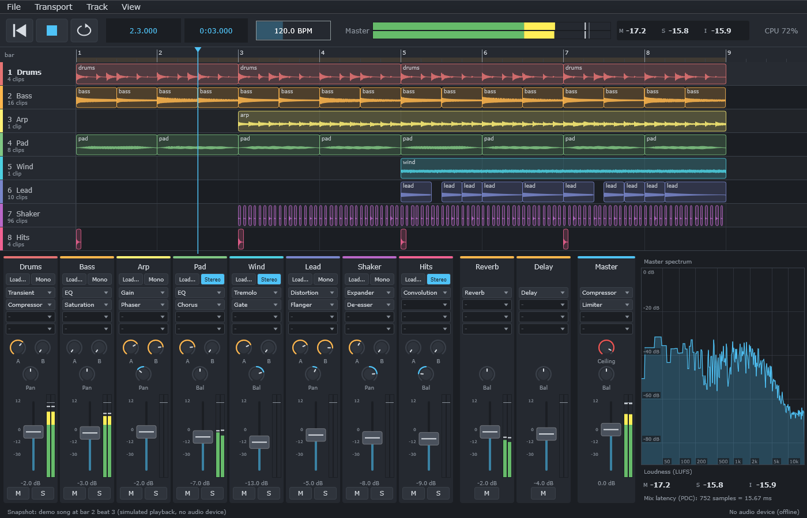
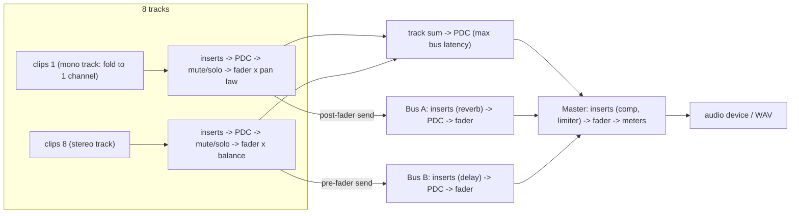

# Chapter 14 - Capstone: Build an 8-Track DAW, Step by Step

**English** | [繁體中文](README.zh-TW.md)

> [Course home](../../README.md) | Previous: [13 - VST hosting](../13-vst-hosting/README.md) | This is the last chapter.

> This is the last chapter of the course.
> Chapters 01-12 gave you DSP building blocks (gain, filters, EQ, dynamics, saturation,
> delay, modulation, metering, reverb); [chapter 13](../13-vst-hosting/README.md) showed how plugins are hosted.
> Now we put everything together into a small but *real* digital audio workstation.

The chapter is built in two stages:

| Stage | What | Where | Needs JUCE? |
|---|---|---|---|
| **1** (Steps 1-10) | The **engine**: transport, clips, 8-track mixer, inserts, FX buses, lock-free command queue, plugin delay compensation, offline bounce, real-time safety tests | build along: `steps/`; reference: `engine/`, `examples/`, `tests/`; text: `docs/step-01..10` | No - plain C++17, testable offline |
| **2** (Steps 11-21) | The **app "DawLab 8"**: audio device, dark GUI (transport bar, arrangement with waveforms, mixer with generated parameter panels, spectrum and loudness), VST3 inserts through chapter 13, file loading with resampling, export, keyboard shortcuts, automated GUI tests | `app/`, `docs/step-11..21` | Yes |



*DawLab 8 with the demo song at bar 2 beat 3. This picture is not a screenshot: the app renders
itself with `"DawLab 8.exe" --snapshot <file.png>` (Step 12), which ctest runs on every build.*

Keeping the engine free of JUCE is the most important design decision of the whole chapter:
every piece of it can be run, measured and unit-tested from a console program, and the GUI
becomes "just" a client of a well-defined API ([docs/engine-api.md](docs/engine-api.md)). Stage 2
proves it: the app adds no audio processing of its own (apart from a file resampler); it opens a
device, draws, and talks to the engine through atomics and the command queue.

## How to use this chapter

There are two ways through the chapter, and they use the same 21 step documents
([roadmap](#4-the-twenty-one-steps)):

| Route | What you do | Where | Checked by |
|---|---|---|---|
| **Build along** (recommended) | write the DAW yourself, one step at a time | Steps 1-10: `steps/stepNN-*/` - one small, self-contained engine snapshot per step. Steps 11-21: the "Your turn" section of each step document | Steps 1-10: `l14_stepNN_starter` (your code; prints `[FAIL]` until the step works) and `l14_stepNN_solution` (ctest). Steps 11-21: the app's own tests (`l14_app_smoke_test`, `l14_app_snapshot`, exercise solutions) |
| **Reference** | read and run the finished program | `engine/` (+ `examples/`, `tests/`) and `app/` | `l14_test_*`, `l14_app_smoke_test`, the examples |

**Build along, Steps 1-10 (the engine).** Each `steps/stepNN-*/` folder is a complete, compilable
mini engine that contains exactly what exists after that step - Step 1 has no transport, no
clips, no commands and no PDC; every later step starts from the previous step's solution:

```
steps/step04-mixer/
  minidaw.h            the whole mini engine so far: Steps 1-3 solved, Step 4's functions only declared
  check.h              the step's self-check (main); it tests only what this step adds
  starter/step04.cpp   YOUR code: the step's functions with TODOs  -> l14_step04_starter  (build only)
  solution/step04.cpp  a worked solution                          -> l14_step04_solution (ctest, label "solution")
```

Read the step document, open the starter, fill in the TODOs, rebuild
(`.\scripts\build.ps1 -Only 14-daw-8track`, or just the target in your IDE) and run
`build\bin\Debug\l14_stepNN_starter.exe` from the `build` folder until it prints
`[PASS] l14_stepNN`. The "Your turn" section of every step document lists the functions, the file,
the check and the expected output. The snapshots need no JUCE and do not use `engine/`; they keep
its names (`Transport::advance`, `renderClip`, `Mixer::updateLatencies`, ...), so after Step 10 you
can read the finished engine like a familiar program - it adds the rest of the 19 effect adapters,
meters with LUFS, a few more commands and edge cases.

**Build along, Steps 11-21 (the app).** A GUI application cannot be cut into ten console
snapshots, so here you work in the finished app: each "Your turn" names one function (or a small
group) of `app/Source/` to delete and write again from the step's design - copy the file first
(`AudioHost.cpp` -> `AudioHost.cpp.orig`) - and the check that must pass afterwards, usually a
section of `DawLab 8.exe --smoke-test` (`l14_app_smoke_test`) or the `--snapshot` picture.

**Reference.** Skip the starters, read the step documents next to `engine/` and `app/`, and run
the examples and tests listed under "Verify (reference route)".

---

## 1. Goals

After working through this chapter you can

- explain the **two clocks** of a DAW - the sample clock of the audio device and the musical
  clock (bars, beats, ticks) - and convert between them exactly;
- place audio **clips** on a timeline with **sample accuracy**, with clip gain and fades, and play
  them with a **loop** whose end falls in the middle of an audio block;
- build an **8-track mixer** with fader, pan law, mute / solo logic, **mono and stereo tracks**
  (like Cubase: a mono track runs its inserts on one channel and pans with the pan law, a stereo
  track keeps its image and pans as balance), **pre/post-fader sends** to two **FX buses**, a master
  bus and **meters** (peak, RMS, LUFS from chapter 11);
- wrap **all nineteen effect DSP classes** of chapters 01-12 behind one `InsertEffect` interface with a
  **self-describing parameter API**, so that a UI can generate knobs automatically;
- change a running mix from another thread **without locks and without allocating on the audio
  thread**: atomics for values, a **single-producer/single-consumer queue** for structural changes
  and a **garbage queue** that sends dead objects back to be freed;
- compute and apply **plugin delay compensation (PDC)** across tracks, buses and master;
- **bounce** a song offline, latency-compensated, to a WAV file that is bit-identical to what
  playback produces;
- **prove** the engine is real-time safe with an allocation-counting test, randomized block sizes
  and a second thread hammering the API;
- connect the engine to a **real audio device** with JUCE's `AudioIODeviceCallback`, wrapping the
  device's buffers without a copy, and survive sample-rate changes;
- build a **DAW GUI** that only reads atomics and sends commands: transport bar, arrangement with
  waveform thumbnails and draggable clips, mixer with a proper fader law, **parameter panels
  generated** from the effects' self-description, spectrum and EBU R 128 loudness;
- host **VST3 plugins** as inserts (chapter 13) with editors and automatic latency compensation;
- load audio files on a **worker thread** and convert their sample rate with a windowed-sinc
  resampler; **export** the mix without freezing the window;
- make a GUI application **testable**: an offline mode, a device-free render path and command-line
  modes (`--smoke-test`, `--snapshot`) that ctest runs.

## 2. The final architecture

### 2.1 Two threads, three channels of communication

A DAW is a concurrent program with one hard rule: the **audio thread** must deliver every block
before its deadline (512 samples at 48 kHz = 10.67 ms), *every time*. It may never wait for
anything. Everybody else - GUI, file loading, plugin scanning - lives on other threads.

```
  UI / message thread                                             audio thread
  ===================                                             ============
                         (1) atomics: fader, pan, mute, solo,
  mixer.getTrack(t)      sends, effect parameters, bypass,
     .setGainDb(...)  ---------------------------------------->  strip.beginBlock()
  fx->setParameter(...)  tempo, play/stop, seek, loop             fx->applyPendingParameters()
  transport.play()                                                transport.advance()

                         (2) command queue (SpscQueue<Command>)
  engine.addInsert()  ---------------------------------------->  applyCommands()
  engine.removeInsert()  "here is a new, prepared effect"          insertAt / removeAt /
  engine.setTrackClips() "here is a new clip list"                 exchangeClips
                                                                       |
                         (3) garbage queue (SpscQueue<Garbage>)        |
  engine.collectGarbage() <--------------------------------------------+
     delete old effect    "I no longer use this, please free it"
     delete old clip list
```

- **(1) Values** are single numbers. They live in `std::atomic`s: the UI writes, the audio thread
  reads once per block. No queue needed, and only the newest value matters.
- **(2) Structure** (an effect inserted, a clip list replaced) needs memory. The UI thread
  allocates *and prepares* the new object, then sends a raw pointer through a lock-free queue; the
  audio thread links it in between two blocks - a few pointer stores.
- **(3) Garbage**: whatever the audio thread unlinks is sent back through a second queue and freed
  by the UI thread. The audio thread never calls `new` or `delete`.

### 2.2 The signal flow



### 2.3 The files

All engine code is header-only in `engine/include/dawlab/engine/`, namespace
`dawlab::engine`, CMake target `dawlab_engine` (alias `dawlab::engine`).

| Header | Responsibility | Step |
|---|---|---|
| `Constants.h` | fixed sizes: 8 tracks, 2 buses, stereo, 8 inserts per strip | 1 |
| `Engine.h` | the facade: `prepare`, `processBlock`, command / garbage queues | 1, 7 |
| `Transport.h` | play / stop / seek / loop / tempo, bars:beats, timeline segments | 2 |
| `Clip.h` | clip = window into a shared buffer + gain + fades; `renderClip()` | 3 |
| `Track.h` | a channel strip that reads clips; lock-free clip-list swap | 3 |
| `ChannelStrip.h` | fader, pan (law / balance), mute/solo ramp, sends, meters | 4, 6 |
| `Mixer.h` | 8 tracks + 2 buses + master, solo logic, routing, PDC computation | 4, 6, 8 |
| `InsertEffect.h` | the effect interface, `ParameterInfo`, `PlayHead`, `InsertChain` | 5 |
| `EffectBase.h` | lock-free parameter hand-over for adapters; `PureDelayEffect` | 5, 8 |
| `Effects.h` | adapters for all 19 effect DSP classes + factory (`createEffect("Reverb")`) | 5 |
| `SpscQueue.h` | wait-free single-producer / single-consumer ring buffer | 7 |
| `Commands.h` | `Command` (structural change) and `Garbage` (delete me later) | 7 |
| `LatencyCompensator.h` | integer delay line used for PDC | 8 |
| `Renderer.h` | `renderOffline()` / `bounceToWav()` | 9 |
| `DemoSong.h` | the 8-track demo song as data (`makeDemoSong`, `applyDemoSong`) | 9, 18 |
| `All.h` | includes everything (except `DemoSong.h`) | - |

### 2.4 The application: four threads around the engine

```
                         +---------------------- MainComponent (message thread) ------------------------+
 mouse / keys ---------> | commands (Space, Ctrl+E ...)   TransportBar  ArrangementView  MixerView         |
                         |        |                           ^              ^             ^   panels    |
                         |        v                           |  30 Hz timer: read atomics, collect garbage |
                         |   Session (GUI model) ---- setTrackClips / addInsert / replaceInsert ----+      |
                         +--------|----------------------------------------------------------------|------+
                                  | atomics (fader, pan, mute, solo, sends, parameters, transport) | command queue
                                  v                                                                v
  driver thread:  AudioHost::audioDeviceIOCallbackWithContext -> Engine::processBlock(AudioBlock(outputs))
                                  |                                   (+ SpectrumAnalyzer::pushSamples)
  loader thread:  MediaLoader: read file, resample, convert clips after a device change /
                  makeDemoSong -> callAsync -> Session
  export thread:  ExportJob: renderOffline (engine detached from the device) -> WAV -> callAsync
```

Every arrow into the audio thread is an atomic or the command queue; every result of a worker
thread comes back to the message thread as an immutable object through
`MessageManager::callAsync`. No thread ever waits for the audio thread, and the audio thread
waits for nobody.

| File (`app/Source/`) | Responsibility | Step |
|---|---|---|
| `AudioHost.h/.cpp` | device, callback (zero-copy), CPU load, offline render path, spectrum feed | 11 |
| `Main.cpp`, `MainComponent.h/.cpp` | application, window, ownership order, layout, commands, menus | 12, 21 |
| `DawLookAndFeel.h/.cpp` | dark theme, knobs, faders, colour table | 12 |
| `TransportBar.h/.cpp` | play / stop / loop, position, tempo, master meter + LUFS, CPU | 13 |
| `ArrangementView.h/.cpp` | lanes, waveform cache, ruler, playhead, seek, clip dragging | 14 |
| `MixerView.h/.cpp` | channel strips, fader law, sends, mute / solo, meters, master section | 15, 20 |
| `Session.h/.cpp` | GUI model: insert slots <-> compact chains, clip lists, demo song, sample-rate change | 15, 16, 18 |
| `EffectMenu.h/.cpp`, `ParameterPanel.h/.cpp` | insert drop-down, generated parameter panels | 16 |
| `VstInsert.h/.cpp` | a chapter-13 `HostedPlugin` behind `InsertEffect` | 17 |
| `MediaLoader.h/.cpp` | file reading and windowed-sinc resampling on a worker thread | 18 |
| `Exporter.h/.cpp` | export mixdown on a thread, WAV writing | 19 |
| `Meters.h/.cpp` | `MeterBar`, `LoudnessDisplay`, `SpectrumView` | 13, 15, 20 |
| `AppCommands.h` | command IDs | 21 |
| `SmokeTest.h/.cpp` | `--smoke-test`, `--snapshot`, an in-process test plugin | 11-21 |

CMake: the static library `l14_daw_app` (all of the above except `Main.cpp`; the JUCE exercises
link it), the app `DawLab8` (`juce_add_gui_app`, product name "DawLab 8"), and `l14_daw_app_3bus`
(the same sources with `DAWLAB_ENGINE_NUM_BUSES=3`, Exercise 12). JUCE itself is compiled once,
inside chapter 13's `dawlab_plugin_host`; `app/CMakeLists.txt` adds chapter 13's `host/` folder if
chapter 13 is not part of the build. Without `-Juce` the chapter builds only stage 1.

## 3. The theory, in one place

Each step document derives its part in detail. Here are the ideas you will meet, with the key
formulas, so that you can see how they connect.

### 3.1 Two clocks: samples and music

The audio device counts **samples**; musicians count **bars, beats and ticks**. The engine keeps
its position as an integer number of samples (`int64_t`: an `int32_t` would overflow after
2^31 / 48000 s = 12.4 hours) and derives musical time from tempo $`B`$ (beats per minute), sample
rate $`f_s`$ and the time-signature numerator $`n`$:

$$
N_{\text{beat}} = \frac{60\,f_s}{B}, \qquad N_{\text{bar}} = n\,N_{\text{beat}}
$$

At 120 BPM and 48 kHz one beat is 24 000 samples and a 4/4 bar is 96 000 samples. A position
"bar $`b`$, beat $`k`$, tick $`t`$" (1-based bar and beat, 960 ticks per beat) is

$$
\text{samples} = \mathrm{round}\Big( \big[(b-1)\,n + (k-1) + t/960\big]\, N_{\text{beat}} \Big)
$$

The round-trip is exact on the grid (`l14_transport_clips` prints a table). At 96 BPM / 44.1 kHz a
beat is 27 562.5 samples - not an integer - which is why the conversion rounds only once, at the
very end (Exercise 2).

### 3.2 Sample-accurate clips

A clip is a window of a source buffer placed at timeline sample $`S`$ with length $`L`$ and source
offset $`O`$. A block covers the timeline range $`[T_0, T_0 + N)`$. The part to render is the
intersection

$$
\text{from} = \max(T_0, S), \qquad \text{to} = \min(T_0 + N, S + L)
$$

and timeline sample $`T \in [\text{from}, \text{to})`$ goes to block index $`T - T_0`$ and reads source
index $`O + (T - S)`$. Everything is integer arithmetic, so a clip starting at sample 12 345 lands on
output sample 12 345 for *any* block size (`tests/test_timeline.cpp` checks block sizes 1, 64, 512
and 1000). Fades multiply each sample by

$$
g_{\text{in}}(i) = \text{shape}\Big(\frac{i+1}{F_{\text{in}}+1}\Big), \quad
g_{\text{out}}(i) = \text{shape}\Big(\frac{L-i}{F_{\text{out}}+1}\Big), \quad
\text{shape}(x) = x \ \text{or}\ \sin\big(\tfrac{\pi}{2}x\big)
$$

chosen so that an overlapping fade-out and fade-in of equal length $`F`$ always satisfy
$`x_{\text{in}} + x_{\text{out}} = 1`$ - the basis of crossfades (Exercise 5).

### 3.3 Fader, pan law, balance

A fader in dB becomes a linear gain $`g = 10^{\,\text{dB}/20}`$ (-6.02 dB = x0.5). For a mono source
placed in the stereo field with pan $`p \in [-1, 1]`$ the **constant-power law** uses an angle
$`\theta = \frac{\pi}{4}(p+1)`$:

$$
g_L = \cos\theta, \qquad g_R = \sin\theta, \qquad g_L^2 + g_R^2 = 1
$$

The acoustic power stays constant while you pan; at the centre each side gets
$`\cos(\pi/4) = 0.7071`$ (-3.01 dB). Chapter 01's `dsp::Panner::computeGains` also offers the
**linear** law (centre -6.02 dB, a dip in loudness) and the **-4.5 dB** compromise. Mono tracks use
the pan law; stereo tracks, buses and the master already carry a stereo image, so they use
**balance**: centre = unity, turning right only attenuates the left side, $`g_L = \min(1, 1-p)`$,
$`g_R = \min(1, 1+p)`$. Otherwise the master would lower the whole mix by 3 dB at its default
setting.

A track's **format** (`TrackFormat::Mono` / `Stereo`, Step 4) decides which of the two it uses, and
how many channels its inserts see: a mono track folds its clips to $`(L+R)/2`$, runs inserts and PDC
on one channel and copies it to both sides before the pan law; a stereo track runs everything on two
channels. Loading a file chooses the format from its channel count, as Cubase does (Step 18). The
same mono file is therefore 3.01 dB louder at the centre on a stereo track, and a stereo-generating
effect (chorus spread, a wide reverb) collapses to mono on a mono track. Chapter 01's theory section
on [pan law and balance](../01-gain/README.md) explains why the two controls differ.

| setting | $`g_L`$ | $`g_R`$ |
|---|---|---|
| fader 0 dB, pan centre, constant power | 0.7071 (-3.01 dB) | 0.7071 |
| fader -6.02 dB, pan centre | 0.3536 | 0.3536 |
| pan hard left | 1 | 0 |
| pan +0.5, fader -6 dB | 0.1918 (-14.34 dB) | 0.4630 (-6.69 dB) |
| balance mode, centre | 1 | 1 |
| balance +0.5 | 0.5 | 1 |

### 3.4 Summing, mute and solo

The master is a sum. $`N`$ identical (coherent) signals add in amplitude, $`+20\log_{10}N`$ dB
(two tracks: +6.02 dB); $`N`$ independent signals add in power, $`+10\log_{10}N`$ dB (two tracks:
+3.01 dB). That is why the mix needs headroom and why the master ends with a limiter.
Solo is a rule over the whole mixer:

$$
\text{audible}_t = \lnot\,\text{mute}_t \ \land\ \big(\lnot\,\exists u:\text{solo}_u \ \lor\ \text{solo}_t\big)
$$

Buses are *solo-safe* (they only have mute), so a soloed vocal is still heard with its reverb.
Every on/off change is ramped over 10 ms, every fader move over 50 ms: no clicks, no zipper noise.

### 3.5 Sends

A send copies a track into a bus with its own gain $`s`$. **Post-fader** sends tap after fader and
pan (turning the track down also turns its reverb down - the usual choice); **pre-fader** sends tap
before them (a headphone mix, or a reverb that stays when you fade the dry signal out):

$$
\text{bus}_b = \sum_t s_{t,b}\cdot
\begin{cases} g_t\, x_t & \text{post-fader} \\ x_t & \text{pre-fader} \end{cases}
$$

Mute/solo sit *before* both taps: a muted track sends nothing.

### 3.6 Latency and plugin delay compensation

A lookahead limiter (chapter 05), an oversampled saturator (chapter 06) or a partitioned
convolution (chapter 12) cannot produce output sample $`n`$ before seeing input $`n + D`$: it delays
its signal by $`D`$ samples and reports $`D`$ via `getLatencySamples()`. If track 1 has a 240-sample
limiter and track 2 has nothing, their sum is

$$
y[n] = x[n] + x[n - D] \quad\Rightarrow\quad |H(f)| = 2\,\big|\cos(\pi f D / f_s)\big|
$$

a **comb filter** with notches at $`f = (2k+1)\,f_s / (2D)`$: for $`D = 240`$ at 48 kHz at 100, 300,
500 Hz ... plus a flam on every drum hit. PDC delays every other path so that all paths are
equally late:

$$
c_t = \max_u L_u - L_t, \qquad c_b = \max_v L_v - L_b, \qquad
L_{\text{total}} = \max_u L_u + \max_v L_v + L_{\text{master}}
$$

(track $`t`$, bus $`b`$; the dry track sum waits $`\max_v L_v`$ for the slowest bus). `l14_pdc_demo`
measures it and lets you hear both versions. Each compensating delay holds at most
$`C = 16\,384`$ samples (`kDefaultMaxPdcSamples`); a chain of high-latency VST3 plugins can exceed
that. The mixer then aligns on $`\min(\max L, C)`$, reports the latency it really applied and sets
`Engine::hasPdcOverflow()`, which the app shows next to the mix latency (Step 8).

### 3.7 Real time

The audio thread has $`N / f_s`$ seconds per block and must not block: no `new` / `delete` /
`malloc`, no mutex, no file or console I/O, no exceptions, no unbounded loops, no waiting for
another thread. The engine follows the rule "allocate in `prepare()`, communicate through
atomics and wait-free queues, free on the UI thread". `tests/test_realtime_safety.cpp` proves it by
replacing the global `operator new` / `operator delete` and counting calls made from inside
`processBlock()` - while another thread does about 600 random edits.

### 3.8 Block-size invariance

Hosts call us with 64, 441, 512 or a different size every time. Every smoother in the engine
advances per sample, clips and automation are functions of the timeline, PDC is integer delay,
and effects keep their state across calls - so the output must not depend on how the stream is
cut. `tests/test_block_invariance.cpp` renders a project with block size 512, 64 and random sizes
1..1500 and requires the maximum difference to stay below $`10^{-5}`$ (measured difference: exactly 0).

### 3.9 The GUI side: polling, fader law, meters

The GUI never receives messages from the audio thread. A 30 Hz timer reads atomics (position,
peaks, LUFS, CPU load) - fast enough for the eye, one block stale at worst, zero cost for the audio
thread. Controls write atomics; the engine ramps every change.

A fader position $`p \in [0, 1]`$ maps to gain with a square law that spends most of the travel near
0 dB (Step 15):

$$
\text{dB}(p) = 12 - 72\,(1 - p)^2, \qquad p(\text{dB}) = 1 - \sqrt{(12 - \text{dB}) / 72}
$$

0 dB sits at $`p = 0.592`$, -6 dB at exactly 0.5, the bottom means $`-\infty`$. Meters are linear in dB
over -60 .. +6 dBFS: $`\text{position} = (\text{dB} + 60) / 66`$.

### 3.10 Resampling a file

A 44.1 kHz file in a 48 kHz project must be converted, or it plays 1.47 semitones sharp
($`12 \log_2 (48000/44100)`$). Output sample $`m`$ lies at input position $`t_m = m\,f_{\text{in}}/f_{\text{out}}`$;
band-limited interpolation evaluates (Step 18)

$$
y[m] = \sum_k x[k]\,g(t_m - k), \qquad g(x) = 2 f_c\, \mathrm{sinc}(2 f_c x)\, w(x / W),
\qquad f_c = 0.46 \min\!\Big(1, \frac{f_{\text{out}}}{f_{\text{in}}}\Big)
$$

with a Blackman window $`w`$ over $`W = 24 / (2 f_c)`$ input samples. The cutoff follows the *lower*
Nyquist frequency, with a margin ($`0.46 f_{\text{out}}`$ instead of $`0.5 f_{\text{out}}`$ when
downsampling). A windowed sinc is not a brick wall, though. The kernel is $`N = 2W = 24 / f_c`$
input samples long, and a Blackman window gives a transition band about $`5.5 / N = 0.23 f_c`$ wide,
centred on $`f_c`$; it ends near $`1.115 \cdot 0.46 f_{\text{out}} = 0.513 f_{\text{out}}`$, a little
*above* the output's Nyquist frequency. So aliasing is not impossible, only confined: content
between $`0.5`$ and $`0.513 f_{\text{out}}`$ (22.05-22.6 kHz when converting to 44.1 kHz) folds back
into $`0.487`$-$`0.5 f_{\text{out}}`$ (21.5-22.05 kHz) and is attenuated by at least about 54 dB;
everything higher lies in the stopband. The smoke test measures both ends: a 20 kHz tone converted
to 22.05 kHz ends up 122 dB down instead of folding to 2050 Hz, and a 22.3 kHz tone converted from
48 to 44.1 kHz folds to 21.8 kHz at -54 dB. For a converter that cannot alias at all, lower
`kCutoffScale` to about 0.88 (stopband edge at $`0.49 f_{\text{out}}`$, slightly more treble loss) or
double `kZeroCrossings` (half the transition width, twice the CPU time).

### 3.11 Spectrum on a log axis

The master spectrum is a 4096-point FFT (chapter 11): bins every $`f_s / N = 11.7`$ Hz at 48 kHz.
The display maps frequency to $`x = \ln(f/20) / \ln(1000)`$ and, per pixel column, takes the
**maximum** of the bins that fall into it. In a view $`W`$ pixels wide, the pixel at frequency $`f`$
spans $`f\,(1000^{1/W} - 1)`$ Hz, so below

$$
f < \frac{f_s / N}{1000^{1/W} - 1}
$$

a pixel has less than one bin: about 480 Hz for the 285-pixel-wide view of the snapshot (500 Hz
for $`W = 300`$). At 10 kHz the same pixel covers about 20 bins (Step 20).

## 4. The twenty-one steps

Each step adds one capability and has its own document with **goal -> design -> code -> your
turn -> verify -> what you learned**. Steps 1-10 build the engine (no JUCE), Steps 11-21 the
application. The two routes of ["How to use this chapter"](#how-to-use-this-chapter) differ only
in the last two columns: **build along** = write the code of the "Your turn" column yourself and
run its check; **reference** = read the main files and run the reference checks.

| # | Document | Adds | Build along: your turn (Steps 1-10: `steps/stepNN-*/`, starter `l14_stepNN_starter`, solution `l14_stepNN_solution`) | Reference: main files | Reference: verify with |
|---|---|---|---|---|---|
| 1 | [docs/step-01-skeleton.md](docs/step-01-skeleton.md) | project skeleton, `Engine`, `processBlock(AudioBlock)` | `step01-skeleton`: `Engine::processBlock`, `processChunk` | `Engine.h`, `Constants.h`, `CMakeLists.txt` | `l14_hello_engine` |
| 2 | [docs/step-02-transport.md](docs/step-02-transport.md) | play / stop / seek / loop / tempo, bars:beats | `step02-transport`: `barsBeatsToSamples`, `samplesToBarsBeats`, `Transport::advance` | `Transport.h` | `l14_test_timeline`, `l14_transport_clips` |
| 3 | [docs/step-03-clips.md](docs/step-03-clips.md) | sample-accurate clips, clip gain, fades | `step03-clips`: `clipFadeAt`, `renderClip` | `Clip.h`, `Track.h` | `l14_test_timeline`, `l14_transport_clips` |
| 4 | [docs/step-04-mixer.md](docs/step-04-mixer.md) | 8-track mixer, fader / pan / mute / solo, mono / stereo tracks, master, meters | `step04-mixer`: `computeStripGains`, `isTrackAudible`, `Mixer::processTrack` | `ChannelStrip.h`, `Track.h`, `Mixer.h` | `l14_test_mixer`, `l14_test_track_format` |
| 5 | [docs/step-05-insert-effects.md](docs/step-05-insert-effects.md) | `InsertEffect`, parameter API, 19 adapters, factory | `step05-insert-effects`: `ParameterInfo` tapers, `EffectBase` dirty mask, `InsertChain::process` | `InsertEffect.h`, `EffectBase.h`, `Effects.h` | `l14_test_effects`, `l14_effect_catalog` |
| 6 | [docs/step-06-sends-buses.md](docs/step-06-sends-buses.md) | 2 FX buses, pre/post-fader sends | `step06-sends-buses`: `addSend`, the two send taps | `ChannelStrip.h`, `Mixer.h` | `l14_test_mixer` |
| 7 | [docs/step-07-commands.md](docs/step-07-commands.md) | lock-free command queue, garbage queue | `step07-commands`: `SpscQueue::push` / `pop`, `Engine::applyCommands` | `SpscQueue.h`, `Commands.h`, `Engine.h` | `l14_test_commands` |
| 8 | [docs/step-08-pdc.md](docs/step-08-pdc.md) | plugin delay compensation | `step08-pdc`: `LatencyCompensator::process`, `Mixer::updateLatencies` | `LatencyCompensator.h`, `Mixer.h` | `l14_test_pdc`, `l14_pdc_demo` |
| 9 | [docs/step-09-offline-render.md](docs/step-09-offline-render.md) | offline bounce to WAV, mix report | `step09-offline-render`: `renderOffline` | `Renderer.h` | `l14_render_song` |
| 10 | [docs/step-10-realtime-safety.md](docs/step-10-realtime-safety.md) | real-time safety audit | `step10-realtime-safety`: counting `operator new` / `delete`, `renderWithBlockSizes` | `tests/test_realtime_safety.cpp`, `tests/test_block_invariance.cpp` | `l14_test_realtime_safety`, `l14_realtime_sim` |
| 11 | [docs/step-11-audio-device.md](docs/step-11-audio-device.md) | audio device, zero-copy callback, CPU load, device changes | `AudioHost::render` -> smoke test 4 | `AudioHost` | `l14_app_smoke_test` (4, 7, 10) |
| 12 | [docs/step-12-main-window.md](docs/step-12-main-window.md) | application, main window, ownership order, dark LookAndFeel, `--snapshot` | `MainComponent::resized` -> snapshot | `Main.cpp`, `MainComponent`, `DawLookAndFeel` | `l14_app_snapshot` |
| 13 | [docs/step-13-transport-bar.md](docs/step-13-transport-bar.md) | play / stop / loop, bars.beats and m:ss of what is heard (latency-compensated), tempo, master meter + LUFS, CPU | `AudioHost::compensatePosition`, `TransportBar::formatBarsBeats` -> smoke test 6 | `TransportBar` | `l14_app_smoke_test` (6) |
| 14 | [docs/step-14-arrangement.md](docs/step-14-arrangement.md) | 8 lanes, waveform thumbnails, playhead, click-to-seek, drag clips | `sampleToX`, `xToSample`, `snapToBeat`, `Session::moveClip` -> Exercise 8 | `ArrangementView`, `Session::moveClip` | snapshot, Exercise 8 |
| 15 | [docs/step-15-mixer.md](docs/step-15-mixer.md) | 8 track strips, FX bus strips, master; fader law, sends, mute / solo, meters | `FaderLaw` -> smoke test 6 | `MixerView` | `l14_app_smoke_test` (6) |
| 16 | [docs/step-16-inserts-panels.md](docs/step-16-inserts-panels.md) | insert slots, effect menu, auto-generated parameter panels | `Session::chainIndexOf` -> smoke test 2 | `Session`, `EffectMenu`, `ParameterPanel` | `l14_app_smoke_test` (2, 6) |
| 17 | [docs/step-17-vst3-inserts.md](docs/step-17-vst3-inserts.md) | VST3 inserts with editor windows and PDC | `VstInsert::process`, `getLatencySamples` -> smoke test 5, 5b | `VstInsert` (+ chapter 13) | `l14_app_smoke_test` (5) |
| 18 | [docs/step-18-file-loading.md](docs/step-18-file-loading.md) | background file loading, resampling, "Load demo song" | `resampleBuffer` -> smoke test 1 | `MediaLoader`, `DemoSong.h` | `l14_app_smoke_test` (1, 2) |
| 19 | [docs/step-19-export.md](docs/step-19-export.md) | export mixdown on a thread | `Exporter::renderToFile` -> smoke test 3, 9 | `Exporter` | `l14_app_smoke_test` (3, 9) |
| 20 | [docs/step-20-spectrum-loudness.md](docs/step-20-spectrum-loudness.md) | master spectrum analyzer, EBU R 128 loudness, mix latency | `SpectrumView` log axis -> smoke test 8 | `Meters`, `AudioHost` | `l14_app_smoke_test` (8), snapshot |
| 21 | [docs/step-21-shortcuts-and-tests.md](docs/step-21-shortcuts-and-tests.md) | commands, menus, keyboard shortcuts, the app's automated tests | transport commands in `getCommandInfo` / `perform` -> smoke test | `AppCommands.h`, `MainComponent`, `SmokeTest` | `l14_app_smoke_test`, Exercise 13 |

The engine's API reference (threading table, JUCE integration recipe) is
[docs/engine-api.md](docs/engine-api.md); stage 2 is one way to build a GUI on it.

## 5. Building and running

The engine part needs no JUCE. From the repository root (PowerShell):

```powershell
.\scripts\build.ps1 -Only 14-daw-8track                      # build + run every test of this chapter
.\scripts\build.ps1 -Only 14-daw-8track -TestLabel example   # only the examples
.\scripts\build.ps1 -Only 14-daw-8track -TestLabel solution  # only the exercise and build-along step solutions
```

The unit tests carry the ctest label `test`. Programs land in `build/bin/Debug/`, WAV files in
`build/dawlab_output/` (run the programs from the build directory, as ctest does).

| Target | Kind | What it shows | Output files |
|---|---|---|---|
| `l14_hello_engine` | example | Step 1: one clip, the callback loop | `l14_hello_engine.wav` |
| `l14_transport_clips` | example | Steps 2-3: grid table, 16 clips, loop with 441-sample blocks | `l14_transport_clips.wav`, `l14_transport_loop.wav` |
| `l14_effect_catalog` | example | Step 5: knob lists of all 19 effects, each one heard | `l14_effect_catalog.wav` |
| `l14_pdc_demo` | example | Step 8: PDC measured and heard | `l14_pdc_off.wav`, `l14_pdc_on.wav`, `l14_pdc_clicks.wav` |
| `l14_render_song` | example | Steps 4, 6, 9: 8-track song, mix report, bounce, solo | `l14_render_song.wav`, `l14_render_song_drums_solo.wav` |
| `l14_realtime_sim` | example | Steps 7, 10: device-paced callback + busy UI thread | `l14_realtime_sim.wav` |
| `l14_test_timeline` | test | transport maths, clip placement, fades, loop, seek | - |
| `l14_test_mixer` | test | fader, pan law, mute / solo, sends, ramps | - |
| `l14_test_effects` | test | all adapters: tables, clamping, fuzzing, latency | - |
| `l14_test_commands` | test | SpscQueue, insert / clip commands, garbage, queue full | - |
| `l14_test_pdc` | test | alignment across tracks, buses, master, device change | - |
| `l14_test_block_invariance` | test | 512 vs 64 vs random block sizes | - |
| `l14_test_realtime_safety` | test | no allocation on the audio thread, concurrency | - |
| `l14_test_demo_song` | test | `DemoSong.h` (the app's demo song as data) reproduces the `l14_render_song` report | - |
| `l14_test_track_format` | test | mono / stereo tracks: pan mode, mono fold + pan law, balance keeps the image, +3.01 dB, all 19 effects on one channel, chorus collapse | - |
| `l14_ex2_solution` ... `l14_ex5_solution`, `l14_ex14_solution` | solution | exercises 2-5 and 14 | `l14_ex4_project.json` |
| `l14_step01_solution` ... `l14_step10_solution` | solution | the build-along snapshots of Steps 1-10 (`steps/`), each checking only its own step | `l14_step01.wav`, `l14_step09.wav` |
| `l14_step01_starter` ... `l14_step10_starter` | (build only) | the same snapshots with your TODOs; they print `[FAIL]` until the step is done | - |

The application needs JUCE (chapter 13's setup; the first configure builds JUCE's helper tool):

```powershell
.\scripts\build.ps1 -Only 14-daw-8track -Juce                      # engine + app + all tests
.\scripts\build.ps1 -Only 13-vst-hosting,14-daw-8track -Juce       # + chapter 13's VST3 plugins in the insert menu
cd build
& ".\bin\Debug\DawLab 8.exe"                                       # the DAW (Space = play, F1 = shortcuts)
& ".\bin\Debug\DawLab 8.exe" --smoke-test                          # automated check, no audio device
& ".\bin\Debug\DawLab 8.exe" --snapshot dawlab_output/l14_app_snapshot.png
```

| Target | Kind | What it shows | Output files |
|---|---|---|---|
| `DawLab8` ("DawLab 8.exe") | app | the 8-track DAW, Steps 11-21 | (Export mixdown: any WAV you choose) |
| `l14_app_smoke_test` | test (`DawLab8 --smoke-test`) | resampler, demo song via the GUI model, export, device callback = bounce, plugin insert + PDC (with chapter 13 built: its VST3 compressor and limiter), GUI controls -> engine, latency-compensated playhead, shortcuts, sample-rate change, spectrum display, File > Export on its thread | `l14_app_smoke.wav`, `l14_app_export.wav` (the whole song, 19 s), `l14_app_smoke_44k.wav` (the loader's 44.1 kHz mono test input) |
| `l14_app_snapshot` | example (`DawLab8 --snapshot`) | the window with the demo song at bar 2 beat 3, and a generated parameter panel | `l14_app_snapshot.png`, `l14_app_snapshot_panel.png` |
| `l14_ex8_solution` ... `l14_ex13_solution` | solution | JUCE exercises 8-13 | `l14_ex8_lane.png`, `l14_ex9_take.wav`, `l14_ex10_synth.wav`, `l14_ex11_project.dawlab` (+ media), `l14_ex12_bus_c_only.wav`, `l14_ex12_third_bus.png`, `l14_ex13_shortcuts.xml`, `l14_ex13_editor.png` |

Using the app: the demo song is generated at start-up (File > Load demo song, Ctrl+D, does it
again). Click a lane's ruler to seek, drag clips, click an insert slot's arrow to choose an effect
and its body to open the generated panel, "Load..." (or dragging files from the file browser onto a lane) loads WAV / AIFF / FLAC / Ogg / Opus / MP3 into a track,
File > Export mixdown (Ctrl+E) bounces 24-bit WAV, File > Audio settings (Ctrl+,) chooses the
device. Without an audio device the app runs in offline mode (status line).

### 5.1 What the song sounds like - and what the meters say

`l14_render_song` builds 8 bars at 120 BPM in A minor from generated material (drum loop, plucked
bass, arpeggio, detuned pad, filtered-noise "wind", fuzzy lead, shaker, a hit through a
convolution reverb) on five mono and three stereo tracks (Pad, Wind, and Hits so that its
convolution reverb stays wide), uses 17 of the 19 effects (all but Filter and AmpChain), sends to a reverb bus and a ping-pong delay
bus, glues the master with a compressor and a -1 dBFS limiter, and bounces 19 s. Its report on the
author's machine (Debug build):

```
  length 19.00 s, rendered in 13.14 s (1.4x real time), mix latency 752 samples (15.67 ms)

  strip     peak     RMS     LUFS   fader   pan    inserts
            dBFS    dBFS      (I)
  Drums     -3.3   -27.4    -24.8    -2.0 dB  0.00   TransientShaper, Compressor
  Bass      -8.9   -22.6    -16.8    -3.0 dB  0.00   ParametricEQ, Saturation
  ...
  Master    -1.0   -20.2    -15.5     0.0 dB  0.00   Compressor, Limiter

  file: peak -1.00 dBFS, RMS -20.2 dBFS, integrated loudness -15.5 LUFS
```

The mix latency is the convolution reverb on track 8 (512 samples, the FFT partition) plus the
master limiter's 5 ms lookahead (240 samples); the bounce removes it, so the first drum hit is at
sample 0 of the file. The peak of -1.00 dBFS is the limiter's ceiling - its guarantee from
chapter 05 holds in the full mix. The full table is in [Step 9](docs/step-09-offline-render.md);
a Release build prints the same report and renders the 19 s in 1.38 s (13.8x real time).

## 6. Real-time notes

- **`processBlock()` is the only audio-thread entry point.** Everything it touches was allocated
  in `prepare()` or arrived pre-built through a command.
- **Values through atomics, structure through commands.** Never call `InsertChain::insertAt()`
  or `Track::exchangeClips()` from the UI thread; use `Engine::addInsert()` / `setTrackClips()`.
- **Effects are prepared on the UI thread** (inside `Engine::addInsert`), so a convolution reverb
  computing its FFT partitions never stalls the audio.
- **Garbage must be collected.** Call `Engine::collectGarbage()` from a ~30 Hz UI timer. If the
  garbage queue ever filled up, the audio thread would *leak* the object (and count it in
  `getGarbageLeaked()`) rather than free it - leaking a few bytes is better than a dropout.
- **Observer pointers.** `Engine::addInsert()` returns an `InsertEffect*` the UI may keep for its
  editor. It stays valid until the effect has been removed *and* the UI thread itself has run
  `collectGarbage()` - so only the thread that collects garbage may hold such pointers.
- **Ramps everywhere.** Fader and send changes ramp over 50 ms, mute/solo over 10 ms, effect
  parameters are smoothed by the chapter-01..12 classes. PDC changes are *not* ramped (a read
  pointer jumps); they only happen when inserts change.
- **Denormals.** The DSP classes flush their recursive state (chapters 02-12). If you add your own
  recursive effects, do the same, or set FTZ/DAZ (flush-to-zero / denormals-are-zero: the CPU
  treats tiny denormal numbers as 0) on the audio thread (JUCE:
  `juce::ScopedNoDenormals` at the top of the callback - `AudioHost` does).

In the application (stage 2):

- **The device callback is a view.** `AudioBlock(outputs, 2, n)` wraps JUCE's channel pointers;
  nothing is copied, nothing is allocated. Extra device channels are cleared.
- **`audioDeviceAboutToStart` is the only audio-side place that allocates** (engine, analyzer,
  scratch). It skips `Engine::prepare()` when rate and size did not change.
- **One caller of `processBlock()` at a time.** The export detaches the engine from the device
  (`removeAudioCallback` waits for a running callback) and pauses the GUI's garbage collection,
  because the render thread consumes both single-consumer queues meanwhile.
- **Plugins are created, prepared, shown and deleted on the message thread**; the audio thread only
  calls `process()`. VST3 `reset()` is not real-time safe, so `VstInsert::reset()` does nothing.
- **Windows close before their objects die.** `Session::onInsertWillBeRemoved` closes parameter
  panels and plugin editors before an insert can become garbage.
- **Worker threads return immutable results via `MessageManager::callAsync`**, guarded by an
  "alive" flag, so a late result after the window closed is dropped, not dereferenced. A result
  that is out of date (the device changed the sample rate while a file was read or the clips were
  converted) is detected by comparing sample rates and produced again (Steps 11 and 18).
- **A device sample-rate change stops the transport** until the clips are converted on the loader
  thread; old-rate clips are never played at the new rate (Step 11).

## 7. Common mistakes and how to debug them

| Symptom | Likely cause | Where to look |
|---|---|---|
| Clicks when a clip starts or stops | no fade at the clip edge; clip cut in the middle of a waveform | `Clip::fadeInSamples` / `fadeOutSamples` (a few ms is enough) |
| Clip one block late / early | position taken from the *previous* block, or the seek applied mid-block | `Transport::advance()` applies seeks at the block start |
| Loop "stutters" or skips a few samples | the loop end handled only at block boundaries | timeline segments: the block is split at the loop end |
| Everything 3 dB too quiet | pan law applied on the master (stereo) bus | buses and master use `PanMode::Balance` |
| A track 3 dB louder / quieter after switching Mono / Stereo | pan law (centre x0.7071) vs balance (centre x1) | expected: correct the fader by 3 dB (Step 4, `l14_test_track_format`) |
| A chorus / stereo delay / wide reverb sounds mono on one track | the track is mono: its inserts run on one channel | make it a stereo track (format button, Step 15) |
| Flams, hollow / phasey sound when an effect is added | missing or wrong PDC | `Mixer::updateLatencies()`, `l14_pdc_demo` |
| Glitches when the UI is busy | lock or allocation on the audio thread | `l14_test_realtime_safety`; never call `new`, `std::vector::push_back`, `printf` or a mutex in `processBlock` |
| Crash a while after removing an effect | the UI deleted an effect the audio thread still used | go through `removeInsert()` + `collectGarbage()` |
| Bounce differs from playback | different block size changes the result | `l14_test_block_invariance`; smoothers must advance per sample |
| NaN spreading through the mix | an effect fed with NaN parameters, or an unstable filter | `ParameterInfo::clamp()` replaces NaN; `hasNanOrInf()` in tests |
| Memory grows while editing | `collectGarbage()` never called | a UI timer |
| (app) Space does nothing / clicks the last button | a child component has the keyboard focus | `setWantsKeyboardFocus(false)` on buttons, knobs, faders (Step 21) |
| (app) A loaded file plays too high and too fast | file sample rate != device rate, no conversion | `resampleBuffer()` in `MediaLoader` (Step 18) |
| (app) Everything shifted / wrong pitch after changing the device | positions and clip audio in samples not converted | `MainComponent::startClipConversion()`, `Session::applySampleRateConversion()` (Step 11) |
| (app) A file loaded during a device change plays at the wrong pitch | the loader's result was made for the old rate | compare `LoadedMedia::targetSampleRate` with `Session::getClipSampleRate()` (Step 18) |
| (app) Crash when closing an effect slot whose panel is open | the panel still points at the freed effect | close views in `onInsertWillBeRemoved` (Step 16) |
| (app) Crash or assertion when quitting with a plugin editor open | editor deleted after its plugin, or LookAndFeel deleted before its components | member order in `VstInsert` and `MainComponent` (Steps 12, 17) |
| (app) Mixer shows stale names in a test or snapshot | `ChangeBroadcaster` messages are asynchronous, no message loop ran | `dispatchPendingMessages()` (Step 12) |
| (app) Export hangs or crashes randomly | the device callback still calls `processBlock()` during the render | detach the engine first (Step 19) |
| (app) Meters freeze while the GUI is busy | the timer only runs when the message thread is free | move slow work (file loading, export) to worker threads |

## 8. Exercises

See [exercises/README.md](exercises/README.md). The chapter's exercise set is Exercises 1-7, about the engine (concept,
calculation, implementation and design): automation envelopes, saving and loading projects as JSON,
clip moves with crossfades, an input-recording design and a time-stretch design question.
Exercise 14 (engine, no JUCE) has you write a track's format-dependent processing - fold, mono
inserts, pan law vs balance - and measure the 3.01 dB and a collapsing chorus.
Exercises 8-13 are **optional projects** that extend the application (each with a starter and a
self-checking solution, built with `-Juce`): an automation lane drawn in the GUI, recording from the audio input into a track, a
MIDI track with a polyphonic synthesizer, project save / open in the File menu, a third FX bus,
and a keyboard shortcut map with conflict detection. Solutions and explanations for all of them:
[solutions/README.md](solutions/README.md).

## 9. Further reading

- Will Pirkle, *Designing Audio Effect Plugins in C++*, 2nd ed., Routledge, 2019 - plugin
  architecture, parameter handling, latency.
- Ross Bencina, "Real-time audio programming 101: time waits for nothing", rossbencina.com, 2011 -
  the classic list of what not to do on the audio thread.
- Anthony Williams, *C++ Concurrency in Action*, 2nd ed., Manning, 2019 - atomics, memory
  ordering, lock-free data structures (the theory behind `SpscQueue`).
- ITU-R Recommendation BS.1770 and EBU R 128 - loudness metering and normalization (the LUFS
  numbers in the mix report; chapter 11).
- The JUCE documentation of `AudioProcessor`, `AudioIODeviceCallback` and `AudioPlayHead` - the
  host-side counterparts of `Engine::processBlock()` and `PlayHead` - and of
  `ApplicationCommandManager`, `LookAndFeel_V4` and `AudioDeviceManager` (stage 2).
- Julius O. Smith III and Phil Gossett, "A flexible sampling-rate conversion method", Proc. IEEE
  ICASSP 1984 - the band-limited interpolation behind `resampleBuffer()`; also J. O. Smith's online
  "Digital Audio Resampling Home Page" (ccrma.stanford.edu).
- Vesa Valimaki and Antti Huovilainen, "Antialiasing oscillators in subtractive synthesis", IEEE
  Signal Processing Magazine, 2007 - PolyBLEP and related methods (Exercise 10).
- Tracktion Engine (open source, on GitHub) - a complete, production DAW engine built on JUCE; read
  its playback graph and PDC code once you have finished this chapter.

## 10. Where to go next

You now have a working DAW engine. Where you take it depends on what excites you:

- **Grow DawLab 8**: wire the solutions of Exercises 8-11 into the app for real - an automation
  lane under every track, a record button with input monitoring, MIDI tracks with a piano-roll
  editor, project files with auto-save and undo (JUCE's `UndoManager` around every `Session`
  operation).
- **MIDI and instruments** (Exercise 10 generalized): MIDI clips in the arrangement, VST3
  instruments (chapter 13's host can create them too), MIDI input from a keyboard.
- **Automation everywhere** (Exercises 3 and 8 generalized): every parameter of every insert,
  recorded from knob movements, drawn in the arrangement.
- **Recording** (Exercises 6 and 9): input monitoring, a WAV writer on the disk thread, punch in /
  out, latency-corrected clip placement measured with a loop-back cable.
- **Time-stretching and warping** (Exercise 7): WSOLA or a phase vocoder built on the FFT of
  chapter 11.
- **A parallel audio graph**: process independent tracks on several cores (a thread pool with a
  lock-free job queue), and arbitrary routing (sidechains, nested buses) with PDC on a graph.
- **Performance**: SIMD for the mixing loops, a Release profile of `l14_realtime_sim`, and
  measuring worst-case (not average) block times.

Thank you for following the course to the end. Build something that makes music.
