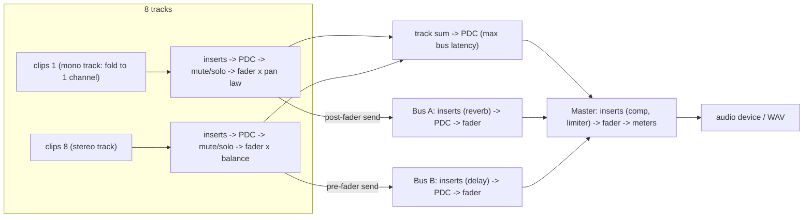

# 第 14 章 - 總結專案：一步一步打造 8 軌 DAW

[English](README.md) | **繁體中文**

> [課程首頁](../../README.zh-TW.md) | 上一章：[13 - VST hosting](../13-vst-hosting/README.zh-TW.md) | 這是最後一章。

> 這是整個課程的最後一章。
> 第 01-12 章給了你 DSP 的基本積木（gain、filter、EQ、dynamics、saturation、
> delay、modulation、metering、reverb）；[第 13 章](../13-vst-hosting/README.zh-TW.md)示範了 plugin 如何被 host。
> 現在我們要把所有東西組合成一套小巧但*真正可用*的 digital audio workstation。

本章分成兩個階段：

| 階段 | 內容 | 位置 | 需要 JUCE？ |
|---|---|---|---|
| **1**（Step 1-10） | **engine**：transport、clip、8 軌 mixer、insert、FX bus、lock-free command queue、plugin delay compensation、offline bounce、real-time safety 測試 | 跟著做：`steps/`；參考實作：`engine/`、`examples/`、`tests/`；文字說明：`docs/step-01..10` | 不需要 - 純 C++17，可離線測試 |
| **2**（Step 11-21） | **應用程式 "DawLab 8"**：audio device、深色 GUI（transport bar、帶波形的 arrangement、帶自動產生參數面板的 mixer、spectrum 與 loudness）、透過第 13 章載入的 VST3 insert、含 resampling 的檔案載入、export、鍵盤快捷鍵、自動化 GUI 測試 | `app/`、`docs/step-11..21` | 需要 |


*DawLab 8 播放 demo song，位置在第 2 小節第 3 拍。這張圖不是螢幕截圖：app 會用
`"DawLab 8.exe" --snapshot <file.png>`（Step 12）自己繪製畫面，ctest 每次 build 都會執行它。*

讓 engine 完全不依賴 JUCE，是整章最重要的設計決策：
engine 的每一個部分都可以從 console 程式執行、量測與做 unit test，而 GUI
「只不過」是一個定義明確的 API（[docs/engine-api.zh-TW.md](docs/engine-api.zh-TW.md)）的 client。第 2 階段
證明了這一點：app 自己不做任何音訊處理（除了一個檔案 resampler）；它只開啟
device、繪圖，並透過 atomic 與 command queue 和 engine 溝通。

## 如何使用本章

通過本章有兩種方式，它們使用同樣的 21 份 step 文件
（[路線圖](#4-二十一個-step)）：

| 路線 | 你要做的事 | 位置 | 由什麼檢查 |
|---|---|---|---|
| **跟著做**（建議） | 自己一步一步寫出這套 DAW | Step 1-10：`steps/stepNN-*/` - 每個 step 一份小而獨立的 engine snapshot。Step 11-21：各 step 文件裡的「Your turn」章節 | Step 1-10：`l14_stepNN_starter`（你的程式碼；在 step 完成前會印出 `[FAIL]`）與 `l14_stepNN_solution`（ctest）。Step 11-21：app 自己的測試（`l14_app_smoke_test`、`l14_app_snapshot`、習題解答） |
| **參考** | 閱讀並執行完成版的程式 | `engine/`（+ `examples/`、`tests/`）與 `app/` | `l14_test_*`、`l14_app_smoke_test`、各個 example |

**跟著做，Step 1-10（engine）。** 每個 `steps/stepNN-*/` 資料夾都是一個完整、可編譯的
迷你 engine，內容恰好是該 step 之後所存在的東西 - Step 1 沒有 transport、沒有
clip、沒有 command、也沒有 PDC；之後每個 step 都從前一個 step 的 solution 出發：

```
steps/step04-mixer/
  minidaw.h            the whole mini engine so far: Steps 1-3 solved, Step 4's functions only declared
  check.h              the step's self-check (main); it tests only what this step adds
  starter/step04.cpp   YOUR code: the step's functions with TODOs  -> l14_step04_starter  (build only)
  solution/step04.cpp  a worked solution                          -> l14_step04_solution (ctest, label "solution")
```

閱讀 step 文件、打開 starter、填完 TODO、重新 build
（`.\scripts\build.ps1 -Only 14-daw-8track`，或在 IDE 裡只 build 該 target），然後從 `build` 資料夾執行
`build\bin\Debug\l14_stepNN_starter.exe`，直到它印出
`[PASS] l14_stepNN`。每份 step 文件的「Your turn」章節都列出了函式、檔案、
檢查方式與預期輸出。這些 snapshot 不需要 JUCE，也不使用 `engine/`；它們沿用
`engine/` 的命名（`Transport::advance`、`renderClip`、`Mixer::updateLatencies`……），所以做完 Step 10 之後，
你讀完成版的 engine 就像讀一份熟悉的程式 - 它只是多了其餘的 19 個 effect adapter、
含 LUFS 的 meter、幾個額外的 command 與邊界情況。

**跟著做，Step 11-21（app）。** GUI 應用程式沒辦法切成十個 console
snapshot，所以這裡你直接在完成版的 app 裡作業：每個「Your turn」會指定 `app/Source/` 裡的一個函式（或一小組函式），
要你刪掉後依該 step 的設計重寫 - 請先複製檔案
（`AudioHost.cpp` -> `AudioHost.cpp.orig`）- 並說明之後必須通過的檢查，通常是
`DawLab 8.exe --smoke-test`（`l14_app_smoke_test`）的某一段，或 `--snapshot` 產生的圖片。

**參考。** 跳過 starter，一邊對照 `engine/` 與 `app/` 一邊閱讀 step 文件，並執行
「Verify (reference route)」下列出的 example 與測試。

---

## 1. 學習目標

完成本章之後，你可以

- 解釋 DAW 的**兩個時鐘** - audio device 的 sample clock 與音樂時鐘
  （小節、拍、tick）- 並在兩者之間精確換算；
- 以 **sample 精度**把音訊 **clip** 放到 timeline 上，附帶 clip gain 與 fade，並用**loop** 播放，
  而且 loop 的結尾可以落在一個 audio block 的中間；
- 建立一個 **8 軌 mixer**，具備 fader、pan law、mute / solo 邏輯、**mono 與 stereo track**
  （像 Cubase 一樣：mono track 在單一 channel 上執行 insert 並以 pan law 定位，stereo track 保留聲像並以
  balance 調整）、送往兩條 **FX bus** 的 **pre/post-fader send**、一條 master bus，以及 **meter**（peak、RMS，以及來自第 11 章的 LUFS）；
- 把第 01-12 章的**全部十九個 effect DSP class** 包在同一個 `InsertEffect` interface 後面，
  並提供**自我描述的參數 API**，讓 UI 可以自動產生旋鈕；
- 從另一條 thread 修改執行中的 mix，**不用 lock、也不在 audio thread 上配置記憶體**：
  數值用 atomic、結構性變更用 **single-producer/single-consumer queue**，
  並用 **garbage queue** 把已失效的物件送回去釋放；
- 在 track、bus 與 master 之間計算並套用 **plugin delay compensation（PDC）**；
- 把一首歌**離線 bounce**（含 latency 補償）成 WAV 檔，結果與
  播放所產生的內容 bit-identical；
- 以計算配置次數的測試、隨機 block size，以及一條不停猛打 API 的第二條 thread，來**證明** engine 是 real-time safe 的；
- 透過 JUCE 的 `AudioIODeviceCallback` 把 engine 接到**真正的 audio device**，不經複製地包裝
  device 的 buffer，並能撐過 sample rate 的變更；
- 建立一個只讀取 atomic 並送出 command 的 **DAW GUI**：transport bar、帶
  波形縮圖與可拖曳 clip 的 arrangement、具備正確 fader law 的 mixer、由 effect 的自我描述**自動產生的
  參數面板**、spectrum 與 EBU R 128 loudness；
- 把 **VST3 plugin** 當成 insert 來 host（第 13 章），含編輯器視窗與自動 latency 補償；
- 在**worker thread** 上載入音訊檔，並用 windowed-sinc resampler 轉換其 sample rate；
  **export** mix 時不讓視窗凍結；
- 讓 GUI 應用程式**可測試**：offline 模式、不依賴 device 的 render 路徑，以及
  由 ctest 執行的命令列模式（`--smoke-test`、`--snapshot`）。

## 2. 最終架構

### 2.1 兩條 thread、三條溝通管道

DAW 是一個 concurrent 程式，有一條鐵律：**audio thread** 必須在每個 block 的 deadline 前交出它
（48 kHz 下 512 samples = 10.67 ms），*每一次都要*。它絕不能為任何東西等待。其他所有工作 - GUI、檔案載入、plugin 掃描 - 都在別的 thread 上。

```
  UI / message thread                                             audio thread
  ===================                                             ============
                         (1) atomics: fader, pan, mute, solo,
  mixer.getTrack(t)      sends, effect parameters, bypass,
     .setGainDb(...)  ---------------------------------------->  strip.beginBlock()
  fx->setParameter(...)  tempo, play/stop, seek, loop             fx->applyPendingParameters()
  transport.play()                                                transport.advance()

                         (2) command queue (SpscQueue<Command>)
  engine.addInsert()  ---------------------------------------->  applyCommands()
  engine.removeInsert()  "here is a new, prepared effect"          insertAt / removeAt /
  engine.setTrackClips() "here is a new clip list"                 exchangeClips
                                                                       |
                         (3) garbage queue (SpscQueue<Garbage>)        |
  engine.collectGarbage() <--------------------------------------------+
     delete old effect    "I no longer use this, please free it"
     delete old clip list
```

- **(1) 數值**是單一的數字。它們住在 `std::atomic` 裡：UI 寫入，audio thread
  每個 block 讀一次。不需要 queue，而且只有最新的值有意義。
- **(2) 結構**（插入一個 effect、替換一份 clip list）需要記憶體。UI thread
  負責配置*並準備好*新物件，然後透過 lock-free queue 送出一個 raw pointer；audio
  thread 在兩個 block 之間把它接上去 - 只是幾次 pointer 寫入。
- **(3) Garbage**：audio thread 拆下來的任何東西，都透過第二條 queue 送回去，由
  UI thread 釋放。audio thread 從不呼叫 `new` 或 `delete`。

### 2.2 Signal flow



### 2.3 檔案

所有 engine 程式碼都是 header-only，位於 `engine/include/dawlab/engine/`，namespace 為
`dawlab::engine`，CMake target 為 `dawlab_engine`（別名 `dawlab::engine`）。

| Header | 職責 | Step |
|---|---|---|
| `Constants.h` | 固定大小：8 軌、2 條 bus、stereo、每個 strip 8 個 insert | 1 |
| `Engine.h` | facade：`prepare`、`processBlock`、command / garbage queue | 1, 7 |
| `Transport.h` | play / stop / seek / loop / tempo、bars:beats、timeline segment | 2 |
| `Clip.h` | clip = 共享 buffer 上的一個視窗 + gain + fade；`renderClip()` | 3 |
| `Track.h` | 讀取 clip 的 channel strip；lock-free 的 clip list 交換 | 3 |
| `ChannelStrip.h` | fader、pan（law / balance）、mute/solo ramp、send、meter | 4, 6 |
| `Mixer.h` | 8 軌 + 2 條 bus + master、solo 邏輯、routing、PDC 計算 | 4, 6, 8 |
| `InsertEffect.h` | effect interface、`ParameterInfo`、`PlayHead`、`InsertChain` | 5 |
| `EffectBase.h` | 供 adapter 使用的 lock-free 參數交接；`PureDelayEffect` | 5, 8 |
| `Effects.h` | 全部 19 個 effect DSP class 的 adapter + factory（`createEffect("Reverb")`） | 5 |
| `SpscQueue.h` | wait-free 的 single-producer / single-consumer ring buffer | 7 |
| `Commands.h` | `Command`（結構性變更）與 `Garbage`（稍後刪除我） | 7 |
| `LatencyCompensator.h` | 用於 PDC 的整數 delay line | 8 |
| `Renderer.h` | `renderOffline()` / `bounceToWav()` | 9 |
| `DemoSong.h` | 以資料形式存在的 8 軌 demo song（`makeDemoSong`、`applyDemoSong`） | 9, 18 |
| `All.h` | include 所有東西（`DemoSong.h` 除外） | - |

### 2.4 應用程式：圍繞 engine 的四條 thread

```
                         +---------------------- MainComponent (message thread) ------------------------+
 mouse / keys ---------> | commands (Space, Ctrl+E ...)   TransportBar  ArrangementView  MixerView         |
                         |        |                           ^              ^             ^   panels    |
                         |        v                           |  30 Hz timer: read atomics, collect garbage |
                         |   Session (GUI model) ---- setTrackClips / addInsert / replaceInsert ----+      |
                         +--------|----------------------------------------------------------------|------+
                                  | atomics (fader, pan, mute, solo, sends, parameters, transport) | command queue
                                  v                                                                v
  driver thread:  AudioHost::audioDeviceIOCallbackWithContext -> Engine::processBlock(AudioBlock(outputs))
                                  |                                   (+ SpectrumAnalyzer::pushSamples)
  loader thread:  MediaLoader: read file, resample, convert clips after a device change /
                  makeDemoSong -> callAsync -> Session
  export thread:  ExportJob: renderOffline (engine detached from the device) -> WAV -> callAsync
```

每一條通往 audio thread 的箭頭不是 atomic，就是 command queue；worker
thread 的每一個結果，都以 immutable 物件的形式，透過
`MessageManager::callAsync` 回到 message thread。沒有任何 thread 會等待 audio thread，而 audio thread
也不等任何人。

| 檔案（`app/Source/`） | 職責 | Step |
|---|---|---|
| `AudioHost.h/.cpp` | device、callback（zero-copy）、CPU 負載、offline render 路徑、spectrum 餵入 | 11 |
| `Main.cpp`、`MainComponent.h/.cpp` | 應用程式、視窗、擁有權順序、layout、command、選單 | 12, 21 |
| `DawLookAndFeel.h/.cpp` | 深色主題、旋鈕、fader、色彩表 | 12 |
| `TransportBar.h/.cpp` | play / stop / loop、位置、tempo、master meter + LUFS、CPU | 13 |
| `ArrangementView.h/.cpp` | lane、波形快取、ruler、playhead、seek、clip 拖曳 | 14 |
| `MixerView.h/.cpp` | channel strip、fader law、send、mute / solo、meter、master 區段 | 15, 20 |
| `Session.h/.cpp` | GUI model：insert slot <-> 精簡 chain、clip list、demo song、sample rate 變更 | 15, 16, 18 |
| `EffectMenu.h/.cpp`、`ParameterPanel.h/.cpp` | insert 下拉選單、自動產生的參數面板 | 16 |
| `VstInsert.h/.cpp` | 在 `InsertEffect` 後面的第 13 章 `HostedPlugin` | 17 |
| `MediaLoader.h/.cpp` | 在 worker thread 上讀檔與 windowed-sinc resampling | 18 |
| `Exporter.h/.cpp` | 在 thread 上 export mixdown、寫入 WAV | 19 |
| `Meters.h/.cpp` | `MeterBar`、`LoudnessDisplay`、`SpectrumView` | 13, 15, 20 |
| `AppCommands.h` | command ID | 21 |
| `SmokeTest.h/.cpp` | `--smoke-test`、`--snapshot`、一個 in-process 的測試 plugin | 11-21 |

CMake：靜態函式庫 `l14_daw_app`（除了 `Main.cpp` 之外的上述全部；JUCE 習題會 link 它）、
app `DawLab8`（`juce_add_gui_app`，產品名稱 "DawLab 8"），以及 `l14_daw_app_3bus`
（同樣的原始碼加上 `DAWLAB_ENGINE_NUM_BUSES=3`，Exercise 12）。JUCE 本身只編譯一次，
在第 13 章的 `dawlab_plugin_host` 裡；如果第 13 章不在這次 build 中，`app/CMakeLists.txt` 會加入第 13 章的 `host/` 資料夾。
不加 `-Juce` 時，本章只 build 第 1 階段。

## 3. 理論總覽

每份 step 文件都會詳細推導它負責的部分。這裡列出你會遇到的概念與關鍵
公式，讓你看見它們之間如何串連。

### 3.1 兩個時鐘：sample 與音樂

audio device 數的是 **sample**；音樂家數的是**小節、拍與 tick**。engine 以整數個 sample 保存
位置（`int64_t`：`int32_t` 在
2^31 / 48000 s = 12.4 小時後就會溢位），並從 tempo $`B`$（每分鐘拍數）、sample
rate $`f_s`$ 與拍號分子 $`n`$ 推導出音樂時間：

$$
N_{\text{beat}} = \frac{60\,f_s}{B}, \qquad N_{\text{bar}} = n\,N_{\text{beat}}
$$

在 120 BPM、48 kHz 下，一拍是 24 000 個 sample，一個 4/4 小節是 96 000 個 sample。位置
「第 $`b`$ 小節、第 $`k`$ 拍、tick $`t`$」（小節與拍從 1 起算，每拍 960 tick）為

$$
\text{samples} = \mathrm{round}\Big( \big[(b-1)\,n + (k-1) + t/960\big]\, N_{\text{beat}} \Big)
$$

在網格上往返轉換是精確的（`l14_transport_clips` 會印出一張表）。在 96 BPM / 44.1 kHz 下，一
拍是 27 562.5 個 sample - 不是整數 - 這就是為什麼換算只在
最後一步 round 一次（Exercise 2）。

### 3.2 Sample 精度的 clip

clip 是 source buffer 的一個視窗，放在 timeline 的 sample $`S`$ 處，長度為 $`L`$，source
offset 為 $`O`$。一個 block 涵蓋 timeline 範圍 $`[T_0, T_0 + N)`$。要 render 的部分是
兩者的交集

$$
\text{from} = \max(T_0, S), \qquad \text{to} = \min(T_0 + N, S + L)
$$

而 timeline sample $`T \in [\text{from}, \text{to})`$ 會寫到 block 索引 $`T - T_0`$，並讀取 source
索引 $`O + (T - S)`$。一切都是整數運算，所以起點在 sample 12 345 的 clip 在*任何* block size 下
都會落在輸出 sample 12 345（`tests/test_timeline.cpp` 檢查了 block size 1、64、512
與 1000）。Fade 把每個 sample 乘上

$$
g_{\text{in}}(i) = \text{shape}\Big(\frac{i+1}{F_{\text{in}}+1}\Big), \quad
g_{\text{out}}(i) = \text{shape}\Big(\frac{L-i}{F_{\text{out}}+1}\Big), \quad
\text{shape}(x) = x \ \text{or}\ \sin\big(\tfrac{\pi}{2}x\big)
$$

這樣選的目的是讓長度同為 $`F`$ 且重疊的 fade-out 與 fade-in 永遠滿足
$`x_{\text{in}} + x_{\text{out}} = 1`$ - 這是 crossfade 的基礎（Exercise 5）。

### 3.3 Fader、pan law、balance

以 dB 表示的 fader 會變成線性 gain $`g = 10^{\,\text{dB}/20}`$（-6.02 dB = x0.5）。對於
放在 stereo 聲場中、pan 為 $`p \in [-1, 1]`$ 的 mono source，**constant-power law** 使用角度
$`\theta = \frac{\pi}{4}(p+1)`$：

$$
g_L = \cos\theta, \qquad g_R = \sin\theta, \qquad g_L^2 + g_R^2 = 1
$$

pan 的過程中聲學功率保持不變；在中央時每一側得到
$`\cos(\pi/4) = 0.7071`$（-3.01 dB）。第 01 章的 `dsp::Panner::computeGains` 也提供
**linear** law（中央 -6.02 dB，響度會凹下去）與 **-4.5 dB** 的折衷方案。Mono track 使用
pan law；stereo track、bus 與 master 承載的已經是 stereo 聲像，所以它們使用 **balance**：中央 = unity，
往右轉只會衰減左側，$`g_L = \min(1, 1-p)`$、$`g_R = \min(1, 1+p)`$。否則
master 在預設設定下就會把整個 mix 壓低 3 dB。

Track 的 **format**（`TrackFormat::Mono` / `Stereo`，Step 4）決定它使用兩者中的哪一個，以及它的 insert
看到幾個 channel：mono track 把 clip fold 成 $`(L+R)/2`$，在單一 channel 上執行 insert 與 PDC，再在
pan law 之前複製到兩側；stereo track 則全部在兩個 channel 上執行。載入檔案時會像 Cubase 一樣，依它的
channel 數選擇 format（Step 18）。因此同一個 mono 檔案在 stereo track 上中央會大聲 3.01 dB，而會產生
stereo 的 effect（chorus spread、寬廣的 reverb）在 mono track 上會塌縮成 mono。第 01 章關於
[pan law 與 balance](../01-gain/README.zh-TW.md) 的理論段落解釋了這兩種控制為什麼不同。

| 設定 | $`g_L`$ | $`g_R`$ |
|---|---|---|
| fader 0 dB、pan 置中、constant power | 0.7071 (-3.01 dB) | 0.7071 |
| fader -6.02 dB、pan 置中 | 0.3536 | 0.3536 |
| pan 完全向左 | 1 | 0 |
| pan +0.5、fader -6 dB | 0.1918 (-14.34 dB) | 0.4630 (-6.69 dB) |
| balance 模式、置中 | 1 | 1 |
| balance +0.5 | 0.5 | 1 |

### 3.4 加總、mute 與 solo

master 是一個加總器。$`N`$ 個相同（coherent）的訊號以振幅相加，$`+20\log_{10}N`$ dB
（兩軌：+6.02 dB）；$`N`$ 個互相獨立的訊號以功率相加，$`+10\log_{10}N`$ dB（兩軌：
+3.01 dB）。這就是為什麼 mix 需要 headroom，也是 master 最後要接 limiter 的原因。
Solo 是一條涵蓋整個 mixer 的規則：

$$
\text{audible}_t = \lnot\,\text{mute}_t \ \land\ \big(\lnot\,\exists u:\text{solo}_u \ \lor\ \text{solo}_t\big)
$$

Bus 是 *solo-safe* 的（它們只有 mute），所以被 solo 的人聲仍然能和它的 reverb 一起被聽到。
每一次開關變更都以 10 ms ramp，每一次 fader 移動以 50 ms ramp：沒有 click，也沒有 zipper noise。

### 3.5 Send

send 把一個 track 以自己的 gain $`s`$ 複製到一條 bus。**Post-fader** send 在 fader 與
pan 之後取樣（把 track 推低時，它的 reverb 也跟著變小 - 這是通常的選擇）；**pre-fader** send 則在
它們之前取樣（耳機 mix，或是在你把 dry 訊號 fade out 時仍然保留的 reverb）：

$$
\text{bus}_b = \sum_t s_{t,b}\cdot
\begin{cases} g_t\, x_t & \text{post-fader} \\ x_t & \text{pre-fader} \end{cases}
$$

Mute/solo 位於兩種取樣點*之前*：被 mute 的 track 什麼也不送。

### 3.6 Latency 與 plugin delay compensation

lookahead limiter（第 05 章）、oversampled saturator（第 06 章）或 partitioned
convolution（第 12 章）在看到 input $`n + D`$ 之前，無法產生 output sample $`n`$：它把
訊號延遲 $`D`$ 個 sample，並透過 `getLatencySamples()` 回報 $`D`$。如果 track 1 有一個 240-sample
的 limiter 而 track 2 什麼都沒有，它們的和是

$$
y[n] = x[n] + x[n - D] \quad\Rightarrow\quad |H(f)| = 2\,\big|\cos(\pi f D / f_s)\big|
$$

這是一個 **comb filter**，notch 位於 $`f = (2k+1)\,f_s / (2D)`$：在 48 kHz、$`D = 240`$ 時，位於 100、300、
500 Hz ……，再加上每一下鼓擊都會出現 flam。PDC 會延遲所有其他路徑，讓所有路徑
都一樣晚：

$$
c_t = \max_u L_u - L_t, \qquad c_b = \max_v L_v - L_b, \qquad
L_{\text{total}} = \max_u L_u + \max_v L_v + L_{\text{master}}
$$

（track $`t`$，bus $`b`$；乾的 track sum 要為最慢的 bus 等待 $`\max_v L_v`$。）`l14_pdc_demo`
會量測它，並讓你聽到兩種版本。每個補償用的 delay 最多容納
$`C = 16\,384`$ 個 sample（`kDefaultMaxPdcSamples`）；一串高 latency 的 VST3 plugin 可能超過
這個值。此時 mixer 會以 $`\min(\max L, C)`$ 對齊、回報它實際套用的 latency，並設定
`Engine::hasPdcOverflow()`，app 會把它顯示在 mix latency 旁邊（Step 8）。

### 3.7 Real time

audio thread 每個 block 只有 $`N / f_s`$ 秒，而且不能 block：不能 `new` / `delete` /
`malloc`、不能用 mutex、不能做檔案或 console I/O、不能丟 exception、不能有無上限的迴圈、不能等待
另一條 thread。engine 遵循的規則是「在 `prepare()` 配置、透過
atomic 與 wait-free queue 溝通、在 UI thread 釋放」。`tests/test_realtime_safety.cpp` 的證明方式是：
取代全域的 `operator new` / `operator delete`，計算從 `processBlock()` 內部發出的呼叫次數 -
同時另一條 thread 做大約 600 次隨機編輯。

### 3.8 Block-size invariance

host 每次呼叫我們時用的可能是 64、441、512，或每次都不一樣的大小。engine 裡的每個 smoother
都逐 sample 前進，clip 與 automation 是 timeline 的函數，PDC 是整數 delay，
而 effect 在呼叫之間會保留狀態 - 所以輸出不能取決於串流是怎麼切的。
`tests/test_block_invariance.cpp` 以 block size 512、64 與隨機大小
1..1500 render 一個專案，並要求最大差異維持在 $`10^{-5}`$ 以下（實測差異：恰好為 0）。

### 3.9 GUI 這一側：polling、fader law、meter

GUI 從不接收來自 audio thread 的訊息。一個 30 Hz 的 timer 讀取 atomic（位置、
peak、LUFS、CPU 負載）- 對眼睛來說夠快，最差只落後一個 block，對 audio
thread 沒有任何成本。控制項寫入 atomic；engine 會對每一個變更做 ramp。

fader 位置 $`p \in [0, 1]`$ 以平方律對應到 gain，讓大部分行程都落在
0 dB 附近（Step 15）：

$$
\text{dB}(p) = 12 - 72\,(1 - p)^2, \qquad p(\text{dB}) = 1 - \sqrt{(12 - \text{dB}) / 72}
$$

0 dB 位於 $`p = 0.592`$，-6 dB 恰好在 0.5，最底部代表 $`-\infty`$。Meter 在 -60 .. +6 dBFS 範圍內對 dB 呈線性：
$`\text{position} = (\text{dB} + 60) / 66`$。

### 3.10 對檔案做 resampling

44.1 kHz 的檔案放進 48 kHz 的專案時必須轉換，否則它會高 1.47 個半音
（$`12 \log_2 (48000/44100)`$）。輸出 sample $`m`$ 位於 input 位置 $`t_m = m\,f_{\text{in}}/f_{\text{out}}`$；
頻寬受限的 interpolation 計算（Step 18）

$$
y[m] = \sum_k x[k]\,g(t_m - k), \qquad g(x) = 2 f_c\, \mathrm{sinc}(2 f_c x)\, w(x / W),
\qquad f_c = 0.46 \min\!\Big(1, \frac{f_{\text{out}}}{f_{\text{in}}}\Big)
$$

其中 $`w`$ 是涵蓋 $`W = 24 / (2 f_c)`$ 個 input sample 的 Blackman window。cutoff 跟隨*較低*的
Nyquist 頻率，並留有餘裕（downsampling 時用 $`0.46 f_{\text{out}}`$ 而不是 $`0.5 f_{\text{out}}`$）。
不過 windowed sinc 並不是 brick wall。kernel 長 $`N = 2W = 24 / f_c`$
個 input sample，Blackman window 給出的 transition band 寬度約為 $`5.5 / N = 0.23 f_c`$，
以 $`f_c`$ 為中心；它在 $`1.115 \cdot 0.46 f_{\text{out}} = 0.513 f_{\text{out}}`$ 附近結束，比輸出的 Nyquist 頻率稍微
*高一點*。所以 aliasing 並非不可能，只是被限制住了：介於 $`0.5`$ 與 $`0.513 f_{\text{out}}`$ 之間的內容
（轉成 44.1 kHz 時為 22.05-22.6 kHz）會折回
$`0.487`$-$`0.5 f_{\text{out}}`$（21.5-22.05 kHz），並被衰減至少約 54 dB；
更高的一切都落在 stopband。smoke test 量測了兩端：一個 20 kHz 的 tone 轉成
22.05 kHz 後，落在 -122 dB，而不是折回到 2050 Hz；一個 22.3 kHz 的 tone 從
48 轉成 44.1 kHz 時，折回到 21.8 kHz，大小為 -54 dB。若要一個完全不會產生 alias 的轉換器，可以把
`kCutoffScale` 降到約 0.88（stopband 邊緣在 $`0.49 f_{\text{out}}`$，高音損失稍多），或把 `kZeroCrossings`
加倍（transition 寬度減半，CPU 時間加倍）。

### 3.11 對數軸上的 spectrum

master spectrum 是 4096 點的 FFT（第 11 章）：在 48 kHz 下，每個 bin 相距 $`f_s / N = 11.7`$ Hz。
顯示時把頻率對應到 $`x = \ln(f/20) / \ln(1000)`$，並且對每一條像素欄，取落在其中的各 bin 的
**最大值**。在寬 $`W`$ 像素的 view 中，頻率 $`f`$ 處的像素
涵蓋 $`f\,(1000^{1/W} - 1)`$ Hz，所以在

$$
f < \frac{f_s / N}{1000^{1/W} - 1}
$$

以下，一個像素不到一個 bin：以 snapshot 285 像素寬的 view 來說約為 480 Hz（$`W = 300`$ 時為
500 Hz）。在 10 kHz，同樣一個像素涵蓋約 20 個 bin（Step 20）。

## 4. 二十一個 step

每個 step 加入一項能力，並有自己的文件，結構為 **goal -> design -> code -> your
turn -> verify -> what you learned**。Step 1-10 建立 engine（不需 JUCE），Step 11-21 建立
應用程式。["如何使用本章"](#如何使用本章)的兩條路線只在
最後兩欄有差別：**跟著做** = 自己寫出「Your turn」欄的程式碼並
執行它的檢查；**參考** = 閱讀主要檔案並執行參考檢查。

| # | 文件 | 新增 | 跟著做：Your turn（Step 1-10：`steps/stepNN-*/`，starter `l14_stepNN_starter`，solution `l14_stepNN_solution`） | 參考：主要檔案 | 參考：驗證方式 |
|---|---|---|---|---|---|
| 1 | [docs/step-01-skeleton.zh-TW.md](docs/step-01-skeleton.zh-TW.md) | 專案骨架、`Engine`、`processBlock(AudioBlock)` | `step01-skeleton`：`Engine::processBlock`、`processChunk` | `Engine.h`、`Constants.h`、`CMakeLists.txt` | `l14_hello_engine` |
| 2 | [docs/step-02-transport.zh-TW.md](docs/step-02-transport.zh-TW.md) | play / stop / seek / loop / tempo、bars:beats | `step02-transport`：`barsBeatsToSamples`、`samplesToBarsBeats`、`Transport::advance` | `Transport.h` | `l14_test_timeline`、`l14_transport_clips` |
| 3 | [docs/step-03-clips.zh-TW.md](docs/step-03-clips.zh-TW.md) | sample 精度的 clip、clip gain、fade | `step03-clips`：`clipFadeAt`、`renderClip` | `Clip.h`、`Track.h` | `l14_test_timeline`、`l14_transport_clips` |
| 4 | [docs/step-04-mixer.zh-TW.md](docs/step-04-mixer.zh-TW.md) | 8 軌 mixer、fader / pan / mute / solo、mono / stereo track、master、meter | `step04-mixer`：`computeStripGains`、`isTrackAudible`、`Mixer::processTrack` | `ChannelStrip.h`、`Track.h`、`Mixer.h` | `l14_test_mixer`、`l14_test_track_format` |
| 5 | [docs/step-05-insert-effects.zh-TW.md](docs/step-05-insert-effects.zh-TW.md) | `InsertEffect`、參數 API、19 個 adapter、factory | `step05-insert-effects`：`ParameterInfo` taper、`EffectBase` dirty mask、`InsertChain::process` | `InsertEffect.h`、`EffectBase.h`、`Effects.h` | `l14_test_effects`、`l14_effect_catalog` |
| 6 | [docs/step-06-sends-buses.zh-TW.md](docs/step-06-sends-buses.zh-TW.md) | 2 條 FX bus、pre/post-fader send | `step06-sends-buses`：`addSend`、兩種 send 取樣點 | `ChannelStrip.h`、`Mixer.h` | `l14_test_mixer` |
| 7 | [docs/step-07-commands.zh-TW.md](docs/step-07-commands.zh-TW.md) | lock-free command queue、garbage queue | `step07-commands`：`SpscQueue::push` / `pop`、`Engine::applyCommands` | `SpscQueue.h`、`Commands.h`、`Engine.h` | `l14_test_commands` |
| 8 | [docs/step-08-pdc.zh-TW.md](docs/step-08-pdc.zh-TW.md) | plugin delay compensation | `step08-pdc`：`LatencyCompensator::process`、`Mixer::updateLatencies` | `LatencyCompensator.h`、`Mixer.h` | `l14_test_pdc`、`l14_pdc_demo` |
| 9 | [docs/step-09-offline-render.zh-TW.md](docs/step-09-offline-render.zh-TW.md) | offline bounce 成 WAV、mix 報告 | `step09-offline-render`：`renderOffline` | `Renderer.h` | `l14_render_song` |
| 10 | [docs/step-10-realtime-safety.zh-TW.md](docs/step-10-realtime-safety.zh-TW.md) | real-time safety 稽核 | `step10-realtime-safety`：計算 `operator new` / `delete` 次數、`renderWithBlockSizes` | `tests/test_realtime_safety.cpp`、`tests/test_block_invariance.cpp` | `l14_test_realtime_safety`、`l14_realtime_sim` |
| 11 | [docs/step-11-audio-device.zh-TW.md](docs/step-11-audio-device.zh-TW.md) | audio device、zero-copy callback、CPU 負載、device 變更 | `AudioHost::render` -> smoke test 4 | `AudioHost` | `l14_app_smoke_test`（4、7、10） |
| 12 | [docs/step-12-main-window.zh-TW.md](docs/step-12-main-window.zh-TW.md) | 應用程式、主視窗、擁有權順序、深色 LookAndFeel、`--snapshot` | `MainComponent::resized` -> snapshot | `Main.cpp`、`MainComponent`、`DawLookAndFeel` | `l14_app_snapshot` |
| 13 | [docs/step-13-transport-bar.zh-TW.md](docs/step-13-transport-bar.zh-TW.md) | play / stop / loop、實際聽到內容（已補償 latency）的 bars.beats 與 m:ss、tempo、master meter + LUFS、CPU | `AudioHost::compensatePosition`、`TransportBar::formatBarsBeats` -> smoke test 6 | `TransportBar` | `l14_app_smoke_test`（6） |
| 14 | [docs/step-14-arrangement.zh-TW.md](docs/step-14-arrangement.zh-TW.md) | 8 條 lane、波形縮圖、playhead、click-to-seek、拖曳 clip | `sampleToX`、`xToSample`、`snapToBeat`、`Session::moveClip` -> Exercise 8 | `ArrangementView`、`Session::moveClip` | snapshot、Exercise 8 |
| 15 | [docs/step-15-mixer.zh-TW.md](docs/step-15-mixer.zh-TW.md) | 8 個 track strip、FX bus strip、master；fader law、send、mute / solo、meter | `FaderLaw` -> smoke test 6 | `MixerView` | `l14_app_smoke_test`（6） |
| 16 | [docs/step-16-inserts-panels.zh-TW.md](docs/step-16-inserts-panels.zh-TW.md) | insert slot、effect 選單、自動產生的參數面板 | `Session::chainIndexOf` -> smoke test 2 | `Session`、`EffectMenu`、`ParameterPanel` | `l14_app_smoke_test`（2、6） |
| 17 | [docs/step-17-vst3-inserts.zh-TW.md](docs/step-17-vst3-inserts.zh-TW.md) | 帶編輯器視窗與 PDC 的 VST3 insert | `VstInsert::process`、`getLatencySamples` -> smoke test 5、5b | `VstInsert`（+ 第 13 章） | `l14_app_smoke_test`（5） |
| 18 | [docs/step-18-file-loading.zh-TW.md](docs/step-18-file-loading.zh-TW.md) | 背景檔案載入、resampling、"Load demo song" | `resampleBuffer` -> smoke test 1 | `MediaLoader`、`DemoSong.h` | `l14_app_smoke_test`（1、2） |
| 19 | [docs/step-19-export.zh-TW.md](docs/step-19-export.zh-TW.md) | 在 thread 上 export mixdown | `Exporter::renderToFile` -> smoke test 3、9 | `Exporter` | `l14_app_smoke_test`（3、9） |
| 20 | [docs/step-20-spectrum-loudness.zh-TW.md](docs/step-20-spectrum-loudness.zh-TW.md) | master spectrum analyzer、EBU R 128 loudness、mix latency | `SpectrumView` 對數軸 -> smoke test 8 | `Meters`、`AudioHost` | `l14_app_smoke_test`（8）、snapshot |
| 21 | [docs/step-21-shortcuts-and-tests.zh-TW.md](docs/step-21-shortcuts-and-tests.zh-TW.md) | command、選單、鍵盤快捷鍵、app 的自動化測試 | `getCommandInfo` / `perform` 中的 transport command -> smoke test | `AppCommands.h`、`MainComponent`、`SmokeTest` | `l14_app_smoke_test`、Exercise 13 |

engine 的 API 參考文件（threading 表、JUCE 整合食譜）是
[docs/engine-api.zh-TW.md](docs/engine-api.zh-TW.md)；第 2 階段只是在它之上建造 GUI 的其中一種方式。

## 5. 建置與執行

engine 部分不需要 JUCE。從 repository 根目錄（PowerShell）：

```powershell
.\scripts\build.ps1 -Only 14-daw-8track                      # build + run every test of this chapter
.\scripts\build.ps1 -Only 14-daw-8track -TestLabel example   # only the examples
.\scripts\build.ps1 -Only 14-daw-8track -TestLabel solution  # only the exercise and build-along step solutions
```

unit test 帶有 ctest label `test`。程式會輸出到 `build/bin/Debug/`，WAV 檔輸出到
`build/dawlab_output/`（請從 build 目錄執行這些程式，如同 ctest 的做法）。

| Target | 種類 | 展示什麼 | 輸出檔案 |
|---|---|---|---|
| `l14_hello_engine` | example | Step 1：一個 clip、callback 迴圈 | `l14_hello_engine.wav` |
| `l14_transport_clips` | example | Step 2-3：網格表、16 個 clip、以 441-sample block 做 loop | `l14_transport_clips.wav`、`l14_transport_loop.wav` |
| `l14_effect_catalog` | example | Step 5：全部 19 個 effect 的旋鈕清單，每個都聽得到 | `l14_effect_catalog.wav` |
| `l14_pdc_demo` | example | Step 8：PDC 的量測與聆聽 | `l14_pdc_off.wav`、`l14_pdc_on.wav`、`l14_pdc_clicks.wav` |
| `l14_render_song` | example | Step 4、6、9：8 軌歌曲、mix 報告、bounce、solo | `l14_render_song.wav`、`l14_render_song_drums_solo.wav` |
| `l14_realtime_sim` | example | Step 7、10：由 device 帶動節拍的 callback + 忙碌的 UI thread | `l14_realtime_sim.wav` |
| `l14_test_timeline` | test | transport 數學、clip 擺放、fade、loop、seek | - |
| `l14_test_mixer` | test | fader、pan law、mute / solo、send、ramp | - |
| `l14_test_effects` | test | 所有 adapter：表格、clamping、fuzzing、latency | - |
| `l14_test_commands` | test | SpscQueue、insert / clip command、garbage、queue 滿載 | - |
| `l14_test_pdc` | test | 跨 track、bus、master 的對齊，以及 device 變更 | - |
| `l14_test_block_invariance` | test | 512 vs 64 vs 隨機 block size | - |
| `l14_test_realtime_safety` | test | audio thread 上不做配置、concurrency | - |
| `l14_test_demo_song` | test | `DemoSong.h`（app 的 demo song 資料）能重現 `l14_render_song` 的報告 | - |
| `l14_test_track_format` | test | mono / stereo track：pan mode、mono fold + pan law、balance 保留聲像、+3.01 dB、全部 19 個 effect 在單一 channel 上執行、chorus 塌縮 | - |
| `l14_ex2_solution` ... `l14_ex5_solution`、`l14_ex14_solution` | solution | 習題 2-5 與 14 | `l14_ex4_project.json` |
| `l14_step01_solution` ... `l14_step10_solution` | solution | Step 1-10 跟著做的 snapshot（`steps/`），各自只檢查自己的 step | `l14_step01.wav`、`l14_step09.wav` |
| `l14_step01_starter` ... `l14_step10_starter` | （只 build） | 同樣的 snapshot，但帶有你的 TODO；在 step 完成前會印出 `[FAIL]` | - |

應用程式需要 JUCE（第 13 章的設定；第一次 configure 會 build JUCE 的輔助工具）：

```powershell
.\scripts\build.ps1 -Only 14-daw-8track -Juce                      # engine + app + all tests
.\scripts\build.ps1 -Only 13-vst-hosting,14-daw-8track -Juce       # + chapter 13's VST3 plugins in the insert menu
cd build
& ".\bin\Debug\DawLab 8.exe"                                       # the DAW (Space = play, F1 = shortcuts)
& ".\bin\Debug\DawLab 8.exe" --smoke-test                          # automated check, no audio device
& ".\bin\Debug\DawLab 8.exe" --snapshot dawlab_output/l14_app_snapshot.png
```

| Target | 種類 | 展示什麼 | 輸出檔案 |
|---|---|---|---|
| `DawLab8`（"DawLab 8.exe"） | app | 8 軌 DAW，Step 11-21 | （Export mixdown：你選擇的任何 WAV） |
| `l14_app_smoke_test` | test（`DawLab8 --smoke-test`） | resampler、經由 GUI model 載入的 demo song、export、device callback = bounce、plugin insert + PDC（在第 13 章已 build 時：它的 VST3 compressor 與 limiter）、GUI 控制項 -> engine、已補償 latency 的 playhead、快捷鍵、sample rate 變更、spectrum 顯示、在自己的 thread 上執行 File > Export | `l14_app_smoke.wav`、`l14_app_export.wav`（整首歌，19 秒）、`l14_app_smoke_44k.wav`（loader 的 44.1 kHz mono 測試輸入） |
| `l14_app_snapshot` | example（`DawLab8 --snapshot`） | demo song 位於第 2 小節第 3 拍的視窗，以及一個自動產生的參數面板 | `l14_app_snapshot.png`、`l14_app_snapshot_panel.png` |
| `l14_ex8_solution` ... `l14_ex13_solution` | solution | JUCE 習題 8-13 | `l14_ex8_lane.png`、`l14_ex9_take.wav`、`l14_ex10_synth.wav`、`l14_ex11_project.dawlab`（+ media）、`l14_ex12_bus_c_only.wav`、`l14_ex12_third_bus.png`、`l14_ex13_shortcuts.xml`、`l14_ex13_editor.png` |

使用 app：demo song 會在啟動時產生（File > Load demo song，Ctrl+D，會再產生一次）。
點擊 lane 的 ruler 來 seek，拖曳 clip，點擊 insert slot 的箭頭來選擇 effect，
點它的本體來開啟自動產生的面板，"Load..."（或從檔案總管把音檔拖到 lane 上）會把 WAV / AIFF / FLAC / Ogg / Opus / MP3 載入到一個 track，
File > Export mixdown（Ctrl+E）會 bounce 成 24-bit WAV，File > Audio settings（Ctrl+,）用來選擇
device。沒有 audio device 時，app 會以 offline 模式執行（狀態列會顯示）。

### 5.1 這首歌聽起來如何 - 以及 meter 怎麼說

`l14_render_song` 用產生出來的素材建立 120 BPM、A minor 的 8 個小節（鼓 loop、撥奏
bass、琶音、detuned pad、經過 filter 的 noise「風聲」、fuzzy lead、shaker，以及一下經過
convolution reverb 的敲擊），放在五個 mono track 與三個 stereo track 上（Pad、Wind，以及為了讓
convolution reverb 保持寬廣的 Hits），使用 19 個 effect 中的 17 個（除了 Filter 與 AmpChain 之外全部），送到一條 reverb bus 與一條 ping-pong delay
bus，用 compressor 與 -1 dBFS limiter 在 master 上做 glue，然後 bounce 出 19 秒。它在
作者的機器上（Debug build）的報告如下：

```
  length 19.00 s, rendered in 13.14 s (1.4x real time), mix latency 752 samples (15.67 ms)

  strip     peak     RMS     LUFS   fader   pan    inserts
            dBFS    dBFS      (I)
  Drums     -3.3   -27.4    -24.8    -2.0 dB  0.00   TransientShaper, Compressor
  Bass      -8.9   -22.6    -16.8    -3.0 dB  0.00   ParametricEQ, Saturation
  ...
  Master    -1.0   -20.2    -15.5     0.0 dB  0.00   Compressor, Limiter

  file: peak -1.00 dBFS, RMS -20.2 dBFS, integrated loudness -15.5 LUFS
```

mix latency 來自 track 8 上的 convolution reverb（512 個 sample，即 FFT partition）加上
master limiter 的 5 ms lookahead（240 個 sample）；bounce 會把它移除，所以第一下鼓擊位於
檔案的 sample 0。-1.00 dBFS 的 peak 就是 limiter 的天花板 - 第 05 章的保證在完整 mix 中依然成立。
完整的表在 [Step 9](docs/step-09-offline-render.zh-TW.md)；
Release build 印出相同的報告，並在 1.38 秒內 render 完這 19 秒（13.8 倍 real time）。

## 6. Real-time 注意事項

- **`processBlock()` 是唯一的 audio-thread 入口。** 它碰到的一切，不是在 `prepare()` 裡配置好的，
  就是以預先建好的狀態經由 command 送達。
- **數值走 atomic，結構走 command。** 絕不要從 UI thread 呼叫 `InsertChain::insertAt()`
  或 `Track::exchangeClips()`；請使用 `Engine::addInsert()` / `setTrackClips()`。
- **Effect 在 UI thread 上準備**（在 `Engine::addInsert` 內），所以 convolution reverb
  計算 FFT partition 時，絕不會讓 audio 停頓。
- **Garbage 必須被回收。** 請從約 30 Hz 的 UI timer 呼叫 `Engine::collectGarbage()`。如果
  garbage queue 曾經滿了，audio thread 會*洩漏*該物件（並計入
  `getGarbageLeaked()`）而不是釋放它 - 洩漏幾個 byte 好過發生 dropout。
- **Observer pointer。** `Engine::addInsert()` 會回傳一個 `InsertEffect*`，UI 可以為了它的
  編輯器而保留。它在 effect 被移除*並且* UI thread 自己已執行過
  `collectGarbage()` 之前都保持有效 - 所以只有負責回收 garbage 的 thread 可以持有這類 pointer。
- **到處都有 ramp。** Fader 與 send 的變更以 50 ms ramp，mute/solo 以 10 ms，effect
  參數由第 01..12 章的 class 做 smoothing。PDC 的變更*不*做 ramp（read
  pointer 會跳動）；它們只在 insert 改變時發生。
- **Denormal。** DSP class 會 flush 它們的遞迴狀態（第 02-12 章）。如果你加入自己的
  遞迴 effect，請照做，或在 audio thread 上設定 FTZ/DAZ（flush-to-zero / denormals-are-zero：CPU
  把極小的 denormal 數字視為 0）（JUCE：在 callback 的最前面用
  `juce::ScopedNoDenormals` - `AudioHost` 就是這麼做的）。

在應用程式中（第 2 階段）：

- **Device callback 是一個 view。** `AudioBlock(outputs, 2, n)` 包裝 JUCE 的 channel pointer；
  沒有任何複製，沒有任何配置。多餘的 device channel 會被清除。
- **`audioDeviceAboutToStart` 是 audio 這一側唯一會配置記憶體的地方**（engine、analyzer、
  scratch）。當 rate 與 size 都沒變時，它會略過 `Engine::prepare()`。
- **同一時間只能有一個 `processBlock()` 的呼叫者。** export 會讓 engine 脫離 device
  （`removeAudioCallback` 會等待執行中的 callback），並暫停 GUI 的 garbage 回收，
  因為在這段期間 render thread 會消費兩條 single-consumer queue。
- **Plugin 在 message thread 上建立、準備、顯示與刪除**；audio thread 只
  呼叫 `process()`。VST3 的 `reset()` 不是 real-time safe 的，所以 `VstInsert::reset()` 什麼都不做。
- **視窗要在它們的物件消亡之前關閉。** `Session::onInsertWillBeRemoved` 會在 insert 變成 garbage 之前
  關閉參數面板與 plugin 編輯器。
- **Worker thread 經由 `MessageManager::callAsync` 回傳 immutable 的結果**，並以
  "alive" 旗標把關，所以視窗關閉後才遲到的結果會被丟棄，而不是被解參考。
  過期的結果（在讀檔或轉換 clip 期間 device 改變了 sample rate）
  會透過比較 sample rate 偵測出來並重新產生（Step 11 與 18）。
- **Device 的 sample-rate 變更會讓 transport 停止**，直到 clip 在 loader
  thread 上轉換完成；舊 rate 的 clip 絕不會以新的 rate 播放（Step 11）。

## 7. 常見錯誤與如何除錯

| 症狀 | 可能原因 | 去哪裡看 |
|---|---|---|
| clip 開始或停止時有 click | clip 邊緣沒有 fade；clip 在波形中間被切斷 | `Clip::fadeInSamples` / `fadeOutSamples`（幾毫秒就夠了） |
| clip 晚了或早了一個 block | 位置取自*前一個* block，或 seek 在 block 中途才套用 | `Transport::advance()` 在 block 開頭套用 seek |
| Loop「卡頓」或跳過幾個 sample | loop 結尾只在 block 邊界處理 | timeline segment：block 在 loop 結尾處被切開 |
| 整體小了 3 dB | pan law 被套用在 master（stereo）bus 上 | bus 與 master 使用 `PanMode::Balance` |
| 切換 Mono / Stereo 之後某個 track 大聲或小聲了 3 dB | pan law（中央 x0.7071）與 balance（中央 x1）的差別 | 這是預期的：把 fader 修正 3 dB（Step 4、`l14_test_track_format`） |
| 某個 track 上的 chorus / stereo delay / 寬廣 reverb 聽起來是 mono | 這是 mono track：它的 insert 在單一 channel 上執行 | 把它改成 stereo track（format 按鈕，Step 15） |
| 加入 effect 後出現 flam、空洞 / 相位怪異的聲音 | 缺少 PDC 或 PDC 錯誤 | `Mixer::updateLatencies()`、`l14_pdc_demo` |
| UI 忙碌時出現 glitch | audio thread 上有 lock 或配置 | `l14_test_realtime_safety`；絕不要在 `processBlock` 中呼叫 `new`、`std::vector::push_back`、`printf` 或 mutex |
| 移除 effect 後過一陣子 crash | UI 刪除了 audio thread 還在使用的 effect | 走 `removeInsert()` + `collectGarbage()` |
| Bounce 與播放不同 | 不同的 block size 改變了結果 | `l14_test_block_invariance`；smoother 必須逐 sample 前進 |
| NaN 在 mix 中擴散 | effect 被餵入 NaN 參數，或 filter 不穩定 | `ParameterInfo::clamp()` 會取代 NaN；測試中的 `hasNanOrInf()` |
| 編輯時記憶體持續增長 | 從未呼叫 `collectGarbage()` | UI timer |
| （app）Space 沒反應 / 按到最後一個按鈕 | 某個子 component 拿到了鍵盤 focus | 對按鈕、旋鈕、fader 設定 `setWantsKeyboardFocus(false)`（Step 21） |
| （app）載入的檔案播放得太高又太快 | 檔案 sample rate != device rate，且沒有轉換 | `MediaLoader` 中的 `resampleBuffer()`（Step 18） |
| （app）更換 device 後全部位移 / 音高錯誤 | 以 sample 為單位的位置與 clip 音訊沒有轉換 | `MainComponent::startClipConversion()`、`Session::applySampleRateConversion()`（Step 11） |
| （app）在 device 變更期間載入的檔案音高錯誤 | loader 的結果是針對舊 rate 產生的 | 比較 `LoadedMedia::targetSampleRate` 與 `Session::getClipSampleRate()`（Step 18） |
| （app）關閉面板仍開著的 effect slot 時 crash | 面板仍指向已釋放的 effect | 在 `onInsertWillBeRemoved` 中關閉各 view（Step 16） |
| （app）帶著 plugin 編輯器離開時 crash 或 assertion | 編輯器在它的 plugin 之後才被刪除，或 LookAndFeel 在它的 component 之前被刪除 | `VstInsert` 與 `MainComponent` 的成員順序（Step 12、17） |
| （app）測試或 snapshot 中 mixer 顯示過時的名稱 | `ChangeBroadcaster` 的訊息是非同步的，沒有 message loop 執行過 | `dispatchPendingMessages()`（Step 12） |
| （app）Export 卡住或隨機 crash | render 期間 device callback 仍在呼叫 `processBlock()` | 先讓 engine 脫離 device（Step 19） |
| （app）GUI 忙碌時 meter 凍結 | timer 只有在 message thread 空閒時才會執行 | 把耗時的工作（載入檔案、export）移到 worker thread |

## 8. 習題

請見 [exercises/README.zh-TW.md](exercises/README.zh-TW.md)。本章的習題集是 Exercise 1-7，內容關於 engine（概念、
計算、實作與設計）：automation envelope、把專案存成與載入 JSON、
帶 crossfade 的 clip 移動、一個 input 錄音設計，以及一個 time-stretch 設計題。
Exercise 14（engine，不用 JUCE）讓你寫出 track 中與 format 有關的處理——fold、mono insert、pan law 與
balance——並量測 3.01 dB 與塌縮的 chorus。
Exercise 8-13 是擴充應用程式的**選做專案**（各自附有 starter 與
可自我檢查的 solution，以 `-Juce` build）：在 GUI 中繪製的 automation lane、從 audio input 錄音到 track、
帶 polyphonic synthesizer 的 MIDI track、File 選單中的專案儲存 / 開啟、第三條 FX bus，
以及帶衝突偵測的鍵盤快捷鍵對應表。所有習題的解答與說明：
[solutions/README.zh-TW.md](solutions/README.zh-TW.md)。

## 9. 延伸閱讀

- Will Pirkle, *Designing Audio Effect Plugins in C++*, 2nd ed., Routledge, 2019 - plugin
  架構、參數處理、latency。
- Ross Bencina, "Real-time audio programming 101: time waits for nothing", rossbencina.com, 2011 -
  關於 audio thread 上不該做什麼的經典清單。
- Anthony Williams, *C++ Concurrency in Action*, 2nd ed., Manning, 2019 - atomic、memory
  ordering、lock-free 資料結構（`SpscQueue` 背後的理論）。
- ITU-R Recommendation BS.1770 與 EBU R 128 - loudness 量測與 normalization（mix 報告中的 LUFS
  數字；第 11 章）。
- JUCE 文件中的 `AudioProcessor`、`AudioIODeviceCallback` 與 `AudioPlayHead` - 它們是
  `Engine::processBlock()` 與 `PlayHead` 在 host 端的對應物 - 以及
  `ApplicationCommandManager`、`LookAndFeel_V4` 與 `AudioDeviceManager`（第 2 階段）。
- Julius O. Smith III 與 Phil Gossett, "A flexible sampling-rate conversion method", Proc. IEEE
  ICASSP 1984 - `resampleBuffer()` 背後的頻寬受限 interpolation；另見 J. O. Smith 的線上
  "Digital Audio Resampling Home Page"（ccrma.stanford.edu）。
- Vesa Valimaki 與 Antti Huovilainen, "Antialiasing oscillators in subtractive synthesis", IEEE
  Signal Processing Magazine, 2007 - PolyBLEP 及相關方法（Exercise 10）。
- Tracktion Engine（開源，在 GitHub 上）- 建立在 JUCE 之上、完整的正式 DAW engine；讀完本章之後，
  請去讀一次它的 playback graph 與 PDC 程式碼。

## 10. 接下來往哪裡走

你現在擁有一個可運作的 DAW engine。要把它帶往哪裡，取決於什麼最讓你興奮：

- **擴充 DawLab 8**：把 Exercise 8-11 的 solution 真正接進 app - 每個 track 底下一條 automation
  lane、帶 input monitoring 的錄音按鈕、帶 piano-roll
  編輯器的 MIDI track、帶 auto-save 與 undo 的專案檔（在每個 `Session`
  操作外包一層 JUCE 的 `UndoManager`）。
- **MIDI 與樂器**（Exercise 10 的推廣）：arrangement 中的 MIDI clip、VST3
  樂器（第 13 章的 host 也能建立它們）、來自鍵盤的 MIDI 輸入。
- **處處都有 automation**（Exercise 3 與 8 的推廣）：每個 insert 的每個參數，
  都能由旋鈕動作錄製、或在 arrangement 中繪製。
- **錄音**（Exercise 6 與 9）：input monitoring、disk thread 上的 WAV writer、punch in /
  out、以 loop-back 線量測並校正 latency 的 clip 擺放。
- **Time-stretching 與 warping**（Exercise 7）：建立在第 11 章 FFT 之上的 WSOLA 或 phase vocoder。
- **平行的 audio graph**：在多個 core 上處理彼此獨立的 track（帶 lock-free job queue 的 thread
  pool），以及任意的 routing（sidechain、巢狀 bus），並在 graph 上做 PDC。
- **效能**：用於 mixing 迴圈的 SIMD、`l14_realtime_sim` 的 Release profile，以及
  量測最壞情況（而非平均）的 block 時間。

感謝你跟著課程走到最後。去做點能讓音樂誕生的東西吧。
