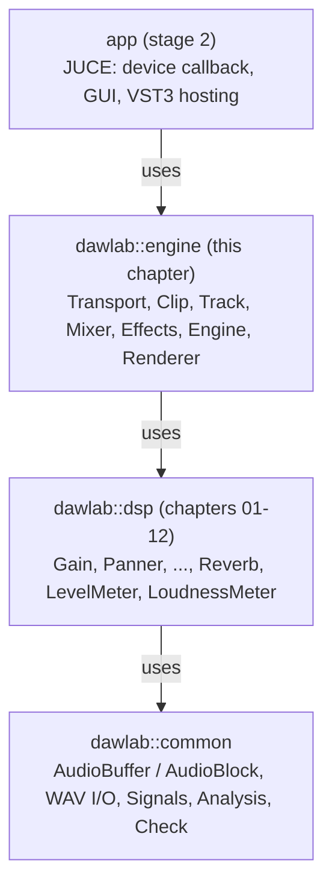

# Step 1 - Project skeleton and AudioBlock plumbing

**English** | [繁體中文](step-01-skeleton.zh-TW.md)

[Back to the chapter overview](../README.md) | Next: [Step 2 - Transport](step-02-transport.md)

## Goal

Create the engine as a library that has nothing to do with JUCE, and make the smallest possible
program that pushes audio through it the way a sound card would: call
`Engine::processBlock(AudioBlock)` again and again, 512 samples at a time.

## Design

### Why a separate engine library?

A DAW has two very different halves:

| | Engine | Application |
|---|---|---|
| runs on | the audio thread (and setup code) | the message / UI thread |
| must be | real-time safe, deterministic | responsive, pretty |
| depends on | the C++ standard library + our DSP | JUCE (windows, audio devices, VST3) |
| can be tested | offline, from a console program | mostly by hand |

If the engine includes JUCE, every test needs JUCE, every bug hunt starts a GUI, and the
temptation to call a GUI function from the audio thread is one `#include` away. So the engine is a
header-only CMake `INTERFACE` library that only links `dawlab::dsp` (chapters 01-12, which link
`dawlab::common`):



### The audio callback contract

Every audio API (WASAPI, ASIO, CoreAudio, JACK, a plugin host) ends up calling a function like

```cpp
void callback(float* const* channels, int numChannels, int numSamples); // fill these buffers
```

with a block size it chooses. Our `AudioBlock` (from `common/`) is exactly that: a non-owning view
of `float* const*` + channel count + sample count. So the engine's entry point is

```cpp
void Engine::processBlock(AudioBlock out) noexcept;   // fills `out`, any size, real-time safe
```

and the JUCE app will wrap the device's pointer array in an `AudioBlock` without copying.

### Fixed sizes

The engine has a fixed shape: in Step 1 that is just "stereo" (`kNumChannels = 2`) and the
`maxBlockSize` given to `prepare()`. Each later step adds its own constant (the number of tracks in
Step 3, of buses in Step 6, ...); the finished engine collects them in `Constants.h`. A fixed shape
means every array can be allocated in `prepare()` and the audio thread never has to grow anything.
(A production DAW has dynamic track counts; it then builds a *new* processing graph on the UI
thread and swaps it in.)

## The code

Step 1 is deliberately tiny. The engine has no transport, no clips, no mixer, no effects yet - it
plays one source buffer (a "tape") from the start. What it does have is the shape every later step
keeps: `prepare()` allocates, `processBlock()` accepts any block size and cuts it into chunks,
`processChunk()` does the work.

### `CMakeLists.txt` (lesson folder)

The finished engine is a header-only `INTERFACE` library:

```cmake
add_library(dawlab_engine INTERFACE)
add_library(dawlab::engine ALIAS dawlab_engine)
target_include_directories(dawlab_engine INTERFACE ${CMAKE_CURRENT_SOURCE_DIR}/engine/include)
target_link_libraries(dawlab_engine INTERFACE dawlab::dsp)
```

The build-along snapshots (`steps/`, see "Your turn" below) need only `dawlab::dsp`. Each step
is one starter and one solution program, registered in `steps/CMakeLists.txt`:

```cmake
dawlab_add_starter(l14_step01_starter   step01-skeleton/starter/step01.cpp)   # build only
dawlab_add_solution(l14_step01_solution step01-skeleton/solution/step01.cpp)  # ctest, label "solution"
```

### `minidaw.h` - the Step 1 engine

```cpp
class Engine {
public:
    void prepare(double sampleRate, int maxBlockSize);           // setup: the only place that may allocate
    void setSource(std::shared_ptr<const AudioBuffer> source);   // setup: the audio to play
    void processBlock(AudioBlock out) noexcept;                  // the audio callback, any block size
    int64_t getPosition() const noexcept;                        // samples played so far
    int64_t getChunksProcessed() const noexcept;
private:
    void processChunk(AudioBlock out) noexcept;                  // one chunk <= maxBlockSize
    double sampleRate_ = 0.0;
    int maxBlockSize_ = 0;
    bool prepared_ = false;
    std::shared_ptr<const AudioBuffer> source_;
    int64_t position_ = 0, chunksProcessed_ = 0;
};
```

`processBlock()` accepts **any** block size. Blocks longer than `maxBlockSize` are cut into
chunks, because every scratch buffer of the later steps will be exactly `maxBlockSize` long:

```cpp
void Engine::processBlock(AudioBlock out) noexcept {
    if (!prepared_) { out.clear(); return; }      // a device may call us before prepare()
    const int total = out.getNumSamples();
    for (int done = 0; done < total;) {
        const int len = std::min(maxBlockSize_, total - done);
        processChunk(out.getSubBlock(done, len));
        done += len;
    }
}

void Engine::processChunk(AudioBlock out) noexcept {
    out.clear();
    // copy source_ samples [position_, position_ + n) into every channel of `out`
    // (a mono source feeds both channels, beyond its end stays silent)
    ...
    position_ += n;
    ++chunksProcessed_;
}
```

`out.getSubBlock(pos, n)` is a view, not a copy - the same trick an offline render uses to imitate
a device: the "device" loop below writes 512-sample sub-blocks of one big buffer.

```cpp
Engine engine;
engine.prepare(48000.0, 512);
engine.setSource(std::make_shared<const AudioBuffer>(makeSine(440.0, 48000.0, 2.0, 0.5f, 1)));
AudioBuffer out(2, total);                            // 2.5 s
for (int pos = 0; pos < total; pos += 512)
    engine.processBlock(out.toBlock().getSubBlock(pos, std::min(512, total - pos)));
```

In the finished engine (`engine/include/dawlab/engine/Engine.h`) `processBlock()` is the same
function, and `processChunk()` has grown one line per step; you will add those lines yourself in
Steps 2, 7, 8 and 9.

## Your turn

| | |
|---|---|
| You write | `Engine::processBlock()` (not prepared -> silence; cut into chunks) and `Engine::processChunk()` (copy the source, mono -> both channels, advance the position) |
| File | `steps/step01-skeleton/starter/step01.cpp` (the class is in `steps/step01-skeleton/minidaw.h`) |
| Build | `.\scripts\build.ps1 -Only 14-daw-8track -NoTest`, then `cd build; .\bin\Debug\l14_step01_starter.exe` |
| Check | the starter prints `[FAIL] l14_step01 (10 of 16 checks failed)` until you are done; the worked solution is `steps/step01-skeleton/solution/step01.cpp` (ctest `l14_step01_solution`) |

What the check tests: an unprepared engine outputs silence; 2.5 s in 512-sample callbacks are
235 calls; the output equals the source sample for sample on both channels and is silent after
it; one single 120 000-sample callback is cut into the same 235 chunks and gives identical audio;
callback sizes 441, 1000 and 7 do too. Expected output when your code is right (verified):

```
Step 1: the engine skeleton (build-along)
  unprepared engine output peak : 0.0000 (expected 0)
  processBlock() calls          : 235 (expected 235)
  output peak                   : 0.5000 (expected 0.5000: no mixer yet, no pan law)
  max |output - source|         : 0 (expected 0, both channels)
  peak after the source ends    : 0 (expected 0)
  position at the end           : 120000 samples (expected 120000)
  one 120000-sample callback    : 235 chunks (expected 235), max difference to the 512 render 0
  wrote dawlab_output/l14_step01.wav
[PASS] l14_step01 (16 checks passed)
```

- 2.5 s x 48 000 / 512 = 234.4, so 235 calls (the last block is 192 samples).
- The sine has peak 0.5 (-6.02 dBFS) and nothing changes it yet.
- Listen to `dawlab_output/l14_step01.wav`: 2 s of A4, then 0.5 s of silence.

## Verify (reference route)

`examples/hello_engine.cpp` (`l14_hello_engine`) runs the same 512-sample device loop through the
*finished* engine. That engine already contains everything of Steps 2-9, so the example puts the
sine on a track instead of a tape:

```powershell
.\scripts\build.ps1 -Only 14-daw-8track -TestLabel example
cd build; .\bin\Debug\l14_hello_engine.exe
```

```
Step 1: hello engine
  processBlock() calls         : 235 (expected 235)
  output peak                  : 0.3536 = -9.03 dBFS (expected 0.3536 = -9.03 dBFS)
  transport position at the end: 120000 samples = 2.500 s
  wrote dawlab_output/l14_hello_engine.wav
[PASS] l14_hello_engine (3 checks passed)
```

The same 235 calls; the peak is 3.01 dB lower than in your Step 1 engine because a track pans its
signal to the centre with the constant-power law ($`\cos(\pi/4) = 0.7071`$ per side) - you will
build that in Step 4.

## What you learned

- The engine is a JUCE-free library with a single real-time entry point,
  `processBlock(AudioBlock)`.
- `prepare()` is the only place that allocates; the engine shape is fixed so nothing has to grow.
- `processBlock()` accepts any block size by cutting it into chunks of at most `maxBlockSize`.
- An offline render is the same `processBlock()` loop writing into sub-blocks of a big buffer.
