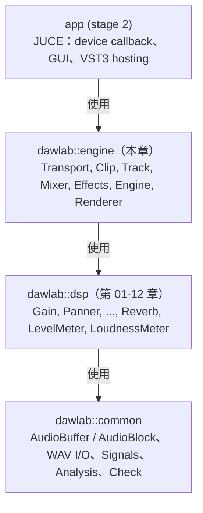

# Step 1 - 專案骨架與 AudioBlock 管線

[English](step-01-skeleton.md) | **繁體中文**

[回到本章總覽](../README.zh-TW.md) | 下一步：[Step 2 - Transport](step-02-transport.zh-TW.md)

## 目標

建立一個與 JUCE 無關的 engine library，並寫出最小的程式，讓音訊像經過音效卡一樣流過它：
一次又一次地呼叫
`Engine::processBlock(AudioBlock)`，每次 512 個 sample。

## 設計

### 為什麼要有獨立的 engine library？

DAW 有兩個截然不同的半邊：

<div align="center">

| | Engine | Application |
|---|---|---|
| 執行於 | audio thread（以及 setup 程式碼） | message / UI thread |
| 必須 | real-time safe、deterministic | 反應靈敏、好看 |
| 依賴 | C++ 標準函式庫 + 我們的 DSP | JUCE（視窗、audio device、VST3） |
| 可以被測試 | offline，從 console 程式 | 多半靠手動 |

</div>

如果 engine include 了 JUCE，每個測試都需要 JUCE，每次找 bug 都得啟動 GUI，而從 audio thread
呼叫 GUI 函式的誘惑，也只差一個 `#include`。所以 engine 是一個
header-only 的 CMake `INTERFACE` library，只 link `dawlab::dsp`（第 01-12 章，它們 link
`dawlab::common`）：



### Audio callback 的契約

每一種 audio API（WASAPI、ASIO、CoreAudio、JACK、plugin host）最終都會呼叫類似下面的函式

```cpp
void callback(float* const* channels, int numChannels, int numSamples); // fill these buffers
```

block size 由它自己決定。我們的 `AudioBlock`（來自 `common/`）正是如此：它是對
`float* const*` + channel 數 + sample 數的非擁有式 view。所以 engine 的入口是

```cpp
void Engine::processBlock(AudioBlock out) noexcept;   // fills `out`, any size, real-time safe
```

JUCE app 會把 device 的 pointer 陣列包進 `AudioBlock`，不經複製。

### 固定大小

engine 的形狀是固定的：在 Step 1，那只是「stereo」（`kNumChannels = 2`）以及交給 `prepare()` 的
`maxBlockSize`。之後每個 step 會加入自己的常數（Step 3 的 track 數、
Step 6 的 bus 數、……）；完成版的 engine 把它們集中在 `Constants.h`。固定的形狀
代表每個陣列都能在 `prepare()` 中配置，audio thread 永遠不必擴充任何東西。
（正式的 DAW 有動態的 track 數量；那時它會在 UI thread 上建立一個*新的*處理 graph，再交換進去。）

## 程式碼

Step 1 刻意做得很小。engine 還沒有 transport、沒有 clip、沒有 mixer、沒有 effect - 它
從頭播放一個 source buffer（一捲「磁帶」）。它確實擁有的，是之後每個 step 都保留的形狀：`prepare()` 負責配置，
`processBlock()` 接受任何 block size 並把它切成 chunk，
`processChunk()` 負責實際工作。

### `CMakeLists.txt`（lesson 資料夾）

完成版的 engine 是一個 header-only 的 `INTERFACE` library：

```cmake
add_library(dawlab_engine INTERFACE)
add_library(dawlab::engine ALIAS dawlab_engine)
target_include_directories(dawlab_engine INTERFACE ${CMAKE_CURRENT_SOURCE_DIR}/engine/include)
target_link_libraries(dawlab_engine INTERFACE dawlab::dsp)
```

跟著做的 snapshot（`steps/`，見下方「Your turn」）只需要 `dawlab::dsp`。每個 step
是一支 starter 與一支 solution 程式，登錄在 `steps/CMakeLists.txt`：

```cmake
dawlab_add_starter(l14_step01_starter   step01-skeleton/starter/step01.cpp)   # build only
dawlab_add_solution(l14_step01_solution step01-skeleton/solution/step01.cpp)  # ctest, label "solution"
```

### `minidaw.h` - Step 1 的 engine

```cpp
class Engine {
public:
    void prepare(double sampleRate, int maxBlockSize);           // setup: the only place that may allocate
    void setSource(std::shared_ptr<const AudioBuffer> source);   // setup: the audio to play
    void processBlock(AudioBlock out) noexcept;                  // the audio callback, any block size
    int64_t getPosition() const noexcept;                        // samples played so far
    int64_t getChunksProcessed() const noexcept;
private:
    void processChunk(AudioBlock out) noexcept;                  // one chunk <= maxBlockSize
    double sampleRate_ = 0.0;
    int maxBlockSize_ = 0;
    bool prepared_ = false;
    std::shared_ptr<const AudioBuffer> source_;
    int64_t position_ = 0, chunksProcessed_ = 0;
};
```

`processBlock()` 接受**任何** block size。比 `maxBlockSize` 長的 block 會被切成
chunk，因為之後各 step 的每個 scratch buffer 長度都會恰好是 `maxBlockSize`：

```cpp
void Engine::processBlock(AudioBlock out) noexcept {
    if (!prepared_) { out.clear(); return; }      // a device may call us before prepare()
    const int total = out.getNumSamples();
    for (int done = 0; done < total;) {
        const int len = std::min(maxBlockSize_, total - done);
        processChunk(out.getSubBlock(done, len));
        done += len;
    }
}

void Engine::processChunk(AudioBlock out) noexcept {
    out.clear();
    // copy source_ samples [position_, position_ + n) into every channel of `out`
    // (a mono source feeds both channels, beyond its end stays silent)
    ...
    position_ += n;
    ++chunksProcessed_;
}
```

`out.getSubBlock(pos, n)` 是 view，不是複製 - offline render 模仿 device 用的也是同一招：
下面的「device」迴圈會寫入一個大 buffer 的 512-sample sub-block。

```cpp
Engine engine;
engine.prepare(48000.0, 512);
engine.setSource(std::make_shared<const AudioBuffer>(makeSine(440.0, 48000.0, 2.0, 0.5f, 1)));
AudioBuffer out(2, total);                            // 2.5 s
for (int pos = 0; pos < total; pos += 512)
    engine.processBlock(out.toBlock().getSubBlock(pos, std::min(512, total - pos)));
```

在完成版的 engine（`engine/include/dawlab/engine/Engine.h`）中，`processBlock()` 是同一個
函式，而 `processChunk()` 每個 step 會多長出一行；你會在
Step 2、7、8 與 9 自己加上那些行。

## Your turn

<div align="center">

| | |
|---|---|
| 你要寫的 | `Engine::processBlock()`（未 prepare -> 靜音；切成 chunk）與 `Engine::processChunk()`（複製 source、mono -> 兩個 channel、推進 position） |
| 檔案 | `steps/step01-skeleton/starter/step01.cpp`（class 在 `steps/step01-skeleton/minidaw.h`） |
| Build | `.\scripts\build.ps1 -Only 14-daw-8track -NoTest`，然後 `cd build; .\bin\Debug\l14_step01_starter.exe` |
| 檢查 | 在你完成之前，starter 會印出 `[FAIL] l14_step01 (10 of 16 checks failed)`；示範解答是 `steps/step01-skeleton/solution/step01.cpp`（ctest `l14_step01_solution`） |

</div>

這個檢查測試的是：未 prepare 的 engine 輸出靜音；以 512-sample 的 callback 處理 2.5 秒
需要 235 次呼叫；輸出在兩個 channel 上與 source 逐 sample 相等，並在 source 結束後保持靜音；
一次 120 000-sample 的 callback 會被切成同樣的 235 個 chunk，並得到相同的音訊；
441、1000 與 7 的 callback 大小也一樣。當你的程式碼正確時，預期輸出如下（已驗證）：

```
Step 1: the engine skeleton (build-along)
  unprepared engine output peak : 0.0000 (expected 0)
  processBlock() calls          : 235 (expected 235)
  output peak                   : 0.5000 (expected 0.5000: no mixer yet, no pan law)
  max |output - source|         : 0 (expected 0, both channels)
  peak after the source ends    : 0 (expected 0)
  position at the end           : 120000 samples (expected 120000)
  one 120000-sample callback    : 235 chunks (expected 235), max difference to the 512 render 0
  wrote dawlab_output/l14_step01.wav
[PASS] l14_step01 (16 checks passed)
```

- 2.5 s x 48 000 / 512 = 234.4，所以是 235 次呼叫（最後一個 block 是 192 個 sample）。
- 這個 sine 的 peak 是 0.5（-6.02 dBFS），目前還沒有任何東西改變它。
- 聽聽看 `dawlab_output/l14_step01.wav`：2 秒的 A4，接著 0.5 秒的靜音。

## Verify（參考路線）

`examples/hello_engine.cpp`（`l14_hello_engine`）透過*完成版*的 engine 執行同樣的 512-sample device 迴圈。
那個 engine 已經包含 Step 2-9 的所有東西，所以這個 example 把 sine 放在
track 上，而不是磁帶上：

```powershell
.\scripts\build.ps1 -Only 14-daw-8track -TestLabel example
cd build; .\bin\Debug\l14_hello_engine.exe
```

```
Step 1: hello engine
  processBlock() calls         : 235 (expected 235)
  output peak                  : 0.3536 = -9.03 dBFS (expected 0.3536 = -9.03 dBFS)
  transport position at the end: 120000 samples = 2.500 s
  wrote dawlab_output/l14_hello_engine.wav
[PASS] l14_hello_engine (3 checks passed)
```

同樣是 235 次呼叫；peak 比你的 Step 1 engine 低 3.01 dB，因為 track 會用 constant-power law
把它的訊號 pan 到中央（每側 $`\cos(\pi/4) = 0.7071`$）- 你會在
Step 4 親手做出來。

## 你學到了什麼

- engine 是一個不含 JUCE 的 library，只有單一個 real-time 入口，
  `processBlock(AudioBlock)`。
- `prepare()` 是唯一會配置記憶體的地方；engine 的形狀是固定的，所以沒有東西需要擴充。
- `processBlock()` 把 block 切成最大為 `maxBlockSize` 的 chunk，藉此接受任何 block size。
- offline render 就是同一個 `processBlock()` 迴圈，寫入一個大 buffer 的 sub-block。
