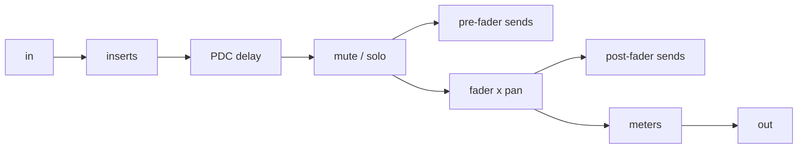
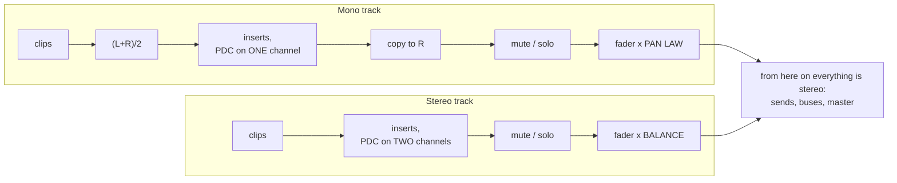

# Step 4 - The 8-track mixer: fader, pan, mute, solo, master, meters

**English** | [繁體中文](step-04-mixer.zh-TW.md)

[Overview](../README.md) | Previous: [Step 3](step-03-clips.md) | Next: [Step 5 - Inserts](step-05-insert-effects.md)

## Goal

Turn eight tracks into a mix: each track gets a channel strip (fader, pan, mute, solo, meters),
the strips are summed into a master strip, and every parameter can be moved from the UI while
playing without clicks.

## Design

### One strip class for everything

Tracks, FX buses and the master all need the same things - inserts, a fader, a pan or balance
control, mute, meters - so they are all `ChannelStrip`s. A `Track` is a `ChannelStrip` that also
reads clips. The strip's processing order (Steps 4-8 together):



### Fader and pan are one gain per side

$$
g_L = 10^{\text{dB}/20}\cdot p_L, \qquad g_R = 10^{\text{dB}/20}\cdot p_R
$$

With the constant-power law (chapter 01, `dsp::Panner::computeGains`):
$`\theta = \frac{\pi}{4}(p + 1)`$, $`p_L = \cos\theta`$, $`p_R = \sin\theta`$, so $`p_L^2 + p_R^2 = 1`$:
a source keeps the same perceived loudness wherever you pan it. The price is -3.01 dB at the centre.
The linear law ($`p_L = (1-p)/2`$) has -6.02 dB at the centre and a loudness dip; the -4.5 dB law is
the geometric mean of the two.

| pan law | centre gain per side | total power at the centre ($`p_L^2 + p_R^2`$) | mono sum at the centre ($`p_L + p_R`$) |
|---|---|---|---|
| Linear | 0.5 (-6.02 dB) | 0.5 (-3.01 dB: quieter in the middle) | 1 (0 dB) |
| ConstantPower (default) | 0.7071 (-3.01 dB) | 1 (0 dB: constant) | 1.414 (+3.01 dB) |
| Minus4_5dB | 0.5946 (-4.52 dB) | 0.707 (-1.5 dB) | 1.189 (+1.5 dB) |

(At $`p = \pm 1`$ every law gives 1 on one side and 0 on the other.) No law is right for both stereo
playback (where power adds) and mono playback (where amplitudes add); -4.5 dB splits the
difference.

Buses and the master are stereo strips; for them a "pan" is a **balance** control: centre = unity,
$`p_L = \min(1, 1-p)`$, $`p_R = \min(1, 1+p)`$ (`PanMode::Balance`). A master at its default must not
drop the mix by 3 dB.

### Mono and stereo tracks

Which of the two a *track* uses depends on its **format**, like the mono and stereo audio tracks
of Cubase (`enum class TrackFormat { Mono, Stereo }` in `Track.h`):



- A **mono track** carries one signal. The clips are folded to $`(L+R)/2`$ (exact for a mono file,
  which the loader stores as L = R), the inserts and the PDC delay run on a one-channel block
  (`tb.getChannelSubset(0, 1)`), and the channel is copied to the right side. The pan control then
  *positions* the mono source with the pan law: centre = -3.01 dB per side, hard left = L only.
- A **stereo track** already has an image. Its inserts run on both channels and the pan control is
  a balance: centre = unity on both sides, turning right only lowers the left side, L != R is kept.
- `Track::setFormat(f)` also selects the pan mode that belongs to the format (Mono ->
  `PanMode::PanLaw`, Stereo -> `PanMode::Balance`); `setPanMode()` can still override it
  afterwards. The default is Mono, which is what every track was before formats existed.
  `getNumProcessingChannels()` gives 1 or 2.

Consequence worth remembering: the **same mono file is 3.01 dB louder at the centre on a stereo
track** (balance: x1) than on a mono track (pan law: x0.7071). That is why the demo song's Pad, Wind
and Hits faders went 3 dB down when those tracks became stereo (Step 9).

Buses and the master stay `Balance` and have no format: they always receive a stereo mix (track
sums, reverb and delay returns), and a pan law there would drop everything by 3 dB at the centre
and fold nothing useful. Why the pan law and the balance control are two different things - and why
"mono source panned" and "stereo source balanced" are different operations - is the theory part of
[chapter 01](../../01-gain/README.md); this chapter only wires it into the mixer.

### Smoothing: no zipper noise, no clicks

The UI writes the fader value to an atomic. Once per block the audio thread computes the target
gains and hands them to two `dsp::SmoothedValue`s (chapter 01) with a 50 ms linear ramp, which are
advanced **per sample**. A jump from 0 dB to -20 dB therefore becomes a 2400-sample ramp; the test
checks that no sample-to-sample step exceeds 0.001. After a `reset()` (e.g. at the start of a
bounce) the smoothers *snap* to their targets, so a render starts at the right level instead of
fading in.

### Mute and solo

$$
\text{audible}_t = \lnot\,\text{mute}_t \ \land\ \big(\lnot\,\text{anySolo} \ \lor\ \text{solo}_t\big)
$$

- solo on several tracks: all of them are heard;
- mute wins over solo on the same track;
- a soloed but muted track is silent, and still silences the others (it is soloed);
- buses and the master ignore solo ("solo safe") - see Step 6 for why.

The result drives a third smoother (10 ms) that multiplies the signal - a hard on/off would click.

### Summing and headroom

The master input is the plain sum of the track outputs (plus bus returns). Coherent signals add in
amplitude (two identical tracks: +6.02 dB), independent ones in power (+3.01 dB). With eight tracks
near full scale the sum can exceed 0 dBFS by a lot; floating point does not care, but the
converter does - hence faders below 0 dB and a limiter on the master (Step 9's song).

### Meters

Each strip feeds its output into chapter 11's `dsp::LevelMeter` (ballistic peak with hold, 300 ms
RMS) and `dsp::LoudnessMeter` (BS.1770 momentary / short-term / integrated LUFS), whose getters are
atomics a UI can poll. For offline reports the strip also keeps exact statistics since the last
reset - the highest $`|x|`$ and the RMS over all samples - available as `StripStats`.

## The code

### `ChannelStrip.h`

| Section | Highlights |
|---|---|
| parameters (any thread) | `setGainDb` (clamped to [-100, +12] dB), `setPan`, `setPanLaw`, `setPanMode`, `setMute`, `setSolo`, sends (Step 6) |
| `computeStripGains(db, pan, law, mode, L, R)` | the formula above, static so tests and exercises can use it |
| `beginBlock(audible)` | atomics -> smoother targets; snaps after `reset()` |
| `processInserts` / `applyMuteSolo` / `applyFaderAndPan` / `addSend` / `meter` | the stages, called by the Mixer in order |
| meters | `getPeakDb(ch)`, `getRmsDb(ch)`, `getMomentaryLufs()`, `getIntegratedLufs()`, `getStats()` |

### `Mixer.h`

```cpp
for (auto& track : tracks_) {
    tb.clear();
    track.renderClips(tb, segments, numSegments);                 // Step 3
    track.beginBlock(!track.isMuted() && (!anySolo || track.isSoloed()));
    track.getInserts().setPlayHead(playHead);                     // Step 5
    if (track.getFormat() == TrackFormat::Mono) {                 // see "Mono and stereo tracks"
        fold tb to (L+R)/2 in channel 0;
        track.processInserts(tb.getChannelSubset(0, 1));          // Steps 5 + 8, one channel
        copy channel 0 to channel 1;
    } else {
        track.processInserts(tb);                                 // Steps 5 + 8, two channels
    }
    track.applyMuteSolo(tb);
    ... pre-fader sends ...                                       // Step 6
    track.applyFaderAndPan(tb);
    ... post-fader sends ...
    track.meter(tb);
    sum.addFrom(tb);
}
```

Then buses (Step 6) and the master: `beginBlock -> processInserts -> applyMuteSolo ->
applyFaderAndPan -> meter`, and the master buffer is copied to the output block.

All buffers (`scratch_`, `trackSum_`, `masterBuffer_`, `busBuffers_`) are allocated in
`Mixer::prepare()` with `maxBlockSize` samples; `process()` only takes sub-blocks of them.

## Your turn

`steps/step04-mixer/minidaw.h` is your Step 3 engine plus `ChannelStrip` (atomics, the three
smoothers, `beginBlock`, `applyMuteSolo`, `applyFaderAndPan`, a peak meter), `Track` as a strip
with clips, and a `Mixer` with 8 tracks and a master whose `process()` calls `processTrack()` for
every track and then runs the master stages. Not here yet: inserts (Step 5), sends and buses
(Step 6), the LUFS meters of the finished strip.

| | |
|---|---|
| You write | `ChannelStrip::computeStripGains()` (pan law via `dsp::Panner::computeGains`, balance mode, fader gain, $`-\infty`$), `Mixer::isTrackAudible()` (the solo rule), `Mixer::processTrack()` (clips -> `beginBlock` -> mute/solo -> fader x pan -> meter -> sum) |
| File | `steps/step04-mixer/starter/step04.cpp` |
| Run | `l14_step04_starter`; it prints `[FAIL] l14_step04 (21 of 27 checks failed)` until you are done |
| Solution | `steps/step04-mixer/solution/step04.cpp` (ctest `l14_step04_solution`) |

Expected output (verified) - the same numbers as the table below, from DC clips:

```
Step 4: the mixer (build-along)
  fader -6 dB, pan +0.5         : L 0.1918 (-14.34 dB), R 0.4630 (-6.69 dB)   (expected 0.1918, 0.4630)
  DC 0.5, fader 0 dB, centre     : 0.3536 (expected 0.3536)
  pan hard left                  : L 0.5000, R 0.0000 (expected 0.5, 0)
  Minus4_5dB law, centre         : -4.52 dB relative to the clip (expected -4.52)
  mute 1 / solo 2 / solo both / + mute 2: 0.1768 0.1768 0.5303 0.3536 (expected 0.1768 0.1768 0.5303 0.3536)
  fader 0 -> -20 dB while playing: max step 0.000133 (expected < 0.001), settles at 0.03536 (expected 0.03536)
[PASS] l14_step04 (27 checks passed)
```

It also checks the linear law, the master fader, the master's balance control and that a fader at
the bottom (-100 dB) means silence, not $`10^{-5}`$.

## Verify (reference route)

`l14_test_mixer` renders constant ("DC") clips, so every gain is visible as a sample value
(all checks verified):

| case | expected `out_L` |
|---|---|
| DC 0.5, fader 0 dB, centre | 0.5 x 0.7071 = 0.3536 |
| fader -6.02 dB | 0.25 x 0.7071 |
| pan hard left | L = 0.5, R = 0 |
| Linear law, centre | 0.25 |
| Minus4_5dB law, centre | -4.515 dB relative to 0.5 |
| master fader -6.02 dB | 0.5 x 0.7071 x 0.5 |
| master balance hard right | L = 0, R unchanged |
| two tracks (0.5, 0.25), mute track 1 | 0.25 x 0.7071 |
| solo track 2 | 0.25 x 0.7071 |
| solo both, then mute track 2 | 0.75 x 0.7071, then 0.5 x 0.7071 |
| fader 0 -> -20 dB while playing | max step < 0.001, settles at 0.7071 x 0.1 |

`l14_test_track_format` checks the formats with a stereo clip L = 0.6, R = 0.2 (verified):

| case | expected `out_L`, `out_R` |
|---|---|
| mono track, centre | both 0.4 x 0.7071 (folded, pan law) |
| mono track, pan hard right | 0, 0.4 |
| stereo track, centre | 0.6, 0.2 (balance: unity, image kept) |
| stereo track, balance +0.5 | 0.3, 0.2 |
| a mono file (L = R = 0.5), stereo vs mono track | +3.01 dB |

The build-along `minidaw.h` has no formats: its tracks behave like mono-format tracks fed with
stereo audio (pan law, no fold). [Exercise 14](../exercises/README.md)
has you write the format-dependent part of a track yourself.

## What you learned

- One strip class serves tracks, buses and master; its processing order is the mixer's design.
- Fader and pan collapse into one smoothed gain per side; pan laws trade centre level against
  constant loudness; stereo buses use balance.
- A track has a format: a mono track folds to one channel, runs its inserts in mono and is placed
  with the pan law; a stereo track keeps its image and pans as balance.
- Solo is a property of the whole mixer, not of a track.
- Every parameter change is a ramp, and every meter value is an atomic the UI can read.
