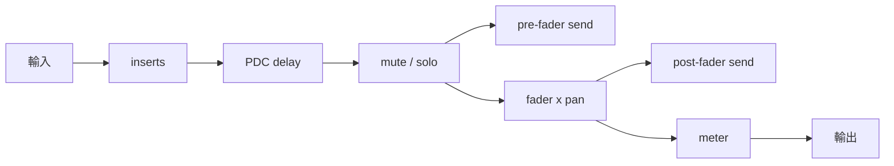
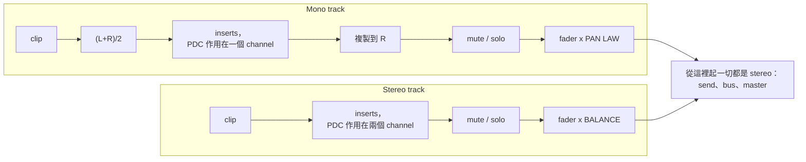

# Step 4 - 8 軌 mixer：fader、pan、mute、solo、master、meter

[English](step-04-mixer.md) | **繁體中文**

[總覽](../README.zh-TW.md) | 上一步：[Step 3](step-03-clips.zh-TW.md) | 下一步：[Step 5 - Inserts](step-05-insert-effects.zh-TW.md)

## 目標

把八個 track 變成一個 mix：每個 track 都有一個 channel strip（fader、pan、mute、solo、meter），
這些 strip 會被加總到 master strip，而且每個參數都能在播放時從 UI 移動，
而不產生 click。

## 設計

### 一個 strip class 通用於所有東西

Track、FX bus 與 master 都需要同樣的東西 - insert、fader、pan 或 balance
控制、mute、meter - 所以它們全都是 `ChannelStrip`。`Track` 是一個同時
會讀取 clip 的 `ChannelStrip`。strip 的處理順序（Step 4-8 合起來）：



### Fader 與 pan 是每一側各一個 gain

```math
g_L = 10^{\text{dB}/20}\cdot p_L, \qquad g_R = 10^{\text{dB}/20}\cdot p_R
```

使用 constant-power law（第 01 章，`dsp::Panner::computeGains`）時：
$`\theta = \frac{\pi}{4}(p + 1)`$，$`p_L = \cos\theta`$，$`p_R = \sin\theta`$，所以 $`p_L^2 + p_R^2 = 1`$：
無論你把 source pan 到哪裡，它都保持相同的感知響度。代價是中央會有 -3.01 dB。
linear law（$`p_L = (1-p)/2`$）在中央是 -6.02 dB，並且響度會凹下去；-4.5 dB law 則是
兩者的幾何平均。

| pan law | 中央每側的 gain | 中央的總功率（$`p_L^2 + p_R^2`$） | 中央的 mono 加總（$`p_L + p_R`$） |
|---|---|---|---|
| Linear | 0.5 (-6.02 dB) | 0.5 (-3.01 dB：中間較小聲) | 1 (0 dB) |
| ConstantPower（預設） | 0.7071 (-3.01 dB) | 1 (0 dB：維持恆定) | 1.414 (+3.01 dB) |
| Minus4_5dB | 0.5946 (-4.52 dB) | 0.707 (-1.5 dB) | 1.189 (+1.5 dB) |

（在 $`p = \pm 1`$ 時，每種 law 都是一側為 1、另一側為 0。）沒有任何一種 law 能同時適用於 stereo
播放（功率相加）與 mono 播放（振幅相加）；-4.5 dB 是兩者的折衷。

Bus 與 master 是 stereo strip；對它們而言，「pan」是 **balance** 控制：中央 = unity，
$`p_L = \min(1, 1-p)`$，$`p_R = \min(1, 1+p)`$（`PanMode::Balance`）。預設狀態的 master 不能
讓 mix 掉 3 dB。

### Mono 與 stereo track

*Track* 用這兩者中的哪一個，由它的 **format** 決定，就像 Cubase 的 mono 與 stereo audio track
（`Track.h` 中的 `enum class TrackFormat { Mono, Stereo }`）：



- **Mono track** 只承載一個訊號。clip 會先 fold 成 $`(L+R)/2`$（對 mono 檔案來說是精確的，因為
  loader 把它存成 L = R），insert 與 PDC delay 在單一 channel 的 block 上執行
  （`tb.getChannelSubset(0, 1)`），然後把這個 channel 複製到右側。接著 pan 控制用 pan law
  *定位* 這個 mono source：中央 = 每側 -3.01 dB，最左 = 只有 L。
- **Stereo track** 本身已經有立體聲像。它的 insert 在兩個 channel 上執行，pan 控制是 balance：
  中央 = 兩側都是 unity，往右轉只會降低左側，L != R 會被保留。
- `Track::setFormat(f)` 也會選擇與 format 對應的 pan mode（Mono -> `PanMode::PanLaw`，
  Stereo -> `PanMode::Balance`）；之後仍可用 `setPanMode()` 覆寫。預設是 Mono，也就是
  format 出現之前每個 track 的行為。`getNumProcessingChannels()` 回傳 1 或 2。

值得記住的結果：**同一個 mono 檔案放在 stereo track 上，中央會比放在 mono track 上大聲 3.01 dB**
（balance：x1；pan law：x0.7071）。這就是為什麼 demo song 的 Pad、Wind 與 Hits 變成 stereo track
之後，它們的 fader 都降了 3 dB（Step 9）。

Bus 與 master 維持 `Balance`，也沒有 format：它們接收的永遠是 stereo mix（track 加總、reverb 與
delay return），在那裡用 pan law 只會讓中央的一切掉 3 dB，fold 也沒有任何好處。pan law 與
balance 控制為什麼是兩回事，以及「pan 一個 mono source」與「balance 一個 stereo source」為什麼是
不同的運算，是 [第 01 章](../../01-gain/README.zh-TW.md) 的理論部分；本章只是把它接進 mixer。

### Smoothing：沒有 zipper noise，沒有 click

UI 把 fader 的值寫入 atomic。audio thread 每個 block 計算一次目標
gain，並交給兩個 `dsp::SmoothedValue`（第 01 章），以 50 ms 的線性 ramp，並且
**逐 sample** 推進。因此從 0 dB 跳到 -20 dB 會變成一段 2400-sample 的 ramp；測試
檢查沒有任何 sample 與 sample 之間的階躍超過 0.001。在 `reset()` 之後（例如在
bounce 開始時），smoother 會 *snap* 到它們的目標，所以 render 會從正確的音量開始，而不是
fade in。

### Mute 與 solo

```math
\text{audible}_t = \lnot\,\text{mute}_t \ \land\ \big(\lnot\,\text{anySolo} \ \lor\ \text{solo}_t\big)
```

- 多個 track 同時 solo：全部都會被聽到；
- 同一個 track 上，mute 優先於 solo；
- 被 solo 但也被 mute 的 track 是靜音的，而且仍會讓其他 track 靜音（因為它被 solo）；
- bus 與 master 忽略 solo（「solo safe」）- 原因見 Step 6。

結果會驅動第三個 smoother（10 ms），它與訊號相乘 - 生硬的開關會產生 click。

### 加總與 headroom

master 的輸入是 track 輸出（加上 bus return）的單純總和。Coherent 訊號以振幅相加
（兩個相同的 track：+6.02 dB），獨立的訊號以功率相加（+3.01 dB）。八個 track 都接近 full scale 時，
總和可能大幅超過 0 dBFS；浮點數不在乎，但
converter 在乎 - 因此要把 fader 放在 0 dB 以下，並在 master 上放一個 limiter（Step 9 的歌曲）。

### Meter

每個 strip 都把它的輸出餵給第 11 章的 `dsp::LevelMeter`（帶 hold 的 ballistic peak、300 ms
RMS）與 `dsp::LoudnessMeter`（BS.1770 的 momentary / short-term / integrated LUFS），它們的 getter 是
UI 可以 poll 的 atomic。為了 offline 報告，strip 也會保留自上次
reset 以來的精確統計值 - 最高的 $`|x|`$ 與所有 sample 的 RMS - 以 `StripStats` 提供。

## 程式碼

### `ChannelStrip.h`

| 區段 | 重點 |
|---|---|
| 參數（任何 thread） | `setGainDb`（clamp 到 [-100, +12] dB）、`setPan`、`setPanLaw`、`setPanMode`、`setMute`、`setSolo`、send（Step 6） |
| `computeStripGains(db, pan, law, mode, L, R)` | 上面的公式，宣告為 static，讓測試與習題可以使用 |
| `beginBlock(audible)` | atomic -> smoother 目標；在 `reset()` 之後 snap |
| `processInserts` / `applyMuteSolo` / `applyFaderAndPan` / `addSend` / `meter` | 各個階段，由 Mixer 依序呼叫 |
| meter | `getPeakDb(ch)`、`getRmsDb(ch)`、`getMomentaryLufs()`、`getIntegratedLufs()`、`getStats()` |

### `Mixer.h`

```cpp
for (auto& track : tracks_) {
    tb.clear();
    track.renderClips(tb, segments, numSegments);                 // Step 3
    track.beginBlock(!track.isMuted() && (!anySolo || track.isSoloed()));
    track.getInserts().setPlayHead(playHead);                     // Step 5
    if (track.getFormat() == TrackFormat::Mono) {                 // see "Mono and stereo tracks"
        fold tb to (L+R)/2 in channel 0;
        track.processInserts(tb.getChannelSubset(0, 1));          // Steps 5 + 8, one channel
        copy channel 0 to channel 1;
    } else {
        track.processInserts(tb);                                 // Steps 5 + 8, two channels
    }
    track.applyMuteSolo(tb);
    ... pre-fader sends ...                                       // Step 6
    track.applyFaderAndPan(tb);
    ... post-fader sends ...
    track.meter(tb);
    sum.addFrom(tb);
}
```

接著是 bus（Step 6）與 master：`beginBlock -> processInserts -> applyMuteSolo ->
applyFaderAndPan -> meter`，然後 master buffer 會被複製到輸出 block。

所有 buffer（`scratch_`、`trackSum_`、`masterBuffer_`、`busBuffers_`）都在
`Mixer::prepare()` 中以 `maxBlockSize` 個 sample 配置；`process()` 只取它們的 sub-block。

## Your turn

`steps/step04-mixer/minidaw.h` 是你的 Step 3 engine 加上 `ChannelStrip`（atomic、三個
smoother、`beginBlock`、`applyMuteSolo`、`applyFaderAndPan`、peak meter）、作為帶 clip 的 strip 的
`Track`，以及一個擁有 8 個 track 與 master 的 `Mixer`，它的 `process()` 對
每個 track 呼叫 `processTrack()`，然後執行 master 的各階段。這裡還沒有的：insert（Step 5）、send 與 bus
（Step 6），以及完成版 strip 的 LUFS meter。

| | |
|---|---|
| 你要寫的 | `ChannelStrip::computeStripGains()`（透過 `dsp::Panner::computeGains` 的 pan law、balance 模式、fader gain、$`-\infty`$）、`Mixer::isTrackAudible()`（solo 規則）、`Mixer::processTrack()`（clip -> `beginBlock` -> mute/solo -> fader x pan -> meter -> sum） |
| 檔案 | `steps/step04-mixer/starter/step04.cpp` |
| 執行 | `l14_step04_starter`；在你完成之前它會印出 `[FAIL] l14_step04 (21 of 27 checks failed)` |
| Solution | `steps/step04-mixer/solution/step04.cpp`（ctest `l14_step04_solution`） |

預期輸出（已驗證）- 與下表相同的數字，來自 DC clip：

```
Step 4: the mixer (build-along)
  fader -6 dB, pan +0.5         : L 0.1918 (-14.34 dB), R 0.4630 (-6.69 dB)   (expected 0.1918, 0.4630)
  DC 0.5, fader 0 dB, centre     : 0.3536 (expected 0.3536)
  pan hard left                  : L 0.5000, R 0.0000 (expected 0.5, 0)
  Minus4_5dB law, centre         : -4.52 dB relative to the clip (expected -4.52)
  mute 1 / solo 2 / solo both / + mute 2: 0.1768 0.1768 0.5303 0.3536 (expected 0.1768 0.1768 0.5303 0.3536)
  fader 0 -> -20 dB while playing: max step 0.000133 (expected < 0.001), settles at 0.03536 (expected 0.03536)
[PASS] l14_step04 (27 checks passed)
```

它也檢查了 linear law、master fader、master 的 balance 控制，以及 fader 在最底部
（-100 dB）代表靜音，而不是 $`10^{-5}`$。

## Verify（參考路線）

`l14_test_mixer` render 的是常數（「DC」）clip，所以每個 gain 都能以 sample 值看見
（所有檢查都已驗證）：

| 情況 | 預期的 `out_L` |
|---|---|
| DC 0.5、fader 0 dB、置中 | 0.5 x 0.7071 = 0.3536 |
| fader -6.02 dB | 0.25 x 0.7071 |
| pan 完全向左 | L = 0.5, R = 0 |
| Linear law、置中 | 0.25 |
| Minus4_5dB law、置中 | 相對於 0.5 為 -4.515 dB |
| master fader -6.02 dB | 0.5 x 0.7071 x 0.5 |
| master balance 完全向右 | L = 0，R 不變 |
| 兩個 track（0.5、0.25），mute track 1 | 0.25 x 0.7071 |
| solo track 2 | 0.25 x 0.7071 |
| 兩者都 solo，然後 mute track 2 | 0.75 x 0.7071，然後 0.5 x 0.7071 |
| 播放時 fader 0 -> -20 dB | 最大階躍 < 0.001，穩定在 0.7071 x 0.1 |

`l14_test_track_format` 用一個 L = 0.6、R = 0.2 的 stereo clip 檢查各種 format（已驗證）：

| 情況 | 預期的 `out_L`、`out_R` |
|---|---|
| mono track、置中 | 兩側都是 0.4 x 0.7071（fold 後套 pan law） |
| mono track、pan 完全向右 | 0、0.4 |
| stereo track、置中 | 0.6、0.2（balance：unity，保留聲像） |
| stereo track、balance +0.5 | 0.3、0.2 |
| mono 檔案（L = R = 0.5），stereo 與 mono track 相比 | +3.01 dB |

build-along 的 `minidaw.h` 沒有 format：它的 track 行為就像餵入 stereo 音訊的 mono-format track
（pan law，不做 fold）。[Exercise 14](../exercises/README.zh-TW.md) 讓你自己寫出 track 中與
format 有關的那一部分。

## 你學到了什麼

- 一個 strip class 服務 track、bus 與 master；它的處理順序就是 mixer 的設計。
- Fader 與 pan 合併成每一側一個經過 smoothing 的 gain；pan law 在中央音量與
  恆定響度之間取捨；stereo bus 使用 balance。
- Track 有 format：mono track fold 成單一 channel、以 mono 執行 insert，並用 pan law 定位；
  stereo track 保留聲像，pan 以 balance 運作。
- Solo 是整個 mixer 的屬性，而不是某個 track 的屬性。
- 每個參數的變更都是一段 ramp，而每個 meter 值都是 UI 可以讀取的 atomic。
