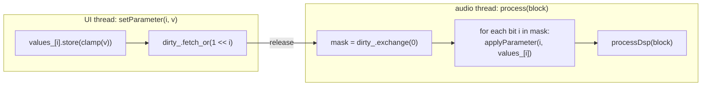

# Step 5 - Insert effects: one interface for nineteen DSP classes

**English** | [繁體中文](step-05-insert-effects.zh-TW.md)

[Overview](../README.md) | Previous: [Step 4](step-04-mixer.md) | Next: [Step 6 - Sends and buses](step-06-sends-buses.md)

## Goal

Let every strip host a chain of up to eight effects, chosen at run time from all the DSP classes of
chapters 01-12 - and describe every effect's parameters in a uniform way so that a UI can build
knobs, a project file can store values, and automation can address them, all without knowing what
a "Compressor" is.

## Design

### The interface

```cpp
class InsertEffect {
public:
    virtual const char* getName() const noexcept = 0;
    virtual void prepare(double sampleRate, int maxBlockSize, int numChannels) = 0; // may allocate
    virtual void reset() noexcept = 0;
    virtual void process(AudioBlock block) noexcept = 0;                            // in place
    virtual int  getLatencySamples() const noexcept { return 0; }                   // Step 8; audio thread
    virtual void setPlayHead(const PlayHead&) noexcept {}                           // timeline info
    virtual void applyPendingParameters() noexcept {}

    virtual int getNumParameters() const noexcept = 0;
    virtual ParameterInfo getParameterInfo(int index) const noexcept = 0;
    virtual float getParameter(int index) const noexcept = 0;
    virtual void  setParameter(int index, float value) noexcept = 0;                // any thread

    virtual bool  hasMeter() const noexcept { return false; }                       // e.g. gain reduction
    virtual float getMeterDb() const noexcept { return 0.0f; }

    void setBypassed(bool) noexcept;  bool isBypassed() const noexcept;             // atomic
    int  findParameter(const char* name) const noexcept;
    bool setParameterByName(const char* name, float value) noexcept;
    float getParameterNormalized(int) const noexcept;  void setParameterNormalized(int, float) noexcept;
    int  getReportedLatencySamples() const noexcept;  void publishLatency() noexcept; // UI copy
};
```

`getLatencySamples()` may compute its answer from DSP state that the audio thread changes (the
limiter's lookahead follows its parameter), so only the audio thread - or setup code before the
effect is handed to the engine - may call it. A UI reads `getReportedLatencySamples()`, an atomic
copy that the audio thread refreshes every block (`publishLatency()`, called by
`InsertChain::applyPendingParameters()`) and the engine sets right after `prepare()`.

This is the same shape as a VST3 / AU / JUCE `AudioProcessor`, reduced to what we need - which is
no accident: chapter 13's hosted VST3 plugins can be wrapped behind the same interface in stage 2.

### Self-describing parameters

```cpp
struct ParameterInfo {
    const char* name;  const char* unit;
    float min, max, defaultValue;
    ParameterKind kind;            // Float, Int, Bool, Choice
    bool logarithmic;              // UI hint: log taper (frequencies, times)
    const char* const* choices;    // labels for Bool / Choice
    int numChoices;
    float clamp(float) const;  float toNormalized(float) const;  float fromNormalized(float) const;
};
```

A knob is a position $`n \in [0, 1]`$. For a linear parameter $`v = v_{\min} + n (v_{\max} - v_{\min})`$.
For frequencies and times equal knob movements should be equal *ratios*, so the log taper is

$$
v = v_{\min}\left(\frac{v_{\max}}{v_{\min}}\right)^{n}, \qquad n = \frac{\ln(v / v_{\min})}{\ln(v_{\max} / v_{\min})}
$$

With 20 Hz .. 20 kHz the knob's middle is $`\sqrt{20 \cdot 20000} = 632`$ Hz instead of 10 kHz.
`clamp()` also rounds Int / Bool / Choice values and replaces NaN with the default - one bad value
from a UI or a corrupt project file can never poison a filter state.

### Getting a knob value to the DSP object without locks

The chapter-01..12 classes are not thread-safe: their setters recompute coefficients that
`process()` reads. So exactly one thread at a time may call them. `EffectBase` solves this with an
atomic value per parameter and a 32-bit "dirty" mask:



Several changes of one parameter between two blocks collapse into one (only the newest value
matters), the UI never blocks, and the DSP object is touched by the audio thread only. Values set
before `prepare()` are stored and pushed into the DSP object by `finishPrepare()`, so "create,
configure, hand over" works in any order. The Mixer calls `applyPendingParameters()` on every chain
*before* computing latencies (Step 8), so changing a limiter's lookahead updates PDC in the same
block.

### Adapters

Each adapter owns one DSP object, a `static constexpr ParameterInfo kInfos[]` table and a
`switch` in `applyParameter()` - nothing else. They call only the methods of the API contract in
`docs/authoring-guide.md` section 5, so they keep working whatever else chapter authors add. A few
notes:

- **ParametricEq**: the contract has `setBand(index, EqBand)` / `getBand(index)`, so each of the
  30 parameters (6 bands x Enabled / Type / Frequency / Q / Gain) is a read-modify-write of one band.
- **Saturation** and **AmpChain**: oversampling must be chosen before `prepare()`; the adapter reads
  its `Oversampling` parameter at the start of `prepare()` (it is a "reload" parameter).
- **Filter** wraps chapter 02's `StateVariableFilter` (TPT SVF): `Type` (Lowpass / Highpass /
  Bandpass / Notch, the order of `dsp::StateVariableFilter::Type`), `Cutoff` (log taper) and
  `Resonance` (the filter's Q, 0.707 = no peak). Unlike a biquad, an SVF can move its cutoff every
  block without clicks - the effect to automate.
- **AmpChain** wraps chapter 07's guitar amp: input highpass, pre-EQ, preamp drive, a
  bass / mid / treble tone stack, power-amp drive and clipping type, speaker cabinet (cutoff,
  resonance), output - 15 parameters.
- **Limiter / Saturation / Distortion / AmpChain / ConvolutionReverb** report latency by *asking*
  the DSP object (AmpChain adds the latencies of its two oversampled stages).
- **ConvolutionReverb** creates a synthetic 1.5 s room IR in `prepare()` unless
  `setImpulseResponse()` was called (non-audio thread, before handing it to the engine).
- **PureDelayEffect** (in `EffectBase.h`) delays by N samples and reports N - the test instrument
  for Step 8.

### The factory

```cpp
enum class EffectType { Gain, ParametricEq, Compressor, ..., ConvolutionReverb, Filter, AmpChain, PureDelay };
const char* effectTypeName(EffectType);                  // "ParametricEQ" == getName()
bool effectTypeFromName(const char*, EffectType&);
std::unique_ptr<InsertEffect> createEffect(EffectType);   // not prepared yet
std::unique_ptr<InsertEffect> createEffect(const char* name);
```

`kNumUserEffectTypes = 19` (everything before `PureDelay`). Filter and AmpChain were added to the
catalog after the demo song of Step 9 was written, so they are appended at the end of the enum:
the indices of the first 17 do not move, and the song (which uses those 17) keeps all its numbers.
A UI's "Add insert" menu offers the 19 user types; a project file stores the name.

### The chain

`InsertChain` is a fixed array of `kMaxInserts = 8` atomic pointers plus an atomic count. It is
processed in order, skips bypassed effects, and sums latencies (effects in series add their
delays). Structural changes are made only by the audio thread (Step 7); the atomics just let the UI
*look* at the chain without a data race.

### Inserts on a mono track

Every effect is prepared for `kNumChannels = 2`, but on a **mono track** (Step 4) the mixer hands
the chain a *one-channel* block: `tb.getChannelSubset(0, 1)` after folding the clips to
$`(L+R)/2`$. The chain and the PDC delay simply process the channels the block has, so
`process()` must work for any channel count up to the prepared one. All nineteen adapters hand the
block to a chapter 01-12 DSP class that processes the channels the block has and never touches one
that is not there; `l14_test_track_format` runs every effect on a one-channel block to make sure. Running in mono also
halves the insert CPU of such a track.

The price: an effect that *creates* stereo has nowhere to put it. A chorus with Stereo Spread, a
stereo delay or a wide reverb produce one channel on a mono track, which is then copied to both
sides - the effect **collapses to mono** (L = R exactly). That is the same trade-off a mono track
makes in Cubase; to keep an effect's width, put the source on a stereo track. The demo song does
exactly that with Hits, a mono source on a stereo track so that its convolution reverb insert stays
wide (Step 9). Hosted VST3 plugins need one more trick, because they were prepared with a stereo
bus layout: see `VstInsert`'s mono fold in [Step 17](step-17-vst3-inserts.md).

## The code

| File | Section |
|---|---|
| `InsertEffect.h` | `ParameterKind`, `ParameterInfo` (+ `formatParameterValue()` for "-18.0 dB" labels), `PlayHead`, `InsertEffect`, `InsertChain` |
| `EffectBase.h` | `EffectBase` (atomics + dirty mask + `finishPrepare`), `PureDelayEffect` |
| `Effects.h` | 19 adapters, `choices::` label tables, `paramFloat/Int/Bool/Choice` helpers, factory |

A complete adapter, as an example of the pattern:

```cpp
class CompressorEffect final : public EffectBase {
public:
    enum Param { Threshold, Ratio, Knee, Attack, Release, Makeup, StereoLink, kCount };
    CompressorEffect() : EffectBase(kInfos, kCount) {}
    const char* getName() const noexcept override { return "Compressor"; }
    void prepare(double sr, int maxBlock, int nch) override { dsp_.prepare(sr, maxBlock, nch); finishPrepare(sr); }
    void reset() noexcept override { dsp_.reset(); }
    bool hasMeter() const noexcept override { return true; }
    float getMeterDb() const noexcept override { return dsp_.getGainReductionDb(); }
protected:
    void applyParameter(int index, float v) noexcept override {
        switch (index) {
        case Threshold: dsp_.setThresholdDb(v); break;
        ...
        }
    }
    void processDsp(AudioBlock block) noexcept override { dsp_.process(block); }
private:
    static constexpr ParameterInfo kInfos[kCount] = {
        paramFloat("Threshold", "dB", -60.0f, 0.0f, -18.0f),
        paramFloat("Ratio", ":1", 1.0f, 20.0f, 4.0f),
        ...
    };
    dsp::Compressor dsp_;
};
```

## Your turn

`steps/step05-insert-effects/minidaw.h` is your Step 4 engine plus `ParameterInfo`,
`InsertEffect`, `EffectBase`, two adapters (`GainEffect`, and `CompressorEffect` around chapter
04's `dsp::Compressor` - the pattern of all 19 adapters in `Effects.h`), a factory
`createEffect("Gain" / "Compressor")` and `InsertChain`. Tracks and the master run their chain;
`Engine::addInsertNow(strip, effect)` prepares an effect and puts it in a strip - setup only, Step 7
turns it into a lock-free command. Latency (`getLatencySamples`) arrives in Step 8.

| | |
|---|---|
| You write | `ParameterInfo::clamp()`, `toNormalized()`, `fromNormalized()` (linear and log taper), `EffectBase::setParameter()` and `applyPendingParameters()` (the atomic values + dirty mask), `InsertChain::process()` (in order, skip bypassed) |
| File | `steps/step05-insert-effects/starter/step05.cpp` |
| Run | `l14_step05_starter`; it prints `[FAIL] l14_step05 (20 of 24 checks failed)` until you are done |
| Solution | `steps/step05-insert-effects/solution/step05.cpp` (ctest `l14_step05_solution`) |

Expected output (verified):

```
Step 5: insert effects (build-along)
  knob centre: Threshold -30.0 dB (linear), Cutoff 632.5 Hz (log, expected 632.5)
  three setParameter() calls on two parameters -> 2 applyParameter() calls (expected 2)
  chain [offset +0.1, gain x2] on 0.2: 0.6000 (expected (0.2 + 0.1) x 2 = 0.6000)
  DC 0.1 with a +6.02 dB Gain insert on track 1: 0.1414 (expected 0.2 x 0.7071 = 0.1414)
  + Compressor on the master (-30 dB, 10:1): 0.0367, gain reduction 11.7 dB
[PASS] l14_step05 (24 checks passed)
```

"Three calls, two applications" is the dirty mask at work: two changes of the same parameter
before a block collapse into one. The order test uses an offset effect before a gain, so a chain
processed in the wrong order would print 0.5. The compressor numbers come from chapter 04's
implementation; the check only requires more than 6 dB of gain reduction.

## Verify (reference route)

`l14_test_effects` (verified) creates every type through the factory and checks: name round trip;
`min < max`, default inside the range, unique names, choices present, log tapers only with
`min > 0`; clamping at both ends; normalized round trip; `formatParameterValue()`; then 2 s of drums
and plucks with **all parameters randomized every fourth block** - no NaN, no inf, no explosion;
latency between 0 and 16 384; silence in -> silence out after a reset. It prints:

```
  Gain                1 params  latency    0 samples
  ParametricEQ       30 params  latency    0 samples
  Compressor          7 params  latency    0 samples  meter
  Limiter             4 params  latency  240 samples  meter
  Saturation          5 params  latency   31 samples
  Distortion          7 params  latency   36 samples
  ...
  ConvolutionReverb   1 params  latency  512 samples
  Filter              3 params  latency    0 samples
  AmpChain           15 params  latency   72 samples
  PureDelay           1 params  latency    0 samples
  Filter vs RBJ biquad: worst difference 0.0000 dB over 9 cases; LP at fc -3.01 dB, notch at fc -228.0 dB
  AmpChain: latency 72 samples at 4x (0 at 1x); 220 Hz at -20 dBFS -> fundamental -9.9 dB, 3rd harmonic -26.5 dB (16.6 dB below), RMS -12.83 dBFS; output -12 -> -18 dB: RMS -6.00 dB
[PASS] l14_test_effects (1486 checks passed)
```

(Saturation's latency depends on the oversampling chosen at its last `prepare()`; the numbers come
from the chapter-05/06/07/12 implementations and may differ slightly if those change.)

The two adapters added last get a measured check as well. **Filter**: the TPT state-variable
filter and chapter 02's RBJ biquads discretise the same analog prototype with the same bilinear
transform, so their magnitude responses must be identical; the test plays sines through the
Filter effect (lowpass, highpass, bandpass and notch, at, below and above the cutoff, Q 0.707 / 2 /
4) and compares the measured gain with `BiquadCoefficients::magnitudeDb()` - within 0.05 dB (it
is 0.0000 dB). **AmpChain**: its latency is the sum of its two oversampled stages (72 samples at
the default 4x, 0 at 1x), a -20 dBFS sine comes out heavily distorted (3rd harmonic only 16.6 dB
below the fundamental), and the Output parameter is a plain gain after the nonlinear stages
(-6 dB on the knob = -6.00 dB RMS).

`l14_effect_catalog` prints the auto-generated "knob list" of every effect and runs each one on the
same 2-second phrase into `l14_effect_catalog.wav` (19 x 2.5 s = 47.5 s). Excerpt (verified):

```
Compressor        latency    0 samples ( 0.00 ms)  out RMS  -23.9 dBFS  peak   -4.2 dBFS  max meter 10.6 dB
    [ 0] Threshold        float         -60 .. 0         default -18.0 dB
    [ 1] Ratio            float           1 .. 20        default 4.00:1
    [ 3] Attack           float         0.1 .. 200       default 10.0 ms      (log)
    [ 6] Stereo Link      bool            0 .. 1         default On
Limiter           latency  240 samples ( 5.00 ms)  out RMS  -11.7 dBFS  peak   -1.0 dBFS  max meter 7.8 dB
Gate              latency    0 samples ( 0.00 ms)  out RMS  -18.9 dBFS  peak   -2.2 dBFS  max meter 80.0 dB
Filter            latency    0 samples ( 0.00 ms)  out RMS  -16.9 dBFS  peak   -3.2 dBFS
    [ 0] Type             choice          0 .. 3         default Lowpass       {Lowpass, Highpass, Bandpass, Notch}
    [ 1] Cutoff           float          20 .. 2e+04     default 1000 Hz      (log)
    [ 2] Resonance        float         0.5 .. 20        default 0.71 Q       (log)
AmpChain          latency   72 samples ( 1.50 ms)  out RMS  -13.8 dBFS  peak   -7.5 dBFS
```

The program checks the numbers it prints (`[PASS] l14_effect_catalog (9 checks passed)`): no NaN;
the Gain effect at 0 dB leaves the RMS unchanged (within 0.01 dB); the Limiter's output peak stays at
or below its -1 dBFS ceiling and its latency is exactly 240 samples (5 ms x 48 kHz); the convolution
reverb reports 512 samples (its partition is the next power of two >= the 512-sample block);
Saturation, Distortion and AmpChain report a non-zero oversampling latency (31, 36 and 72 samples
here; the Filter reports 0) and the other 14 effects report 0; the transient shaper's +9 dB attack raises the peak by more than 6 dB.

`l14_test_track_format` (verified) checks the mono-track side of this step: every one of the 19
effects, prepared for two channels, runs on a one-channel block - finite output, the same latency -
and a chorus with Stereo Spread 1 is exactly mono (L = R) on a mono track but wide on a stereo
track (it also checks the Step 4 pan modes):

```
mono file at the centre: mono track 0.3536, stereo track 0.5000 -> 3.01 dB
19 of 19 effects run on a one-channel block
chorus (spread 1): max |L - R| mono track 0.000000, stereo track 0.3279
[PASS] l14_test_track_format (75 checks passed)
```

Listen to the catalog: each effect should sound like its chapter promised (the order and what to
listen for are in the comment at the top of `examples/effect_catalog.cpp`).

## What you learned

- A small virtual interface plus a parameter *description* turns nineteen unrelated classes into
  interchangeable plugins.
- Knob positions are normalized; frequency-like parameters use a log taper.
- A per-parameter atomic plus a dirty bit mask hands values from any thread to the audio thread
  with no lock and no queue.
- Adapters depend only on the documented API contract and *ask* the DSP object for its latency.
- An insert must accept fewer channels than it was prepared for: on a mono track it gets one, and
  whatever stereo it would create is lost.
