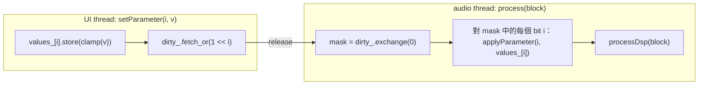

# Step 5 - Insert effect：十九個 DSP class 共用一個 interface

[English](step-05-insert-effects.md) | **繁體中文**

[總覽](../README.zh-TW.md) | 上一步：[Step 4](step-04-mixer.zh-TW.md) | 下一步：[Step 6 - Send 與 bus](step-06-sends-buses.zh-TW.md)

## 目標

讓每個 strip 都能 host 一條最多八個 effect 的 chain，並在 run time 從第 01-12 章的所有 DSP class 中挑選 - 同時以一致的方式描述每個 effect 的參數，讓 UI
能建立旋鈕、專案檔能儲存數值、automation 能定位它們，而這一切都不需要知道
「Compressor」是什麼。

## 設計

### Interface

```cpp
class InsertEffect {
public:
    virtual const char* getName() const noexcept = 0;
    virtual void prepare(double sampleRate, int maxBlockSize, int numChannels) = 0; // may allocate
    virtual void reset() noexcept = 0;
    virtual void process(AudioBlock block) noexcept = 0;                            // in place
    virtual int  getLatencySamples() const noexcept { return 0; }                   // Step 8; audio thread
    virtual void setPlayHead(const PlayHead&) noexcept {}                           // timeline info
    virtual void applyPendingParameters() noexcept {}

    virtual int getNumParameters() const noexcept = 0;
    virtual ParameterInfo getParameterInfo(int index) const noexcept = 0;
    virtual float getParameter(int index) const noexcept = 0;
    virtual void  setParameter(int index, float value) noexcept = 0;                // any thread

    virtual bool  hasMeter() const noexcept { return false; }                       // e.g. gain reduction
    virtual float getMeterDb() const noexcept { return 0.0f; }

    void setBypassed(bool) noexcept;  bool isBypassed() const noexcept;             // atomic
    int  findParameter(const char* name) const noexcept;
    bool setParameterByName(const char* name, float value) noexcept;
    float getParameterNormalized(int) const noexcept;  void setParameterNormalized(int, float) noexcept;
    int  getReportedLatencySamples() const noexcept;  void publishLatency() noexcept; // UI copy
};
```

`getLatencySamples()` 的答案可能是從 audio thread 會改變的 DSP 狀態計算出來的（limiter 的
lookahead 會跟隨它的參數），所以只有 audio thread - 或是在 effect 交給 engine 之前的 setup 程式碼 - 可以呼叫它。UI 讀取的是 `getReportedLatencySamples()`，
這是一份 atomic 複本，由 audio thread 每個 block 更新一次（`publishLatency()`，由
`InsertChain::applyPendingParameters()` 呼叫），engine 則在 `prepare()` 之後立刻設定它。

這和 VST3 / AU / JUCE `AudioProcessor` 的形狀相同，只是縮減成我們需要的部分 - 這並非
巧合：第 13 章被 host 的 VST3 plugin 可以在第 2 階段包在同一個 interface 後面。

### 自我描述的參數

```cpp
struct ParameterInfo {
    const char* name;  const char* unit;
    float min, max, defaultValue;
    ParameterKind kind;            // Float, Int, Bool, Choice
    bool logarithmic;              // UI hint: log taper (frequencies, times)
    const char* const* choices;    // labels for Bool / Choice
    int numChoices;
    float clamp(float) const;  float toNormalized(float) const;  float fromNormalized(float) const;
};
```

旋鈕是一個位置 $`n \in [0, 1]`$。線性參數為 $`v = v_{\min} + n (v_{\max} - v_{\min})`$。
對於頻率與時間，相等的旋鈕移動應該對應相等的*比例*，所以 log taper 為

```math
v = v_{\min}\left(\frac{v_{\max}}{v_{\min}}\right)^{n}, \qquad n = \frac{\ln(v / v_{\min})}{\ln(v_{\max} / v_{\min})}
```

在 20 Hz .. 20 kHz 的範圍內，旋鈕的中間是 $`\sqrt{20 \cdot 20000} = 632`$ Hz，而不是 10 kHz。
`clamp()` 也會把 Int / Bool / Choice 的值四捨五入，並把 NaN 換成預設值 - 來自 UI 或損毀專案檔的
一個壞值，永遠不會污染 filter 的狀態。

### 不用 lock 把旋鈕的值送到 DSP 物件

第 01..12 章的 class 不是 thread-safe 的：它們的 setter 會重新計算 `process()` 讀取的
係數。所以同一時間只能有一條 thread 呼叫它們。`EffectBase` 用每個參數一個
atomic 值，加上一個 32-bit 的「dirty」mask 來解決這個問題：



兩個 block 之間，同一個參數的多次變更會合併成一次（只有最新的值有意義），UI 永遠不會 block，
而 DSP 物件只會被 audio thread 碰觸。在 `prepare()` 之前設定的值會被儲存起來，並由 `finishPrepare()` 推進 DSP 物件，所以「建立、
設定、交接」可以用任何順序進行。Mixer 在計算 latency（Step 8）*之前*，會對每條 chain 呼叫 `applyPendingParameters()`，
所以改變 limiter 的 lookahead 會在同一個 block 就更新 PDC。

### Adapter

每個 adapter 擁有一個 DSP 物件、一個 `static constexpr ParameterInfo kInfos[]` 表，以及
`applyParameter()` 中的一個 `switch` - 沒有別的了。它們只呼叫
`docs/authoring-guide.md` 第 5 節中 API 契約的方法，所以不論章節作者還加了什麼，它們都能繼續運作。幾點
說明：

- **ParametricEq**：契約中有 `setBand(index, EqBand)` / `getBand(index)`，所以
  30 個參數（6 個 band x Enabled / Type / Frequency / Q / Gain）中的每一個，都是對某個 band 的 read-modify-write。
- **Saturation** 與 **AmpChain**：oversampling 必須在 `prepare()` 之前選定；adapter 在 `prepare()` 開頭
  讀取它的 `Oversampling` 參數（這是一個「reload」參數）。
- **Filter** 包裝第 02 章的 `StateVariableFilter`（TPT SVF）：`Type`（Lowpass / Highpass /
  Bandpass / Notch，順序同 `dsp::StateVariableFilter::Type`）、`Cutoff`（log taper）與
  `Resonance`（filter 的 Q，0.707 = 沒有 peak）。和 biquad 不同，SVF 可以在每個
  block 移動 cutoff 而不產生 click - 這正是適合做 automation 的 effect。
- **AmpChain** 包裝第 07 章的吉他音箱：input highpass、pre-EQ、preamp drive、
  bass / mid / treble tone stack、power-amp drive 與 clipping 類型、音箱 cabinet（cutoff、
  resonance）、output - 共 15 個參數。
- **Limiter / Saturation / Distortion / AmpChain / ConvolutionReverb** 透過*詢問*
  DSP 物件來回報 latency（AmpChain 會加上它兩個 oversampled 階段的 latency）。
- **ConvolutionReverb** 會在 `prepare()` 中建立一個合成的 1.5 秒房間 IR，除非
  已呼叫過 `setImpulseResponse()`（在非 audio thread，於交給 engine 之前）。
- **PureDelayEffect**（在 `EffectBase.h` 中）延遲 N 個 sample 並回報 N - 這是 Step 8 的
  測試用樂器。

### Factory

```cpp
enum class EffectType { Gain, ParametricEq, Compressor, ..., ConvolutionReverb, Filter, AmpChain, PureDelay };
const char* effectTypeName(EffectType);                  // "ParametricEQ" == getName()
bool effectTypeFromName(const char*, EffectType&);
std::unique_ptr<InsertEffect> createEffect(EffectType);   // not prepared yet
std::unique_ptr<InsertEffect> createEffect(const char* name);
```

`kNumUserEffectTypes = 19`（`PureDelay` 之前的全部）。Filter 與 AmpChain 是在 Step 9 的 demo song 寫好之後
才加進 catalog 的，所以它們被附加在 enum 的最後：
前 17 個的索引不會移動，而使用那 17 個的歌曲也保有它所有的數字。
UI 的「Add insert」選單提供 19 種使用者類型；專案檔則儲存名稱。

### Chain

`InsertChain` 是一個固定大小的陣列，含 `kMaxInserts = 8` 個 atomic pointer 加上一個 atomic 計數。它
依序處理、略過被 bypass 的 effect，並加總 latency（串聯的 effect 會把它們的
delay 相加）。結構性變更只由 audio thread 進行（Step 7）；atomic 只是讓 UI
能夠*查看* chain 而不產生 data race。

### Mono track 上的 insert

每個 effect 都是以 `kNumChannels = 2` 來 prepare，但在 **mono track**（Step 4）上，mixer 先把 clip
fold 成 $`(L+R)/2`$，再交給 chain 一個*單一 channel* 的 block：`tb.getChannelSubset(0, 1)`。
chain 與 PDC delay 只是處理 block 擁有的那些 channel，所以 `process()` 必須能處理不超過 prepare
時數量的任何 channel 數。十九個 adapter 都把 block 交給第 01-12 章的 DSP class，它們只處理 block
擁有的 channel，從不碰不存在的 channel；`l14_test_track_format` 會把每個 effect 都放在單一 channel 的
block 上執行來確認這一點。以 mono 執行也讓這種 track 的 insert CPU 減半。

代價是：會*產生* stereo 的 effect 沒有地方放它的立體聲。開了 Stereo Spread 的 chorus、stereo delay
或寬廣的 reverb，在 mono track 上只產生一個 channel，接著被複製到兩側 - effect **塌縮成 mono**
（L = R，完全相同）。這和 Cubase 的 mono track 做的取捨一樣；想保留 effect 的寬度，就把 source 放在
stereo track 上。demo song 的 Hits 正是這樣做的：mono source 放在 stereo track 上，讓它的
convolution reverb insert 保持寬廣（Step 9）。被 host 的 VST3 plugin 還需要多一個技巧，因為它們是以
stereo bus layout prepare 的：見 [Step 17](step-17-vst3-inserts.zh-TW.md) 中 `VstInsert` 的 mono fold。

## 程式碼

| 檔案 | 區段 |
|---|---|
| `InsertEffect.h` | `ParameterKind`、`ParameterInfo`（+ 用於 "-18.0 dB" 標籤的 `formatParameterValue()`）、`PlayHead`、`InsertEffect`、`InsertChain` |
| `EffectBase.h` | `EffectBase`（atomic + dirty mask + `finishPrepare`）、`PureDelayEffect` |
| `Effects.h` | 19 個 adapter、`choices::` 標籤表、`paramFloat/Int/Bool/Choice` helper、factory |

一個完整的 adapter，作為這個模式的範例：

```cpp
class CompressorEffect final : public EffectBase {
public:
    enum Param { Threshold, Ratio, Knee, Attack, Release, Makeup, StereoLink, kCount };
    CompressorEffect() : EffectBase(kInfos, kCount) {}
    const char* getName() const noexcept override { return "Compressor"; }
    void prepare(double sr, int maxBlock, int nch) override { dsp_.prepare(sr, maxBlock, nch); finishPrepare(sr); }
    void reset() noexcept override { dsp_.reset(); }
    bool hasMeter() const noexcept override { return true; }
    float getMeterDb() const noexcept override { return dsp_.getGainReductionDb(); }
protected:
    void applyParameter(int index, float v) noexcept override {
        switch (index) {
        case Threshold: dsp_.setThresholdDb(v); break;
        ...
        }
    }
    void processDsp(AudioBlock block) noexcept override { dsp_.process(block); }
private:
    static constexpr ParameterInfo kInfos[kCount] = {
        paramFloat("Threshold", "dB", -60.0f, 0.0f, -18.0f),
        paramFloat("Ratio", ":1", 1.0f, 20.0f, 4.0f),
        ...
    };
    dsp::Compressor dsp_;
};
```

## Your turn

`steps/step05-insert-effects/minidaw.h` 是你的 Step 4 engine 加上 `ParameterInfo`、
`InsertEffect`、`EffectBase`、兩個 adapter（`GainEffect`，以及包裝第
04 章 `dsp::Compressor` 的 `CompressorEffect` - 也就是 `Effects.h` 中全部 19 個 adapter 的模式）、一個 factory
`createEffect("Gain" / "Compressor")` 以及 `InsertChain`。Track 與 master 會執行它們的 chain；
`Engine::addInsertNow(strip, effect)` 會 prepare 一個 effect 並把它放進 strip - 只用於 setup，Step 7
會把它變成 lock-free 的 command。Latency（`getLatencySamples`）會在 Step 8 出現。

| | |
|---|---|
| 你要寫的 | `ParameterInfo::clamp()`、`toNormalized()`、`fromNormalized()`（線性與 log taper）、`EffectBase::setParameter()` 與 `applyPendingParameters()`（atomic 值 + dirty mask）、`InsertChain::process()`（依序、略過被 bypass 的） |
| 檔案 | `steps/step05-insert-effects/starter/step05.cpp` |
| 執行 | `l14_step05_starter`；在你完成之前它會印出 `[FAIL] l14_step05 (20 of 24 checks failed)` |
| Solution | `steps/step05-insert-effects/solution/step05.cpp`（ctest `l14_step05_solution`） |

預期輸出（已驗證）：

```
Step 5: insert effects (build-along)
  knob centre: Threshold -30.0 dB (linear), Cutoff 632.5 Hz (log, expected 632.5)
  three setParameter() calls on two parameters -> 2 applyParameter() calls (expected 2)
  chain [offset +0.1, gain x2] on 0.2: 0.6000 (expected (0.2 + 0.1) x 2 = 0.6000)
  DC 0.1 with a +6.02 dB Gain insert on track 1: 0.1414 (expected 0.2 x 0.7071 = 0.1414)
  + Compressor on the master (-30 dB, 10:1): 0.0367, gain reduction 11.7 dB
[PASS] l14_step05 (24 checks passed)
```

「三次呼叫、兩次套用」就是 dirty mask 在發揮作用：一個 block 之前，對同一個參數的兩次變更會合併成一次。順序測試在 gain 之前使用一個 offset effect，所以如果 chain
以錯誤的順序處理，就會印出 0.5。compressor 的數字來自第 04 章的
實作；這個檢查只要求超過 6 dB 的 gain reduction。

## Verify（參考路線）

`l14_test_effects`（已驗證）透過 factory 建立每一種類型並檢查：名稱往返；
`min < max`、預設值在範圍內、名稱唯一、choices 存在、log taper 只在
`min > 0` 時使用；兩端的 clamping；normalized 往返；`formatParameterValue()`；然後是 2 秒的鼓
與 pluck，並且**每第四個 block 就隨機化所有參數** - 沒有 NaN、沒有 inf、沒有爆炸；
latency 介於 0 與 16 384 之間；靜音輸入 -> reset 之後靜音輸出。它會印出：

```
  Gain                1 params  latency    0 samples
  ParametricEQ       30 params  latency    0 samples
  Compressor          7 params  latency    0 samples  meter
  Limiter             4 params  latency  240 samples  meter
  Saturation          5 params  latency   31 samples
  Distortion          7 params  latency   36 samples
  ...
  ConvolutionReverb   1 params  latency  512 samples
  Filter              3 params  latency    0 samples
  AmpChain           15 params  latency   72 samples
  PureDelay           1 params  latency    0 samples
  Filter vs RBJ biquad: worst difference 0.0000 dB over 9 cases; LP at fc -3.01 dB, notch at fc -228.0 dB
  AmpChain: latency 72 samples at 4x (0 at 1x); 220 Hz at -20 dBFS -> fundamental -9.9 dB, 3rd harmonic -26.5 dB (16.6 dB below), RMS -12.83 dBFS; output -12 -> -18 dB: RMS -6.00 dB
[PASS] l14_test_effects (1486 checks passed)
```

（Saturation 的 latency 取決於它上一次 `prepare()` 時選擇的 oversampling；這些數字來自
第 05/06/07/12 章的實作，如果那些實作改變，數字可能會略有不同。）

最後加入的兩個 adapter 也有量測式的檢查。**Filter**：TPT state-variable
filter 與第 02 章的 RBJ biquad 用同樣的 bilinear transform 把同一個 analog prototype 離散化，
所以它們的 magnitude response 必須完全相同；測試把 sine 送進
Filter effect（lowpass、highpass、bandpass 與 notch，位於 cutoff、低於與高於 cutoff，Q 為 0.707 / 2 /
4），並把量到的 gain 與 `BiquadCoefficients::magnitudeDb()` 比較 - 誤差在 0.05 dB 以內（實際
為 0.0000 dB）。**AmpChain**：它的 latency 是它兩個 oversampled 階段之和（預設 4x 時 72 個 sample，1x 時 0），
-20 dBFS 的 sine 會被嚴重失真（3rd harmonic 只比基頻低 16.6 dB），
而 Output 參數是在非線性階段之後的單純 gain
（旋鈕上的 -6 dB = -6.00 dB RMS）。

`l14_effect_catalog` 會印出每個 effect 自動產生的「旋鈕清單」，並讓每一個都處理
同一段 2 秒的樂句，輸出到 `l14_effect_catalog.wav`（19 x 2.5 s = 47.5 s）。節錄（已驗證）：

```
Compressor        latency    0 samples ( 0.00 ms)  out RMS  -23.9 dBFS  peak   -4.2 dBFS  max meter 10.6 dB
    [ 0] Threshold        float         -60 .. 0         default -18.0 dB
    [ 1] Ratio            float           1 .. 20        default 4.00:1
    [ 3] Attack           float         0.1 .. 200       default 10.0 ms      (log)
    [ 6] Stereo Link      bool            0 .. 1         default On
Limiter           latency  240 samples ( 5.00 ms)  out RMS  -11.7 dBFS  peak   -1.0 dBFS  max meter 7.8 dB
Gate              latency    0 samples ( 0.00 ms)  out RMS  -18.9 dBFS  peak   -2.2 dBFS  max meter 80.0 dB
Filter            latency    0 samples ( 0.00 ms)  out RMS  -16.9 dBFS  peak   -3.2 dBFS
    [ 0] Type             choice          0 .. 3         default Lowpass       {Lowpass, Highpass, Bandpass, Notch}
    [ 1] Cutoff           float          20 .. 2e+04     default 1000 Hz      (log)
    [ 2] Resonance        float         0.5 .. 20        default 0.71 Q       (log)
AmpChain          latency   72 samples ( 1.50 ms)  out RMS  -13.8 dBFS  peak   -7.5 dBFS
```

這支程式會檢查它印出的數字（`[PASS] l14_effect_catalog (9 checks passed)`）：沒有 NaN；
0 dB 的 Gain effect 不改變 RMS（誤差在 0.01 dB 內）；Limiter 的輸出 peak 維持在
其 -1 dBFS 天花板或以下，而且它的 latency 恰好是 240 個 sample（5 ms x 48 kHz）；convolution
reverb 回報 512 個 sample（它的 partition 是 >= 512-sample block 的下一個 2 的次方）；
Saturation、Distortion 與 AmpChain 回報非零的 oversampling latency（此處分別為 31、36 與 72 個 sample；
Filter 回報 0），其餘 14 個 effect 回報 0；transient shaper 的 +9 dB attack 讓 peak 提高超過 6 dB。

`l14_test_track_format`（已驗證）檢查本步驟中與 mono track 有關的部分：19 個 effect 都以兩個 channel prepare，
每一個都能在單一 channel 的 block 上執行——輸出是有限值、latency 不變——而 Stereo Spread 為 1 的 chorus
在 mono track 上完全是 mono（L = R），在 stereo track 上則是寬廣的（它也檢查 Step 4 的 pan mode）：

```
mono file at the centre: mono track 0.3536, stereo track 0.5000 -> 3.01 dB
19 of 19 effects run on a one-channel block
chorus (spread 1): max |L - R| mono track 0.000000, stereo track 0.3279
[PASS] l14_test_track_format (75 checks passed)
```

聽聽這份 catalog：每個 effect 聽起來都應該符合它那一章的承諾（順序以及該聽什麼，
寫在 `examples/effect_catalog.cpp` 頂端的註解中）。

## 你學到了什麼

- 一個小型 virtual interface 加上一份參數*描述*，就能把十九個不相關的 class 變成
  可互換的 plugin。
- 旋鈕位置是 normalized 的；類頻率的參數使用 log taper。
- 每個參數一個 atomic 加上 dirty bit mask，就能不用 lock、不用 queue，把數值從任何 thread
  交給 audio thread。
- Adapter 只依賴有文件記載的 API 契約，並*詢問* DSP 物件它的 latency。
- Insert 必須接受比 prepare 時更少的 channel：在 mono track 上它只拿到一個，而它原本會產生的 stereo 就此消失。
