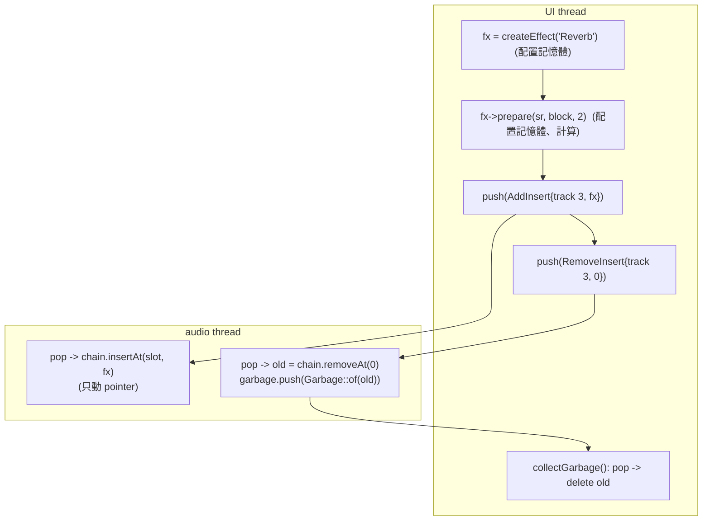

# Step 7 - Lock-free 的 command queue 與 garbage queue

[English](step-07-commands.md) | **繁體中文**

[總覽](../README.zh-TW.md) | 上一步：[Step 6](step-06-sends-buses.zh-TW.md) | 下一步：[Step 8 - PDC](step-08-pdc.zh-TW.md)

## 目標

讓 UI 能在 audio thread 持續執行的同時，改變一個正在播放的 mix 的*結構* - 新增、移除、取代與重新排序
effect，取代 track 的 clip - 而且不用 lock，audio
thread 也永遠不需要配置或釋放記憶體。

## 設計

### 為什麼不用 mutex？

mutex 會讓 audio thread 等待持有它的人。持有它的 UI thread 可能被 OS
搶佔，可能正在調整 vector 的大小（這會配置記憶體 - 而 allocator 本身會取得
一個 lock），或者只是很慢。在它持有 lock 的期間，audio thread 會錯過它的 deadline：產生 dropout。
這稱為 **priority inversion**：高優先權的 thread 等待低優先權的 thread。
因此 real-time 的規則是「絕不等待」，而不是「只等一下」。

### 數值 vs. 結構

<div align="center">

| 變更 | 機制 | 為什麼這樣就夠了 |
|---|---|---|
| fader、pan、mute、solo、send level、effect 參數、bypass、tempo、play | `std::atomic` | 單一數字；最新的值勝出；不涉及記憶體 |
| 新增 / 移除 / 取代 / 移動 insert、新的 clip list | 透過 `SpscQueue<Command>` 的 **command** | 需要記憶體，以及必須一起套用的多個 pointer 更新 |
| audio thread 不再使用的物件 | 透過 `SpscQueue<Garbage>` 的 **garbage ticket** | 必須被釋放，但不能在 audio thread 上釋放 |

</div>

### Single-producer / single-consumer ring buffer

恰好一條 thread push（UI），恰好一條 pop（audio thread）。這樣，帶有兩個索引的 ring buffer
不需要 lock，也不需要 compare-and-swap 迴圈 - 它是 **wait-free** 的：每一次 push 與
pop 都會在有限個步驟內完成。

```
slots:  [ 0 ][ 1 ][ 2 ][ 3 ][ 4 ]      capacity + 1 slots (one always stays empty)
              ^head           ^tail
        consumer reads slots[head]     producer writes slots[tail]
        empty: head == tail            full: (tail + 1) % size == head
```

只有 producer 寫入 `tail_`，只有 consumer 寫入 `head_`。Memory ordering：

```cpp
// producer
slots_[tail] = item;                                   // 1. write the slot
tail_.store(next, std::memory_order_release);          // 2. publish it
// consumer
if (head == tail_.load(std::memory_order_acquire))     // 3. sees the publication...
    return false;
out = slots_[head];                                    // 4. ...so it sees the finished slot
head_.store(increment(head), std::memory_order_release); // 5. hand the slot back
```

(2) 的 release store 與 (3) 的 acquire load 形成一條 *happens-before* 邊：producer 在 (2) 之前寫入的一切，
在 (3) 之後對 consumer 都是可見的。反方向的同一組配對（5 / producer 對 `head_` 的 acquire load）
則告訴 producer 某個 slot 可以被重用。兩個索引被 padding 到不同的 64-byte cache line 上，這樣兩個 CPU core 就
不會一直讓彼此的 cache line 失效（false sharing）。

`T` 必須是 trivially copyable - slot 是以賦值覆寫的，從不被 destroy - 所以
`Command` 攜帶的是 raw pointer，絕不是 `unique_ptr` 或 `std::vector`。

### 擁有權隨著訊息一起移動



`Garbage` 是 type-erased 的：一個 `void*` 加上一個知道真正型別的單純函式 pointer，
由 `Garbage::of<T>()` 中一個不帶 capture 的 lambda 產生。它仍然是 trivially copyable。

邊界情況，全部都有處理並經過測試：

- **Command queue 已滿**：`pushCommand()` 回傳 false，計入一次 drop，並立刻刪除 payload
  （它從未到達 audio thread，所以 UI 仍然擁有它）。
- **Chain 已滿 / channel 無效**：audio thread 無法 link 這個 effect，所以它直接把它當成 garbage
  送回去。
- **Garbage queue 已滿**：audio thread 不可以釋放，所以它會*洩漏*該物件並計數
  （`getGarbageLeaked()`）。每個 command 最多產生一張 garbage ticket，而且兩條 queue 的容量
  相同，所以只要 `collectGarbage()` 定期執行，這就不可能發生。
- **Engine 在還有 command pending 時被 destroy**：destructor 會釋放它們的 payload。

### 給 UI 的 observer pointer

`addInsert()` 會回傳 effect 的 raw pointer。UI 保留它來驅動編輯器與 meter
（`setParameter`、`getMeterDb` 是 thread-safe 的）。它在 effect 被移除*並且*
`collectGarbage()` 已經在 UI thread 本身執行過之前，都保持有效。所以：只有回收 garbage 的 thread
可以保留這類 pointer。insert slot 是 atomic，所以 `getInsert(channel, slot)` 可以隨時被
UI 呼叫。

## 程式碼

<div align="center">

| 檔案 | 內容 |
|---|---|
| `SpscQueue.h` | `SpscQueue<T>`：`push`、`pop`、`size`、`empty`、`capacity` |
| `Commands.h` | `ChannelKind`、`ChannelRef`、`CommandType`、`Command`（factory `addInsert`、`removeInsert`、`replaceInsert`、`moveInsert`、`replaceClips`）、`Garbage` |
| `Engine.h` | `pushCommand`、`addInsert`、`replaceInsert`、`removeInsert`、`moveInsert`、`setTrackClips`、`getInsert`、`getNumInserts`、`collectGarbage`、`applyCommands` / `apply` / `discard` / `disposeNow` |

</div>

`Engine::apply()` 是針對 command 類型的 `switch`；每個分支都只是幾次 pointer 操作，
以及最多一次 `discard()`。

## Your turn

`steps/step07-commands/minidaw.h` 是你的 Step 6 engine 加上 `SpscQueue<T>`、`ChannelRef`、
`Command`（snapshot 所需的三種類型：`AddInsert`、`RemoveInsert`、`ReplaceClips`；
完成版的 engine 另外加了 `ReplaceInsert` 與 `MoveInsert`）以及 `Garbage`。`Engine::addInsert()`、
`removeInsert()` 與 `setTrackClips()` 現在會 push command，`collectGarbage()` 會釋放送回來的東西，
track 的 clip list 是一個 atomic pointer，而 `processChunk()` 以
`applyCommands()` 開頭。

<div align="center">

| | |
|---|---|
| 你要寫的 | `SpscQueue<T>::push()` 與 `pop()`（release / acquire、一個空 slot）以及 `Engine::applyCommands()`（pop 出所有東西、link pointer、對被拆下或被拒絕的東西呼叫 `discard()`） |
| 檔案 | `steps/step07-commands/starter/step07.cpp` |
| 執行 | `l14_step07_starter`；在你完成之前它會印出 `[FAIL] l14_step07 (16 of 24 checks failed)`（單 thread 的測試通過後，才會開始兩條 thread 的 queue 測試） |
| Solution | `steps/step07-commands/solution/step07.cpp`（ctest `l14_step07_solution`） |

</div>

預期輸出（已驗證）：

```
Step 7: command queue and garbage queue (build-along)
  SpscQueue<int>(4): 4 accepted yes, 5th refused yes, FIFO yes, 1000 wrap-arounds yes
  two threads, 200000 items through a 256-slot queue: 0 out of order (expected 0)
  two inserts (x2, x3) queued on DC 0.1: 2 inserts after one block, output 0.4243 (expected 2, 0.4243)
  removed insert: alive until collectGarbage() frees 1 object (expected 1)
  living effects after the engine is gone: 0 (expected 0)
  queue of 4: 4 accepted, 6 dropped, 4 alive (expected 4, 6, 4)
  UI thread vs audio thread: 600 commands pushed, 600 applied, 0 dropped, 0 leaked
[PASS] l14_step07 (25 checks passed)
```

測試 effect 中的 instance counter 證明了擁有權規則：被 audio thread 移除的 effect 會一直存活到 UI thread 回收它，被取代的 clip list 與已滿 chain 的第 9 個 insert 會當成 garbage 送回來，被丟棄的 command 的 payload 會立刻被刪除，而帶著 pending command 被 destroy 的 engine 會釋放它們。最後一行執行的是真正的 audio thread，同時主
thread 新增、移除與取代東西共 600 次。

## Verify（參考路線）

`l14_test_commands`（已驗證，0 個失敗）：

- `SpscQueue<int>(4)`：容納 4 個、拒絕第 5 個、FIFO 順序、1000 次 wrap-around；
- 兩條 thread，2 000 000 個項目通過一條 256-slot 的 queue：全部依序抵達；
- engine：兩個 insert 進入 queue -> 在下一次 `processBlock()` 之前不可見 -> 依序套用
  （DC 0.1 上先 x2 再 x3 得到 0.1 x 6 x 0.7071）；透過 observer pointer 變更參數；
  移動 + 移除；被移除的 effect 會存活到 `collectGarbage()` 釋放它（instance
  counter 證明沒有 leak 也沒有 double free）；取代；bypass；已滿 chain 的第 9 個 insert
  會當成 garbage 送回來；被取代的 clip list 會當成 garbage 送回來；
- 4 個 command 的 queue：4 個被接受，6 個被丟棄並立刻刪除；
- 帶著 pending command 被 destroy 的 engine 會釋放它的 payload。

`l14_realtime_sim` 展示了這兩條 queue 在忙碌的模擬使用者下運作的情況（一次 Debug 執行；數量
每次執行都不同，因為編輯是隨機的，但零不會變）：

```
  UI         : 381 actions, 135 commands applied, 0 dropped
  garbage    : 44 objects freed on the UI thread, 0 leaked
```

## 你學到了什麼

- 絕不要在 audio thread 上等待；mutex 可能讓你去等系統中最慢的 thread。
- 把變更分成數值（atomic）與結構（訊息）。
- single-producer / single-consumer 的 ring buffer 只需要兩個帶有
  release/acquire ordering 的 atomic 索引。
- 配置與釋放發生在 UI thread 上；擁有權隨訊息一起傳遞，而
  失效的物件以同樣的方式送回來。
