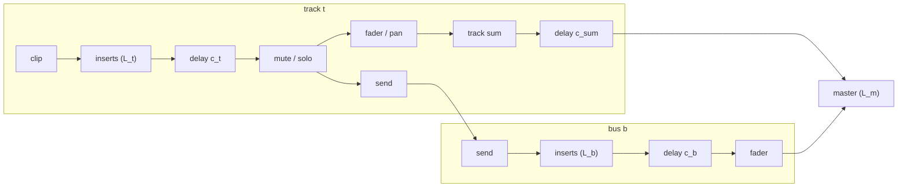

# Step 8 - Plugin delay compensation（PDC）

[English](step-08-pdc.md) | **繁體中文**

[總覽](../README.zh-TW.md) | 上一步：[Step 7](step-07-commands.zh-TW.md) | 下一步：[Step 9 - Offline render](step-09-offline-render.zh-TW.md)

## 目標

有些 effect 會延遲它的訊號：lookahead limiter（第 05 章）必須在 peak 到達之前先看到它，
oversampled saturator（第 06 章）有 linear-phase filter，partitioned convolution
（第 12 章）需要一整個 partition 的 input。讓 mixer 中的每一條路徑都一樣晚，
這樣無論各 track 使用了哪些 effect，它們彼此之間都能保持同步。

## 設計

### 沒有 PDC 會出什麼問題

Track 1 與 track 2 播放同一個 snare；track 1 有一個 latency 為 $`D`$ 的 insert。master 得到

$$
y[n] = x[n] + x[n - D]
\quad\Longrightarrow\quad
H(e^{j\omega}) = 1 + e^{-j\omega D},\qquad |H| = 2\left|\cos\frac{\omega D}{2}\right| = 2\left|\cos\frac{\pi f D}{f_s}\right|
$$

這是一個 comb filter，notch 位於 $`f_k = \frac{(2k+1) f_s}{2D}`$。對於 5 ms 的 lookahead（48 kHz 下 $`D = 240`$），
notch 位於 100、300、500、…… Hz：kick 與 snare 失去厚度，每一下
擊打都變成雙重（「flam」）。即使兩個 track 播放的是*不同*的聲部，節奏也會感覺鬆散 -
對於緊湊的打擊樂，5 ms 是聽得出來的。

### 規則

每個 insert 都回報它的 latency $`L`$；一條 chain 回報其中未被 bypass 的 insert 的總和
（串聯的 effect 會把它們的 delay 相加）。接著

$$
c_t = \max_u L_u - L_t \quad(\text{track } t), \qquad
c_b = \max_v L_v - L_b \quad(\text{bus } b), \qquad
c_{\text{sum}} = \max_v L_v
$$

$$
L_{\text{total}} = \max_u L_u + \max_v L_v + L_{\text{master}}
$$



- 每個 track 的 compensator 位於*它的 insert 之後、send 之前*，所以所有 track 在抵達
  dry sum 與 bus 時都已對齊（對齊在 $`\max L_u`$）。
- bus 會加上它自己的 $`L_b`$；把每條 bus padding 到 $`\max L_v`$，會讓各個 return 彼此對齊。
- dry sum 必須等待 return：它被延遲 $`\max L_v`$。
- master 的 latency 無法在 mix 內部補償（一切都會經過它）；它
  屬於回報的總 latency 的一部分，由 host（或 bounce，Step 9）在輸出端補償。

注意，有 latency 的 bus 會延遲整個 mix，即使沒有任何東西送給它 - engine 無法
知道它是靜音的。沒有使用的高 latency effect 是一種浪費。

### Delay line

`LatencyCompensator` 是一個整數 delay：每個 channel 一個 `maxDelay + 1` 個 sample 的 ring buffer，
在 `prepare()` 中配置；`setDelaySamples()` 只移動 read offset。

$$
y[n] = x[n - c], \qquad 0 \le c \le 16\,384
$$

改變 $`c`$ 會讓輸出跳動（read position 會跳過或重複 sample）- 這是一個 click，但
它只在 insert 被新增、移除、bypass 或改變其 latency 時才會發生。ring 在每個 block 都會被寫入，
即使 $`c = 0`$ 時也是；否則當 $`c`$ 從 0 增加到 $`D`$ 時，會重播自 delay 上次被使用以來殘留的
$`D`$ 個 sample 的舊音訊，而不是單純重複最近的 $`D`$
個 sample。專業的 DAW 會在這裡做 crossfade；這是個很好的延伸習題。

### 上限，以及超過上限時會發生什麼

$`C = 16\,384`$ 個 sample（`kDefaultMaxPdcSamples`，在 48 kHz 下約 341 ms，在 96 kHz 下約 171 ms）是每個 compensator 的
預設容量；`Engine::prepare(sampleRate, blockSize, maxPdcSamples)`
可以接受其他數值。內建的 effect 遠低於這個值，但被 host 的 VST3（Step 17）可以回報
任何數字：linear-phase EQ 與 look-ahead processor 常常回報數千個 sample，
而在同一個 track 上串聯其中幾個就可能超過 $`C`$。compensator 無法延遲超過 $`C`$，所以
在這種情況下並非每條路徑都能對齊。此時 mixer 會對齊在上限而不是
最大值：

$$
T_{\text{track}} = \min\!\big(\max_u L_u,\ C\big), \qquad
T_{\text{bus}} = \min\!\big(\max_v L_v,\ C\big), \qquad
c_t = \max(0,\ T_{\text{track}} - L_t)
$$

並回報 $`L_{\text{total}} = T_{\text{track}} + T_{\text{bus}} + L_{\text{master}}`$。每條
latency 不超過目標的路徑仍保持對齊，並恰好落在 bounce 所預期的位置；
$`L_t > T_{\text{track}}`$ 的路徑會晚 $`L_t - T_{\text{track}}`$ 個 sample 抵達（聽得出來
節奏不準，但仍在 bounce 範圍內）。這時 `Mixer::hasPdcOverflow()` / `Engine::hasPdcOverflow()` 會
為 true，app 的 mixer 會在 mix latency 旁邊顯示「PDC limit exceeded, not aligned!」。解法
是移除有問題的 plugin，或是用更大的 `maxPdcSamples` prepare engine。

為什麼不回報真正的最大值？因為那樣回報的 latency 會大於套用在 dry track 上的
delay，而經過 latency 補償的 bounce 會把它們移到 sample 0 之前 -
它們就會直接從檔案中消失。

### 何時計算

`Mixer::updateLatencies()` 在 audio thread 上於每個 chunk 開頭執行：首先每條 chain
套用它 pending 的參數變更（所以 lookahead 的變更已經生效），然後計算上述的總和與最大值，
並寫入 compensator - 只需幾十次整數運算。
停用 PDC（`setLatencyCompensationEnabled(false)`）時，所有 compensator 都是 0，回報的
總 latency 也是 0。

## 程式碼

| 檔案 | 內容 |
|---|---|
| `LatencyCompensator.h` | `prepare(maxDelay, channels)`、`setDelaySamples()`、`process(block)` |
| `InsertEffect.h` | 每個 effect 的 `getLatencySamples()`；`InsertChain::getLatencySamples()` 負責加總 |
| `ChannelStrip.h` | `processInserts()` = insert，然後是 compensator |
| `Mixer.h` | `updateLatencies()`、track-sum compensator、`getTotalLatencySamples()` |
| `EffectBase.h` | `PureDelayEffect`：延遲 N 並回報 N（量測用的儀器） |

## Your turn

`steps/step08-pdc/minidaw.h` 是你的 Step 7 engine 加上 effect interface 中的 `getLatencySamples()`、
`InsertChain::getLatencySamples()`、`PureDelayEffect`（`createEffect("PureDelay")`，
參數 0 = 以 sample 為單位的 delay）、每個 strip 的 insert 之後都有一個 `LatencyCompensator`、dry track sum 有一個，
而 `processChunk()` 在 `applyCommands()` 之後立刻呼叫 `mixer_.updateLatencies()`。

| | |
|---|---|
| 你要寫的 | `LatencyCompensator::process()`（ring buffer，在 delay 為 0 時也要寫入）與 `Mixer::updateLatencies()`（套用 pending 參數、目標值、每個 compensator、overflow 旗標、總 latency） |
| 檔案 | `steps/step08-pdc/starter/step08.cpp` |
| 執行 | `l14_step08_starter`；在你完成之前它會印出 `[FAIL] l14_step08 (15 of 22 checks failed)` |
| Solution | `steps/step08-pdc/solution/step08.cpp`（ctest `l14_step08_solution`） |

預期輸出（已驗證）- 在 track 1 與 2 的 timeline 1000 處各放一個 0.25 的 impulse，每一行列出
某個東西在輸出的哪裡（以及多大聲）抵達：

```
Step 8: plugin delay compensation (build-along)
  delay line: delay 0 passes through yes; delay 3 -> y[n] = x[n-3] on both channels yes; first sample after 0 -> 3 is x[7] = 8 (expected 8)
  PDC on : track 1 delayed by 100             : 0.3536 at 1100
  PDC off: the flam                           : 0.1768 at 1000 0.1768 at 1100
  tracks 37/0, buses 250/0, master 64         : 0.7071 at 1351
  total latency                               : 351 (expected 351), track sum waits 250 (expected 250)
  limit C = 128, track 1 delayed by 200       : 0.1768 at 1128 0.1768 at 1200
  overflow                                    : yes, reported latency 128 (expected yes, 128)
  delay changed to 30 by its parameter        : 0.3536 at 1030
[PASS] l14_step08 (22 checks passed)
```

最後一行就是 `updateLatencies()` 要先套用 pending 參數的原因：delay 的
latency 跟隨它的參數，就像 limiter 的 lookahead 一樣。

## Verify（參考路線）

`l14_test_pdc`（已驗證）：

| 情境 | 預期 | 結果 |
|---|---|---|
| track 1 與 2 在 1000 處有 impulse，track 1 有一個 100-sample 的 PureDelay | 在 1100 處有一個 2 x 0.25 x 0.7071 的 impulse；compensator 為 0 / 100 | pass |
| 同上，輸出端補償的 render | impulse 在 1000 | pass |
| PDC off | 兩個 impulse，在 1000 與 1100 | pass |
| track 1：37 個 sample + send 到 bus A（250 個 sample）；track 2 send 到 bus B（0）；master 64 | 四條路徑全都落在 1000 + 351；總 latency 37 + 250 + 64 | pass |
| 真正的 Limiter（5 ms）vs. dry | 對齊在 1000 + 240；lookahead 改成 2 ms -> 96 個 sample，仍然對齊；bypass -> 0 | pass |
| device 變更 48 kHz -> 96 kHz | 同樣 5 ms 的 lookahead 重新 prepare = 480 個 sample，PDC 跟著改變 | pass |
| track 1：3 x 8191 = 24 573 個 sample（超過 $`C`$ = 16 384），track 2 為 dry，經補償的 render | overflow 旗標被設定，回報的 latency 為 16 384；track 2 在 1000，track 1 在 1000 + 8189（晚了，但在檔案裡） | pass |
| 同上，engine 以 `maxPdcSamples` = 32 768 prepare | 沒有 overflow，latency 24 573，一個 impulse 在 1000 | pass |

`l14_pdc_demo` 會量測並讓你聽到結果（已驗證的輸出）：

```
Step 8: plugin delay compensation
  insert latency  track 1 (Limiter)          : 240 samples
  insert latency  track 2 (dry)              : 0 samples
  insert latency  bus A (ConvolutionReverb)  : 512 samples
  compensation    track 1 / track 2          : 0 / 240 samples
  compensation    track sum (waits for buses): 512 samples
  total latency (maxTrack + maxBus + master) : 752 samples = 15.67 ms

  click at timeline sample 1000:
    PDC off            : arrivals at 1000 and 1240 (flam of 240 samples), peak 0.177
    PDC on             : first arrival at 1752, second arrival at 25752 (beat 2), peak 0.354
    PDC on + bounce    : first arrival at 1000 (latency removed)

  drums RMS  PDC off -25.98 dBFS, PDC on -20.93 dBFS (comb filter loses energy)
```

兩份 coherent 的複本相加成兩倍振幅（+6.02 dB，peak 0.177 -> 0.354）。PDC 關閉時，鼓的 RMS
低了 5.05 dB（-25.98 對 -20.93 dBFS）：沒有對齊的複本只有在不重疊的地方才以功率相加，而在重疊的地方，comb 在 100、300、500 Hz 的 notch 剛好落在 kick
與 snare 的基頻上。這支程式會檢查上述所有事項（`[PASS] l14_pdc_demo (7 checks passed)`）：
flam 等於 limiter 的 latency，PDC 開啟時的 click 恰好在 1000 + 752 抵達，下一個
在 24 000 個 sample 之後，bounce 會把它放回 1000，coherent 的 peak 是 $2 \cdot 0.5 \cdot
10^{-6/20} \cdot 0.7071$，而對齊後的鼓響了超過 3 dB。聽聽 `l14_pdc_off.wav`（空洞、有 flam）與 `l14_pdc_on.wav`（扎實），以及
`l14_pdc_clicks.wav`（先是雙重 click，然後是單一的）。

## 你學到了什麼

- Latency 是每個 effect 都必須誠實回報的屬性，而串聯的 latency 會相加。
- PDC 把每條路徑 padding 到最慢的那條：track 對齊最慢的 track，return 對齊最慢的 bus，
  dry sum 則延遲最慢 bus 的量；master 的 latency 則是為輸出端回報。
- padding 有上限；超過上限時，mixer 會對齊它能對齊的，回報它實際
  套用的 latency，並升起 overflow 旗標，而不是默默地回報錯誤的數字。
- 沒有 PDC，相同的素材會變成 comb filter - 一個聽得到、量得到的錯誤。
