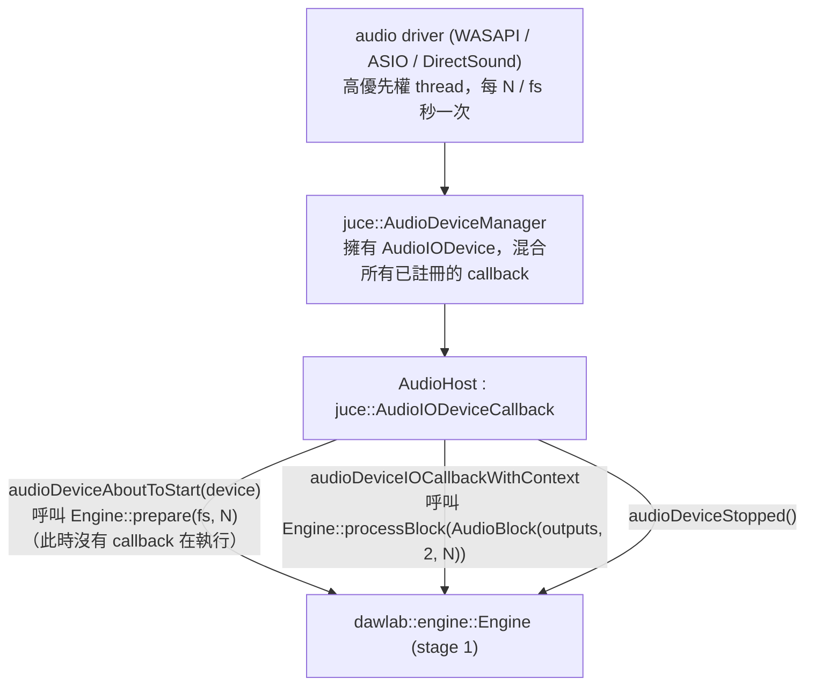
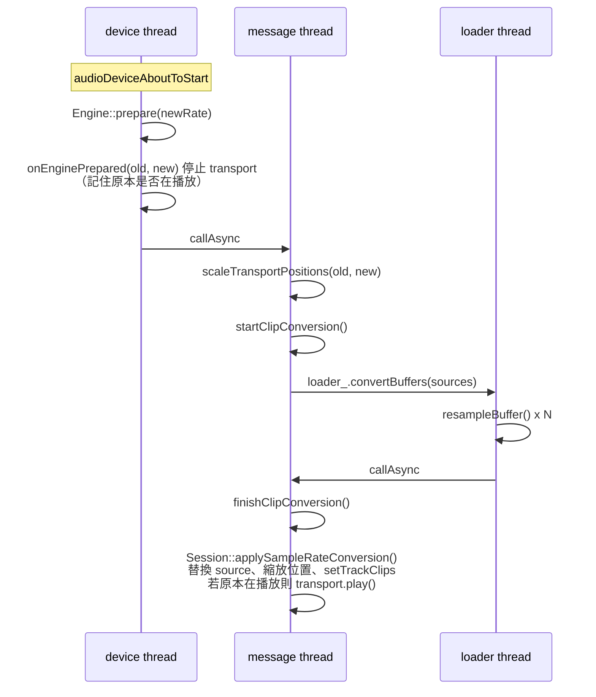

# Step 11 - Audio device 與 callback

[English](step-11-audio-device.md) | **繁體中文**

[總覽](../README.zh-TW.md) | 上一步：[Step 10](step-10-realtime-safety.zh-TW.md) | 下一步：[Step 12](step-12-main-window.zh-TW.md) | 回到[路線圖](../README.zh-TW.md#4-the-twenty-one-steps)

Stage 2 從這裡開始：接下來我們要建構 **DawLab 8**，一個圍繞 Step 1-10 engine 的 JUCE 應用程式。DAW 需要的第一件事，就是讓喇叭發出聲音。

## 目標

開啟系統預設的 audio output，每當 device 要求一個 buffer，就呼叫 `Engine::processBlock()`——JUCE 的 buffer 與我們的 `AudioBlock` 之間**沒有任何複製**，callback 裡也沒有任何可能 block 的東西。量測我們用掉了多少可用時間（"CPU" 顯示），並且讓同一條路徑在沒有任何 device 的情況下也能用於測試。

## 設計

### 誰呼叫誰



`AudioDeviceManager::initialise(numInputs, numOutputs, nullptr, true)` 會挑選預設的 device type 與 device，並以 device 偏好的 sample rate 與 buffer size 開啟它。加入我們的 callback（`addAudioCallback`）後，JUCE 會先呼叫 `audioDeviceAboutToStart()`，之後再從 driver 的 thread 呼叫 I/O callback。

### Zero-copy：JUCE 的 channel array *就是* AudioBlock

JUCE 交給我們 `float* const* outputChannelData`：每個 channel 一個 pointer，non-interleaved。這正是 `dawlab::AudioBlock` 所檢視的 layout（chapter 00）。因此整個 adapter 只有一行：

```cpp
engine_.processBlock(AudioBlock(outputs, std::min(numOutputChannels, 2), numSamples));
```

Engine 直接 render 到 driver 的記憶體裡。輸出多於兩個 channel 的 device，其餘 channel 得到靜音（我們必須寫入每一個 channel：buffer 可能含有垃圾資料）；mono device 則取得左 channel（engine 支援 1-channel 的 `out`）。

### 兩個關鍵時刻

| 時刻 | thread | 這裡可以做什麼 |
|---|---|---|
| `audioDeviceAboutToStart` | 啟動 device 的 thread（通常是 message thread） | allocation：`Engine::prepare()`（它同時會重新 prepare 每一個 insert，Step 1）、`SpectrumAnalyzer::prepare()`（Step 20） |
| `audioDeviceIOCallbackWithContext` | driver 的 real-time thread | 只有 `processBlock()`、幾個 atomic，沒有 allocation / lock / I/O |

如果 sample rate 或 buffer size 沒有改變（例如 export 重新 attach engine 時，Step 19），`prepareInternal()` 會跳過 `Engine::prepare()`：重新 prepare 會重置每個 effect，並無謂地切斷 reverb tail。

當 device *確實*以另一個 sample rate 回來時，所有以 sample 為單位量測的東西都會出錯：clip 的位置與長度、fade、loop range——還有 clip audio 本身，它現在會以錯誤的速度與音高播放（48 -> 44.1 kHz：慢 8 %，低 1.47 個半音）。每個 clip source 都必須 resample 一次（共用的 buffer 仍維持共用），每個位置都要乘上 $`f_{\text{new}} / f_{\text{old}}`$。Resampling 很慢——即使在 Release build，一個 3 分鐘的 stereo 檔案也要幾秒——所以它既不能跑在 message thread 上（GUI 會凍結），也不能讓 engine 在這段時間繼續播放舊的 clip：



`Session` 會追蹤 *clip rate*（`getClipSampleRate()`）：clip 清單所採用的 rate。除了這類轉換進行期間之外，它等於 engine 的 rate。轉換進行時，Space 只會設定「完成後播放」，而 export 會被拒絕，因此絕不會有以舊 rate 表示的 clip 在新 rate 下播放。如果 loader 工作期間有東西改變了（另一次 device 變更、新的 project、demo song），`finishClipConversion()` 會丟棄結果，並從目前狀態重新開始；期間載入完成的檔案（仍是舊的 clip rate，Step 18）會在多一輪中轉換。`Session::handleSampleRateChange(old, new)` 是整件事的同步版本，供沒有 message loop、或已知 clip 位於 `old` 的程式碼使用（測試、Exercise 11）。

### CPU load

Callback 用 `juce::Time::getHighResolutionTicks()` 量測自己的耗時：

$$
\text{load} = \frac{t_{\text{callback}}}{N / f_s}, \qquad
\overline{\text{load}}_k = \overline{\text{load}}_{k-1} + 0.1\,(\text{load}_k - \overline{\text{load}}_{k-1})
$$

One-pole smoothing（係數 0.1，約 10 個 callback）讓顯示保持可讀。100 % 代表「剛好踩到 deadline」；任何接近它的情況，在下一次小卡頓時都會 dropout。這個值是 `std::atomic<float>`：transport bar 每秒讀取它 30 次。

### Denormals

Callback 開頭的 `juce::ScopedNoDenormals` 會在 callback 期間設定 CPU 的 FTZ/DAZ flag（flush-to-zero / denormals-are-zero：CPU 把極小的 denormal 數值視為 0），讓衰減中的 filter state 與 reverb tail 永遠不會退化成 denormal 運算而變慢（chapter 02 與 12 解釋了為什麼這很重要）。

## 程式碼

`app/Source/AudioHost.h`、`AudioHost.cpp`。重點函式完整如下：

```cpp
void AudioHost::render(float* const* outputs, int numOutputChannels, int numSamples) noexcept {
    if (numOutputChannels <= 0 || numSamples <= 0)
        return;
    const juce::ScopedNoDenormals noDenormals;
    const auto t0 = juce::Time::getHighResolutionTicks();

    const int engineChannels = std::min(numOutputChannels, engine::kNumChannels);
    engine_.processBlock(AudioBlock(outputs, engineChannels, numSamples));
    for (int ch = engineChannels; ch < numOutputChannels; ++ch)
        if (outputs[ch] != nullptr)
            std::fill_n(outputs[ch], numSamples, 0.0f);

    // ... push (L+R)/2 into the spectrum analyzer (Step 20) ...
    // ... CPU load, smoothed, into an atomic ...
}
```

`audioDeviceIOCallbackWithContext()` 與 `processOffline()` 都會呼叫 `render()`。這正是 `processOffline()` 的用意：smoke test、`--snapshot` 模式與各個 exercise，是從 main thread 以 JUCE 形式的 channel array 驅動 driver 所驅動的*同一個函式*。

開啟 device（`openDefaultDevice`）與 fallback（`MainComponent` constructor）：

```cpp
juce::String deviceError;
if (mode_ == Mode::Live)
    deviceError = audioHost_.openDefaultDevice();          // -> aboutToStart -> Engine::prepare
if (mode_ == Mode::Offline || deviceError.isNotEmpty())
    audioHost_.prepareOffline(kOfflineSampleRate, kOfflineBlockSize); // 48 kHz, 512
```

沒有 audio output 的機器仍然可以啟動這個 app（"No audio device ... running offline"）。

## 驗證

`DawLab 8.exe --smoke-test`（ctest `l14_app_smoke_test`）會透過 `AudioHost::processOffline()` 以**三個** output channel 播放 demo song，並與 Step 9 的 offline bounce 比較：

```
4. device callback, 512-sample blocks, 3 outputs: max |callback - bounce| = 0, CPU load 68.1%
4. device callback, 480-sample blocks, 3 outputs: max |callback - bounce| = 0, CPU load 81.5%
```

- 兩種 block size 的差異都精確為 0（bounce 最後的 `latency` 個 sample 被排除：renderer 在 transport 已停止的情況下播放它們）。因此 callback 路徑是 zero-copy，*而且*不多加任何東西：你聽到的就是你 bounce 出來的。
- 第三個 channel 由測試預先填入垃圾資料，之後全為零。
- CPU 數字來自一個 Debug build，以最快速度 render demo song 的全部 19 個 insert；它的意思是「這個 Debug build 需要大約 60-80 % 的 real time」——demo song 的 convolution reverb 與 oversampled effect 佔了大宗，且這個數字每次執行、每台機器都會不同。Release build 只需要其中一小部分。

同一個測試的第 7 節模擬 device 以 44.1 kHz 重新啟動：`Engine::prepare(44100, 512)` 之後接著 `Session::handleSampleRateChange(48000, 44100)`：

```
7. device change 48 -> 44.1 kHz: bass clip 3 moved 96000 -> 88200 samples (bar 2 = 88200)
```

第 10 節則在 transport 播放中，透過 application 自己的接線做同樣的事——在 `MainComponent` 上呼叫 `AudioHost::prepareOffline(44100, 512)`，接著 message loop 送達 `onEnginePrepared` 的 `callAsync`，loader thread 進行轉換，測試持續輪詢，直到 `MainComponent::isConvertingSampleRate()` 為 false：

```
10. GUI device change 48 -> 44.1 kHz (loader thread): engine 44100 Hz, transport stopped at once: yes, bass clip 3 96000 -> 88200,
    converted in 5010 ms with 457 message-loop turns meanwhile, playback resumed: yes, status "Sample rate changed to 44100 Hz: clips converted"
```

從 bar 2 開始的 clip 仍然從 bar 2 開始（$`96000 \cdot 44100 / 48000 = 88200`$），它 1 秒長的 source buffer 現在有 44 100 個 sample，轉換後的 song render 結果沒有 NaN。Transport 在 device 重新啟動的瞬間停止，並在轉換完成後再度開始；message loop 全程持續運轉（turn 的次數與毫秒數取決於機器；這是一個 Debug build，在轉換 demo song 的 28 個 buffer）。

想聽聽看：啟動 `DawLab 8.exe`（不帶參數），按下 Space。

## 換你動手

從這一步起不再有 snapshot：GUI 無法拆成十個小型 console 程式。取而代之的是，你每次重建完成版 app 中的一個函式，並讓 app 自己的自動化測試來評判（見 [chapter README](../README.zh-TW.md) 的「How to use this chapter」）。先複製檔案（`AudioHost.cpp` -> `AudioHost.cpp.orig`），以便比對與還原。

| | |
|---|---|
| 你要寫 | `app/Source/AudioHost.cpp` 中 `AudioHost::render()` 的主體，到 spectrum feed 之前為止：把 device 的 pointer array 包成最多 `engine::kNumChannels` 個 channel 的 `AudioBlock`，呼叫 `engine_.processBlock()`，清除 device 其餘的每個 channel（其下的 spectrum 與 CPU-load 程式碼保持原樣） |
| 建置 + 檢查 | `.\scripts\build.ps1 -Only 14-daw-8track -Juce -TestLabel test`（建置 `DawLab8` 並執行 `l14_app_smoke_test`） |
| 預期 | 第 4 節對 512 與 480 sample 的 block 印出 `max |callback - bounce| = 0`，第三個 output channel 被檢查為全零，最後以 `[PASS] l14_app_smoke_test` 結束 |

接著不帶參數啟動 `DawLab 8.exe` 並按下 Space：你會聽到自己寫的 callback。

## 你學到了什麼

- JUCE 的 `AudioIODeviceCallback` 是 `Engine::processBlock()` 在 host 端的對應物；adapter 是 view，不是複製。
- `audioDeviceAboutToStart()` 是除了 construction 之外，audio 端唯一可以 allocate 的地方——此時 device 是停止的。
- Device 變更對整個 project 而言就是 sample-rate 變更：所有以 sample 計的東西都必須轉換——在 worker thread 上進行，並且在轉換後的 clip 就位之前 transport 保持停止。
- 保留一條不需要 device、通往同一個 render 函式的路徑，這樣測試就能證明 device 會播放的內容。
