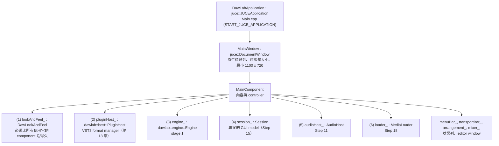

# Step 12 - Main window 與深色 LookAndFeel

[English](step-12-main-window.md) | **繁體中文**

[總覽](../README.zh-TW.md) | 上一步：[Step 11](step-11-audio-device.zh-TW.md) | 下一步：[Step 13](step-13-transport-bar.zh-TW.md) | 回到[路線圖](../README.zh-TW.md#4-the-twenty-one-steps)

## 目標

一個 1400 x 900 的視窗，包含 menu bar、頂端的 transport bar、中間的 arrangement、底部的 mixer 與一條狀態列——全部採用深色主題——以及一個依正確順序擁有所有東西的 application 物件。外加一個不必手動啟動 app 就能*看到*視窗的方法：`--snapshot <file.png>`。

<p align="center"></p>

## 設計

### 物件樹



C++ 以宣告順序的相反順序銷毀 member，而上面的順序經過挑選，使每個物件都先於它所使用的東西被銷毀：audio device 在 engine (3) 消失之前關閉 (5)，所以沒有 callback 能碰到已死亡的 engine；engine（擁有 VST3 insert）先於 plugin format manager (2) 銷毀；每個 component 都先於 LookAndFeel (1) 銷毀——如果 LookAndFeel 在仍有 component 指向它時被刪除，JUCE 會 assert。`~MainComponent()` 另外會明確地停止 timer、等待進行中的 export、關閉 editor window 與 device，讓這個順序在程式碼中清楚可見，而不只是隱含的。

### Layout

`MainComponent::resized()` 從邊緣向內切割視窗：

<div align="center">

| 區域 | 高度 | component |
|---|---|---|
| menu bar | 24 px | `juce::MenuBarComponent`（File、Transport、Track、View） |
| transport | 58 px | `TransportBar`（Step 13） |
| status line | 22 px | 兩個 `juce::Label`：最近一則訊息、audio device |
| mixer | max(430 px, 剩餘高度的 55 %) | `MixerView`（Step 15） |
| arrangement | 剩下的部分 | `ArrangementView`（Step 14） |

</div>

Menu bar 是視窗內部的一個 component（不是 OS 的 menu），因此它也會出現在 snapshot 中，且在每個平台上外觀相同。

### LookAndFeel

JUCE 透過 `LookAndFeel` 繪製標準 widget。`DawLookAndFeel` 衍生自 `LookAndFeel_V4`，把它含 9 個角色的色彩配置設為深灰色，並 override 四個繪製函式：

- `drawRotarySlider`：深色的 track 弧線、青色（cyan）的 value 弧線、一個帶指針的圓盤。設有 `bipolar` property 的旋鈕（pan、+/- dB 參數）會**從中心**畫出弧線，讓 0 在視覺上明顯代表「什麼都沒有」。
- `drawLinearSlider`（僅垂直）：混音台的 fader——一道凹槽、cap 下方填滿的部分、帶有中心線的平坦 cap。
- `drawButtonBackground`、字型、tooltip。

所有顏色都放在 `DawColours`（`DawLookAndFeel.h`）中，包括每個 track 各一個顏色，用於 clip、lane header 與 strip header，讓眼睛能把 lane 與它的 strip 連起來。

`MainComponent` 呼叫 `setLookAndFeel(&lookAndFeel_)`：child 會繼承它。Top-level window（參數面板）則明確地設定，並在它們的 destructor 中重設為 `nullptr`。

### 兩種模式

`MainComponent(Mode::Live)` 開啟 audio device 並啟動 30 Hz timer；`MainComponent(Mode::Offline)` 建出完全相同的 component 樹，但沒有 device（48 kHz、512）也沒有 timer——由呼叫端自己驅動 `tick()` 與 `simulatePlayback()`。Smoke test、snapshot 與所有 JUCE exercise 都使用 offline 模式。

### `--snapshot`

```cpp
MainComponent main(MainComponent::Mode::Offline);
main.setSize(1400, 900);
main.loadDemoSongNow();                              // Step 18, synchronously
tr.setPosition(0); tr.play();
for (done = 0; done < bar2beat3; done += fs / 30) {  // "play" with 30 UI ticks per second
    main.simulatePlayback(fs / 30);                  // AudioHost::processOffline in 512 blocks
    main.tick();                                     // meters, playhead, spectrum
}
juce::Image image = main.createComponentSnapshot(main.getLocalBounds(), true, 1.0f);
juce::PNGImageFormat().writeImageToStream(image, out);
```

`createComponentSnapshot()` 會在螢幕上沒有視窗的情況下，把 component 樹繪製到一張影像中。有一個細節讓第一張 snapshot 出錯：`Session` 以 `juce::ChangeBroadcaster` 通知各個 view，而它是透過 message loop *非同步*送達的——snapshot 中沒有 message loop 在跑，於是 mixer 仍然顯示 "Track 1" 與空的 slot。現在 `tick()` 一開始就呼叫 `session_.dispatchPendingMessages()`，同步送達待處理的 change message。（在執行中的 app 裡這不會改變任何事；它只是讓每個 tick 自成一體。）

## 程式碼

- `app/Source/Main.cpp`：`DawLabApplication`（命令列：`--smoke-test`、`--snapshot`）、`MainWindow`。測試模式在 `initialise()` 內執行，以 `setApplicationReturnValue()` 與 `quit()` 設定 exit code。Windows 上的 GUI 程式沒有 console；當它從 terminal 啟動（stdout 沒有被 redirect）時，`AttachConsole(ATTACH_PARENT_PROCESS)` 讓 `printf` 可見。
- `app/Source/MainComponent.h/.cpp`：建構順序、`resized()`、`tick()`、`simulatePlayback()`。
- `app/Source/DawLookAndFeel.h/.cpp`。
- `app/CMakeLists.txt`：`juce_add_gui_app(DawLab8 PRODUCT_NAME "DawLab 8")`。除了 `main` 之外，所有 app class 都在 static library `l14_daw_app` 裡，讓 exercise 可以連結它們。JUCE 不會再次編譯：chapter 13 的 `dawlab_plugin_host` 已經包含 JUCE module。

## 驗證

```powershell
cd build                                      # the build directory (.\scripts\build.ps1 -Juce)
& ".\bin\Debug\DawLab 8.exe" --snapshot dawlab_output/l14_app_snapshot.png
```

```
snapshot written: 1400x900, ...\dawlab_output\l14_app_snapshot.png, position 2.3.000, unknown parameters 0
meters at that point: master peak -9.4 / -9.6 dBFS, loudness M -17.2  S -15.8  I -15.9 LUFS, mix latency 752 samples
panel snapshot: ...\dawlab_output\l14_app_snapshot_panel.png (drum compressor, gain reduction 12.1 dB)
```

ctest 以 `l14_app_snapshot`（label `example`）執行它。本頁頂端的圖片就是那個檔案。它顯示 playhead 位於 bar 2 beat 3——你*聽到*的位置：snapshot 會播放到 transport 超過該位置 752 個 sample（mix latency）為止，見 Step 13——meter 有訊號（第二行的數字就是 transport bar 與 master 區段所顯示的）、master spectrum，以及狀態列中的 "No audio device (offline)"。Transport bar 中的 CPU 數字（這次執行為 72 %，會變動）是誠實的，但在這裡的意義略有不同：`simulatePlayback()` 以最快速度 render，所以它是這個 Debug build 的「render 所花時間 / 所 render audio 的長度」。

## 換你動手

重建視窗 layout（先複製 `MainComponent.cpp`，見 Step 11）。

<div align="center">

| | |
|---|---|
| 你要寫 | `app/Source/MainComponent.cpp` 中的 `MainComponent::resized()`：從頂端起是 24 像素的 menu bar 與 58 像素的 transport bar，底部是 22 像素的狀態列（device 資訊在其右側），其下的 mixer 佔剩餘高度的 55 %（至少 430 像素），arrangement 佔剩下的部分，export overlay 蓋在所有東西之上 |
| 建置 + 檢查 | `.\scripts\build.ps1 -Only 14-daw-8track -Juce`；ctest 執行 `l14_app_snapshot`（label `example`） |
| 預期 | `dawlab_output/l14_app_snapshot.png`（1400 x 900）看起來像 chapter README 頂端的圖片：transport bar、八條 lane、mixer、狀態列 "No audio device (offline)"——把兩張圖並排比較 |

</div>

Layout 的錯誤不會讓測試失敗，而是顯示在圖片上：這就是 app 能把自己 render 成 PNG 的原因。

## 你學到了什麼

- Member 的宣告順序就是生命週期順序；在重要時把它寫下來。
- 一個 `LookAndFeel` subclass 就能為每個 widget 設定主題；自訂 component 共用它的色彩表。
- `createComponentSnapshot()` 讓 GUI 在沒有螢幕的情況下也可測試、可文件化。
- `ChangeBroadcaster` 是非同步的——對 GUI 而言沒問題，在測試中卻會令人意外。
