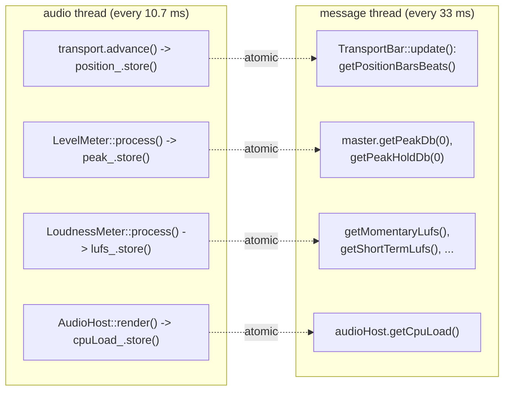
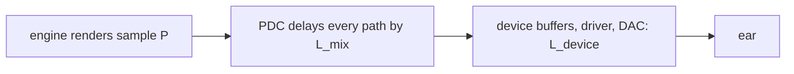

# Step 13 - The transport bar
**English** | [繁體中文](step-13-transport-bar.zh-TW.md)

[Overview](../README.md) | Previous: [Step 12](step-12-main-window.md) | Next: [Step 14](step-14-arrangement.md) | Back to the [roadmap](../README.md#4-the-twenty-one-steps)

## Goal

Play / Stop, Return to start, Loop on/off, the position as bars.beats.ticks and as m:ss.mmm,
the tempo, a master peak meter with LUFS, and the CPU load - in one 58-pixel strip. Every control
must work from the mouse *and* from the keyboard, and every display must follow the audio thread
without ever blocking it.

## Design

### Reading the audio thread's state: polling atomics at 30 Hz

The transport (stage 1, Step 2) keeps play state, position, loop range and tempo in atomics. The
GUI never asks the audio thread anything; it *reads* those atomics from a `juce::Timer` on the
message thread, 30 times per second:



30 Hz is enough for the eye (a film runs at 24) and costs nothing. The values may be one block
old, which no one can see. There is no queue, no lock and no message from the audio thread.

### Writing: the same atomics the other way

- **Play / Stop**: `Transport::setPlaying(!isPlaying())`.
- **Return to start**: `Transport::setPosition(0)` - a *pending seek* (Step 2): the audio thread
  applies it at the start of its next block, never in the middle of one.
- **Loop**: `setLoopEnabled()`; the loop range is shown in the arrangement ruler (Step 14).
- **Tempo**: a `juce::Slider` in `LinearBar` style (20 .. 300 BPM, 0.1 steps) calling
  `Transport::setTempo()`. Clips are positioned in samples, so a tempo change moves the bar grid
  under the audio, not the audio (Exercise 7 of stage 1 discusses why).

The buttons do not call the transport themselves: they call `onPlayStop`, `onReturnToStart`,
`onToggleLoop`, which `MainComponent` connects to the same functions the menu and the keyboard
commands use (Step 21). One action, one implementation.

### Formatting the position

`Transport::getPositionBarsBeats()` (stage 1) does the maths; the display just formats:

```cpp
juce::String TransportBar::formatBarsBeats(const engine::BarsBeats& p) {
    return juce::String(p.bar) + "." + juce::String(p.beat) + "." + juce::String(p.tick).paddedLeft('0', 3);
}
// 120 BPM, 48 kHz: sample 24000 -> "1.2.000", sample 132000 -> "2.2.480"
```

and `formatTime()` turns seconds into `m:ss.mmm` with integer arithmetic on milliseconds, so the
display never shows "0:60.000".

### Show what is heard, not what is rendered

`Transport::getPosition()` is the sample the engine renders *now*. While playing, that sample
reaches the speakers later:



- $`L_{\text{mix}}`$ = `Engine::getLatencySamples()`, the plugin delay compensation of Step 8. The
  bounce removes it (Step 9); live playback cannot: it is real delay. In the demo song it is 752
  samples (512 for the convolution reverb on track 8 + 240 for the master limiter) = 15.7 ms.
- $`L_{\text{device}}`$ = what the driver reports for the open device
  (`juce::AudioIODevice::getOutputLatencyInSamples()`, read in `audioDeviceAboutToStart()`),
  typically 5..30 ms; 0 without a device.

A position display that ignores them runs ahead of the sound by $`L_{\text{mix}} + L_{\text{device}}`$.
`AudioHost::getAudiblePosition()` corrects it, and both the counters here and the playhead
(Step 14) use it:

```math
\text{shown} = \begin{cases}\max(0,\ P - L_{\text{mix}} - L_{\text{device}}) & \text{playing}\\ P & \text{stopped}\end{cases}
```

When the transport is stopped nothing sounds, so the display shows where playback will start (the
moment you press Stop it therefore jumps forward by $`L_{\text{mix}} + L_{\text{device}}`$). The
formula is a static function, `AudioHost::compensatePosition(position, playing, mixLatency,
deviceLatency)`, so the smoke test can check it with any latencies. (At a loop wrap the display
briefly shows a position just before the loop start - for $`L`$ samples, about half a frame of the
30 Hz display.)

### The icons

The buttons are a small `IconButton : juce::Button` that draws its icon with `juce::Path`
(triangle, square, bar + triangle, a circular arrow). No image files, sharp at any DPI. The play
button switches its icon between Play and Stop in `update()`; the loop button lights up orange
when the loop is on. All of them call `setWantsKeyboardFocus(false)`: if a button kept the
keyboard focus after a click, the next Space would "click" that button again instead of reaching
the Play/Stop command.

### Master meter and loudness

A horizontal `MeterBar` (Step 20 explains its scale) shows the master's peak and peak hold per
channel; a `LoudnessDisplay` shows **M**omentary (400 ms), **S**hort-term (3 s) and **I**ntegrated
loudness from the master strip's `dsp::LoudnessMeter` (chapter 11). The integrated value starts
again whenever the engine is reset (a new project, a bounce).

## Code

`app/Source/TransportBar.h/.cpp`. `update()`:

```cpp
void TransportBar::update() {
    const engine::Transport& tr = engine_.getTransport();
    const int64_t audible = audioHost_.getAudiblePosition();   // minus mix + device latency while playing
    barsBeats_.setText(formatBarsBeats(tr.samplesToBarsBeats(audible)), juce::dontSendNotification);
    time_.setText(formatTime(tr.toSeconds(audible)), juce::dontSendNotification);
    playButton_->setIcon(tr.isPlaying() ? IconButton::Icon::Stop : IconButton::Icon::Play);
    loopButton_->setToggleState(tr.isLoopEnabled(), juce::dontSendNotification);
    if (!tempo_.isMouseButtonDown() && std::abs(tempo_.getValue() - tr.getTempo()) > 1e-6)
        tempo_.setValue(tr.getTempo(), juce::dontSendNotification);
    const engine::ChannelStrip& master = engine_.getMixer().getMaster();
    masterMeter_.setLevels(master.getPeakDb(0), master.getPeakDb(1), master.getPeakHoldDb(0), master.getPeakHoldDb(1));
    loudness_.setValues(master.getMomentaryLufs(), master.getShortTermLufs(), master.getIntegratedLufs());
    cpu_.setText("CPU " + juce::String(juce::roundToInt(100.0f * audioHost_.getCpuLoad())) + "%", juce::dontSendNotification);
}
```

Note `dontSendNotification` everywhere: updating a display must not trigger the control's own
callback (otherwise the tempo display would write the tempo back to the engine 30 times a second,
and fight the user's drag). `isMouseButtonDown()` leaves a control alone while the user holds it.

## Verify

The smoke test plays the demo song through the simulated callback until beat 2 (24 000 samples
at 120 BPM) is *heard*: 24 000 + 752 samples, because the mix latency of the song is 752 samples
and there is no device (device latency 0). Then it checks the displays:

```
6. GUI offline: 11 strips, position 1.2.000 (playhead 24000, transport 24752 = + mix latency 752),
   master peak -11.8 dBFS, status "Demo song loaded"
```

- the counter shows "1.2.000" and the arrangement's playhead is at sample 24 000, *less* than the
  transport position 24 752 - exactly the mix latency behind it;
- `compensatePosition()` with a device latency as well: position 24 752, mix latency 752, device
  256 -> 23 744; position 500 -> 0 (never before the start); stopped -> unchanged;
- after Stop the counter jumps to the transport position: "1.2.030" (752 samples = 30 ticks).

`l14_app_smoke_test` also presses Space through the key mappings and checks that the transport
toggled, and `L` for the loop. In the app: Space plays, Home returns to bar 1, L toggles the loop,
the tempo slider can be dragged or double-clicked to type.

## Your turn

<div align="center">

| | |
|---|---|
| You write | `AudioHost::compensatePosition()` in `app/Source/AudioHost.cpp` (while playing: position minus mix latency minus device latency, never below 0; stopped: unchanged) and `TransportBar::formatBarsBeats()` in `app/Source/TransportBar.cpp` ("bar.beat.tick", tick with three digits) |
| Build + check | `.\scripts\build.ps1 -Only 14-daw-8track -Juce -TestLabel test` (`l14_app_smoke_test`) |
| Expected | section 6 prints `position 1.2.000 (playhead 24000, transport 24752 = + mix latency 752)`; the three `compensatePosition()` checks of this page (23 744, 0, unchanged) and "1.2.030" after Stop pass; `[PASS] l14_app_smoke_test` |

</div>

## What you learned

- GUI and audio thread meet in atomics; the GUI polls at its own pace.
- Display updates use `dontSendNotification`, and skip controls the user is holding.
- Route buttons, menu items and keys to one function per action.
