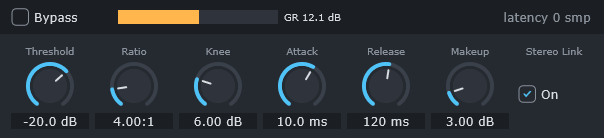

# Step 16 - Insert slot 與自動產生的參數面板

[English](step-16-inserts-panels.md) | **繁體中文**

[總覽](../README.zh-TW.md) | 上一步：[Step 15](step-15-mixer.zh-TW.md) | 下一步：[Step 17](step-17-vst3-inserts.zh-TW.md) | 回到[路線圖](../README.zh-TW.md#4-the-twenty-one-steps)

## 目標

每個 strip 有四個 insert slot。Slot 的下拉選單提供每一個內建 effect（EQ、Filter、Compressor、Gate、Expander、De-esser、Transient、Saturation、Distortion、Amp、Delay、Chorus、Flanger、Phaser、Tremolo、Reverb、Convolution、Limiter、Gain）、"VST3..."、Bypass 與 "(none)"。點擊已佔用的 slot 會開啟一個沒有任何人手工設計的參數面板：它是由 effect 的 `ParameterInfo` 表（stage 1，Step 5）產生的。



## 設計

### Session：建立在緊湊 chain 之上的 GUI slot

Engine 的 `InsertChain` 沒有空洞：移除位置 1 的 effect，會讓位置 2 移到 1。然而 mixer 擁有的是*固定*的 slot——當 slot 1 被清空時，slot 3 的 EQ 仍然留在 slot 3。`Session` 為每個 strip 保存 GUI 檢視 `std::array<InsertSlotState, 4>`（種類 Empty / Builtin / Vst3、effect 類型、observer pointer、顯示名稱），並負責轉換：

```math
\text{chainIndex}(s) = \#\{\, k < s : \text{slot } k \text{ occupied} \,\}
```

```
GUI slots:   [ EQ ][    ][Comp][    ]
chain:       [ EQ ][Comp]                 GUI slot 2 -> chain index 1
```

| 使用者動作 | Session 呼叫 | engine command（Step 7） |
|---|---|---|
| 在空的 slot 選擇一個 effect | `setBuiltinInsert(ref, slot, type)` | `addInsert(ref, chainIndex, createEffect(type))` |
| 選擇另一個 effect | `setBuiltinInsert` | `replaceInsert(ref, chainIndex, ...)`——在一個 block 邊界交換 |
| (none) | `clearInsert(ref, slot)` | `removeInsert(ref, chainIndex)` |
| Bypass | `setInsertBypassed` | 無：`InsertEffect::setBypassed()` 是 atomic |

Command 依 FIFO 順序套用，所以即使連續點擊好幾下，等 audio thread 趕上之後，GUI 與 chain 仍會一致。`Engine::addInsert()` 在 *message thread* 上 prepare effect（convolution reverb 在那裡計算它的 FFT partition），然後交出一個準備好的物件；audio thread 只負責連結一個 pointer。

移除 effect 有一條微妙的規則：observer pointer 要一直有效，直到 audio thread 已經 unlink 該 effect，*而且* message thread 已經執行過 `collectGarbage()`。任何顯示該 effect 的視窗都必須在那之前關閉。`Session::onInsertWillBeRemoved(effect)` 會在移除或替換之前觸發；`MainComponent` 在那裡關閉該 effect 的參數視窗（以及 VST3 editor，Step 17）。

### 選單

`EffectMenu::build()` 從一張資料表（`builtinEntries()`：標籤 + `EffectType`）建立 `juce::PopupMenu`，勾選目前的 effect，並加入 slot 動作。19 個內建 effect 的順序是音樂人預期的順序（EQ 與 dynamics 在前，time-based effect 在後），而不是 enum 的順序。點擊已佔用 slot 的本體會開啟 editor；右側的箭頭、右鍵點擊，或點擊空的 slot 會開啟選單。

### 自動產生的面板

`ParameterPanel(InsertEffect&)` 走訪 `getNumParameters()`，為每個參數建立一個控制項：

| `ParameterKind` | 控制項 | 寫入值的方式 |
|---|---|---|
| Float、Int | 旋轉式 `juce::Slider` | `setParameter(i, sliderValue)` |
| Bool | `juce::ToggleButton` "On" / "Off" | `setParameter(i, 0 or 1)` |
| Choice | 帶有 `info.choices` 的 `juce::ComboBox` | `setParameter(i, min + selectedIndex)` |

Slider 的值是**真實的**參數值（-20 dB、120 ms、4:1），但它的行程透過自訂的 `juce::NormalisableRange` 使用 engine 的 normalized 對應：

```cpp
juce::NormalisableRange<double> range(info.min, info.max,
    [info](double, double, double n) { return info.fromNormalized((float) n); },   // knob -> value
    [info](double, double, double v) { return info.toNormalized((float) v); },     // value -> knob
    [info](double, double, double v) { return info.clamp((float) v); });           // snap (Int)
```

因此頻率旋鈕（log taper：$`n = \ln(v/v_{\min}) / \ln(v_{\max}/v_{\min})`$）會把 1 kHz 放在 20 Hz .. 20 kHz 的中間附近，與 engine 的 `getParameterNormalized()` 完全一致。文字來自 `formatParameterValue()`（stage 1），雙擊會回到 `defaultValue`，範圍跨越零的旋鈕會從中心畫出弧線。對於有 30 個參數的 EQ，面板使用 5 欄——每列一個 band，就像硬體 EQ。帶有 meter 的 effect（`hasMeter()`：compressor、limiter、gate、expander、de-esser）會在標頭中得到一條 gain-reduction bar；標頭也顯示 effect 的 latency——以 `getReportedLatencySamples()` 讀取，也就是 atomic 副本，因為 `getLatencySamples()` 屬於 audio thread（Step 5）。

Threading：`setParameter()` 可以從任何 thread 呼叫（一次 atomic store 加上一個 dirty bit，由 audio thread 在下一個 block 套用）。一個 15 Hz 的 timer 讀回 `getParameter()`，所以面板會跟隨其他地方所做的變更——同一個 effect 上的第二個面板、automation lane（Exercise 8）、project load。

面板位於 top-level 的 `ParameterWindow`（`juce::DocumentWindow`，永遠置頂）中，每個 effect 一個，由 `MainComponent` 持有於 `std::map<InsertEffect*, ...>`。關閉視窗時會*非同步*刪除它（`MessageManager::callAsync`）：視窗不能在自己的 `closeButtonPressed()` 內刪除自己。

## 程式碼

- `app/Source/Session.h/.cpp`：`InsertSlotState`、`chainIndexOf`、`setBuiltinInsert`、`setVstInsert`、`clearInsert`、`setInsertBypassed`、`onInsertWillBeRemoved`。
- `app/Source/EffectMenu.h/.cpp`：資料表、`build()`、item ID。
- `app/Source/ParameterPanel.h/.cpp`：`ParameterPanel`、`ParameterWindow`。
- `app/Source/MainComponent.cpp`：`showSlotMenu`、`handleSlotMenuResult`、`openInsertEditor`。

## 驗證

`l14_app_smoke_test`：

```
2. demo song: 140 clips on 28 distinct buffers, 19 inserts in GUI slots, 0 unknown parameter names,
   mix latency 752 samples
```

- 在 command 套用之後，所有 11 個 strip 的每個 GUI slot 的 observer pointer 都等於 `engine.getInsert(ref, chainIndexOf(ref, slot))`；
- drum compressor 的面板每個參數有一個控制項；它的 Threshold 旋鈕顯示 -20.0 dB（demo song 的值），把它移到 -30 會讓 `getParameter(0)` 變成 -30，且旋鈕的文字等於 `formatParameterValue()`；"Stereo Link" 成為一個 toggle。

頂端的圖片是 `l14_app_snapshot_panel.png`，由 `--snapshot` 寫出：song 播放時的 drum compressor。Snapshot 會印出標頭 bar 所顯示的值（當 bar 2 beat 3 被聽見時的 `InsertEffect::getMeterDb()`，也就是 beat-3 的 hit 抵達 compressor 之後 752 個 sample——它最大 gain reduction 的時刻）：

```
panel snapshot: ...\dawlab_output\l14_app_snapshot_panel.png (drum compressor, gain reduction 12.1 dB)
```

## 換你動手

| | |
|---|---|
| 你要寫 | `app/Source/Session.cpp` 中的 `Session::chainIndexOf()`：GUI slot `uiSlot` 對應的 engine chain index = 它之前非空 slot 的數量 |
| 建置 + 檢查 | `.\scripts\build.ps1 -Only 14-daw-8track -Juce -TestLabel test`（`l14_app_smoke_test`） |
| 預期 | 第 2 節仍然在 GUI slot 中找到 19 個 insert，且「每個 GUI slot 的 observer pointer 等於 `engine.getInsert(ref, chainIndexOf(ref, slot))`」這項檢查對所有 11 個 strip 通過；`[PASS] l14_app_smoke_test`。在 app 中，把一個 effect 放進空 strip 的 slot 3，再放一個進 slot 1：每個的面板都會開啟正確的 effect |

錯誤的對應是「有空洞的 GUI 建立在緊湊 engine chain 之上」這種情況的經典 bug：面板編輯到的是鄰居。

## 你學到了什麼

- 自我描述的參數 API 把「每個 effect 一個 GUI」變成「一個 GUI 產生器」。
- 用一個轉換函式，把固定的 GUI slot 與緊湊的處理 chain 分開。
- 在物件可能被釋放之前，先關閉它的所有 view；在移除前的 callback 讓這件事有系統。
