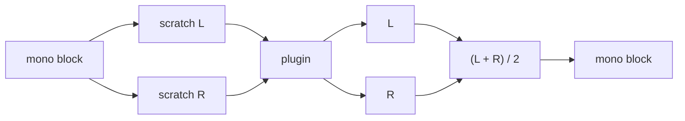

# Step 17 - VST3 plugins as inserts
**English** | [繁體中文](step-17-vst3-inserts.zh-TW.md)

[Overview](../README.md) | Previous: [Step 16](step-16-inserts-panels.md) | Next: [Step 18](step-18-file-loading.md) | Back to the [roadmap](../README.md#4-the-twenty-one-steps)

## Goal

Choose "VST3..." in any insert slot, pick a `.vst3` bundle, and the plugin processes audio in that
slot like a built-in effect: with its own editor window, a generic parameter panel as an
alternative, bypass, and its latency compensated by the engine's PDC (Step 8).

## Design

### Chapter 13 does the hosting; we write an adapter

Chapter 13's library `dawlab_plugin_host` provides

- `PluginHost::loadFromFile(file, sampleRate, blockSize, error)` - scan the bundle, create a
  `juce::AudioPluginInstance` (message thread);
- `HostedPlugin` - prepare / process(`AudioBlock`) without copying / normalized parameters /
  state / latency;
- `PluginWindow` - the plugin's editor (or JUCE's `GenericAudioProcessorEditor`) in a window.

The engine knows none of that; it knows `InsertEffect`. `VstInsert` is the adapter:

<div align="center">

| `InsertEffect` | `VstInsert` does | thread |
|---|---|---|
| `prepare(sr, block, ch)` | `HostedPlugin::prepare()` (bus layout, `prepareToPlay`) | message (inside `Engine::addInsert`) |
| `process(block)` | `HostedPlugin::process(block)` | audio |
| `getLatencySamples()` | `AudioProcessor::getLatencySamples()` | audio, every block |
| `getNumParameters()` ... | up to 64 parameters as Float 0..1 (normalized, the VST3 convention), names copied into `std::string`s | any |
| `setParameter(i, v)` | `HostedPlugin::setParameterValue(i, v)` | any |
| `reset()` | nothing (see below) | audio |
| `getName()` | the plugin's name | any |

</div>

Once wrapped, a VST3 plugin goes through *exactly* the same path as a built-in effect:
`Session::setVstInsert()` -> `Engine::addInsert()` -> command queue -> `InsertChain`; removal
returns it as garbage, deleted on the message thread - which VST3 requires.

### Latency and PDC for free

The mixer asks every insert for `getLatencySamples()` at the start of every block (Step 8) and
recomputes the compensation delays. So a plugin with a lookahead is compensated the moment it is
inserted, and again when it changes its latency (many plugins do when you change their quality or
lookahead setting) - within one block, without any code in the app.

### Mono tracks: a stereo plugin around a mono signal

On a mono track (Step 4) the insert chain gets a *one-channel* block. The built-in effects handle
that (Step 5), but a hosted plugin was prepared with a stereo bus layout: handing it a one-channel
buffer would let it read or write a channel that does not exist. `VstInsert::process()` therefore
wraps the plugin in a small fold:



```cpp
void VstInsert::process(AudioBlock block) noexcept {
    const int n = block.getNumSamples();
    if (block.getNumChannels() >= 2 || n > monoScratch_.getNumSamples()) {
        plugin_->process(block);                       // stereo track: straight through
        return;
    }
    float* mono = block.getChannelPointer(0);
    AudioBlock stereo = AudioBlock(monoScratch_).getSubBlock(0, n).getChannelSubset(0, 2);
    std::copy_n(mono, n, stereo.getChannelPointer(0)); // L = R
    std::copy_n(mono, n, stereo.getChannelPointer(1));
    plugin_->process(stereo);
    for (int i = 0; i < n; ++i)                        // fold back
        mono[i] = 0.5f * (stereo.getChannelPointer(0)[i] + stereo.getChannelPointer(1)[i]);
}
```

The scratch buffer is allocated in `prepare()` (message thread, `max(2, numChannels)` x
`maxBlockSize`), so the audio thread only copies. For a plugin that treats both sides alike the
fold is exact: L = R in gives L = R out, and $`(L + R)/2`$ returns that signal unchanged. A
stereo-widening plugin collapses to mono, the same trade-off every insert on a mono track makes;
put it on a stereo track to keep its width.

### Why `reset()` does nothing

`Engine::requestReset()` calls `reset()` on every insert, on the audio thread. For a VST3 plugin
JUCE's `reset()` goes through `setActive(false)` / `setActive(true)`, which may allocate and is not
real-time safe. We leave the plugin's state alone: after a bounce or a "new project", its tail
rings out instead of being cut. (A host that needs a hard reset would deactivate and re-prepare
the plugin on the message thread while it is out of the chain.)

### Lifetime of the editor window

The plugin's editor must be deleted *before* the plugin. `VstInsert` owns its `PluginWindow`, and
declares it *after* the `HostedPlugin`, so the destructor order is window first, plugin second.
Closing the window deletes it asynchronously (a window must not delete itself inside its own
close callback). `Session::onInsertWillBeRemoved` closes it as soon as the slot is cleared, long
before the garbage collector deletes the plugin.

### No VST3 at hand? A test plugin

The automated test cannot depend on a VST3 file. `createTestDelayPlugin(latency)` (SmokeTest.cpp)
is an in-process `juce::AudioPluginInstance`: a stereo delay of `latency` samples with one
parameter "Gain" (gain $`= 2 \cdot`$ value, default 0.5 = unity) and `setLatencySamples(latency)`.
Wrapped in `HostedPlugin` and `VstInsert`, it travels the same code path as a real plugin.

When chapter 13 is built in the same tree (`build.ps1 -Only 13-vst-hosting,14-daw-8track -Juce`),
its two plugins appear directly in the insert menu: "DawLab Compressor (chapter 13)" (latency 0)
and "DawLab Limiter (chapter 13)" (a lookahead limiter that reports its lookahead as latency: 240
samples = 5 ms at 48 kHz by default). `app/CMakeLists.txt` compiles their bundle paths in as
`DAWLAB_L13_COMPRESSOR_VST3` / `DAWLAB_L13_LIMITER_VST3` (rebuilt from the targets' artefact
folders, because chapter 13 sets `L13_COMPRESSOR_VST3` / `L13_LIMITER_VST3` only in its own
directory scope) and makes `DawLab8` depend on the two bundle targets, so they exist when the
smoke test runs. `EffectMenu::chapter13LimiterFile()` returns the bundle only if it exists on
disk; otherwise the item is not shown.

## Code

- `app/Source/VstInsert.h/.cpp` - the adapter.
- `app/Source/MainComponent.cpp` - `chooseVst3For()` (file chooser that accepts bundle folders and
  single files), `loadVst3Into()`:

```cpp
auto instance = pluginHost_.loadFromFile(file, engine_.getSampleRate(), engine_.getMaxBlockSize(), error);
if (instance == nullptr)
    return false;
auto vst = std::make_unique<VstInsert>(std::make_unique<host::HostedPlugin>(std::move(instance)));
if (session_.setVstInsert(ref, slot, std::move(vst)) == nullptr) { ... }
openInsertEditor(ref, slot, false);   // -> VstInsert::openEditor() -> host::PluginWindow
```

- `app/Source/SmokeTest.cpp` - `TestDelayPlugin`.

## Verify

`l14_app_smoke_test`, section 5: the test plugin with a latency of 100 samples goes into master
slot 4 (after the master limiter):

```
5. test plugin on the master (latency 100): mix latency 752 -> 852, |with - without| = 0, gain 0.25 -> -6.02 dB, 192 process calls
```

- The mix latency grows by exactly 100 samples (PDC picked it up).
- A 1-second bounce **with** the plugin at unity gain is bit-identical to the bounce **without**
  it: the renderer removes the whole mix latency (Step 9), so a pure delay is invisible.
- Setting its parameter to 0.25 through `InsertEffect::setParameter()` lowers the output by
  6.02 dB ($`20\log_{10} 0.5`$).
- After `clearInsert()` + `collectGarbage()` no instance of the test plugin is alive, and the mix
  latency is back to 752.

Section 5a puts the same test plugin (latency 100, unity gain) into slot 4 of the **drum track**,
a mono track in the demo song, so `VstInsert::process()` gets one-channel blocks and takes the
mono-fold path:

```
5a. test plugin on the mono drum track: |with - without| = 0
```

The plugin sees L = R and returns L = R (delayed by 100 samples, which PDC compensates), the fold
$`(L+R)/2`$ gives that signal back unchanged, and the 1-second bounce is bit-identical to the one
without the plugin. A fold that read a missing channel, or averaged with a stale scratch channel,
would show up here as a non-zero difference.

When chapter 13 is part of the build, the smoke test also loads the real VST3 files (section 5b);
with `build.ps1 -Only 13-vst-hosting,14-daw-8track -Juce` the author got

```
5b. VST3 DawLabCompressor on the drums: 8 parameters, latency 0, 1 s render peak -1.00 dBFS
5b. VST3 DawLabLimiter on track 8 (insert latency now 752): plugin latency 240, mix latency 752 -> 992,
    |with - without| = 0 (the two compared 240 samples apart: 1.34)
[PASS] l14_app_smoke_test (134 checks passed)
```

The compressor has no latency, so it only proves that a real bundle loads, processes and is
deleted on the message thread. The limiter is the real PDC test - section 5 again, with a plugin
that computes and reports its own latency:

- It goes into slot 4 of the track whose inserts already have the largest latency (track 8, the
  convolution reverb: 512 samples), so that track's path becomes $`512 + 240 = 752`$ and every other
  track must now be delayed 240 samples more. The mix latency must grow by exactly what the plugin
  reports through `AudioProcessor::getLatencySamples()`: $`752 \to 992`$, $`+240`$.
- Its ceiling is set to 0 dB (normalized 1.0), above the level of that track, so for this signal
  the limiter is a pure delay of 240 samples. A 1-second bounce **with** it is then bit-identical
  to the bounce **without** it: PDC aligned all eight tracks, and the renderer removed the larger
  mix latency. Comparing the same two bounces 240 samples apart - what an uncompensated plugin
  would do to that track - gives a difference of 1.34, so the check would catch a missing
  compensation.
- After `clearInsert()` the mix latency is back to 752.

(134 = the 121 checks of the stand-alone build, which prints two "not built in this tree" lines for
section 5b, plus 5 checks for the compressor and 8 for the limiter. The 192 process calls of the
test plugin are two 1-second renders of $`48\,000 + 852`$ samples in 512-sample blocks,
$`2 \lceil 48\,852 / 512 \rceil = 2 \cdot 96`$.)

In the app: insert chapter 13's DawLab Compressor on the drums, open its editor, pull the
threshold down - the meter in the plugin's own GUI moves with the song. Insert the DawLab Limiter
on the Hits track and watch "Mix latency (PDC)" under the mixer: 752 -> 992 samples; turn its
lookahead knob and the number follows within one block, while all tracks stay in time. (On the
bass, whose inserts report 31 samples, $`31 + 240 = 271`$ stays below the 512 of the Hits track:
the bass is simply delayed less, and the mix latency does not change.)

## Your turn

<div align="center">

| | |
|---|---|
| You write | `VstInsert::process()` and `VstInsert::getLatencySamples()` in `app/Source/VstInsert.cpp` (forward to the hosted plugin; on a one-channel block run it on L = R in `monoScratch_` and fold the result back; a negative latency counts as 0) |
| Build + check | `.\scripts\build.ps1 -Only 13-vst-hosting,14-daw-8track -Juce -TestLabel test` (with chapter 13, so section 5b loads the real VST3 limiter too) |
| Expected | section 5: `mix latency 752 -> 852, |with - without| = 0`; section 5a: `|with - without| = 0` on the mono drum track; section 5b: `mix latency 752 -> 992`; `[PASS] l14_app_smoke_test` - PDC follows your adapter's latency report |

</div>

## What you learned

- An adapter between two interfaces is all it takes to host foreign code in the engine.
- PDC that is recomputed every block handles plugins whose latency changes.
- Not everything a plugin API offers is real-time safe: decide per call where it may run.
- An in-process fake plugin makes the hosting path testable without files.
- A stereo plugin on a mono track runs on L = R in a preallocated scratch buffer and is folded back.
