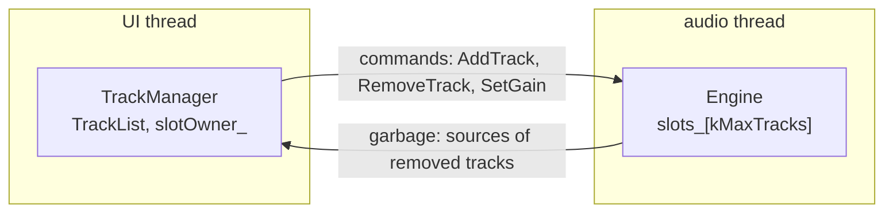

# Step 2 - A pool of tracks

**English** | [繁體中文](step-02-track-pool.zh-TW.md)

[Overview](../README.md) | Previous: [Step 1 - Stable track IDs](step-01-track-ids.md) | Next: Step 3 - A CPU budget (planned)

## Goal

Let the user add and delete tracks while the audio thread keeps running - without allocating,
freeing or locking on the audio thread, and without a single data race. Then prove the last part
with ThreadSanitizer instead of hoping.

## Design

### What breaks when the track count becomes a variable

Chapter 14's mixer is `std::array<Track, kNumTracks>`: the memory for every track exists from
`prepare()` on, and the audio thread never has to ask for more. "Add a track" turns that into a
question: where does the new track's memory come from, and who is allowed to touch it while the
audio thread is reading the old ones?

<div align="center">

| Approach | What goes wrong |
|---|---|
| `std::vector<Track>` and `push_back` on the audio thread | allocates on the audio thread; a reallocation moves *every* track, including the one being processed |
| the UI thread calls `push_back` | a data race: the audio thread may be iterating the vector while it reallocates |
| a mutex around the vector | the audio thread can wait for a UI thread that is not scheduled - a dropout (chapter 14, Step 10) |
| the UI builds a new vector and swaps a pointer | fine for a small list (chapter 14's clip lists do exactly this), but a track's DSP state - delay lines, filter memory, meters - would have to be copied or shared on every add |
| **a pool of `kMaxTracks` slots, allocated up front** | none of the above; the price is memory for tracks that may never exist |

</div>

A pool turns "add a track" from an allocation into a state change: a free slot becomes a used
one. Nothing grows, nothing moves, and the slot's address stays the same for the whole life of the
track.

### One writer per piece of state

The step's real design decision is *who may write what*:

<div align="center">

| State | Written by | Read by |
|---|---|---|
| `Engine::slots_` (id, source, gain per slot) | audio thread only | audio thread only |
| `TrackList` and `slotOwner_` (the UI's copy of who lives in which slot) | UI thread only | UI thread only |
| the command queue | UI thread (push) | audio thread (pop) |
| the garbage queue | audio thread (push) | UI thread (pop) |

</div>

Because each slot has exactly one writer and one reader - the same thread - nothing in `Slot` is
atomic, and nothing needs to be. The threads share only the two SPSC queues from chapter 14,
Step 7, whose release / acquire pair makes everything written before a `push` visible after the
matching `pop`. That includes the `ToneSource` the UI built before sending `AddTrack`.



The UI keeps its *own* copy of the slot assignment (`slotOwner_`) instead of reading the engine's.
That copy runs ahead of the engine by whatever is still in the queue, and that is fine: the UI
decides, the engine follows in the same order.

### The slot is a hint, the id is the truth

A command could name its track by slot alone - the audio thread needs the slot anyway, to avoid
any lookup. But a slot is reused. The check's worked example shows what goes wrong:

1. Bass lives in slot 1. Something records a Bass fader move for slot 1 (an automation write,
   an undo entry, a message from a control surface).
2. The user deletes Bass and adds Vox. Vox gets the free slot: slot 1.
3. The recorded fader move arrives: "slot 1 to -inf dB" - and mutes *Vox*.

So every command carries the id **and** the slot. The audio thread goes straight to the slot and
acts only if that slot still holds that id. A stale command finds a different id and changes
nothing. This is Step 1's rule - a lookup finds the right track or nothing, never a different one
- applied on the audio thread.

### Reusing a slot needs no handshake

When `removeTrack()` sends `RemoveTrack`, the audio thread has not processed it yet. May the UI
hand that slot to the next `addTrack()` straight away? Yes: the queue keeps its order, so the
audio thread always sees `RemoveTrack(Bass, 1)` before `AddTrack(Vox, 1)`. The UI frees its copy
of the slot immediately and needs no reply.

The source of the removed track is different: the audio thread may be using it until it processes
the remove. It comes back through the garbage queue, and the UI thread deletes it there (chapter
14's rule: the audio thread never frees).

### All or nothing, and twice is the same as once

The UI side changes its state only after the command has been sent:

- `addTrack()` checks for a free slot **before** making anything. If the queue then turns out to
  be full, it takes the track out of the list again and deletes the source it made. The caller
  sees an invalid id and the state is exactly as before.
- `removeTrack()` of a track that is already gone returns `false` and sends nothing. Removing
  twice is the same as removing once.
- The audio thread is just as defensive about commands a correct UI never sends: an `AddTrack`
  for a slot that is in use, or out of range, does not overwrite anything - its source goes back
  as garbage, so it does not leak either.

### The garbage queue never overflows

If the garbage queue were full, the audio thread could neither free a source nor wait for room.
`Engine::process()` avoids that with one rule: *take a command only when its garbage is sure to
fit*. Every command returns at most one source, so checking for one free place before each `pop`
is enough. If the UI stops collecting garbage, commands simply wait in their queue - nothing is
lost and the audio thread never blocks. (From the producer's side, `size()` is an upper bound,
because the UI can only make the queue shorter in the meantime, so the check is safe.)

### How big should the pool be?

Every slot costs memory whether it is used or not: whatever a track pre-allocates (insert buffers,
delay lines for latency compensation, meter state) times `kMaxTracks`. If a track pre-allocated
256 KiB, 128 slots would take 32 MiB - nothing on a desktop computer. This step uses 16 so that
the check can fill the pool; the finished app uses 128.

The number of tracks a machine can *play* is a different question: that is CPU time, and it
depends on the plug-ins, not on the track count. Step 3 measures it.

### Checking with ThreadSanitizer

A data race is not a crash you can wait for. It may corrupt one value in a million blocks, only
on another CPU or with another compiler's optimisation. A test that only looks at the result
cannot prove its absence.

ThreadSanitizer (TSan, part of GCC and Clang) instruments every memory access and reports two
threads that touch the same memory without a happens-before relation between them, whether or
not the result came out wrong in this run. The last part of the self-check exists for it: a
real second thread processes blocks while the UI thread performs 20000 random adds, removes and
gain changes.

```bash
./scripts/build.sh --only 15-daw-growing --sanitize thread --build-dir build-tsan
```

MSVC has no ThreadSanitizer. On Windows, run the same command in WSL. If TSan stops with
"unexpected memory mapping", the kernel's address randomisation is wider than TSan supports:
run with `sudo sysctl vm.mmap_rnd_bits=28` first, or start the program through
`setarch $(uname -m) -R`. CI runs this build as its `tsan` job.

To see that the check can fail, weaken the queue: change its `memory_order_release` and
`memory_order_acquire` to `memory_order_relaxed`. On x86 the result may well still come out
right, because the hardware does not reorder these stores - but the C++ memory model no longer
promises it, and an ARM board or a compiler optimisation can break it. TSan reports
`WARNING: ThreadSanitizer: data race` between the main thread and the audio thread, and the run
exits with code 66.

## The code

`steps/step02-track-pool/minidaw.h` (abridged):

```cpp
struct Command {                  // trivially copyable: it travels through an SpscQueue
    CommandType type;             // AddTrack, RemoveTrack, SetGain
    TrackId id;                   // the truth
    int slot = -1;                // the hint
    ToneSource* source = nullptr; // AddTrack: the engine owns it from now on
    float gain = 1.0f;
};

struct Slot {                     // audio thread only: nothing atomic
    TrackId id;                   // invalid = free
    ToneSource* source = nullptr;
    float gain = 1.0f;
};

class Engine {                    // the audio side
public:
    bool send(const Command&) noexcept;        // UI thread
    void process(float* out, int n) noexcept { // audio thread
        Command c;
        while (garbage_.size() < garbage_.capacity() && commands_.pop(c))
            applyCommand(c);
        render(out, n);
    }
    void applyCommand(const Command& c) noexcept; // YOUR TURN
private:
    std::array<Slot, kMaxTracks> slots_{};
    SpscQueue<Command> commands_;
    SpscQueue<Garbage> garbage_;
};

class TrackManager {              // the UI side
public:
    TrackId addTrack(std::string name, float level); // YOUR TURN
    bool removeTrack(TrackId id);                    // YOUR TURN
    bool setGainDb(TrackId id, float gainDb);        // provided: the pattern
private:
    TrackList list_;                                 // Step 1
    std::array<TrackId, kMaxTracks> slotOwner_{};    // the UI's copy of the slot assignment
};
```

`ToneSource` stands in for everything a real track owns on the heap: a constant level, so the
check can predict the mix exactly. It also counts how many exist, which lets the check find
sources that leaked or were deleted twice.

## Your turn

`steps/step02-track-pool/minidaw.h` has Step 1's `TrackList` (solved), the queue, `Command`,
`Slot`, the `Engine` with `process()` and `render()`, and `TrackManager` with `setGainDb()`,
`collectGarbage()`, `slotOf()` and `freeSlot()`.

<div align="center">

| | |
|---|---|
| You write | `Engine::applyCommand()`, `TrackManager::addTrack()` and `TrackManager::removeTrack()` |
| File | `steps/step02-track-pool/starter/step02.cpp` |
| Run | `l15_step02_starter`; it prints `[FAIL] l15_step02 (32 of 41 checks failed)` until you are done |
| Solution | `steps/step02-track-pool/solution/step02.cpp` (ctest `l15_step02_solution`) |

</div>

Follow `setGainDb()`: find the slot, send, and change the UI side only when the send worked.
In `applyCommand()`, decide first whether the slot still holds the command's id, then switch on
the type.

Expected output (verified; the numbers of the two-thread run depend on scheduling, except the
ones in "expected"):

```
Step 2: a pool of tracks (build-along)
  add Drums 0.125, Bass 0.25, Keys 0.5: slots 0 1 2, mix 0.875 (expected 0 1 2, 0.875)
  remove Bass, add Vox 1.0: Vox in slot 1 (expected 1, Bass's old slot); a late Bass fader at
  -inf dB for slot 1 arrives: mix 1.625 (expected 1.625 - the late command must not mute Vox)
  Vox to -6 dB: mix 1.126 (expected 1.126)
  remove Keys, then again, then an invalid id: false, false; mix 0.626 (expected false, false, 0.626)
  fill the pool (16 slots), then one more: 16 added, extra valid: no, 16 in the list, mix 1.000
  (expected 16, no, 16, 1.000)
  a full queue (64 commands): add -> valid no, remove -> false, list size 1, sources made 0
  (expected 64, no, false, 1, 0)
  rogue commands (add to a taken slot, add out of range, remove the wrong id, gain out of range):
  slot 0 still holds A: yes, sources returned 2, leaked 0 (expected yes, 2, 0)
  2 threads, 20000 random operations (5995 adds, 5981 removes, 5994 gain changes, 2030 refused) over 22213 blocks:
  0 slot mismatches, 14 tracks in the engine for 14 in the list, 14 sources alive, mix 0.5316
  (expected 0 mismatches, equal counts, sources = tracks, mix 0.5316)
  sources alive after every engine is gone: 0 (expected 0)
[PASS] l15_step02 (41 checks passed)
```

## What you learned

- A pool of slots allocated up front turns "add a track" into a state change: nothing is
  allocated, moved or freed on the audio thread.
- Give every piece of state one writer. The slots belong to the audio thread, the track list to
  the UI thread, and the two talk only through queues.
- Send the id and the slot: the slot finds the track without a lookup, the id makes sure it is
  still the right one.
- An order-preserving queue lets the UI reuse a slot at once; owned memory still comes back as
  garbage.
- Make every operation all-or-nothing, and make repeating it harmless.
- Prove the absence of data races with ThreadSanitizer; a correct result in one run proves
  nothing.
