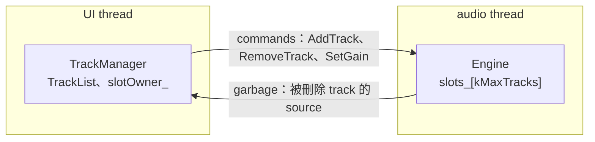

# Step 2 - Track 池

[English](step-02-track-pool.md) | **繁體中文**

[總覽](../README.zh-TW.md) | 上一步：[Step 1 - 穩定的 track ID](step-01-track-ids.zh-TW.md) | 下一步：Step 3 - CPU 預算（規劃中）

## 目標

讓使用者在 audio thread 持續運作時新增、刪除 track，而且 audio thread 上不配置記憶體、不釋放記憶體、不上鎖，
也沒有任何 data race。最後一點不靠運氣，而是用 ThreadSanitizer 證明。

## 設計

### Track 數變成變數時，什麼會壞掉

第 14 章的 mixer 是 `std::array<Track, kNumTracks>`：每個 track 的記憶體從 `prepare()` 起就存在，audio thread
永遠不必再要。「新增一個 track」讓這件事變成問題：新 track 的記憶體從哪裡來？audio thread 正在讀舊 track 時，誰可以碰它？

<div align="center">

| 做法 | 問題 |
|---|---|
| `std::vector<Track>`，在 audio thread 上 `push_back` | 在 audio thread 上配置記憶體；重新配置會搬動*每個 track*，包括正在處理的那一個 track |
| 由 UI thread 呼叫 `push_back` | data race：audio thread 可能正在走訪這個 vector，它卻在重新配置 |
| 用 mutex 保護 vector | audio thread 可能要等一個還沒被排程到的 UI thread，造成爆音（第 14 章 Step 10） |
| UI 建一個新的 vector，再交換指標 | 小清單沒問題（第 14 章的 clip list 就是這樣做），但一個 track 的 DSP 狀態（delay line、濾波器記憶、meter）每次新增都得複製或共用 |
| **事先配置好 `kMaxTracks` 個 slot 的 track 池** | 以上問題都沒有；代價是可能永遠用不到的 track 也佔記憶體 |

</div>

有了 track 池，「新增一個 track」就不再是配置記憶體，而是改變狀態：一個空的 slot 變成被使用。沒有東西變大、
沒有東西搬家，slot 的位址在整個 track 生命期內都不變。

### 每一份狀態只有一個寫入者

這一步真正的設計決定是*誰可以寫什麼*：

<div align="center">

| 狀態 | 寫入者 | 讀取者 |
|---|---|---|
| `Engine::slots_`（每個 slot 的 id、source、gain） | 只有 audio thread | 只有 audio thread |
| `TrackList` 與 `slotOwner_`（UI 自己記的「哪一個 track 住在哪個 slot」） | 只有 UI thread | 只有 UI thread |
| command queue | UI thread（push） | audio thread（pop） |
| garbage queue | audio thread（push） | UI thread（pop） |

</div>

每個 slot 只有一個寫入者和一個讀取者，而且是同一個 thread，所以 `Slot` 裡沒有任何 atomic，也不需要。
兩個 thread 只共用第 14 章 Step 7 的兩個 SPSC queue；它的 release / acquire 配對保證：`push` 之前寫的
所有東西，在對應的 `pop` 之後都看得到，包括 UI 在送出 `AddTrack` 之前建好的 `ToneSource`。



UI 保留*自己的*一份 slot 分配表（`slotOwner_`），不去讀 engine 的。這份表比 engine 超前「queue 裡還沒處理的
那些 command」，這沒有問題：UI 做決定，engine 依同樣的順序跟上。

### slot 是提示，id 才是真相

command 可以只用 slot 指定 track，反正 audio thread 本來就需要 slot 才能不做任何查找。但 slot 會被重複使用。
自我檢查的範例顯示了會出什麼錯：

1. Bass 住在 slot 1。某個地方記錄了一次 Bass 的 fader 移動，目標是 slot 1（automation 寫入、undo
   紀錄、控制器傳來的訊息）。
2. 使用者刪掉 Bass、新增 Vox。Vox 拿到空出來的 slot：slot 1。
3. 那筆記錄下來的 fader 移動到達了：「slot 1 調到 -inf dB」，結果把 *Vox* 靜音了。

所以每個 command 同時帶 id **和** slot。audio thread 直接到那個 slot，只有在 slot 裡仍然是那個 id 時才動作。
過期的 command 會看到不同的 id，什麼也不改。這就是 Step 1 的規則（查找要嘛找到對的 track，要嘛什麼都找不到，
絕不會找到另一個 track）用在 audio thread 上。

### 重複使用 slot 不需要握手

`removeTrack()` 送出 `RemoveTrack` 時，audio thread 還沒處理它。UI 可以馬上把這個 slot 交給下一次
`addTrack()` 嗎？可以：queue 保持順序，所以 audio thread 一定先看到 `RemoveTrack(Bass, 1)`，才看到
`AddTrack(Vox, 1)`。UI 立刻釋放自己那份 slot 紀錄，不需要等回覆。

被刪除 track 的 source 不一樣：audio thread 在處理 remove 之前可能還在用它。它會經由 garbage queue 送回來，
由 UI thread 刪除（第 14 章的規則：audio thread 從不釋放記憶體）。

### 全有或全無，做兩次等於做一次

UI 這一側只有在 command 送出之後才改變自己的狀態：

- `addTrack()` 在建立任何東西**之前**先確認有空的 slot。如果接著發現 queue 滿了，就把 track 從清單拿掉、刪除
  剛建的 source。呼叫者拿到無效的 id，狀態和之前完全一樣。
- 對已經不存在的 track 呼叫 `removeTrack()` 會回傳 `false`，什麼也不送。刪兩次和刪一次一樣。
- audio thread 對正確的 UI 不會送的 command 同樣小心：目標 slot 已被使用或超出範圍的 `AddTrack` 不會覆蓋
  任何東西，它的 source 會當成 garbage 送回，所以也不會 leak。

### garbage queue 永遠不會滿

如果 garbage queue 滿了，audio thread 既不能釋放 source，也不能等待空位。`Engine::process()` 用一條規則避免
這件事：*只有確定 garbage 放得下，才取出 command*。每個 command 最多送回一個 source，所以每次 `pop` 前
確認有一個空位就夠了。如果 UI 不再收 garbage，command 就留在 queue 裡等，什麼都不會遺失，audio thread
也不會卡住。（從 producer 這一側看，`size()` 是上限，因為 UI 同時只會讓 queue 變短，所以這個檢查是安全的。）

### Track 池要多大

每個 slot 不管有沒有用都要佔記憶體：一個 track 事先配置的東西（insert buffer、延遲補償的 delay line、meter 狀態）
乘以 `kMaxTracks`。假如一個 track 事先配置 256 KiB，128 個 slot 就是 32 MiB，在桌上型電腦上微不足道。這一步用 16，
讓自我檢查能把池子填滿；完成的 app 用 128。

一台機器能*播放*幾個 track 是另一個問題：那取決於 CPU 時間，而 CPU 時間取決於 plug-in，不是 track 數。Step 3 會量測它。

### 用 ThreadSanitizer 檢查

data race 不是等著就會出現的 crash。它可能一百萬個 block 才弄壞一個值，而且只在別的 CPU 或別的編譯器最佳化下
發生。只看結果的測試無法證明它不存在。

ThreadSanitizer（TSan，GCC 與 Clang 內建）會對每一次記憶體存取加上檢測，只要兩個 thread 存取同一塊記憶體、
彼此之間又沒有 happens-before 關係，它就會回報，不管這一次執行的結果有沒有錯。自我檢查的最後一部分就是為它
而寫的：一個真正的第二個 thread 不斷處理 block，同時 UI thread 隨機做 20000 次新增、刪除和調整 gain。

```bash
./scripts/build.sh --only 15-daw-growing --sanitize thread --build-dir build-tsan
```

MSVC 沒有 ThreadSanitizer。在 Windows 上，請在 WSL 裡執行同一個指令。如果 TSan 停在
「unexpected memory mapping」，表示 kernel 的位址隨機化範圍比 TSan 支援的大：先執行
`sudo sysctl vm.mmap_rnd_bits=28`，或用 `setarch $(uname -m) -R` 啟動程式。CI 的 `tsan` job 會跑這個 build。

想看看這個檢查會不會失敗，可以把 queue 弄弱：把它的 `memory_order_release` 和 `memory_order_acquire` 改成
`memory_order_relaxed`。在 x86 上結果很可能還是對的，因為硬體不會重排這些 store，但 C++ memory model 已經
不再保證它，換到 ARM 板子或遇到編譯器最佳化就可能出錯。TSan 會回報主 thread 和 audio thread 之間的
`WARNING: ThreadSanitizer: data race`，程式以 exit code 66 結束。

## 程式碼

`steps/step02-track-pool/minidaw.h`（節錄）：

```cpp
struct Command {                  // trivially copyable: it travels through an SpscQueue
    CommandType type;             // AddTrack, RemoveTrack, SetGain
    TrackId id;                   // the truth
    int slot = -1;                // the hint
    ToneSource* source = nullptr; // AddTrack: the engine owns it from now on
    float gain = 1.0f;
};

struct Slot {                     // audio thread only: nothing atomic
    TrackId id;                   // invalid = free
    ToneSource* source = nullptr;
    float gain = 1.0f;
};

class Engine {                    // the audio side
public:
    bool send(const Command&) noexcept;        // UI thread
    void process(float* out, int n) noexcept { // audio thread
        Command c;
        while (garbage_.size() < garbage_.capacity() && commands_.pop(c))
            applyCommand(c);
        render(out, n);
    }
    void applyCommand(const Command& c) noexcept; // YOUR TURN
private:
    std::array<Slot, kMaxTracks> slots_{};
    SpscQueue<Command> commands_;
    SpscQueue<Garbage> garbage_;
};

class TrackManager {              // the UI side
public:
    TrackId addTrack(std::string name, float level); // YOUR TURN
    bool removeTrack(TrackId id);                    // YOUR TURN
    bool setGainDb(TrackId id, float gainDb);        // provided: the pattern
private:
    TrackList list_;                                 // Step 1
    std::array<TrackId, kMaxTracks> slotOwner_{};    // the UI's copy of the slot assignment
};
```

`ToneSource` 代表真實 track 放在 heap 上的所有東西：一個固定的電平，讓自我檢查能準確預測混音結果。它也會計算
目前有幾個存在，自我檢查靠這個找出 leak 或被刪了兩次的 source。

## 換你寫

`steps/step02-track-pool/minidaw.h` 裡有 Step 1 的 `TrackList`（已完成）、queue、`Command`、`Slot`、
含 `process()` 與 `render()` 的 `Engine`，以及含 `setGainDb()`、`collectGarbage()`、`slotOf()`、
`freeSlot()` 的 `TrackManager`。

<div align="center">

| | |
|---|---|
| 你要寫 | `Engine::applyCommand()`、`TrackManager::addTrack()` 和 `TrackManager::removeTrack()` |
| 檔案 | `steps/step02-track-pool/starter/step02.cpp` |
| 執行 | `l15_step02_starter`；完成前會印出 `[FAIL] l15_step02 (32 of 41 checks failed)` |
| 解答 | `steps/step02-track-pool/solution/step02.cpp`（ctest `l15_step02_solution`） |

</div>

照著 `setGainDb()` 的模式寫：找到 slot、送出，只有送出成功才改 UI 這一側。`applyCommand()` 裡先判斷 slot 是否
仍然是 command 的 id，再依 type 分支。

預期輸出（已驗證；兩個 thread 那一段的數字取決於排程，「expected」裡的除外）：

```
Step 2: a pool of tracks (build-along)
  add Drums 0.125, Bass 0.25, Keys 0.5: slots 0 1 2, mix 0.875 (expected 0 1 2, 0.875)
  remove Bass, add Vox 1.0: Vox in slot 1 (expected 1, Bass's old slot); a late Bass fader at
  -inf dB for slot 1 arrives: mix 1.625 (expected 1.625 - the late command must not mute Vox)
  Vox to -6 dB: mix 1.126 (expected 1.126)
  remove Keys, then again, then an invalid id: false, false; mix 0.626 (expected false, false, 0.626)
  fill the pool (16 slots), then one more: 16 added, extra valid: no, 16 in the list, mix 1.000
  (expected 16, no, 16, 1.000)
  a full queue (64 commands): add -> valid no, remove -> false, list size 1, sources made 0
  (expected 64, no, false, 1, 0)
  rogue commands (add to a taken slot, add out of range, remove the wrong id, gain out of range):
  slot 0 still holds A: yes, sources returned 2, leaked 0 (expected yes, 2, 0)
  2 threads, 20000 random operations (5995 adds, 5981 removes, 5994 gain changes, 2030 refused) over 22213 blocks:
  0 slot mismatches, 14 tracks in the engine for 14 in the list, 14 sources alive, mix 0.5316
  (expected 0 mismatches, equal counts, sources = tracks, mix 0.5316)
  sources alive after every engine is gone: 0 (expected 0)
[PASS] l15_step02 (41 checks passed)
```

## 你學到了

- 事先配置好的 slot 池把「新增一個 track」變成狀態改變：audio thread 上沒有配置、搬移或釋放任何東西。
- 每一份狀態只給一個寫入者。slot 屬於 audio thread，track 清單屬於 UI thread，兩邊只透過 queue 溝通。
- 同時送 id 和 slot：slot 讓你不必查找就找到 track，id 確認它仍然是對的那一個 track。
- 保持順序的 queue 讓 UI 能立刻重用 slot；擁有的記憶體仍要當成 garbage 送回。
- 每個操作都做成全有或全無，並讓重複執行無害。
- 用 ThreadSanitizer 證明沒有 data race；某一次執行結果正確什麼也證明不了。
