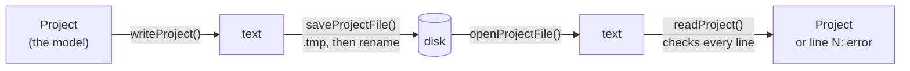

# Step 4 - Saving and opening projects

**English** | [繁體中文](step-04-project-files.zh-TW.md)

[Overview](../README.md) | Previous: [Step 3 - A CPU budget](step-03-cpu-budget.md) | Next: [Step 5 - Undo and redo](step-05-undo.md)

## Goal

Save a project to a file and open it again - also in a later version of the program, at another
sample rate, after the file was edited by hand, and after a crash in the middle of saving.

## Design

### A project file is outside data

A file outlives the program that wrote it. It may come from an older DawLab or a newer one, from
a machine whose language writes `-6,5`, from a text editor, from a disk that filled up. So the
step follows two rules from the boundary-discipline part of ub-mode:

- **Check the data where it enters.** `readProject()` checks every line, once, and reports the
  first problem with its line number. Whatever it returns as `ok` is valid: the rest of the
  program never checks again.
- **Keep the logic pure.** `writeProject()` turns a `Project` into text and `readProject()` turns
  text into a `Project`; neither touches a file. Only `saveProjectFile()` and `openProjectFile()`
  do, and they are a few lines each. The checks feed the parser strings - broken ones, old ones,
  hand-written ones - without creating a single file.



### The format

A text file, one item per line:

```
DawLabProject 2
sampleRate 48000
nextTrackId 5
track 2 "Bass" -6.5 0.25
track 1 "Drums \"live\" \\ room" 0.100000001 -1
track 4 "Gitarre ü / 鍵盤" -0.333333343 0
clip 2 0 96000 "audio/bass take 1.wav"
clip 1 48000 1 "kick.wav"
clip 4 123456789012 480 "two\nlines.wav"
```

(That is the self-check's sample project, as `writeProject()` writes it.) Text rather than a
binary format, because it can be read in a diff, repaired in an editor and checked in a test.
Strings are in quotes with `\"`, `\\` and `\n` escaped, so a name may contain anything; `#`
starts a comment. Numbers are written in the classic "C" locale with 9 significant digits - the
most a `float` needs to come back as exactly the same value, which is why `0.1f` is written as
`0.100000001`.

### Save the ids, and the id counter

Tracks are saved with their ids, and clips name their track by id (Step 1). After opening, every
clip finds its track again - and so will sends, automation and undo entries in later steps.

The counter is saved as well (`nextTrackId`). Track 3 was deleted in the sample project; if the
counter were not saved, the reopened project would hand out id 3 again - exactly the reuse that
Step 1 forbids. As a safety net, `readProject()` also raises the counter above the highest id it
read, so a hand-written file without `nextTrackId` works too.

### Versions

The first line says which format the file is in. Format 1 had no pan; format 2 added it.

<div align="center">

| The file is... | What happens |
|---|---|
| older (format 1) | read with the rules of format 1; the missing pan becomes 0 (centre). Saving writes format 2 |
| current (format 2) | read as it is |
| newer (format 3) | refused: *"line 1: made by a newer DawLab (format 3, this one reads up to 2)"* |

</div>

Refusing a newer file can look unfriendly, but the alternative is worse: an old program cannot
know what a new keyword means. If it skipped what it does not understand and then saved, it
would quietly delete the user's work. For the same reason an unknown keyword in a file of a
*known* version is an error, not something to skip: a file we wrote ourselves never contains one,
so the file is damaged.

### What the reader refuses

Every line is checked: the right number of values, numbers that are completely numbers (`12abc`
and `-6,5` are not), a quoted name, ids above 0 and unique, pan within -1..1, clip lengths of at
least one sample, `sampleRate` exactly once and right after the header. References are checked
after the last line, so the order of `track` and `clip` lines does not matter. The self-check
tries 20 broken files and expects every one to be refused with the right line number, for
example:

```
line 4: clip on track 9, which does not exist
```

The application's reader (Step 8) refuses more: numbers that pass for their sign but that DawLab
never writes, such as a sample rate outside 8000 to 768000 Hz or a position beyond 2^40
(`app/Source/ProjectLimits.h`). This step's reader, Exercise 4 and chapter 16's Step 4 stay as
they are: they teach the format, not every limit.

The reader also accepts what editors do to text files: a UTF-8 byte order mark at the start
(Notepad) and CRLF line ends (Windows).

### Another sample rate

Positions are stored in samples, together with the rate they were made at. That is exact at that
rate; seconds stored as a `double` would round on every save. When the project is opened at
another rate, the positions are converted once.

The obvious conversion rounds the start and the length separately. For clips that touch, that is
wrong: 100 touching clips (1001 to 1100 samples) converted from 48 kHz to 44.1 kHz end up with 25
one-sample gaps or overlaps - clicks at the joins. Converting both **edges** instead keeps them
touching, because a shared edge is the same number for both clips:

```math
\text{start}' = \mathrm{round}\!\left(\text{start} \cdot \frac{f_s'}{f_s}\right), \qquad
\text{end}' = \mathrm{round}\!\left((\text{start} + \text{length}) \cdot \frac{f_s'}{f_s}\right), \qquad
\text{length}' = \max(1,\ \text{end}' - \text{start}')
```

A clip is never converted to nothing: it keeps at least one sample. (The audio files themselves
are resampled when they are loaded; that is not part of the project file.)

### A crash while saving

Writing straight over the old file has a window in which the file is half old, half new - a
crash, a full disk or a pulled cable at that moment destroys the project. `saveProjectFile()`
writes `<name>.tmp` first and renames it over the old file only when the whole text is written.
A rename within one folder replaces the file in one step, so at every moment there is a complete
old file or a complete new one, and saving twice is the same as saving once. (A real app also
flushes the temporary file to the disk before the rename - `FlushFileBuffers` on Windows, `fsync`
on Linux and macOS. Standard C++ has no portable way to do that.)

### The locale

`std::ostringstream` formats numbers with the program's global locale. In a German or French
locale it writes `-6,5` and `123.456.789.012`, and a file saved in Berlin cannot be opened in
Taipei. The writer and `parseNumber()` both `imbue(std::locale::classic())`. The self-check sets
a global locale with a decimal comma and digit grouping, and expects `-6.5` and `123456789012`
in the file; without the `imbue` that check fails.

## The code

`steps/step04-project-files/minidaw.h` (abridged):

```cpp
struct TrackState { TrackId id; std::string name; float gainDb = 0; float pan = 0; };
struct ClipState  { TrackId track; std::int64_t start = 0, length = 0; std::string file; };
struct Project    { double sampleRate; std::uint32_t nextTrackId; std::vector<TrackState> tracks;
                    std::vector<ClipState> clips; };

struct LoadResult {
    bool ok = false;
    Project project;        // valid only if ok
    std::string error;      // "line 4: ..."
    int formatVersion = 0;
};

std::string writeProject(const Project& project);                         // YOUR TURN
LoadResult readProject(std::string_view text, double targetSampleRate);   // YOUR TURN
void convertSampleRate(Project& project, double newRate);                 // YOUR TURN

// provided
bool splitLine(std::string_view line, std::vector<Token>& out, std::string& error);
std::string quote(std::string_view s);
template <typename T> bool parseNumber(const Token& token, T& out);  // whole token, classic locale
bool saveProjectFile(const Project&, const std::filesystem::path&, std::string& error);
LoadResult openProjectFile(const std::filesystem::path&, double targetSampleRate);
```

## Your turn

<div align="center">

| | |
|---|---|
| You write | `writeProject()`, `readProject()` and `convertSampleRate()` |
| File | `steps/step04-project-files/starter/step04.cpp` |
| Run | `l15_step04_starter`; it prints `[FAIL] l15_step04 (21 of 24 checks failed)` until you are done |
| Solution | `steps/step04-project-files/solution/step04.cpp` (ctest `l15_step04_solution`) |

</div>

Start with `writeProject()` and `convertSampleRate()`; they are short. In `readProject()`, write
one small `fail(line, message)` helper first and return through it on the first problem. Read
every number with `parseNumber()` and check every line's token count before you index into it.

Expected output (verified):

```
Step 4: saving and opening projects (build-along)
  write, then read back: ok yes, version 2, equal yes (expected yes, 2, yes)
  the same text with a BOM and CRLF line ends: equal yes (expected yes)
  a hand-written format-1 file: ok yes, version 1, Vox pan 0.0, nextTrackId 8 (expected yes, 1, 0.0, 8)
  a format-3 file: ok no, error "line 1: made by a newer DawLab (format 3, this one reads up to 2)"
  20 of 20 broken files refused with the right line, e.g. "line 4: clip on track 9, which does not exist"
  100 touching clips, 48 kHz -> 44.1 kHz: sampleRate 44100, 0 gaps or overlaps, end 96515 (expected 44100, 0, 96515)
  a 1-sample clip at 48 kHz -> 8 kHz: start 2, length 1 (expected 2, 1); same rate unchanged: yes
  with a decimal-comma locale: "-6.5" written yes, 123456789012 ungrouped yes, reads back equal yes (expected yes x3)
  on disk (dawlab_output\l15_step04.dawlab): saved yes, opened equal yes; saved a smaller one over it: equal yes; .tmp left: no;
  saving into a missing folder: refused (expected yes, yes, yes, no, refused)
[PASS] l15_step04 (24 checks passed)
```

## What you learned

- A project file is outside data: parse and check it once, where it comes in, and report the
  line of the first problem.
- Keep reading and writing pure (text in, text out) and the file system at the edge; then every
  case can be tested with a string.
- Save ids and the id counter, so references survive and ids are not reused after reopening.
- Put a format version in the first line. Read older versions with their own rules; refuse newer
  ones instead of guessing - and treat an unknown keyword as damage, not as something to skip.
- Store positions in samples with their rate, and convert the edges of a clip, not its length.
- Save to a temporary file and rename it, so a crash never leaves half a project.
- Write numbers in the classic locale, with enough digits to read them back exactly.
