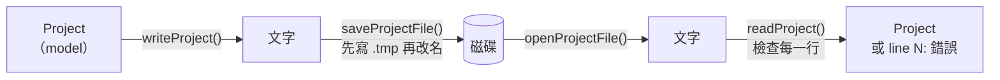

# Step 4 - 存檔與開啟專案

[English](step-04-project-files.md) | **繁體中文**

[總覽](../README.zh-TW.md) | 上一步：[Step 3 - CPU 預算](step-03-cpu-budget.zh-TW.md) | 下一步：Step 5 - Undo 與 redo（規劃中）

## 目標

把專案存成檔案，再把它開回來：包括用之後的程式版本開、在別的 sample rate 下開、檔案被手動改過之後開，以及存到一半當機之後開。

## 設計

### 專案檔是外部資料

檔案比寫它的程式活得久。它可能來自舊版或新版的 DawLab、來自語言設定會寫出 `-6,5` 的電腦、來自文字編輯器，或來自一顆
已經滿了的硬碟。所以這一步遵守 ub-mode「邊界紀律」的兩條規則：

- **資料在進來的地方檢查。** `readProject()` 每一行只檢查一次，並回報第一個問題和它的行號。它回傳 `ok` 的東西就是
  有效的：程式其他部分不必再檢查。
- **邏輯保持純粹。** `writeProject()` 把 `Project` 變成文字，`readProject()` 把文字變成 `Project`，兩者都不碰檔案。
  只有 `saveProjectFile()` 和 `openProjectFile()` 會碰，而且各只有幾行。自我檢查直接把字串餵給 parser（壞掉的、舊版的、
  手寫的），一個檔案都不用建立。



### 格式

一個文字檔，每行一個項目：

```
DawLabProject 2
sampleRate 48000
nextTrackId 5
track 2 "Bass" -6.5 0.25
track 1 "Drums \"live\" \\ room" 0.100000001 -1
track 4 "Gitarre ü / 鍵盤" -0.333333343 0
clip 2 0 96000 "audio/bass take 1.wav"
clip 1 48000 1 "kick.wav"
clip 4 123456789012 480 "two\nlines.wav"
```

（這是自我檢查的範例專案，由 `writeProject()` 實際寫出。）用文字而不是二進位格式，因為文字可以在 diff 裡看、在編輯器裡修、
在測試裡檢查。字串放在引號裡，`\"`、`\\`、`\n` 會跳脫，所以名稱可以包含任何字元；`#` 開始註解。數字用 classic「C」locale、
9 位有效數字寫出：這是 `float` 要原封不動讀回來所需的最多位數，所以 `0.1f` 會寫成 `0.100000001`。

### 存 id，也存 id 計數器

track 連同 id 一起存，clip 用 id 指定它的 track（Step 1）。開啟之後每個 clip 都會找回它的 track，之後幾步的 send、automation、
undo 紀錄也一樣。

計數器也要存（`nextTrackId`）。範例專案裡 track 3 被刪掉了；如果不存計數器，重新開啟的專案會再發出 id 3，正是 Step 1 禁止的
重複使用。保險起見，`readProject()` 也會把計數器提高到讀到的最大 id 之上，所以沒有 `nextTrackId` 的手寫檔案也能用。

### 版本

第一行說明檔案的格式。格式 1 沒有 pan，格式 2 加上了 pan。

<div align="center">

| 檔案是… | 結果 |
|---|---|
| 舊版（格式 1） | 用格式 1 的規則讀；缺少的 pan 設為 0（置中）。存檔時寫成格式 2 |
| 目前版本（格式 2） | 照原樣讀 |
| 新版（格式 3） | 拒絕：*「line 1: made by a newer DawLab (format 3, this one reads up to 2)」* |

</div>

拒絕新版檔案看起來不友善，但另一個選擇更糟：舊程式不可能知道新的 keyword 是什麼意思。如果它跳過看不懂的部分然後存檔，
就會悄悄刪掉使用者的作品。同樣的理由，在*已知*版本的檔案裡出現不認得的 keyword 是錯誤，而不是可以跳過的東西：我們自己寫的
檔案絕不會有它，所以檔案一定壞了。

### reader 會拒絕什麼

每一行都會檢查：值的個數對不對、數字是不是完整的數字（`12abc` 和 `-6,5` 都不是）、名稱有沒有引號、id 大於 0 且不重複、
pan 在 -1..1 之間、clip 長度至少 1 個 sample、`sampleRate` 剛好一次而且緊接在 header 之後。參照關係在最後一行之後才檢查，
所以 `track` 和 `clip` 行的順序不重要。自我檢查試了 20 個壞掉的檔案，每一個都必須以正確的行號被拒絕，例如：

```
line 4: clip on track 9, which does not exist
```

reader 也接受編輯器對文字檔做的事：開頭的 UTF-8 byte order mark（記事本）和 CRLF 行尾（Windows）。

### 不同的 sample rate

位置以 sample 為單位儲存，並記下它們是在哪個 rate 下產生的。這在那個 rate 下是精確的；如果以 `double` 存秒數，每次存檔都會
捨入。在別的 rate 下開啟專案時，位置只轉換一次。

直覺的做法是 start 和 length 分別捨入。對相鄰的 clip 來說這是錯的：100 個相鄰的 clip（長度 1001 到 1100 個 sample）從 48 kHz
轉到 44.1 kHz，會產生 25 個 1 sample 的空隙或重疊，在接縫處發出喀聲。改成轉換兩個**邊界**就能保持相鄰，因為共用的邊界對兩個
clip 來說是同一個數字：

```math
\text{start}' = \mathrm{round}\!\left(\text{start} \cdot \frac{f_s'}{f_s}\right), \qquad
\text{end}' = \mathrm{round}\!\left((\text{start} + \text{length}) \cdot \frac{f_s'}{f_s}\right), \qquad
\text{length}' = \max(1,\ \text{end}' - \text{start}')
```

clip 永遠不會被轉換成空的：至少保留 1 個 sample。（音檔本身會在載入時做 resample，那不屬於專案檔。）

### 存檔到一半當機

直接覆寫舊檔案時，會有一段時間檔案一半是舊的、一半是新的；這時當機、磁碟滿了或拔掉線，專案就毀了。`saveProjectFile()` 先寫
`<name>.tmp`，等整份文字都寫完才把它改名蓋掉舊檔案。同一個資料夾內的改名是一步完成的，所以任何時刻都有一個完整的舊檔案或一個
完整的新檔案，存兩次和存一次一樣。（真正的 app 還會在改名前把暫存檔 flush 到磁碟：Windows 用 `FlushFileBuffers`，Linux 和
macOS 用 `fsync`。標準 C++ 沒有可攜的做法。）

### locale

`std::ostringstream` 用程式的全域 locale 格式化數字。在德文或法文 locale 下，它會寫出 `-6,5` 和 `123.456.789.012`，於是在柏林
存的檔案在台北打不開。writer 和 `parseNumber()` 都會 `imbue(std::locale::classic())`。自我檢查會設定一個用小數逗號、有千分位
分組的全域 locale，並要求檔案裡是 `-6.5` 和 `123456789012`；拿掉 `imbue`，這項檢查就會失敗。

## 程式碼

`steps/step04-project-files/minidaw.h`（節錄）：

```cpp
struct TrackState { TrackId id; std::string name; float gainDb = 0; float pan = 0; };
struct ClipState  { TrackId track; std::int64_t start = 0, length = 0; std::string file; };
struct Project    { double sampleRate; std::uint32_t nextTrackId; std::vector<TrackState> tracks;
                    std::vector<ClipState> clips; };

struct LoadResult {
    bool ok = false;
    Project project;        // valid only if ok
    std::string error;      // "line 4: ..."
    int formatVersion = 0;
};

std::string writeProject(const Project& project);                         // YOUR TURN
LoadResult readProject(std::string_view text, double targetSampleRate);   // YOUR TURN
void convertSampleRate(Project& project, double newRate);                 // YOUR TURN

// provided
bool splitLine(std::string_view line, std::vector<Token>& out, std::string& error);
std::string quote(std::string_view s);
template <typename T> bool parseNumber(const Token& token, T& out);  // whole token, classic locale
bool saveProjectFile(const Project&, const std::filesystem::path&, std::string& error);
LoadResult openProjectFile(const std::filesystem::path&, double targetSampleRate);
```

## 換你寫

<div align="center">

| | |
|---|---|
| 你要寫 | `writeProject()`、`readProject()` 和 `convertSampleRate()` |
| 檔案 | `steps/step04-project-files/starter/step04.cpp` |
| 執行 | `l15_step04_starter`；完成前會印出 `[FAIL] l15_step04 (21 of 24 checks failed)` |
| 解答 | `steps/step04-project-files/solution/step04.cpp`（ctest `l15_step04_solution`） |

</div>

先寫 `writeProject()` 和 `convertSampleRate()`，它們很短。在 `readProject()` 裡，先寫一個小小的 `fail(line, message)` 輔助函式，
遇到第一個問題就透過它回傳。每個數字都用 `parseNumber()` 讀，用索引取 token 之前先檢查這一行的 token 數。

預期輸出（已驗證）：

```
Step 4: saving and opening projects (build-along)
  write, then read back: ok yes, version 2, equal yes (expected yes, 2, yes)
  the same text with a BOM and CRLF line ends: equal yes (expected yes)
  a hand-written format-1 file: ok yes, version 1, Vox pan 0.0, nextTrackId 8 (expected yes, 1, 0.0, 8)
  a format-3 file: ok no, error "line 1: made by a newer DawLab (format 3, this one reads up to 2)"
  20 of 20 broken files refused with the right line, e.g. "line 4: clip on track 9, which does not exist"
  100 touching clips, 48 kHz -> 44.1 kHz: sampleRate 44100, 0 gaps or overlaps, end 96515 (expected 44100, 0, 96515)
  a 1-sample clip at 48 kHz -> 8 kHz: start 2, length 1 (expected 2, 1); same rate unchanged: yes
  with a decimal-comma locale: "-6.5" written yes, 123456789012 ungrouped yes, reads back equal yes (expected yes x3)
  on disk (dawlab_output\l15_step04.dawlab): saved yes, opened equal yes; saved a smaller one over it: equal yes; .tmp left: no;
  saving into a missing folder: refused (expected yes, yes, yes, no, refused)
[PASS] l15_step04 (24 checks passed)
```

## 你學到了

- 專案檔是外部資料：在它進來的地方解析、檢查一次，並回報第一個問題所在的行。
- 讀寫保持純粹（文字進、文字出），檔案系統留在邊界；這樣每種情況都能用一個字串測試。
- 存 id 也存 id 計數器，參照關係才能保留，重新開啟後 id 也不會被重複使用。
- 第一行放格式版本。舊版用它自己的規則讀；新版直接拒絕而不是猜，而且把不認得的 keyword 當成損壞，不是可以跳過的東西。
- 位置以 sample 加上 rate 儲存，轉換 clip 的邊界，而不是它的長度。
- 先存到暫存檔再改名，當機也不會留下半個專案。
- 數字用 classic locale 寫出，位數要足以原封不動讀回來。
