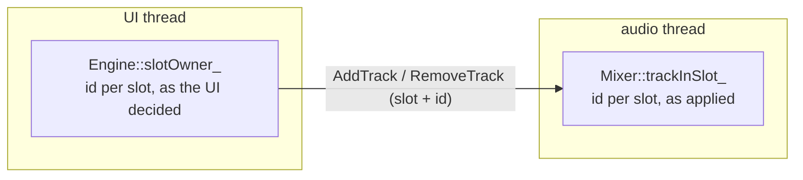

# Step 6 - The engine with a track pool

**English** | [繁體中文](step-06-engine-pool.zh-TW.md)

[Overview](../README.md) | Previous: [Step 5 - Undo and redo](step-05-undo.md) | Next: Step 7 - The app (planned)

## Goal

Bring Steps 1-3 into the real engine: copy chapter 14's engine and turn its 8 fixed tracks into a
pool of track slots with ids, so that tracks can be added and removed while the audio thread
runs. Then prove two things: that nothing chapter 14 could do changed, and that the new part is
real-time safe and free of data races.

## Design

### Copy, then change

Chapter 14 stays as it is: its step documents and starters depend on the 8 fixed tracks. So
`lessons/15-daw-growing/engine/` starts as a copy of `lessons/14-daw-8track/engine/`, with the
same file names and include paths, and the changes are made there. The difference between the
two chapters is part of the lesson:

```bash
git diff --no-index lessons/14-daw-8track/engine lessons/15-daw-growing/engine
```

<div align="center">

| File | What changed |
|---|---|
| `Constants.h` | `kNumTracks = 8` became `kMaxTracks = 128` slots; `TrackId` (Step 1); `kMaxGarbagePerCommand` |
| `Commands.h` | a track's `ChannelRef` carries slot **and** id; new commands `AddTrack` and `RemoveTrack` |
| `Mixer.h` | `std::array<Track, kMaxTracks>`, the audio thread's slot table, `activateTrack()` / `deactivateTrack()`; free slots are skipped |
| `Engine.h` | the UI thread's slot table, `addTrack()` / `removeTrack()` / `trackRef()`; a command is taken only when its garbage fits; `processBlock()` times itself |
| `CpuMeter.h` | new: Step 3's `CpuMeter` and `CpuMonitor` |
| `DemoSong.h` | adds its 8 tracks itself (ids 1..8) and names them by id |

</div>

Everything else - transport, clips, the 19 effects, inserts, sends, buses, PDC, the renderer - is
unchanged.

### Two slot tables, one writer each

The pool needs to know which track lives in which slot, and both threads need that: the UI thread
to address a track, the audio thread to process it. One shared table would have two writers, so
there are two:



- `addTrack(id)` picks a free slot in the UI's table, writes the slot's values (fader, pan, mute,
  solo, sends, format - atomics, as in chapter 14) and sends `AddTrack`. `removeTrack(id)` sends
  `RemoveTrack` and frees the UI's entry at once.
- The audio thread applies those commands to its own table, in order. The UI's table is ahead by
  whatever is still in the queue - and that is fine, because the queue keeps the order: a
  `RemoveTrack` for slot 1 always arrives before the `AddTrack` that reuses slot 1 (Step 2).
- UI-thread functions (`getInsert()`, `getNumInserts()`, `addInsert()`'s checks) use the UI's
  table only. Reading the audio thread's table from the UI thread would be a data race, and one
  of the negative controls below shows ThreadSanitizer catching exactly that.

### The slot is a hint, the id is the truth - now for every command

A chapter-14 `ChannelRef::track(i)` was just an index. A chapter-15 track reference is
`{slot, id}`, and you get it from `engine.trackRef(id)`. The audio thread's `Mixer::getStrip(ref)`
returns the strip only if that slot still holds that id. Every structural command - add, remove,
move or replace an insert, replace the clips - goes through `getStrip()`, so all of them get
Step 2's protection at once: an insert or a clip list meant for a deleted track is handed back as
garbage instead of landing on the track that took its slot over.

### Removing a track

A track owns things on the heap: up to `kMaxInserts` effects and a clip list. When the audio
thread applies `RemoveTrack`, `Mixer::deactivateTrack()`

1. removes every insert and the clip list and hands them to the garbage queue (the audio thread
   never frees),
2. resets the strip's own state - above all its latency-compensation delay line, which still holds
   up to the mix's largest insert latency of the old track's audio, plus meters and smoothers - so
   that the next track in this slot does not start by playing the end of the old one, and
3. marks the slot free.

That is up to `kMaxGarbagePerCommand = kMaxInserts + 1` objects from one command. Chapter 14's
engine counted on "one command, at most one piece of garbage" and leaked (and counted) an object
when the garbage queue was full. Chapter 15 uses Step 2's rule instead: the audio thread takes a
command only when the garbage queue has room for the most that command can return. If the UI
stops collecting garbage, commands wait in their queue; nothing leaks and nothing blocks.

### Values in a reused slot

Values are atomics written by the UI thread (chapter 14's design, unchanged). `addTrack()` writes
the new track's values into the slot right away. If the slot's previous track is still playing
its last block - its `RemoveTrack` is queued, not yet applied - that block may already hear the
new values. The previous track is being deleted, so this is harmless; the alternative (the audio
thread writing the defaults when it applies `AddTrack`) would give those atomics two writers and
could overwrite a value the user set in between.

### Free slots cost (almost) nothing

The mixer skips a free slot with one comparison. Solo is a property of the tracks that exist: a
freed slot's old solo flag must not keep the remaining tracks silent, so the audio thread only
looks at slots in use. The memory is spent up front: each slot holds a full `Track`, mostly the
PDC delay line of `kDefaultMaxPdcSamples` samples per channel - about 128 KiB, so roughly 16 MiB
for 128 slots. The number of tracks a machine can *play* is CPU time (Step 3), and the engine
now measures it itself: `getCpuMeter()`.

### Refactoring: pin the behaviour first

The pool is a structural change; it must not change what the engine does with 8 tracks. So
chapter 14's nine engine tests were copied and changed only where a chapter-15 engine needs it:
an engine starts empty, so each test first adds 8 tracks with ids 1..8 (`tests/TestTracks.h`).
In an empty engine they take slots 0..7, so "track 3" still means the same thing. All nine pass,
including the demo song at -15.5 LUFS with 752 samples of latency, exactly as in chapter 14.

Then come the tests for what is new:

- `test_track_pool` (a pool of 16): add, remove and reuse a slot; late commands for a deleted
  track, both through the API and as raw commands; everything a removed track owned comes back
  (8 inserts and the clip list); a reused slot is silent although its PDC delay line was full of
  the old track's audio; garbage back-pressure with a queue of 16; a full pool, duplicate and
  invalid ids; the solo flag of a removed track; the CPU meter.
- `test_realtime_safety`, part 3: an audio thread with allocation counting runs while the UI
  thread adds and removes tracks at random (about 750 of each), sets clips and inserts, and sends
  late commands for deleted tracks. Afterwards both slot tables must agree, and the audio thread
  must have allocated and freed nothing.

Each guarantee was also broken on purpose, to see a test fail:

<div align="center">

| Broken on purpose | Caught by |
|---|---|
| `getStrip()` checks the slot but not the id | `test_track_pool`: the late insert lands on the new track |
| removing a track does not reset the slot | `test_track_pool`: the new track starts with 2000 samples of the old one |
| commands are taken without room for their garbage | `test_track_pool`: objects leak |
| the UI thread asks the audio thread's table | ThreadSanitizer: a data race in `test_realtime_safety` |

</div>

## Try it

```powershell
.\scripts\build.ps1 -Only 15-daw-growing
.\build\bin\Debug\l15_test_track_pool.exe
```

On Linux or macOS add the ThreadSanitizer build:

```bash
./scripts/build.sh --only 15-daw-growing --sanitize thread --build-dir build-tsan
```

Then read the diff between the two engines (above) and find each change of the table in it.

## What you learned

- To grow a fixed design, copy it and change the copy; keep the original as the reference.
- A pool turns "add a track" into a state change: every slot is allocated up front, a free slot
  is skipped.
- Two threads that both need a table get one table each, with one writer each; the command queue
  keeps them in step.
- Put the id into every reference, and let the audio thread check it: then every command - not
  only add and remove - is safe against slot reuse.
- Removing a track returns everything it owns as garbage and clears its DSP state; take a
  command only when its garbage fits.
- Before restructuring, pin the behaviour with the old tests; after it, break each new guarantee
  on purpose and watch a test catch it.
